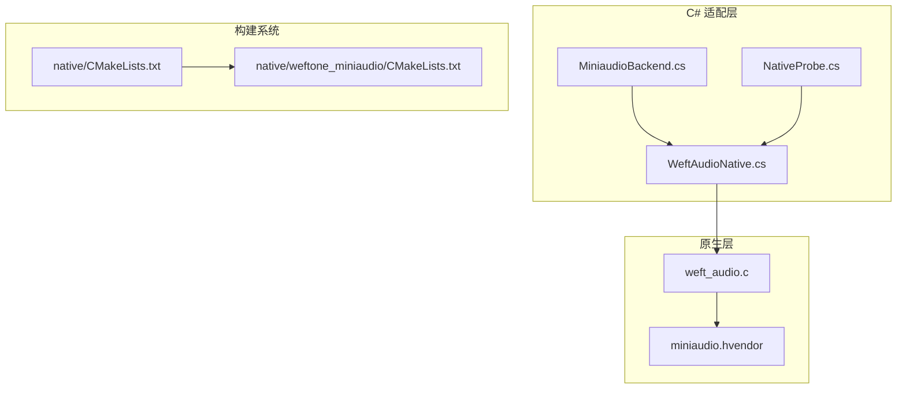
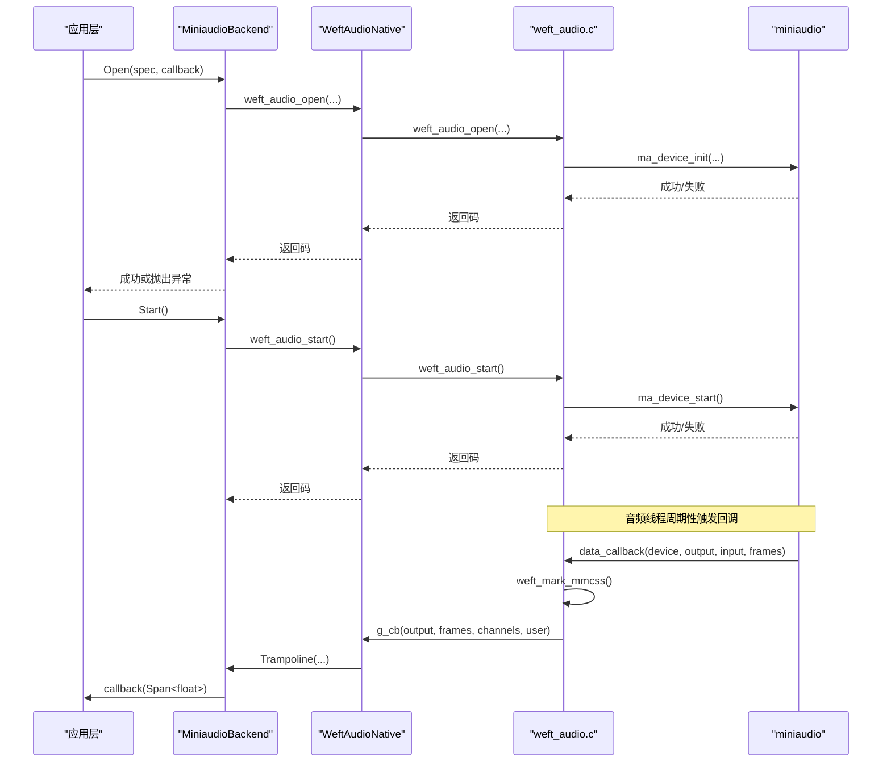
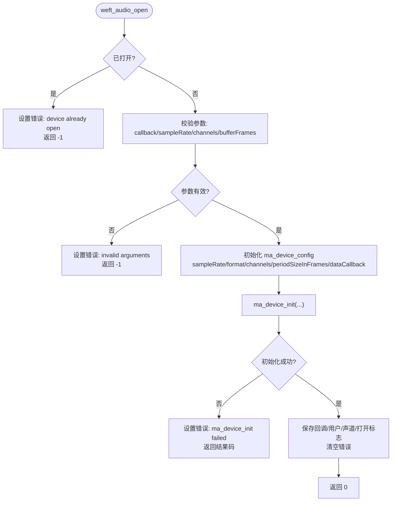
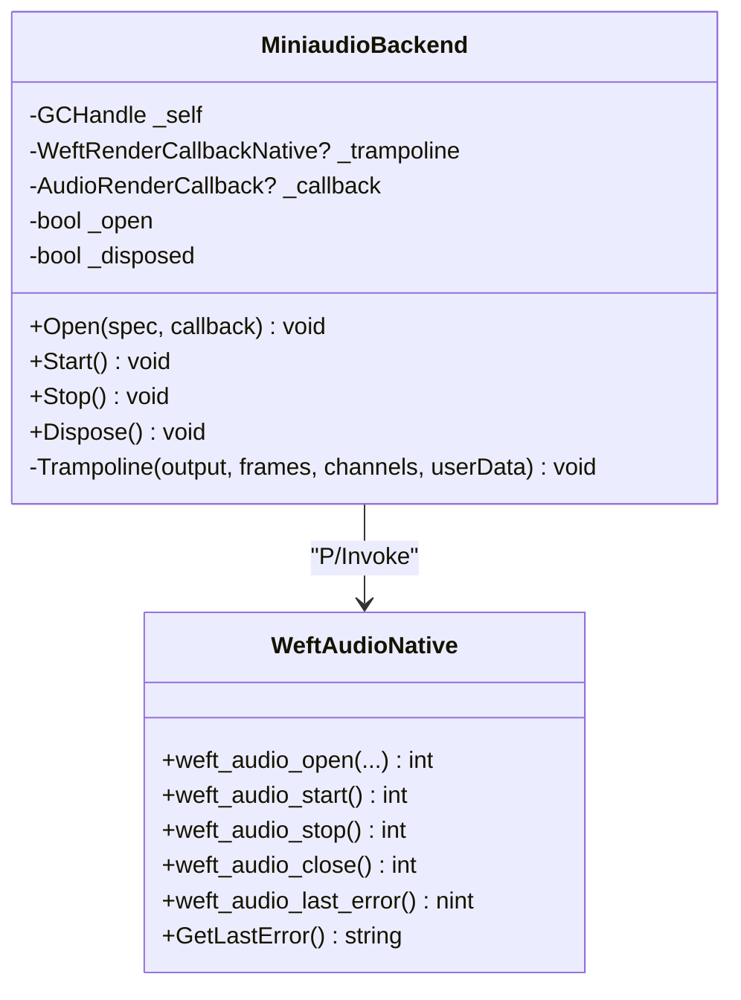
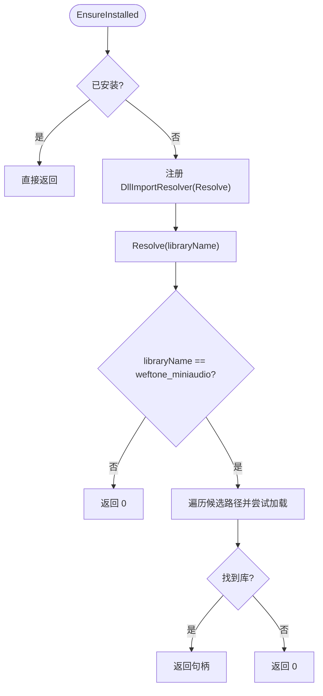
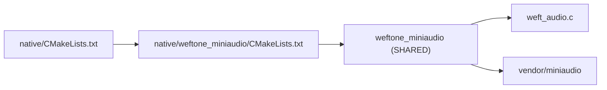
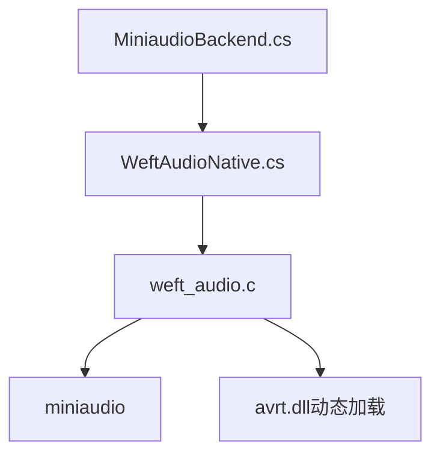

# 原生代码

<cite>
**本文引用的文件**   
- [weft_audio.c](file://native/weftone_miniaudio/weft_audio.c)
- [CMakeLists.txt（weftone_miniaudio）](file://native/weftone_miniaudio/CMakeLists.txt)
- [CMakeLists.txt（native 顶层）](file://native/CMakeLists.txt)
- [WeftAudioNative.cs](file://src/Weftone.Adapters.Audio.Miniaudio/WeftAudioNative.cs)
- [MiniaudioBackend.cs](file://src/Weftone.Adapters.Audio.Miniaudio/MiniaudioBackend.cs)
- [NativeProbe.cs](file://src/Weftone.Adapters.Audio.Miniaudio/NativeProbe.cs)
- [ADR-0002-threading-realtime.md](file://docs/adr/ADR-0002-threading-realtime.md)
</cite>

## 目录
1. [引言](#引言)
2. [项目结构](#项目结构)
3. [核心组件](#核心组件)
4. [架构总览](#架构总览)
5. [详细组件分析](#详细组件分析)
6. [依赖关系分析](#依赖关系分析)
7. [性能与实时性](#性能与实时性)
8. [构建与部署](#构建与部署)
9. [调试与故障排查](#调试与故障排查)
10. [结论](#结论)

## 引言
本文面向 Weftone 的原生音频层，重点说明 C ABI 设计、miniaudio 集成、CMake 构建配置、C# P/Invoke 封装以及实时音频处理的安全性与稳定性策略。目标是让读者既能理解 weft_audio.c 的 C ABI 与 miniaudio 抽象，也能掌握 WeftAudioNative.cs 中的托管侧封装、内存管理、错误传播和部署方式。

## 项目结构
原生代码位于 native 目录，采用 CMake 组织；C# 适配层位于 src/Weftone.Adapters.Audio.Miniaudio。关键路径如下：
- native/weftone_miniaudio/weft_audio.c：C ABI 实现，封装 miniaudio 播放设备生命周期与回调。
- native/weftone_miniaudio/CMakeLists.txt：定义共享库 weftone_miniaudio，统一输出目录。
- native/CMakeLists.txt：聚合子模块。
- src/Weftone.Adapters.Audio.Miniaudio/WeftAudioNative.cs：P/Invoke 声明与错误读取。
- src/Weftone.Adapters.Audio.Miniaudio/MiniaudioBackend.cs：IAudioBackend 实现，桥接回调与托管对象。
- src/Weftone.Adapters.Audio.Miniaudio/NativeProbe.cs：动态解析原生库路径。

**图表来源**
- [weft_audio.c:1-163](file://native/weftone_miniaudio/weft_audio.c#L1-L163)
- [CMakeLists.txt（weftone_miniaudio）:1-29](file://native/weftone_miniaudio/CMakeLists.txt#L1-L29)
- [CMakeLists.txt（native 顶层）:1-6](file://native/CMakeLists.txt#L1-L6)
- [WeftAudioNative.cs:1-30](file://src/Weftone.Adapters.Audio.Miniaudio/WeftAudioNative.cs#L1-L30)
- [MiniaudioBackend.cs:1-85](file://src/Weftone.Adapters.Audio.Miniaudio/MiniaudioBackend.cs#L1-L85)
- [NativeProbe.cs:1-71](file://src/Weftone.Adapters.Audio.Miniaudio/NativeProbe.cs#L1-L71)

**章节来源**
- [weft_audio.c:1-163](file://native/weftone_miniaudio/weft_audio.c#L1-L163)
- [CMakeLists.txt（weftone_miniaudio）:1-29](file://native/weftone_miniaudio/CMakeLists.txt#L1-L29)
- [CMakeLists.txt（native 顶层）:1-6](file://native/CMakeLists.txt#L1-L6)
- [WeftAudioNative.cs:1-30](file://src/Weftone.Adapters.Audio.Miniaudio/WeftAudioNative.cs#L1-L30)
- [MiniaudioBackend.cs:1-85](file://src/Weftone.Adapters.Audio.Miniaudio/MiniaudioBackend.cs#L1-L85)
- [NativeProbe.cs:1-71](file://src/Weftone.Adapters.Audio.Miniaudio/NativeProbe.cs#L1-L71)

## 核心组件
- weft_audio.c：提供稳定的 C ABI，暴露设备打开、启动、停止、关闭与最后错误信息接口；内部使用 miniaudio 完成跨平台音频设备初始化与数据回调。
- MiniaudioBackend.cs：实现 IAudioBackend，负责将 C# 回调安全地桥接到原生回调线程，并通过 GCHandle 避免在 RT 路径分配。
- WeftAudioNative.cs：集中声明 P/Invoke 入口，统一调用约定为 Cdecl，并提供 last error 字符串读取。
- NativeProbe.cs：通过自定义 DllImportResolver 定位 weftone_miniaudio 动态库，支持环境变量、应用目录与仓库布局多种安装位置。
- CMake 脚本：定义共享库目标、包含 vendor/miniaudio 头文件、设置编译选项并统一输出目录，便于 .NET 运行时探测。

**章节来源**
- [weft_audio.c:17-25](file://native/weftone_miniaudio/weft_audio.c#L17-L25)
- [weft_audio.c:72-163](file://native/weftone_miniaudio/weft_audio.c#L72-L163)
- [MiniaudioBackend.cs:11-84](file://src/Weftone.Adapters.Audio.Miniaudio/MiniaudioBackend.cs#L11-L84)
- [WeftAudioNative.cs:5-29](file://src/Weftone.Adapters.Audio.Miniaudio/WeftAudioNative.cs#L5-L29)
- [NativeProbe.cs:10-70](file://src/Weftone.Adapters.Audio.Miniaudio/NativeProbe.cs#L10-L70)
- [CMakeLists.txt（weftone_miniaudio）:7-28](file://native/weftone_miniaudio/CMakeLists.txt#L7-L28)

## 架构总览
Weftone 的音频路径由三层组成：
- C# 业务层：通过 IAudioBackend 发起 Open/Start/Stop/Dispose。
- C# 适配层：MiniaudioBackend 维护委托与 GCHandle，WeftAudioNative 进行 P/Invoke，NativeProbe 解析库路径。
- 原生层：weft_audio.c 封装 miniaudio，负责设备初始化、回调调度与错误记录。

**图表来源**
- [MiniaudioBackend.cs:21-46](file://src/Weftone.Adapters.Audio.Miniaudio/MiniaudioBackend.cs#L21-L46)
- [WeftAudioNative.cs:12-26](file://src/Weftone.Adapters.Audio.Miniaudio/WeftAudioNative.cs#L12-L26)
- [weft_audio.c:52-65](file://native/weftone_miniaudio/weft_audio.c#L52-L65)
- [weft_audio.c:72-126](file://native/weftone_miniaudio/weft_audio.c#L72-L126)

## 详细组件分析

### weft_audio.c：C ABI 与 miniaudio 集成
- ABI 设计要点
  - 导出函数以 WEFT_API 宏修饰，Windows 下使用 __declspec(dllexport)，其他平台使用默认可见性。
  - 回调类型 weft_render_cb 指向 float* 输出缓冲、帧数、声道数与用户指针，符合 Cdecl 调用约定。
  - 全局状态包括设备句柄、回调、用户指针、声道数、打开/运行标志与错误缓冲区，保证单设备、单回调的 M0 约束。
- 设备生命周期
  - weft_audio_open：校验参数，初始化 ma_device_config（采样率、格式 f32、声道数、periodSizeInFrames），调用 ma_device_init。
  - weft_audio_start / weft_audio_stop：分别调用 ma_device_start / ma_device_stop，更新运行状态。
  - weft_audio_close：释放设备，清理全局状态。
  - weft_audio_last_error：返回最近错误字符串。
- 回调路径与实时优化
  - weft_data_callback：先标记 MMCSS（Windows），再调用托管回调；若未设置回调则填充静音。
  - Windows 上动态加载 avrt.dll 并调用 AvSetMmThreadCharacteristicsW("Pro Audio")，提升音频线程优先级。
- 错误处理
  - 所有失败路径均写入 g_error，供上层读取；对重复 open/start/stop/close 做幂等与防御性检查。

**图表来源**
- [weft_audio.c:72-107](file://native/weftone_miniaudio/weft_audio.c#L72-L107)

**章节来源**
- [weft_audio.c:1-163](file://native/weftone_miniaudio/weft_audio.c#L1-L163)

### MiniaudioBackend.cs：托管侧桥接与内存管理
- 职责
  - 实现 IAudioBackend，封装 Open/Start/Stop/Dispose。
  - 在 Open 时创建委托 WeftRenderCallbackNative 与 GCHandle，将托管对象地址传给原生层。
  - 在 Trampoline 中将原生 float* 转换为 Span<float>，零分配调用用户回调。
- 资源管理
  - 使用 GCHandle.Alloc(this) 持有托管实例，确保原生回调可安全取回对象。
  - Dispose 中关闭原生设备、释放 GCHandle，防止泄漏。
- 错误传播
  - 将原生返回码与 last error 组合成 InvalidOperationException，便于上层诊断。

**图表来源**
- [MiniaudioBackend.cs:11-84](file://src/Weftone.Adapters.Audio.Miniaudio/MiniaudioBackend.cs#L11-L84)
- [WeftAudioNative.cs:8-29](file://src/Weftone.Adapters.Audio.Miniaudio/WeftAudioNative.cs#L8-L29)

**章节来源**
- [MiniaudioBackend.cs:11-84](file://src/Weftone.Adapters.Audio.Miniaudio/MiniaudioBackend.cs#L11-L84)
- [WeftAudioNative.cs:8-29](file://src/Weftone.Adapters.Audio.Miniaudio/WeftAudioNative.cs#L8-L29)

### NativeProbe.cs：原生库路径解析
- 功能
  - 首次调用 EnsureInstalled 时注册自定义 DllImportResolver。
  - Resolve 仅处理 weftone_miniaudio 库名，按候选列表尝试加载。
  - Candidates 优先使用环境变量 WEFTONE_NATIVE_DIR，其次应用目录，最后向上回溯仓库布局 native/build 或 native/weftone_miniaudio/build。
- 跨平台文件名
  - Windows 使用 .dll，macOS 使用 .dylib，Linux 使用 .so，前缀 lib 在非 Windows 平台自动添加。

**图表来源**
- [NativeProbe.cs:15-38](file://src/Weftone.Adapters.Audio.Miniaudio/NativeProbe.cs#L15-L38)
- [NativeProbe.cs:40-69](file://src/Weftone.Adapters.Audio.Miniaudio/NativeProbe.cs#L40-L69)

**章节来源**
- [NativeProbe.cs:1-71](file://src/Weftone.Adapters.Audio.Miniaudio/NativeProbe.cs#L1-71)

### CMake 构建系统与依赖管理
- 顶层 native/CMakeLists.txt
  - 定义 C 语言项目，聚合 weftone_miniaudio 与 weftone_codecs 子模块。
- weftone_miniaudio/CMakeLists.txt
  - 设置 C11 标准。
  - add_library(weftone_miniaudio SHARED weft_audio.c)。
  - include_directories 指向 ../vendor/miniaudio。
  - MSVC 使用 /W4，GCC/Clang 使用 -Wall -Wextra。
  - 统一输出到 CMAKE_BINARY_DIR，并对 DEBUG/RELEASE/RELWITHDEBINFO/MINSIZEREL 各配置分别设置输出目录，便于 .NET 运行时探测。

**图表来源**
- [CMakeLists.txt（native 顶层）:1-6](file://native/CMakeLists.txt#L1-L6)
- [CMakeLists.txt（weftone_miniaudio）:1-28](file://native/weftone_miniaudio/CMakeLists.txt#L1-L28)

**章节来源**
- [CMakeLists.txt（native 顶层）:1-6](file://native/CMakeLists.txt#L1-L6)
- [CMakeLists.txt（weftone_miniaudio）:1-28](file://native/weftone_miniaudio/CMakeLists.txt#L1-L28)

## 依赖关系分析
- 组件耦合
  - MiniaudioBackend 强依赖 WeftAudioNative（P/Invoke）。
  - WeftAudioNative 依赖 weft_audio.c 导出的符号。
  - weft_audio.c 依赖 miniaudio 头文件与平台 API（如 Windows avrt.dll）。
- 外部依赖
  - miniaudio：跨平台音频后端抽象。
  - Windows avrt.dll：动态加载，用于提升音频线程优先级。
- 潜在循环依赖
  - 无循环依赖；C# 层不反向引用原生层，原生层不引用 C#。

**图表来源**
- [MiniaudioBackend.cs:11-84](file://src/Weftone.Adapters.Audio.Miniaudio/MiniaudioBackend.cs#L11-L84)
- [WeftAudioNative.cs:8-29](file://src/Weftone.Adapters.Audio.Miniaudio/WeftAudioNative.cs#L8-L29)
- [weft_audio.c:31-50](file://native/weftone_miniaudio/weft_audio.c#L31-L50)

**章节来源**
- [MiniaudioBackend.cs:11-84](file://src/Weftone.Adapters.Audio.Miniaudio/MiniaudioBackend.cs#L11-L84)
- [WeftAudioNative.cs:8-29](file://src/Weftone.Adapters.Audio.Miniaudio/WeftAudioNative.cs#L8-L29)
- [weft_audio.c:31-50](file://native/weftone_miniaudio/weft_audio.c#L31-L50)

## 性能与实时性
- 实时规则
  - ADR-0002 明确 RT 路径需零分配、零锁；UI/文档/音频 RT/worker 线程分离；Windows 启用 MMCSS；denormals 使用 FTZ/DAZ 或 flush。
- weft_audio.c 的实时保障
  - 回调路径尽量轻量：仅调用托管回调或填充静音。
  - Windows 上延迟加载 avrt.dll 并设置“Pro Audio”特性，减少链接期依赖与启动开销。
  - 使用固定大小错误缓冲区，避免回调内部分配。
- MiniaudioBackend 的托管侧优化
  - Trampoline 使用 Span<float> 包装原生缓冲，避免 GC 分配。
  - 委托与 GCHandle 在 Open 时一次性建立，回调路径零分配。
- 建议
  - 保持 bufferFrames 合理，避免过小导致频繁回调或过大导致延迟。
  - 在回调中避免阻塞、IO、锁与复杂计算，必要时使用双缓冲与后台 worker。

**章节来源**
- [ADR-0002-threading-realtime.md:1-27](file://docs/adr/ADR-0002-threading-realtime.md#L1-L27)
- [weft_audio.c:31-65](file://native/weftone_miniaudio/weft_audio.c#L31-L65)
- [MiniaudioBackend.cs:78-83](file://src/Weftone.Adapters.Audio.Miniaudio/MiniaudioBackend.cs#L78-L83)

## 构建与部署
- 构建步骤
  - 准备环境：安装 CMake 3.16+、C 编译器（MSVC/GCC/Clang）、.NET SDK。
  - 进入 native 目录执行 CMake 配置与构建，生成 weftone_miniaudio 共享库至构建根目录。
  - 确保 weftone_miniaudio.dll/.so/.dylib 与托管程序集同目录或通过环境变量 WEFTONE_NATIVE_DIR 指定。
- 依赖管理
  - miniaudio 头文件位于 native/vendor/miniaudio，CMake 通过 target_include_directories 引用。
  - Windows 音频线程优先级依赖 avrt.dll，但通过动态加载避免链接期依赖。
- 部署注意事项
  - 多配置生成器会按配置输出到同一目录，便于 .NET 运行时探测。
  - NativeProbe 支持从应用目录或仓库布局自动发现库文件。

**章节来源**
- [CMakeLists.txt（weftone_miniaudio）:7-28](file://native/weftone_miniaudio/CMakeLists.txt#L7-L28)
- [NativeProbe.cs:40-69](file://src/Weftone.Adapters.Audio.Miniaudio/NativeProbe.cs#L40-L69)
- [weft_audio.c:31-50](file://native/weftone_miniaudio/weft_audio.c#L31-L50)

## 调试与故障排查
- 常见错误
  - 设备已打开：weft_audio_open 重复调用会返回错误。
  - 参数无效：sampleRate/channels/callback/bufferFrames 为空或为零。
  - 设备未打开：start/stop 在未 open 时调用。
  - 原生初始化失败：ma_device_init/start/stop 返回非成功码。
- 诊断方法
  - 使用 WeftAudioNative.GetLastError() 获取最近错误字符串。
  - 在 MiniaudioBackend.Open/Start/Stop 中捕获并打印异常消息，包含返回码与错误文本。
  - 确认 weftone_miniaudio 库已被正确加载（NativeProbe 日志或进程加载器日志）。
- 实时问题
  - 爆音或卡顿：检查 bufferFrames 是否过小；确认未启用高开销操作；验证 MMCSS 是否生效（Windows）。
  - GC 暂停影响：遵循 ADR-0002，避免在回调中分配；必要时拆分进程或使用 NativeAOT 服务。

**章节来源**
- [weft_audio.c:72-163](file://native/weftone_miniaudio/weft_audio.c#L72-L163)
- [MiniaudioBackend.cs:21-56](file://src/Weftone.Adapters.Audio.Miniaudio/MiniaudioBackend.cs#L21-L56)
- [ADR-0002-threading-realtime.md:1-27](file://docs/adr/ADR-0002-threading-realtime.md#L1-L27)

## 结论
Weftone 的原生音频层通过稳定的 C ABI 与 miniaudio 抽象实现了跨平台音频设备管理，并在 C# 侧通过 P/Invoke 与 GCHandle 完成高效、安全的回调桥接。CMake 构建系统统一管理共享库输出与依赖，NativeProbe 简化了部署路径解析。结合 ADR-0002 的实时规则，系统在 Windows 上通过 MMCSS 提升音频线程优先级，整体满足低延迟、稳定性的要求。后续可在回调路径进一步引入双缓冲与后台渲染，以增强鲁棒性与可扩展性。