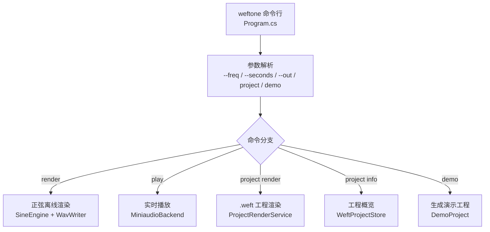
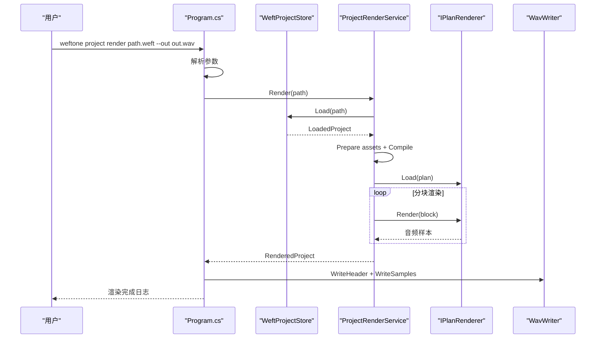
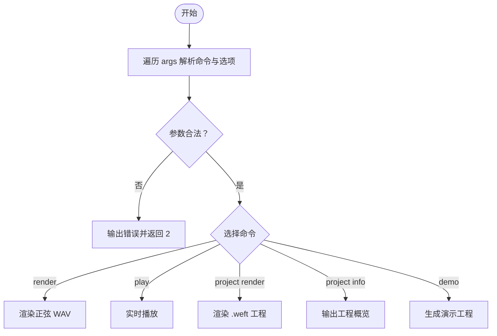
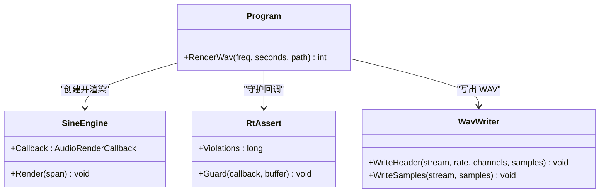
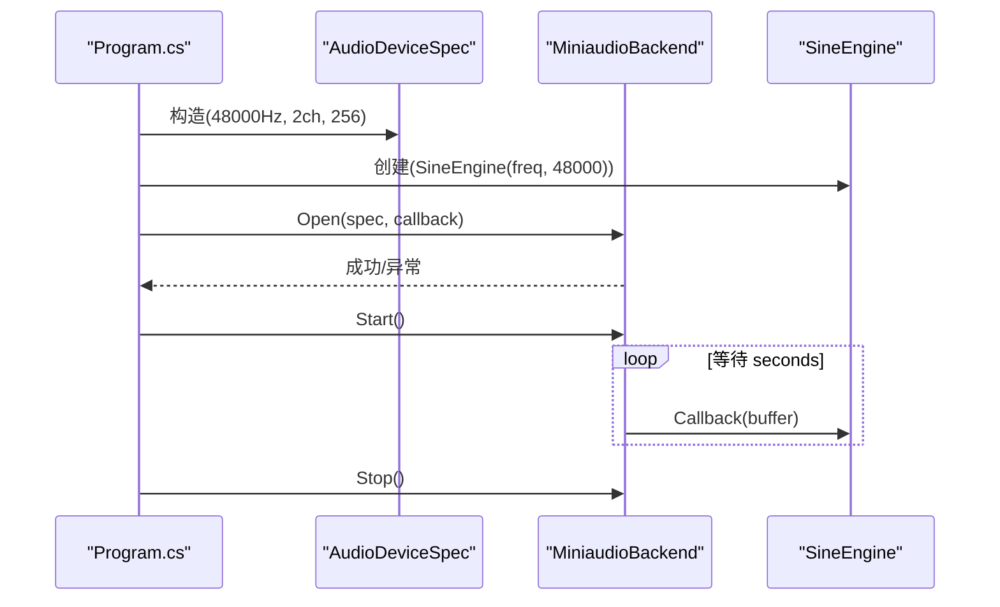
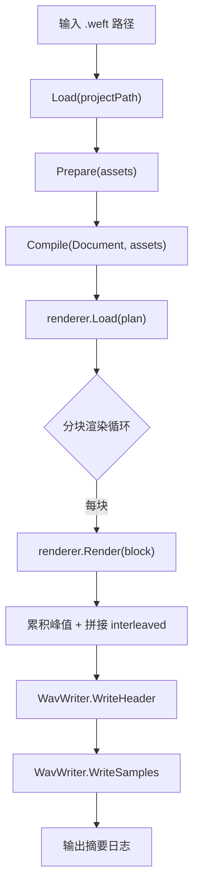
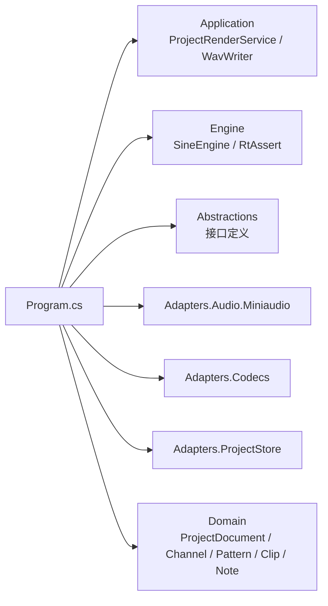

# 命令行工具

<cite>
**本文引用的文件**   
- [Program.cs](file://tools/HeadlessRender/Program.cs)
- [README.md（HeadlessRender）](file://tools/HeadlessRender/README.md)
- [M1a_HEADLESS.md](file://specs/M1a_HEADLESS.md)
- [ProjectRenderService.cs](file://src/Weftone.Application/ProjectRenderService.cs)
- [WavWriter.cs](file://src/Weftone.Application/WavWriter.cs)
- [SineEngine.cs](file://src/Weftone.Engine/SineEngine.cs)
- [RtAssert.cs](file://src/Weftone.Engine/RtAssert.cs)
</cite>

## 目录
1. [简介](#简介)
2. [项目结构](#项目结构)
3. [核心功能与命令](#核心功能与命令)
4. [架构总览](#架构总览)
5. [详细组件分析](#详细组件分析)
6. [依赖关系分析](#依赖关系分析)
7. [性能与实时性特征](#性能与实时性特征)
8. [错误处理与退出码](#错误处理与退出码)
9. [使用示例与批处理脚本](#使用示例与批处理脚本)
10. [自动化与持续集成集成指南](#自动化与持续集成集成指南)
11. [故障排查](#故障排查)
12. [结论](#结论)

## 简介
Weftone 的命令行工具 `weftone` 是 M1a headless 组合根入口，提供两类能力：
- 离线渲染：把正弦信号或 `.weft` 工程渲染为 WAV。
- 实时播放：通过 native shim 播放音频流，用于验证音频路径和实时行为。

该 CLI 遵循 headless 优先原则，默认不依赖 UI；只有 `play` 模式需要 native 音频后端。

**章节来源**
- [README.md（HeadlessRender）:1-16](file://tools/HeadlessRender/README.md#L1-L16)
- [M1a_HEADLESS.md:1-10](file://specs/M1a_HEADLESS.md#L1-L10)

## 项目结构
CLI 位于 `tools/HeadlessRender`，由一个入口程序解析参数并调度到不同工作流：
- 参数解析：主程序读取 `render`、`play`、`project`、`demo` 等命令及选项。
- 渲染管线：`.weft` 工程加载 → 资产准备 → 编译为 RenderPlan → 引擎渲染 → 写出 WAV。
- 输出格式：WAV 使用 IEEE float32 小端格式，采样率 48kHz、双声道。



**图表来源**
- [Program.cs:21-96](file://tools/HeadlessRender/Program.cs#L21-L96)
- [ProjectRenderService.cs:19-48](file://src/Weftone.Application/ProjectRenderService.cs#L19-L48)
- [WavWriter.cs:9-38](file://src/Weftone.Application/WavWriter.cs#L9-L38)
- [SineEngine.cs:13-38](file://src/Weftone.Engine/SineEngine.cs#L13-L38)

**章节来源**
- [Program.cs:1-266](file://tools/HeadlessRender/Program.cs#L1-L266)
- [ProjectRenderService.cs:1-51](file://src/Weftone.Application/ProjectRenderService.cs#L1-L51)
- [WavWriter.cs:1-40](file://src/Weftone.Application/WavWriter.cs#L1-L40)

## 核心功能与命令
`weftone` 支持以下命令：
- `render`：离线渲染正弦 WAV。
- `play`：实时播放正弦音频。
- `project render <path.weft>`：将 `.weft` 工程渲染为 WAV。
- `project info <path.weft>`：查看工程概览（BPM、时长、声部、pattern、clip、资产）。
- `demo [--out demo.weft]`：生成演示工程。

常用选项：
- `--freq` / `-f`：频率（Hz），默认 440。
- `--seconds` / `-s`：时长（秒），范围 (0, 3600]。
- `--out` / `-o`：输出路径，默认 `out.wav`（render）、`demo.weft`（demo）。
- `--help` / `-h`：打印帮助信息。

默认值：
- 频率：440 Hz
- 时长：5 秒
- 输出：`out.wav`

**章节来源**
- [Program.cs:14-68](file://tools/HeadlessRender/Program.cs#L14-L68)
- [Program.cs:250-265](file://tools/HeadlessRender/Program.cs#L250-L265)
- [README.md（HeadlessRender）:5-11](file://tools/HeadlessRender/README.md#L5-L11)

## 架构总览
CLI 启动后先解析参数，再根据命令进入不同流程：
- `render`：创建 `SineEngine`，按块渲染正弦波，写入 WAV。
- `play`：打开 native 音频设备，回调中调用 `SineEngine` 实时输出。
- `project render`：通过 `ProjectRenderService` 完成完整渲染链路。
- `project info`：加载工程文档并计算时长、通道等信息。
- `demo`：生成包含合成 kick 的演示工程。



**图表来源**
- [Program.cs:119-135](file://tools/HeadlessRender/Program.cs#L119-L135)
- [ProjectRenderService.cs:19-48](file://src/Weftone.Application/ProjectRenderService.cs#L19-L48)
- [WavWriter.cs:9-38](file://src/Weftone.Application/WavWriter.cs#L9-L38)

## 详细组件分析

### 参数解析与命令路由
- 支持短选项 `-f`、`-s`、`-o`、`-h` 与长选项 `--freq`、`--seconds`、`--out`、`--help`。
- `project` 子命令需紧跟 `render` 或 `info`，否则报错。
- 未知参数或非法值会打印用法并返回退出码 2。
- `--seconds` 必须在 (0, 3600] 范围内。



**图表来源**
- [Program.cs:21-96](file://tools/HeadlessRender/Program.cs#L21-L96)

**章节来源**
- [Program.cs:21-86](file://tools/HeadlessRender/Program.cs#L21-L86)

### 离线渲染（正弦 WAV）
- 固定采样率 48kHz、双声道、块大小 256 帧。
- 使用 `SineEngine` 生成正弦波，并通过 `RtAssert.Guard` 包裹回调以检测实时分配违规。
- 使用 `WavWriter` 写出 IEEE float32 WAV。
- 若检测到 RT 分配违规，返回退出码 1。



**图表来源**
- [Program.cs:193-215](file://tools/HeadlessRender/Program.cs#L193-L215)
- [SineEngine.cs:13-38](file://src/Weftone.Engine/SineEngine.cs#L13-L38)
- [RtAssert.cs:17-30](file://src/Weftone.Engine/RtAssert.cs#L17-L30)
- [WavWriter.cs:9-38](file://src/Weftone.Application/WavWriter.cs#L9-L38)

**章节来源**
- [Program.cs:193-215](file://tools/HeadlessRender/Program.cs#L193-L215)
- [SineEngine.cs:1-40](file://src/Weftone.Engine/SineEngine.cs#L1-L40)
- [RtAssert.cs:1-32](file://src/Weftone.Engine/RtAssert.cs#L1-L32)
- [WavWriter.cs:1-40](file://src/Weftone.Application/WavWriter.cs#L1-L40)

### 实时播放（play 模式）
- 使用 `AudioDeviceSpec` 指定采样率、声道数、块大小。
- 通过 `MiniaudioBackend` 打开音频设备并启动回调。
- 回调中调用 `SineEngine.Callback` 输出正弦波。
- 若 native 库缺失，提示构建 native 或设置环境变量 `WEFTONE_NATIVE_DIR`，返回退出码 3。
- 若设备打开失败，返回退出码 4。



**图表来源**
- [Program.cs:217-248](file://tools/HeadlessRender/Program.cs#L217-L248)
- [SineEngine.cs:13-25](file://src/Weftone.Engine/SineEngine.cs#L13-L25)

**章节来源**
- [Program.cs:217-248](file://tools/HeadlessRender/Program.cs#L217-L248)

### 工程渲染（project render）
- 通过 `ProjectRenderService` 完成：
  - 加载 `.weft` 工程。
  - 准备资产（解码、重采样）。
  - 编译为 RenderPlan。
  - 分块渲染并累积峰值。
- 输出 WAV 头包含采样率、声道数、总样本数，随后流式追加样本。
- 控制台输出渲染结果摘要（时长、采样率、声道数、峰值）。



**图表来源**
- [ProjectRenderService.cs:19-48](file://src/Weftone.Application/ProjectRenderService.cs#L19-L48)
- [Program.cs:122-135](file://tools/HeadlessRender/Program.cs#L122-L135)
- [WavWriter.cs:9-38](file://src/Weftone.Application/WavWriter.cs#L9-L38)

**章节来源**
- [ProjectRenderService.cs:1-51](file://src/Weftone.Application/ProjectRenderService.cs#L1-L51)
- [Program.cs:119-135](file://tools/HeadlessRender/Program.cs#L119-L135)
- [WavWriter.cs:1-40](file://src/Weftone.Application/WavWriter.cs#L1-L40)

### 工程概览（project info）
- 加载工程文档，统计 pattern 结束 tick、playlist 最大 tick。
- 根据 BPM、sampleRate、PPQ 计算总样本数和近似时长。
- 输出通道名称、类型、音量、声像等元数据。

**章节来源**
- [Program.cs:138-169](file://tools/HeadlessRender/Program.cs#L138-L169)

### 演示工程（demo）
- 在临时目录生成 kick WAV，然后创建演示工程文档并保存为 `.weft`。
- 清理临时文件。
- 输出可渲染为 WAV 的演示工程路径。

**章节来源**
- [Program.cs:171-191](file://tools/HeadlessRender/Program.cs#L171-L191)

## 依赖关系分析
CLI 依赖以下模块：
- Abstractions：音频设备接口、采样解码器接口、渲染计划接口。
- Adapters.Audio.Miniaudio：native 音频后端实现。
- Adapters.Codecs：dr_wav 解码器与线性重采样器。
- Adapters.ProjectStore：`.weft` 工程存储。
- Application：工程渲染服务与 WAV 写出。
- Domain：工程模型（Channel、Pattern、Clip、Note 等）。
- Engine：SineEngine、RtAssert、PlanRenderer。



**图表来源**
- [Program.cs:1-8](file://tools/HeadlessRender/Program.cs#L1-L8)
- [ProjectRenderService.cs:1-4](file://src/Weftone.Application/ProjectRenderService.cs#L1-L4)
- [WavWriter.cs:1-2](file://src/Weftone.Application/WavWriter.cs#L1-L2)
- [SineEngine.cs:1-1](file://src/Weftone.Engine/SineEngine.cs#L1-L1)
- [RtAssert.cs:1-1](file://src/Weftone.Engine/RtAssert.cs#L1-L1)

**章节来源**
- [Program.cs:1-8](file://tools/HeadlessRender/Program.cs#L1-L8)

## 性能与实时性特征
- 离线渲染采用分块处理，避免一次性分配超大缓冲区。
- 正弦渲染路径使用 `RtAssert.Guard` 检测实时分配违规；若违规则返回非零退出码。
- WAV 写出使用 IEEE float32 小端格式，单文件上限 4GB。
- 工程渲染在服务层累积峰值并计算时长，便于输出摘要。

**章节来源**
- [Program.cs:193-215](file://tools/HeadlessRender/Program.cs#L193-L215)
- [RtAssert.cs:5-30](file://src/Weftone.Engine/RtAssert.cs#L5-L30)
- [WavWriter.cs:9-17](file://src/Weftone.Application/WavWriter.cs#L9-L17)
- [ProjectRenderService.cs:17-48](file://src/Weftone.Application/ProjectRenderService.cs#L17-L48)

## 错误处理与退出码
- 参数错误：返回 2。
- native 库缺失：返回 3。
- 工程包非法或数据非法：返回 4。
- 实时分配违规：返回 1。
- 成功：返回 0。

常见错误场景：
- 未知命令或子命令。
- 缺少参数值。
- `--seconds` 超出范围。
- `project` 命令未提供工程路径。
- native 音频后端无法打开设备。

**章节来源**
- [Program.cs:33-38](file://tools/HeadlessRender/Program.cs#L33-L38)
- [Program.cs:69-86](file://tools/HeadlessRender/Program.cs#L69-L86)
- [Program.cs:98-107](file://tools/HeadlessRender/Program.cs#L98-L107)
- [Program.cs:227-236](file://tools/HeadlessRender/Program.cs#L227-L236)
- [README.md（HeadlessRender）:13-15](file://tools/HeadlessRender/README.md#L13-L15)

## 使用示例与批处理脚本

### 基本命令示例
- 渲染 440Hz 正弦波，时长 5 秒，输出 `out.wav`：
  ```
  weftone render
  ```
- 指定频率和时长：
  ```
  weftone render --freq 880 --seconds 10
  ```
- 指定输出路径：
  ```
  weftone render --out audio/sine.wav
  ```
- 实时播放：
  ```
  weftone play --freq 440 --seconds 5
  ```
- 渲染工程：
  ```
  weftone project render project.weft --out output.wav
  ```
- 查看工程概览：
  ```
  weftone project info project.weft
  ```
- 生成演示工程：
  ```
  weftone demo --out demo.weft
  ```

### 批处理脚本（Windows 示例）
```bat
@echo off
set OUT_DIR=build\renders
mkdir "%OUT_DIR%"

weftone render --freq 440 --seconds 5 --out "%OUT_DIR%\sine_440.wav"
weftone render --freq 880 --seconds 3 --out "%OUT_DIR%\sine_880.wav"
weftone project render demo.weft --out "%OUT_DIR%\demo_render.wav"
weftone project info demo.weft
```

### 批处理脚本（Unix/Linux 示例）
```sh
#!/bin/sh
OUT_DIR="build/renders"
mkdir -p "$OUT_DIR"

weftone render --freq 440 --seconds 5 --out "$OUT_DIR/sine_440.wav"
weftone render --freq 880 --seconds 3 --out "$OUT_DIR/sine_880.wav"
weftone project render demo.weft --out "$OUT_DIR/demo_render.wav"
weftone project info demo.weft
```

**章节来源**
- [Program.cs:250-265](file://tools/HeadlessRender/Program.cs#L250-L265)

## 自动化与持续集成集成指南
- 在 CI 中运行 `weftone project render` 生成基准 WAV，并与黄金基线对比。
- 使用环境变量控制基线更新：`WEFTONE_GOLDEN_UPDATE=1`。
- 对 `play` 模式进行 native 环境检查，若缺失则跳过或报错。
- 将渲染输出纳入测试工件归档，便于审计。

建议步骤：
1. 安装 Weftone 构建产物。
2. 准备 `.weft` 工程文件。
3. 执行 `weftone project render` 生成 WAV。
4. 对比黄金基线（可选：允许跨平台容差）。
5. 记录退出码与日志，失败时中断流水线。

**章节来源**
- [M1a_HEADLESS.md:71-79](file://specs/M1a_HEADLESS.md#L71-L79)
- [README.md（HeadlessRender）:13-15](file://tools/HeadlessRender/README.md#L13-L15)

## 故障排查
- 问题：`play` 模式提示 native 库缺失。
  - 解决：构建 native shim 或设置 `WEFTONE_NATIVE_DIR`。
- 问题：`--seconds` 报错。
  - 解决：确保值在 (0, 3600] 范围内。
- 问题：`project render` 报工程包非法。
  - 解决：检查 `.weft` 文件完整性与 SHA256 校验。
- 问题：渲染输出有 RT 分配违规。
  - 解决：检查渲染路径是否引入对象分配，确认 `RtAssert.Violations` 为零。

**章节来源**
- [Program.cs:227-236](file://tools/HeadlessRender/Program.cs#L227-L236)
- [Program.cs:69-86](file://tools/HeadlessRender/Program.cs#L69-L86)
- [Program.cs:98-107](file://tools/HeadlessRender/Program.cs#L98-L107)
- [Program.cs:213-214](file://tools/HeadlessRender/Program.cs#L213-L214)

## 结论
`weftone` CLI 提供了简洁而强大的 headless 音频处理能力：
- 支持离线渲染正弦波与 `.weft` 工程。
- 提供实时播放模式用于验证音频路径。
- 明确的参数规范、错误处理与退出码体系。
- 易于集成到自动化工作流与 CI 管道中。

对于批量处理与持续集成，建议结合黄金基线测试与标准化脚本，确保跨平台一致性与可重复性。