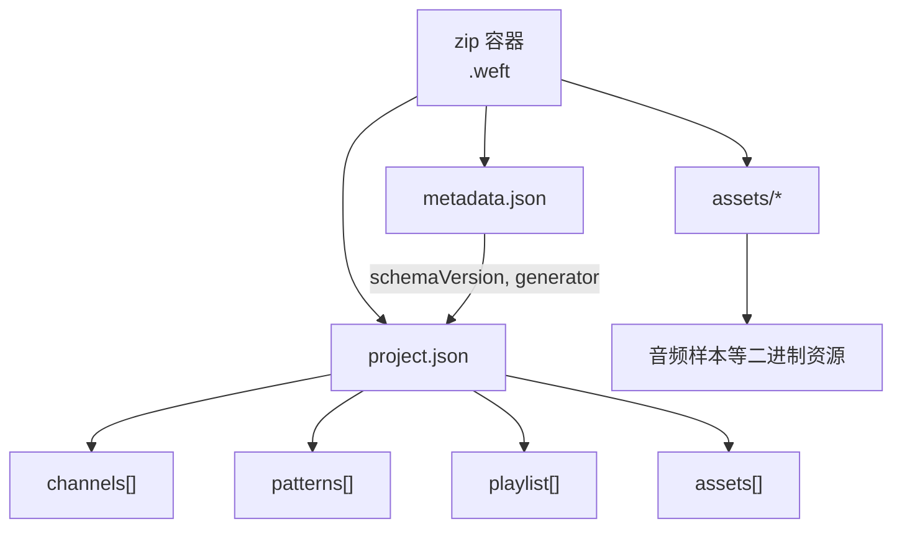
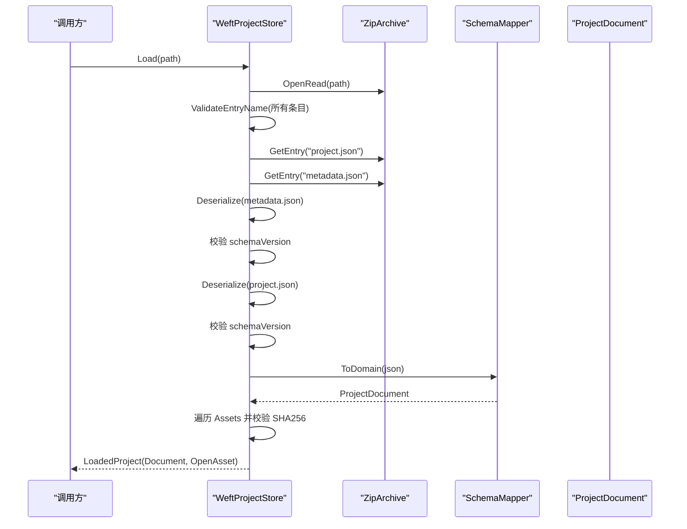
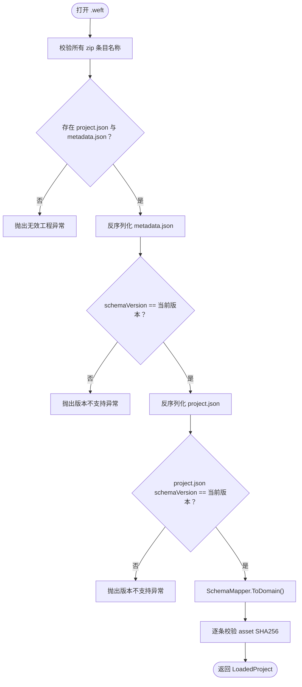
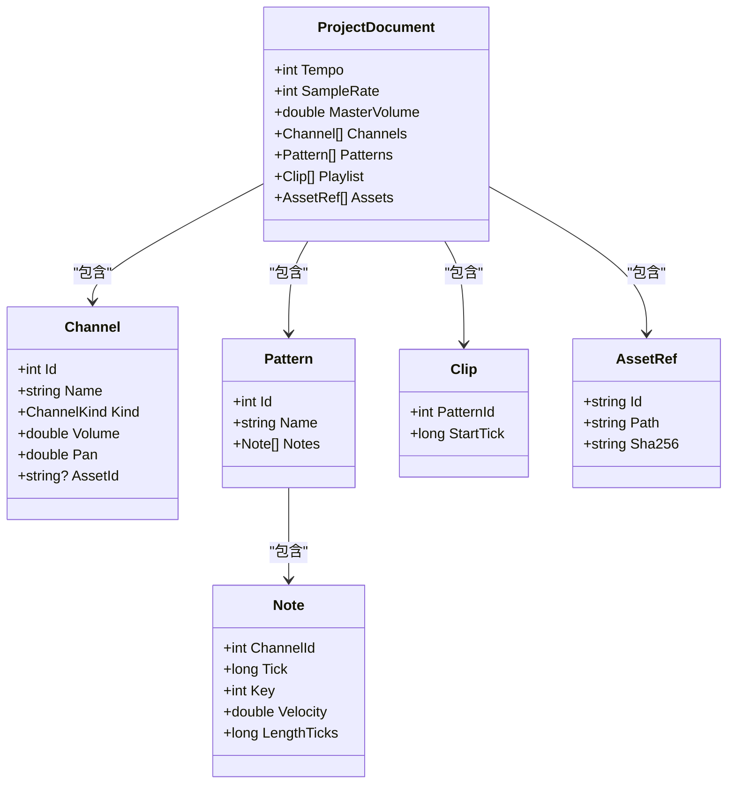
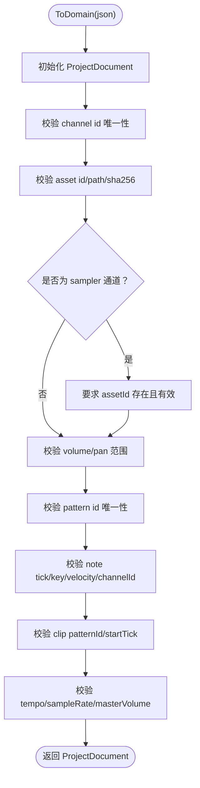
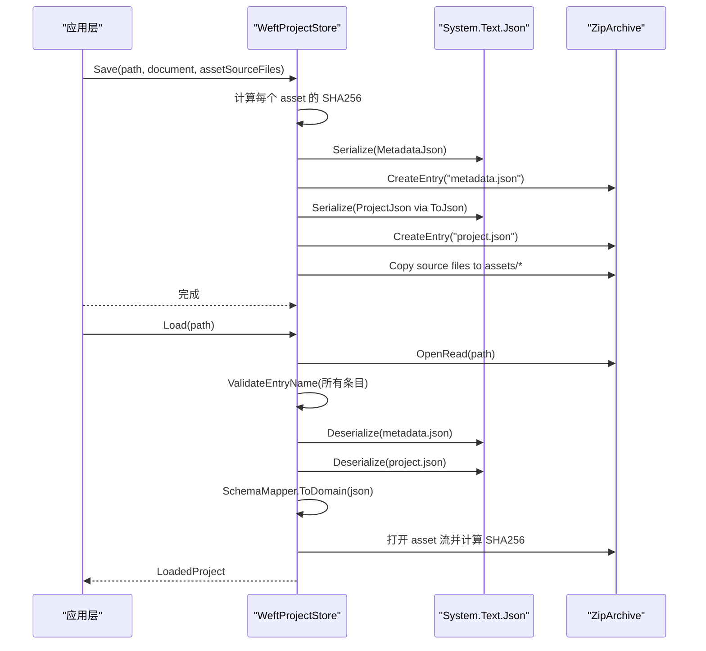
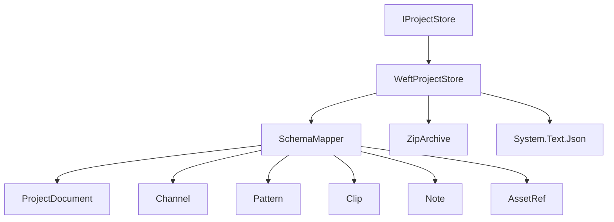

# 工程文件格式

<cite>
**本文引用的文件**   
- [ADR-0006-project-format.md](file://docs/adr/ADR-0006-project-format.md)
- [SchemaMapper.cs](file://src/Weftone.Adapters.ProjectStore/SchemaMapper.cs)
- [WeftProjectStore.cs](file://src/Weftone.Adapters.ProjectStore/WeftProjectStore.cs)
- [IProjectStore.cs](file://src/Weftone.Domain/IProjectStore.cs)
- [ProjectDocument.cs](file://src/Weftone.Domain/ProjectDocument.cs)
- [Channel.cs](file://src/Weftone.Domain/Channel.cs)
- [Pattern.cs](file://src/Weftone.Domain/Pattern.cs)
- [Clip.cs](file://src/Weftone.Domain/Clip.cs)
- [Note.cs](file://src/Weftone.Domain/Note.cs)
- [AssetRef.cs](file://src/Weftone.Domain/AssetRef.cs)
</cite>

## 目录
1. [简介](#简介)
2. [项目结构](#项目结构)
3. [核心组件](#核心组件)
4. [架构总览](#架构总览)
5. [详细组件分析](#详细组件分析)
6. [依赖关系分析](#依赖关系分析)
7. [性能考虑](#性能考虑)
8. [故障排查指南](#故障排查指南)
9. [结论](#结论)
10. [附录](#附录)

## 简介
本文件为 Weftone 的工程文件格式 .weft 提供全面技术规范。该格式采用 zip 容器，包含元数据、工程 JSON 与资源资产；通过 schema 版本与迁移机制保证向后兼容；在加载时执行严格的白名单校验、schema 版本检查、域规则验证与资产 SHA256 完整性校验。文档同时说明如何扩展格式以支持新功能，并给出示例结构与序列化/反序列化流程。

## 项目结构
.weft 工程包是一个标准 zip 压缩包，内部组织如下：
- metadata.json：工程元数据，包含 schemaVersion 与 generator。
- project.json：工程数据结构，包含 tempo、sampleRate、masterVolume、channels、patterns、playlist、assets。
- assets/*：资源资产目录，按相对路径存放，文件名由内容 SHA256 决定（命名策略见 ADR）。

**图示来源**
- [WeftProjectStore.cs:9-12](file://src/Weftone.Adapters.ProjectStore/WeftProjectStore.cs#L9-L12)
- [ADR-0006-project-format.md:7-11](file://docs/adr/ADR-0006-project-format.md#L7-L11)

**章节来源**
- [ADR-0006-project-format.md:7-11](file://docs/adr/ADR-0006-project-format.md#L7-L11)
- [WeftProjectStore.cs:9-12](file://src/Weftone.Adapters.ProjectStore/WeftProjectStore.cs#L9-L12)

## 核心组件
- IProjectStore：定义工程存取接口，屏蔽 zip/JSON 细节，对外暴露 Load 与 Save。
- WeftProjectStore：实现 .weft v1 的加载与保存，负责 zip 条目白名单、schema 版本校验、SHA256 校验与流式资产读取。
- SchemaMapper：负责 domain 模型与 JSON DTO 之间的双向映射，并在反序列化阶段进行严格的数据验证。
- Domain 模型：ProjectDocument、Channel、Pattern、Clip、Note、AssetRef 描述工程语义。

**章节来源**
- [IProjectStore.cs:3-14](file://src/Weftone.Domain/IProjectStore.cs#L3-L14)
- [WeftProjectStore.cs:13-21](file://src/Weftone.Adapters.ProjectStore/WeftProjectStore.cs#L13-L21)
- [SchemaMapper.cs:67-100](file://src/Weftone.Adapters.ProjectStore/SchemaMapper.cs#L67-L100)
- [ProjectDocument.cs:7-20](file://src/Weftone.Domain/ProjectDocument.cs#L7-L20)

## 架构总览
下图展示从外部调用到内部存储与数据校验的整体流程。

**图示来源**
- [WeftProjectStore.cs:23-70](file://src/Weftone.Adapters.ProjectStore/WeftProjectStore.cs#L23-L70)
- [SchemaMapper.cs:102-180](file://src/Weftone.Adapters.ProjectStore/SchemaMapper.cs#L102-L180)

## 详细组件分析

### .weft 容器规范
- 容器类型：标准 zip 压缩包。
- 必需条目：
  - metadata.json：包含 schemaVersion 与 generator。
  - project.json：工程数据主体。
  - assets/*：资源资产目录，路径必须以 assets/ 开头。
- 安全约束：
  - 仅允许 project.json、metadata.json 与 assets/* 三类条目。
  - 禁止路径穿越（..）、绝对路径、反斜杠分隔符。
  - 工程内不执行脚本。
- 版本管理：
  - metadata.json 与 project.json 均包含 schemaVersion。
  - 当前实现固定为 v1，不支持旧版本自动迁移。

**图示来源**
- [WeftProjectStore.cs:23-70](file://src/Weftone.Adapters.ProjectStore/WeftProjectStore.cs#L23-L70)
- [WeftProjectStore.cs:131-152](file://src/Weftone.Adapters.ProjectStore/WeftProjectStore.cs#L131-L152)

**章节来源**
- [WeftProjectStore.cs:23-70](file://src/Weftone.Adapters.ProjectStore/WeftProjectStore.cs#L23-L70)
- [WeftProjectStore.cs:131-152](file://src/Weftone.Adapters.ProjectStore/WeftProjectStore.cs#L131-L152)
- [ADR-0006-project-format.md:7-11](file://docs/adr/ADR-0006-project-format.md#L7-L11)

### project.json 元数据与字段规范
- schemaVersion：整数，表示 schema 版本。
- tempo：BPM，范围 [MinTempo, MaxTempo]。
- sampleRate：采样率，范围 [8000, 192000]。
- masterVolume：主控音量，范围 [0, 2]。
- channels：声部列表，每个 channel 包含 id、name、kind、volume、pan、assetId（sampler 类型必填）。
- patterns：乐段列表，每个 pattern 包含 id、name、notes[]。
- playlist：播放列表片段，每个 clip 包含 patternId、startTick。
- assets：资产引用列表，每个 asset 包含 id、path、sha256。

**图示来源**
- [ProjectDocument.cs:7-20](file://src/Weftone.Domain/ProjectDocument.cs#L7-L20)
- [Channel.cs:3-18](file://src/Weftone.Domain/Channel.cs#L3-L18)
- [Pattern.cs:3-8](file://src/Weftone.Domain/Pattern.cs#L3-L8)
- [Clip.cs:3-8](file://src/Weftone.Domain/Clip.cs#L3-L8)
- [Note.cs:3-11](file://src/Weftone.Domain/Note.cs#L3-L11)
- [AssetRef.cs:3-9](file://src/Weftone.Domain/AssetRef.cs#L3-L9)

**章节来源**
- [ProjectDocument.cs:7-20](file://src/Weftone.Domain/ProjectDocument.cs#L7-L20)
- [Channel.cs:3-18](file://src/Weftone.Domain/Channel.cs#L3-L18)
- [Pattern.cs:3-8](file://src/Weftone.Domain/Pattern.cs#L3-L8)
- [Clip.cs:3-8](file://src/Weftone.Domain/Clip.cs#L3-L8)
- [Note.cs:3-11](file://src/Weftone.Domain/Note.cs#L3-L11)
- [AssetRef.cs:3-9](file://src/Weftone.Domain/AssetRef.cs#L3-L9)

### SchemaMapper 映射机制与数据验证
- 序列化（ToJson）：将 ProjectDocument 转换为 ProjectJson DTO，设置 schemaVersion 为当前版本。
- 反序列化（ToDomain）：
  - 创建 ProjectDocument 并填充基础属性。
  - 校验 channel id 唯一性。
  - 校验 asset id 非空、path 以 assets/ 开头、sha256 为 64 位十六进制。
  - sampler 类型的 channel 必须具有 assetId，且该 assetId 存在于 assets 列表中。
  - 校验 channel volume ∈ [0, 2]、pan ∈ [-1, 1]。
  - 校验 pattern id 唯一性。
  - 校验 note tick ≥ 0、lengthTicks ≥ 1、key ∈ [0, 127]、velocity ∈ [0, 1]、channelId 已定义。
  - 校验 clip 引用 patternId 已定义、startTick ≥ 0。
  - 校验 tempo ∈ [MinTempo, MaxTempo]、sampleRate ∈ [8000, 192000]、masterVolume ∈ [0, 2]。
- 错误处理：所有校验失败抛出 InvalidProjectException。

**图示来源**
- [SchemaMapper.cs:102-180](file://src/Weftone.Adapters.ProjectStore/SchemaMapper.cs#L102-L180)

**章节来源**
- [SchemaMapper.cs:67-100](file://src/Weftone.Adapters.ProjectStore/SchemaMapper.cs#L67-L100)
- [SchemaMapper.cs:102-180](file://src/Weftone.Adapters.ProjectStore/SchemaMapper.cs#L102-L180)

### 序列化与反序列化流程
- 序列化（Save）：
  - 计算每个资产的 SHA256，写入 reference.Sha256。
  - 使用 JsonSerializer 输出缩进、驼峰命名的 JSON。
  - 写入 metadata.json（schemaVersion=1，generator="weftone"）。
  - 写入 project.json（经 SchemaMapper.ToJson）。
  - 将资产源文件复制到 zip 中对应 assets/* 路径。
- 反序列化（Load）：
  - 打开 zip，校验所有条目名称。
  - 读取 metadata.json 与 project.json，校验 schemaVersion。
  - 调用 SchemaMapper.ToDomain 构建领域对象。
  - 对每个 asset 打开 zip 条目流，计算 SHA256 并与预期值比较。
  - 返回 LoadedProject，其中 OpenAsset 委托按需读取资产流。

**图示来源**
- [WeftProjectStore.cs:73-110](file://src/Weftone.Adapters.ProjectStore/WeftProjectStore.cs#L73-L110)
- [WeftProjectStore.cs:23-70](file://src/Weftone.Adapters.ProjectStore/WeftProjectStore.cs#L23-L70)
- [SchemaMapper.cs:67-100](file://src/Weftone.Adapters.ProjectStore/SchemaMapper.cs#L67-L100)

**章节来源**
- [WeftProjectStore.cs:73-110](file://src/Weftone.Adapters.ProjectStore/WeftProjectStore.cs#L73-L110)
- [WeftProjectStore.cs:23-70](file://src/Weftone.Adapters.ProjectStore/WeftProjectStore.cs#L23-L70)
- [SchemaMapper.cs:67-100](file://src/Weftone.Adapters.ProjectStore/SchemaMapper.cs#L67-L100)

### 版本管理与兼容性策略
- 当前版本：SchemaVersion = 1。
- 兼容性：
  - 加载时要求 metadata.json 与 project.json 的 schemaVersion 等于当前版本。
  - 若版本不一致，直接抛出“版本不支持”异常，不进行自动迁移。
- 升级路径建议：
  - 新增字段时应保持向后兼容（可选字段、默认值）。
  - 废弃字段应保留但忽略。
  - 当引入破坏性变更时，递增 schemaVersion，并提供迁移工具或中间格式。
  - 建议在 metadata.json 中增加 migrationHistory 或 changelog 字段以便追踪。

**章节来源**
- [WeftProjectStore.cs:15-21](file://src/Weftone.Adapters.ProjectStore/WeftProjectStore.cs#L15-L21)
- [WeftProjectStore.cs:42-52](file://src/Weftone.Adapters.ProjectStore/WeftProjectStore.cs#L42-L52)

### 安全考虑与完整性校验
- 防 zip slip：
  - 拒绝包含 ..、绝对路径、反斜杠的条目名。
  - 仅允许 project.json、metadata.json、assets/* 三类条目。
- 完整性校验：
  - 对每个 asset 计算 SHA256，与 project.json 中记录的 sha256 比较。
- 输入验证：
  - 对 channel/pattern/note/clip 的 id、范围、引用关系进行严格校验。
  - 对 BPM、采样率、音量等全局参数进行范围校验。
- 执行隔离：
  - 工程包内不执行脚本，避免任意代码执行风险。

**章节来源**
- [WeftProjectStore.cs:131-152](file://src/Weftone.Adapters.ProjectStore/WeftProjectStore.cs#L131-L152)
- [WeftProjectStore.cs:55-68](file://src/Weftone.Adapters.ProjectStore/WeftProjectStore.cs#L55-L68)
- [SchemaMapper.cs:102-180](file://src/Weftone.Adapters.ProjectStore/SchemaMapper.cs#L102-L180)
- [ADR-0006-project-format.md:7-11](file://docs/adr/ADR-0006-project-format.md#L7-L11)

### 扩展文件格式以支持新功能
- 新增字段：
  - 在 ProjectJson/DTO 中添加新字段，保持默认值与可空性。
  - 在 SchemaMapper.ToDomain 中添加解析逻辑与校验。
  - 在 SchemaMapper.ToJson 中添加序列化逻辑。
- 新增枚举或类型：
  - 在 ChannelKind 等枚举中扩展值。
  - 在 ParseKind/KindToString 中维护双向映射。
- 新增资源类型：
  - 在 assets/* 下新增子目录（如 presets/），并确保 ValidateEntryName 白名单允许。
  - 在 project.json 的 assets 列表中记录引用。
- 版本演进：
  - 递增 SchemaVersion。
  - 提供迁移脚本或中间格式，确保旧工程可升级。
  - 在 metadata.json 中记录 generator 与版本历史。

**章节来源**
- [SchemaMapper.cs:182-197](file://src/Weftone.Adapters.ProjectStore/SchemaMapper.cs#L182-L197)
- [WeftProjectStore.cs:131-152](file://src/Weftone.Adapters.ProjectStore/WeftProjectStore.cs#L131-L152)
- [WeftProjectStore.cs:15-21](file://src/Weftone.Adapters.ProjectStore/WeftProjectStore.cs#L15-L21)

## 依赖关系分析
- IProjectStore 定义抽象接口，WeftProjectStore 实现具体存储逻辑。
- SchemaMapper 依赖 Domain 模型与 JSON DTO，负责映射与校验。
- WeftProjectStore 依赖 System.IO.Compression 与 System.Text.Json，负责 zip 与 JSON 操作。
- Domain 模型之间通过组合关系形成工程结构。

**图示来源**
- [IProjectStore.cs:3-14](file://src/Weftone.Domain/IProjectStore.cs#L3-L14)
- [WeftProjectStore.cs:1-5](file://src/Weftone.Adapters.ProjectStore/WeftProjectStore.cs#L1-L5)
- [SchemaMapper.cs:1-3](file://src/Weftone.Adapters.ProjectStore/SchemaMapper.cs#L1-L3)

**章节来源**
- [IProjectStore.cs:3-14](file://src/Weftone.Domain/IProjectStore.cs#L3-L14)
- [WeftProjectStore.cs:1-5](file://src/Weftone.Adapters.ProjectStore/WeftProjectStore.cs#L1-L5)
- [SchemaMapper.cs:1-3](file://src/Weftone.Adapters.ProjectStore/SchemaMapper.cs#L1-L3)

## 性能考虑
- JSON 体积较大时，序列化/反序列化可能成为瓶颈；后续可引入二进制缓存以提升性能。
- 资产 SHA256 校验在加载时逐条进行，对于大型工程应考虑异步或并行化。
- 使用流式读取资产，避免一次性加载整个 zip 到内存。
- 压缩级别与写入缓冲可根据工程大小调优。

[本节为通用指导，不直接分析具体文件]

## 故障排查指南
- 缺少必要文件：
  - 现象：加载时报“缺少 project.json/metadata.json”。
  - 原因：zip 容器不完整。
  - 解决：确保包含 metadata.json 与 project.json。
- 版本不支持：
  - 现象：加载时报“schema 版本不支持”。
  - 原因：metadata.json 或 project.json 的 schemaVersion 不等于当前版本。
  - 解决：升级工程或调整 SchemaVersion 并提供迁移。
- 非法 zip 条目：
  - 现象：加载时报“非法 zip 条目/非白名单 zip 条目”。
  - 原因：存在 ..、绝对路径、反斜杠或非允许路径。
  - 解决：清理 zip 条目，仅保留 project.json、metadata.json、assets/*。
- 资产缺失或 SHA256 不匹配：
  - 现象：加载时报“资产缺失/资产 SHA256 不匹配”。
  - 原因：assets/* 缺失或内容被篡改。
  - 解决：重新生成资产并更新 project.json 中的 sha256。
- 数据校验失败：
  - 现象：加载时报“channel id 重复/asset 路径越界/BPM 越界”等。
  - 原因：project.json 数据不符合域规则。
  - 解决：修正字段值，确保范围与引用关系正确。

**章节来源**
- [WeftProjectStore.cs:31-52](file://src/Weftone.Adapters.ProjectStore/WeftProjectStore.cs#L31-L52)
- [WeftProjectStore.cs:55-68](file://src/Weftone.Adapters.ProjectStore/WeftProjectStore.cs#L55-L68)
- [WeftProjectStore.cs:131-152](file://src/Weftone.Adapters.ProjectStore/WeftProjectStore.cs#L131-L152)
- [SchemaMapper.cs:102-180](file://src/Weftone.Adapters.ProjectStore/SchemaMapper.cs#L102-L180)

## 结论
.weft 工程格式以 zip 容器承载 metadata.json、project.json 与 assets/*，并通过 schema 版本与严格校验保障安全性与一致性。SchemaMapper 负责领域模型与 JSON 的双向映射与数据验证，WeftProjectStore 负责容器操作与安全控制。当前实现为 v1，未提供自动迁移；未来可通过版本演进与迁移工具支持向后兼容与功能扩展。

[本节为总结，不直接分析具体文件]

## 附录

### 示例 .weft 结构
- metadata.json：
  - schemaVersion: 1
  - generator: "weftone"
- project.json：
  - schemaVersion: 1
  - tempo: 140
  - sampleRate: 48000
  - masterVolume: 1.0
  - channels: [
      { id: 1, name: "主音", kind: "sine", volume: 1.0, pan: 0, assetId: null },
      { id: 2, name: "采样", kind: "sampler", volume: 1.0, pan: 0, assetId: "sample_001" }
    ]
  - patterns: [
      { id: 1, name: "旋律", notes: [
          { channelId: 1, tick: 0, key: 60, velocity: 1.0, lengthTicks: 96 },
          { channelId: 1, tick: 96, key: 64, velocity: 0.8, lengthTicks: 96 }
        ]
      }
    ]
  - playlist: [
      { patternId: 1, startTick: 0 }
    ]
  - assets: [
      { id: "sample_001", path: "assets/sample.wav", sha256: "<64位小写十六进制>" }
    ]
- assets/sample.wav：二进制音频文件，内容与 sha256 一致。

[本节为概念性示例，不直接分析具体文件]