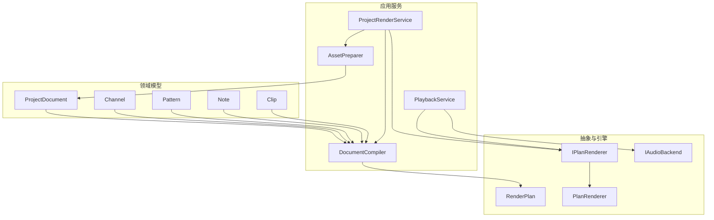
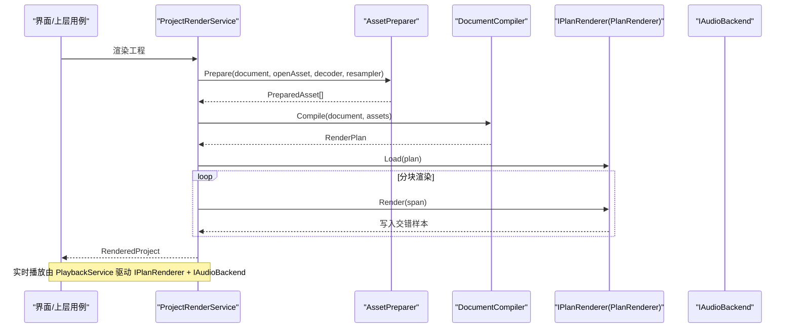
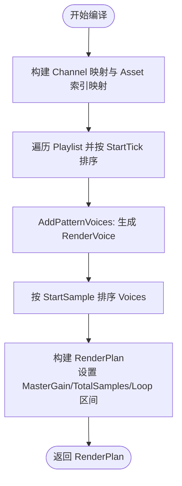
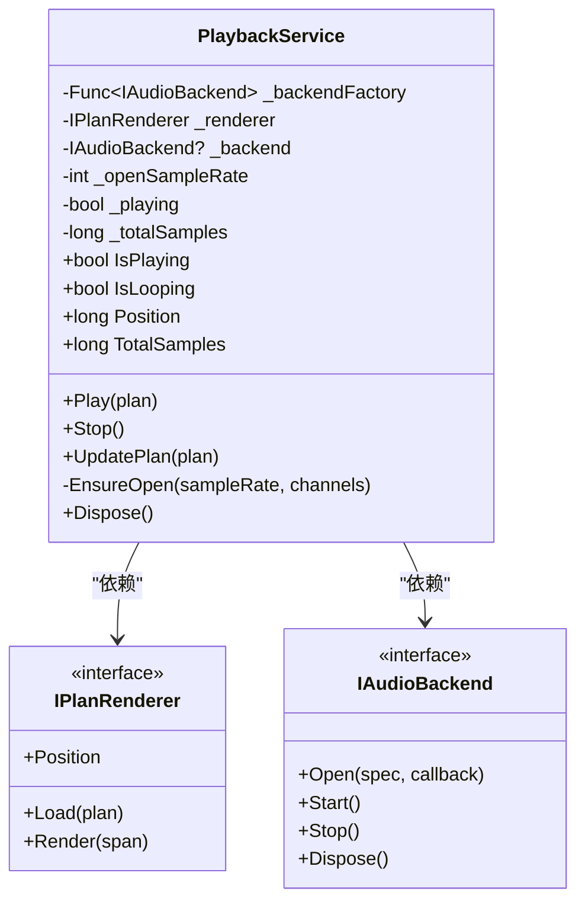
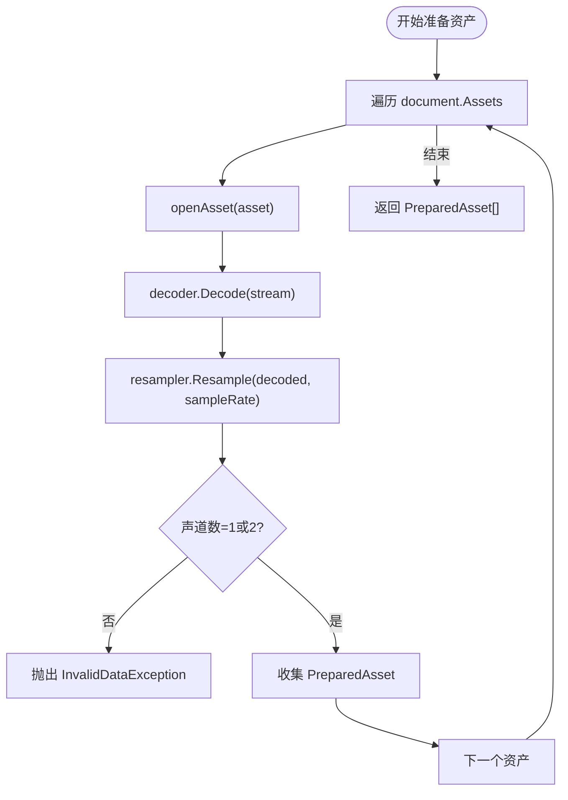
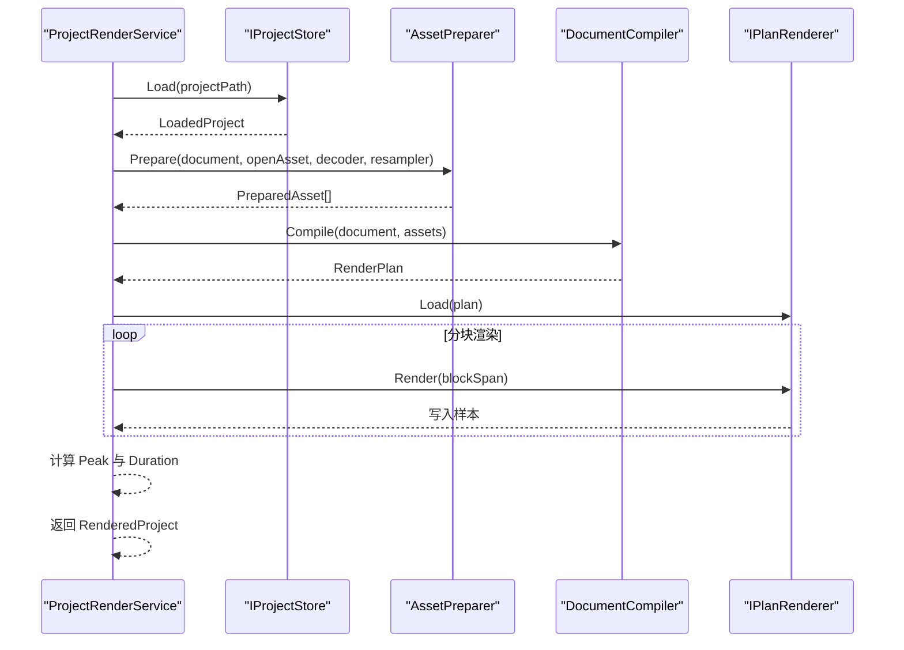
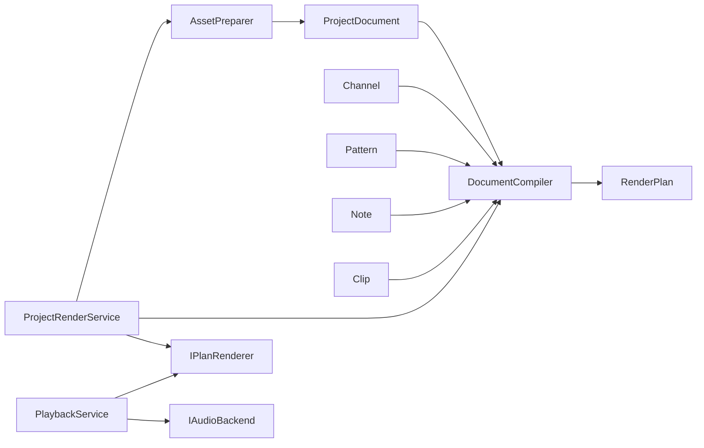
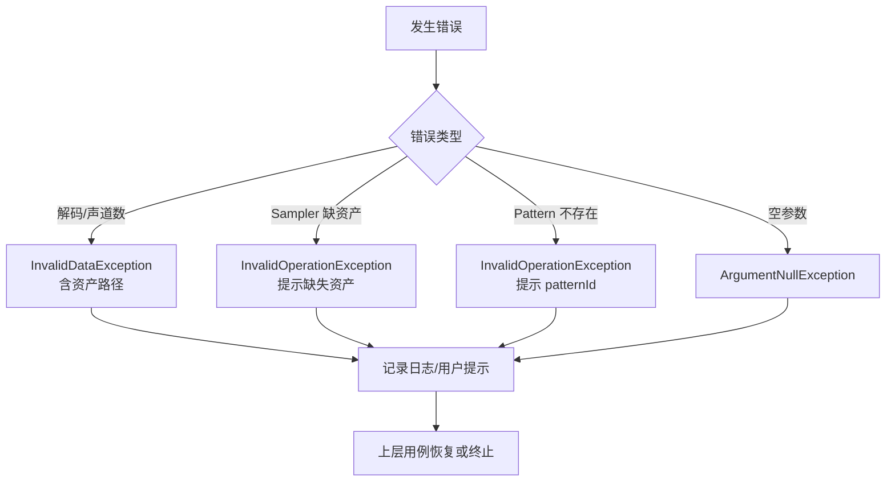

# 应用服务

<cite>
**本文引用的文件**   
- [DocumentCompiler.cs](file://src/Weftone.Application/DocumentCompiler.cs)
- [PlaybackService.cs](file://src/Weftone.Application/PlaybackService.cs)
- [AssetPreparer.cs](file://src/Weftone.Application/AssetPreparer.cs)
- [ProjectRenderService.cs](file://src/Weftone.Application/ProjectRenderService.cs)
- [ProjectDocument.cs](file://src/Weftone.Domain/ProjectDocument.cs)
- [Channel.cs](file://src/Weftone.Domain/Channel.cs)
- [Clip.cs](file://src/Weftone.Domain/Clip.cs)
- [Pattern.cs](file://src/Weftone.Domain/Pattern.cs)
- [Note.cs](file://src/Weftone.Domain/Note.cs)
- [RenderPlan.cs](file://src/Weftone.Abstractions/Rendering/RenderPlan.cs)
- [IPlanRenderer.cs](file://src/Weftone.Abstractions/Rendering/IPlanRenderer.cs)
- [PlanRenderer.cs](file://src/Weftone.Engine/PlanRenderer.cs)
</cite>

## 目录
1. [引言](#引言)
2. [项目结构](#项目结构)
3. [核心组件](#核心组件)
4. [架构总览](#架构总览)
5. [详细组件分析](#详细组件分析)
6. [依赖关系分析](#依赖关系分析)
7. [性能与实时性](#性能与实时性)
8. [错误处理与故障排查](#错误处理与故障排查)
9. [结论](#结论)

## 引言
本文面向 Weftone 的应用服务层，聚焦以下四个关键服务：
- DocumentCompiler：将富对象工程文档编译为扁平的渲染计划。
- PlaybackService：管理实时播放状态、播放控制、暂停恢复与位置同步。
- AssetPreparer：离线预处理音频资源，完成解码与重采样。
- ProjectRenderService：离线导出工程，批量渲染并统计峰值与时长。

这些服务共同承担领域模型（ProjectDocument、Channel、Pattern、Note、Clip）与音频引擎（PlanRenderer、IAudioBackend）之间的数据流转职责，确保编辑期与渲染期解耦，并在实时路径中保持零分配与确定性行为。

## 项目结构
应用服务位于 Weftone.Application，向上依赖领域模型 Weftone.Domain，向下通过抽象接口 IPlanRenderer 与音频后端 IAudioBackend 对接引擎实现 PlanRenderer 与 Miniaudio 后端。

图表来源
- [DocumentCompiler.cs:1-159](file://src/Weftone.Application/DocumentCompiler.cs#L1-L159)
- [PlaybackService.cs:1-98](file://src/Weftone.Application/PlaybackService.cs#L1-L98)
- [AssetPreparer.cs:1-42](file://src/Weftone.Application/AssetPreparer.cs#L1-L42)
- [ProjectRenderService.cs:1-51](file://src/Weftone.Application/ProjectRenderService.cs#L1-L51)
- [ProjectDocument.cs:1-21](file://src/Weftone.Domain/ProjectDocument.cs#L1-L21)
- [Channel.cs:1-19](file://src/Weftone.Domain/Channel.cs#L1-L19)
- [Pattern.cs:1-9](file://src/Weftone.Domain/Pattern.cs#L1-L9)
- [Note.cs:1-12](file://src/Weftone.Domain/Note.cs#L1-L12)
- [Clip.cs:1-9](file://src/Weftone.Domain/Clip.cs#L1-L9)
- [RenderPlan.cs:1-42](file://src/Weftone.Abstractions/Rendering/RenderPlan.cs#L1-L42)
- [PlanRenderer.cs:1-356](file://src/Weftone.Engine/PlanRenderer.cs#L1-L356)

章节来源
- [DocumentCompiler.cs:1-159](file://src/Weftone.Application/DocumentCompiler.cs#L1-L159)
- [PlaybackService.cs:1-98](file://src/Weftone.Application/PlaybackService.cs#L1-L98)
- [AssetPreparer.cs:1-42](file://src/Weftone.Application/AssetPreparer.cs#L1-L42)
- [ProjectRenderService.cs:1-51](file://src/Weftone.Application/ProjectRenderService.cs#L1-L51)
- [ProjectDocument.cs:1-21](file://src/Weftone.Domain/ProjectDocument.cs#L1-L21)
- [RenderPlan.cs:1-42](file://src/Weftone.Abstractions/Rendering/RenderPlan.cs#L1-L42)
- [PlanRenderer.cs:1-356](file://src/Weftone.Engine/PlanRenderer.cs#L1-L356)

## 核心组件
- DocumentCompiler：负责把 ProjectDocument 展开为 RenderPlan。支持全量工程编译与单 Pattern 循环编译；按 StartSample 排序生成确定性的声部事件序列；对 Sampler 通道使用已准备的资产索引。
- AssetPreparer：遍历工程中的 AssetRef，调用解码器与重采样器，输出 PreparedAsset 列表，供后续编译阶段直接引用。
- ProjectRenderService：串联“加载工程 → 准备资产 → 编译计划 → 离线渲染”流程，分块渲染并计算峰值与时长。
- PlaybackService：封装 IPlanRenderer 与 IAudioBackend，提供 Play/Stop/UpdatePlan 能力，维护 IsPlaying、IsLooping、Position、TotalSamples 等状态，保证音频线程零分配。

章节来源
- [DocumentCompiler.cs:6-10](file://src/Weftone.Application/DocumentCompiler.cs#L6-L10)
- [AssetPreparer.cs:8-40](file://src/Weftone.Application/AssetPreparer.cs#L8-L40)
- [ProjectRenderService.cs:10-49](file://src/Weftone.Application/ProjectRenderService.cs#L10-L49)
- [PlaybackService.cs:6-11](file://src/Weftone.Application/PlaybackService.cs#L6-L11)

## 架构总览
应用服务层在 Weftone 中扮演“用例编排者”角色：
- 编辑期：领域模型可被命令修改，但音频线程不可见。
- 预览期：PlaybackService 通过 IPlanRenderer 驱动 PlanRenderer，按需从 RenderPlan 消费样本。
- 导出期：ProjectRenderService 离线渲染整段工程，不依赖音频设备。

图表来源
- [ProjectRenderService.cs:19-49](file://src/Weftone.Application/ProjectRenderService.cs#L19-L49)
- [AssetPreparer.cs:11-40](file://src/Weftone.Application/AssetPreparer.cs#L11-L40)
- [DocumentCompiler.cs:16-65](file://src/Weftone.Application/DocumentCompiler.cs#L16-L65)
- [PlanRenderer.cs:48-105](file://src/Weftone.Engine/PlanRenderer.cs#L48-L105)
- [PlaybackService.cs:42-78](file://src/Weftone.Application/PlaybackService.cs#L42-L78)

## 详细组件分析

### DocumentCompiler：富对象到渲染计划的编译器
- 输入：ProjectDocument 与可选 PreparedAsset 列表。
- 输出：RenderPlan，包含 SampleRate、Channels、MasterGain、TotalSamples、LoopStartSample/LoopEndSample、Voices、Assets。
- 关键流程：
  - 构建 Channel 映射与 AssetId→索引映射。
  - 遍历 Playlist，按 StartTick 顺序展开 Pattern 音符，计算每个音符的起始样本与长度样本。
  - 根据 ChannelKind 决定 Sine 或 Sampler 声部类型，预乘左右声道增益。
  - 对 Voices 按 StartSample 排序，构造 RenderPlan。
- 优化策略：
  - 非实时线程执行，全量编译，避免运行时开销。
  - 预分配数组与字典，减少编译期分配。
  - 对 Sampler 通道使用已准备的交错样本，避免渲染期解码。
  - Pattern 模式支持循环区间，便于预览时稳定回放。

图表来源
- [DocumentCompiler.cs:16-65](file://src/Weftone.Application/DocumentCompiler.cs#L16-L65)
- [DocumentCompiler.cs:98-157](file://src/Weftone.Application/DocumentCompiler.cs#L98-L157)

章节来源
- [DocumentCompiler.cs:6-10](file://src/Weftone.Application/DocumentCompiler.cs#L6-L10)
- [DocumentCompiler.cs:16-65](file://src/Weftone.Application/DocumentCompiler.cs#L16-L65)
- [DocumentCompiler.cs:98-157](file://src/Weftone.Application/DocumentCompiler.cs#L98-L157)
- [ProjectDocument.cs:7-20](file://src/Weftone.Domain/ProjectDocument.cs#L7-L20)
- [Channel.cs:9-18](file://src/Weftone.Domain/Channel.cs#L9-L18)
- [Pattern.cs:3-8](file://src/Weftone.Domain/Pattern.cs#L3-L8)
- [Note.cs:3-11](file://src/Weftone.Domain/Note.cs#L3-L11)
- [Clip.cs:3-8](file://src/Weftone.Domain/Clip.cs#L3-L8)
- [RenderPlan.cs:29-41](file://src/Weftone.Abstractions/Rendering/RenderPlan.cs#L29-L41)

### PlaybackService：实时播放状态管理
- 状态字段：_playing、IsLooping、Position、TotalSamples。
- 生命周期：
  - Play(plan)：停止旧播放，Load plan，打开/复用 IAudioBackend，启动后端，置 _playing=true。
  - Stop()：安全停止后端，重置 _playing。
  - UpdatePlan(plan)：用于编辑后热更新，采用“停止-交换-恢复”策略，短暂静音但不丢失播放状态。
- 音频线程约束：回调一次性捕获，渲染路径零分配；后端仅在采样率变化时重建。
- 位置同步：Position 来自 IPlanRenderer.Position，IsLooping 由 RenderPlan.LoopEndSample > LoopStartSample 判定。

图表来源
- [PlaybackService.cs:12-98](file://src/Weftone.Application/PlaybackService.cs#L12-L98)
- [IPlanRenderer.cs](file://src/Weftone.Abstractions/Rendering/IPlanRenderer.cs)

章节来源
- [PlaybackService.cs:6-11](file://src/Weftone.Application/PlaybackService.cs#L6-L11)
- [PlaybackService.cs:24-98](file://src/Weftone.Application/PlaybackService.cs#L24-L98)

### AssetPreparer：资源预处理机制
- 输入：ProjectDocument.Assets、openAsset 工厂、ISampleDecoder、IResampler。
- 处理：
  - 逐个 AssetRef 打开流，调用 decoder.Decode。
  - 对解码结果进行重采样至工程采样率。
  - 校验声道数仅支持 1/2，否则抛出 InvalidDataException。
  - 输出 PreparedAsset 列表，包含 Interleaved 样本、Channels、Frames。
- 设计要点：
  - 全离线预处理，避免渲染期 IO 与解码。
  - 异常包装，附带资产路径信息，便于定位问题。

图表来源
- [AssetPreparer.cs:11-40](file://src/Weftone.Application/AssetPreparer.cs#L11-L40)

章节来源
- [AssetPreparer.cs:8-40](file://src/Weftone.Application/AssetPreparer.cs#L8-L40)

### ProjectRenderService：离线渲染与批量处理
- 流程：
  - 通过 IProjectStore.Load 加载工程。
  - 调用 AssetPreparer.Prepare 准备资产。
  - 调用 DocumentCompiler.Compile 生成 RenderPlan。
  - 使用 IPlanRenderer.Render 分块渲染，累积交错样本。
  - 计算峰值与时长，返回 RenderedProject。
- 批处理特性：
  - 固定 BlockFrames 分块渲染，降低内存占用。
  - 峰值统计在渲染过程中累加。
  - 时长由 Frames/SampleRate 计算。

图表来源
- [ProjectRenderService.cs:19-49](file://src/Weftone.Application/ProjectRenderService.cs#L19-L49)
- [AssetPreparer.cs:11-40](file://src/Weftone.Application/AssetPreparer.cs#L11-L40)
- [DocumentCompiler.cs:16-65](file://src/Weftone.Application/DocumentCompiler.cs#L16-L65)
- [PlanRenderer.cs:61-105](file://src/Weftone.Engine/PlanRenderer.cs#L61-L105)

章节来源
- [ProjectRenderService.cs:10-49](file://src/Weftone.Application/ProjectRenderService.cs#L10-L49)

## 依赖关系分析
- DocumentCompiler 依赖领域模型（ProjectDocument、Channel、Pattern、Note、Clip）与 RenderPlan 抽象。
- AssetPreparer 依赖 ISampleDecoder、IResampler 与 ProjectDocument.Assets。
- ProjectRenderService 组合 AssetPreparer、DocumentCompiler 与 IPlanRenderer。
- PlaybackService 组合 IPlanRenderer 与 IAudioBackend，并通过工厂创建后端实例。

图表来源
- [DocumentCompiler.cs:1-159](file://src/Weftone.Application/DocumentCompiler.cs#L1-L159)
- [AssetPreparer.cs:1-42](file://src/Weftone.Application/AssetPreparer.cs#L1-L42)
- [ProjectRenderService.cs:1-51](file://src/Weftone.Application/ProjectRenderService.cs#L1-L51)
- [PlaybackService.cs:1-98](file://src/Weftone.Application/PlaybackService.cs#L1-L98)
- [ProjectDocument.cs:1-21](file://src/Weftone.Domain/ProjectDocument.cs#L1-L21)
- [RenderPlan.cs:1-42](file://src/Weftone.Abstractions/Rendering/RenderPlan.cs#L1-L42)

章节来源
- [DocumentCompiler.cs:1-159](file://src/Weftone.Application/DocumentCompiler.cs#L1-L159)
- [AssetPreparer.cs:1-42](file://src/Weftone.Application/AssetPreparer.cs#L1-L42)
- [ProjectRenderService.cs:1-51](file://src/Weftone.Application/ProjectRenderService.cs#L1-L51)
- [PlaybackService.cs:1-98](file://src/Weftone.Application/PlaybackService.cs#L1-L98)

## 性能与实时性
- DocumentCompiler：
  - 非实时线程全量编译，时间复杂度主要受 Playlist 与 Notes 规模影响；Voices 排序带来 O(n log n)。
  - 预分配字典与数组，避免运行期分配。
- PlanRenderer：
  - 固定大小 Voice 池（64），Pending 环缓冲（32），全程零分配。
  - 事件按 StartSample 顺序激活，池满时采用“最早结束”偷取策略，带线性淡出尾音防 click。
  - 支持循环区间，回绕时重置事件游标，活跃声部自然延续。
- PlaybackService：
  - 音频回调一次性捕获，渲染路径零分配；后端仅在采样率变化时重建。
  - BufferFrames=256，平衡延迟与稳定性。
- ProjectRenderService：
  - BlockFrames=512 分块渲染，峰值在线统计，避免额外大数组。

章节来源
- [DocumentCompiler.cs:16-65](file://src/Weftone.Application/DocumentCompiler.cs#L16-L65)
- [PlanRenderer.cs:5-10](file://src/Weftone.Engine/PlanRenderer.cs#L5-L10)
- [PlanRenderer.cs:48-105](file://src/Weftone.Engine/PlanRenderer.cs#L48-L105)
- [PlaybackService.cs:14-31](file://src/Weftone.Application/PlaybackService.cs#L14-L31)
- [ProjectRenderService.cs:17-49](file://src/Weftone.Application/ProjectRenderService.cs#L17-L49)

## 错误处理与故障排查
- AssetPreparer：
  - 解码失败或无效数据：抛出 InvalidDataException，附带资产路径与原始异常消息。
  - 声道数不支持（非 1/2）：抛出 InvalidDataException，提示具体声道数。
- DocumentCompiler：
  - Sampler 通道缺少已准备资产：抛出 InvalidOperationException，提示缺失资产。
  - Pattern 不存在（CompilePattern）：抛出 InvalidOperationException，提示 patternId。
- PlaybackService：
  - 空参数检查：Play/UpdatePlan 对 null plan 抛异常。
  - 后端生命周期：EnsureOpen 在采样率变化时释放旧后端并重建，避免重复打开。
- ProjectRenderService：
  - 空 projectPath：抛出异常。
  - 渲染过程无外部异常捕获，建议在上层用例统一处理。

图表来源
- [AssetPreparer.cs:24-37](file://src/Weftone.Application/AssetPreparer.cs#L24-L37)
- [DocumentCompiler.cs:59-64](file://src/Weftone.Application/DocumentCompiler.cs#L59-L64)
- [DocumentCompiler.cs:111-117](file://src/Weftone.Application/DocumentCompiler.cs#L111-L117)
- [PlaybackService.cs:42-49](file://src/Weftone.Application/PlaybackService.cs#L42-L49)

章节来源
- [AssetPreparer.cs:24-37](file://src/Weftone.Application/AssetPreparer.cs#L24-L37)
- [DocumentCompiler.cs:59-64](file://src/Weftone.Application/DocumentCompiler.cs#L59-L64)
- [DocumentCompiler.cs:111-117](file://src/Weftone.Application/DocumentCompiler.cs#L111-L117)
- [PlaybackService.cs:42-49](file://src/Weftone.Application/PlaybackService.cs#L42-L49)

## 结论
Weftone 的应用服务层通过 DocumentCompiler、AssetPreparer、ProjectRenderService 与 PlaybackService 形成清晰的职责边界：
- 编辑器侧只操作富对象领域模型，不感知音频细节。
- 编译与预处理在离线线程完成，生成轻量、确定的 RenderPlan。
- 实时播放由 PlaybackService 驱动 PlanRenderer 与音频后端，保证零分配与稳定循环。
- 离线导出由 ProjectRenderService 串联完整管线，提供峰值与时长统计。

这种分层与数据流转方式，既保证了编辑体验的灵活性，也确保了音频路径的性能与可靠性。