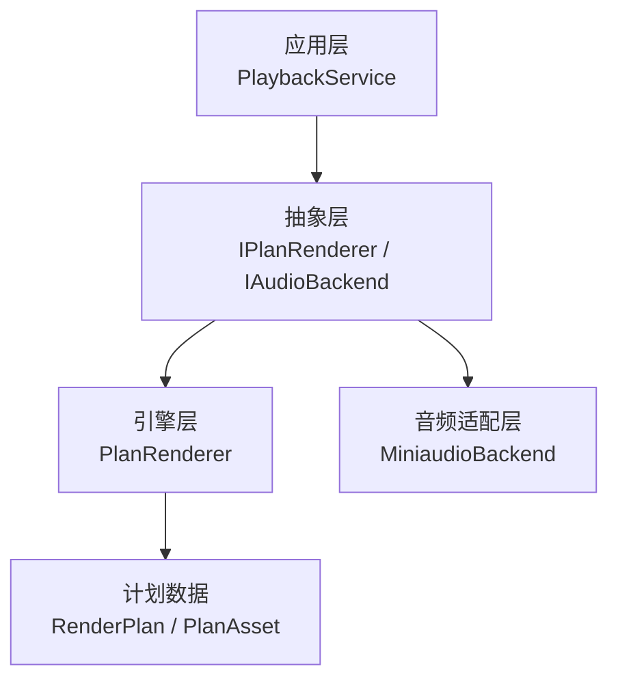
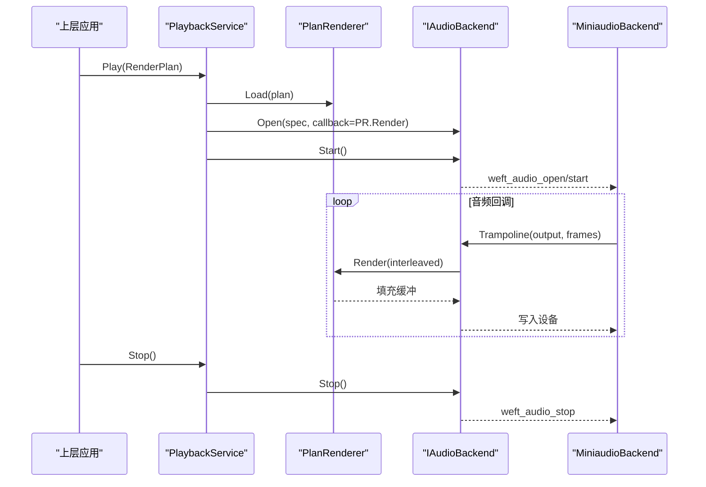
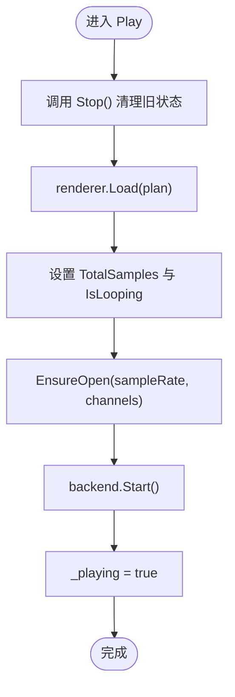
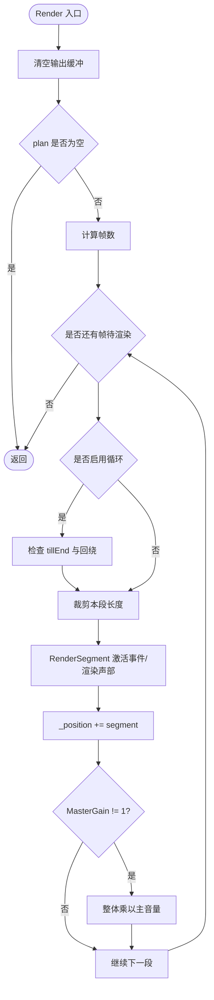
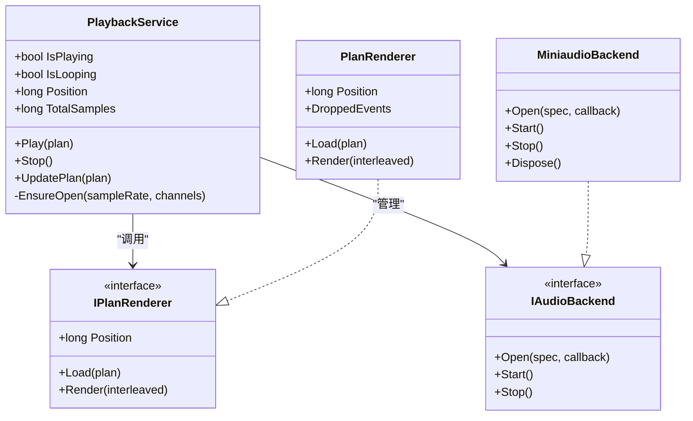
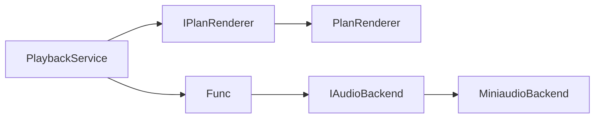
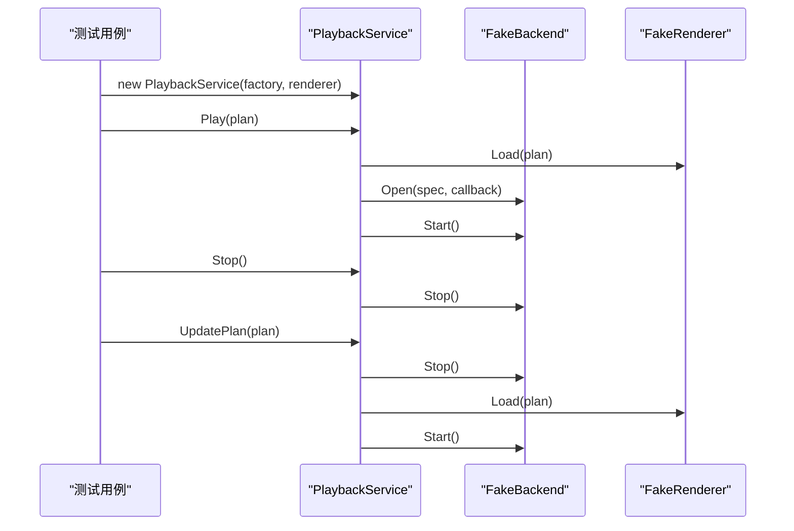
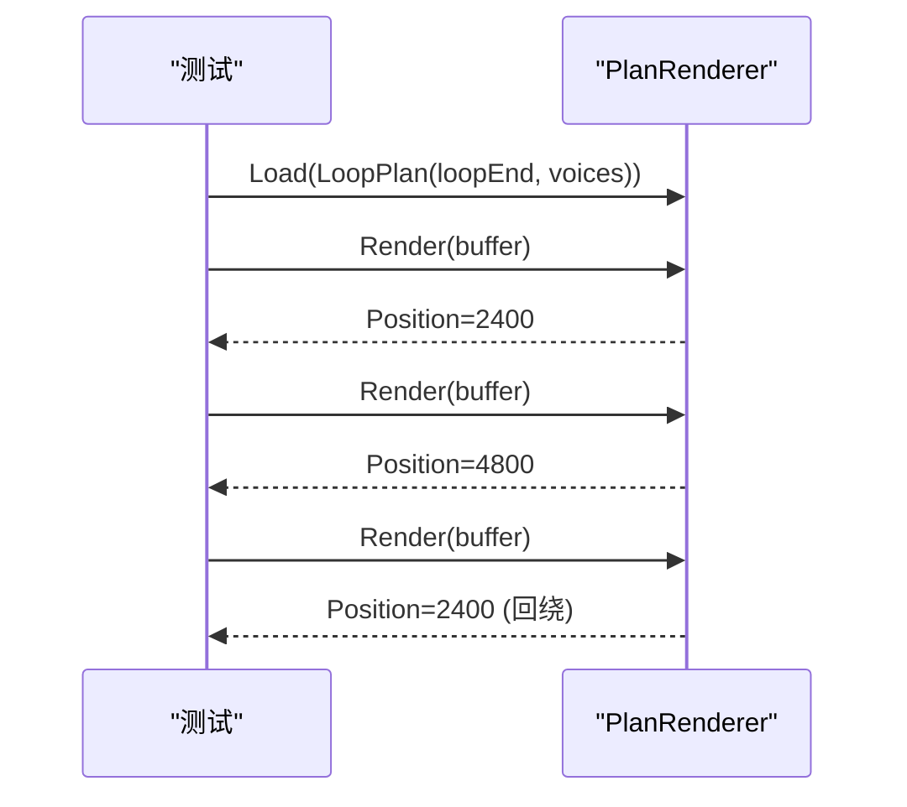

# 播放服务

<cite>
**本文引用的文件**   
- [PlaybackService.cs](file://src/Weftone.Application/PlaybackService.cs)
- [PlanRenderer.cs](file://src/Weftone.Engine/PlanRenderer.cs)
- [IPlanRenderer.cs](file://src/Weftone.Abstractions/Rendering/IPlanRenderer.cs)
- [RenderPlan.cs](file://src/Weftone.Abstractions/Rendering/RenderPlan.cs)
- [IAudioBackend.cs](file://src/Weftone.Abstractions/IAudioBackend.cs)
- [MiniaudioBackend.cs](file://src/Weftone.Adapters.Audio.Miniaudio/MiniaudioBackend.cs)
- [PlaybackServiceTests.cs](file://tests/Weftone.Application.Tests/PlaybackServiceTests.cs)
- [PlanRendererLoopTests.cs](file://tests/Weftone.Engine.Tests/PlanRendererLoopTests.cs)
</cite>

## 目录
1. [简介](#简介)
2. [项目结构定位](#项目结构定位)
3. [核心组件](#核心组件)
4. [架构总览](#架构总览)
5. [详细组件分析](#详细组件分析)
6. [依赖关系分析](#依赖关系分析)
7. [性能与实时性特征](#性能与实时性特征)
8. [故障排查指南](#故障排查指南)
9. [结论](#结论)
10. [附录：使用示例与最佳实践](#附录使用示例与最佳实践)

## 简介
本文围绕 `PlaybackService` 组件，系统化说明其在 Weftone 中的实时播放职责、状态管理、位置同步、循环播放、与音频后端的交互方式，以及与 `PlanRenderer` 的协作机制。文档同时覆盖缓冲区大小、延迟处理、线程安全约束、错误恢复策略，并提供基于测试用例的使用流程说明，帮助开发者在不直接阅读源码的情况下理解并正确使用该服务。

## 项目结构定位
`PlaybackService` 位于应用层（Application），负责编排渲染器与音频后端；`PlanRenderer` 位于引擎层（Engine），负责将预计算的 `RenderPlan` 转换为实时音频样本；音频后端通过抽象接口 `IAudioBackend` 解耦具体实现，当前提供基于 miniaudio 的适配层。

**图表来源**
- [PlaybackService.cs:12-31](file://src/Weftone.Application/PlaybackService.cs#L12-L31)
- [IPlanRenderer.cs:4-10](file://src/Weftone.Abstractions/Rendering/IPlanRenderer.cs#L4-L10)
- [IAudioBackend.cs:7-14](file://src/Weftone.Abstractions/IAudioBackend.cs#L7-L14)
- [PlanRenderer.cs:11-12](file://src/Weftone.Engine/PlanRenderer.cs#L11-L12)
- [MiniaudioBackend.cs:11-12](file://src/Weftone.Adapters.Audio.Miniaudio/MiniaaudioBackend.cs#L11-L12)

**章节来源**
- [PlaybackService.cs:1-31](file://src/Weftone.Application/PlaybackService.cs#L1-L31)
- [IPlanRenderer.cs:1-12](file://src/Weftone.Abstractions/Rendering/IPlanRenderer.cs#L1-L12)
- [IAudioBackend.cs:1-15](file://src/Weftone.Abstractions/IAudioBackend.cs#L1-L15)

## 核心组件
- `PlaybackService`：实时播放用例入口，封装播放控制、状态维护、后端生命周期管理与热更新逻辑。
- `PlanRenderer`：离线/实时两用渲染器，负责事件激活、声部调度、循环回绕、主音量缩放和零分配路径。
- `IPlanRenderer`：渲染器抽象，暴露位置、加载与渲染能力。
- `RenderPlan`：扁平化实时计划，包含采样率、声道数、主音量、总样本数、循环区间、声音事件与资产数组。
- `IAudioBackend`：音频后端抽象，定义打开、启动、停止与回调契约。
- `MiniaudioBackend`：基于 miniaudio 的后端实现，负责原生设备打开、回调桥接与资源释放。

**章节来源**
- [PlaybackService.cs:12-38](file://src/Weftone.Application/PlaybackService.cs#L12-L38)
- [PlanRenderer.cs:11-46](file://src/Weftone.Engine/PlanRenderer.cs#L11-L46)
- [IPlanRenderer.cs:4-10](file://src/Weftone.Abstractions/Rendering/IPlanRenderer.cs#L4-L10)
- [RenderPlan.cs:3-41](file://src/Weftone.Abstractions/Rendering/RenderPlan.cs#L3-L41)
- [IAudioBackend.cs:4-14](file://src/Weftone.Abstractions/IAudioBackend.cs#L4-L14)
- [MiniaudioBackend.cs:11-36](file://src/Weftone.Adapters.Audio.Miniaudio/MiniaudioBackend.cs#L11-L36)

## 架构总览
`PlaybackService` 在 UI 或上层应用中作为播放控制器，调用 `Play`/`Stop`/`UpdatePlan` 管理播放状态；内部通过 `IPlanRenderer.Render` 回调驱动 `PlanRenderer` 生成交错浮点样本；音频后端在实时线程上拉取样本并输出到设备。

**图表来源**
- [PlaybackService.cs:42-51](file://src/Weftone.Application/PlaybackService.cs#L42-L51)
- [PlanRenderer.cs:61-105](file://src/Weftone.Engine/PlanRenderer.cs#L61-L105)
- [IAudioBackend.cs:7-14](file://src/Weftone.Abstractions/IAudioBackend.cs#L7-L14)
- [MiniaudioBackend.cs:21-46](file://src/Weftone.Adapters.Audio.Miniaudio/MiniaudioBackend.cs#L21-L46)

## 详细组件分析

### PlaybackService：实时播放状态管理
- 播放控制
  - `Play`：先 `Stop()` 确保无并发，再 `Load` plan，设置总样本与循环标志，按 plan 的采样率与声道数打开后端，最后 `Start()` 并置 `IsPlaying=true`。
  - `Stop`：若正在播放则调用后端 `Stop()` 并清除播放标志。
  - `UpdatePlan`：支持编辑后“停止-交换-恢复”，保留原播放状态，避免音频线程中执行 `Load`，保证零并发。
- 状态属性
  - `IsPlaying`：是否处于播放态。
  - `IsLooping`：由 plan 的 `LoopEndSample > LoopStartSample` 决定，表示 Pattern 模式启用循环。
  - `Position`：委托给 `PlanRenderer.Position`，用于 UI 显示与进度跟踪。
  - `TotalSamples`：来自 plan 的总样本数，用于进度条上限。
- 后端管理
  - `EnsureOpen`：当已有后端且采样率未变化时复用；否则释放旧后端、创建新后端并以 `BufferFrames=256` 打开。
  - 构造时缓存 `renderer.Render` 为委托，避免回调路径重复绑定。

**图表来源**
- [PlaybackService.cs:42-51](file://src/Weftone.Application/PlaybackService.cs#L42-L51)
- [PlaybackService.cs:80-90](file://src/Weftone.Application/PlaybackService.cs#L80-L90)

**章节来源**
- [PlaybackService.cs:12-38](file://src/Weftone.Application/PlaybackService.cs#L12-L38)
- [PlaybackService.cs:42-78](file://src/Weftone.Application/PlaybackService.cs#L42-L78)
- [PlaybackService.cs:80-98](file://src/Weftone.Application/PlaybackService.cs#L80-L98)

### PlanRenderer：位置同步与循环算法
- 位置推进
  - `Render` 每次清空输出缓冲，计算帧数并按段渲染；每段结束后 `_position += frames`。
  - 循环模式下，若当前位置到达 `LoopEnd`，则将位置回绕至 `LoopStart`，并将事件游标归零以重新触发事件。
- 事件激活与声部调度
  - 按 `StartSample` 顺序激活声音；池满时选择最早结束的活跃声部进行淡出偷取，新事件进入 pending 环等待槽位释放。
  - 每个声部支持等待期、剩余长度、相位推进、资产读取与增益混合。
- 主音量与零分配
  - 若 `MasterGain != 1f`，对整段缓冲乘以主音量。
  - 全程使用固定容量数组与 struct，避免托管分配，满足实时路径要求。

**图表来源**
- [PlanRenderer.cs:61-105](file://src/Weftone.Engine/PlanRenderer.cs#L61-L105)
- [PlanRenderer.cs:107-137](file://src/Weftone.Engine/PlanRenderer.cs#L107-L137)

**章节来源**
- [PlanRenderer.cs:44-59](file://src/Weftone.Engine/PlanRenderer.cs#L44-L59)
- [PlanRenderer.cs:61-105](file://src/Weftone.Engine/PlanRenderer.cs#L61-L105)
- [PlanRenderer.cs:107-137](file://src/Weftone.Engine/PlanRenderer.cs#L107-L137)
- [PlanRenderer.cs:139-231](file://src/Weftone.Engine/PlanRenderer.cs#L139-L231)

### 播放进度与 UI 同步
- UI 可通过 `PlaybackService.Position` 获取当前播放位置，该值直接映射到 `PlanRenderer.Position`。
- 进度条最大值可使用 `PlaybackService.TotalSamples`。
- 由于 `Position` 仅在渲染推进后更新，UI 刷新频率应与音频回调周期匹配或采用插值平滑，以避免视觉抖动。

**章节来源**
- [PlaybackService.cs:33-40](file://src/Weftone.Application/PlaybackService.cs#L33-L40)
- [PlanRenderer.cs:44-46](file://src/Weftone.Engine/PlanRenderer.cs#L44-L46)

### 循环播放支持与 Pattern 模式
- `RenderPlan` 提供 `LoopStartSample` 与 `LoopEndSample`；当 `LoopEnd > LoopStart` 时启用循环。
- `PlaybackService.IsLooping` 根据 plan 的循环区间设置，供 UI 展示 Pattern/Song 模式。
- `PlanRenderer` 在循环边界处回绕位置并重置事件游标，确保音符重触发。

**章节来源**
- [RenderPlan.cs:29-41](file://src/Weftone.Abstractions/Rendering/RenderPlan.cs#L29-L41)
- [PlaybackService.cs:42-51](file://src/Weftone.Application/PlaybackService.cs#L42-L51)
- [PlanRenderer.cs:75-95](file://src/Weftone.Engine/PlanRenderer.cs#L75-L95)

### 播放速度控制
- 当前代码未暴露显式的“播放速度”参数；实际播放速率由 `RenderPlan.SampleRate` 与 `PlanRenderer` 的相位/资产步进决定。
- 若需变速，可在编译阶段调整 `RenderVoice.Frequency` 或资产重采样，从而改变音高或时长。

**章节来源**
- [RenderPlan.cs:31-39](file://src/Weftone.Abstractions/Rendering/RenderPlan.cs#L31-L39)
- [PlanRenderer.cs:158-177](file://src/Weftone.Engine/PlanRenderer.cs#L158-L177)

### 与音频后端的交互：缓冲区、延迟与线程安全
- 缓冲区
  - `PlaybackService` 使用固定 `BufferFrames=256` 作为设备缓冲帧数，影响延迟与稳定性。
  - `MiniaudioBackend.Open` 将 spec 传递给原生层，回调路径零分配。
- 延迟处理
  - 通过较小的缓冲帧数降低端到端延迟；若出现爆音可增大缓冲帧数。
- 线程安全
  - 音频回调在实时线程上调用，禁止分配、锁与异常；`PlaybackService` 保证 `Load` 不在回调期间执行。
  - `MiniaudioBackend.Trampoline` 仅做指针转换与委托调用，不引入额外开销。

**图表来源**
- [PlaybackService.cs:12-38](file://src/Weftone.Application/PlaybackService.cs#L12-L38)
- [IPlanRenderer.cs:4-10](file://src/Weftone.Abstractions/Rendering/IPlanRenderer.cs#L4-L10)
- [PlanRenderer.cs:11-46](file://src/Weftone.Engine/PlanRenderer.cs#L11-L46)
- [IAudioBackend.cs:7-14](file://src/Weftone.Abstractions/IAudioBackend.cs#L7-L14)
- [MiniaudioBackend.cs:11-36](file://src/Weftone.Adapters.Audio.Miniaudio/MiniaudioBackend.cs#L11-L36)

**章节来源**
- [PlaybackService.cs:14-31](file://src/Weftone.Application/PlaybackService.cs#L14-L31)
- [MiniaudioBackend.cs:21-56](file://src/Weftone.Adapters.Audio.Miniaudio/MiniaudioBackend.cs#L21-L56)
- [IAudioBackend.cs:3-4](file://src/Weftone.Abstractions/IAudioBackend.cs#L3-L4)

### 播放状态枚举与事件通知
- 当前实现未定义独立的“播放状态枚举”，而是通过布尔标志 `IsPlaying` 与 `IsLooping` 表达状态。
- 事件通知方面，未暴露事件总线；上层通过轮询 `IsPlaying`、`Position`、`TotalSamples` 与 `IsLooping` 来感知状态变化。
- 如需扩展，可在 `PlaybackService` 增加事件（如 `OnStateChanged`、`OnPositionChanged`）并在相应方法中触发。

**章节来源**
- [PlaybackService.cs:33-40](file://src/Weftone.Application/PlaybackService.cs#L33-L40)

### 错误恢复策略
- 后端打开/启动失败：`MiniaudioBackend` 抛出 `InvalidOperationException`，携带原生错误信息；上层应捕获并提示用户或降级。
- 资源释放：`PlaybackService.Dispose` 会调用 `Stop()` 并释放后端；`MiniaudioBackend.Dispose` 关闭设备并释放句柄。
- 丢事件统计：`PlanRenderer.DroppedEvents` 可用于监控极端负载下的事件丢失情况。

**章节来源**
- [MiniaudioBackend.cs:28-35](file://src/Weftone.Adapters.Audio.Miniaudio/MiniaudioBackend.cs#L28-L35)
- [MiniaudioBackend.cs:38-56](file://src/Weftone.Adapters.Audio.Miniaudio/MiniaudioBackend.cs#L38-L56)
- [MiniaudioBackend.cs:58-76](file://src/Weftone.Adapters.Audio.Miniaudio/MiniaudioBackend.cs#L58-L76)
- [PlanRenderer.cs:46-46](file://src/Weftone.Engine/PlanRenderer.cs#L46-L46)
- [PlaybackService.cs:92-98](file://src/Weftone.Application/PlaybackService.cs#L92-L98)

## 依赖关系分析
- `PlaybackService` 依赖 `Func<IAudioBackend>` 工厂与 `IPlanRenderer` 实例，松耦合便于替换实现。
- `PlanRenderer` 依赖 `RenderPlan` 数据，不感知后端细节。
- `MiniaudioBackend` 依赖原生库，但对外仅暴露 `IAudioBackend` 接口。

**图表来源**
- [PlaybackService.cs:16-31](file://src/Weftone.Application/PlaybackService.cs#L16-L31)
- [IPlanRenderer.cs:4-10](file://src/Weftone.Abstractions/Rendering/IPlanRenderer.cs#L4-L10)
- [IAudioBackend.cs:7-14](file://src/Weftone.Abstractions/IAudioBackend.cs#L7-L14)
- [MiniaudioBackend.cs:11-36](file://src/Weftone.Adapters.Audio.Miniaudio/MiniaudioBackend.cs#L11-L36)

**章节来源**
- [PlaybackService.cs:16-31](file://src/Weftone.Application/PlaybackService.cs#L16-L31)
- [PlanRenderer.cs:11-12](file://src/Weftone.Engine/PlanRenderer.cs#L11-L12)
- [MiniaudioBackend.cs:11-36](file://src/Weftone.Adapters.Audio.Miniaudio/MiniaudioBackend.cs#L11-L36)

## 性能与实时性特征
- 零分配路径：`PlanRenderer` 使用固定数组与 struct，避免 GC 压力；`MiniaudioBackend` 回调路径仅做指针转换。
- 缓冲帧数：`BufferFrames=256` 平衡延迟与稳定性；可根据设备与平台调优。
- 事件调度：池化声部与 pending 环减少动态分配；偷取策略带线性淡出避免 click。
- 主音量缩放：仅在需要时对整段缓冲进行乘法，避免逐样本分支判断。

**章节来源**
- [PlanRenderer.cs:13-16](file://src/Weftone.Engine/PlanRenderer.cs#L13-L16)
- [PlanRenderer.cs:139-231](file://src/Weftone.Engine/PlanRenderer.cs#L139-L231)
- [PlaybackService.cs:14-14](file://src/Weftone.Application/PlaybackService.cs#L14-L14)
- [MiniaudioBackend.cs:78-83](file://src/Weftone.Adapters.Audio.Miniaudio/MiniaudioBackend.cs#L78-L83)

## 故障排查指南
- 无法打开设备
  - 现象：`MiniaudioBackend.Open` 抛出异常。
  - 排查：检查采样率、声道数与缓冲帧数是否被系统支持；确认原生库已安装。
- 播放卡顿或爆音
  - 现象：音频断续或爆音。
  - 排查：增大 `BufferFrames`；检查 CPU 占用与实时优先级；确认渲染路径无分配。
- 位置不同步
  - 现象：UI 进度与声音不一致。
  - 排查：确认 UI 刷新频率与回调周期匹配；检查是否在非实时线程修改了 plan。
- 循环不生效
  - 现象：Pattern 模式未循环。
  - 排查：确认 `LoopEndSample > LoopStartSample`；检查 `IsLooping` 与 `Position` 行为。

**章节来源**
- [MiniaudioBackend.cs:28-35](file://src/Weftone.Adapters.Audio.Miniaudio/MiniaudioBackend.cs#L28-L35)
- [PlaybackService.cs:80-90](file://src/Weftone.Application/PlaybackService.cs#L80-L90)
- [PlanRenderer.cs:75-95](file://src/Weftone.Engine/PlanRenderer.cs#L75-L95)

## 结论
`PlaybackService` 以简洁的状态机与后端生命周期管理，实现了实时播放的核心能力；`PlanRenderer` 提供高性能、零分配的渲染路径，并通过循环回绕与事件调度保证音乐播放的正确性与连续性。两者通过稳定抽象解耦，便于扩展与测试。对于 UI 同步与错误恢复，建议结合轮询状态与事件扩展，提升用户体验与健壮性。

## 附录：使用示例与最佳实践

### 播放控制流程示例
以下示例基于单元测试验证的行为，描述典型用法：
- 初始化服务：传入后端工厂与渲染器实例。
- 播放：调用 `Play(plan)`，内部依次执行 `Stop`、`Load`、`EnsureOpen`、`Start`，并设置 `IsPlaying=true`。
- 停止：调用 `Stop()`，内部调用后端 `Stop()` 并清除播放标志。
- 热更新：调用 `UpdatePlan(plan)`，内部先停止、交换 plan、再恢复播放（若之前处于播放态）。

**图表来源**
- [PlaybackServiceTests.cs:49-64](file://tests/Weftone.Application.Tests/PlaybackServiceTests.cs#L49-L64)
- [PlaybackServiceTests.cs:66-78](file://tests/Weftone.Application.Tests/PlaybackServiceTests.cs#L66-L78)
- [PlaybackServiceTests.cs:80-95](file://tests/Weftone.Application.Tests/PlaybackServiceTests.cs#L80-L95)

**章节来源**
- [PlaybackServiceTests.cs:49-174](file://tests/Weftone.Application.Tests/PlaybackServiceTests.cs#L49-L174)

### 循环播放行为示例
- 加载带循环区间的 plan，首次渲染到 `LoopEnd`，再次渲染回绕至 `LoopStart` 并重新触发事件。
- 短循环块在一次渲染中多次回绕，仍保持事件正确性与零丢事件。

**图表来源**
- [PlanRendererLoopTests.cs:33-57](file://tests/Weftone.Engine.Tests/PlanRendererLoopTests.cs#L33-L57)

**章节来源**
- [PlanRendererLoopTests.cs:1-90](file://tests/Weftone.Engine.Tests/PlanRendererLoopTests.cs#L1-L90)

### 最佳实践清单
- 始终在 UI 线程调用 `Play`/`Stop`/`UpdatePlan`，不要在音频回调中修改 plan。
- 使用 `IsPlaying`、`Position`、`TotalSamples`、`IsLooping` 监听状态与进度。
- 遇到设备打开失败时捕获异常并提示用户；必要时重试或降级。
- 根据设备与平台调整 `BufferFrames` 以平衡延迟与稳定性。
- 监控 `PlanRenderer.DroppedEvents` 以评估极端负载下的事件丢失情况。