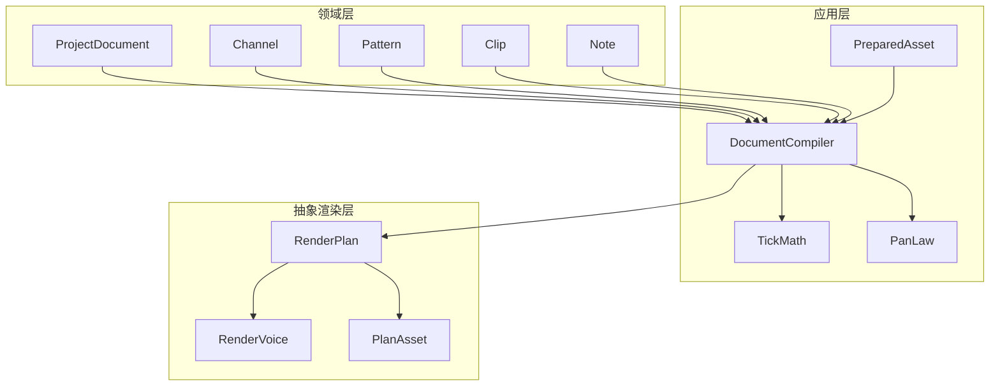
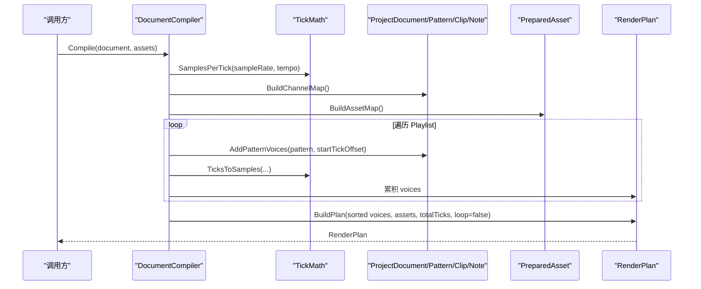
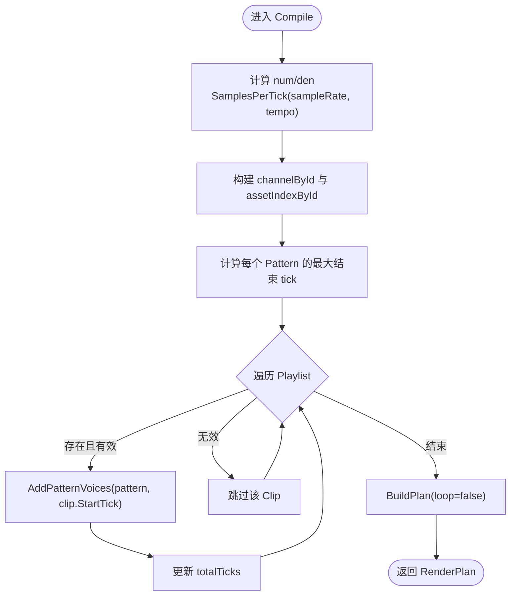
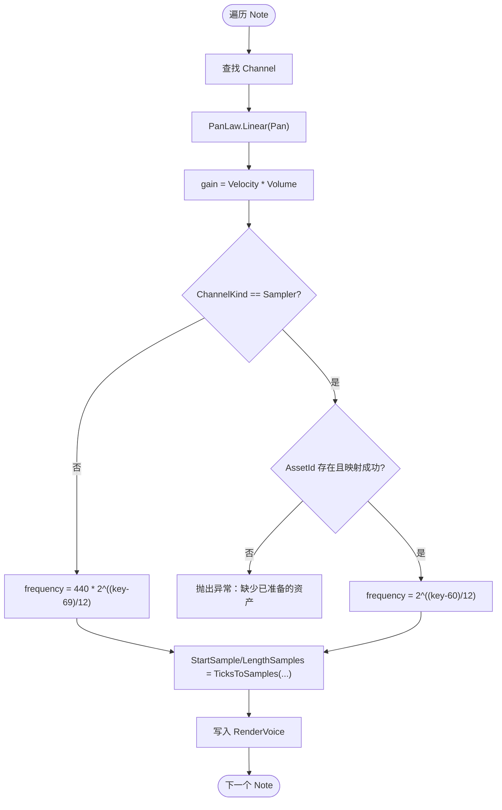
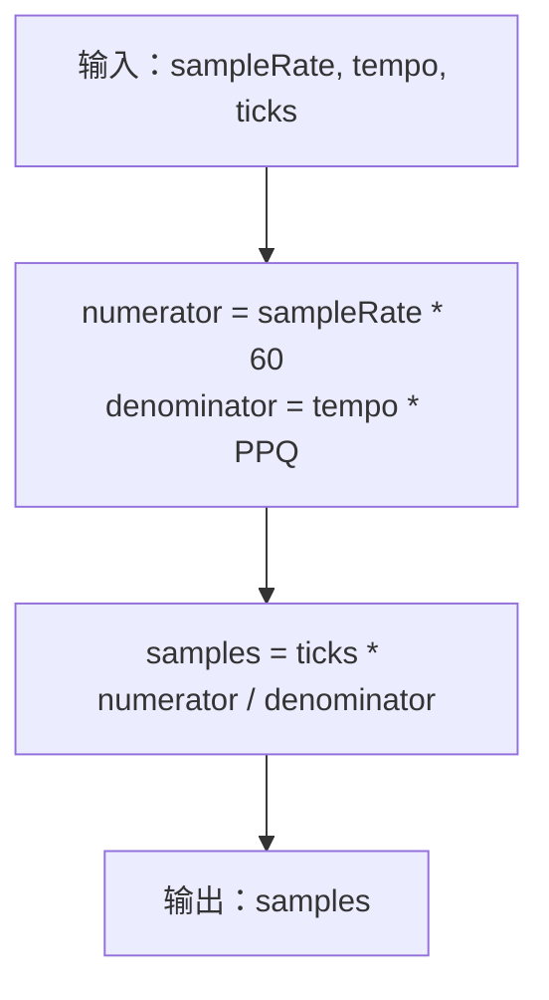
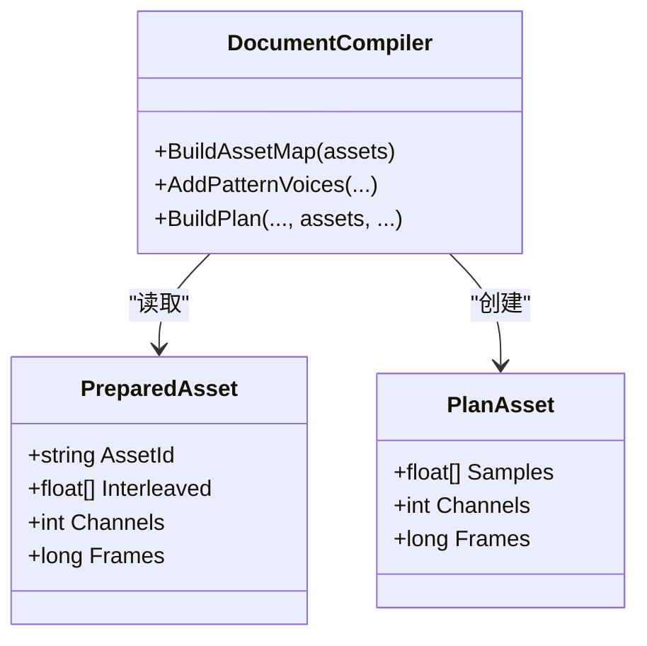
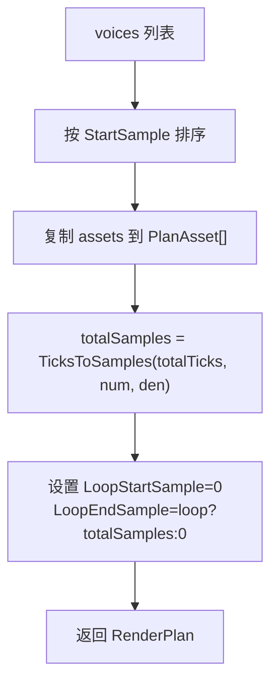
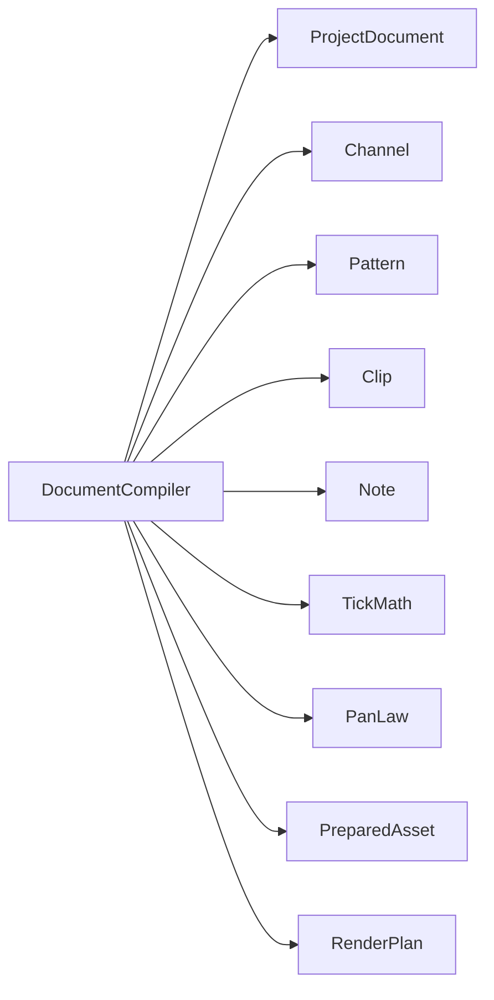

# 文档编译器

<cite>
**本文引用的文件**   
- [DocumentCompiler.cs](file://src/Weftone.Application/DocumentCompiler.cs)
- [ProjectDocument.cs](file://src/Weftone.Domain/ProjectDocument.cs)
- [Channel.cs](file://src/Weftone.Domain/Channel.cs)
- [Pattern.cs](file://src/Weftone.Domain/Pattern.cs)
- [Clip.cs](file://src/Weftone.Domain/Clip.cs)
- [Note.cs](file://src/Weftone.Domain/Note.cs)
- [RenderPlan.cs](file://src/Weftone.Abstractions/Rendering/RenderPlan.cs)
- [TickMath.cs](file://src/Weftone.Application/TickMath.cs)
- [PanLaw.cs](file://src/Weftone.Application/PanLaw.cs)
- [AssetPreparer.cs](file://src/Weftone.Application/AssetPreparer.cs)
- [ADR-0003-document-engine-compiler.md](file://docs/adr/ADR-0003-document-engine-compiler.md)
</cite>

## 目录
1. [引言](#引言)
2. [项目结构定位](#项目结构定位)
3. [核心组件](#核心组件)
4. [架构总览](#架构总览)
5. [详细组件分析](#详细组件分析)
6. [依赖关系分析](#依赖关系分析)
7. [性能与优化](#性能与优化)
8. [故障排查指南](#故障排查指南)
9. [结论](#结论)

## 引言
本文围绕 Weftone 的 DocumentCompiler 组件，系统性说明如何将富对象工程 ProjectDocument 编译为扁平、实时安全的 RenderPlan。重点覆盖：
- 完整播放列表 Compile 流程与 Pattern 模式 CompilePattern 循环逻辑
- 声部（RenderVoice）生成：频率计算、音量混合、声像定位、采样器索引映射
- 时间系统转换（Ticks → Samples）、BPM 到采样率换算、节拍对齐
- 资产映射机制与错误处理策略
- 编译流程、优化策略与性能考虑

该设计遵循 ADR-0003：编辑模型与实时渲染数据解耦，非实时线程全量编译，音频线程仅消费扁平数组。

**章节来源**
- [ADR-0003-document-engine-compiler.md:1-24](file://docs/adr/ADR-0003-document-engine-compiler.md#L1-L24)

## 项目结构定位
DocumentCompiler 位于应用层（Weftone.Application），负责将领域层（Weftone.Domain）的富对象工程转换为抽象层（Weftone.Abstractions.Rendering）定义的 RenderPlan。关键输入输出如下：
- 输入：ProjectDocument（包含 Tempo、SampleRate、MasterVolume、Channels、Patterns、Playlist、Assets）
- 辅助输入：PreparedAsset（已解码并重采样的交错样本）
- 输出：RenderPlan（扁平事件数组 Voices、PlanAsset[] Assets、TotalSamples、LoopStartSample/LoopEndSample）

**图表来源**
- [DocumentCompiler.cs:11-158](file://src/Weftone.Application/DocumentCompiler.cs#L11-L158)
- [ProjectDocument.cs:7-20](file://src/Weftone.Domain/ProjectDocument.cs#L7-L20)
- [Channel.cs:3-18](file://src/Weftone.Domain/Channel.cs#L3-L18)
- [Pattern.cs:3-8](file://src/Weftone.Domain/Pattern.cs#L3-L8)
- [Clip.cs:4-8](file://src/Weftone.Domain/Clip.cs#L4-L8)
- [Note.cs:4-11](file://src/Weftone.Domain/Note.cs#L4-L11)
- [RenderPlan.cs:3-41](file://src/Weftone.Abstractions/Rendering/RenderPlan.cs#L3-L41)
- [TickMath.cs:6-13](file://src/Weftone.Application/TickMath.cs#L6-L13)
- [PanLaw.cs:7-14](file://src/Weftone.Application/PanLaw.cs#L7-L14)
- [AssetPreparer.cs:6-6](file://src/Weftone.Application/AssetPreparer.cs#L6-L6)

**章节来源**
- [DocumentCompiler.cs:11-158](file://src/Weftone.Application/DocumentCompiler.cs#L11-L158)
- [ProjectDocument.cs:7-20](file://src/Weftone.Domain/ProjectDocument.cs#L7-L20)
- [RenderPlan.cs:3-41](file://src/Weftone.Abstractions/Rendering/RenderPlan.cs#L3-L41)

## 核心组件
- DocumentCompiler：核心编译器，提供 Compile 与 CompilePattern 两个入口，内部构建声道映射、资产映射，展开 Playlist 或单个 Pattern，生成 RenderVoice 列表并组装 RenderPlan。
- ProjectDocument：可编辑工程文档，包含 Tempo、SampleRate、MasterVolume、Channels、Patterns、Playlist、Assets。
- Channel：声部通道，定义音源类型（Sine/Sampler）、音量、声像、采样器资产 ID。
- Pattern：乐段，包含一组 Note。
- Clip：播放列表片段，指定 PatternId 与 StartTick。
- Note：音符，包含 ChannelId、Tick、Key、Velocity、LengthTicks。
- RenderPlan/RenderVoice/PlanAsset：扁平渲染计划与事件、资产数据结构。
- TickMath：tick 与 sample 的整数映射工具。
- PanLaw：线性声像分配算法。
- PreparedAsset：预处理的音频资产记录。

**章节来源**
- [DocumentCompiler.cs:11-158](file://src/Weftone.Application/DocumentCompiler.cs#L11-L158)
- [ProjectDocument.cs:7-20](file://src/Weftone.Domain/ProjectDocument.cs#L7-L20)
- [Channel.cs:3-18](file://src/Weftone.Domain/Channel.cs#L3-L18)
- [Pattern.cs:3-8](file://src/Weftone.Domain/Pattern.cs#L3-L8)
- [Clip.cs:4-8](file://src/Weftone.Domain/Clip.cs#L4-L8)
- [Note.cs:4-11](file://src/Weftone.Domain/Note.cs#L4-L11)
- [RenderPlan.cs:3-41](file://src/Weftone.Abstractions/Rendering/RenderPlan.cs#L3-L41)
- [TickMath.cs:6-13](file://src/Weftone.Application/TickMath.cs#L6-L13)
- [PanLaw.cs:7-14](file://src/Weftone.Application/PanLaw.cs#L7-L14)
- [AssetPreparer.cs:6-6](file://src/Weftone.Application/AssetPreparer.cs#L6-L6)

## 架构总览
DocumentCompiler 的编译过程分为三个阶段：
1. 准备阶段：根据 SampleRate 与 Tempo 计算每 tick 对应的采样数（num/den），构建 Channel 与 Asset 查找表。
2. 展开阶段：遍历 Playlist 或单个 Pattern，按音符生成 RenderVoice，完成频率、音量、声像、资产索引等参数预乘。
3. 构建阶段：对 RenderVoice 按 StartSample 排序，复制资产数据到 PlanAsset，设置 TotalSamples、LoopStartSample/LoopEndSample，返回 RenderPlan。

**图表来源**
- [DocumentCompiler.cs:19-49](file://src/Weftone.Application/DocumentCompiler.cs#L19-L49)
- [TickMath.cs:8-12](file://src/Weftone.Application/TickMath.cs#L8-L12)
- [ProjectDocument.cs:12-19](file://src/Weftone.Domain/ProjectDocument.cs#L12-L19)
- [RenderPlan.cs:29-41](file://src/Weftone.Abstractions/Rendering/RenderPlan.cs#L29-L41)

## 详细组件分析

### 编译入口：Compile 与 CompilePattern
- Compile(ProjectDocument, assets)：
  - 计算 num/den（每 tick 采样数）
  - 构建 channelById 与 assetIndexById
  - 遍历 Patterns 计算每个 Pattern 的最大结束 tick（patternEnds）
  - 按 StartTick 排序遍历 Playlist，累计 totalTicks，并为每个 Clip 调用 AddPatternVoices
  - 最终 BuildPlan(loop=false)
- CompilePattern(ProjectDocument, patternId, assets)：
  - 校验 patternId 存在
  - 从 0 开始展开单个 Pattern 的 Notes 为 RenderVoice
  - 使用 PatternLengthTicks 计算循环长度（小节对齐，至少 1 小节）
  - BuildPlan(loop=true)，设置 LoopEndSample = totalSamples

**图表来源**
- [DocumentCompiler.cs:19-49](file://src/Weftone.Application/DocumentCompiler.cs#L19-L49)

**章节来源**
- [DocumentCompiler.cs:19-49](file://src/Weftone.Application/DocumentCompiler.cs#L19-L49)
- [DocumentCompiler.cs:52-65](file://src/Weftone.Application/DocumentCompiler.cs#L52-L65)

### 声部生成：AddPatternVoices
AddPatternVoices 是核心转换函数，将 Pattern.Notes 转为 RenderVoice：
- 查找 Channel：通过 note.ChannelId 获取 Channel
- 声像定位：PanLaw.Linear(channel.Pan) 得到左右增益系数
- 音量混合：gain = note.Velocity * channel.Volume
- 频率计算：
  - Sine 声部：frequency = 440 * 2^((key - 69)/12)
  - Sampler 声部：frequency = 2^((key - 60)/12)（MIDI 60 = 原速）
- 资产索引：若 ChannelKind == Sampler，则必须存在 AssetId 且在 assetIndexById 中；否则抛出异常
- 时间转换：StartSample = TicksToSamples(startTickOffset + note.Tick, num, den)；LengthSamples = max(1, TicksToSamples(note.LengthTicks, num, den))
- 写入 RenderVoice：Kind、Frequency、GainLeft、GainRight、AssetIndex

**图表来源**
- [DocumentCompiler.cs:98-129](file://src/Weftone.Application/DocumentCompiler.cs#L98-L129)
- [PanLaw.cs:9-13](file://src/Weftone.Application/PanLaw.cs#L9-L13)
- [TickMath.cs:11-12](file://src/Weftone.Application/TickMath.cs#L11-L12)

**章节来源**
- [DocumentCompiler.cs:98-129](file://src/Weftone.Application/DocumentCompiler.cs#L98-L129)
- [Channel.cs:3-18](file://src/Weftone.Domain/Channel.cs#L3-L18)
- [Note.cs:4-11](file://src/Weftone.Domain/Note.cs#L4-L11)

### 时间系统与 BPM 计算
- 每 tick 采样数：SamplesPerTick(sampleRate, tempo) = (sampleRate * 60, tempo * PPQ)
- 时间转换：TicksToSamples(ticks, numerator, denominator) = ticks * numerator / denominator（截断除法，确定性）
- 节拍对齐：PatternLengthTicks 将最大结束 tick 向上取整到小节（BarTicks = PPQ * 4），至少 1 小节

**图表来源**
- [TickMath.cs:8-12](file://src/Weftone.Application/TickMath.cs#L8-L12)

**章节来源**
- [TickMath.cs:6-13](file://src/Weftone.Application/TickMath.cs#L6-L13)
- [DocumentCompiler.cs:67-76](file://src/Weftone.Application/DocumentCompiler.cs#L67-L76)

### 资产映射机制
- PreparedAsset：包含 AssetId、Interleaved（交错样本数组）、Channels、Frames
- BuildAssetMap：将 assets[i].AssetId 映射到 index i，供 Sampler 声部引用
- 在 AddPatternVoices 中，若 ChannelKind == Sampler，则要求 AssetId 存在且映射成功，否则抛出异常
- BuildPlan 中将 PreparedAsset 复制到 PlanAsset（Samples、Channels、Frames）

**图表来源**
- [AssetPreparer.cs:6-6](file://src/Weftone.Application/AssetPreparer.cs#L6-L6)
- [RenderPlan.cs:22-27](file://src/Weftone.Abstractions/Rendering/RenderPlan.cs#L22-L27)
- [DocumentCompiler.cs:88-96](file://src/Weftone.Application/DocumentCompiler.cs#L88-L96)
- [DocumentCompiler.cs:131-156](file://src/Weftone.Application/DocumentCompiler.cs#L131-L156)

**章节来源**
- [AssetPreparer.cs:6-6](file://src/Weftone.Application/AssetPreparer.cs#L6-L6)
- [DocumentCompiler.cs:88-96](file://src/Weftone.Application/DocumentCompiler.cs#L88-L96)
- [DocumentCompiler.cs:131-156](file://src/Weftone.Application/DocumentCompiler.cs#L131-L156)

### 编译结果：RenderPlan 构建
BuildPlan 负责：
- 将 voices 按 StartSample 排序，确保渲染期稳定顺序
- 复制 assets 到 plan.Assets（PlanAsset）
- 计算 totalSamples = TicksToSamples(totalTicks, num, den)
- 设置 MasterGain = clamp(MasterVolume, 0, 2)
- 设置 LoopStartSample = 0，LoopEndSample = loop ? totalSamples : 0

**图表来源**
- [DocumentCompiler.cs:131-156](file://src/Weftone.Application/DocumentCompiler.cs#L131-L156)

**章节来源**
- [DocumentCompiler.cs:131-156](file://src/Weftone.Application/DocumentCompiler.cs#L131-L156)
- [RenderPlan.cs:29-41](file://src/Weftone.Abstractions/Rendering/RenderPlan.cs#L29-L41)

## 依赖关系分析
DocumentCompiler 依赖以下模块：
- 领域层：ProjectDocument、Channel、Pattern、Clip、Note
- 应用层：TickMath、PanLaw、PreparedAsset
- 抽象层：RenderPlan、RenderVoice、PlanAsset

**图表来源**
- [DocumentCompiler.cs:1-158](file://src/Weftone.Application/DocumentCompiler.cs#L1-L158)
- [ProjectDocument.cs:7-20](file://src/Weftone.Domain/ProjectDocument.cs#L7-L20)
- [Channel.cs:3-18](file://src/Weftone.Domain/Channel.cs#L3-L18)
- [Pattern.cs:3-8](file://src/Weftone.Domain/Pattern.cs#L3-L8)
- [Clip.cs:4-8](file://src/Weftone.Domain/Clip.cs#L4-L8)
- [Note.cs:4-11](file://src/Weftone.Domain/Note.cs#L4-L11)
- [TickMath.cs:6-13](file://src/Weftone.Application/TickMath.cs#L6-L13)
- [PanLaw.cs:7-14](file://src/Weftone.Application/PanLaw.cs#L7-L14)
- [RenderPlan.cs:3-41](file://src/Weftone.Abstractions/Rendering/RenderPlan.cs#L3-L41)

**章节来源**
- [DocumentCompiler.cs:1-158](file://src/Weftone.Application/DocumentCompiler.cs#L1-L158)

## 性能与优化
- 非实时编译：DocumentCompiler 在非实时线程执行，避免 GC/锁不确定性影响音频线程
- 扁平数据结构：RenderPlan 使用数组与 struct，无富对象图，减少运行时开销
- 预乘参数：频率、音量、声像、资产索引等在编译期计算，渲染期零计算负担
- 确定性时间映射：TicksToSamples 使用截断除法，保证回放一致性
- 批量排序：voices 一次性按 StartSample 排序，避免渲染期动态排序
- 最小化内存拷贝：PlanAsset 直接引用 PreparedAsset.Interleaved，避免重复分配

[本节为通用性能讨论，不直接分析具体文件]

## 故障排查指南
常见错误与处理：
- Sampler 声部缺少已准备的资产：当 ChannelKind == Sampler 但 AssetId 为空或未在 assetIndexById 中找到时，抛出 InvalidOperationException
- Pattern 不存在：CompilePattern 中若 patternId 未找到，抛出 InvalidOperationException
- 空资产列表：Compile/CompilePattern 对 assets 进行 null 检查，传入 null 会抛出 ArgumentNullException

建议排查步骤：
- 确认所有 Sampler 声部的 AssetId 已在 PreparedAsset 列表中
- 确认 CompilePattern 传入的 patternId 存在于 document.Patterns
- 检查 Playlist 中的 Clip 是否指向有效的 PatternId，且 Pattern 中存在 Notes

**章节来源**
- [DocumentCompiler.cs:21-21](file://src/Weftone.Application/DocumentCompiler.cs#L21-L21)
- [DocumentCompiler.cs:59-60](file://src/Weftone.Application/DocumentCompiler.cs#L59-L60)
- [DocumentCompiler.cs:111-114](file://src/Weftone.Application/DocumentCompiler.cs#L111-L114)

## 结论
DocumentCompiler 实现了从富对象工程到扁平渲染计划的可靠转换，遵循 ADR-0003 的非实时编译原则，确保音频线程的安全性与确定性。通过预乘音频参数、整数时间映射、小节对齐与资产映射，系统在性能与可测性之间取得平衡。未来可在声像律升级（constant-power）与自动化 PDC 离线计算方面继续演进。

[本节为总结性内容，不直接分析具体文件]