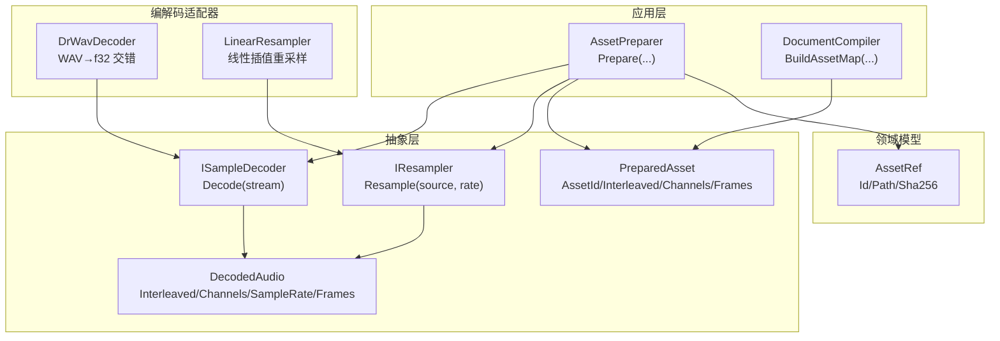
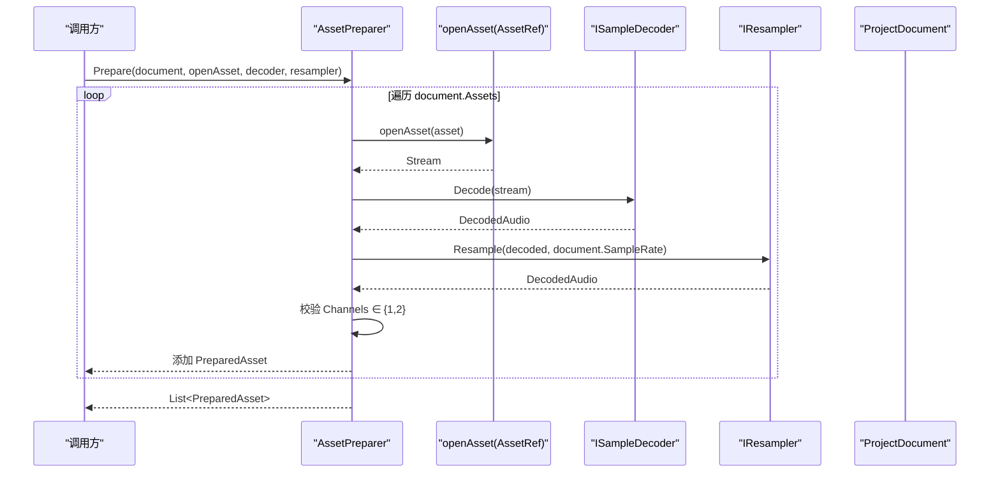
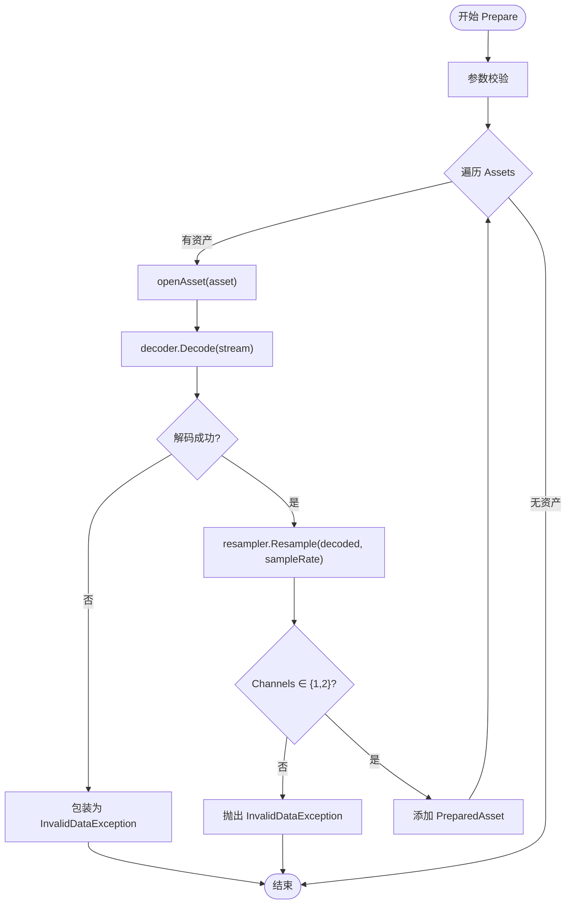
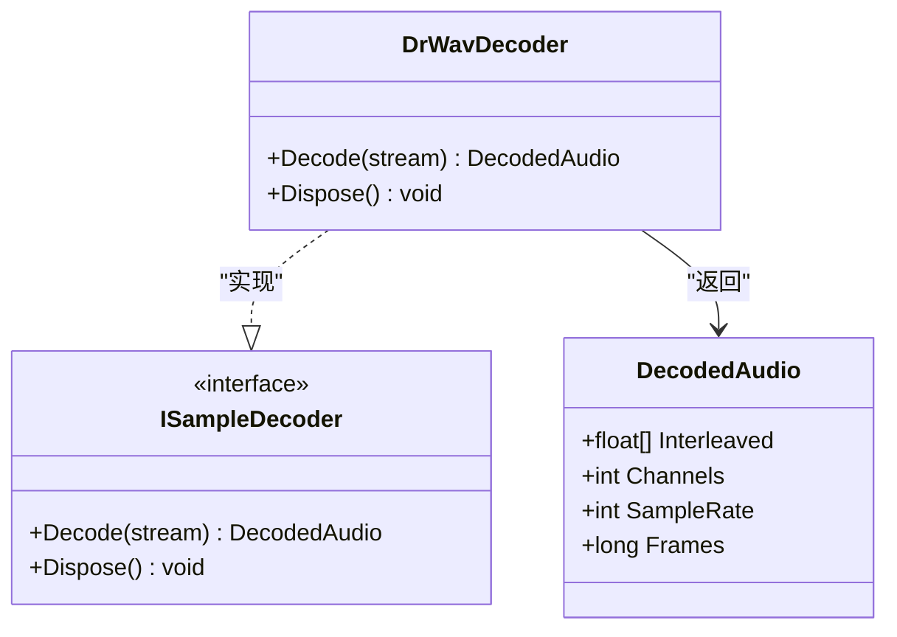
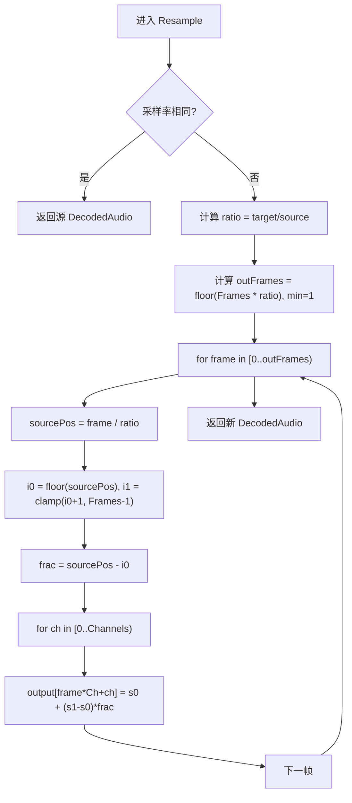
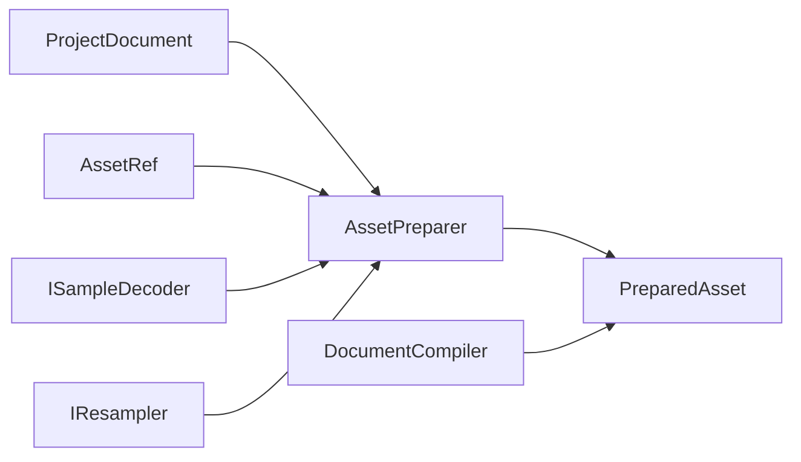

# 资源处理器

<cite>
**本文引用的文件**   
- [AssetPreparer.cs](file://src/Weftone.Application/AssetPreparer.cs)
- [ISampleDecoder.cs](file://src/Weftone.Abstractions/ISampleDecoder.cs)
- [DrWavDecoder.cs](file://src/Weftone.Adapters.Codecs/DrWavDecoder.cs)
- [LinearResampler.cs](file://src/Weftone.Adapters.Codecs/LinearResampler.cs)
- [AssetRef.cs](file://src/Weftone.Domain/AssetRef.cs)
- [DocumentCompiler.cs](file://src/Weftone.Application/DocumentCompiler.cs)
- [AssetPipelineTests.cs](file://tests/Weftone.Application.Tests/AssetPipelineTests.cs)
</cite>

## 目录
1. [简介](#简介)
2. [项目结构](#项目结构)
3. [核心组件](#核心组件)
4. [架构总览](#架构总览)
5. [详细组件分析](#详细组件分析)
6. [依赖关系分析](#依赖关系分析)
7. [性能与质量权衡](#性能与质量权衡)
8. [故障排查指南](#故障排查指南)
9. [结论](#结论)
10. [附录：使用示例与最佳实践](#附录使用示例与最佳实践)

## 简介
本文件围绕 AssetPreparer 组件，系统化说明音频资源的预处理流程：从资产流打开、格式检测与解码、重采样到工程采样率、声道数校验，再到生成 PreparedAsset。文档同时解释 DecodedAudio 数据结构、交错 PCM 数据布局、元数据字段含义，以及当前实现中的缓存现状、错误处理策略和批量处理能力。最后给出端到端的使用示例与优化建议，帮助读者在离线编译阶段正确集成资源管线。

## 项目结构
AssetPreparer 位于应用层，负责编排解码器与重采样器的调用；解码由 DrWavDecoder 提供（基于 dr_wav 的 C 适配器）；重采样由 LinearResampler 提供（线性插值）。DecodedAudio 定义在抽象层接口中，作为解码与重采样的统一数据契约。

**图表来源**
- [AssetPreparer.cs:6-40](file://src/Weftone.Application/AssetPreparer.cs#L6-L40)
- [ISampleDecoder.cs:3-16](file://src/Weftone.Abstractions/ISampleDecoder.cs#L3-L16)
- [DrWavDecoder.cs:5-45](file://src/Weftone.Adapters.Codecs/DrWavDecoder.cs#L5-L45)
- [LinearResampler.cs:5-43](file://src/Weftone.Adapters.Codecs/LinearResampler.cs#L5-L43)
- [AssetRef.cs:3-9](file://src/Weftone.Domain/AssetRef.cs#L3-L9)
- [DocumentCompiler.cs:88-96](file://src/Weftone.Application/DocumentCompiler.cs#L88-L96)

**章节来源**
- [AssetPreparer.cs:6-40](file://src/Weftone.Application/AssetPreparer.cs#L6-L40)
- [ISampleDecoder.cs:3-16](file://src/Weftone.Abstractions/ISampleDecoder.cs#L3-L16)
- [DrWavDecoder.cs:5-45](file://src/Weftone.Adapters.Codecs/DrWavDecoder.cs#L5-L45)
- [LinearResampler.cs:5-43](file://src/Weftone.Adapters.Codecs/LinearResampler.cs#L5-L43)
- [AssetRef.cs:3-9](file://src/Weftone.Domain/AssetRef.cs#L3-L9)
- [DocumentCompiler.cs:88-96](file://src/Weftone.Application/DocumentCompiler.cs#L88-L96)

## 核心组件
- PreparedAsset：表示已准备就绪的音频资产，包含资产标识、交错 PCM 浮点数组、声道数和帧数。
- AssetPreparer：编排解码与重采样，对每个 AssetRef 执行“打开流 → 解码 → 重采样 → 校验 → 产出”的流程。
- ISampleDecoder/IResampler：解耦解码与重采样实现，便于替换后端或升级算法。
- DrWavDecoder：将 WAV 文件解码为 f32 交错 PCM，并返回 DecodedAudio。
- LinearResampler：按目标采样率进行线性插值重采样，输出新的 DecodedAudio。
- DecodedAudio：解码结果的数据结构，承载交错 PCM 与元数据。
- AssetRef：资产引用，包含 Id、Path 与 Sha256，用于定位与校验。

**章节来源**
- [AssetPreparer.cs:6-40](file://src/Weftone.Application/AssetPreparer.cs#L6-L40)
- [ISampleDecoder.cs:3-16](file://src/Weftone.Abstractions/ISampleDecoder.cs#L3-L16)
- [DrWavDecoder.cs:5-45](file://src/Weftone.Adapters.Codecs/DrWavDecoder.cs#L5-L45)
- [LinearResampler.cs:5-43](file://src/Weftone.Adapters.Codecs/LinearResampler.cs#L5-L43)
- [AssetRef.cs:3-9](file://src/Weftone.Domain/AssetRef.cs#L3-L9)

## 架构总览
AssetPreparer.Prepare 是离线编译阶段的入口。它接收 ProjectDocument（含 Assets 列表与 SampleRate）、资产打开委托、解码器与重采样器实例，逐个处理资产，最终返回 PreparedAsset 列表。后续 DocumentCompiler 会将 PreparedAsset 映射为索引字典，供渲染管线使用。

**图表来源**
- [AssetPreparer.cs:11-40](file://src/Weftone.Application/AssetPreparer.cs#L11-L40)
- [ISampleDecoder.cs:7-10](file://src/Weftone.Abstractions/ISampleDecoder.cs#L7-L10)
- [LinearResampler.cs:11-43](file://src/Weftone.Adapters.Codecs/LinearResampler.cs#L11-L43)

## 详细组件分析

### PreparedAsset 与 DecodedAudio 数据结构
- DecodedAudio：
  - Interleaved：float[]，交错 PCM 数据，布局为 [ch0_frame0, ch1_frame0, ..., chN_frame0, ch0_frame1, ...]。
  - Channels：int，声道数。
  - SampleRate：int，采样率（Hz）。
  - Frames：long，帧数。
- PreparedAsset：
  - AssetId：string，资产唯一标识（来自 AssetRef.Id）。
  - Interleaved：float[]，与 DecodedAudio.Interleaved 同布局。
  - Channels：int，声道数。
  - Frames：long，帧数。

交错布局的优势在于一次连续内存访问可顺序读取多声道样本，适合实时渲染与批处理。

**章节来源**
- [ISampleDecoder.cs:3-4](file://src/Weftone.Abstractions/ISampleDecoder.cs#L3-L4)
- [AssetPreparer.cs:6](file://src/Weftone.Application/AssetPreparer.cs#L6)

### AssetPreparer：批量处理与错误处理
- 输入参数校验：对 document、openAsset、decoder、resampler 进行空检查。
- 批量循环：对 document.Assets 逐项处理，避免一次性加载所有流。
- 解码异常包装：捕获 InvalidDataException 与 InvalidOperationException，包装为 InvalidDataException 并附带 asset.Path 信息。
- 重采样：调用 resampler.Resample(decoded, document.SampleRate)。
- 声道校验：仅支持 1 或 2 声道，否则抛出 InvalidDataException。
- 产出：构造 PreparedAsset 并加入结果列表。

**图表来源**
- [AssetPreparer.cs:11-40](file://src/Weftone.Application/AssetPreparer.cs#L11-L40)

**章节来源**
- [AssetPreparer.cs:11-40](file://src/Weftone.Application/AssetPreparer.cs#L11-L40)

### DrWavDecoder：WAV 解码与格式标准化
- 依赖原生库：通过 NativeProbe.EnsureInstalled() 确保原生组件可用。
- 流缓冲：将输入流复制到 MemoryStream，再转为 byte[]，以便传递给原生解码器。
- 空流检测：若字节长度为 0，直接抛出 InvalidDataException。
- 原生解码：调用 WeftCodecsNative.weft_wav_decode，返回 samples、channels、sampleRate、frames。
- 错误码处理：rc != 0 时抛出 InvalidDataException，并附带错误码含义注释。
- 数据拷贝：将原生 float* 缓冲区拷贝到托管 float[]，保持交错布局。
- 资源释放：finally 中调用 weft_wav_free 释放原生内存。
- 返回值：构造 DecodedAudio，包含 Interleaved、Channels、SampleRate、Frames。

**图表来源**
- [DrWavDecoder.cs:5-45](file://src/Weftone.Adapters.Codecs/DrWavDecoder.cs#L5-L45)
- [ISampleDecoder.cs:7-10](file://src/Weftone.Abstractions/ISampleDecoder.cs#L7-L10)
- [ISampleDecoder.cs:3-4](file://src/Weftone.Abstractions/ISampleDecoder.cs#L3-L4)

**章节来源**
- [DrWavDecoder.cs:5-45](file://src/Weftone.Adapters.Codecs/DrWavDecoder.cs#L5-L45)

### LinearResampler：线性插值重采样
- 快速路径：当 source.SampleRate == targetSampleRate 时直接返回源对象，避免不必要计算。
- 比率计算：ratio = target / source。
- 输出帧数：outFrames = floor(source.Frames * ratio)，最小为 1。
- 逐帧插值：对每帧计算 sourcePos = frame / ratio，取 i0、i1 两个相邻样本，按 frac 线性插值。
- 多声道处理：内层循环遍历 channels，保持交错布局。
- 返回值：构造新的 DecodedAudio，包含新采样率与帧数。

**图表来源**
- [LinearResampler.cs:11-43](file://src/Weftone.Adapters.Codecs/LinearResampler.cs#L11-L43)

**章节来源**
- [LinearResampler.cs:11-43](file://src/Weftone.Adapters.Codecs/LinearResampler.cs#L11-L43)

### 资源验证与错误处理
- 空流与空字节：DrWavDecoder 检测到空流或空字节数组时抛出 InvalidDataException。
- 原生解码失败：根据 rc 错误码抛出 InvalidDataException，并附带可读提示。
- 声道数限制：AssetPreparer 仅允许 1 或 2 声道，否则抛出 InvalidDataException。
- 解码异常包装：AssetPreparer 捕获底层解码异常并附加 asset.Path，便于定位问题文件。

**章节来源**
- [DrWavDecoder.cs:13-28](file://src/Weftone.Adapters.Codecs/DrWavDecoder.cs#L13-L28)
- [AssetPreparer.cs:24-36](file://src/Weftone.Application/AssetPreparer.cs#L24-L36)

### 缓存机制现状
- 当前 AssetPreparer 未实现内存级缓存；每次 Prepare 都会重新解码并重采样。
- AssetRef 包含 Sha256 字段，可用于上层构建内容地址式缓存键；但当前管线未使用该字段进行去重。
- 如需引入缓存，可在 AssetPreparer 中以 Sha256 为键缓存 DecodedAudio 或 PreparedAsset，并在 Prepare 前命中缓存。

**章节来源**
- [AssetRef.cs:3-9](file://src/Weftone.Domain/AssetRef.cs#L3-L9)
- [AssetPreparer.cs:11-40](file://src/Weftone.Application/AssetPreparer.cs#L11-L40)

### 进度回调与批量处理
- 当前 Prepare 方法不支持进度回调；如需 UI 反馈，可在外层封装迭代器或事件，或在 Prepare 签名中增加回调参数。
- 批量处理已存在：Prepare 会遍历 document.Assets 并依次处理，适合一次性离线编译。

**章节来源**
- [AssetPreparer.cs:11-40](file://src/Weftone.Application/AssetPreparer.cs#L11-L40)

## 依赖关系分析
- AssetPreparer 依赖：
  - ProjectDocument：提供 Assets 列表与 SampleRate。
  - Func<AssetRef, Stream>：资产打开策略，解耦 IO。
  - ISampleDecoder：解码实现（DrWavDecoder）。
  - IResampler：重采样实现（LinearResampler）。
- DocumentCompiler 消费 PreparedAsset：
  - BuildAssetMap 将 PreparedAsset 列表映射为 AssetId → Index 字典，供渲染阶段查找。

**图表来源**
- [AssetPreparer.cs:11-40](file://src/Weftone.Application/AssetPreparer.cs#L11-L40)
- [DocumentCompiler.cs:88-96](file://src/Weftone.Application/DocumentCompiler.cs#L88-L96)
- [AssetRef.cs:3-9](file://src/Weftone.Domain/AssetRef.cs#L3-L9)

**章节来源**
- [AssetPreparer.cs:11-40](file://src/Weftone.Application/AssetPreparer.cs#L11-L40)
- [DocumentCompiler.cs:88-96](file://src/Weftone.Application/DocumentCompiler.cs#L88-L96)
- [AssetRef.cs:3-9](file://src/Weftone.Domain/AssetRef.cs#L3-L9)

## 性能与质量权衡
- 解码阶段：
  - DrWavDecoder 整文件解码，非流式；适合离线编译，避免实时压力。
  - 原生缓冲区拷贝至托管数组，带来额外内存占用，但简化了后续处理。
- 重采样阶段：
  - LinearResampler 采用线性插值，确定性且轻量；高质量实现（如 r8brain）可通过 IResampler 替换。
  - 快速路径跳过相同采样率的重采样，减少冗余计算。
- 内存布局：
  - 交错 PCM 有利于顺序访问，但在某些 DSP 场景下可能需要转置；当前管线以简单优先。
- 扩展点：
  - 通过 IResampler 替换为更高质量的算法，或在 AssetPreparer 中加入缓存层以提升重复资源加载性能。

[本节为通用指导，不直接分析具体文件]

## 故障排查指南
- 空音频流：
  - 现象：抛出 InvalidDataException，消息包含“空音频流”。
  - 排查：确认 openAsset 返回的流非空且包含有效 WAV 数据。
- WAV 解码失败：
  - 现象：InvalidDataException，附带 rc 错误码（如 -2 非法 WAV、-3 空或超限、-5 截断）。
  - 排查：检查 WAV 文件头是否完整、数据区长度是否正确、是否存在截断。
- 声道数不支持：
  - 现象：InvalidDataException，消息包含“资产声道数不支持（仅 1/2）”。
  - 排查：确保音频为单声道或立体声，其他声道数需在上游转换。
- 资产路径与标识：
  - 现象：后续索引或渲染阶段找不到资产。
  - 排查：确认 AssetRef.Id 与 PreparedAsset.AssetId 一致，且未被覆盖或丢失。

**章节来源**
- [DrWavDecoder.cs:13-28](file://src/Weftone.Adapters.Codecs/DrWavDecoder.cs#L13-L28)
- [AssetPreparer.cs:24-36](file://src/Weftone.Application/AssetPreparer.cs#L24-L36)

## 结论
AssetPreparer 在当前工程中承担离线资源准备职责，串联解码与重采样，输出标准化的 PreparedAsset。其设计简洁、可扩展性强：通过 ISampleDecoder 与 IResampler 抽象，可灵活替换解码后端与重采样算法。当前未内置缓存，但 AssetRef.Sha256 为未来内容地址式缓存提供了基础。建议在大规模项目中引入缓存层与进度回调，以提升编译效率与用户体验。

[本节为总结性内容，不直接分析具体文件]

## 附录：使用示例与最佳实践

### 端到端加载与处理流程示例
以下示例展示如何创建 ProjectDocument、添加 AssetRef、构造 AssetPreparer 并调用 Prepare，最终获得 PreparedAsset 列表。该流程与测试用例一致，便于复现。

- 步骤要点：
  - 创建 ProjectDocument，设置 SampleRate（例如 48000）。
  - 向 document.Assets 添加 AssetRef（Id、Path、Sha256）。
  - 构造 AssetPreparer。
  - 提供 openAsset 委托，返回 MemoryStream（或真实文件流）。
  - 传入 DrWavDecoder 与 LinearResampler。
  - 调用 Prepare，获取 List<PreparedAsset>。
  - 验证结果：AssetId、Channels、Frames 是否符合预期。

参考测试用例路径：
- [AssetPipelineTests.cs:79-101](file://tests/Weftone.Application.Tests/AssetPipelineTests.cs#L79-L101)

**章节来源**
- [AssetPipelineTests.cs:79-101](file://tests/Weftone.Application.Tests/AssetPipelineTests.cs#L79-L101)

### 最佳实践建议
- 解码器选择：
  - 当前仅支持 WAV（DrWavDecoder），如需 MP3/AAC 等格式，新增 ISampleDecoder 实现。
- 重采样质量：
  - 若对音质要求更高，替换 LinearResampler 为高质量实现（如 r8brain），保持 IResampler 接口不变。
- 缓存策略：
  - 以 AssetRef.Sha256 为键缓存 DecodedAudio 或 PreparedAsset，避免重复解码与重采样。
- 进度反馈：
  - 在 Prepare 外层封装迭代器或事件，报告每个资产的完成状态，便于 UI 显示进度条。
- 错误诊断：
  - 保留原始异常链，并在日志中记录 asset.Path 与错误码，便于快速定位损坏文件。

[本节为通用指导，不直接分析具体文件]