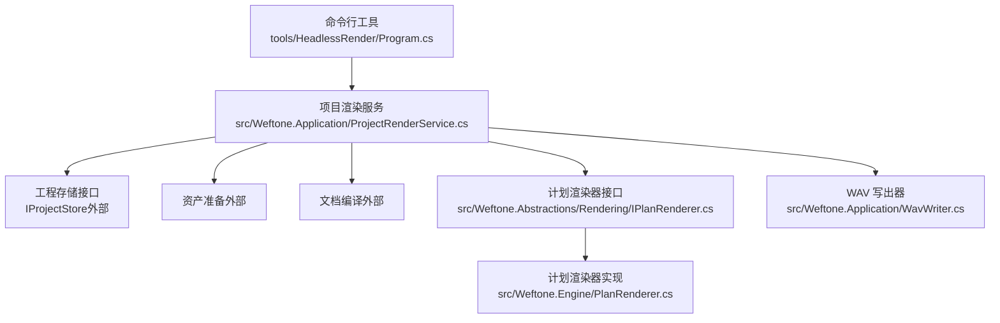
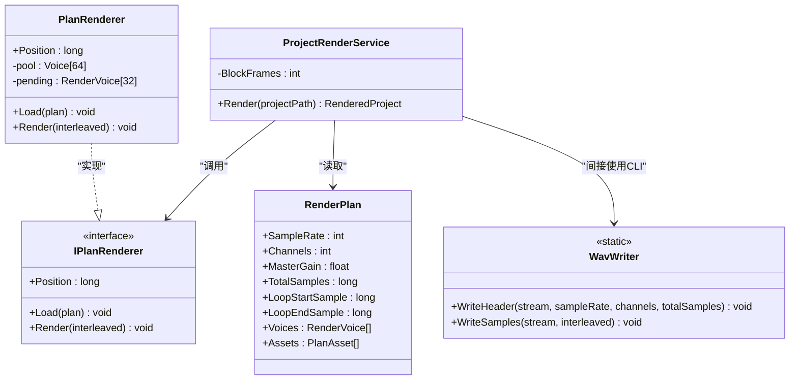
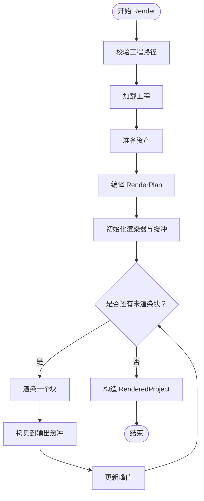
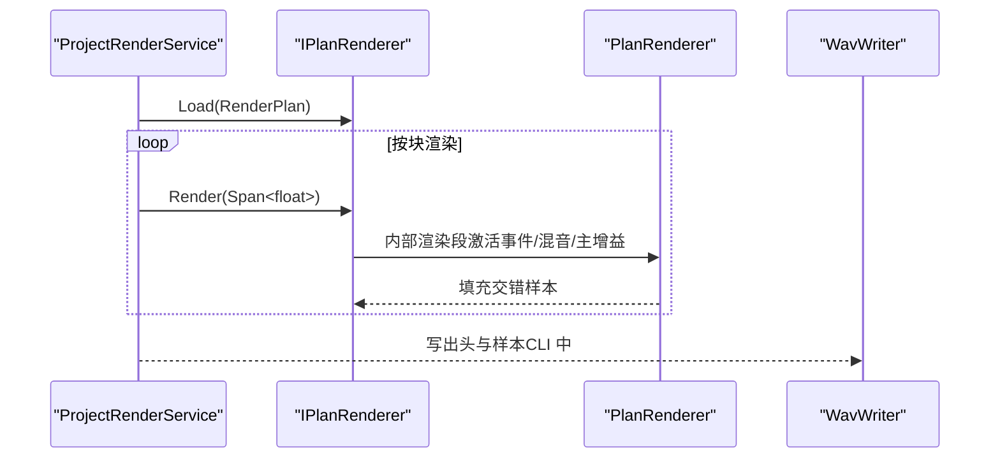
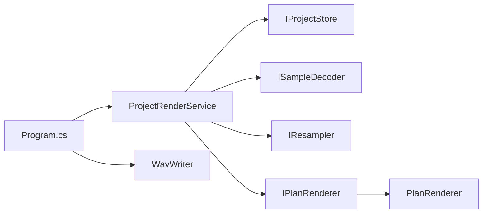
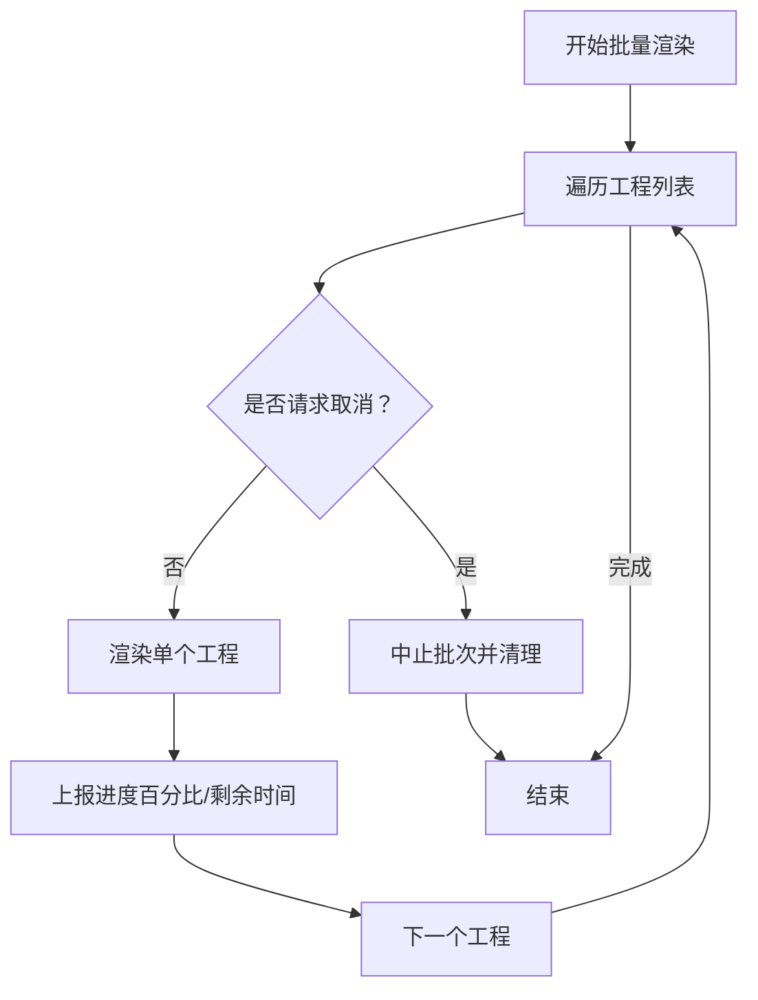
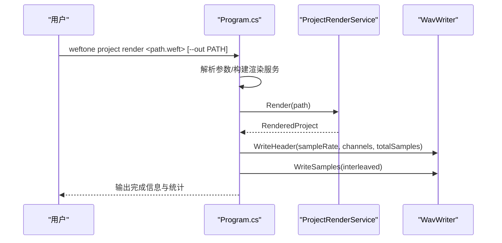

# 项目渲染服务

<cite>
**本文引用的文件**   
- [ProjectRenderService.cs](file://src/Weftone.Application/ProjectRenderService.cs)
- [IPlanRenderer.cs](file://src/Weftone.Abstractions/Rendering/IPlanRenderer.cs)
- [RenderPlan.cs](file://src/Weftone.Abstractions/Rendering/RenderPlan.cs)
- [PlanRenderer.cs](file://src/Weftone.Engine/PlanRenderer.cs)
- [WavWriter.cs](file://src/Weftone.Application/WavWriter.cs)
- [Program.cs](file://tools/HeadlessRender/Program.cs)
</cite>

## 目录
1. [简介](#简介)
2. [项目结构](#项目结构)
3. [核心组件](#核心组件)
4. [架构总览](#架构总览)
5. [详细组件分析](#详细组件分析)
6. [依赖关系分析](#依赖关系分析)
7. [性能与质量特性](#性能与质量特性)
8. [进度、取消与批处理](#进度取消与批处理)
9. [错误处理与恢复策略](#错误处理与恢复策略)
10. [配置选项与调优建议](#配置选项与调优建议)
11. [使用示例](#使用示例)
12. [故障排查指南](#故障排查指南)
13. [结论](#结论)

## 简介
本文围绕 ProjectRenderService 组件，系统化说明其离线渲染能力：从工程加载、资产准备、计划编译，到基于 IPlanRenderer 的块式渲染输出。文档重点覆盖以下方面：
- 批量 WAV 导出流程与数据流
- 渲染任务调度机制（当前为单线程块式渲染）与资源管理
- 渲染质量控制（采样率、声道数、位深度、压缩方式）
- 渲染进度报告机制（百分比更新、剩余时间估算）
- 错误处理与重试策略（含部分结果保存与恢复思路）
- 渲染配置项与性能调优建议
- 批量渲染任务与进度监控的使用示例

## 项目结构
ProjectRenderService 位于应用层，负责编排“工程 → 资产 → 计划 → 渲染”的离线导出链路；实际音频合成由引擎层的 PlanRenderer 实现；WAV 写出由 WavWriter 提供。

图表来源
- [ProjectRenderService.cs:11-49](file://src/Weftone.Application/ProjectRenderService.cs#L11-L49)
- [IPlanRenderer.cs:1-12](file://src/Weftone.Abstractions/Rendering/IPlanRenderer.cs#L1-L12)
- [PlanRenderer.cs:11-59](file://src/Weftone.Engine/PlanRenderer.cs#L11-L59)
- [WavWriter.cs:6-38](file://src/Weftone.Application/WavWriter.cs#L6-L38)
- [Program.cs:119-136](file://tools/HeadlessRender/Program.cs#L119-L136)

章节来源
- [ProjectRenderService.cs:11-49](file://src/Weftone.Application/ProjectRenderService.cs#L11-L49)
- [Program.cs:119-136](file://tools/HeadlessRender/Program.cs#L119-L136)

## 核心组件
- ProjectRenderService：离线渲染编排器，负责加载工程、准备资产、编译 RenderPlan、分块调用渲染器并聚合峰值与时长信息。
- IPlanRenderer：渲染端口抽象，屏蔽 Application 与 Engine 的直接耦合，支持离线/实时两种实现。
- PlanRenderer：引擎侧渲染实现，基于预分配声部池与事件激活逻辑，零分配实时渲染路径。
- RenderPlan：扁平渲染计划，包含采样率、声道数、循环区间、声音事件数组与已解码重采样后的资产。
- WavWriter：WAVE_FORMAT_IEEE_FLOAT（32-bit float）写出器，先写头再流式写入样本。

章节来源
- [ProjectRenderService.cs:7-49](file://src/Weftone.Application/ProjectRenderService.cs#L7-L49)
- [IPlanRenderer.cs:1-12](file://src/Weftone.Abstractions/Rendering/IPlanRenderer.cs#L1-L12)
- [PlanRenderer.cs:11-59](file://src/Weftone.Engine/PlanRenderer.cs#L11-L59)
- [RenderPlan.cs:29-41](file://src/Weftone.Abstractions/Rendering/RenderPlan.cs#L29-L41)
- [WavWriter.cs:6-38](file://src/Weftone.Application/WavWriter.cs#L6-L38)

## 架构总览
ProjectRenderService 通过依赖注入组合各子系统，形成清晰的“编排层 + 端口抽象 + 具体实现”的分层结构。

图表来源
- [ProjectRenderService.cs:11-49](file://src/Weftone.Application/ProjectRenderService.cs#L11-L49)
- [IPlanRenderer.cs:1-12](file://src/Weftone.Abstractions/Rendering/IPlanRenderer.cs#L1-L12)
- [PlanRenderer.cs:11-59](file://src/Weftone.Engine/PlanRenderer.cs#L11-L59)
- [RenderPlan.cs:29-41](file://src/Weftone.Abstractions/Rendering/RenderPlan.cs#L29-L41)
- [WavWriter.cs:6-38](file://src/Weftone.Application/WavWriter.cs#L6-L38)

## 详细组件分析

### ProjectRenderService：离线渲染编排器
职责
- 参数校验与工程加载
- 资产准备与文档编译
- 将 RenderPlan 交给 IPlanRenderer 进行块式渲染
- 累积峰值、计算时长，返回 RenderedProject

关键流程
- 固定块大小 BlockFrames = 512，按块迭代渲染，避免一次性分配超大缓冲
- 每块调用 renderer.Render(span)，并将结果拷贝至交错输出缓冲
- 遍历块内样本计算绝对值峰值，最终封装为 RenderedProject

复杂度
- 时间复杂度 O(N)，N 为总帧数
- 空间复杂度 O(N * Channels)，用于存放完整交错样本

错误处理
- 对 projectPath 进行空引用检查
- 上层 IProjectStore.Load 可能抛出工程相关异常（由调用方捕获）

图表来源
- [ProjectRenderService.cs:19-49](file://src/Weftone.Application/ProjectRenderService.cs#L19-L49)

章节来源
- [ProjectRenderService.cs:11-49](file://src/Weftone.Application/ProjectRenderService.cs#L11-L49)

### IPlanRenderer 与 PlanRenderer：渲染执行端
IPlanRenderer
- 暴露 Position、Load、Render 三个成员，作为 Application 与 Engine 之间的稳定边界

PlanRenderer
- 预分配 64 个声部池，事件按 StartSample 顺序激活
- 池满时采用“最早结束者淡出被偷”，新事件进入 pending 环等待槽位释放
- 支持正弦波与采样器两类声部，采样器使用线性插值
- 全程零分配（RtAssert 守护），适合实时场景
- 支持循环区间：position 到达 LoopEnd 后回绕 LoopStart，事件游标归零重触发

图表来源
- [ProjectRenderService.cs:27-48](file://src/Weftone.Application/ProjectRenderService.cs#L27-L48)
- [PlanRenderer.cs:48-105](file://src/Weftone.Engine/PlanRenderer.cs#L48-L105)
- [WavWriter.cs:9-38](file://src/Weftone.Application/WavWriter.cs#L9-L38)

章节来源
- [IPlanRenderer.cs:1-12](file://src/Weftone.Abstractions/Rendering/IPlanRenderer.cs#L1-L12)
- [PlanRenderer.cs:11-356](file://src/Weftone.Engine/PlanRenderer.cs#L11-L356)

### RenderPlan：渲染计划模型
- SampleRate、Channels：决定输出格式与声道布局
- MasterGain：全局增益，渲染后统一乘以该系数
- TotalSamples：总帧数，驱动外层块式循环
- LoopStartSample / LoopEndSample：Pattern 模式下的循环区间
- Voices：预乘好的声音事件数组，渲染期只读
- Assets：已解码并重采样到工程采样率的 f32 交错样本

章节来源
- [RenderPlan.cs:29-41](file://src/Weftone.Abstractions/Rendering/RenderPlan.cs#L29-L41)

### WavWriter：WAV 写出器
- 输出格式：WAVE_FORMAT_IEEE_FLOAT（32-bit float，小端）
- 先写 44 字节标准头，再流式追加样本
- 限制：单文件最大约 4GB（uint 上限）

章节来源
- [WavWriter.cs:6-38](file://src/Weftone.Application/WavWriter.cs#L6-L38)

## 依赖关系分析
- ProjectRenderService 依赖 IProjectStore、ISampleDecoder、IResampler、IPlanRenderer（通过构造函数注入）
- IPlanRenderer 由 PlanRenderer 实现，Application 不直接耦合 Engine
- CLI 工具通过 NewRenderService 组装具体实现，便于替换与测试

图表来源
- [Program.cs:119-136](file://tools/HeadlessRender/Program.cs#L119-L136)
- [ProjectRenderService.cs:11-15](file://src/Weftone.Application/ProjectRenderService.cs#L11-L15)
- [PlanRenderer.cs:11-12](file://src/Weftone.Engine/PlanRenderer.cs#L11-L12)

章节来源
- [Program.cs:119-136](file://tools/HeadlessRender/Program.cs#L119-L136)
- [ProjectRenderService.cs:11-15](file://src/Weftone.Application/ProjectRenderService.cs#L11-L15)

## 性能与质量特性
- 块式渲染：BlockFrames = 512，降低单次内存压力，利于缓存局部性
- 峰值计算：逐块扫描绝对值，O(N) 时间，无额外分配
- 主增益：在 PlanRenderer 中对整段输出统一缩放，减少分支判断
- 零分配渲染：PlanRenderer 使用预分配池与环形队列，避免实时路径分配
- WAV 格式：IEEE float 32-bit，保留动态范围，避免量化失真

章节来源
- [ProjectRenderService.cs:17-48](file://src/Weftone.Application/ProjectRenderService.cs#L17-L48)
- [PlanRenderer.cs:97-105](file://src/Weftone.Engine/PlanRenderer.cs#L97-L105)
- [WavWriter.cs:9-38](file://src/Weftone.Application/WavWriter.cs#L9-L38)

## 进度、取消与批处理
当前实现要点
- 进度跟踪：ProjectRenderService 内部维护 done 计数与 frames 总数，可据此计算百分比
- 取消支持：当前 Render 方法未暴露取消令牌，无法中断正在进行的渲染
- 批处理：单个 Render 仅处理一个工程；批量需由调用方（如 CLI 或 UI）组织循环

扩展建议
- 在 Render 方法签名中增加 CancellationToken，并在块循环中检查 IsCancellationRequested
- 对外暴露进度回调或事件，传递已完成帧数、总帧数、百分比与剩余时间估算
- 对于批量任务，可在调用层并行化多个工程的渲染，但需注意 I/O 与 CPU 资源上限

图表来源
- [ProjectRenderService.cs:32-48](file://src/Weftone.Application/ProjectRenderService.cs#L32-L48)

章节来源
- [ProjectRenderService.cs:32-48](file://src/Weftone.Application/ProjectRenderService.cs#L32-L48)

## 错误处理与恢复策略
现有行为
- 参数校验：projectPath 为空时抛异常
- 工程加载失败：由 IProjectStore.Load 抛出（例如 InvalidProjectException、InvalidDataException），由调用方捕获
- 渲染过程：当前未捕获渲染过程中的异常，会向上传播

恢复策略建议
- 部分结果保存：在块循环中，每渲染完一块就将对应片段写入临时文件（分段 WAV 或索引化容器）
- 断点恢复：记录已完成的帧偏移与峰值，下次启动时跳过已渲染区间继续
- 重试策略：对可重试错误（如 I/O 抖动）进行有限次数重试；不可重试错误立即失败并清理临时文件
- 原子提交：全部完成后将临时文件合并为最终 WAV，失败则丢弃中间产物

章节来源
- [ProjectRenderService.cs:19-48](file://src/Weftone.Application/ProjectRenderService.cs#L19-L48)
- [Program.cs:98-107](file://tools/HeadlessRender/Program.cs#L98-L107)

## 配置选项与调优建议
- 采样率：由 RenderPlan.SampleRate 决定，通常来自工程文档；如需转换应在资产准备阶段完成
- 位深度：WAV 使用 IEEE float 32-bit，适合高动态范围与后续处理
- 压缩：当前不支持压缩格式；如需 MP3/AAC 等，应在 float 输出后再转码
- 块大小：BlockFrames = 512，可根据目标平台与 I/O 吞吐调整
- 主增益：RenderPlan.MasterGain 控制整体音量，注意避免削波
- 循环区间：RenderPlan.LoopStartSample / LoopEndSample 控制 Pattern 循环，避免越界

调优建议
- 若 CPU 受限，可适当增大 BlockFrames 以减少函数调用开销，但会增加内存占用
- 若内存受限，可降低 BlockFrames，或在批处理中串行化大工程
- 对大量短资产，优先使用 PlanRenderer 的线性插值路径，避免频繁分配
- 对高复音密度场景，关注 PlanRenderer 的 DroppedEvents 指标，必要时提高 MaxVoices 或优化事件密度

章节来源
- [ProjectRenderService.cs:17-48](file://src/Weftone.Application/ProjectRenderService.cs#L17-L48)
- [PlanRenderer.cs:11-59](file://src/Weftone.Engine/PlanRenderer.cs#L11-L59)
- [WavWriter.cs:9-38](file://src/Weftone.Application/WavWriter.cs#L9-L38)

## 使用示例
命令行工具 HeadlessRender 展示了如何装配 ProjectRenderService 并完成工程到 WAV 的导出。

- 装配渲染服务：创建 WeftProjectStore、DrWavDecoder、LinearResampler、PlanRenderer 并注入 ProjectRenderService
- 渲染工程：调用 Render(path) 得到 RenderedProject，随后用 WavWriter 写出头与样本
- 输出信息：打印时长、采样率、声道数与峰值

图表来源
- [Program.cs:119-136](file://tools/HeadlessRender/Program.cs#L119-L136)
- [ProjectRenderService.cs:19-48](file://src/Weftone.Application/ProjectRenderService.cs#L19-L48)
- [WavWriter.cs:9-38](file://src/Weftone.Application/WavWriter.cs#L9-L38)

章节来源
- [Program.cs:119-136](file://tools/HeadlessRender/Program.cs#L119-L136)

## 故障排查指南
常见问题与定位
- 工程包非法：检查 .weft 包结构与元数据，确认资产路径有效
- 数据非法：检查样本数据完整性与长度，确保与计划一致
- 原生库缺失：播放相关功能需要 native shim；渲染导出不受影响
- 峰值异常：检查 MasterGain 与通道增益设置，避免溢出或静音

定位步骤
- 查看 CLI 的错误输出与返回码
- 检查 RenderedProject 中的 Duration、Peak、SampleRate、Channels 是否符合预期
- 对大工程，逐步缩小 RenderPlan.TotalSamples 以定位问题片段

章节来源
- [Program.cs:98-107](file://tools/HeadlessRender/Program.cs#L98-L107)
- [Program.cs:227-235](file://tools/HeadlessRender/Program.cs#L227-L235)

## 结论
ProjectRenderService 提供了清晰、可扩展的离线渲染编排能力：通过 IPlanRenderer 解耦应用与引擎，借助 RenderPlan 的扁平数据结构实现高性能渲染，配合 WavWriter 输出高质量 float32 WAV。当前实现聚焦于单工程、单线程、无取消的渲染流程；在此基础上，可通过引入取消令牌、进度回调、部分结果保存与重试策略，进一步满足批量渲染与生产环境的可靠性需求。