# 开发指南

<cite>
**本文引用的文件**   
- [README.md](file://README.md)
- [CONTRIBUTING.md](file://CONTRIBUTING.md)
- [AGENTS.md](file://AGENTS.md)
- [Directory.Build.props](file://Directory.Build.props)
- [Directory.Packages.props](file://Directory.Packages.props)
- [Weftone.slnx](file://Weftone.slnx)
- [.github/workflows/ci.yml](file://.github/workflows/ci.yml)
- [native/CMakeLists.txt](file://native/CMakeLists.txt)
- [native/weftone_miniaudio/CMakeLists.txt](file://native/weftone_miniaudio/CMakeLists.txt)
- [native/weftone_codecs/CMakeLists.txt](file://native/weftone_codecs/CMakeLists.txt)
- [THIRD_PARTY_NOTICES.md](file://THIRD_PARTY_NOTICES.md)
- [docs/adr/ADR-0005-license-commercialization.md](file://docs/adr/ADR-0005-license-commercialization.md)
</cite>

## 目录
1. [引言](#引言)
2. [项目结构](#项目结构)
3. [环境搭建](#环境搭建)
4. [构建系统与包版本管理](#构建系统与包版本管理)
5. [代码规范与贡献流程](#代码规范与贡献流程)
6. [第三方依赖与许可证合规](#第三方依赖与许可证合规)
7. [调试、性能分析与故障排除](#调试性能分析与故障排除)
8. [发布流程与版本管理](#发布流程与版本管理)
9. [架构总览](#架构总览)
10. [详细组件分析](#详细组件分析)
11. [依赖关系分析](#依赖关系分析)
12. [结论](#结论)

## 引言
Weftone（纬音）是一个从零开始用 C# / .NET 10 LTS 构建的开源跨平台数字音频工作站。当前处于 M1b 最小 UI 阶段，已完成 headless 渲染、文档模型、命令撤销、编译器、transport、采样器声部、混音器和黄金音频回归；UI 方向正在推进钢琴卷帘、播放列表和混音器界面。

本项目强调：
- 规格驱动开发：先写验收测试，再实现功能。
- Headless 优先：先 `.weft` 工程导出 WAV，再叠加 UI。
- 实时零分配纪律：音频回调禁止分配、锁、异常和原生内存分配。
- 六边形架构 + 编译器模式：编辑模型与实时模型分离，通过 RenderPlan 传递数据。
- Wheel-first：外围使用成熟库，核心自研音频图、transport、文档模型等。
- 三平台 CI：Windows、macOS、Linux 矩阵构建与冒烟测试。

**章节来源**
- [README.md:1-36](file://README.md#L1-L36)
- [AGENTS.md:1-24](file://AGENTS.md#L1-L24)

## 项目结构
仓库采用分层与领域划分相结合的结构：
- `src`：C# 源码，包含 Domain、Abstractions、Application、Engine、Adapters 和 App。
- `native`：原生 C 代码，包括 miniaudio shim 和 dr_wav codec shim，由 CMake 构建。
- `specs`：功能规格，驱动 Spec-first 开发。
- `docs/adr`：已定稿的架构决策记录。
- `tests`：引擎测试、应用测试、架构测试、黄金音频回归。
- `tools`：HeadlessRender CLI，用于离线渲染和冒烟测试。
- 根级配置文件：`Directory.Build.props`、`Directory.Packages.props`、`Weftone.slnx`、`.github/workflows/ci.yml`。

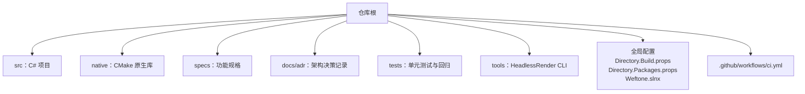

**图表来源**
- [Weftone.slnx:1-24](file://Weftone.slnx#L1-L24)
- [native/CMakeLists.txt:1-6](file://native/CMakeLists.txt#L1-L6)
- [.github/workflows/ci.yml:1-60](file://.github/workflows/ci.yml#L1-L60)

**章节来源**
- [README.md:70-79](file://README.md#L70-L79)
- [AGENTS.md:124-152](file://AGENTS.md#L124-L152)

## 环境搭建
### 必需工具
- **.NET 10 SDK**：项目目标框架为 `net10.0`，CI 使用 `10.0.x`。
- **CMake ≥ 3.16**：用于构建 `native` 下的原生 shim。
- **IDE**：推荐使用支持 .NET 10 和 Avalonia 的 IDE，例如 Visual Studio 或 JetBrains Rider；VS Code 也可配合 C# Dev Kit 使用。

### 本地构建步骤
1. 安装 .NET 10 SDK。
2. 安装 CMake 3.16 或以上版本。
3. 克隆仓库后执行：
   - 构建 C# 项目：`dotnet build -c Release`
   - 运行测试：`dotnet test -c Release`
   - Debug 构建启用 RT_ASSERT 分配断言：`dotnet build -c Debug`
   - 构建原生 shim：`cmake -S native -B native/build && cmake --build native/build --config Release`
4. 运行 headless 渲染：
   - `dotnet run --project tools/HeadlessRender -c Release -- render --seconds 5 --out out.wav`
5. 运行图形界面（M1b）：
   - `dotnet run --project src/Weftone.App -c Release`

### IDE 配置建议
- 确保解决方案加载 `Weftone.slnx`，该文件聚合了 src、tests、tools 下的所有 csproj。
- 在 Debug 模式下确认 `RT_ASSERT` 宏生效，以便启用实时分配断言。
- 若需要调试原生音频 I/O，请确保 `native/build` 下生成了对应平台的动态库。

**章节来源**
- [README.md:90-112](file://README.md#L90-L112)
- [CONTRIBUTING.md:15-26](file://CONTRIBUTING.md#L15-L26)
- [Weftone.slnx:1-24](file://Weftone.slnx#L1-L24)

## 构建系统与包版本管理
### Directory.Build.props：全局编译设置
- 目标框架：`net10.0`
- 语言版本：`latest`
- 启用 Nullable 和 ImplicitUsings
- Deterministic 构建，便于可重复输出
- TreatWarningsAsErrors：将警告视为错误，提升代码质量
- Product 名称：`Weftone`
- 版本号前缀：`0.1.0`
- Debug 配置自动定义 `RT_ASSERT`，Release 可通过 `-p:DefineConstants=RT_ASSERT` 叠加

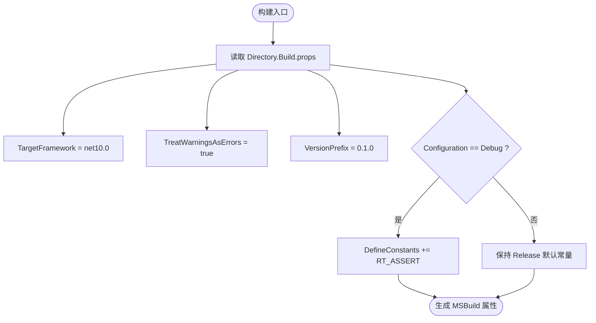

**图表来源**
- [Directory.Build.props:1-20](file://Directory.Build.props#L1-L20)

### Directory.Packages.props：集中式包版本管理
- 启用中央包版本管理：`ManagePackageVersionsCentrally=true`
- 启用传递依赖固定：`CentralPackageTransitivePinningEnabled=true`
- 测试相关包：NUnit、NUnit3TestAdapter、Microsoft.NET.Test.Sdk、NetArchTest.Rules
- UI 相关包：Avalonia 生态（Desktop、Themes.Fluent、Fonts.Inter、Headless）
- MVVM：CommunityToolkit.Mvvm

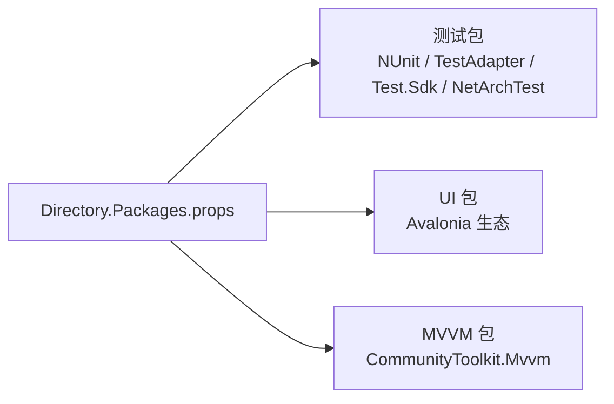

**图表来源**
- [Directory.Packages.props:1-27](file://Directory.Packages.props#L1-L27)

### Weftone.slnx：解决方案聚合
- 聚合 `src`、`tests`、`tools` 三个文件夹下的 csproj
- 便于 IDE 一次性打开完整解决方案

**章节来源**
- [Directory.Build.props:1-20](file://Directory.Build.props#L1-L20)
- [Directory.Packages.props:1-27](file://Directory.Packages.props#L1-L27)
- [Weftone.slnx:1-24](file://Weftone.slnx#L1-L24)

## 代码规范与贡献流程
### 开发方法论
- Architecture Runway + Spec-first + Vertical Slice
- 无 SPEC 不实现；先写验收测试与黄金音频基线
- 小步提交，保持可运行；周末必须有能出声或导出的 demo
- Trunk-based 开发，短分支、小 PR

### Commit 约定
- 前缀：`feat` / `fix` / `refactor` / `test` / `docs` / `adr`
- 主题使用中文
- 小步原子提交，禁止 force push

### 构建与验证门禁
- Release 构建与测试
- Debug 构建与测试（启用 RT_ASSERT 分配断言）
- 原生 shim 构建验证
- Headless 渲染冒烟测试

### 贡献协议
- 当前状态：DCO 或 CLA 待定，确定前暂不接受外部 PR
- 贡献代码以 GPL-3.0-or-later 授权
- 第三方依赖许可见 THIRD_PARTY_NOTICES.md

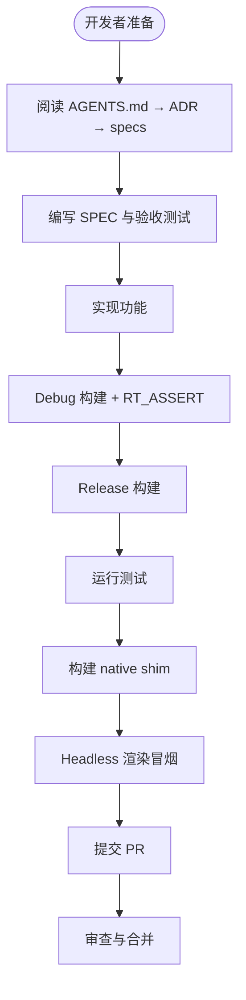

**图表来源**
- [AGENTS.md:37-59](file://AGENTS.md#L37-L59)
- [CONTRIBUTING.md:8-31](file://CONTRIBUTING.md#L8-L31)

**章节来源**
- [AGENTS.md:37-59](file://AGENTS.md#L37-L59)
- [CONTRIBUTING.md:1-31](file://CONTRIBUTING.md#L1-L31)

## 第三方依赖与许可证合规
### 产品组件
- miniaudio：MIT-0，用于音频设备 I/O，vendored 在 `native/vendor/miniaudio/`
- dr_wav：MIT-0，用于 WAV 解码，vendored 在 `native/vendor/dr_wav/`
- Avalonia：MIT，跨平台 UI 框架
- CommunityToolkit.Mvvm：MIT，MVVM 源生成器

### 开发与测试依赖
- NUnit、NUnit3TestAdapter、Microsoft.NET.Test.Sdk：MIT
- NetArchTest.Rules：Apache-2.0
- Avalonia.Headless / Avalonia.Headless.NUnit：MIT

### 许可证策略
- 主程序、引擎、内置插件：GPL-3.0-or-later
- Weftone.PluginSdk：独立 MIT，不引用 GPL 代码
- 核心第三方依赖仅接受宽松许可；GPL/专有依赖只作为可选非核心模块
- 新增或升级依赖必须更新 THIRD_PARTY_NOTICES.md 并完成许可评审
- DCO/CLA 待决仅阻塞外部贡献接入，不阻塞内部开发

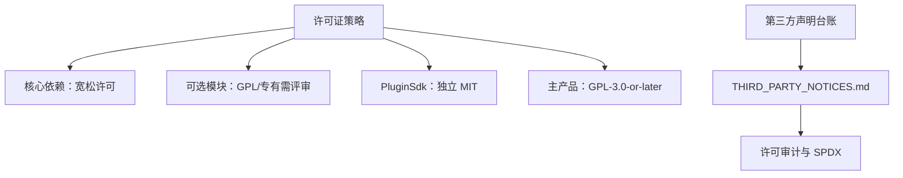

**图表来源**
- [THIRD_PARTY_NOTICES.md:1-25](file://THIRD_PARTY_NOTICES.md#L1-L25)
- [docs/adr/ADR-0005-license-commercialization.md:1-29](file://docs/adr/ADR-0005-license-commercialization.md#L1-L29)

**章节来源**
- [THIRD_PARTY_NOTICES.md:1-25](file://THIRD_PARTY_NOTICES.md#L1-L25)
- [docs/adr/ADR-0005-license-commercialization.md:1-29](file://docs/adr/ADR-0005-license-commercialization.md#L1-L29)
- [AGENTS.md:169-191](file://AGENTS.md#L169-L191)

## 调试、性能分析与故障排除
### 实时分配断言
- Debug 构建自动启用 `RT_ASSERT`
- 音频回调中禁止分配；CI 会检查 `GC.GetAllocatedBytesForCurrentThread()` 差值为 0
- 若出现 xrun 或分配断言失败，优先检查是否引入了 new、LINQ、装箱、string、async、日志或 native malloc

### 常见故障
- 无法出声：确认已构建 native shim；miniaudio 动态库位于 `native/build`
- 渲染为空：检查 demo 工程路径与输出参数；CI 会校验 WAV 尺寸
- 三平台构建失败：检查 CMake 版本、.NET 10 SDK 安装、原生依赖路径
- UI 启动失败：确认 Avalonia 依赖正确解析；Headless 测试可用于隔离 UI 问题

### 性能分析建议
- 使用 BenchmarkDotNet 对 DSP 和编译器进行基准测试
- 监控 p99 回调耗时直方图
- 关注 GC 暂停与 xrun 指标
- 黄金音频回归用于检测数值漂移

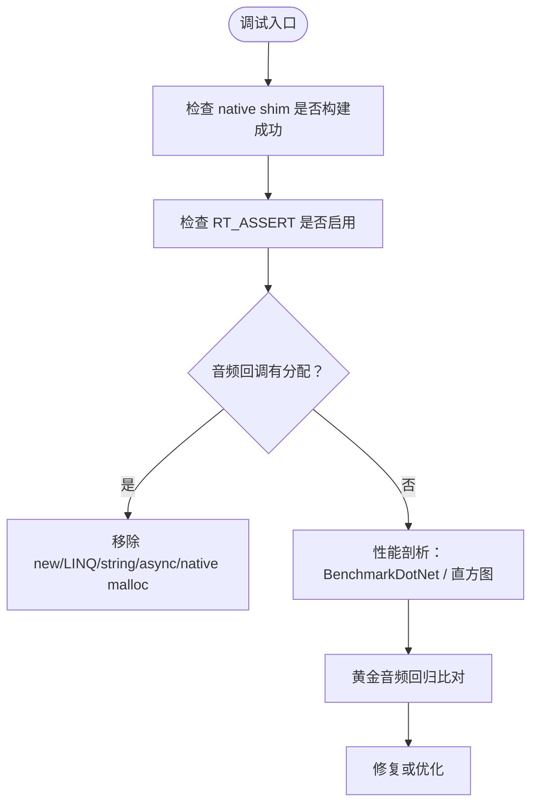

**图表来源**
- [AGENTS.md:193-224](file://AGENTS.md#L193-L224)
- [.github/workflows/ci.yml:40-60](file://.github/workflows/ci.yml#L40-L60)

**章节来源**
- [AGENTS.md:193-224](file://AGENTS.md#L193-L224)
- [.github/workflows/ci.yml:31-60](file://.github/workflows/ci.yml#L31-L60)

## 发布流程与版本管理
### 版本前缀
- 全局版本前缀为 `0.1.0`，由 `Directory.Build.props` 控制
- 发布前应评估是否需要提升主/次/补丁版本

### 构建与测试门禁
- CI 矩阵：windows-latest、ubuntu-latest、macos-latest
- 构建 Release 与 Debug
- 运行 Release 与 Debug 测试
- 原生 shim 构建验证
- Headless 渲染冒烟测试
- WAV 尺寸校验

### 发布建议
- 先完成 Spec、测试、文档、ADR 更新
- 确保三平台 CI 绿
- 更新 THIRD_PARTY_NOTICES.md 与 LICENSE 台账
- 若涉及 GPL/专有依赖，需额外许可评审
- macOS 直接分发或公证，避免 Mac App Store 条款冲突

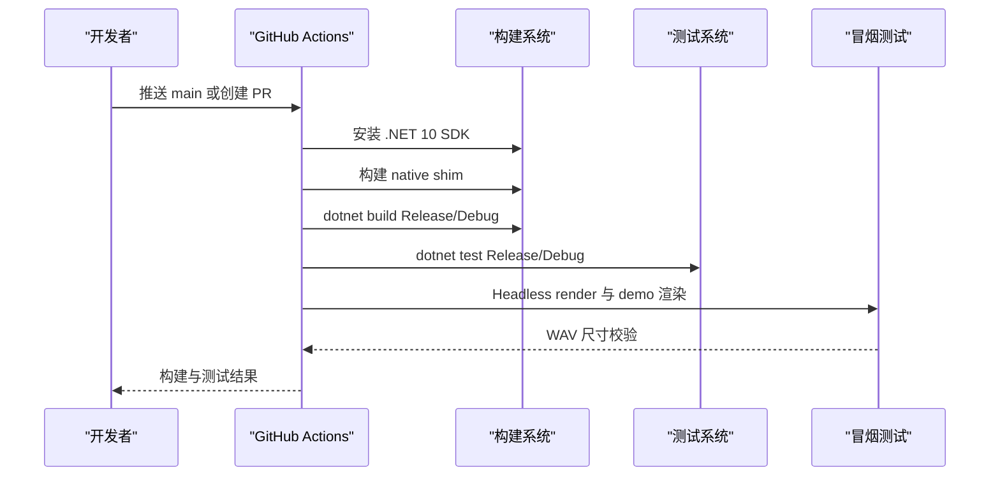

**图表来源**
- [.github/workflows/ci.yml:1-60](file://.github/workflows/ci.yml#L1-L60)
- [Directory.Build.props:1-20](file://Directory.Build.props#L1-L20)

**章节来源**
- [.github/workflows/ci.yml:1-60](file://.github/workflows/ci.yml#L1-L60)
- [Directory.Build.props:1-20](file://Directory.Build.props#L1-L20)

## 架构总览
Weftone 采用六边形架构（端口与适配器）+ 编译器模式 + 数据导向实时层：
- ProjectDocument：可编辑、可撤销、富对象
- Compile：非实时线程，将 Document 编译为 RenderPlan
- RenderPlan：扁平数组、预分配、无对象图
- AtomicSwap：RCU 双缓冲
- RealtimeEngine：音频回调只读，零分配零锁

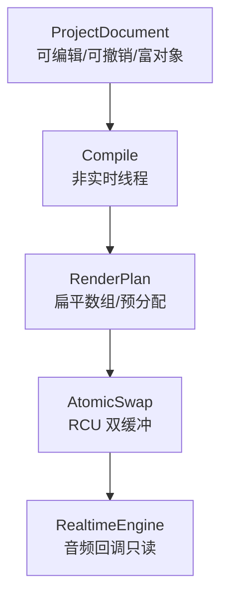

**图表来源**
- [README.md:38-57](file://README.md#L38-L57)
- [AGENTS.md:61-94](file://AGENTS.md#L61-L94)

**章节来源**
- [README.md:38-57](file://README.md#L38-L57)
- [AGENTS.md:61-94](file://AGENTS.md#L61-L94)

## 详细组件分析
### 原生构建组件
- weftone_miniaudio：封装 miniaudio，提供音频设备 I/O
- weftone_codecs：封装 dr_wav，提供 WAV 解码能力
- 两个子项目均输出到 `native/build`，便于 C# 通过 P/Invoke 探测动态库

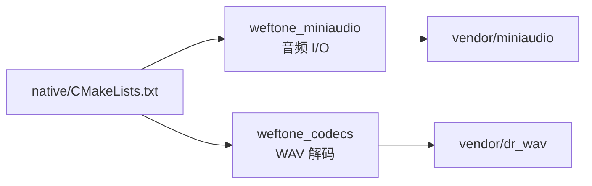

**图表来源**
- [native/CMakeLists.txt:1-6](file://native/CMakeLists.txt#L1-L6)
- [native/weftone_miniaudio/CMakeLists.txt:1-29](file://native/weftone_miniaudio/CMakeLists.txt#L1-L29)
- [native/weftone_codecs/CMakeLists.txt:1-28](file://native/weftone_codecs/CMakeLists.txt#L1-L28)

**章节来源**
- [native/CMakeLists.txt:1-6](file://native/CMakeLists.txt#L1-L6)
- [native/weftone_miniaudio/CMakeLists.txt:1-29](file://native/weftone_miniaudio/CMakeLists.txt#L1-L29)
- [native/weftone_codecs/CMakeLists.txt:1-28](file://native/weftone_codecs/CMakeLists.txt#L1-L28)

### C# 解决方案结构
- src：Domain、Abstractions、Application、Engine、Adapters、App
- tests：App.Tests、Application.Tests、ArchTests、Domain.Tests、Engine.Tests、GoldenAudio
- tools：HeadlessRender CLI

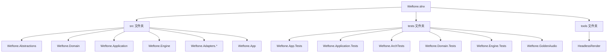

**图表来源**
- [Weftone.slnx:1-24](file://Weftone.slnx#L1-L24)

**章节来源**
- [Weftone.slnx:1-24](file://Weftone.slnx#L1-L24)

## 依赖关系分析
### 构建依赖
- .NET 10 SDK：CI 使用 `10.0.x`
- CMake ≥ 3.16：构建原生 shim
- NuGet 包：Avalonia、NUnit、CommunityToolkit.Mvvm 等

### 运行时依赖
- Avalonia UI 框架
- miniaudio 动态库（原生）
- dr_wav 解码能力（原生）

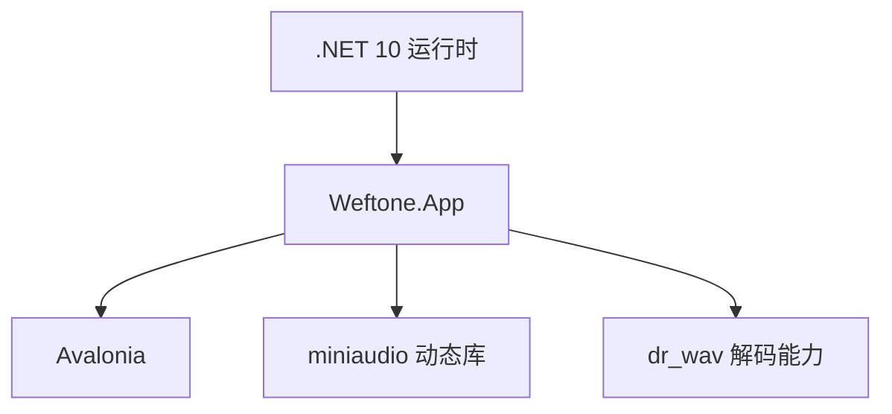

**图表来源**
- [.github/workflows/ci.yml:19-26](file://.github/workflows/ci.yml#L19-L26)
- [THIRD_PARTY_NOTICES.md:5-13](file://THIRD_PARTY_NOTICES.md#L5-L13)

**章节来源**
- [.github/workflows/ci.yml:19-26](file://.github/workflows/ci.yml#L19-L26)
- [THIRD_PARTY_NOTICES.md:5-13](file://THIRD_PARTY_NOTICES.md#L5-L13)

## 结论
Weftone 的开发指南围绕 .NET 10、CMake、Avalonia 和原生 shim 展开，强调规格驱动、headless 优先、实时零分配和三平台 CI。开发时应遵循 AGENTS.md 的方法论与硬约束，使用 Directory.Build.props 与 Directory.Packages.props 统一构建与包版本，遵循 CONTRIBUTING.md 的贡献流程，并维护 THIRD_PARTY_NOTICES.md 的许可证台账。发布前需确保 Spec、测试、文档、ADR 和许可合规全部就绪，并通过 CI 矩阵验证。