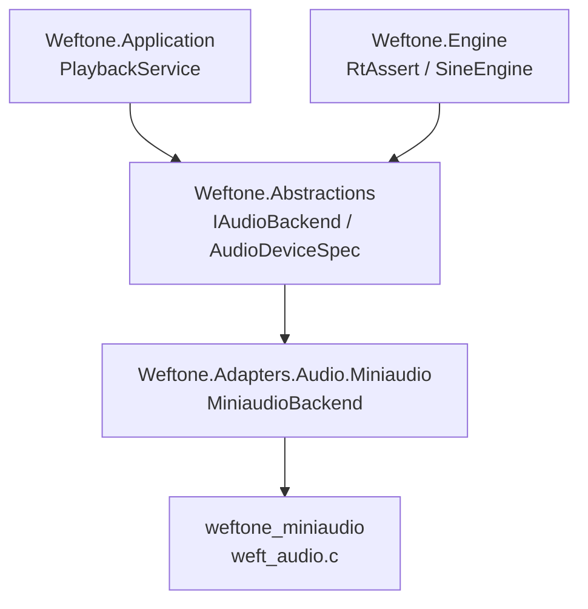
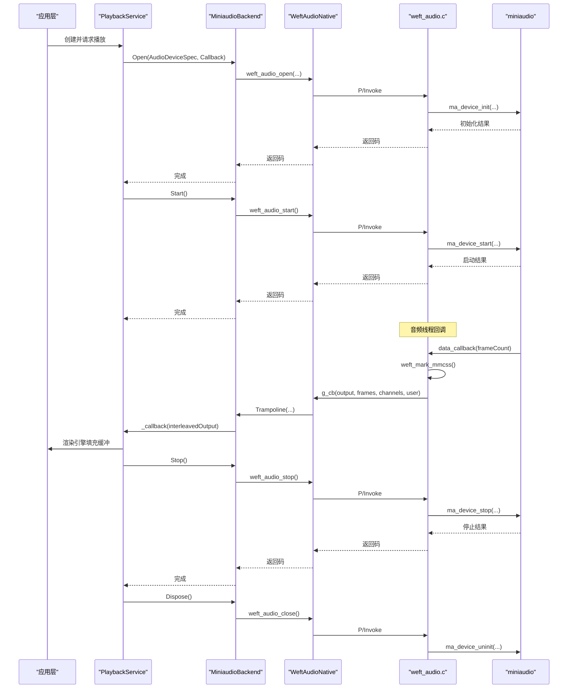
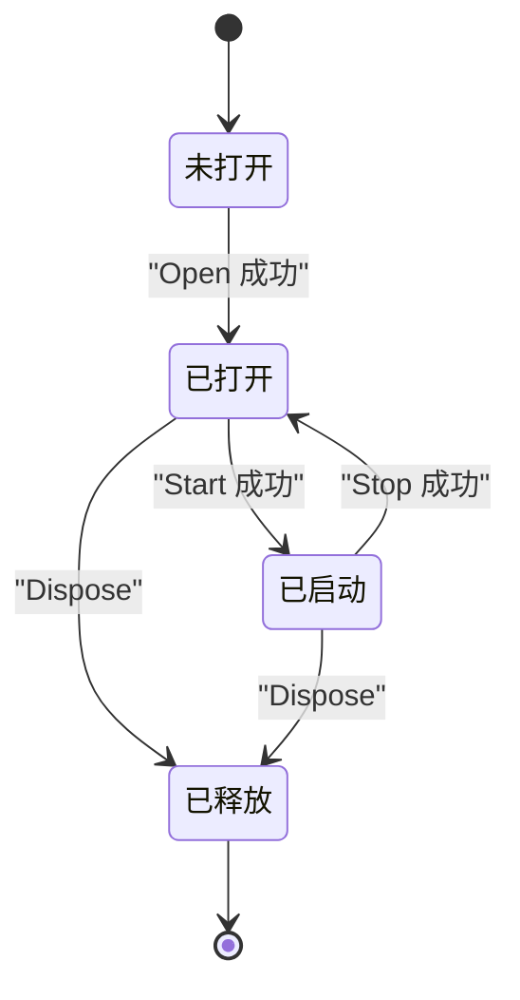
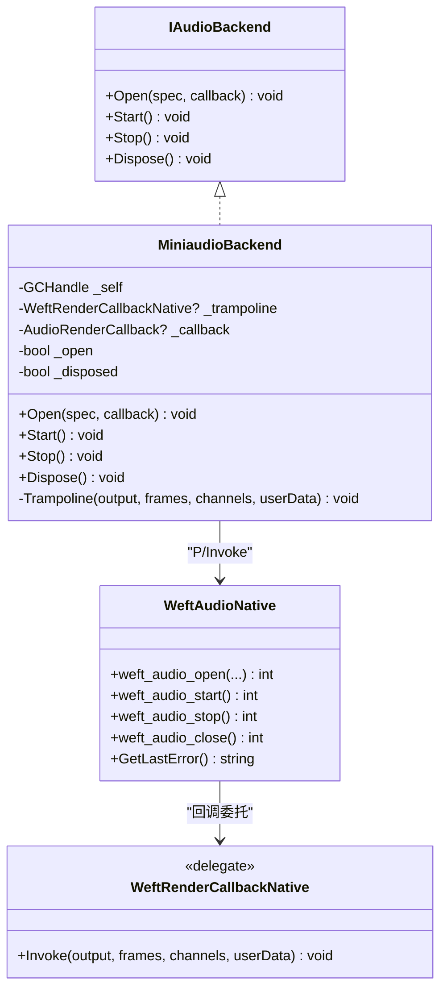
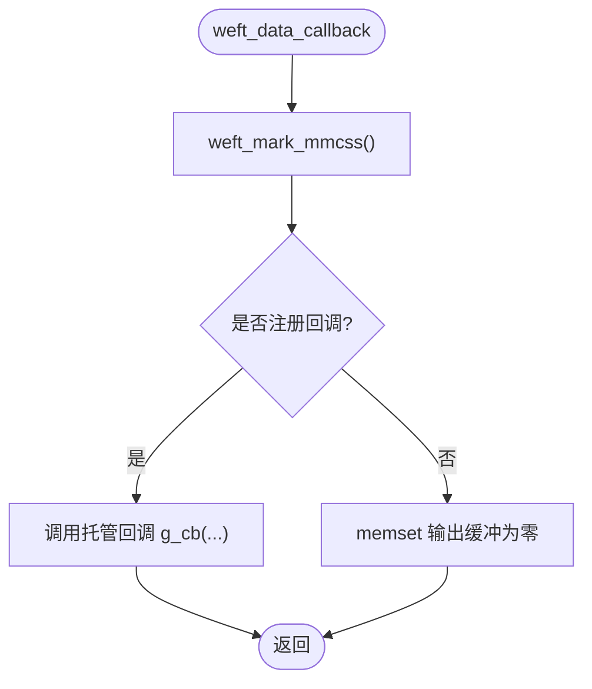
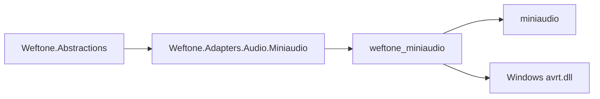
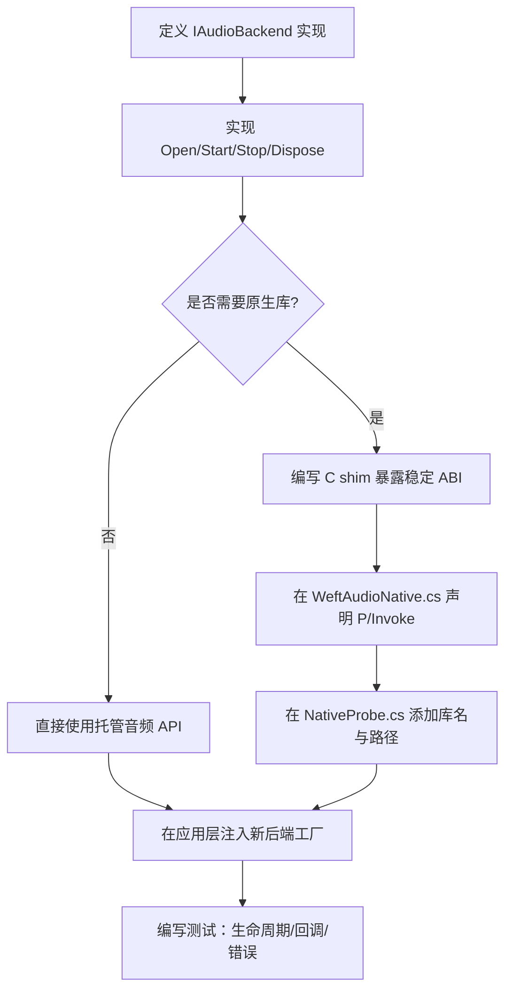

# IAudioBackend 音频后端接口

<cite>
**本文引用的文件**   
- [IAudioBackend.cs](file://src/Weftone.Abstractions/IAudioBackend.cs)
- [AudioDeviceSpec.cs](file://src/Weftone.Abstractions/AudioDeviceSpec.cs)
- [MiniaudioBackend.cs](file://src/Weftone.Adapters.Audio.Miniaudio/MiniaudioBackend.cs)
- [NativeProbe.cs](file://src/Weftone.Adapters.Audio.Miniaudio/NativeProbe.cs)
- [WeftAudioNative.cs](file://src/Weftone.Adapters.Audio.Miniaudio/WeftAudioNative.cs)
- [weft_audio.c](file://native/weftone_miniaudio/weft_audio.c)
- [PlaybackService.cs](file://src/Weftone.Application/PlaybackService.cs)
- [RtAssert.cs](file://src/Weftone.Engine/RtAssert.cs)
- [SineEngine.cs](file://src/Weftone.Engine/SineEngine.cs)
- [README.md（Abstractions）](file://src/Weftone.Abstractions/README.md)
- [README.md（Miniaudio 适配器）](file://src/Weftone.Adapters.Audio.Miniaudio/README.md)
- [README.md（weftone_miniaudio）](file://native/weftone_miniaudio/README.md)
</cite>

## 目录
1. [简介](#简介)
2. [项目结构](#项目结构)
3. [核心组件](#核心组件)
4. [架构总览](#架构总览)
5. [详细组件分析](#详细组件分析)
6. [依赖关系分析](#依赖关系分析)
7. [性能与延迟特性](#性能与延迟特性)
8. [平台适配指南](#平台适配指南)
9. [添加新音频后端](#添加新音频后端)
10. [故障排查](#故障排查)
11. [结论](#结论)

## 简介
本文件为 Weftone 项目的音频后端抽象层提供完整 API 文档，围绕 `IAudioBackend`、`AudioDeviceSpec` 和 `AudioRenderCallback` 展开。内容涵盖：
- 设备规格定义与参数约束
- 生命周期管理：打开、启动、停止、释放
- 音频回调机制、错误处理、延迟与线程安全要求
- 当前 miniaudio 实现的关键行为
- 跨平台适配与扩展新后端的步骤
- 性能优化建议与常见问题定位方法

## 项目结构
音频相关代码分布在三层：
- 抽象层：定义端口契约，不包含第三方类型
- 适配器层：基于 miniaudio 的托管实现，负责 P/Invoke 与资源管理
- 原生层：C shim 暴露稳定 ABI，封装 miniaudio 播放设备

**图表来源**
- [IAudioBackend.cs:1-15](file://src/Weftone.Abstractions/IAudioBackend.cs#L1-L15)
- [AudioDeviceSpec.cs:1-7](file://src/Weftone.Abstractions/AudioDeviceSpec.cs#L1-L7)
- [MiniaudioBackend.cs:1-85](file://src/Weftone.Adapters.Audio.Miniaudio/MiniaudioBackend.cs#L1-L85)
- [weft_audio.c:1-163](file://native/weftone_miniaudio/weft_audio.c#L1-L163)
- [PlaybackService.cs:16-24](file://src/Weftone.Application/PlaybackService.cs#L16-L24)
- [RtAssert.cs:17](file://src/Weftone.Engine/RtAssert.cs#L17)
- [SineEngine.cs:10-25](file://src/Weftone.Engine/SineEngine.cs#L10-L25)

**章节来源**
- [README.md（Abstractions）:1-10](file://src/Weftone.Abstractions/README.md#L1-L10)
- [README.md（Miniaudio 适配器）:1-12](file://src/Weftone.Adapters.Audio.Miniaudio/README.md#L1-L12)
- [README.md（weftone_miniaudio）:1-31](file://native/weftone_miniaudio/README.md#L1-L31)

## 核心组件
本节聚焦三个核心类型及其职责边界。

### IAudioBackend
- 角色：音频输出后端端口，所有实现不得把第三方类型泄漏给上层
- 生命周期方法：
  - Open：配置设备规格并注册渲染回调
  - Start：启动音频流
  - Stop：停止音频流
  - Dispose：释放底层资源
- 关键约束：
  - 回调运行在音频实时线程
  - 回调内禁止分配、加锁、抛异常

**章节来源**
- [IAudioBackend.cs:1-15](file://src/Weftone.Abstractions/IAudioBackend.cs#L1-L15)
- [README.md（Abstractions）:1-10](file://src/Weftone.Abstractions/README.md#L1-L10)

### AudioDeviceSpec
- 字段：
  - SampleRate：采样率
  - Channels：通道数
  - BufferFrames：缓冲区帧数
- 默认值：48000 Hz、立体声、256 帧

**章节来源**
- [AudioDeviceSpec.cs:1-7](file://src/Weftone.Abstractions/AudioDeviceSpec.cs#L1-L7)

### AudioRenderCallback
- 输入：交错排列的 float 缓冲 Span<float>
- 调用时机：音频实时线程
- 行为约束：零分配、无锁、无异常

**章节来源**
- [IAudioBackend.cs:1-15](file://src/Weftone.Abstractions/IAudioBackend.cs#L1-L15)

## 架构总览
下图展示从应用层到原生层的调用链，以及状态流转。

**图表来源**
- [PlaybackService.cs:16-24](file://src/Weftone.Application/PlaybackService.cs#L16-L24)
- [MiniaudioBackend.cs:21-83](file://src/Weftone.Adapters.Audio.Miniaudio/MiniaudioBackend.cs#L21-L83)
- [WeftAudioNative.cs:5-29](file://src/Weftone.Adapters.Audio.Miniaudio/WeftAudioNative.cs#L5-L29)
- [weft_audio.c:52-163](file://native/weftone_miniaudio/weft_audio.c#L52-L163)

## 详细组件分析

### IAudioBackend 接口规范
- 方法
  - Open(spec, callback)
    - 参数验证规则：
      - spec 非空且字段为正整数
      - callback 非空委托
    - 行为：
      - 建立回调绑定与用户数据
      - 初始化底层设备
      - 成功后进入“已打开未启动”状态
  - Start()
    - 前置条件：Open 成功
    - 行为：启动音频流；重复调用应幂等或返回成功
  - Stop()
    - 前置条件：Open 成功
    - 行为：停止音频流；重复调用应幂等或返回成功
  - Dispose()
    - 行为：确保 Stop/Close 被调用，释放托管与非托管资源
- 状态机

**图表来源**
- [MiniaudioBackend.cs:21-76](file://src/Weftone.Adapters.Audio.Miniaudio/MiniaudioBackend.cs#L21-L76)
- [weft_audio.c:72-163](file://native/weftone_miniaudio/weft_audio.c#L72-L163)

**章节来源**
- [IAudioBackend.cs:1-15](file://src/Weftone.Abstractions/IAudioBackend.cs#L1-L15)

### AudioDeviceSpec 设备规格
- 字段语义
  - SampleRate：目标采样率，单位 Hz
  - Channels：声道数，通常 1 或 2
  - BufferFrames：每周期帧数，影响延迟与稳定性
- 默认规格
  - 48000 Hz、立体声、256 帧
- 参数验证
  - 原生层拒绝 0 值；上层应保证正整数
  - 过小 BufferFrames 可能增加卡顿风险；过大则增加延迟

**章节来源**
- [AudioDeviceSpec.cs:1-7](file://src/Weftone.Abstractions/AudioDeviceSpec.cs#L1-L7)
- [weft_audio.c:72-84](file://native/weftone_miniaudio/weft_audio.c#L72-L84)

### MiniaudioBackend 实现要点
- 设计模式
  - 适配器模式：隔离 miniaudio 类型与上层
  - 反向 P/Invoke：原生回调经托管 trampolines 进入用户回调
- 资源管理
  - GCHandle 持有自身实例，避免 GC 回收
  - Open 时一次性建立委托与 trampolines，回调路径零分配
- 错误处理
  - 将原生返回码转换为 InvalidOperationException，附带最后错误字符串
- 线程模型
  - 音频回调在原生线程触发，通过委托桥接到托管层
  - 回调内禁止分配、锁、异常

**图表来源**
- [MiniaudioBackend.cs:11-83](file://src/Weftone.Adapters.Audio.Miniaudio/MiniaudioBackend.cs#L11-L83)
- [WeftAudioNative.cs:5-29](file://src/Weftone.Adapters.Audio.Miniaudio/WeftAudioNative.cs#L5-L29)

**章节来源**
- [MiniaudioBackend.cs:1-85](file://src/Weftone.Adapters.Audio.Miniaudio/MiniaudioBackend.cs#L1-L85)
- [README.md（Miniaudio 适配器）:1-12](file://src/Weftone.Adapters.Audio.Miniaudio/README.md#L1-L12)

### 原生层 weft_audio.c
- 职责
  - 封装 miniaudio 播放设备
  - 暴露稳定 C ABI：open/start/stop/close/last_error
- 回调流程
  - 首次回调前设置 Windows MMCSS “Pro Audio”
  - 若未注册回调，则输出静音
- 状态变量
  - g_open、g_started、g_channels、g_user、g_cb、g_error

**图表来源**
- [weft_audio.c:33-65](file://native/weftone_miniaudio/weft_audio.c#L33-L65)

**章节来源**
- [weft_audio.c:1-163](file://native/weftone_miniaudio/weft_audio.c#L1-L163)

### 应用层 PlaybackService 集成
- 使用方式
  - 通过工厂创建 IAudioBackend
  - 根据渲染计划选择采样率并重建后端
  - 播放结束时调用 Stop 与 Dispose
- 测试覆盖
  - 采样率变化重建后端
  - Dispose 时停止并释放后端

**章节来源**
- [PlaybackService.cs:16-24](file://src/Weftone.Application/PlaybackService.cs#L16-L24)

### 引擎侧 RtAssert 与 SineEngine
- RtAssert
  - 提供运行时断言工具，用于保护实时回调
- SineEngine
  - 示例引擎，持有 AudioRenderCallback 并在渲染管线中使用

**章节来源**
- [RtAssert.cs:17](file://src/Weftone.Engine/RtAssert.cs#L17)
- [SineEngine.cs:10-25](file://src/Weftone.Engine/SineEngine.cs#L10-L25)

## 依赖关系分析
- 抽象层不依赖任何第三方库，仅定义端口契约
- 适配器层依赖：
  - System.Runtime.InteropServices
  - 原生库 weftone_miniaudio
- 原生层依赖：
  - miniaudio（vendored）
  - Windows avrt.dll（动态加载）

**图表来源**
- [NativeProbe.cs:1-71](file://src/Weftone.Adapters.Audio.Miniaudio/NativeProbe.cs#L1-L71)
- [weft_audio.c:7-15](file://native/weftone_miniaudio/weft_audio.c#L7-L15)

**章节来源**
- [NativeProbe.cs:1-71](file://src/Weftone.Adapters.Audio.Miniaudio/NativeProbe.cs#L1-L71)
- [README.md（weftone_miniaudio）:28-31](file://native/weftone_miniaudio/README.md#L28-L31)

## 性能与延迟特性
- 回调路径
  - 原生回调 → 托管 trampolines → 用户回调，全程零分配
- 延迟控制
  - BufferFrames 越小延迟越低，但需保证足够稳定性
  - 默认 256 帧在多数系统上平衡了延迟与稳定性
- 线程优先级
  - Windows 下动态提升为 MMCSS “Pro Audio”，降低调度抖动
- 内存布局
  - 交错 float 缓冲，便于直接写入混音器或效果链

[本节为通用性能讨论，不直接分析具体文件]

## 平台适配指南
- Windows
  - 原生库文件名后缀 .dll
  - 回调线程动态加载 avrt.dll 设置 MMCSS “Pro Audio”
  - 构建产物位于 native/weftone_miniaudio/build
- macOS
  - 原生库文件名 libweftone_miniaudio.dylib
  - 通过 dlopen/dlsym 由 miniaudio 内部处理
- Linux
  - 原生库文件名 libweftone_miniaudio.so
  - 依赖系统 ALSA/PulseAudio/JACK（由 miniaudio 自动探测）

**章节来源**
- [NativeProbe.cs:40-69](file://src/Weftone.Adapters.Audio.Miniaudio/NativeProbe.cs#L40-L69)
- [weft_audio.c:7-15](file://native/weftone_miniaudio/weft_audio.c#L7-L15)
- [README.md（weftone_miniaudio）:18-31](file://native/weftone_miniaudio/README.md#L18-L31)

## 添加新音频后端
步骤概览：
1. 新建适配器项目，引用 Weftone.Abstractions
2. 实现 IAudioBackend：
   - Open：校验参数、初始化设备、注册回调
   - Start/Stop：启停设备，保持幂等
   - Dispose：释放资源，确保顺序正确
3. 若需要原生支持：
   - 新增 C shim，暴露稳定 ABI
   - 在 WeftAudioNative.cs 中声明 DllImport
   - 在 NativeProbe.cs 中添加库名与搜索路径
4. 在应用层注入新后端工厂，替换默认实现
5. 编写单元测试：
   - 生命周期：Open→Start→Stop→Dispose
   - 回调路径：零分配、无异常
   - 错误路径：无效参数、设备不可用

[该图为概念性流程图，不映射具体源码文件]

## 故障排查
常见错误与定位方法：
- 设备无法打开
  - 检查 Spec 参数是否为正整数
  - 查看原生 last_error 字符串
- 启动失败
  - 确认 Open 已成功
  - 检查系统音频服务与权限
- 停止失败
  - 确认设备处于已打开状态
  - 避免在回调中执行阻塞操作
- 回调卡顿或爆音
  - 减小 BufferFrames 并观察稳定性
  - 确保回调内零分配、无锁、无异常
  - 检查渲染逻辑耗时

**章节来源**
- [weft_audio.c:67-107](file://native/weftone_miniaudio/weft_audio.c#L67-L107)
- [MiniaudioBackend.cs:21-56](file://src/Weftone.Adapters.Audio.Miniaudio/MiniaudioBackend.cs#L21-L56)

## 结论
IAudioBackend 以最小契约定义了音频后端的开放点，配合 AudioDeviceSpec 与 AudioRenderCallback 形成清晰的实时音频管线。当前 miniaudio 适配器实现了零分配回调路径、稳定的原生 ABI 与跨平台库探测。遵循本文的参数验证、状态管理与线程安全约束，可稳健地扩展新的音频后端，并在不同平台上获得一致的播放体验。