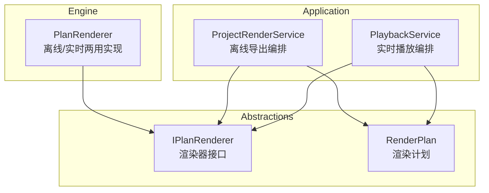
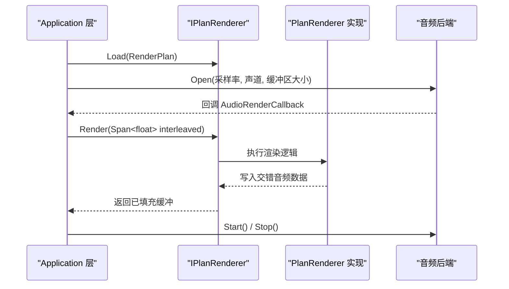
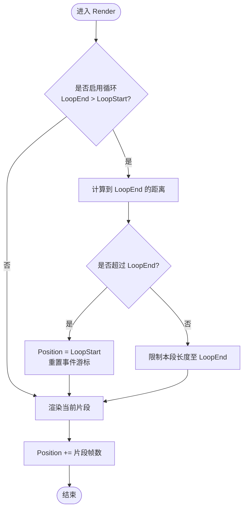
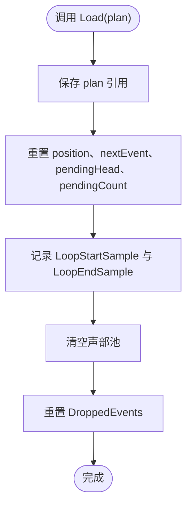
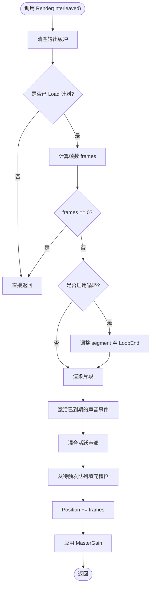
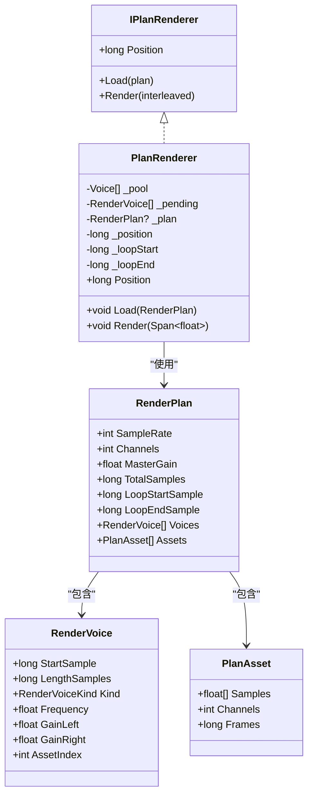
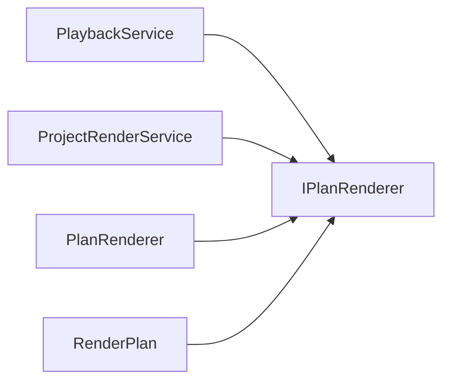

# IPlanRenderer 渲染器接口

<cite>
**本文引用的文件**   
- [IPlanRenderer.cs](file://src/Weftone.Abstractions/Rendering/IPlanRenderer.cs)
- [RenderPlan.cs](file://src/Weftone.Abstractions/Rendering/RenderPlan.cs)
- [PlanRenderer.cs](file://src/Weftone.Engine/PlanRenderer.cs)
- [PlaybackService.cs](file://src/Weftone.Application/PlaybackService.cs)
- [ProjectRenderService.cs](file://src/Weftone.Application/ProjectRenderService.cs)
</cite>

## 目录
1. [引言](#引言)
2. [项目结构定位](#项目结构定位)
3. [核心组件总览](#核心组件总览)
4. [架构概览](#架构概览)
5. [接口定义与语义](#接口定义与语义)
6. [Position 属性：用途与更新机制](#position-属性用途与更新机制)
7. [Load 方法：加载 RenderPlan 渲染计划](#load-方法加载-renderplan-渲染计划)
8. [Render 方法：交错格式音频输出](#render-方法交错格式音频输出)
9. [与 RenderPlan 的协作模式](#与-renderplan-的协作模式)
10. [自定义渲染器实现指南](#自定义渲染器实现指南)
11. [依赖关系分析](#依赖关系分析)
12. [性能考虑与最佳实践](#性能考虑与最佳实践)
13. [故障排查](#故障排查)
14. [结论](#结论)

## 引言
IPlanRenderer 是 Weftone 项目中 Application 层与 Engine 实现之间的抽象边界。它把“如何渲染”从“何时渲染、渲染什么计划”中解耦，使同一套接口既能驱动离线导出，也能驱动实时播放。其设计目标是：
- 统一访问方式：Application 不直接依赖具体引擎实现，只依赖 IPlanRenderer。
- 支持离线和实时两种场景：离线由 ProjectRenderService 分块调用；实时由 PlaybackService 通过音频后端回调驱动。
- 以 RenderPlan 作为零计算负担的预编译计划：事件参数在离线阶段预乘，渲染期只做读取和累加。

## 项目结构定位
IPlanRenderer 位于 Abstractions 层的 Rendering 命名空间，属于跨层契约；PlanRenderer 是 Engine 层的具体实现；PlaybackService 和 ProjectRenderService 是 Application 层的使用方。

**图表来源**
- [IPlanRenderer.cs:1-11](file://src/Weftone.Abstractions/Rendering/IPlanRenderer.cs#L1-L11)
- [RenderPlan.cs:1-42](file://src/Weftone.Abstractions/Rendering/RenderPlan.cs#L1-L42)
- [PlanRenderer.cs:1-11](file://src/Weftone.Engine/PlanRenderer.cs#L1-L11)
- [PlaybackService.cs:1-31](file://src/Weftone.Application/PlaybackService.cs#L1-L31)
- [ProjectRenderService.cs:1-15](file://src/Weftone.Application/ProjectRenderService.cs#L1-L15)

**章节来源**
- [IPlanRenderer.cs:1-11](file://src/Weftone.Abstractions/Rendering/IPlanRenderer.cs#L1-L11)
- [RenderPlan.cs:1-42](file://src/Weftone.Abstractions/Rendering/RenderPlan.cs#L1-L42)
- [PlanRenderer.cs:1-11](file://src/Weftone.Engine/PlanRenderer.cs#L1-L11)
- [PlaybackService.cs:1-31](file://src/Weftone.Application/PlaybackService.cs#L1-L31)
- [ProjectRenderService.cs:1-15](file://src/Weftone.Application/ProjectRenderService.cs#L1-L15)

## 核心组件总览
- IPlanRenderer：定义 Position、Load、Render 三个成员，作为渲染入口。
- RenderPlan：扁平化渲染计划，包含采样率、声道数、总样本数、循环区间、声音事件数组和预解码资产。
- PlanRenderer：Engine 层实现，支持正弦波与采样资产，具备声部池、偷取淡出、待触发队列、循环回绕等能力。
- PlaybackService：实时播放编排，负责停止-交换-恢复、设备打开、回调绑定。
- ProjectRenderService：离线导出编排，负责资产准备、文档编译、分块渲染和峰值统计。

**章节来源**
- [IPlanRenderer.cs:1-11](file://src/Weftone.Abstractions/Rendering/IPlanRenderer.cs#L1-L11)
- [RenderPlan.cs:1-42](file://src/Weftone.Abstractions/Rendering/RenderPlan.cs#L1-L42)
- [PlanRenderer.cs:1-11](file://src/Weftone.Engine/PlanRenderer.cs#L1-L11)
- [PlaybackService.cs:1-31](file://src/Weftone.Application/PlaybackService.cs#L1-L31)
- [ProjectRenderService.cs:1-15](file://src/Weftone.Application/ProjectRenderService.cs#L1-L15)

## 架构概览
IPlanRenderer 将 Application 层与 Engine 实现解耦，形成清晰的职责边界：
- Application 层负责业务编排：准备 RenderPlan、决定何时 Load、如何分块或回调式调用 Render。
- Engine 层负责音频合成：按计划激活声部、混合左右声道、处理循环和尾音淡出。
- Abstractions 层提供稳定契约：避免 Application 被 Engine 细节变化影响。

**图表来源**
- [PlaybackService.cs:24-31](file://src/Weftone.Application/PlaybackService.cs#L24-L31)
- [PlaybackService.cs:42-51](file://src/Weftone.Application/PlaybackService.cs#L42-L51)
- [ProjectRenderService.cs:19-48](file://src/Weftone.Application/ProjectRenderService.cs#L19-L48)
- [PlanRenderer.cs:48-105](file://src/Weftone.Engine/PlanRenderer.cs#L48-L105)

## 接口定义与语义
IPlanRenderer 暴露三个关键成员：
- Position：当前渲染位置，单位是采样点。
- Load：加载一个 RenderPlan，重置内部状态并准备下一次渲染。
- Render：将一段帧的音频写入 Span<float> 交错缓冲区。

该接口不包含任何平台相关类型，仅使用 Span<float> 作为音频数据载体，便于在实时回调和离线循环中复用。

**章节来源**
- [IPlanRenderer.cs:1-11](file://src/Weftone.Abstractions/Rendering/IPlanRenderer.cs#L1-L11)

## Position 属性：用途与更新机制
Position 表示渲染进度，单位为采样点。它在以下场景中发挥作用：
- 实时播放 UI 显示当前位置。
- 循环模式下判断是否到达 LoopEndSample 并回绕到 LoopStartSample。
- 声部等待时间计算：新声部的 StartSample 与当前 Position 比较，决定是否延迟激活。

在 PlanRenderer 中，Position 在每次 RenderSegment 结束时推进；如果启用循环且到达 LoopEndSample，则回绕到 LoopStartSample，并重置事件游标，以便重新触发计划中的事件。

**图表来源**
- [PlanRenderer.cs:61-105](file://src/Weftone.Engine/PlanRenderer.cs#L61-L105)
- [PlanRenderer.cs:107-137](file://src/Weftone.Engine/PlanRenderer.cs#L107-L137)

**章节来源**
- [PlanRenderer.cs:44-59](file://src/Weftone.Engine/PlanRenderer.cs#L44-L59)
- [PlanRenderer.cs:61-105](file://src/Weftone.Engine/PlanRenderer.cs#L61-L105)
- [PlanRenderer.cs:107-137](file://src/Weftone.Engine/PlanRenderer.cs#L107-L137)

## Load 方法：加载 RenderPlan 渲染计划
Load 的职责是：
- 保存传入的 RenderPlan 引用。
- 重置 Position、事件游标、待触发队列头与计数。
- 记录循环区间起点和终点。
- 清空声部池，确保无残留活跃声部。
- 重置丢事件计数器（用于诊断）。

Load 不应在音频线程渲染期间被并发调用。PlaybackService 保证在 Stop 之后才调用 Load，从而避免竞态。

**图表来源**
- [PlanRenderer.cs:48-59](file://src/Weftone.Engine/PlanRenderer.cs#L48-L59)

**章节来源**
- [PlanRenderer.cs:48-59](file://src/Weftone.Engine/PlanRenderer.cs#L48-L59)
- [PlaybackService.cs:42-51](file://src/Weftone.Application/PlaybackService.cs#L42-L51)
- [PlaybackService.cs:63-78](file://src/Weftone.Application/PlaybackService.cs#L63-L78)

## Render 方法：交错格式音频输出
Render 接收 Span<float> interleaved，这是交错格式的浮点音频缓冲：左声道和右声道样本交替排列。例如，前两个元素是第 0 帧的左、右声道，接下来两个元素是第 1 帧的左、右声道，依此类推。

Render 的主要流程：
1. 清空输出缓冲，避免残留上一帧数据。
2. 若未 Load 过计划或帧数为 0，直接返回。
3. 根据循环区间调整每段渲染长度。
4. 激活计划中已到期的声音事件。
5. 遍历声部池，对每个活跃声部进行门限渲染或偷取尾音渲染。
6. 将待触发队列中的事件填入空闲声部槽位。
7. 推进 Position。
8. 应用 MasterGain 主增益。

**图表来源**
- [PlanRenderer.cs:61-105](file://src/Weftone.Engine/PlanRenderer.cs#L61-L105)
- [PlanRenderer.cs:107-137](file://src/Weftone.Engine/PlanRenderer.cs#L107-L137)

**章节来源**
- [PlanRenderer.cs:61-105](file://src/Weftone.Engine/PlanRenderer.cs#L61-L105)
- [PlanRenderer.cs:107-137](file://src/Weftone.Engine/PlanRenderer.cs#L107-L137)

## 与 RenderPlan 的协作模式
RenderPlan 是预编译的扁平计划，包含：
- SampleRate：工程采样率。
- Channels：声道数。
- TotalSamples：总样本数。
- LoopStartSample / LoopEndSample：循环区间。
- Voices：声音事件数组，每个事件包含起始样本、长度、类型、频率、左右增益、资产索引。
- Assets：预解码并重采样后的采样资产。

IPlanRenderer 通过 Load 接收 RenderPlan，并在 Render 中按 StartSample 顺序激活 Voices，同时从 Assets 读取样本数据。这种设计将昂贵的解码、重采样、参数预乘放在离线阶段，渲染期只做轻量混合。

**图表来源**
- [IPlanRenderer.cs:1-11](file://src/Weftone.Abstractions/Rendering/IPlanRenderer.cs#L1-L11)
- [RenderPlan.cs:1-42](file://src/Weftone.Abstractions/Rendering/RenderPlan.cs#L1-L42)
- [PlanRenderer.cs:1-44](file://src/Weftone.Engine/PlanRenderer.cs#L1-L44)

**章节来源**
- [RenderPlan.cs:1-42](file://src/Weftone.Abstractions/Rendering/RenderPlan.cs#L1-L42)
- [PlanRenderer.cs:1-44](file://src/Weftone.Engine/PlanRenderer.cs#L1-L44)

## 自定义渲染器实现指南
要实现自定义 IPlanRenderer，需要遵循以下约定：
- Position 必须反映当前渲染进度，单位是采样点。
- Load 必须接受 RenderPlan 并重置内部状态，包括位置、事件游标、声部池、循环区间等。
- Render 必须将指定帧数的音频写入 Span<float> 交错缓冲，并保持零分配或可预测分配，尤其是实时路径。
- 如果实现支持循环，应正确处理 LoopStartSample 与 LoopEndSample 的回绕逻辑。
- 如果实现支持多声道，应正确读写交错缓冲的左右声道。

推荐步骤：
1. 定义内部状态：Position、声部池、待触发队列、循环区间。
2. 实现 Load：保存 RenderPlan，清空状态，记录循环区间。
3. 实现 Render：清空缓冲、激活事件、混合声部、推进 Position、应用主增益。
4. 测试离线与实时两种调用方式，确保行为一致。

**章节来源**
- [IPlanRenderer.cs:1-11](file://src/Weftone.Abstractions/Rendering/IPlanRenderer.cs#L1-L11)
- [PlanRenderer.cs:48-105](file://src/Weftone.Engine/PlanRenderer.cs#L48-L105)

## 依赖关系分析
IPlanRenderer 被 Application 层直接使用，Engine 层提供默认实现。PlaybackService 和 ProjectRenderService 分别代表实时与离线两种使用模式。

**图表来源**
- [PlaybackService.cs:1-31](file://src/Weftone.Application/PlaybackService.cs#L1-L31)
- [ProjectRenderService.cs:1-15](file://src/Weftone.Application/ProjectRenderService.cs#L1-L15)
- [PlanRenderer.cs:1-11](file://src/Weftone.Engine/PlanRenderer.cs#L1-L11)
- [IPlanRenderer.cs:1-11](file://src/Weftone.Abstractions/Rendering/IPlanRenderer.cs#L1-L11)

**章节来源**
- [PlaybackService.cs:1-31](file://src/Weftone.Application/PlaybackService.cs#L1-L31)
- [ProjectRenderService.cs:1-15](file://src/Weftone.Application/ProjectRenderService.cs#L1-L15)
- [PlanRenderer.cs:1-11](file://src/Weftone.Engine/PlanRenderer.cs#L1-L11)
- [IPlanRenderer.cs:1-11](file://src/Weftone.Abstractions/Rendering/IPlanRenderer.cs#L1-L11)

## 性能考虑与最佳实践
- 零分配优先：PlanRenderer 使用预分配声部池和待触发队列，避免实时路径分配。自定义实现也应尽量复用对象。
- 交错缓冲高效写入：Span<float> 允许切片和快速索引，避免创建中间数组。
- 循环优化：在循环模式下提前计算 LoopEnd 距离，减少分支判断。
- 主增益后处理：先混合再乘以 MasterGain，减少重复乘法。
- 事件批处理：按 StartSample 顺序激活，避免频繁排序。
- 偷取策略确定性：选择最早结束的声部并线性淡出，避免 click。
- 实时约束：不要在音频回调中调用 Load；PlaybackService 保证停止后再 Load。

**章节来源**
- [PlanRenderer.cs:11-16](file://src/Weftone.Engine/PlanRenderer.cs#L11-L16)
- [PlanRenderer.cs:61-105](file://src/Weftone.Engine/PlanRenderer.cs#L61-L105)
- [PlanRenderer.cs:139-231](file://src/Weftone.Engine/PlanRenderer.cs#L139-L231)
- [PlaybackService.cs:6-11](file://src/Weftone.Application/PlaybackService.cs#L6-L11)

## 故障排查
常见问题及建议：
- 输出全静音：检查是否调用了 Load；未 Load 时 Render 会直接返回。
- 位置不推进：确认 RenderSegment 末尾是否更新 Position。
- 循环异常：检查 LoopStartSample 与 LoopEndSample 是否正确设置，以及回绕逻辑是否重置事件游标。
- 爆音或点击：检查偷取淡出是否生效，尾音是否线性衰减。
- 实时卡顿：检查 Render 中是否有分配或昂贵操作；确保 Span<float> 写入高效。
- 热更新失败：确保 UpdatePlan 先 Stop，再 Load，再 Start，避免并发。

**章节来源**
- [PlanRenderer.cs:61-68](file://src/Weftone.Engine/PlanRenderer.cs#L61-L68)
- [PlanRenderer.cs:78-92](file://src/Weftone.Engine/PlanRenderer.cs#L78-L92)
- [PlanRenderer.cs:191-215](file://src/Weftone.Engine/PlanRenderer.cs#L191-L215)
- [PlaybackService.cs:63-78](file://src/Weftone.Application/PlaybackService.cs#L63-L78)

## 结论
IPlanRenderer 为 Weftone 提供了统一的渲染抽象，使 Application 层可以以相同方式驱动离线导出与实时播放。Position、Load、Render 三成员清晰表达了渲染生命周期；RenderPlan 将复杂合成参数前置，使渲染期保持轻量。PlanRenderer 的实现展示了高性能实时渲染的关键技术：预分配池、事件顺序激活、循环回绕、偷取淡出与交错缓冲高效写入。自定义渲染器只需遵循这些约定，即可无缝接入现有应用编排。