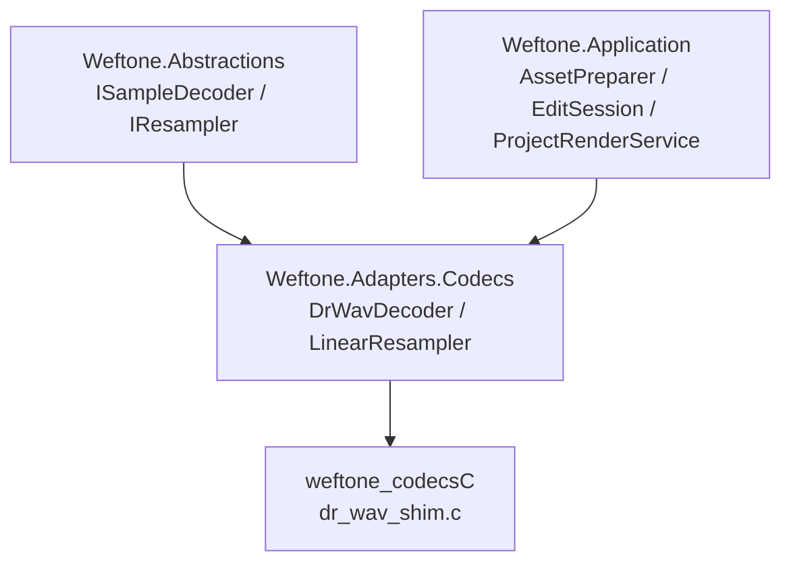
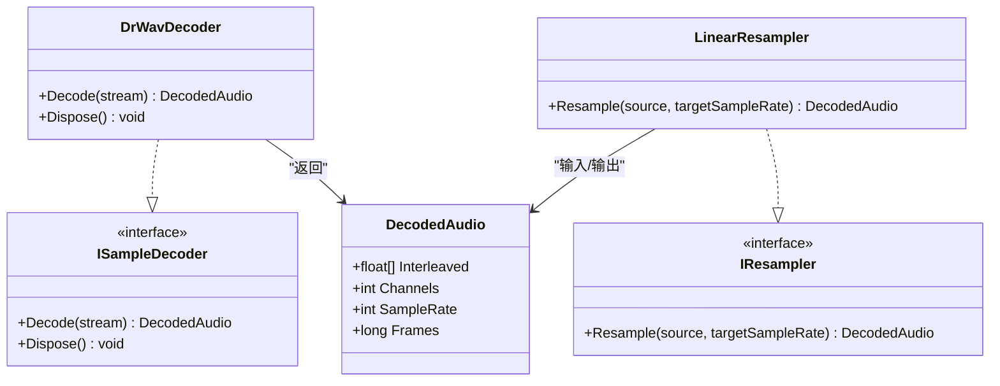
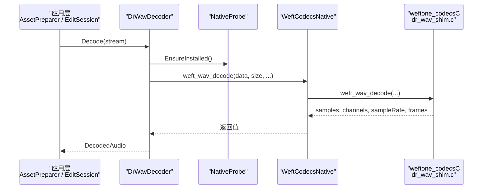
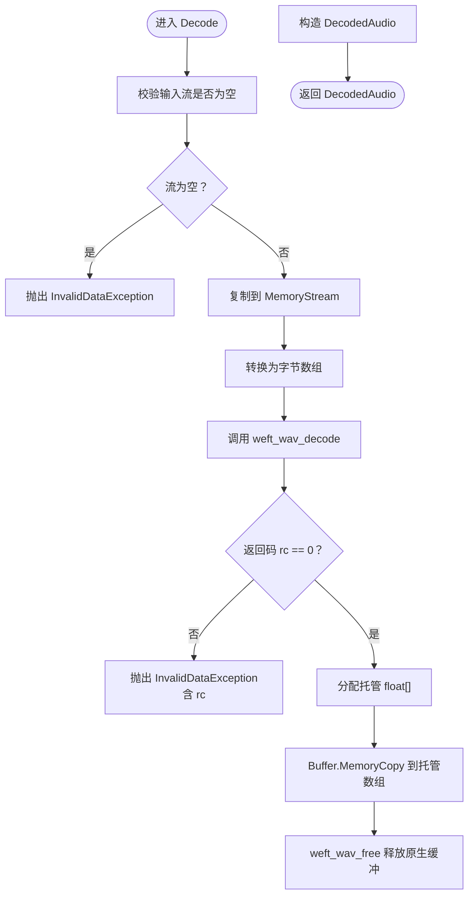
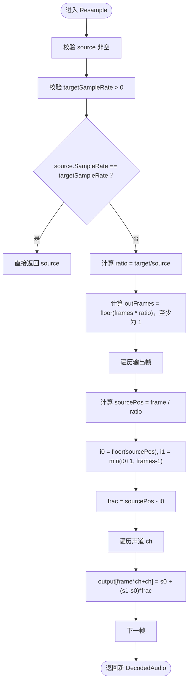
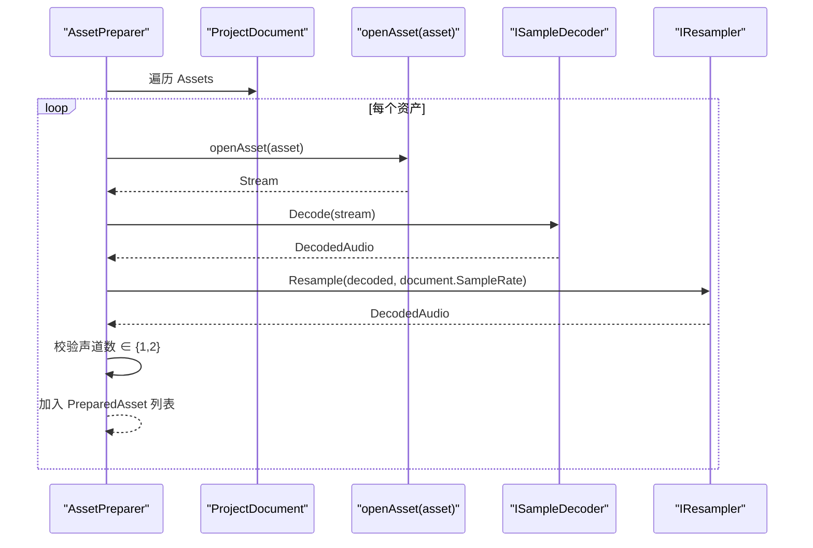

# ISampleDecoder 解码器接口

<cite>
**本文引用的文件**   
- [ISampleDecoder.cs](file://src/Weftone.Abstractions/ISampleDecoder.cs)
- [DrWavDecoder.cs](file://src/Weftone.Adapters.Codecs/DrWavDecoder.cs)
- [LinearResampler.cs](file://src/Weftone.Adapters.Codecs/LinearResampler.cs)
- [NativeProbe.cs](file://src/Weftone.Adapters.Codecs/NativeProbe.cs)
- [WeftCodecsNative.cs](file://src/Weftone.Adapters.Codecs/WeftCodecsNative.cs)
- [AssetPreparer.cs](file://src/Weftone.Application/AssetPreparer.cs)
- [EditSession.cs](file://src/Weftone.Application/EditSession.cs)
- [ProjectRenderService.cs](file://src/Weftone.Application/ProjectRenderService.cs)
- [dr_wav_shim.c](file://native/weftone_codecs/dr_wav_shim.c)
- [CMakeLists.txt（weftone_codecs）](file://native/weftone_codecs/CMakeLists.txt)
- [README.md（weftone_codecs）](file://native/weftone_codecs/README.md)
- [README.md（Weftone.Adapters.Codecs）](file://src/Weftone.Adapters.Codecs/README.md)
- [AssetPipelineTests.cs](file://tests/Weftone.Application.Tests/AssetPipelineTests.cs)
</cite>

## 目录
1. [引言](#引言)
2. [项目结构](#项目结构)
3. [核心组件](#核心组件)
4. [架构总览](#架构总览)
5. [详细组件分析](#详细组件分析)
6. [依赖关系分析](#依赖关系分析)
7. [性能与内存管理](#性能与内存管理)
8. [故障排查指南](#故障排查指南)
9. [结论](#结论)
10. [附录：扩展自定义解码器](#附录：扩展自定义解码器)

## 引言
本文围绕 Weftone 中的采样解码扩展点 `ISampleDecoder`，系统说明其设计目标、接口契约、现有实现与集成方式。当前仓库提供了基于 dr_wav 的 WAV 解码适配器 `DrWavDecoder`，以及离线线性重采样器 `LinearResampler`。文档将解释：
- 如何通过 `ISampleDecoder` 统一接入不同音频格式；
- 初始化、数据读取、格式转换、错误处理机制；
- 元数据与进度报告在当前实现中的现状与扩展建议；
- 流式解码模式在现有代码中的定位与改进方向；
- 与 `LinearResampler` 的集成最佳实践；
- 如何注册和发现自定义解码器。

需要特别说明的是：当前仓库仅实现了 WAV 解码，并未提供 MP3、FLAC 等格式的解码实现或自动格式检测逻辑。因此，关于这些格式的说明将以“扩展点能力”和“建议实现方式”呈现，避免把未实现功能描述为既有行为。

## 项目结构
与 `ISampleDecoder` 直接相关的代码分布在以下位置：
- 抽象层：定义解码结果与接口契约；
- 适配器层：提供 WAV 解码与线性重采样实现，并封装原生库调用；
- 应用层：使用解码器和重采样器进行资产准备；
- 原生层：通过 C 包装 dr_wav，输出 f32 交错 PCM。

**图表来源**
- [ISampleDecoder.cs:1-16](file://src/Weftone.Abstractions/ISampleDecoder.cs#L1-L16)
- [DrWavDecoder.cs:1-50](file://src/Weftone.Adapters.Codecs/DrWavDecoder.cs#L1-L50)
- [LinearResampler.cs:1-45](file://src/Weftone.Adapters.Codecs/LinearResampler.cs#L1-L45)
- [AssetPreparer.cs:1-42](file://src/Weftone.Application/AssetPreparer.cs#L1-L42)
- [dr_wav_shim.c:1-67](file://native/weftone_codecs/dr_wav_shim.c#L1-L67)

**章节来源**
- [ISampleDecoder.cs:1-16](file://src/Weftone.Abstractions/ISampleDecoder.cs#L1-L16)
- [README.md（Weftone.Adapters.Codecs）:1-11](file://src/Weftone.Adapters.Codecs/README.md#L1-L11)

## 核心组件
本节聚焦 `ISampleDecoder`、`DecodedAudio`、`IResampler` 以及现有实现。

- `DecodedAudio`：不可变记录类型，表示一次解码结果，包含交错浮点 PCM 数组、声道数、采样率与帧数。
- `ISampleDecoder`：解码器接口，继承 `IDisposable`，提供 `Decode(Stream)` 方法，从任意输入流解码为 `DecodedAudio`。
- `IResampler`：重采样接口，提供 `Resample(DecodedAudio, int)` 方法，将已解码音频重采样到目标采样率。
- `DrWavDecoder`：基于 dr_wav 的 WAV 解码实现，整文件解码，非实时路径。
- `LinearResampler`：M1a 拍板 D3 的离线线性插值实现，确定性且逐声道插值。

**图表来源**
- [ISampleDecoder.cs:1-16](file://src/Weftone.Abstractions/ISampleDecoder.cs#L1-L16)
- [DrWavDecoder.cs:1-50](file://src/Weftone.Adapters.Codecs/DrWavDecoder.cs#L1-L50)
- [LinearResampler.cs:1-45](file://src/Weftone.Adapters.Codecs/LinearResampler.cs#L1-L45)

**章节来源**
- [ISampleDecoder.cs:1-16](file://src/Weftone.Abstractions/ISampleDecoder.cs#L1-L16)
- [DrWavDecoder.cs:1-50](file://src/Weftone.Adapters.Codecs/DrWavDecoder.cs#L1-L50)
- [LinearResampler.cs:1-45](file://src/Weftone.Adapters.Codecs/LinearResampler.cs#L1-L45)

## 架构总览
从应用层到原生层的完整调用链如下：

**图表来源**
- [AssetPreparer.cs:11-37](file://src/Weftone.Application/AssetPreparer.cs#L11-L37)
- [DrWavDecoder.cs:8-44](file://src/Weftone.Adapters.Codecs/DrWavDecoder.cs#L8-L44)
- [NativeProbe.cs:15-22](file://src/Weftone.Adapters.Codecs/NativeProbe.cs#L15-L22)
- [WeftCodecsNative.cs:9-14](file://src/Weftone.Adapters.Codecs/WeftCodecsNative.cs#L9-L14)
- [dr_wav_shim.c:16-61](file://native/weftone_codecs/dr_wav_shim.c#L16-L61)

## 详细组件分析

### ISampleDecoder 与 DecodedAudio
- 接口职责单一：接收任意 `Stream`，返回标准化 `DecodedAudio`。
- 结果模型固定：f32 交错 PCM、声道数、采样率、帧数，便于上层统一处理。
- 生命周期：接口继承 `IDisposable`，允许实现类持有需释放的资源（当前 `DrWavDecoder.Dispose` 为空实现）。

**章节来源**
- [ISampleDecoder.cs:1-16](file://src/Weftone.Abstractions/ISampleDecoder.cs#L1-L16)

### DrWavDecoder：WAV 解码实现
- 输入校验：拒绝空流；要求底层原生库可用。
- 数据读取：先将流复制到内存缓冲，再调用原生解码函数。
- 原生交互：通过 `WeftCodecsNative` 调用 `weft_wav_decode`，获取 f32 交错 PCM 指针及元信息。
- 内存管理：使用 `try/finally` 确保原生分配的缓冲区被释放；将原生缓冲拷贝到托管数组后返回。
- 错误处理：对空流、非法 WAV、截断等情况抛出 `InvalidDataException`。

**图表来源**
- [DrWavDecoder.cs:8-44](file://src/Weftone.Adapters.Codecs/DrWavDecoder.cs#L8-L44)
- [dr_wav_shim.c:16-61](file://native/weftone_codecs/dr_wav_shim.c#L16-L61)

**章节来源**
- [DrWavDecoder.cs:1-50](file://src/Weftone.Adapters.Codecs/DrWavDecoder.cs#L1-L50)
- [WeftCodecsNative.cs:1-15](file://src/Weftone.Adapters.Codecs/WeftCodecsNative.cs#L1-L15)
- [dr_wav_shim.c:1-67](file://native/weftone_codecs/dr_wav_shim.c#L1-L67)

### LinearResampler：线性重采样
- 输入校验：拒绝空源；目标采样率必须大于 0。
- 同采样率优化：若源与目标采样率相同，直接返回原对象，避免无意义计算。
- 算法流程：按帧计算源位置，取相邻样本做线性插值，逐声道写入输出缓冲。
- 输出约束：输出 `DecodedAudio` 保持交错 PCM 布局，声道数不变。

**图表来源**
- [LinearResampler.cs:11-43](file://src/Weftone.Adapters.Codecs/LinearResampler.cs#L11-L43)

**章节来源**
- [LinearResampler.cs:1-45](file://src/Weftone.Adapters.Codecs/LinearResampler.cs#L1-L45)

### 原生库探测与加载
- `NativeProbe.EnsureInstalled()`：首次调用时设置 `DllImportResolver`，后续不再重复解析。
- 候选路径优先级：环境变量 `WEFTONE_NATIVE_DIR` → 应用目录 → 仓库布局下的 `native/build` 或 `native/weftone_codecs/build`。
- 平台适配：根据 Windows/macOS/Linux 选择 `.dll`/`.dylib`/`.so`。

**章节来源**
- [NativeProbe.cs:1-71](file://src/Weftone.Adapters.Codecs/NativeProbe.cs#L1-L71)
- [README.md（weftone_codecs）:1-23](file://native/weftone_codecs/README.md#L1-L23)
- [CMakeLists.txt（weftone_codecs）:1-27](file://native/weftone_codecs/CMakeLists.txt#L1-L27)

### 应用层集成：AssetPreparer、EditSession、ProjectRenderService
- `AssetPreparer.Prepare`：遍历工程资产，依次调用 `decoder.Decode` 与 `resampler.Resample`，并对声道数进行限制（仅支持 1/2 声道）。
- `EditSession` 与 `ProjectRenderService`：通过构造函数注入 `ISampleDecoder` 与 `IResampler`，体现依赖倒置与可测试性。

**图表来源**
- [AssetPreparer.cs:11-37](file://src/Weftone.Application/AssetPreparer.cs#L11-L37)
- [EditSession.cs:19-27](file://src/Weftone.Application/EditSession.cs#L19-L27)
- [ProjectRenderService.cs:13-14](file://src/Weftone.Application/ProjectRenderService.cs#L13-L14)

**章节来源**
- [AssetPreparer.cs:1-42](file://src/Weftone.Application/AssetPreparer.cs#L1-L42)
- [EditSession.cs:19-27](file://src/Weftone.Application/EditSession.cs#L19-L27)
- [ProjectRenderService.cs:13-14](file://src/Weftone.Application/ProjectRenderService.cs#L13-L14)

## 依赖关系分析
- 抽象层不依赖具体实现，保证扩展性。
- 适配器层依赖抽象层，并通过 P/Invoke 依赖原生库。
- 应用层依赖抽象层，不感知具体解码器实现。
- 原生层通过 CMake 构建共享库，供 .NET 侧动态加载。

**图表来源**
- [ISampleDecoder.cs:1-16](file://src/Weftone.Abstractions/ISampleDecoder.cs#L1-L16)
- [WeftCodecsNative.cs:1-15](file://src/Weftone.Adapters.Codecs/WeftCodecsNative.cs#L1-L15)
- [CMakeLists.txt（weftone_codecs）:1-27](file://native/weftone_codecs/CMakeLists.txt#L1-L27)

**章节来源**
- [README.md（Weftone.Adapters.Codecs）:1-11](file://src/Weftone.Adapters.Codecs/README.md#L1-L11)
- [README.md（weftone_codecs）:1-23](file://native/weftone_codecs/README.md#L1-L23)

## 性能与内存管理
- 解码阶段：
  - `DrWavDecoder` 采用整文件解码，适合离线路径（资产准备），不适合实时播放。
  - 原生缓冲通过 `weft_wav_free` 释放，托管缓冲由 GC 管理。
  - 使用 `Buffer.MemoryCopy` 高效复制原生缓冲到托管数组。
- 重采样阶段：
  - `LinearResampler` 为 O(N) 时间复杂度，空间复杂度为输出缓冲大小。
  - 同采样率直接返回原对象，避免额外开销。
- 内存压力：
  - 大文件解码会同时存在原始流缓冲、字节数组、原生缓冲与托管数组，峰值内存较高。
  - 建议在应用层控制并发解码数量，避免同时解码过多大文件。

[本节为通用性能讨论，不直接分析具体文件]

## 故障排查指南
常见问题与定位要点：
- 原生库未找到：
  - 检查 `WEFTONE_NATIVE_DIR` 环境变量是否指向包含 `weftone_codecs` 动态库的目录。
  - 确认应用目录下是否存在对应平台的动态库文件。
  - 若从源码构建，确认 CMake 产物位于 `native/build` 或 `native/weftone_codecs/build`。
- WAV 解码失败：
  - 空流或非 WAV 数据会触发 `InvalidDataException`。
  - 原生层返回码含义：-2 非法 WAV，-3 空或超限，-5 截断。
- 声道数不支持：
  - `AssetPreparer` 仅接受 1 或 2 声道，其他声道数会抛出异常。

**章节来源**
- [NativeProbe.cs:15-69](file://src/Weftone.Adapters.Codecs/NativeProbe.cs#L15-L69)
- [DrWavDecoder.cs:16-28](file://src/Weftone.Adapters.Codecs/DrWavDecoder.cs#L16-L28)
- [AssetPreparer.cs:33-36](file://src/Weftone.Application/AssetPreparer.cs#L33-L36)
- [AssetPipelineTests.cs:40-77](file://tests/Weftone.Application.Tests/AssetPipelineTests.cs#L40-L77)

## 结论
`ISampleDecoder` 提供了一个简洁而强大的扩展点，使 Weftone 能够以统一方式接入不同音频格式解码实现。当前仓库实现了 WAV 解码与线性重采样，并在应用层完成资产准备与采样率对齐。对于 MP3、FLAC 等格式，可通过新增 `ISampleDecoder` 实现来扩展；但当前仓库未提供自动格式检测与元数据提取机制，这些属于未来扩展方向。

[本节为总结性内容，不直接分析具体文件]

## 附录：扩展自定义解码器
本节给出实现自定义解码器的步骤与建议，涵盖格式注册、发现机制、流式解码、进度报告与元数据提取。

### 1. 新建解码器实现
- 创建类实现 `ISampleDecoder`，在 `Decode(Stream)` 中完成：
  - 输入校验；
  - 格式识别（例如通过魔数或扩展名）；
  - 解码为 `DecodedAudio`；
  - 资源释放（如需要）。

示例结构参考：
- 接口定义：[ISampleDecoder.cs:7-10](file://src/Weftone.Abstractions/ISampleDecoder.cs#L7-L10)
- 现有实现：[DrWavDecoder.cs:6-50](file://src/Weftone.Adapters.Codecs/DrWavDecoder.cs#L6-L50)

### 2. 格式注册与发现机制
- 建议维护一个全局或容器管理的解码器注册表，键为格式标识（如 MIME 类型或扩展名），值为解码器实例或工厂。
- 在应用启动时扫描程序集，自动发现实现 `ISampleDecoder` 的类型并注册。
- 在解码前根据输入流的魔数或扩展名选择合适的解码器。

注意：当前仓库未提供该注册与发现逻辑，需在业务层或 DI 容器中自行实现。

### 3. 流式解码模式
- 当前 `DrWavDecoder` 为整文件解码，不适合实时流式播放。
- 如需流式解码，可在 `ISampleDecoder` 上增加增量 API（例如 `ReadFrame()` 或 `OnFrame` 回调），或在应用层实现分块读取与缓冲合并。
- 流式解码需考虑：
  - 头解析与元数据缓存；
  - 缓冲策略与背压；
  - 线程安全与实时性约束。

### 4. 进度报告
- 当前接口不提供进度回调。
- 可选方案：
  - 在 `Decode` 参数中传入进度回调委托；
  - 或使用异步 API 配合 `CancellationToken` 与进度事件。
- 需注意：进度报告不应阻塞解码主路径，建议使用独立任务或事件驱动。

### 5. 元数据提取
- 当前 `DecodedAudio` 不包含标题、艺术家、专辑等元数据。
- 可扩展 `DecodedAudio` 或引入独立的元数据对象，在解码过程中提取并返回。
- 对于 MP3/FLAC，可利用第三方库解析 ID3v2、Vorbis Comments 等标签。

### 6. 与 LinearResampler 的集成
- 在应用层（如 `AssetPreparer`）先解码再重采样，确保所有资产统一到工程采样率。
- 若自定义解码器返回的采样率与工程不一致，交由 `LinearResampler` 处理。
- 最佳实践：
  - 在解码完成后立即进行采样率对齐；
  - 对声道数进行限制与校验；
  - 对超大文件进行分片或流式处理。

**章节来源**
- [ISampleDecoder.cs:1-16](file://src/Weftone.Abstractions/ISampleDecoder.cs#L1-L16)
- [DrWavDecoder.cs:1-50](file://src/Weftone.Adapters.Codecs/DrWavDecoder.cs#L1-L50)
- [LinearResampler.cs:1-45](file://src/Weftone.Adapters.Codecs/LinearResampler.cs#L1-L45)
- [AssetPreparer.cs:11-37](file://src/Weftone.Application/AssetPreparer.cs#L11-L37)