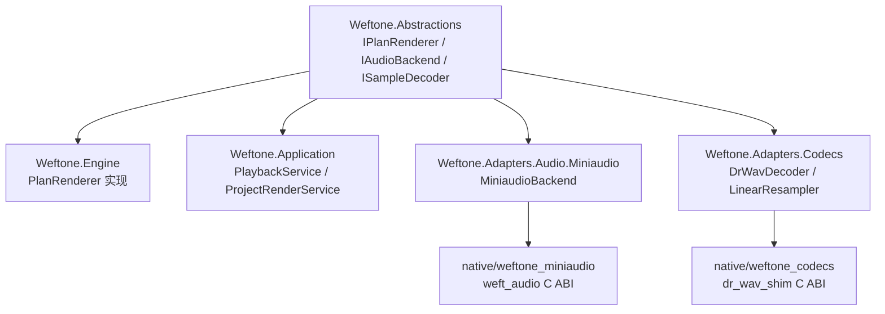
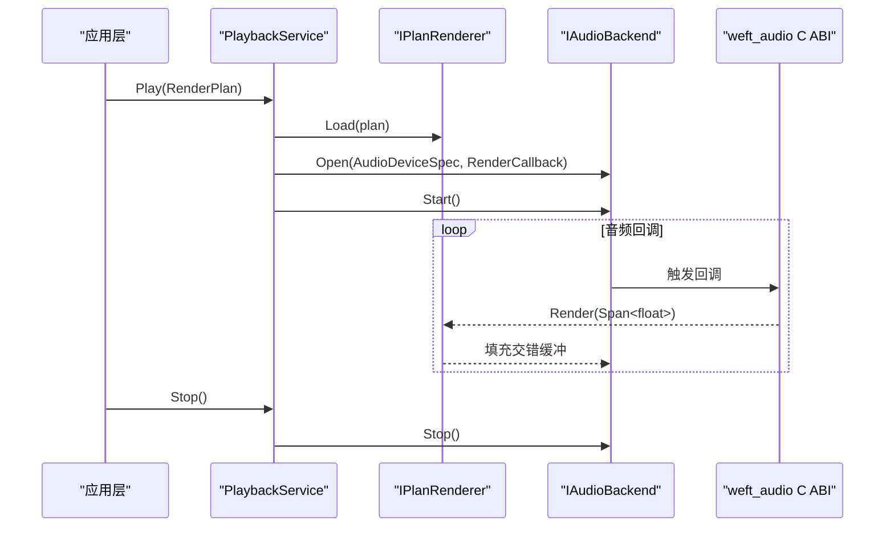
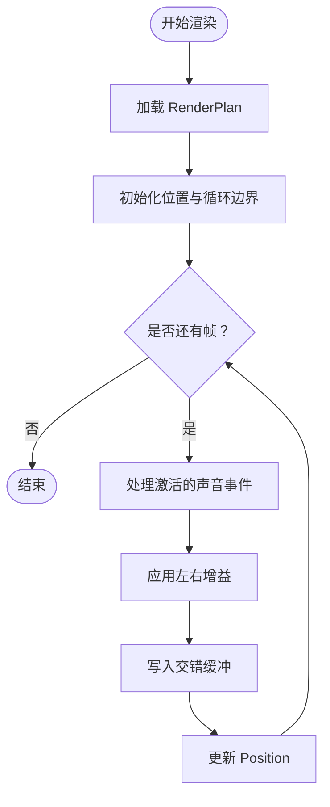
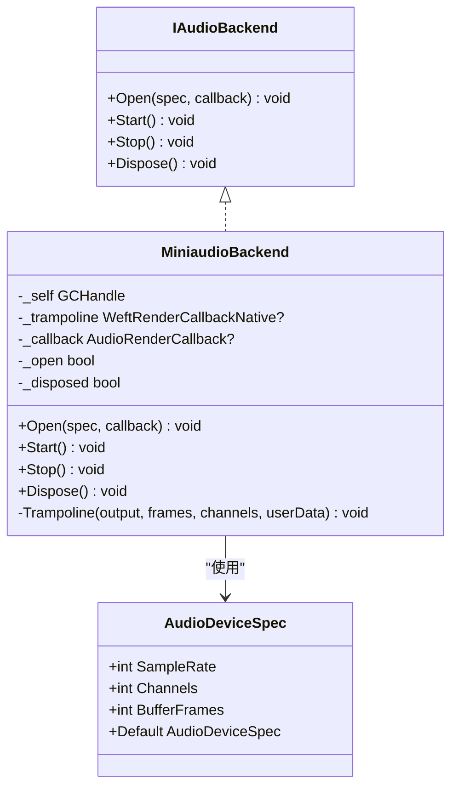
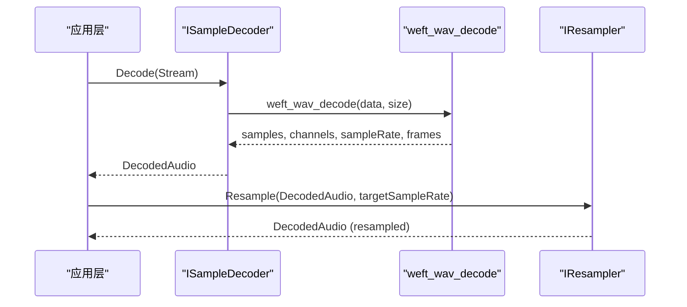
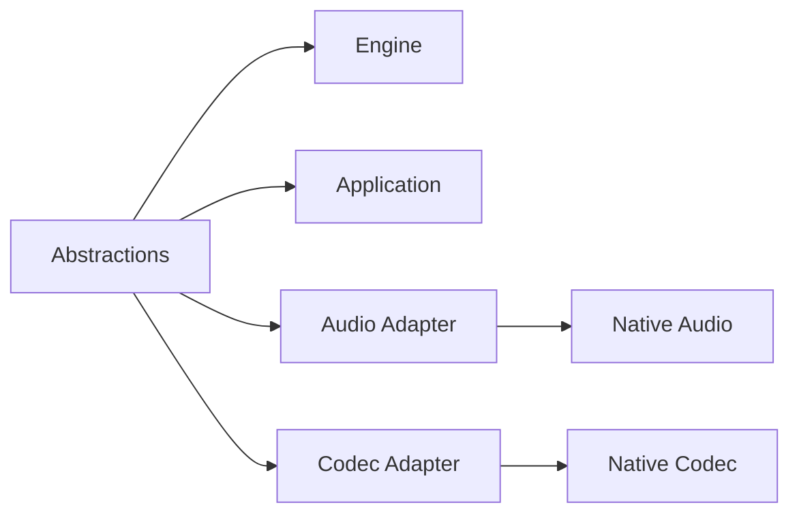

# 抽象接口

<cite>
**本文引用的文件**   
- [IPlanRenderer.cs](file://src/Weftone.Abstractions/Rendering/IPlanRenderer.cs)
- [RenderPlan.cs](file://src/Weftone.Abstractions/Rendering/RenderPlan.cs)
- [IAudioBackend.cs](file://src/Weftone.Abstractions/IAudioBackend.cs)
- [AudioDeviceSpec.cs](file://src/Weftone.Abstractions/AudioDeviceSpec.cs)
- [ISampleDecoder.cs](file://src/Weftone.Abstractions/ISampleDecoder.cs)
- [Abstractions README.md](file://src/Weftone.Abstractions/README.md)
- [PlaybackService.cs](file://src/Weftone.Application/PlaybackService.cs)
- [ProjectRenderService.cs](file://src/Weftone.Application/ProjectRenderService.cs)
- [PlanRenderer.cs](file://src/Weftone.Engine/PlanRenderer.cs)
- [MiniaudioBackend.cs](file://src/Weftone.Adapters.Audio.Miniaudio/MiniaudioBackend.cs)
- [weft_audio.c](file://native/weftone_miniaudio/weft_audio.c)
- [dr_wav_shim.c](file://native/weftone_codecs/dr_wav_shim.c)
- [DrWavDecoder.cs](file://src/Weftone.Adapters.Codecs/DrWavDecoder.cs)
- [LinearResampler.cs](file://src/Weftone.Adapters.Codecs/LinearResampler.cs)
</cite>

## 目录
1. [简介](#简介)
2. [项目结构](#项目结构)
3. [核心接口总览](#核心接口总览)
4. [架构总览](#架构总览)
5. [详细接口分析](#详细接口分析)
6. [依赖关系分析](#依赖关系分析)
7. [性能与实时性约束](#性能与实时性约束)
8. [插件化扩展指南](#插件化扩展指南)
9. [接口版本与向后兼容策略](#接口版本与向后兼容策略)
10. [故障排查](#故障排查)
11. [结论](#结论)

## 简介
本文面向 Weftone 的抽象接口层，聚焦以下三个关键契约：
- `IPlanRenderer`：计划渲染器接口，负责将预计算的渲染计划输出为交错浮点音频。
- `IAudioBackend`：音频后端接口，封装设备打开、启动、停止和实时回调。
- `ISampleDecoder`：采样解码接口，提供从流中解码音频样本并支持重采样的扩展点。

这些接口共同构成 Weftone 的“端口与契约层”，Engine 与应用层通过它们解耦第三方实现，从而实现插件化架构。

## 项目结构
抽象接口位于 `Weftone.Abstractions`，不包含任何上层项目依赖；具体实现分别位于 Engine、Application、Adapter 等项目中：
- 抽象层：`Weftone.Abstractions`
- 引擎实现：`Weftone.Engine`
- 应用编排：`Weftone.Application`
- 音频适配器：`Weftone.Adapters.Audio.Miniaudio`
- 解码适配器：`Weftone.Adapters.Codecs`
- 原生 shim：`native/weftone_miniaudio`、`native/weftone_codecs`

**图示来源**
- [IPlanRenderer.cs:1-11](file://src/Weftone.Abstractions/Rendering/IPlanRenderer.cs#L1-L11)
- [IAudioBackend.cs:1-14](file://src/Weftone.Abstractions/IAudioBackend.cs#L1-L14)
- [ISampleDecoder.cs:1-16](file://src/Weftone.Abstractions/ISampleDecoder.cs#L1-L16)
- [PlanRenderer.cs:1-42](file://src/Weftone.Engine/PlanRenderer.cs#L1-L42)
- [PlaybackService.cs:1-98](file://src/Weftone.Application/PlaybackService.cs#L1-L98)
- [MiniaudioBackend.cs:1-84](file://src/Weftone.Adapters.Audio.Miniaudio/MiniaudioBackend.cs#L1-L84)
- [DrWavDecoder.cs:1-50](file://src/Weftone.Adapters.Codecs/DrWavDecoder.cs#L1-L50)
- [weft_audio.c:100-162](file://native/weftone_miniaudio/weft_audio.c#L100-L162)
- [dr_wav_shim.c:1-67](file://native/weftone_codecs/dr_wav_shim.c#L1-L67)

**章节来源**
- [Abstractions README.md:1-10](file://src/Weftone.Abstractions/README.md#L1-L10)

## 核心接口总览
本节对三个核心接口进行统一说明，包括职责、参数、返回值和使用场景。

### IPlanRenderer：计划渲染器
- 职责：接收预计算的 `RenderPlan`，按帧渲染交错浮点 PCM 到调用方提供的缓冲。
- 关键成员：
  - `Position`：当前渲染位置（样本索引）。
  - `Load(plan)`：加载渲染计划，准备内部状态。
  - `Render(interleaved)`：填充交错浮点缓冲，不分配对象。
- 典型使用者：
  - 实时播放：`PlaybackService` 在音频回调中调用 `Render`。
  - 离线渲染：`ProjectRenderService` 分块调用 `Render` 生成完整工程音频。
- 默认实现：`PlanRenderer`，支持正弦波与采样器两种声音类型，具备循环、淡出、多复音能力。

**章节来源**
- [IPlanRenderer.cs:1-11](file://src/Weftone.Abstractions/Rendering/IPlanRenderer.cs#L1-L11)
- [RenderPlan.cs:1-42](file://src/Weftone.Abstractions/Rendering/RenderPlan.cs#L1-L42)
- [PlanRenderer.cs:1-42](file://src/Weftone.Engine/PlanRenderer.cs#L1-L42)
- [PlaybackService.cs:1-98](file://src/Weftone.Application/PlaybackService.cs#L1-L98)
- [ProjectRenderService.cs:27-50](file://src/Weftone.Application/ProjectRenderService.cs#L27-L50)

### IAudioBackend：音频后端
- 职责：封装底层音频设备的打开、启动、停止和资源释放；在音频线程回调中填充交错浮点输出缓冲。
- 关键成员：
  - `Open(spec, callback)`：以指定采样率、声道数和缓冲帧数打开设备，并注册渲染回调。
  - `Start()`：启动音频流。
  - `Stop()`：停止音频流。
  - `Dispose()`：释放设备资源。
- 实时约束：回调运行在音频实时线程，禁止分配、加锁、抛异常。
- 默认实现：`MiniaudioBackend`，通过 P/Invoke 调用 `weft_audio_*` C ABI。

**章节来源**
- [IAudioBackend.cs:1-14](file://src/Weftone.Abstractions/IAudioBackend.cs#L1-L14)
- [AudioDeviceSpec.cs:1-6](file://src/Weftone.Abstractions/AudioDeviceSpec.cs#L1-L6)
- [MiniaudioBackend.cs:1-84](file://src/Weftone.Adapters.Audio.Miniaudio/MiniaudioBackend.cs#L1-L84)
- [weft_audio.c:100-162](file://native/weftone_miniaudio/weft_audio.c#L100-L162)

### ISampleDecoder：采样解码与重采样
- 职责：从任意流中解码音频样本，返回标准化的 `DecodedAudio`；并提供重采样扩展点。
- 关键成员：
  - `Decode(stream)`：解码输入流，返回交错 f32 PCM、声道数、采样率和帧数。
  - `Resample(source, targetSampleRate)`：将已解码音频重采样到目标采样率。
- 数据模型：
  - `DecodedAudio`：包含交错样本数组、声道数、采样率和帧数。
- 默认实现：
  - `DrWavDecoder`：基于 dr_wav 的 WAV 解码。
  - `LinearResampler`：线性插值重采样，确定性且适合离线路径。

**章节来源**
- [ISampleDecoder.cs:1-16](file://src/Weftone.Abstractions/ISampleDecoder.cs#L1-L16)
- [DrWavDecoder.cs:1-50](file://src/Weftone.Adapters.Codecs/DrWavDecoder.cs#L1-L50)
- [LinearResampler.cs:1-44](file://src/Weftone.Adapters.Codecs/LinearResampler.cs#L1-L44)
- [dr_wav_shim.c:1-67](file://native/weftone_codecs/dr_wav_shim.c#L1-L67)

## 架构总览
Weftone 采用“端口-适配器”架构：
- 抽象层定义稳定契约，不依赖第三方类型。
- Engine 提供高性能渲染实现。
- Application 编排用例，协调渲染器与音频后端。
- Adapters 桥接第三方库（miniaudio、dr_wav）。
- Native shim 暴露稳定 C ABI，避免托管代码直接依赖底层库。

**图示来源**
- [PlaybackService.cs:42-90](file://src/Weftone.Application/PlaybackService.cs#L42-L90)
- [MiniaudioBackend.cs:21-56](file://src/Weftone.Adapters.Audio.Miniaudio/MiniaudioBackend.cs#L21-L56)
- [weft_audio.c:109-145](file://native/weftone_miniaudio/weft_audio.c#L109-L145)

## 详细接口分析

### IPlanRenderer 渲染计划与音频输出格式
- 渲染计划 `RenderPlan` 是扁平数据结构，包含：
  - 工程元信息：采样率、声道数、总样本数、主增益。
  - 循环区间：用于 Pattern 模式的回绕播放。
  - 声音事件数组：每个事件包含起始样本、长度、类型、频率、左右增益、资产索引。
  - 资产数组：预解码并重采样后的 PCM 数据。
- 渲染输出格式：
  - 交错浮点 PCM：左声道、右声道交替排列。
  - 缓冲大小由调用方决定，通常为固定块大小（如 256 帧）。
- 使用示例：
  - 实时播放：`PlaybackService` 在音频回调中调用 `Render`，确保零分配。
  - 离线渲染：`ProjectRenderService` 分块渲染并合并结果。

**图示来源**
- [RenderPlan.cs:9-41](file://src/Weftone.Abstractions/Rendering/RenderPlan.cs#L9-L41)
- [PlanRenderer.cs:1-42](file://src/Weftone.Engine/PlanRenderer.cs#L1-L42)

**章节来源**
- [RenderPlan.cs:1-42](file://src/Weftone.Abstractions/Rendering/RenderPlan.cs#L1-L42)
- [ProjectRenderService.cs:27-50](file://src/Weftone.Application/ProjectRenderService.cs#L27-L50)

### IAudioBackend 设备枚举、音频流控制与错误处理
- 设备枚举：
  - 当前抽象未暴露设备列表枚举方法；设备选择由上层或平台特定逻辑处理。
  - `AudioDeviceSpec` 提供默认配置：48kHz、立体声、256 帧缓冲。
- 音频流控制：
  - `Open`：绑定回调和设备规格。
  - `Start/Stop`：控制音频流生命周期。
  - `Dispose`：释放底层资源。
- 错误处理：
  - 原生层返回错误码，C# 层抛出 `InvalidOperationException`。
  - 最后错误字符串可通过 `weft_audio_last_error` 获取。

**图示来源**
- [IAudioBackend.cs:1-14](file://src/Weftone.Abstractions/IAudioBackend.cs#L1-L14)
- [MiniaudioBackend.cs:1-84](file://src/Weftone.Adapters.Audio.Miniaudio/MiniaudioBackend.cs#L1-L84)
- [AudioDeviceSpec.cs:1-6](file://src/Weftone.Abstractions/AudioDeviceSpec.cs#L1-L6)

**章节来源**
- [IAudioBackend.cs:1-14](file://src/Weftone.Abstractions/IAudioBackend.cs#L1-L14)
- [MiniaudioBackend.cs:21-56](file://src/Weftone.Adapters.Audio.Miniaudio/MiniaudioBackend.cs#L21-L56)
- [weft_audio.c:109-162](file://native/weftone_miniaudio/weft_audio.c#L109-L162)

### ISampleDecoder 解码器扩展点与音频格式支持
- 解码流程：
  - 读取输入流到内存。
  - 调用原生解码器（如 dr_wav）转换为 f32 交错 PCM。
  - 返回标准化 `DecodedAudio`。
- 支持的音频格式：
  - WAV（PCM 16/24/32f/32i），由 `DrWavDecoder` 提供。
- 重采样：
  - `LinearResampler` 提供线性插值重采样，适用于离线路径。
  - 高质量算法（如 r8brain）可通过 `IResampler` 替换。

**图示来源**
- [DrWavDecoder.cs:8-45](file://src/Weftone.Adapters.Codecs/DrWavDecoder.cs#L8-L45)
- [dr_wav_shim.c:16-61](file://native/weftone_codecs/dr_wav_shim.c#L16-L61)
- [LinearResampler.cs:11-43](file://src/Weftone.Adapters.Codecs/LinearResampler.cs#L11-L43)

**章节来源**
- [ISampleDecoder.cs:1-16](file://src/Weftone.Abstractions/ISampleDecoder.cs#L1-L16)
- [DrWavDecoder.cs:1-50](file://src/Weftone.Adapters.Codecs/DrWavDecoder.cs#L1-L50)
- [LinearResampler.cs:1-44](file://src/Weftone.Adapters.Codecs/LinearResampler.cs#L1-L44)

## 依赖关系分析
- 抽象层无外部依赖，仅定义契约。
- Engine 依赖抽象层，实现高性能渲染。
- Application 依赖抽象层，编排用例。
- Adapters 依赖抽象层和原生 shim。
- 原生 shim 依赖第三方库（miniaudio、dr_wav）。

**图示来源**
- [Abstractions README.md:1-10](file://src/Weftone.Abstractions/README.md#L1-L10)
- [PlanRenderer.cs:1-42](file://src/Weftone.Engine/PlanRenderer.cs#L1-L42)
- [PlaybackService.cs:1-98](file://src/Weftone.Application/PlaybackService.cs#L1-L98)
- [MiniaudioBackend.cs:1-84](file://src/Weftone.Adapters.Audio.Miniaudio/MiniaudioBackend.cs#L1-L84)
- [DrWavDecoder.cs:1-50](file://src/Weftone.Adapters.Codecs/DrWavDecoder.cs#L1-L50)

**章节来源**
- [Abstractions README.md:1-10](file://src/Weftone.Abstractions/README.md#L1-L10)

## 性能与实时性约束
- 音频回调路径：
  - 禁止分配、加锁、抛异常。
  - `MiniaudioBackend` 在 `Open` 时一次性建立委托和句柄，回调路径零分配。
- 渲染路径：
  - `PlanRenderer` 使用预分配池和环形缓冲区，避免运行时分配。
  - 支持最大 64 复音，超限时采用淡出偷取策略。
- 解码路径：
  - `DrWavDecoder` 整文件解码，非实时路径，可接受较高延迟。
  - `LinearResampler` 线性插值，确定性且适合离线处理。

**章节来源**
- [MiniaudioBackend.cs:21-84](file://src/Weftone.Adapters.Audio.Miniaudio/MiniaudioBackend.cs#L21-L84)
- [PlanRenderer.cs:1-42](file://src/Weftone.Engine/PlanRenderer.cs#L1-L42)
- [DrWavDecoder.cs:1-50](file://src/Weftone.Adapters.Codecs/DrWavDecoder.cs#L1-L50)
- [LinearResampler.cs:1-44](file://src/Weftone.Adapters.Codecs/LinearResampler.cs#L1-L44)

## 插件化扩展指南
### 添加新的渲染器实现
- 实现 `IPlanRenderer` 接口。
- 提供 `Load` 和 `Render` 方法，确保 `Render` 中零分配。
- 在应用层注入新实现，替换默认 `PlanRenderer`。

### 添加新的音频后端
- 实现 `IAudioBackend` 接口。
- 在 `Open` 中绑定回调和设备规格。
- 在 `Start/Stop` 中管理音频流生命周期。
- 在 `Dispose` 中释放资源。

### 添加新的解码器实现
- 实现 `ISampleDecoder` 接口。
- 在 `Decode` 中支持新格式，返回标准化 `DecodedAudio`。
- 可选：实现 `IResampler` 提供高质量重采样。

**章节来源**
- [IPlanRenderer.cs:1-11](file://src/Weftone.Abstractions/Rendering/IPlanRenderer.cs#L1-L11)
- [IAudioBackend.cs:1-14](file://src/Weftone.Abstractions/IAudioBackend.cs#L1-L14)
- [ISampleDecoder.cs:1-16](file://src/Weftone.Abstractions/ISampleDecoder.cs#L1-L16)

## 接口版本与向后兼容策略
- 接口设计原则：
  - 保持最小必要方法集，避免频繁变更。
  - 使用记录类型（record）和结构体（struct）简化数据传递。
  - 通过适配器隔离第三方类型，避免上游依赖泄露。
- 向后兼容：
  - 新增功能通过新接口或可选参数扩展。
  - 废弃方法标记为过时，保留多个版本过渡期。
  - 原生 ABI 保持稳定，C# 层通过 P/Invoke 适配。

**章节来源**
- [Abstractions README.md:1-10](file://src/Weftone.Abstractions/README.md#L1-L10)
- [weft_audio.c:100-162](file://native/weftone_miniaudio/weft_audio.c#L100-L162)
- [dr_wav_shim.c:1-67](file://native/weftone_codecs/dr_wav_shim.c#L1-L67)

## 故障排查
- 音频回调崩溃：
  - 检查回调中是否有分配、加锁或异常。
  - 确认 `MiniaudioBackend` 的委托和句柄在 `Open` 时正确建立。
- 设备打开失败：
  - 检查 `AudioDeviceSpec` 参数是否有效。
  - 查看原生层错误字符串 `weft_audio_last_error`。
- 解码失败：
  - 确认输入流非空且格式受支持。
  - 检查原生解码器返回码和异常信息。

**章节来源**
- [MiniaudioBackend.cs:21-56](file://src/Weftone.Adapters.Audio.Miniaudio/MiniaudioBackend.cs#L21-L56)
- [weft_audio.c:159-162](file://native/weftone_miniaudio/weft_audio.c#L159-L162)
- [DrWavDecoder.cs:8-45](file://src/Weftone.Adapters.Codecs/DrWavDecoder.cs#L8-L45)

## 结论
Weftone 的抽象接口层通过 `IPlanRenderer`、`IAudioBackend` 和 `ISampleDecoder` 实现了清晰的职责分离和插件化架构。这些接口定义了稳定的契约，使 Engine、Application 和 Adapters 能够独立演进，同时保持与第三方库的解耦。遵循实时性约束和错误处理策略，可以构建高性能、可靠的音频系统。