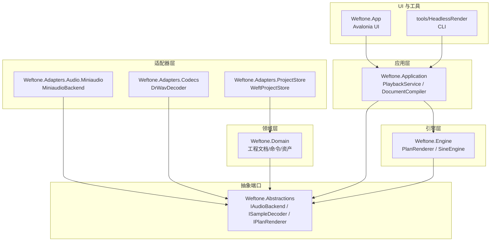
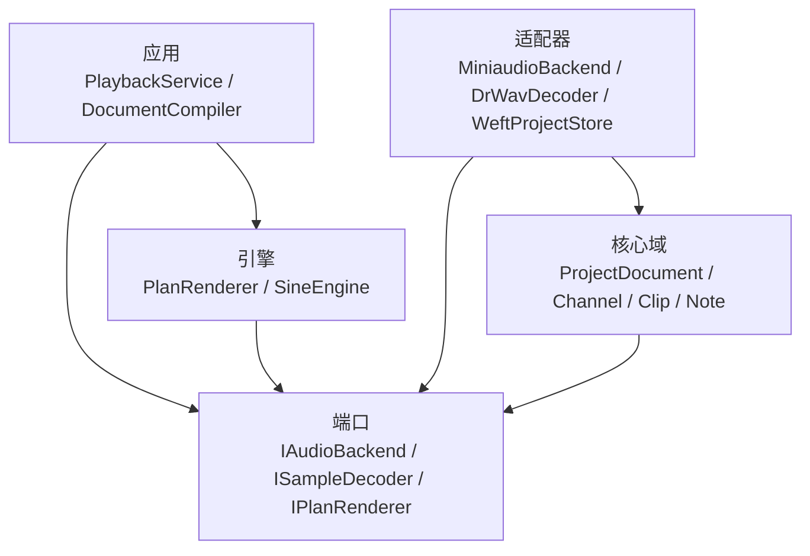
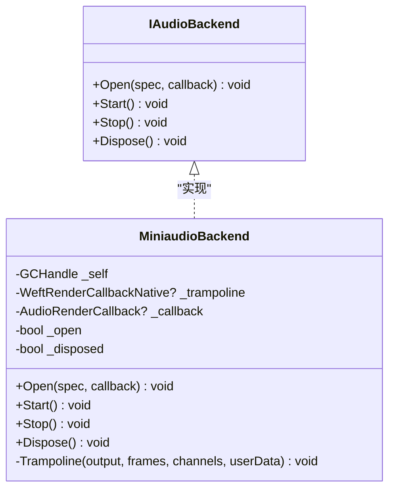
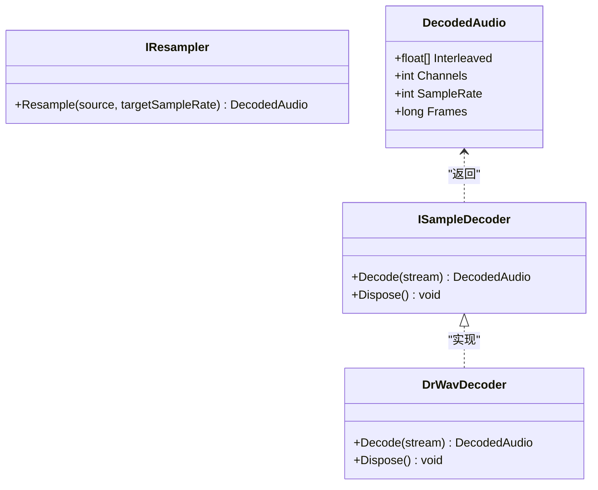
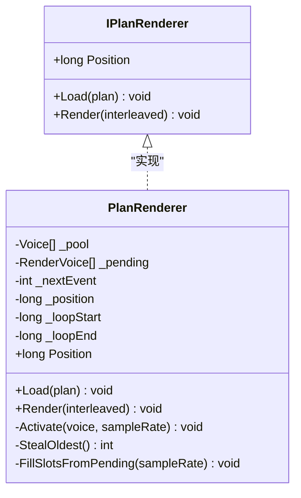
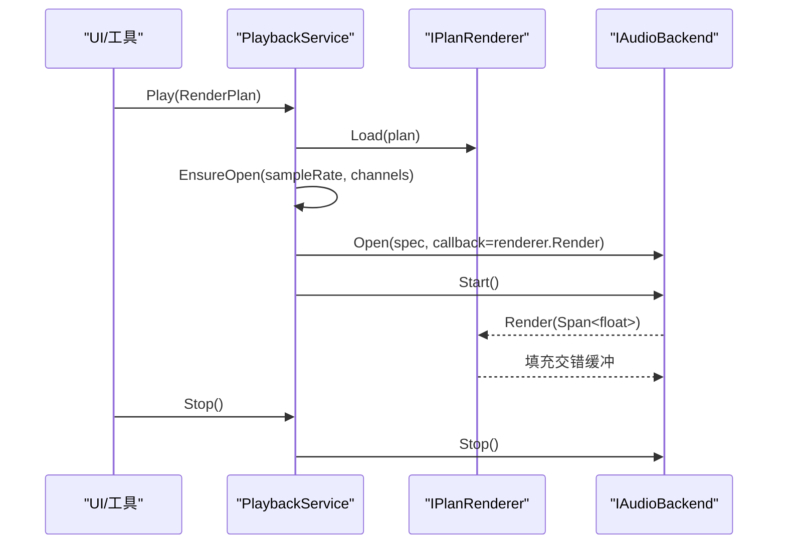
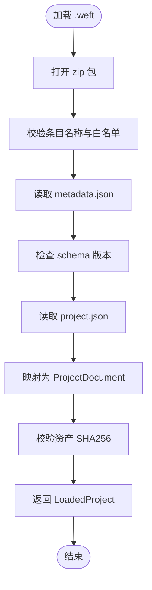
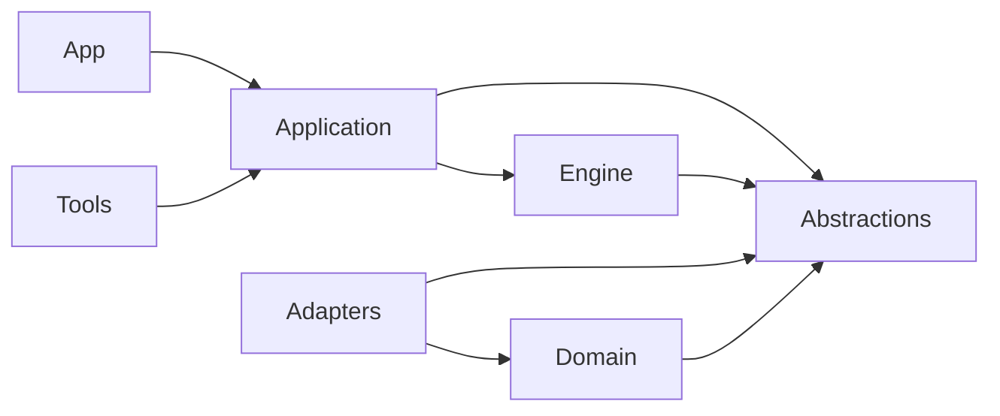

# 六边形架构（端口与适配器）

<cite>
**本文引用的文件**   
- [README.md](file://README.md)
- [ADR-0004-ports-adapters-wheel-first.md](file://docs/adr/ADR-0004-ports-adapters-wheel-first.md)
- [ADR-0007-plugin-strategy.md](file://docs/adr/ADR-0007-plugin-strategy.md)
- [IAudioBackend.cs](file://src/Weftone.Abstractions\IAudioBackend.cs)
- [ISampleDecoder.cs](file://src/Weftone.Abstractions\ISampleDecoder.cs)
- [IPlanRenderer.cs](file://src/Weftone.Abstractions\Rendering\IPlanRenderer.cs)
- [MiniaudioBackend.cs](file://src/Weftone.Adapters.Audio.Miniaudio\MiniaudioBackend.cs)
- [DrWavDecoder.cs](file://src/Weftone.Adapters.Codecs\DrWavDecoder.cs)
- [PlanRenderer.cs](file://src/Weftone.Engine\PlanRenderer.cs)
- [PlaybackService.cs](file://src/Weftone.Application\PlaybackService.cs)
- [IProjectStore.cs](file://src/Weftone.Domain\IProjectStore.cs)
- [WeftProjectStore.cs](file://src/Weftone.Adapters.ProjectStore\WeftProjectStore.cs)
</cite>

## 目录
1. [引言](#引言)
2. [项目结构](#项目结构)
3. [核心组件](#核心组件)
4. [架构总览](#架构总览)
5. [详细组件分析](#详细组件分析)
6. [依赖关系分析](#依赖关系分析)
7. [性能与实时性](#性能与实时性)
8. [故障排查指南](#故障排查指南)
9. [结论](#结论)
10. [附录：DAW 场景下的权衡与扩展建议](#附录daw-场景下的权衡与扩展建议)

## 引言
Weftone 是一个从零构建的开源、跨平台数字音频工作站，采用六边形架构（端口与适配器），将“可编辑文档模型”和“确定性渲染引擎”与外部轮子（音频 I/O、解码、工程存取等）解耦。其核心目标是：
- 通过抽象接口定义系统边界，使 Domain 和 Engine 不感知第三方实现；
- 用适配器封装 miniaudio、dr_wav、zip/JSON 工程等外部依赖；
- 支持插件化扩展、跨平台替换、测试隔离与许可灵活性；
- 在 DAW 工作流中保持编辑模型与实时渲染路径清晰分离。

本文件聚焦端口与适配器模式在 Weftone 中的落地方式，解释如何通过 `IAudioBackend`、`ISampleDecoder`、`IPlanRenderer` 等端口划分领域边界，并说明适配器如何支撑音频后端、解码器、工程存储等扩展点。

**章节来源**
- [README.md:38-57](file://README.md#L38-L57)
- [ADR-0004-ports-adapters-wheel-first.md:4-14](file://docs/adr/ADR-0004-ports-adapters-wheel-first.md#L4-L14)

## 项目结构
Weftone 的代码组织围绕“领域层 + 抽象端口 + 应用编排 + 引擎实现 + 适配器”展开：
- `Weftone.Domain`：领域模型与命令，如工程文档、轨道、音符、剪辑、命令历史等；
- `Weftone.Abstractions`：端口定义，包括音频后端、采样解码、计划渲染等；
- `Weftone.Engine`：实时/离线渲染引擎，基于预分配数据结构的确定性渲染；
- `Weftone.Application`：用例编排，如播放服务、编译、导出等；
- `Weftone.Adapters.*`：适配器实现，如 miniaudio 音频后端、dr_wav 解码器、`.weft` 工程存储；
- `Weftone.App`：Avalonia UI 应用；
- `tools/HeadlessRender`：headless CLI，用于离线渲染与播放演示；
- `native/*`：原生 shim（miniaudio、dr_wav 桥接）。

**图表来源**
- [IAudioBackend.cs:1-15](file://src/Weftone.Abstractions\IAudioBackend.cs#L1-L15)
- [ISampleDecoder.cs:1-17](file://src/Weftone.Abstractions\ISampleDecoder.cs#L1-L17)
- [IPlanRenderer.cs:1-12](file://src/Weftone.Abstractions\Rendering\IPlanRenderer.cs#L1-L12)
- [PlanRenderer.cs:1-15](file://src/Weftone.Engine\PlanRenderer.cs#L1-L15)
- [PlaybackService.cs:1-15](file://src/Weftone.Application\PlaybackService.cs#L1-L15)
- [MiniaudioBackend.cs:1-15](file://src/Weftone.Adapters.Audio.Miniaudio\MiniaudioBackend.cs#L1-L15)
- [DrWavDecoder.cs:1-10](file://src/Weftone.Adapters.Codecs\DrWavDecoder.cs#L1-L10)
- [WeftProjectStore.cs:1-15](file://src/Weftone.Adapters.ProjectStore\WeftProjectStore.cs#L1-L15)

**章节来源**
- [README.md:70-79](file://README.md#L70-L79)

## 核心组件
Weftone 的核心由三类端口组成，分别对应音频输出、采样解码、计划渲染：
- `IAudioBackend`：音频设备 I/O 端口，定义打开、启动、停止以及音频回调契约；
- `ISampleDecoder`：采样解码端口，定义从流解码为交错 PCM 的契约，并附带重采样接口；
- `IPlanRenderer`：计划渲染端口，Application 层通过它加载 RenderPlan 并执行渲染，避免直连 Engine 实现。

这些端口的职责是“定义边界”，而不是实现细节。Domain 和 Engine 只依赖这些接口，从而保证：
- 第三方类型不会泄漏到核心；
- 不同平台或库可以替换实现；
- 测试可以用 Mock/Fake 替代真实后端。

**章节来源**
- [IAudioBackend.cs:1-15](file://src/Weftone.Abstractions\IAudioBackend.cs#L1-L15)
- [ISampleDecoder.cs:1-17](file://src/Weftone.Abstractions\ISampleDecoder.cs#L1-L17)
- [IPlanRenderer.cs:1-12](file://src/Weftone.Abstractions\Rendering\IPlanRenderer.cs#L1-L12)

## 架构总览
Weftone 的六边形架构以“核心域 + 端口 + 适配器”为中心：
- 核心域（Domain）描述 `.weft` 工程、命令、撤销、资产引用；
- 抽象端口（Abstractions）定义引擎与应用的外部契约；
- 引擎（Engine）实现高性能渲染，使用预分配池、零分配约束；
- 应用（Application）编排用例，如播放、编译、导出；
- 适配器（Adapters）把 miniaudio、dr_wav、zip/JSON 等外部依赖适配到端口。

**图表来源**
- [IAudioBackend.cs:1-15](file://src/Weftone.Abstractions\IAudioBackend.cs#L1-L15)
- [ISampleDecoder.cs:1-17](file://src/Weftone.Abstractions\ISampleDecoder.cs#L1-L17)
- [IPlanRenderer.cs:1-12](file://src/Weftone.Abstractions\Rendering\IPlanRenderer.cs#L1-L12)
- [PlanRenderer.cs:1-15](file://src/Weftone.Engine\PlanRenderer.cs#L1-L15)
- [PlaybackService.cs:1-15](file://src/Weftone.Application\PlaybackService.cs#L1-L15)
- [MiniaudioBackend.cs:1-15](file://src/Weftone.Adapters.Audio.Miniaudio\MiniaudioBackend.cs#L1-L15)
- [DrWavDecoder.cs:1-10](file://src/Weftone.Adapters.Codecs\DrWavDecoder.cs#L1-L10)
- [WeftProjectStore.cs:1-15](file://src/Weftone.Adapters.ProjectStore\WeftProjectStore.cs#L1-L15)

## 详细组件分析

### 音频后端端口与适配器：`IAudioBackend` 与 `MiniaudioBackend`
`IAudioBackend` 定义了音频后端的三个关键操作：
- `Open`：根据设备规格打开音频设备，并注册音频回调；
- `Start`：启动音频线程；
- `Stop`：停止音频线程。

`MiniaudioBackend` 是该端口的 miniaudio 实现，负责：
- 通过 P/Invoke 调用原生 weft_audio_* API；
- 在 Open 时建立委托与 GCHandle，确保回调路径零分配；
- 将原生音频回调转换为托管 `AudioRenderCallback`，写入交错 float 缓冲；
- 管理生命周期，防止重复打开或释放未关闭的设备。

**图表来源**
- [IAudioBackend.cs:1-15](file://src/Weftone.Abstractions\IAudioBackend.cs#L1-L15)
- [MiniaudioBackend.cs:1-85](file://src/Weftone.Adapters.Audio.Miniaudio\MiniaudioBackend.cs#L1-L85)

**章节来源**
- [IAudioBackend.cs:1-15](file://src/Weftone.Abstractions\IAudioBackend.cs#L1-L15)
- [MiniaudioBackend.cs:1-85](file://src/Weftone.Adapters.Audio.Miniaudio\MiniaudioBackend.cs#L1-L85)

### 采样解码端口与适配器：`ISampleDecoder` 与 `DrWavDecoder`
`ISampleDecoder` 定义了解码器的统一契约：
- `Decode(stream)`：从任意流解码为 `DecodedAudio`，包含交错 PCM、声道数、采样率、帧数；
- 同时定义 `IResampler`，用于后续高质量重采样替换。

`DrWavDecoder` 是基于 dr_wav 的适配器实现：
- 将托管流复制到内存，调用原生解码 API；
- 将原生浮点缓冲拷贝到托管数组；
- 返回 `DecodedAudio`，并在 finally 中释放原生资源；
- 非实时路径，允许异常与分配。

**图表来源**
- [ISampleDecoder.cs:1-17](file://src/Weftone.Abstractions\ISampleDecoder.cs#L1-L17)
- [DrWavDecoder.cs:1-51](file://src/Weftone.Adapters.Codecs\DrWavDecoder.cs#L1-L51)

**章节来源**
- [ISampleDecoder.cs:1-17](file://src/Weftone.Abstractions\ISampleDecoder.cs#L1-L17)
- [DrWavDecoder.cs:1-51](file://src/Weftone.Adapters.Codecs\DrWavDecoder.cs#L1-L51)

### 计划渲染端口与引擎实现：`IPlanRenderer` 与 `PlanRenderer`
`IPlanRenderer` 是 Application 层与 Engine 之间的渲染端口：
- `Position`：当前渲染位置；
- `Load(plan)`：加载 RenderPlan；
- `Render(interleaved)`：填充交错输出缓冲。

`PlanRenderer` 是引擎的具体实现：
- 使用预分配声部池、事件队列、循环区间；
- 支持正弦波与采样资产回放；
- 在音频回调路径上保持零分配；
- 提供偷声部策略与淡出尾音，避免 click。

**图表来源**
- [IPlanRenderer.cs:1-12](file://src/Weftone.Abstractions\Rendering\IPlanRenderer.cs#L1-L12)
- [PlanRenderer.cs:1-356](file://src/Weftone.Engine\PlanRenderer.cs#L1-L356)

**章节来源**
- [IPlanRenderer.cs:1-12](file://src/Weftone.Abstractions\Rendering\IPlanRenderer.cs#L1-L12)
- [PlanRenderer.cs:1-356](file://src/Weftone.Engine\PlanRenderer.cs#L1-L356)

### 应用层编排：`PlaybackService`
`PlaybackService` 是实时播放的用例编排者：
- 通过工厂创建 `IAudioBackend`，避免直接耦合具体后端；
- 将 `IPlanRenderer.Render` 作为音频回调，保证音频路径零分配；
- 实现“停止-交换-恢复”的热更新流程，支持 Pattern 循环；
- 根据工程采样率变化重新打开后端。

**图表来源**
- [PlaybackService.cs:1-98](file://src/Weftone.Application\PlaybackService.cs#L1-L98)
- [IPlanRenderer.cs:1-12](file://src/Weftone.Abstractions\Rendering\IPlanRenderer.cs#L1-L12)
- [IAudioBackend.cs:1-15](file://src/Weftone.Abstractions\IAudioBackend.cs#L1-L15)

**章节来源**
- [PlaybackService.cs:1-98](file://src/Weftone.Application\PlaybackService.cs#L1-L98)

### 工程存储端口与适配器：`IProjectStore` 与 `WeftProjectStore`
`IProjectStore` 是工程存取的领域端口：
- `Load(path)`：加载 `.weft` 工程，返回文档与按需读取资产的委托；
- `Save(path, document, assetSourceFiles)`：保存工程，校验资产源路径。

`WeftProjectStore` 是 `.weft v1` 的实现：
- 使用 zip 容器，包含 metadata.json、project.json、assets/*；
- 加载时校验 schema 版本、资产 SHA256、条目白名单；
- 保存时计算资产哈希并写入 zip；
- 通过 `LoadedProject.OpenAsset` 延迟打开资产流，避免一次性解码。

**图表来源**
- [IProjectStore.cs:1-15](file://src/Weftone.Domain\IProjectStore.cs#L1-L15)
- [WeftProjectStore.cs:1-208](file://src/Weftone.Adapters.ProjectStore\WeftProjectStore.cs#L1-L208)

**章节来源**
- [IProjectStore.cs:1-15](file://src/Weftone.Domain\IProjectStore.cs#L1-L15)
- [WeftProjectStore.cs:1-208](file://src/Weftone.Adapters.ProjectStore\WeftProjectStore.cs#L1-L208)

## 依赖关系分析
Weftone 的依赖方向遵循“外围依赖核心，核心不依赖外围”的原则：
- Domain 仅依赖自身模型；
- Abstractions 无运行时依赖；
- Engine 仅依赖 Abstractions；
- Application 依赖 Abstractions 与 Engine；
- Adapters 依赖 Abstractions 与 Domain（如工程存储）；
- App 与 Tools 依赖 Application。

**图表来源**
- [IAudioBackend.cs:1-15](file://src/Weftone.Abstractions\IAudioBackend.cs#L1-L15)
- [ISampleDecoder.cs:1-17](file://src/Weftone.Abstractions\ISampleDecoder.cs#L1-L17)
- [IPlanRenderer.cs:1-12](file://src/Weftone.Abstractions\Rendering\IPlanRenderer.cs#L1-L12)
- [PlanRenderer.cs:1-15](file://src/Weftone.Engine\PlanRenderer.cs#L1-L15)
- [PlaybackService.cs:1-15](file://src/Weftone.Application\PlaybackService.cs#L1-L15)
- [MiniaudioBackend.cs:1-15](file://src/Weftone.Adapters.Audio.Miniaudio\MiniaudioBackend.cs#L1-L15)
- [DrWavDecoder.cs:1-10](file://src/Weftone.Adapters.Codecs\DrWavDecoder.cs#L1-L10)
- [WeftProjectStore.cs:1-15](file://src/Weftone.Adapters.ProjectStore\WeftProjectStore.cs#L1-L15)

**章节来源**
- [ADR-0004-ports-adapters-wheel-first.md:7-14](file://docs/adr/ADR-0004-ports-adapters-wheel-first.md#L7-L14)

## 性能与实时性
Weftone 在 DAW 场景下对实时性有严格要求：
- 音频回调零分配、零锁、零 GC、零异常、零 native malloc；
- CI 通过分配断言强制实时纪律；
- `PlanRenderer` 使用预分配声部池与环形 pending 队列；
- `MiniaudioBackend` 在 Open 时建立委托与 GCHandle，回调路径零分配；
- `PlaybackService` 将 `IPlanRenderer.Render` 作为一次性捕获的回调，避免闭包分配。

这种设计在 DAW 中的优势包括：
- 确定性渲染：同配置输出一致，便于黄金音频回归；
- 低延迟：减少 GC 抖动与锁竞争；
- 可测试性：通过端口注入 Mock 后端与渲染器；
- 可扩展性：替换 miniaudio 或其他音频后端不影响核心逻辑。

权衡包括：
- 适配器样板代码增加；
- 需要严格的生命周期管理与错误传播；
- 实时路径限制较多，调试难度更高。

**章节来源**
- [README.md:40-57](file://README.md#L40-L57)
- [PlanRenderer.cs:1-15](file://src/Weftone.Engine\PlanRenderer.cs#L1-L15)
- [MiniaudioBackend.cs:1-15](file://src/Weftone.Adapters.Audio.Miniaudio\MiniaudioBackend.cs#L1-L15)
- [PlaybackService.cs:1-15](file://src/Weftone.Application\PlaybackService.cs#L1-L15)

## 故障排查指南
常见故障与排查要点：
- 音频后端打开失败：检查 `MiniaudioBackend.Open` 的原生返回值与错误信息；
- 解码失败：检查 `DrWavDecoder.Decode` 的原生解码返回值与异常消息；
- 工程加载失败：检查 `WeftProjectStore.Load` 的 schema 版本、SHA256、zip 条目白名单；
- 实时分配断言失败：确认回调路径是否引入新对象、锁或异常；
- 热更新卡顿：确认 `PlaybackService.UpdatePlan` 是否在停止状态下执行。

**章节来源**
- [MiniaudioBackend.cs:21-56](file://src/Weftone.Adapters.Audio.Miniaudio\MiniaudioBackend.cs#L21-L56)
- [DrWavDecoder.cs:8-45](file://src/Weftone.Adapters.Codecs\DrWavDecoder.cs#L8-L45)
- [WeftProjectStore.cs:23-71](file://src/Weftone.Adapters.ProjectStore\WeftProjectStore.cs#L23-L71)
- [PlaybackService.cs:42-78](file://src/Weftone.Application\PlaybackService.cs#L42-L78)

## 结论
Weftone 的六边形架构通过端口与适配器模式实现了清晰的系统边界：
- `IAudioBackend`、`ISampleDecoder`、`IPlanRenderer` 定义了核心域与外部实现的契约；
- 适配器封装 miniaudio、dr_wav、zip/JSON 等外部依赖；
- 引擎与应用层通过端口协作，避免直接耦合第三方类型；
- 该设计支持插件化扩展、跨平台替换、测试隔离与许可灵活性；
- 在 DAW 场景中，它提供了确定性渲染、低延迟、可测试性与可扩展性的平衡。

未来可在端口基础上继续扩展：
- 新增音频后端（如 WASAPI、CoreAudio、PipeWire）；
- 新增解码器（FLAC、OGG、MP3）；
- 新增重采样器（高质量算法）；
- 新增工程存储（云存储、二进制格式）。

**章节来源**
- [ADR-0004-ports-adapters-wheel-first.md:7-14](file://docs/adr/ADR-0004-ports-adapters-wheel-first.md#L7-L14)
- [ADR-0007-plugin-strategy.md:4-14](file://docs/adr/ADR-0007-plugin-strategy.md#L4-L14)

## 附录：DAW 场景下的权衡与扩展建议
在 DAW 场景下，六边形架构的优势在于：
- 音频 I/O 与解码器可独立演进；
- 插件宿主可通过额外端口扩展（CLAP/LV2/VST3）；
- 测试可隔离真实硬件与文件格式；
- 许可风险可控，GPL/专有依赖放在可选模块。

潜在权衡包括：
- 适配器层增加复杂度；
- 实时路径需严格约束；
- 跨平台差异集中在适配器层，需维护多实现。

扩展建议：
- 为 `IPluginHost` 定义端口，隔离插件扫描与参数同步；
- 为 `ITimeStretcher` 定义端口，支持拉伸/切片；
- 为 `IMidiFileReader` 定义端口，支持 MIDI 导入；
- 为 `ISerializer` 定义端口，支持多种工程格式。

**章节来源**
- [ADR-0004-ports-adapters-wheel-first.md:7-14](file://docs/adr/ADR-0004-ports-adapters-wheel-first.md#L7-L14)
- [ADR-0007-plugin-strategy.md:4-14](file://docs/adr/ADR-0007-plugin-strategy.md#L4-L14)