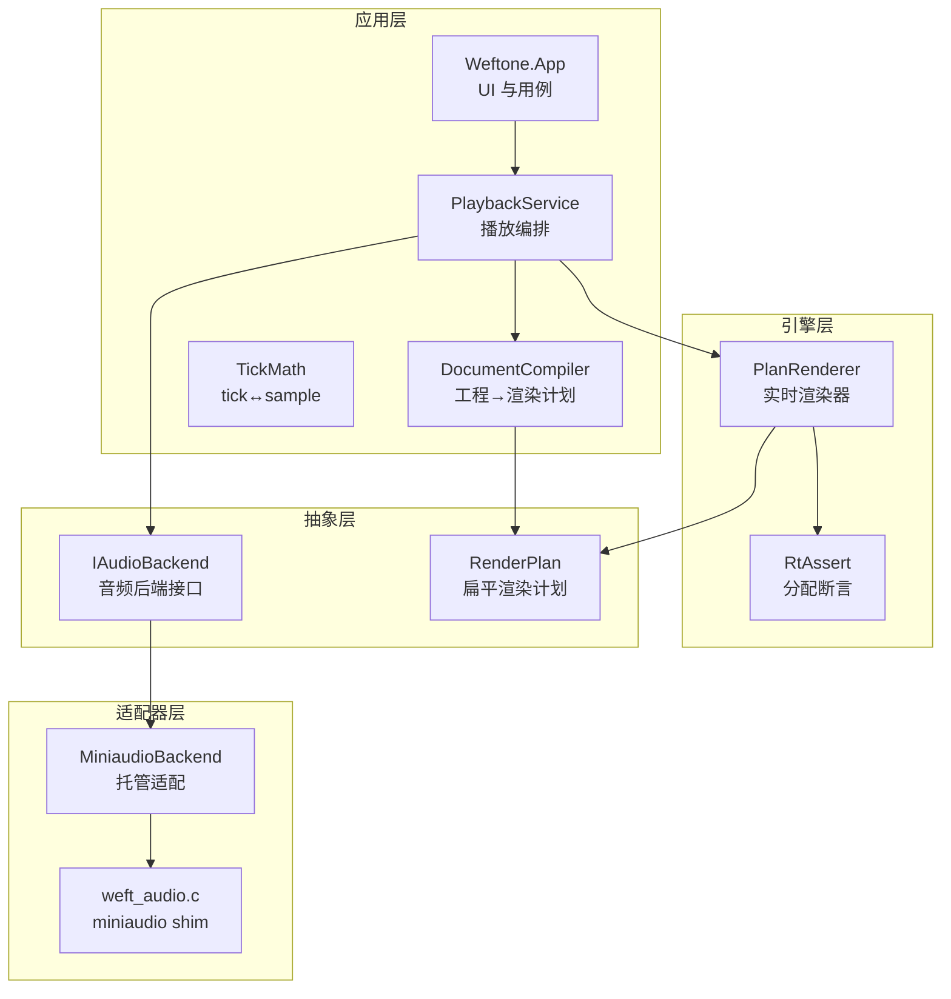
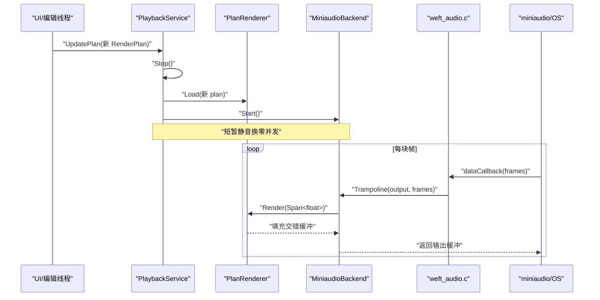
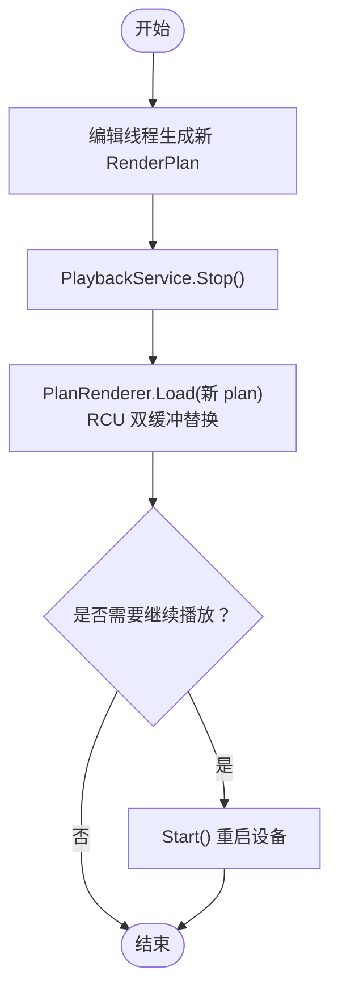
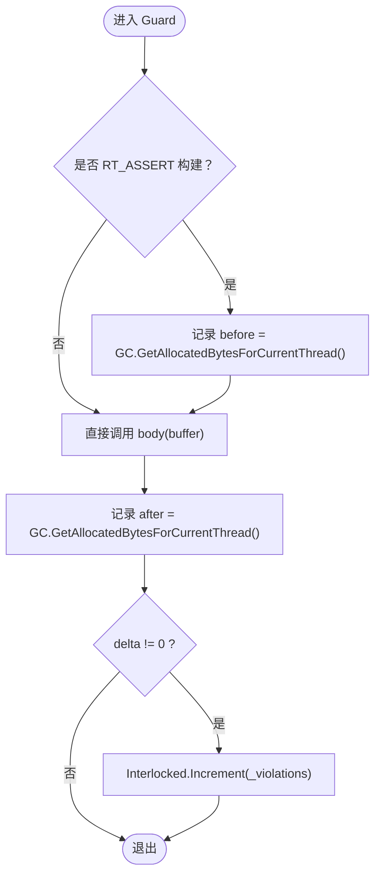
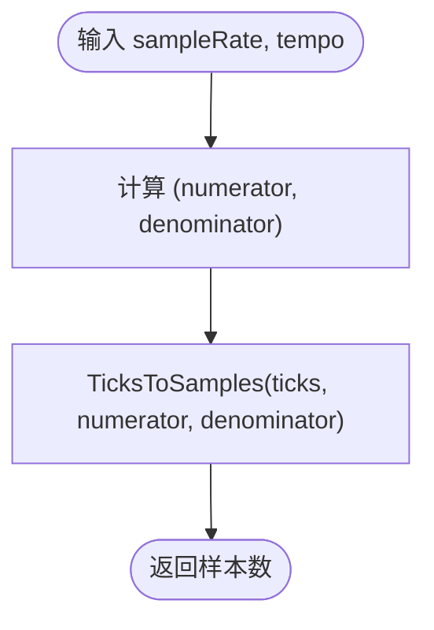
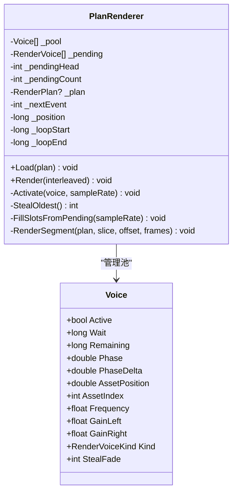
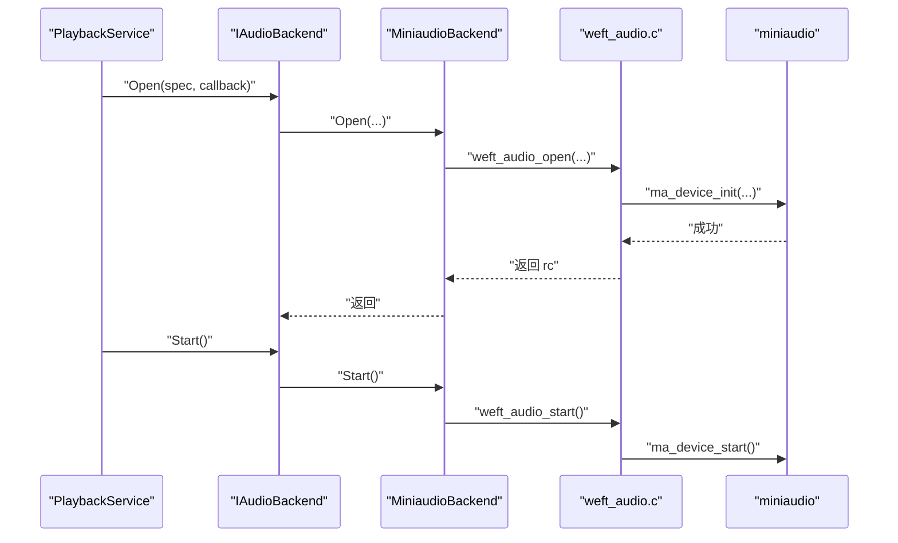
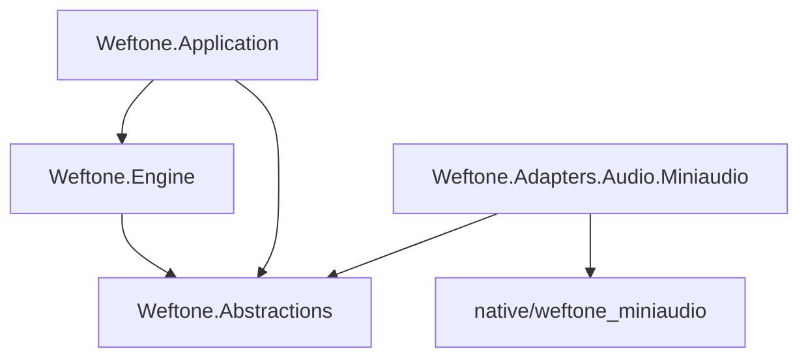

# 实时系统设计

<cite>
**本文引用的文件**   
- [README.md](file://README.md)
- [ADR-0002-threading-realtime.md](file://docs/adr/ADR-0002-threading-realtime.md)
- [AGENTS.md](file://AGENTS.md)
- [TickMath.cs](file://src/Weftone.Application/TickMath.cs)
- [RtAssert.cs](file://src/Weftone.Engine/RtAssert.cs)
- [PlanRenderer.cs](file://src/Weftone.Engine/PlanRenderer.cs)
- [IAudioBackend.cs](file://src/Weftone.Abstractions/IAudioBackend.cs)
- [MiniaudioBackend.cs](file://src/Weftone.Adapters.Audio.Miniaudio/MiniaudioBackend.cs)
- [weft_audio.c](file://native/weftone_miniaudio/weft_audio.c)
- [PlaybackService.cs](file://src/Weftone.Application/PlaybackService.cs)
- [GoldenAudioTests.cs](file://tests/Weftone.GoldenAudio/GoldenAudioTests.cs)
</cite>

## 目录
1. [引言](#引言)
2. [项目结构](#项目结构)
3. [核心组件](#核心组件)
4. [架构总览](#架构总览)
5. [详细组件分析](#详细组件分析)
6. [依赖关系分析](#依赖关系分析)
7. [性能与实时约束](#性能与实时约束)
8. [故障排查指南](#故障排查指南)
9. [结论](#结论)
10. [附录：关键实现路径索引](#附录关键实现路径索引)

## 引言
Weftone 是一个用 C# / .NET 从零构建的开源跨平台数字音频工作站。其核心目标是：在硬实时音频回调中，以 128 samples @48k（约 2.67ms）为预算，实现零分配、零锁、零 GC、零异常、零 native malloc 的稳定播放；同时通过“编辑器模型 → 编译器 → 渲染计划”的分层设计，提供丰富的工程编辑能力。

本架构文档聚焦以下主题：
- 硬实时约束下的设计原则与边界划分。
- AtomicSwap（RCU 双缓冲）机制的设计意图与当前实现状态。
- RtAssert 实时断言系统如何守护音频线程零分配。
- TickMath 时间计算的高精度与确定性算法。
- 实时管道时序图、内存布局图与线程交互图。
- 实时代码验证方法、性能监控与调试策略。
- 如何在保持实时性能的同时提供丰富编辑功能，以及该设计的局限性与替代方案。

## 项目结构
仓库采用六边形架构（端口与适配器）+ 编译器模式 + 数据导向实时层：
- 可编辑的工程模型位于 Domain 层。
- 非实时线程上的 DocumentCompiler 将工程编译为扁平的 RenderPlan。
- PlanRenderer 是离线/实时两用的渲染器，直接消费 RenderPlan。
- IAudioBackend 抽象音频后端，MiniaudioBackend 通过 weft_audio.c 调用 miniaudio。
- PlaybackService 编排播放生命周期，负责停止-交换-恢复。

**图示来源**
- [README.md:38-57](file://README.md#L38-L57)
- [PlanRenderer.cs:5-11](file://src/Weftone.Engine/PlanRenderer.cs#L5-L11)
- [IAudioBackend.cs:1-7](file://src/Weftone.Abstractions/IAudioBackend.cs#L1-L7)
- [MiniaudioBackend.cs:6-11](file://src/Weftone.Adapters.Audio.Miniaudio/MiniaudioBackend.cs#L6-L11)
- [weft_audio.c:1-3](file://native/weftone_miniaudio/weft_audio.c#L1-L3)

**章节来源**
- [README.md:38-79](file://README.md#L38-L79)

## 核心组件
- **RenderPlan**：由编译器生成的扁平数组结构，包含声部事件、资产索引、采样率、通道数、主增益等。它不包含 Note/Clip/Document 等富对象，避免音频线程访问可变对象图。
- **PlanRenderer**：复用 RenderPlan 进行实时渲染，维护固定大小 Voice 池、待激活事件环、循环区间和位置指针。全程使用 Span<float> 输出交错声道，零分配。
- **PlaybackService**：封装播放生命周期，负责 Load/Stop/Start、采样率变化时重开设备、以及“停止-交换-恢复”的热更新流程。
- **MiniaudioBackend + weft_audio.c**：P/Invoke 桥接 miniaudio 设备，回调路径仅做类型转换与委托转发，不分配。
- **RtAssert**：仅在 RT_ASSERT 构建下启用，通过 GC.GetAllocatedBytesForCurrentThread() 差值检测音频回调是否发生托管分配，违规只计数不抛异常。
- **TickMath**：提供 tick 到 sample 的整数映射，保证确定性截断除法。

**章节来源**
- [PlanRenderer.cs:5-11](file://src/Weftone.Engine/PlanRenderer.cs#L5-L11)
- [PlanRenderer.cs:48-59](file://src/Weftone.Engine/PlanRenderer.cs#L48-L59)
- [PlaybackService.cs:6-11](file://src/Weftone.Application/PlaybackService.cs#L6-L11)
- [MiniaudioBackend.cs:6-11](file://src/Weftone.Adapters.Audio.Miniaudio/MiniaudioBackend.cs#L6-L11)
- [weft_audio.c:52-65](file://native/weftone_miniaudio/weft_audio.c#L52-L65)
- [RtAssert.cs:5-9](file://src/Weftone.Engine/RtAssert.cs#L5-L9)
- [TickMath.cs:5-13](file://src/Weftone.Application/TickMath.cs#L5-L13)

## 架构总览
Weftone 的实时架构遵循“编辑模型与实时模型彻底分离”的原则：
- UI 与编辑线程修改 ProjectDocument，触发全量编译生成新的 RenderPlan。
- PlaybackService 在非音频线程上调用 PlanRenderer.Load(plan)，然后启动后端。
- 音频回调中，PlanRenderer 只读访问 _plan，按 StartSample 顺序激活声部，混合输出到交错 float 缓冲。
- 所有第三方类型被隔离在适配器层，Engine 不泄漏第三方类型。

**图示来源**
- [PlaybackService.cs:42-78](file://src/Weftone.Application/PlaybackService.cs#L42-L78)
- [PlanRenderer.cs:61-105](file://src/Weftone.Engine/PlanRenderer.cs#L61-L105)
- [MiniaudioBackend.cs:78-83](file://src/Weftone.Adapters.Audio.Miniaudio/MiniaudioBackend.cs#L78-L83)
- [weft_audio.c:52-65](file://native/weftone_miniaudio/weft_audio.c#L52-L65)

## 详细组件分析

### 实时约束与设计原则
- 目标：128 samples @48k ≈ 2.67ms 内完成一帧渲染，CPU < 1.5ms/块（含多轨与插件）。
- 规则：零分配、零锁、零 GC、零异常、零 native malloc。
- 技术要点：Span<T>/float*/struct/预分配数组/SIMD；Windows 音频线程挂 MMCSS；denormals 用 FTZ/DAZ 或 flush；voice stealing 必须淡出；ring 背压 busy-retry 或丢旧数据。

这些约束贯穿播放器、渲染器与适配器层，并通过 CI 与测试门禁保障。

**章节来源**
- [AGENTS.md:193-224](file://AGENTS.md#L193-L224)
- [ADR-0002-threading-realtime.md:4-15](file://docs/adr/ADR-0002-threading-realtime.md#L4-L15)

### AtomicSwap（RCU 双缓冲）机制
设计意图：
- 编辑器线程生成新的 RenderPlan，通过 RCU 双缓冲原子替换给音频线程。
- 音频线程始终读取一个稳定的 RenderPlan 快照，直到下一轮切换。
- 退役的旧 RenderPlan 在非 RT 线程释放，避免音频线程执行垃圾回收或原生释放。

当前实现状态：
- 代码库中尚未出现名为 AtomicSwap 的类型；但 README 明确描述“AtomicSwap（RCU 双缓冲）”，且 PlanRenderer.Load 接受 RenderPlan 并缓存于私有字段，PlaybackService 在 Stop 后调用 Load，形成“停止-交换-恢复”的零并发窗口。
- 因此，现阶段通过“停止-交换-恢复”实现逻辑上的 RCU 语义：音频回调期间绝不 Load，零并发。

建议的未来增强：
- 引入显式的双缓冲指针（current/next），配合无锁交换原语，使“热更新”无需完全停止设备，减少静音间隙。
- 对 RenderPlan 与内部数组实施池化，确保退役对象在非 RT 线程回收。

**图示来源**
- [README.md:38-57](file://README.md#L38-L57)
- [PlaybackService.cs:63-78](file://src/Weftone.Application/PlaybackService.cs#L63-L78)
- [PlanRenderer.cs:48-59](file://src/Weftone.Engine/PlanRenderer.cs#L48-L59)

**章节来源**
- [README.md:38-57](file://README.md#L38-L57)
- [PlaybackService.cs:63-78](file://src/Weftone.Application/PlaybackService.cs#L63-L78)
- [PlanRenderer.cs:48-59](file://src/Weftone.Engine/PlanRenderer.cs#L48-L59)

### RtAssert 实时断言系统
作用：
- 在 DEBUG/RT_ASSERT 构建下，Guard 包裹 AudioRenderCallback，测量回调前后当前线程分配的字节差值。
- 若检测到分配，递增全局违规计数器；绝不抛出异常，保证音频线程零异常。
- 用于强制“音频路径零分配”纪律，并与 CI 门禁结合。

限制：
- 不覆盖 native malloc；需人工或工具审计原生路径。
- 仅统计托管分配，不能证明 CPU 耗时达标。

**图示来源**
- [RtAssert.cs:17-30](file://src/Weftone.Engine/RtAssert.cs#L17-L30)

**章节来源**
- [RtAssert.cs:5-31](file://src/Weftone.Engine/RtAssert.cs#L5-L31)
- [AGENTS.md:193-224](file://AGENTS.md#L193-L224)

### TickMath 时间计算高精度算法
职责：
- 将 tick 转换为 sample，使用分子分母形式避免浮点误差累积。
- TicksToSamples 使用整数乘法与截断除法，保证确定性。

复杂度：
- SamplesPerTick：O(1)。
- TicksToSamples：O(1)，含一次乘除。

确定性：
- 同配置下输出位一致，支持黄金音频回归。

**图示来源**
- [TickMath.cs:8-12](file://src/Weftone.Application/TickMath.cs#L8-L12)

**章节来源**
- [TickMath.cs:5-13](file://src/Weftone.Application/TickMath.cs#L5-L13)

### PlanRenderer 实时渲染器
职责：
- 维护固定大小的 Voice 池（最大 64 复音）、待激活事件环（容量 32）、循环区间与位置指针。
- 按 StartSample 顺序激活声部；池满时选择最早结束的声部进行淡出偷取；新事件入 pending 环等待槽位。
- Sine 使用双精度相位与步进；Sampler 使用线性插值读取资产；MIDI60=原速；资产耗尽自然结束。
- 全程零分配（RtAssert 守护）。

**图示来源**
- [PlanRenderer.cs:11-46](file://src/Weftone.Engine/PlanRenderer.cs#L11-L46)
- [PlanRenderer.cs:18-32](file://src/Weftone.Engine/PlanRenderer.cs#L18-L32)

**章节来源**
- [PlanRenderer.cs:5-11](file://src/Weftone.Engine/PlanRenderer.cs#L5-L11)
- [PlanRenderer.cs:48-59](file://src/Weftone.Engine/PlanRenderer.cs#L48-L59)
- [PlanRenderer.cs:61-105](file://src/Weftone.Engine/PlanRenderer.cs#L61-L105)
- [PlanRenderer.cs:139-177](file://src/Weftone.Engine/PlanRenderer.cs#L139-L177)
- [PlanRenderer.cs:191-231](file://src/Weftone.Engine/PlanRenderer.cs#L191-L231)
- [PlanRenderer.cs:233-354](file://src/Weftone.Engine/PlanRenderer.cs#L233-L354)

### 音频后端与原生桥接
- IAudioBackend 定义 Open/Start/Stop 接口，要求回调内禁止分配/锁/异常。
- MiniaudioBackend 通过 P/Invoke 调用 weft_audio_open/start/stop/close，并在 Trampoline 中将原生 float* 包装为 Span<float> 后调用托管回调。
- weft_audio.c 暴露稳定 C ABI，封装 miniaudio 设备初始化、回调注册、启停与错误信息；在 Windows 上动态加载 avrt.dll 设置 MMCSS “Pro Audio”。

**图示来源**
- [IAudioBackend.cs:3-7](file://src/Weftone.Abstractions/IAudioBackend.cs#L3-L7)
- [MiniaudioBackend.cs:21-36](file://src/Weftone.Adapters.Audio.Miniaudio/MiniaudioBackend.cs#L21-L36)
- [weft_audio.c:72-107](file://native/weftone_miniaudio/weft_audio.c#L72-L107)

**章节来源**
- [IAudioBackend.cs:1-14](file://src/Weftone.Abstractions/IAudioBackend.cs#L1-L14)
- [MiniaudioBackend.cs:6-85](file://src/Weftone.Adapters.Audio.Miniaudio/MiniaudioBackend.cs#L6-L85)
- [weft_audio.c:1-163](file://native/weftone_miniaudio/weft_audio.c#L1-L163)

### 内存布局与线程交互
- RenderPlan：扁平数组，包含 Voices[]、Assets[]、SampleRate、Channels、MasterGain、LoopStartSample、LoopEndSample、TotalSamples 等。
- PlanRenderer：Voice[] 池、RenderVoice[] 待激活环、位置与循环区间。
- 线程交互：
  - 编辑线程：ProjectDocument → DocumentCompiler → RenderPlan。
  - 播放编排：PlaybackService.Load/Stop/Start。
  - 音频线程：MiniaudioBackend.Trampoline → PlanRenderer.Render。

**图示来源**
- [PlanRenderer.cs:48-59](file://src/Weftone.Engine/PlanRenderer.cs#L48-L59)
- [PlanRenderer.cs:61-105](file://src/Weftone.Engine/PlanRenderer.cs#L61-L105)

**章节来源**
- [PlanRenderer.cs:48-105](file://src/Weftone.Engine/PlanRenderer.cs#L48-L105)

## 依赖关系分析
- Engine 层依赖 Abstractions 中的 IAudioBackend 与 Rendering 接口，不依赖具体音频后端。
- Application 层协调 DocumentCompiler、PlaybackService、WavWriter 等。
- Adapters 层隔离第三方类型，MiniaudioBackend 依赖 weft_audio.c 的 C ABI。
- ADR-0002 明确线程模型与 RT 规则，强调零分配零锁、RCU 双缓冲、SPSC ring、MMCSS、denormals 处理。

**图示来源**
- [ADR-0002-threading-realtime.md:7-15](file://docs/adr/ADR-0002-threading-realtime.md#L7-L15)
- [README.md:38-57](file://README.md#L38-L57)

**章节来源**
- [ADR-0002-threading-realtime.md:7-15](file://docs/adr/ADR-0002-threading-realtime.md#L7-L15)
- [README.md:38-57](file://README.md#L38-L57)

## 性能与实时约束
- 目标预算：128 samples @48k、64 轨、8 插件，引擎 CPU < 1.5ms/块。
- 分配断言：GC.GetAllocatedBytesForCurrentThread() 差值 == 0，仅 DEBUG/RT_ASSERT 构建启用。
- 禁止项：new/装箱/LINQ/闭包/string/lock/ArrayPool.Rent/Dictionary 扩容/事件订阅/async/日志/DI/反射/异常/native malloc。
- 允许项：Span<T>/float*/struct/预分配数组/SIMD；短 P/Invoke 可用 SuppressGCTransition。
- 平台优化：Windows 音频线程挂 MMCSS；denormals 用 FTZ/DAZ 或 flush。
- 参数平滑：参数变化必须平滑/斜坡，避免 zipper noise。
- 声部偷取：voice stealing 必须淡出，避免 click。
- 设备热插拔、采样率切换、xrun 优雅恢复。
- ring 背压：命令 busy-retry；meter 丢旧数据。
- 图交换：RCU，退役在非 RT 线程。
- L1 全量编译 off-RT；RenderPlan 池预分配。

**章节来源**
- [AGENTS.md:193-224](file://AGENTS.md#L193-L224)
- [ADR-0002-threading-realtime.md:7-15](file://docs/adr/ADR-0002-threading-realtime.md#L7-L15)

## 故障排查指南
- 分配违规：检查 RtAssert.Violations 是否非零；确认回调路径未 new/装箱/LINQ/闭包等。
- 爆音/xrun：检查设备 bufferFrames 是否过小；确认 Windows MMCSS 已设置；观察 xrun/GC 监控。
- 采样率变化：PlaybackService 会重开设备；确保 EnsureOpen 逻辑正确。
- 黄金音频回归：GoldenAudioTests 比较峰值差，阈值 ≤1e-4；若超差，检查 DSP 确定性。
- 原生错误：weft_audio_last_error 返回最后错误字符串；MiniaudioBackend 抛出 InvalidOperationException 携带 rc 与错误消息。

**章节来源**
- [RtAssert.cs:17-30](file://src/Weftone.Engine/RtAssert.cs#L17-L30)
- [weft_audio.c:159-162](file://native/weftone_miniaudio/weft_audio.c#L159-L162)
- [MiniaudioBackend.cs:38-56](file://src/Weftone.Adapters.Audio.Miniaudio/MiniaudioBackend.cs#L38-L56)
- [GoldenAudioTests.cs:92-114](file://tests/Weftone.GoldenAudio/GoldenAudioTests.cs#L92-L114)

## 结论
Weftone 的实时系统通过严格的分层与纪律，将编辑模型与实时模型解耦，确保音频回调在极小预算内稳定运行。尽管当前尚未出现显式的 AtomicSwap 类型，但通过“停止-交换-恢复”的流程实现了逻辑上的 RCU 语义；未来可引入显式双缓冲与无锁交换以提升热更新体验。RtAssert 与 TickMath 分别在分配断言与时间计算上提供确定性与可观测性。整体设计在保持实时性能的同时，提供了丰富的编辑功能，并通过适配器层隔离第三方依赖，降低风险。

## 附录：关键实现路径索引
- 实时播放编排：[PlaybackService.cs:42-78](file://src/Weftone.Application/PlaybackService.cs#L42-L78)
- 实时渲染主循环：[PlanRenderer.cs:61-105](file://src/Weftone.Engine/PlanRenderer.cs#L61-L105)
- 声部激活与偷取：[PlanRenderer.cs:139-177](file://src/Weftone.Engine/PlanRenderer.cs#L139-L177)
- 资源读取与插值：[PlanRenderer.cs:300-334](file://src/Weftone.Engine/PlanRenderer.cs#L300-L334)
- 音频后端接口：[IAudioBackend.cs:3-7](file://src/Weftone.Abstractions/IAudioBackend.cs#L3-L7)
- 托管适配实现：[MiniaudioBackend.cs:21-83](file://src/Weftone.Adapters.Audio.Miniaudio/MiniaudioBackend.cs#L21-L83)
- 原生桥接实现：[weft_audio.c:52-162](file://native/weftone_miniaudio/weft_audio.c#L52-L162)
- 实时断言守卫：[RtAssert.cs:17-30](file://src/Weftone.Engine/RtAssert.cs#L17-L30)
- 时间计算函数：[TickMath.cs:8-12](file://src/Weftone.Application/TickMath.cs#L8-L12)
- 黄金音频回归测试：[GoldenAudioTests.cs:92-114](file://tests/Weftone.GoldenAudio/GoldenAudioTests.cs#L92-L114)