# 开发方法论

<cite>
**本文引用的文件**   
- [README.md](file://README.md)
- [AGENTS.md](file://AGENTS.md)
- [CONTRIBUTING.md](file://CONTRIBUTING.md)
- [ADR-0001-methodology.md](file://docs/adr/ADR-0001-methodology.md)
- [M0_FOUNDATION.md](file://specs/M0_FOUNDATION.md)
- [M1a_HEADLESS.md](file://specs/M1a_HEADLESS.md)
- [M1b_UI.md](file://specs/M1b_UI.md)
- [ci.yml](file://.github/workflows/ci.yml)
</cite>

## 目录
1. [引言](#引言)
2. [项目结构](#项目结构)
3. [核心组件](#核心组件)
4. [架构总览](#架构总览)
5. [详细组件分析](#详细组件分析)
6. [依赖分析](#依赖分析)
7. [性能与实时约束](#性能与实时约束)
8. [每周竖切交付流程](#每周竖切交付流程)
9. [风险优先策略](#风险优先策略)
10. [看板、分支与 PR 实践](#看板分支与-pr-实践)
11. [DoD 门禁标准](#dod-门禁标准)
12. [开发环境、构建与持续集成](#开发环境构建与持续集成)
13. [故障排查指南](#故障排查指南)
14. [结论](#结论)

## 引言
Weftone 是一个用 C# / .NET 从零构建的开源跨平台数字音频工作站，目标是 Windows、macOS、Linux。其开发方法论的核心是：**Architecture Runway + Spec-first + Vertical Slice**。在硬实时约束下，它通过冻结不可逆决策、每周交付可运行竖切、Headless 优先和 DoD 门禁，平衡 UX 迭代与架构稳定性。

关键原则包括：
- 只冻结不可逆决策（线程模型、Document↔Engine 边界、许可、工程格式、插件策略），以 ADR 记录。
- 每周交付能出声或能导出的最小竖切，不做横向铺层。
- Headless 优先：先 JSON→WAV，再贴 UI。
- 风险优先：先验证 GC/实时、音频 I/O 延迟、UI 大音符量等关键技术风险。
- 看板 WIP=2，Trunk-based，短分支小 PR。
- DoD 门禁包含 SPEC、测试、分配断言、性能预算、三平台 CI 和文档。

这些原则在仓库顶层说明、方法论 ADR、里程碑 SPEC、贡献指南和 CI 中形成闭环。

**章节来源**
- [README.md:12-57](file://README.md#L12-L57)
- [ADR-0001-methodology.md:4-15](file://docs/adr/ADR-0001-methodology.md#L4-L15)
- [AGENTS.md:37-49](file://AGENTS.md#L37-L49)

## 项目结构
Weftone 采用分层与领域划分结合的仓库结构：
- `/src`：C# 源码，按 Domain、Abstractions、Application、Engine、Adapters、App 组织。
- `/native`：原生 shim（miniaudio）与 vendored 库。
- `/specs`：功能规格，驱动每个里程碑。
- `/docs/adr`：已定稿的架构决策记录。
- `/tests`：引擎测试、架构测试、黄金音频回归。
- `/tools`：HeadlessRender CLI，用于离线渲染与冒烟。
- `.github/workflows/ci.yml`：三平台 CI 矩阵。

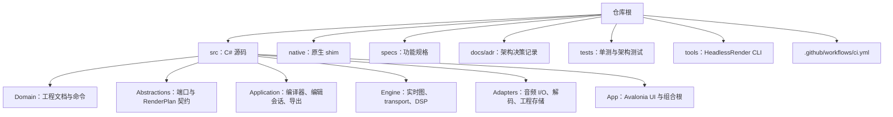

**图示来源**
- [README.md:70-79](file://README.md#L70-L79)
- [AGENTS.md:124-152](file://AGENTS.md#L124-L152)

**章节来源**
- [README.md:70-79](file://README.md#L70-L79)
- [AGENTS.md:124-152](file://AGENTS.md#L124-L152)

## 核心组件
从开发方法论角度，Weftone 的核心组件不是单纯的技术模块，而是“方法—规格—实现—验收”的闭环：

| 维度 | 内容 | 作用 |
|---|---|---|
| 方法论 | Architecture Runway + Spec-first + Vertical Slice | 冻结不可逆决策，用小步竖切交付 |
| 规格 | M0、M1a、M1b | 定义目标、范围、完成定义、验收标准 |
| 实现 | Domain/Application/Engine/Adapters/App | 六边形架构 + 编译器模式 + 数据导向实时层 |
| 验收 | 单测、架构测试、黄金音频、CI | 正确性、零分配、确定性、三平台 |
| 治理 | ADR、AGENTS、CONTRIBUTING | 升级规则、角色边界、贡献流程 |

其中：
- **M0 地基**：搭建可出声、可离线渲染、可被三平台 CI 守护的最小地基。
- **M1a headless 竖切**：`.weft` 工程可确定性渲染出 WAV，含文档模型、命令撤销、编译器、transport、Sampler、Mixer、导出与黄金音频基线。
- **M1b 最小 UI**：Avalonia 单窗口，Piano Roll、Playlist、Mixer、传输条、工程存取、采样导入与导出，保持 Headless 优先。

**章节来源**
- [M0_FOUNDATION.md:5-15](file://specs/M0_FOUNDATION.md#L5-L15)
- [M1a_HEADLESS.md:6-11](file://specs/M1a_HEADLESS.md#L6-L11)
- [M1b_UI.md:7-16](file://specs/M1b_UI.md#L7-L16)

## 架构总览
Weftone 的运行时架构遵循六边形架构、编译器模式和数据导向实时层：

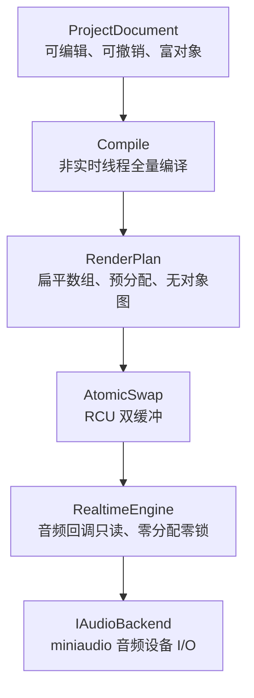

该架构的关键不变量：
- 编辑模型与实时模型彻底分离。
- 音频线程永远看不到 Note、Clip、Document 等富对象。
- 渲染路径零分配、零锁、零异常、零 native malloc。
- 同配置输出确定性结果，支持黄金音频回归。

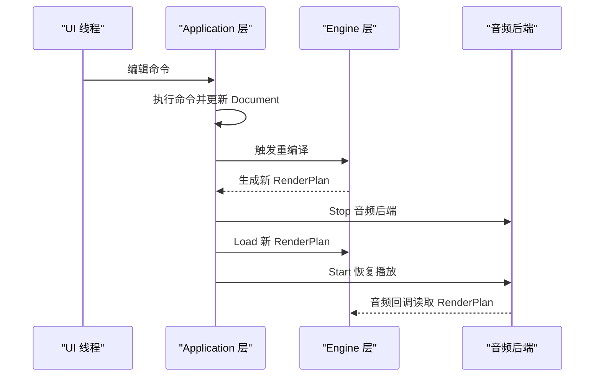

**图示来源**
- [README.md:40-57](file://README.md#L40-L57)
- [AGENTS.md:61-94](file://AGENTS.md#L61-L94)
- [M1b_UI.md:39-64](file://specs/M1b_UI.md#L39-L64)

**章节来源**
- [README.md:40-57](file://README.md#L40-L57)
- [AGENTS.md:61-94](file://AGENTS.md#L61-L94)
- [M1b_UI.md:39-64](file://specs/M1b_UI.md#L39-L64)

## 详细组件分析

### 方法论组件：Architecture Runway + Spec-first + Vertical Slice
该方法论由三个相互支撑的部分组成：

1. **Architecture Runway**  
   先冻结不可逆决策，例如线程模型、Document↔Engine 边界、许可、工程格式、插件策略。这些决策写入 ADR，避免后期因 UX 迭代而重写架构。

2. **Spec-first**  
   每个特性先写 SPEC，明确目标、范围、完成定义、验收标准和非目标。没有 SPEC 不实现；先写验收测试与黄金音频基线。

3. **Vertical Slice**  
   每周交付一个可运行的竖切，而不是横向铺层。例如 M1a 是 headless 竖切，M1b 是最小 UI 竖切。

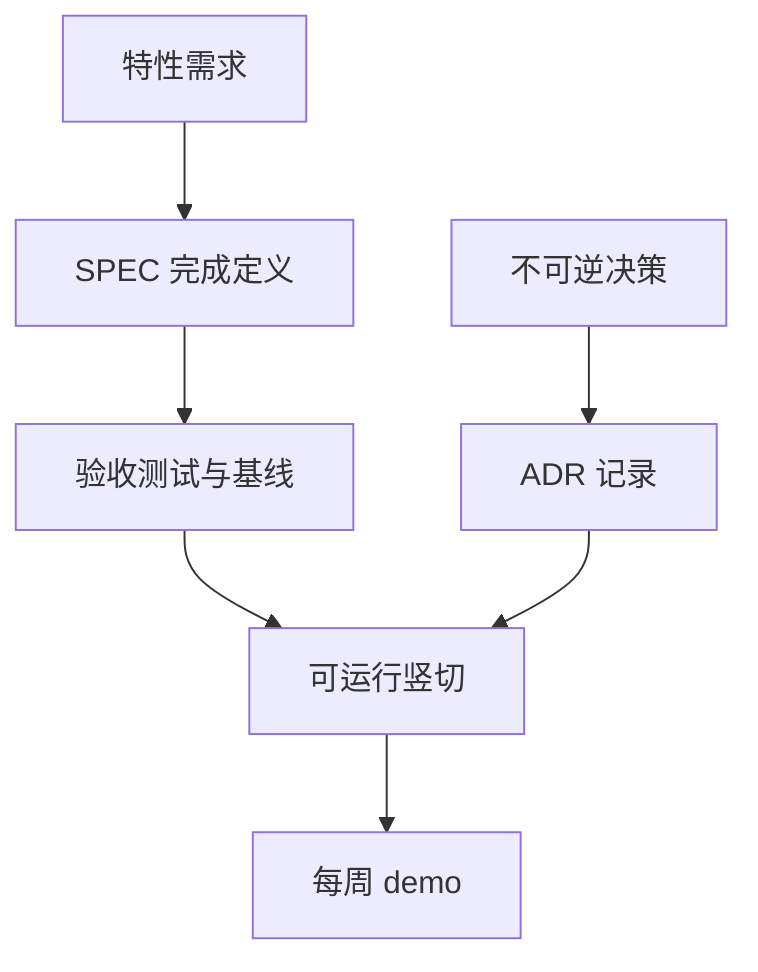

**图示来源**
- [ADR-0001-methodology.md:4-15](file://docs/adr/ADR-0001-methodology.md#L4-L15)
- [AGENTS.md:37-56](file://AGENTS.md#L37-L56)

**章节来源**
- [ADR-0001-methodology.md:4-15](file://docs/adr/ADR-0001-methodology.md#L4-L15)
- [AGENTS.md:37-56](file://AGENTS.md#L37-L56)

### 规格组件：M0、M1a、M1b
M0、M1a、M1b 构成 Weftone 的早期里程碑序列，体现 Spec-first 和 Vertical Slice：

| 里程碑 | 目标 | 关键验收 |
|---|---|---|
| M0 | 搭出可出声、可离线渲染、可被三平台 CI 守护的最小地基 | `dotnet build/test` 全绿；渲染路径托管分配为 0；`weftone render` 产出正确 WAV；三平台 CI 绿 |
| M1a | headless 竖切：`.weft` 工程可确定性渲染出 WAV | 同工程同配置逐位一致；黄金音频基线；撤销/重做；zip slip 与坏包拒绝；分配断言 0 |
| M1b | 最小 UI：加载采样 → 画 4 小节 → Pattern 循环 → Playlist 排 2 段 → 调音量/pan → 导出 WAV | 撤销覆盖所有编辑；实时播放零分配；交换无竞争；Piano Roll 1 万音符视口裁剪流畅；三平台 CI 绿 |

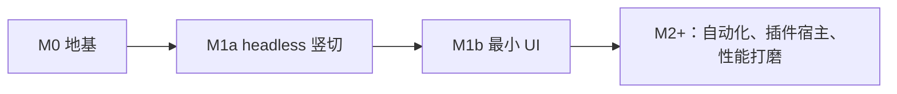

**图示来源**
- [M0_FOUNDATION.md:5-28](file://specs/M0_FOUNDATION.md#L5-L28)
- [M1a_HEADLESS.md:6-79](file://specs/M1a_HEADLESS.md#L6-L79)
- [M1b_UI.md:7-133](file://specs/M1b_UI.md#L7-L133)

**章节来源**
- [M0_FOUNDATION.md:5-28](file://specs/M0_FOUNDATION.md#L5-L28)
- [M1a_HEADLESS.md:6-79](file://specs/M1a_HEADLESS.md#L6-L79)
- [M1b_UI.md:7-133](file://specs/M1b_UI.md#L7-L133)

### 实现组件：Headless 优先与 UI 薄壳
Headless 优先意味着所有编辑、编译、渲染逻辑可在无 UI 环境测试，UI 只是薄壳。具体表现为：

- M1a 先实现 `.weft` → WAV 的完整 headless 路径。
- M1b 在 M1a 基础上接入 Avalonia UI，但 ViewModel、几何计算、命令合并、播放状态机均可 headless 单测。
- 导出走离线路径，与实时播放互不干扰。
- 架构测试保证 App 之外不得出现 Avalonia 类型。

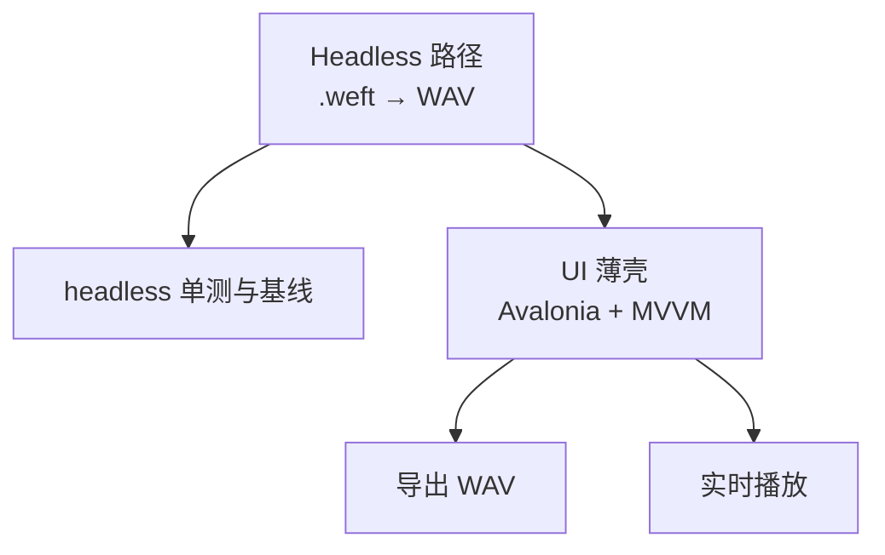

**图示来源**
- [M1a_HEADLESS.md:60-79](file://specs/M1a_HEADLESS.md#L60-L79)
- [M1b_UI.md:10-11](file://specs/M1b_UI.md#L10-L11)
- [M1b_UI.md:102-115](file://specs/M1b_UI.md#L102-L115)

**章节来源**
- [M1a_HEADLESS.md:60-79](file://specs/M1a_HEADLESS.md#L60-L79)
- [M1b_UI.md:10-11](file://specs/M1b_UI.md#L10-L11)
- [M1b_UI.md:102-115](file://specs/M1b_UI.md#L102-L115)

### 实时组件：停止-交换-恢复与零分配
M1b 对 RenderPlan 热交换采用“停止-交换-恢复”，以换取零并发风险：

- 编辑触发重编译时，PlaybackService 先 Stop 音频后端。
- Load 新 RenderPlan。
- 再 Start 恢复播放。
- 音频回调内零分配、零锁、零异常。
- 双缓冲原子交换（RCU）留到后续里程碑专项设计。

```mermaid
flowchart TD
Edit["编辑命令"] --> Compile["重编译生成新 RenderPlan"]
Compile --> Stop["Stop 音频后端"]
Stop --> Load["Load 新 RenderPlan"]
Load --> Start["Start 恢复播放"]
Start --> RT["音频回调只读 RenderPlan"]
```

**图示来源**
- [M1b_UI.md:59-64](file://specs/M1b_UI.md#L59-L64)
- [AGENTS.md:193-224](file://AGENTS.md#L193-L224)

**章节来源**
- [M1b_UI.md:59-64](file://specs/M1b_UI.md#L59-L64)
- [AGENTS.md:193-224](file://AGENTS.md#L193-L224)

## 依赖分析
Weftone 的依赖关系遵循六边形架构与 wheel-first 策略：

- Domain 无依赖。
- Abstractions 无依赖。
- Application 依赖 Domain 与 Abstractions。
- Engine 仅依赖 Abstractions。
- Adapters 依赖 Abstractions。
- App 依赖 Application 与 Adapters。

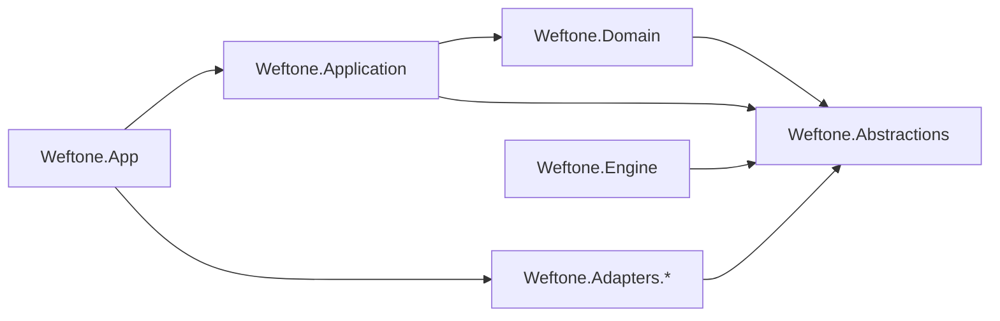

**图示来源**
- [AGENTS.md:71-80](file://AGENTS.md#L71-L80)

**章节来源**
- [AGENTS.md:71-80](file://AGENTS.md#L71-L80)

## 性能与实时约束
Weftone 的实时约束不是风格偏好，而是物理约束：

- 音频实时线程禁止分配、锁、LINQ、装箱、string、async/await、DI/反射、日志、异常抛出、native malloc。
- Engine 不得引用 UI，不得出现第三方类型。
- 渲染必须确定性。
- 初始目标：128 samples @48k、64 轨、8 插件时引擎 CPU < 1.5ms/块。
- 分配断言：托管分配差值为 0，仅在 DEBUG / RT_ASSERT 构建启用。
- UI 60fps；Piano Roll 1 万音符视口裁剪后仍流畅。
- 离线导出快于实时。

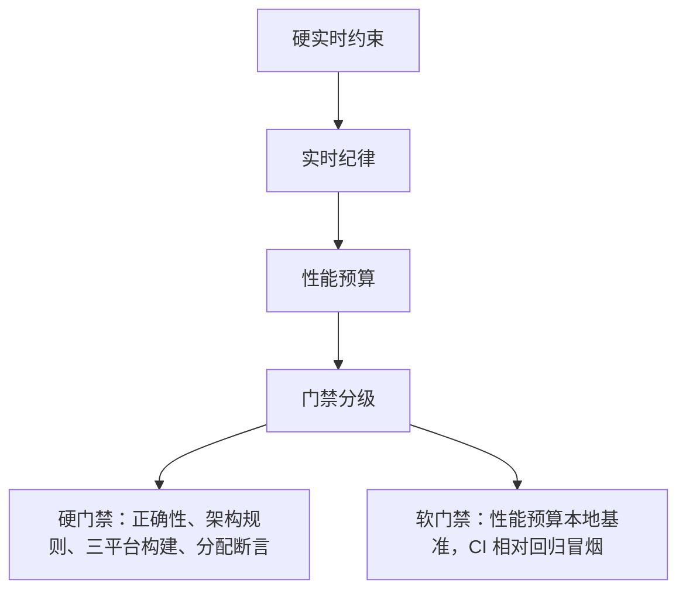

**图示来源**
- [AGENTS.md:25-35](file://AGENTS.md#L25-L35)
- [AGENTS.md:193-207](file://AGENTS.md#L193-L207)

**章节来源**
- [AGENTS.md:25-35](file://AGENTS.md#L25-L35)
- [AGENTS.md:193-207](file://AGENTS.md#L193-L207)

## 每周竖切交付流程
每周交付可运行竖切是 Weftone 方法论的节奏核心。以 M1a 和 M1b 为例：

### M1a headless 竖切节奏
1. Domain 模型 + 命令撤销 + `.weft` 存取往返。
2. 编译器 + transport + 多音符复音 sine 渲染。
3. Sampler（dr_wav + 离线重采样 + voice）+ Mixer。
4. 全链：`.weft` → WAV 导出 + 黄金音频基线 + 工程加载 fuzz。

### M1b 最小 UI 竖切节奏
1. App 骨架 + 传输条 + 工程存取 + 实时播放接线。
2. Piano Roll 自绘 + 音符编辑 + Pattern 循环。
3. Playlist 自绘 + clip 排布 + Pattern/Song 切换。
4. Mixer + 采样导入 + 导出 + 全链验收。

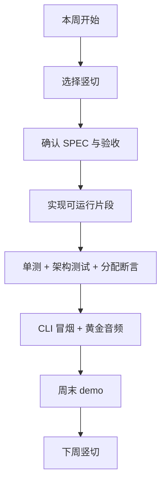

**图示来源**
- [M1a_HEADLESS.md:64-69](file://specs/M1a_HEADLESS.md#L64-L69)
- [M1b_UI.md:117-123](file://specs/M1b_UI.md#L117-L123)
- [AGENTS.md:41-48](file://AGENTS.md#L41-L48)

**章节来源**
- [M1a_HEADLESS.md:64-69](file://specs/M1a_HEADLESS.md#L64-L69)
- [M1b_UI.md:117-123](file://specs/M1b_UI.md#L117-L123)
- [AGENTS.md:41-48](file://AGENTS.md#L41-L48)

## 风险优先策略
Weftone 的风险优先策略聚焦关键技术风险：

| 风险 | 验证方式 | 当前策略 |
|---|---|---|
| GC/实时 | Debug 构建 + RtAssert 分配断言 | 音频回调托管分配差值 == 0 |
| 音频 I/O 延迟 | `weftone play` 本地听感 + CI 构建 native shim | miniaudio shim，CI 构建验证，出声本地验 |
| UI 大音符量 | Piano Roll 视口裁剪 + 本地基准 | 1 万音符为软门禁 |
| 插件宿主 | 后续里程碑 + 进程隔离 | CLAP/LV2/VST3 策略由 ADR 约束 |
| 黄金音频基线 | Verify 对比峰值差 | 跨平台容差吸收浮点差异 |

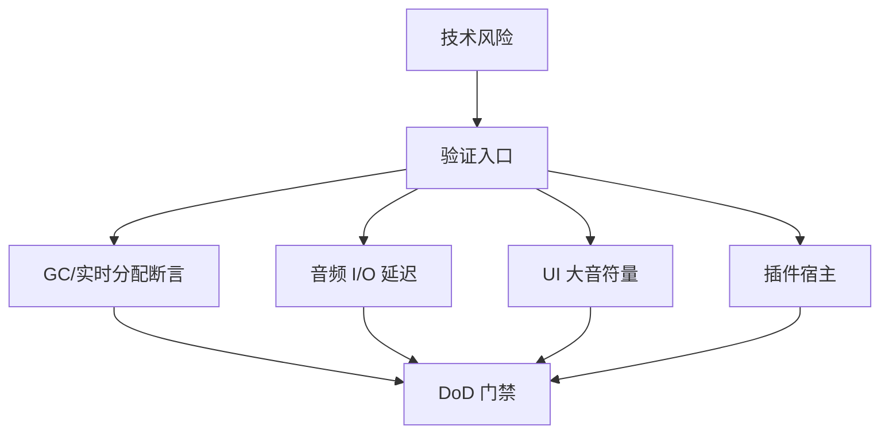

**图示来源**
- [ADR-0001-methodology.md:12-15](file://docs/adr/ADR-0001-methodology.md#L12-L15)
- [AGENTS.md:46-48](file://AGENTS.md#L46-L48)
- [AGENTS.md:193-237](file://AGENTS.md#L193-L237)

**章节来源**
- [ADR-0001-methodology.md:12-15](file://docs/adr/ADR-0001-methodology.md#L12-L15)
- [AGENTS.md:46-48](file://AGENTS.md#L46-L48)
- [AGENTS.md:193-237](file://AGENTS.md#L193-L237)

## 看板、分支与 PR 实践
Weftone 的实践要求：
- 看板 WIP=2，限制并行任务数量，避免上下文切换成本。
- Trunk-based 开发，主干即主要集成线。
- 短分支小 PR，减少集成风险和 review 成本。
- commit 约定使用 `feat` / `fix` / `refactor` / `test` / `docs` / `adr` 前缀，中文主题，小步原子提交，禁止 force push。

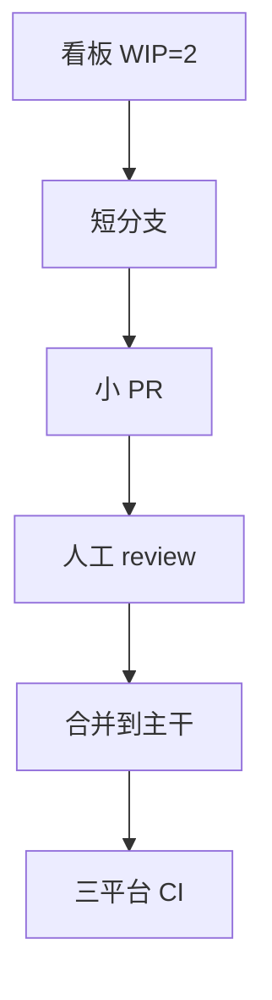

**图示来源**
- [ADR-0001-methodology.md:12-15](file://docs/adr/ADR-0001-methodology.md#L12-L15)
- [AGENTS.md:44-48](file://AGENTS.md#L44-L48)
- [CONTRIBUTING.md:11-13](file://CONTRIBUTING.md#L11-L13)

**章节来源**
- [ADR-0001-methodology.md:12-15](file://docs/adr/ADR-0001-methodology.md#L12-L15)
- [AGENTS.md:44-48](file://AGENTS.md#L44-L48)
- [CONTRIBUTING.md:11-13](file://CONTRIBUTING.md#L11-L13)

## DoD 门禁标准
DoD 门禁是 Weftone 完成定义的硬性门槛，包含以下要素：

| 门禁项 | 含义 | 实施位置 |
|---|---|---|
| SPEC | 特性有明确目标、范围、完成定义、验收标准 | `specs/` |
| 测试 | 单测、架构测试、黄金音频回归 | `tests/` |
| 分配断言 | 音频回调托管分配差值 == 0 | Debug / RT_ASSERT 构建 |
| 性能预算 | 引擎 CPU、UI 帧率、大音符量本地基准 | AGENTS 性能章节 |
| 三平台 CI | Windows、macOS、Linux 矩阵 | `.github/workflows/ci.yml` |
| 文档 | 模块 README、ADR、许可台账更新 | `docs/adr/`、各模块 README |

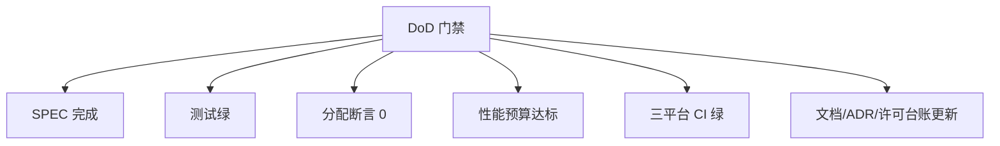

**图示来源**
- [AGENTS.md:274-276](file://AGENTS.md#L274-L276)
- [M0_FOUNDATION.md:20-28](file://specs/M0_FOUNDATION.md#L20-L28)
- [M1a_HEADLESS.md:71-79](file://specs/M1a_HEADLESS.md#L71-L79)
- [M1b_UI.md:125-133](file://specs/M1b_UI.md#L125-L133)

**章节来源**
- [AGENTS.md:274-276](file://AGENTS.md#L274-L276)
- [M0_FOUNDATION.md:20-28](file://specs/M0_FOUNDATION.md#L20-L28)
- [M1a_HEADLESS.md:71-79](file://specs/M1a_HEADLESS.md#L71-L79)
- [M1b_UI.md:125-133](file://specs/M1b_UI.md#L125-L133)

## 开发环境、构建与持续集成
### 开发环境配置
- 安装 .NET 10 LTS。
- 本地验证 Release 与 Debug 双配置，Debug 自动启用 RT_ASSERT 分配断言。
- 构建 native shim：CMake 构建 `native/weftone_miniaudio`。
- 运行 headless 渲染与实时播放，验证最小工作流。

### 构建流程
- `dotnet build -c Release`
- `dotnet test -c Release`
- `dotnet test -c Debug`
- `cmake -S native -B native/build`
- `cmake --build native/build --config Release`

### 持续集成
CI 在 GitHub Actions 上运行三平台矩阵：
- 检出代码。
- 设置 .NET 10。
- 构建 native shim。
- 构建 Release 与 Debug。
- 运行 Release 与 Debug 测试。
- 运行 CLI 冒烟：渲染 1s WAV。
- 全链冒烟：demo 工程渲染。
- 校验 WAV 尺寸与输出非空。

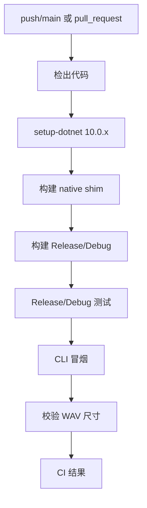

**图示来源**
- [ci.yml:1-60](file://.github/workflows/ci.yml#L1-L60)

**章节来源**
- [CONTRIBUTING.md:15-26](file://CONTRIBUTING.md#L15-L26)
- [ci.yml:1-60](file://.github/workflows/ci.yml#L1-L60)

## 故障排查指南
常见故障与排查方向：

| 问题 | 可能原因 | 排查建议 |
|---|---|---|
| 音频回调分配不为 0 | 实时路径出现 new、装箱、LINQ、事件订阅等 | 检查 Debug / RT_ASSERT 构建下的 RtAssert 断言 |
| 三平台 CI 失败 | native shim 未构建或依赖缺失 | 先跑 `cmake -S native -B native/build && cmake --build native/build --config Release` |
| WAV 尺寸异常 | 渲染参数或头信息错误 | 检查 CLI 冒烟输出与预期字节数 |
| 实时播放无声 | native 库缺失或设备不可用 | 本地验证 `weftone play`，CI 不强制出声 |
| UI 卡顿 | 大音符量未裁剪或控件过多 | 检查 Piano Roll 视口裁剪，避免每音符一个控件 |
| 架构测试失败 | Core/Engine 引用 UI 或第三方类型 | 检查依赖规则与占位符扫描 |

**章节来源**
- [AGENTS.md:193-237](file://AGENTS.md#L193-L237)
- [ci.yml:40-59](file://.github/workflows/ci.yml#L40-L59)

## 结论
Weftone 的开发方法论以 Architecture Runway 提供稳定架构跑道，以 Spec-first 提供可验收的需求边界，以 Vertical Slice 提供每周可运行的交付节奏。在硬实时约束下，它通过 Headless 优先、风险优先、DoD 门禁和三平台 CI，确保 UX 迭代不会破坏架构稳定性。对于团队而言，最重要的是遵守 DoD、保持短分支小 PR、坚持每周 demo，并在遇到升级规则时停下来问维护者。