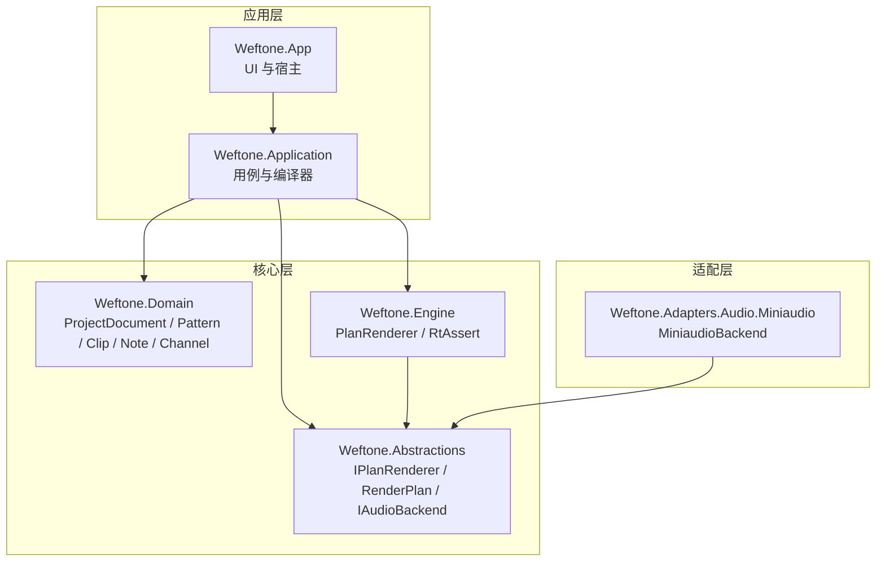
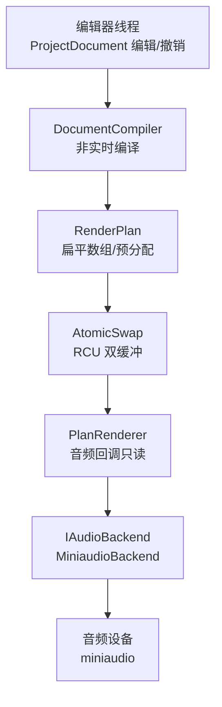
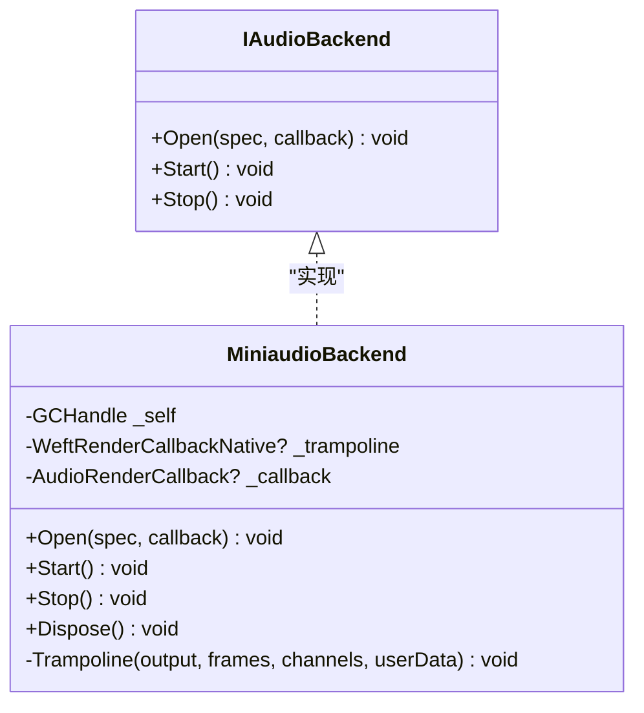
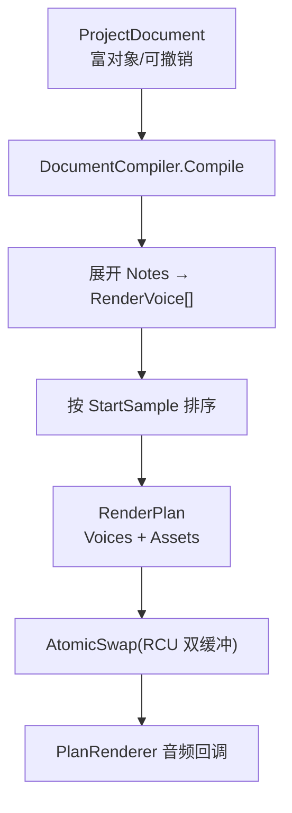
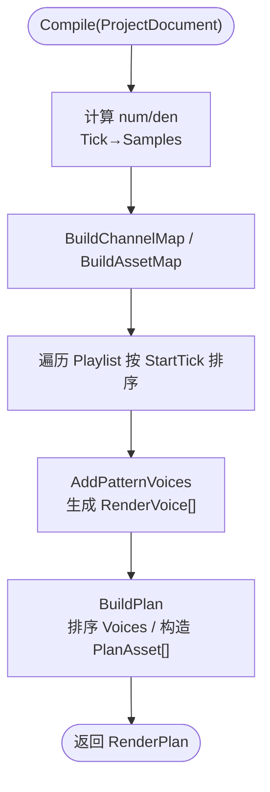
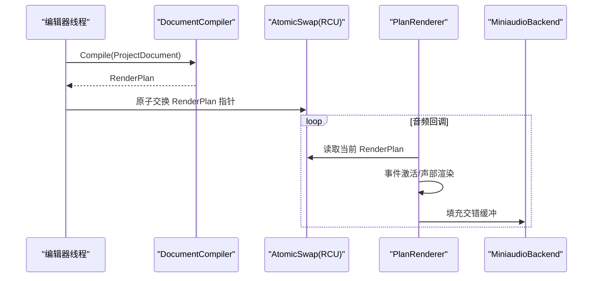
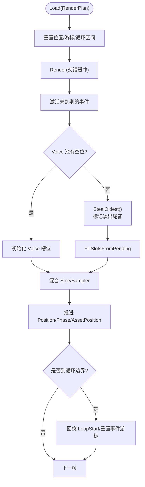
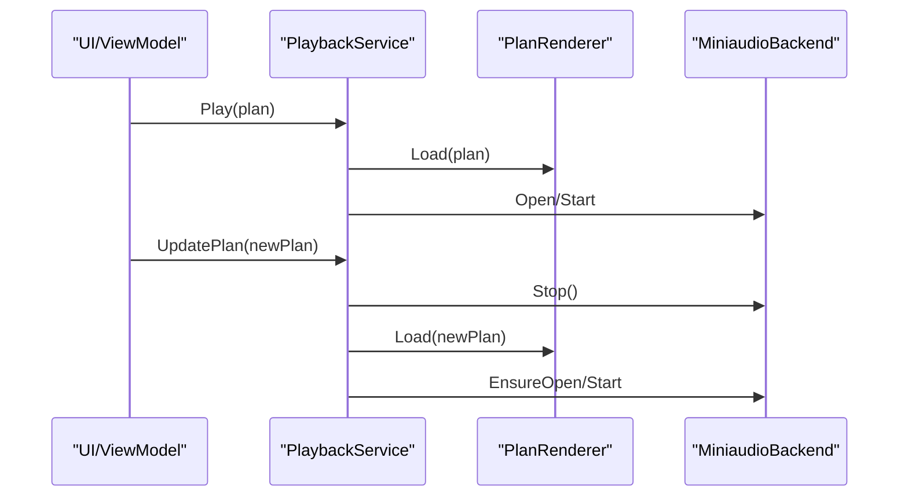
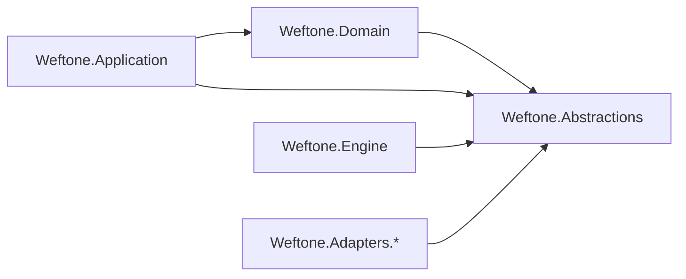

# 架构设计

<cite>
**本文引用的文件**   
- [README.md](file://README.md)
- [ADR-0002-threading-realtime.md](file://docs/adr/ADR-0002-threading-realtime.md)
- [ADR-0003-document-engine-compiler.md](file://docs/adr/ADR-0003-document-engine-compiler.md)
- [ADR-0004-ports-adapters-wheel-first.md](file://docs/adr/ADR-0004-ports-adapters-wheel-first.md)
- [DocumentCompiler.cs](file://src/Weftone.Application/DocumentCompiler.cs)
- [ProjectDocument.cs](file://src/Weftone.Domain/ProjectDocument.cs)
- [RenderPlan.cs](file://src/Weftone.Abstractions/Rendering/RenderPlan.cs)
- [PlanRenderer.cs](file://src/Weftone.Engine/PlanRenderer.cs)
- [RtAssert.cs](file://src/Weftone.Engine/RtAssert.cs)
- [PlaybackService.cs](file://src/Weftone.Application/PlaybackService.cs)
- [MiniaudioBackend.cs](file://src/Weftone.Adapters.Audio.Miniaudio/MiniaudioBackend.cs)
- [IAudioBackend.cs](file://src/Weftone.Abstractions/IAudioBackend.cs)
- [Channel.cs](file://src/Weftone.Domain/Channel.cs)
- [Clip.cs](file://src/Weftone.Domain/Clip.cs)
- [Pattern.cs](file://src/Weftone.Domain/Pattern.cs)
- [Note.cs](file://src/Weftone.Domain/Note.cs)
</cite>

## 目录
1. [引言](#引言)
2. [项目结构](#项目结构)
3. [核心组件](#核心组件)
4. [架构总览](#架构总览)
5. [详细组件分析](#详细组件分析)
6. [依赖关系分析](#依赖关系分析)
7. [性能与实时性约束](#性能与实时性约束)
8. [故障排查指南](#故障排查指南)
9. [结论](#结论)
10. [附录：边界、权衡与扩展建议](#附录边界权衡与扩展建议)

## 引言
Weftone 是一个从零构建的开源跨平台数字音频工作站，采用六边形架构（端口与适配器）、编译器模式与数据导向的实时层。其核心目标是把“可编辑、可撤销、可序列化”的富对象工程模型，转换为“扁平数组、预分配、无对象图”的渲染计划，并通过原子交换机制交给只读音频线程，实现零分配、零锁、零 GC、零异常、零 native malloc 的确定性播放体验。

## 项目结构
仓库按领域分层组织：Domain 提供可编辑文档模型；Abstractions 定义引擎端口；Application 负责编译与用例编排；Engine 提供实时渲染器；Adapters 桥接第三方轮子；App 为最小 UI。

图表来源
- [README.md:70-79](file://README.md#L70-L79)
- [ADR-0004-ports-adapters-wheel-first.md:7-14](file://docs/adr/ADR-0004-ports-adapters-wheel-first.md#L7-L14)

章节来源
- [README.md:70-79](file://README.md#L70-L79)
- [ADR-0004-ports-adapters-wheel-first.md:7-14](file://docs/adr/ADR-0004-ports-adapters-wheel-first.md#L7-L14)

## 核心组件
- 编辑模型：ProjectDocument、Pattern、Clip、Note、Channel，面向编辑、撤销与持久化。
- 渲染计划：RenderPlan、RenderVoice、PlanAsset，面向实时渲染的扁平数据结构。
- 编译器：DocumentCompiler，将 ProjectDocument 编译为 RenderPlan。
- 渲染器：PlanRenderer，基于 RenderPlan 进行零分配渲染。
- 实时服务：PlaybackService，封装停止-交换-恢复流程与后端生命周期。
- 音频后端：MiniaudioBackend，通过 P/Invoke 驱动原生 miniaudio。
- 实时断言：RtAssert，在调试构建中强制音频路径零分配。

章节来源
- [ProjectDocument.cs:1-21](file://src/Weftone.Domain/ProjectDocument.cs#L1-L21)
- [RenderPlan.cs:1-42](file://src/Weftone.Abstractions/Rendering/RenderPlan.cs#L1-L42)
- [DocumentCompiler.cs:1-159](file://src/Weftone.Application/DocumentCompiler.cs#L1-L159)
- [PlanRenderer.cs:1-356](file://src/Weftone.Engine/PlanRenderer.cs#L1-L356)
- [PlaybackService.cs:1-98](file://src/Weftone.Application/PlaybackService.cs#L1-L98)
- [MiniaudioBackend.cs:1-85](file://src/Weftone.Adapters.Audio.Miniaudio/MiniaudioBackend.cs#L1-L85)
- [RtAssert.cs:1-32](file://src/Weftone.Engine/RtAssert.cs#L1-L32)

## 架构总览
Weftone 的系统边界由“端口与适配器”划定：Domain 与 Engine 不感知第三方类型；所有外部能力经 Abstractions 暴露。编辑器线程负责 Document → Plan 编译，音频线程仅消费 RenderPlan。

图表来源
- [ADR-0003-document-engine-compiler.md:4-12](file://docs/adr/ADR-0003-document-engine-compiler.md#L4-L12)
- [ADR-0002-threading-realtime.md:7-15](file://docs/adr/ADR-0002-threading-realtime.md#L7-L15)
- [DocumentCompiler.cs:6-10](file://src/Weftone.Application/DocumentCompiler.cs#L6-L10)
- [PlanRenderer.cs:5-10](file://src/Weftone.Engine/PlanRenderer.cs#L5-L10)
- [MiniaudioBackend.cs:6-10](file://src/Weftone.Adapters.Audio.Miniaudio/MiniaudioBackend.cs#L6-L10)

## 详细组件分析

### 六边形架构与端口适配器
- 端口：IAudioBackend、IPlanRenderer、AudioRenderCallback、RenderPlan 等纯抽象。
- 适配器：MiniaudioBackend 实现 IAudioBackend，屏蔽原生细节；未来可扩展 CLAP/VST 宿主、解码器等适配器。
- 约束：Core/Engine 不得泄漏第三方类型；许可隔离，GPL/专有依赖仅作为可选模块或外部进程。

图表来源
- [IAudioBackend.cs:1-15](file://src/Weftone.Abstractions/IAudioBackend.cs#L1-L15)
- [MiniaudioBackend.cs:11-85](file://src/Weftone.Adapters.Audio.Miniaudio/MiniaudioBackend.cs#L11-L85)

章节来源
- [ADR-0004-ports-adapters-wheel-first.md:7-14](file://docs/adr/ADR-0004-ports-adapters-wheel-first.md#L7-L14)
- [IAudioBackend.cs:1-15](file://src/Weftone.Abstractions/IAudioBackend.cs#L1-L15)
- [MiniaudioBackend.cs:1-85](file://src/Weftone.Adapters.Audio.Miniaudio/MiniaudioBackend.cs#L1-L85)

### 编辑模型与实时模型的分离
- 编辑模型：ProjectDocument 持有 Channels、Patterns、Playlist、Assets，支持命令撤销与序列化。
- 实时模型：RenderPlan 是扁平数组，Voices 已预乘增益并按 StartSample 排序，Assets 为解码重采样后的交错样本。
- 分离原则：音频线程永远看不到 Note/Clip/Document；编译器在非实时线程工作。

图表来源
- [ProjectDocument.cs:1-21](file://src/Weftone.Domain/ProjectDocument.cs#L1-L21)
- [DocumentCompiler.cs:16-49](file://src/Weftone.Application/DocumentCompiler.cs#L16-L49)
- [RenderPlan.cs:29-42](file://src/Weftone.Abstractions/Rendering/RenderPlan.cs#L29-L42)
- [ADR-0003-document-engine-compiler.md:4-12](file://docs/adr/ADR-0003-document-engine-compiler.md#L4-L12)

章节来源
- [ProjectDocument.cs:1-21](file://src/Weftone.Domain/ProjectDocument.cs#L1-L21)
- [RenderPlan.cs:1-42](file://src/Weftone.Abstractions/Rendering/RenderPlan.cs#L1-L42)
- [ADR-0003-document-engine-compiler.md:4-12](file://docs/adr/ADR-0003-document-engine-compiler.md#L4-L12)

### 编译器模式：DocumentCompiler 的实现
DocumentCompiler 承担以下职责：
- 计算 Tick→Samples 比例（TickMath）。
- 构建 Channel 映射与 PreparedAsset 索引。
- 遍历 Playlist，按 Clip.StartTick 线性展开 Pattern 中的 Note，生成 RenderVoice。
- 对 Sampler 声部使用频率偏移模拟原速播放（MIDI60=原速）。
- 输出 RenderPlan：包含 SampleRate、Channels、MasterGain、TotalSamples、LoopStart/End、Voices、Assets。

图表来源
- [DocumentCompiler.cs:16-49](file://src/Weftone.Application/DocumentCompiler.cs#L16-L49)
- [DocumentCompiler.cs:98-157](file://src/Weftone.Application/DocumentCompiler.cs#L98-L157)

章节来源
- [DocumentCompiler.cs:1-159](file://src/Weftone.Application/DocumentCompiler.cs#L1-L159)
- [Channel.cs:1-19](file://src/Weftone.Domain/Channel.cs#L1-L19)
- [Clip.cs:1-9](file://src/Weftone.Domain/Clip.cs#L1-L9)
- [Pattern.cs:1-9](file://src/Weftone.Domain/Pattern.cs#L1-L9)
- [Note.cs:1-12](file://src/Weftone.Domain/Note.cs#L1-L12)

### 实时系统设计与 AtomicSwap（RCU 双缓冲）
- 线程模型：UI 线程 / 文档单写者线程 / 音频 RT 线程 / worker 池。
- 实时规则：零分配、零锁；SPSC ring；双缓冲图交换（RCU），退役在非 RT 线程。
- AtomicSwap 语义：编辑器线程完成新 RenderPlan 后原子替换指针；音频线程始终读取旧版本直到一帧结束，避免竞态与拷贝。
- 确定性：同配置下输出位一致，Voices 按 StartSample 稳定排序，循环区间明确。

图表来源
- [ADR-0002-threading-realtime.md:7-15](file://docs/adr/ADR-0002-threading-realtime.md#L7-L15)
- [PlaybackService.cs:42-78](file://src/Weftone.Application/PlaybackService.cs#L42-L78)
- [PlanRenderer.cs:48-105](file://src/Weftone.Engine/PlanRenderer.cs#L48-L105)

章节来源
- [ADR-0002-threading-realtime.md:7-15](file://docs/adr/ADR-0002-threading-realtime.md#L7-L15)
- [PlaybackService.cs:1-98](file://src/Weftone.Application/PlaybackService.cs#L1-L98)

### 渲染器：PlanRenderer 的数据流与算法
PlanRenderer 维护固定大小 Voice 池与 pending ring，保证：
- 64 复音预分配池，池满时“偷”最早结束的声部并淡出尾音。
- 事件按 StartSample 顺序激活，未到达的事件进入 pending 环等待槽位释放。
- Sine 使用双精度相位步进；Sampler 使用资产线性插值，MIDI60=原速。
- 全程零分配（RtAssert 守护）。

图表来源
- [PlanRenderer.cs:48-105](file://src/Weftone.Engine/PlanRenderer.cs#L48-L105)
- [PlanRenderer.cs:139-231](file://src/Weftone.Engine/PlanRenderer.cs#L139-L231)
- [PlanRenderer.cs:233-354](file://src/Weftone.Engine/PlanRenderer.cs#L233-L354)

章节来源
- [PlanRenderer.cs:1-356](file://src/Weftone.Engine/PlanRenderer.cs#L1-L356)

### 播放服务：停止-交换-恢复
PlaybackService 封装了 M1b 的最小播放用例：
- Play：加载 RenderPlan，确保后端打开，启动设备。
- UpdatePlan：编辑后热更新，先 Stop，再 Load 新 plan，必要时重启后端以匹配采样率/声道数。
- 回调捕获：一次性绑定 renderer.Render，音频路径零分配。

图表来源
- [PlaybackService.cs:42-90](file://src/Weftone.Application/PlaybackService.cs#L42-L90)
- [MiniaudioBackend.cs:21-56](file://src/Weftone.Adapters.Audio.Miniaudio/MiniaudioBackend.cs#L21-L56)

章节来源
- [PlaybackService.cs:1-98](file://src/Weftone.Application/PlaybackService.cs#L1-L98)
- [MiniaudioBackend.cs:1-85](file://src/Weftone.Adapters.Audio.Miniaudio/MiniaudioBackend.cs#L1-L85)

## 依赖关系分析
- Domain 无运行时依赖，Abstractions 仅定义接口与轻量数据结构。
- Application 依赖 Domain 与 Abstractions，实现编译器与用例。
- Engine 仅依赖 Abstractions，保持实时层纯净。
- Adapters 实现 Abstractions，屏蔽第三方库。

图表来源
- [ADR-0004-ports-adapters-wheel-first.md:7-14](file://docs/adr/ADR-0004-ports-adapters-wheel-first.md#L7-L14)

章节来源
- [ADR-0004-ports-adapters-wheel-first.md:7-14](file://docs/adr/ADR-0004-ports-adapters-wheel-first.md#L7-L14)

## 性能与实时性约束
- 零分配：RtAssert 在调试构建中统计托管线程分配字节差值，违规仅计数不抛异常。
- 零锁：音频回调内不使用锁；队列采用 SPSC ring；双缓冲 RCU 交换。
- 零 GC：PlanRenderer 使用固定数组池与 Span，避免堆分配。
- 零异常：音频路径不抛出异常，错误通过返回值与计数器上报。
- 零 native malloc：适配器在 Open 阶段建立委托与句柄，回调路径只做 Span 包装与调用。
- 确定性：Voices 按 StartSample 排序，循环区间明确，黄金音频回归验证一致性。

章节来源
- [RtAssert.cs:1-32](file://src/Weftone.Engine/RtAssert.cs#L1-L32)
- [ADR-0002-threading-realtime.md:7-15](file://docs/adr/ADR-0002-threading-realtime.md#L7-L15)
- [PlanRenderer.cs:5-10](file://src/Weftone.Engine/PlanRenderer.cs#L5-L10)
- [MiniaudioBackend.cs:6-10](file://src/Weftone.Adapters.Audio.Miniaudio/MiniaudioBackend.cs#L6-L10)

## 故障排查指南
- 爆音/卡顿：检查 RtAssert.Violations 是否增长；确认未引入分配；确认未使用锁或异步任务。
- 无声：确认 PlaybackService.Play 已调用且后端 Open/Start 成功；检查 MiniaudioBackend.Open 返回值与错误信息。
- 循环异常：检查 RenderPlan.LoopStartSample/LoopEndSample 设置；确认 PlanRenderer 回绕逻辑触发。
- 采样率变化无声：EnsureOpen 会重建后端；确认新 plan 的 SampleRate/Channels 与后端一致。
- 事件丢失：观察 PlanRenderer.DroppedEvents；pending ring 容量不足时会丢弃事件。

章节来源
- [RtAssert.cs:1-32](file://src/Weftone.Engine/RtAssert.cs#L1-L32)
- [PlaybackService.cs:42-90](file://src/Weftone.Application/PlaybackService.cs#L42-L90)
- [MiniaudioBackend.cs:21-56](file://src/Weftone.Adapters.Audio.Miniaudio/MiniaudioBackend.cs#L21-L56)
- [PlanRenderer.cs:46-57](file://src/Weftone.Engine/PlanRenderer.cs#L46-L57)

## 结论
Weftone 通过六边形架构与编译器模式，将编辑模型与实时模型彻底解耦；借助 RenderPlan 的扁平结构与 PlanRenderer 的零分配实现，配合 AtomicSwap（RCU 双缓冲）与 RtAssert 断言，达成可预测延迟与确定性渲染。该设计在可维护性、可测试性与实时稳定性之间取得平衡，并为后续插件宿主、自动化曲线、拉伸切片等特性预留扩展点。

## 附录：边界、权衡与扩展建议
- 边界与约束
  - 核心不泄漏第三方类型；许可隔离；头优先规格驱动开发。
  - L1 允许全量编译与进程内实现，但必须经 IEngineTransport/IPluginHost 边界。
- 权衡
  - 编译器复杂度换取 RT 安全与可测性；适配器样板代码换取可替换与跨平台。
  - 后期 IPC 复杂度换取 GC 隔离与崩溃隔离。
- 可扩展性
  - 新增声部类型：扩展 RenderVoiceKind，并在 PlanRenderer 中增加分支处理。
  - 新增后端：实现 IAudioBackend，遵循 Open/Start/Stop 契约与零分配回调。
  - 新增解码器/重采样器：通过 ISampleDecoder/IResampler 适配器接入。
- 性能优化建议
  - 增量编译：从全量编译演进为采样级事件列表与局部刷新。
  - 预取与缓存：对频繁访问的 PlanAsset 做热点缓存，注意 RCU 可见性。
  - 批处理：合并小片段事件以减少激活开销。

章节来源
- [ADR-0002-threading-realtime.md:7-15](file://docs/adr/ADR-0002-threading-realtime.md#L7-L15)
- [ADR-0003-document-engine-compiler.md:4-12](file://docs/adr/ADR-0003-document-engine-compiler.md#L4-L12)
- [ADR-0004-ports-adapters-wheel-first.md:7-14](file://docs/adr/ADR-0004-ports-adapters-wheel-first.md#L7-L14)
- [README.md:38-57](file://README.md#L38-L57)