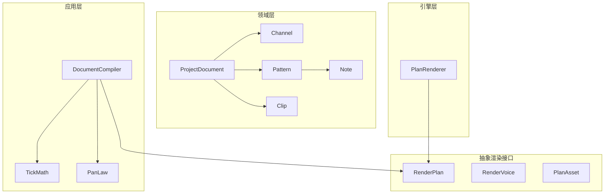
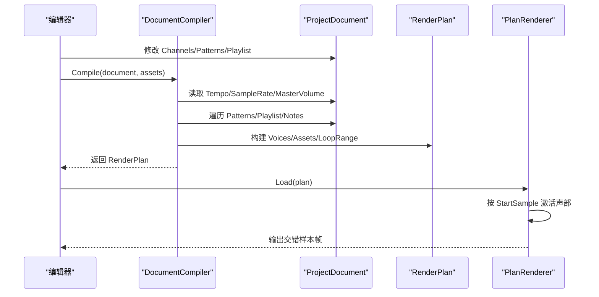
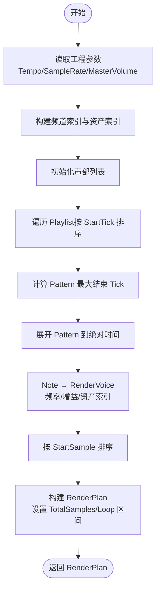
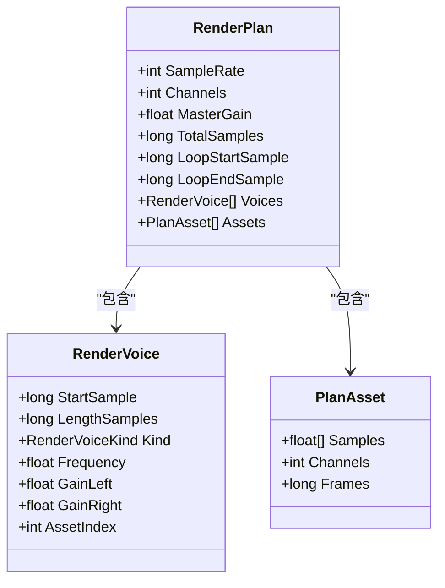
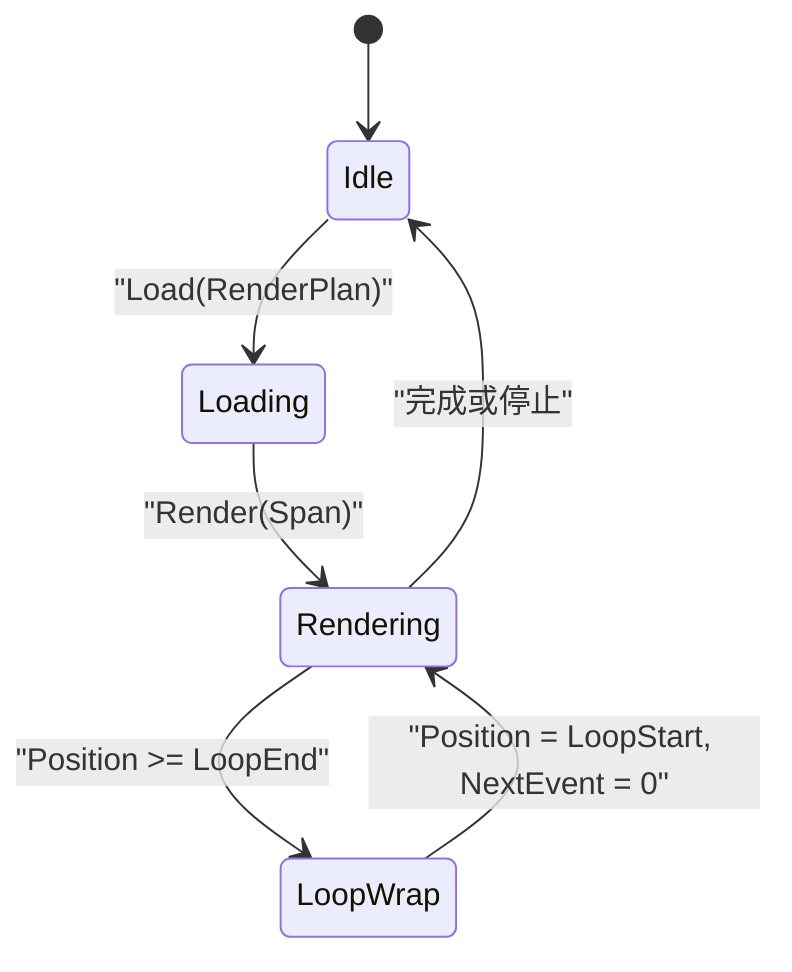
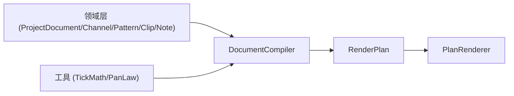
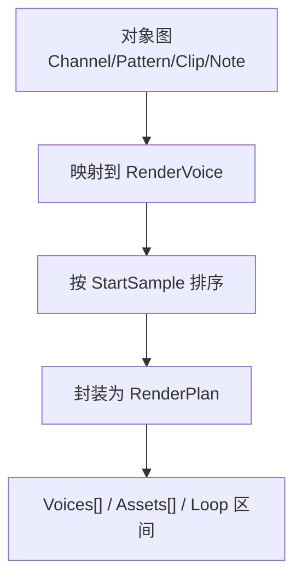

# 编译器模式（编辑模型到实时模型）

<cite>
**本文引用的文件**   
- [DocumentCompiler.cs](file://src/Weftone.Application/DocumentCompiler.cs)
- [RenderPlan.cs](file://src/Weftone.Abstractions/Rendering/RenderPlan.cs)
- [ProjectDocument.cs](file://src/Weftone.Domain/ProjectDocument.cs)
- [Channel.cs](file://src/Weftone.Domain/Channel.cs)
- [Pattern.cs](file://src/Weftone.Domain/Pattern.cs)
- [Clip.cs](file://src/Weftone.Domain/Clip.cs)
- [Note.cs](file://src/Weftone.Domain/Note.cs)
- [ADR-0003-document-engine-compiler.md](file://docs/adr/ADR-0003-document-engine-compiler.md)
- [PanLaw.cs](file://src/Weftone.Application/PanLaw.cs)
- [TickMath.cs](file://src/Weftone.Application/TickMath.cs)
- [PlanRenderer.cs](file://src/Weftone.Engine/PlanRenderer.cs)
- [DocumentCompilerTests.cs](file://tests/Weftone.Application.Tests/DocumentCompilerTests.cs)
- [CompilePatternTests.cs](file://tests/Weftone.Application.Tests/CompilePatternTests.cs)
</cite>

## 目录
1. [引言](#引言)
2. [项目结构](#项目结构)
3. [核心组件](#核心组件)
4. [架构总览](#架构总览)
5. [详细组件分析](#详细组件分析)
6. [依赖关系分析](#依赖关系分析)
7. [性能与复杂度](#性能与复杂度)
8. [故障排查指南](#故障排查指南)
9. [结论](#结论)
10. [附录：数据转换示例](#附录数据转换示例)

## 引言
本文面向 Weftone 的“编辑器 → 实时引擎”编译模式，解释 DocumentCompiler 如何将富对象工程 ProjectDocument 转换为扁平、可循环、零分配友好的 RenderPlan。重点包括：
- 编辑模型（可编辑、面向对象、撤销友好）与实时模型（高性能、零分配、确定性）之间的转换策略。
- 从 Channel → Pattern → Clip → Note 的对象图到扁平数组 Voices 和 Assets 的映射过程。
- 时间复杂度优化、内存布局优化与缓存友好的数据结构设计。
- 如何通过预乘增益、采样级事件排序、固定容量池与环缓冲保证实时音频处理的确定性与可预测性。

## 项目结构
本主题涉及三个层次：
- 领域层：ProjectDocument、Channel、Pattern、Clip、Note 等富对象，用于编辑、撤销与序列化。
- 应用层：DocumentCompiler、TickMath、PanLaw，负责将编辑模型编译为渲染计划。
- 引擎层：RenderPlan、PlanRenderer，提供实时或离线渲染，要求零分配与确定性。

**图表来源**
- [ProjectDocument.cs:1-21](file://src/Weftone.Domain/ProjectDocument.cs#L1-L21)
- [Channel.cs:1-19](file://src/Weftone.Domain/Channel.cs#L1-L19)
- [Pattern.cs:1-9](file://src/Weftone.Domain/Pattern.cs#L1-L9)
- [Clip.cs:1-9](file://src/Weftone.Domain/Clip.cs#L1-L9)
- [Note.cs:1-12](file://src/Weftone.Domain/Note.cs#L1-L12)
- [DocumentCompiler.cs:1-159](file://src/Weftone.Application/DocumentCompiler.cs#L1-L159)
- [RenderPlan.cs:1-42](file://src/Weftone.Abstractions/Rendering/RenderPlan.cs#L1-L42)
- [PlanRenderer.cs:1-356](file://src/Weftone.Engine/PlanRenderer.cs#L1-L356)

**章节来源**
- [ProjectDocument.cs:1-21](file://src/Weftone.Domain/ProjectDocument.cs#L1-L21)
- [DocumentCompiler.cs:1-159](file://src/Weftone.Application/DocumentCompiler.cs#L1-L159)
- [RenderPlan.cs:1-42](file://src/Weftone.Abstractions/Rendering/RenderPlan.cs#L1-L42)
- [PlanRenderer.cs:1-356](file://src/Weftone.Engine/PlanRenderer.cs#L1-L356)

## 核心组件
- ProjectDocument：编辑侧的工程根，包含 Tempo、SampleRate、MasterVolume、Channels、Patterns、Playlist、Assets。
- Channel：声部通道，定义音源类型（Sine/Sampler）、音量、声像、可选资产 ID。
- Pattern：乐段，包含一组 Note。
- Clip：播放列表片段，指定 PatternId 与 StartTick。
- Note：音符，包含 ChannelId、Tick、Key、Velocity、LengthTicks。
- DocumentCompiler：非实时线程的全量编译器，输出 RenderPlan。
- RenderPlan：扁平实时计划，包含 SampleRate、Channels、MasterGain、TotalSamples、LoopStartSample、LoopEndSample、Voices、Assets。
- PlanRenderer：基于 RenderPlan 的实时/离线渲染器，使用固定大小池与环缓冲，保证零分配与确定性。

**章节来源**
- [ProjectDocument.cs:1-21](file://src/Weftone.Domain/ProjectDocument.cs#L1-L21)
- [Channel.cs:1-19](file://src/Weftone.Domain/Channel.cs#L1-L19)
- [Pattern.cs:1-9](file://src/Weftone.Domain/Pattern.cs#L1-L9)
- [Clip.cs:1-9](file://src/Weftone.Domain/Clip.cs#L1-L9)
- [Note.cs:1-12](file://src/Weftone.Domain/Note.cs#L1-L12)
- [DocumentCompiler.cs:1-159](file://src/Weftone.Application/DocumentCompiler.cs#L1-L159)
- [RenderPlan.cs:1-42](file://src/Weftone.Abstractions/Rendering/RenderPlan.cs#L1-L42)
- [PlanRenderer.cs:1-356](file://src/Weftone.Engine/PlanRenderer.cs#L1-L356)

## 架构总览
DocumentCompiler 在编辑线程运行，读取不可变视角的 ProjectDocument，构建频道索引与资产索引，遍历 Playlist 与 Pattern.Notes，生成 RenderVoice 列表，再排序并封装为 RenderPlan。PlanRenderer 在音频线程加载 RenderPlan，按 StartSample 顺序激活声部，使用固定容量池与 pending 环缓冲处理溢出，全程零分配。

**图表来源**
- [DocumentCompiler.cs:16-65](file://src/Weftone.Application/DocumentCompiler.cs#L16-L65)
- [RenderPlan.cs:29-41](file://src/Weftone.Abstractions/Rendering/RenderPlan.cs#L29-L41)
- [PlanRenderer.cs:48-105](file://src/Weftone.Engine/PlanRenderer.cs#L48-L105)

## 详细组件分析

### DocumentCompiler：编辑模型到实时模型的编译器
职责：
- 计算每 tick 的采样数（num/den），建立 Channel 与 Asset 的快速查找表。
- 遍历 Playlist，按 StartTick 顺序展开 Pattern，累计 totalTicks。
- 对每个 Note 计算频率、增益、左右声道增益、资产索引，生成 RenderVoice。
- 按 StartSample 排序 Voices，构造 RenderPlan，设置 LoopStartSample/LoopEndSample。

关键流程：
- Compile：全曲线性时间轴，无循环。
- CompilePattern：单 Pattern 循环模式，长度向上取整到小节，至少 1 小节。
- AddPatternVoices：将 Note 转为 RenderVoice，区分 Sine 与 Sampler。
- BuildPlan：排序 Voices，拷贝 Assets，设置 MasterGain、TotalSamples、Loop 区间。

**图表来源**
- [DocumentCompiler.cs:16-65](file://src/Weftone.Application/DocumentCompiler.cs#L16-L65)
- [DocumentCompiler.cs:98-157](file://src/Weftone.Application/DocumentCompiler.cs#L98-L157)

**章节来源**
- [DocumentCompiler.cs:16-65](file://src/Weftone.Application/DocumentCompiler.cs#L16-L65)
- [DocumentCompiler.cs:98-157](file://src/Weftone.Application/DocumentCompiler.cs#L98-L157)

### RenderPlan：扁平实时计划的数据结构
- RenderVoice：单次触发事件，所有参数离线预乘；包含 StartSample、LengthSamples、Kind、Frequency、GainLeft、GainRight、AssetIndex。
- PlanAsset：解码并重采样后的交错样本数组，附带 Channels 与 Frames。
- RenderPlan：扁平数组集合，无富对象图，无第三方类型；支持循环区间。

**图表来源**
- [RenderPlan.cs:3-41](file://src/Weftone.Abstractions/Rendering/RenderPlan.cs#L3-L41)

**章节来源**
- [RenderPlan.cs:1-42](file://src/Weftone.Abstractions/Rendering/RenderPlan.cs#L1-L42)

### PlanRenderer：实时渲染器与零分配策略
职责：
- 加载 RenderPlan，维护 Position、NextEvent、LoopStart/LoopEnd。
- 按帧渲染：激活未到期的事件，更新活跃声部，填充 pending 队列槽位。
- 池满时选择最早结束的声部进行淡出偷取，避免 click。
- Sine 使用双精度相位步进；Sampler 使用线性插值读取资产。

关键特性：
- 固定容量 Voice 池（MaxVoices=64）。
- Pending 环缓冲（PendingCapacity=32）。
- 全程零分配（RtAssert 守护）。
- 确定性：事件按 StartSample 顺序激活，偷取规则稳定。

**图表来源**
- [PlanRenderer.cs:48-105](file://src/Weftone.Engine/PlanRenderer.cs#L48-L105)

**章节来源**
- [PlanRenderer.cs:1-356](file://src/Weftone.Engine/PlanRenderer.cs#L1-L356)

### TickMath 与 PanLaw：时间与声像的确定性工具
- TickMath：将 tick 映射为 sample，使用截断除法保证确定性。
- PanLaw：线性声像，pan=-1 仅左，pan=+1 仅右，中心双侧全量。

**章节来源**
- [TickMath.cs:1-14](file://src/Weftone.Application/TickMath.cs#L1-L14)
- [PanLaw.cs:1-15](file://src/Weftone.Application/PanLaw.cs#L1-L15)

## 依赖关系分析
- DocumentCompiler 依赖领域层 ProjectDocument、Channel、Pattern、Clip、Note。
- DocumentCompiler 依赖应用层 TickMath、PanLaw。
- DocumentCompiler 输出 RenderPlan，被 PlanRenderer 消费。
- ADR-0003 明确禁止引擎直接访问 Document，确保 RT 安全与可测性。

**图表来源**
- [ADR-0003-document-engine-compiler.md:1-24](file://docs/adr/ADR-0003-document-engine-compiler.md#L1-L24)
- [DocumentCompiler.cs:1-159](file://src/Weftone.Application/DocumentCompiler.cs#L1-L159)
- [PlanRenderer.cs:1-356](file://src/Weftone.Engine/PlanRenderer.cs#L1-L356)

**章节来源**
- [ADR-0003-document-engine-compiler.md:1-24](file://docs/adr/ADR-0003-document-engine-compiler.md#L1-L24)
- [DocumentCompiler.cs:1-159](file://src/Weftone.Application/DocumentCompiler.cs#L1-L159)
- [PlanRenderer.cs:1-356](file://src/Weftone.Engine/PlanRenderer.cs#L1-L356)

## 性能与复杂度
- 时间复杂度：
  - 构建频道与资产索引：O(C + A)，C 为 Channel 数量，A 为 PreparedAsset 数量。
  - 遍历 Playlist 与 Notes：O(P + N)，P 为 Clip 数量，N 为 Note 总数。
  - 排序 Voices：O(N log N)。
  - 总体：O(C + A + P + N log N)。
- 空间复杂度：
  - Voices 列表与最终数组：O(N)。
  - Assets 数组：O(A)。
  - 引擎侧 Voice 池与 pending 环缓冲：固定容量，O(1)。
- 内存布局优化：
  - RenderVoice 为紧凑结构体，按 StartSample 排序提升缓存局部性。
  - PlanAsset.Samples 为交错 float[]，便于线性读取。
- 实时零分配：
  - PlanRenderer 使用预分配池与环缓冲，避免运行时 GC。
  - 事件激活与声部更新均为原地操作。
- 确定性：
  - Tick→Sample 使用截断除法。
  - Voices 按 StartSample 稳定排序。
  - 偷取规则基于 Wait+Remaining 最小值，平局取低索引。

**章节来源**
- [DocumentCompiler.cs:23-48](file://src/Weftone.Application/DocumentCompiler.cs#L23-L48)
- [DocumentCompiler.cs:131-157](file://src/Weftone.Application/DocumentCompiler.cs#L131-L157)
- [PlanRenderer.cs:18-42](file://src/Weftone.Engine/PlanRenderer.cs#L18-L42)
- [PlanRenderer.cs:139-231](file://src/Weftone.Engine/PlanRenderer.cs#L139-L231)

## 故障排查指南
常见问题与定位方法：
- Sampler 通道缺少已准备资产：
  - 现象：编译抛出异常，提示缺少已准备的资产。
  - 原因：Channel.Kind 为 Sampler 但未传入对应 PreparedAsset。
  - 解决：确保 Compiled 调用时传入 assets，且 AssetId 匹配。
- 未知 PatternId：
  - 现象：CompilePattern 抛出异常。
  - 原因：patternId 不存在于 document.Patterns。
  - 解决：校验 patternId 有效性。
- 空 Playlist 编译结果：
  - 现象：Voices 为空，TotalSamples 为 0。
  - 原因：没有 Clip 展开任何 Pattern。
  - 解决：添加有效 Clip 或检查 Playlist 构建逻辑。
- 频率与增益不符合预期：
  - 现象：频率偏移或左右声道增益异常。
  - 原因：Key 与 Velocity、Channel.Volume 与 Pan 组合未正确预乘。
  - 解决：检查 Note.Key、Velocity 与 Channel 参数，确认 PanLaw.Linear 使用。

**章节来源**
- [DocumentCompiler.cs:108-127](file://src/Weftone.Application/DocumentCompiler.cs#L108-L127)
- [DocumentCompiler.cs:59-64](file://src/Weftone.Application/DocumentCompiler.cs#L59-L64)
- [DocumentCompilerTests.cs:98-127](file://tests/Weftone.Application.Tests/DocumentCompilerTests.cs#L98-L127)
- [CompilePatternTests.cs:61-66](file://tests/Weftone.Application.Tests/CompilePatternTests.cs#L61-L66)

## 结论
Weftone 的编译器模式通过 DocumentCompiler 将富对象编辑模型转换为扁平、可循环、零分配友好的 RenderPlan，从而满足实时音频处理的性能与确定性要求。该设计以预乘增益、采样级事件排序、固定容量池与环缓冲为核心，实现了：
- 编辑模型与实时模型的清晰分离。
- 可撤销、可序列化的编辑体验。
- 高性能、可预测的实时渲染。
- 易于测试与验证的黄金音频基准。

## 附录：数据转换示例
以下示例展示从 Channel → Pattern → Clip → Note 的对象图到扁平数组的映射过程。

- 输入对象图：
  - Channel：Sine 通道，Volume=1.0，Pan=0.0。
  - Pattern：包含两个 Note。
  - Clip：StartTick=0，PatternId=10。
  - Note：Tick=0，Key=69，Velocity=1.0，LengthTicks=96；Tick=96，Key=72，Velocity=1.0，LengthTicks=96。

- 编译输出：
  - RenderPlan.Voices：两个 RenderVoice，按 StartSample 排序。
  - RenderPlan.TotalSamples：根据 tempo 与 sample rate 计算。
  - RenderPlan.LoopStartSample/LoopEndSample：Song 模式为 0/0；Pattern 模式为 0/BarTicks×samplesPerTick。

[此图为概念性流程图，不直接映射具体源码文件，因此不提供图表来源]

**章节来源**
- [DocumentCompilerTests.cs:25-35](file://tests/Weftone.Application.Tests/DocumentCompilerTests.cs#L25-L35)
- [CompilePatternTests.cs:25-39](file://tests/Weftone.Application.Tests/CompilePatternTests.cs#L25-L39)