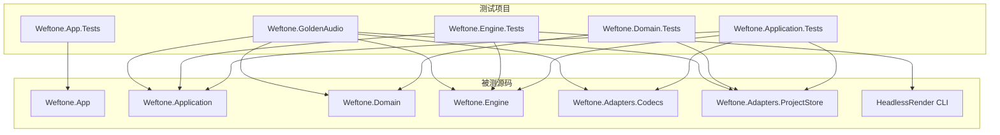
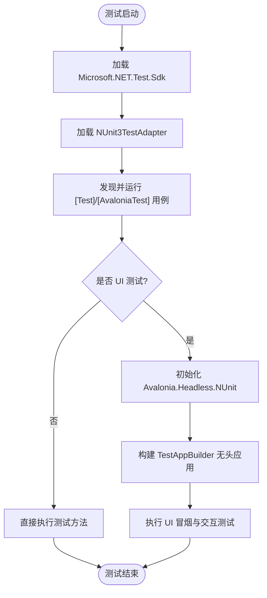
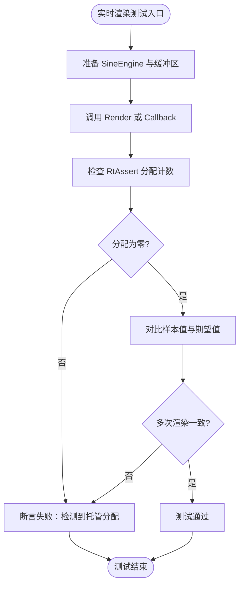
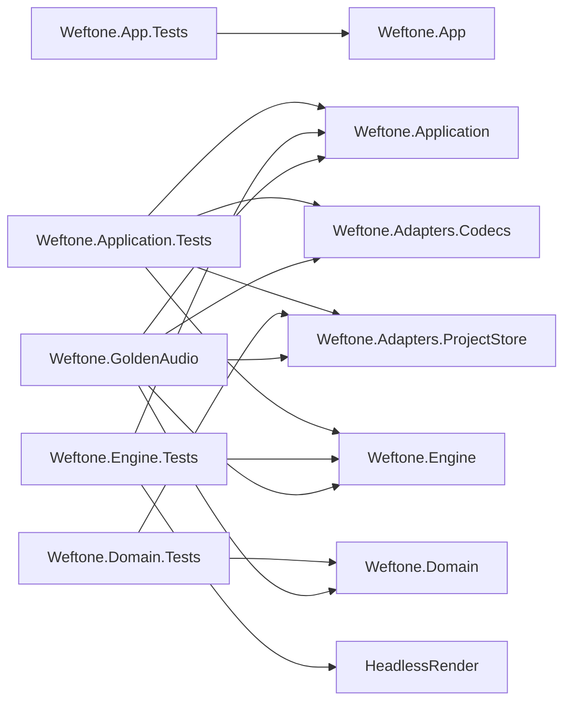

# 单元测试

<cite>
**本文引用的文件**   
- [README.md](file://README.md)
- [Weftone.App.Tests.csproj](file://tests/Weftone.App.Tests/Weftone.App.Tests.csproj)
- [Weftone.Application.Tests.csproj](file://tests/Weftone.Application.Tests/Weftone.Application.Tests.csproj)
- [Weftone.Domain.Tests.csproj](file://tests/Weftone.Domain.Tests/Weftone.Domain.Tests.csproj)
- [Weftone.Engine.Tests.csproj](file://tests/Weftone.Engine.Tests/Weftone.Engine.Tests.csproj)
- [Weftone.GoldenAudio.csproj](file://tests/Weftone.GoldenAudio/Weftone.GoldenAudio.csproj)
- [Fakes.cs](file://tests/Weftone.App.Tests/Fakes.cs)
- [TestAppBuilder.cs](file://tests/Weftone.App.Tests/TestAppBuilder.cs)
- [MainWindowSmokeTests.cs](file://tests/Weftone.App.Tests/MainWindowSmokeTests.cs)
- [MainWindowViewModelGestureTests.cs](file://tests/Weftone.App.Tests/MainWindowViewModelGestureTests.cs)
- [MainWindowViewModelMixerTests.cs](file://tests/Weftone.App.Tests/MainWindowViewModelMixerTests.cs)
- [MainWindowViewModelPlaylistTests.cs](file://tests/Weftone.App.Tests/MainWindowViewModelPlaylistTests.cs)
- [PianoRollGeometryTests.cs](file://tests/Weftone.App.Tests/PianoRollGeometryTests.cs)
- [PlaylistGeometryTests.cs](file://tests/Weftone.App.Tests/PlaylistGeometryTests.cs)
- [ClipCommandTests.cs](file://tests/Weftone.Domain.Tests/ClipCommandTests.cs)
- [CommandHistoryTests.cs](file://tests/Weftone.Domain.Tests/CommandHistoryTests.cs)
- [MixerCommandTests.cs](file://tests/Weftone.Domain.Tests/MixerCommandTests.cs)
- [NoteEditCommandTests.cs](file://tests/Weftone.Domain.Tests/NoteEditCommandTests.cs)
- [ProjectLoadFuzzTests.cs](file://tests/Weftone.Domain.Tests/ProjectLoadFuzzTests.cs)
- [WeftProjectStoreTests.cs](file://tests/Weftone.Domain.Tests/WeftProjectStoreTests.cs)
- [PlanRendererLoopTests.cs](file://tests/Weftone.Engine.Tests/PlanRendererLoopTests.cs)
- [PlanRendererTests.cs](file://tests/Weftone.Engine.Tests/PlanRendererTests.cs)
- [SineEngineTests.cs](file://tests/Weftone.Engine.Tests/SineEngineTests.cs)
- [WavWriterTests.cs](file://tests/Weftone.Engine.Tests/WavWriterTests.cs)
- [GoldenAudioTests.cs](file://tests/Weftone.GoldenAudio/GoldenAudioTests.cs)
</cite>

## 目录
1. [引言](#引言)
2. [测试项目结构](#测试项目结构)
3. [NUnit 5.0 与测试运行环境](#nunit-50-与测试运行环境)
4. [分层测试策略](#分层测试策略)
5. [测试用例设计模式](#测试用例设计模式)
6. [实时音频测试的特殊考虑](#实时音频测试的特殊考虑)
7. [关键测试示例](#关键测试示例)
8. [依赖关系分析](#依赖关系分析)
9. [性能与覆盖率要求](#性能与覆盖率要求)
10. [故障排查指南](#故障排查指南)
11. [结论](#结论)

## 引言
本文件面向 Weftone 的单元测试体系，目标是帮助开发者理解 NUnit 5.0 框架在项目中的使用方式、测试项目的组织结构，以及 Domain、Engine、Application、App 各层的测试策略。文档同时说明 Fakes 模拟对象、测试数据准备、断言方法的使用方式，并重点解释实时音频测试的时间基准、确定性渲染和性能验证机制。最后给出命令系统、渲染引擎、UI 组件和业务逻辑的具体测试示例路径，以及测试覆盖率和最佳实践建议。

## 测试项目结构
Weftone 将测试按领域和层级拆分到多个 NUnit 测试项目中：

- `Weftone.App.Tests`：Avalonia UI 层测试，包含主窗口冒烟测试、视图模型手势测试、混音器与播放列表视图模型测试、几何命中测试等。
- `Weftone.Application.Tests`：应用层测试，覆盖资产管线、文档编译、编辑会话导入导出、播放服务等。
- `Weftone.Domain.Tests`：领域层测试，覆盖命令撤销、剪辑操作、音符编辑、混音命令、工程存储加载模糊测试等。
- `Weftone.Engine.Tests`：引擎层测试，覆盖正弦引擎、计划渲染、循环渲染、WAV 写入等。
- `Weftone.GoldenAudio`：黄金音频回归测试，确保全链路渲染输出在进程内逐位一致，并在跨平台场景下满足峰值差阈值。

**图表来源**  
- [Weftone.App.Tests.csproj:7-16](file://tests/Weftone.App.Tests/Weftone.App.Tests.csproj#L7-L16)  
- [Weftone.Application.Tests.csproj:7-18](file://tests/Weftone.Application.Tests/Weftone.Application.Tests.csproj#L7-L18)  
- [Weftone.Domain.Tests.csproj:7-16](file://tests/Weftone.Domain.Tests/Weftone.Domain.Tests.csproj#L7-L16)  
- [Weftone.Engine.Tests.csproj:7-17](file://tests/Weftone.Engine.Tests/Weftone.Engine.Tests.csproj#L7-L17)  
- [Weftone.GoldenAudio.csproj:7-19](file://tests/Weftone.GoldenAudio/Weftone.GoldenAudio.csproj#L7-L19)

**章节来源**  
- [README.md:70-79](file://README.md#L70-L79)

## NUnit 5.0 与测试运行环境
所有测试项目均通过 `Microsoft.NET.Test.Sdk`、`NUnit` 与 `NUnit3TestAdapter` 组合运行；UI 测试额外引入 `Avalonia.Headless.NUnit`，以无头方式驱动 Avalonia UI，避免真实显示设备与原生音频依赖。

- 通用测试包：`Microsoft.NET.Test.Sdk`、`NUnit`、`NUnit3TestAdapter`。
- UI 测试包：`Avalonia.Headless.NUnit`，配合自定义 `TestAppBuilder` 构建无头 Avalonia 应用。
- 测试入口标记：UI 测试类使用 `[AvaloniaTest]`，普通测试使用 `[Test]`。

**图表来源**  
- [Weftone.App.Tests.csproj:7-12](file://tests/Weftone.App.Tests/Weftone.App.Tests.csproj#L7-L12)  
- [TestAppBuilder.cs:6-24](file://tests/Weftone.App.Tests/TestAppBuilder.cs#L6-L24)  
- [MainWindowSmokeTests.cs:3-4](file://tests/Weftone.App.Tests/MainWindowSmokeTests.cs#L3-L4)

**章节来源**  
- [Weftone.App.Tests.csproj:7-12](file://tests/Weftone.App.Tests/Weftone.App.Tests.csproj#L7-L12)  
- [TestAppBuilder.cs:6-24](file://tests/Weftone.App.Tests/TestAppBuilder.cs#L6-L24)  
- [MainWindowSmokeTests.cs:3-4](file://tests/Weftone.App.Tests/MainWindowSmokeTests.cs#L3-L4)

## 分层测试策略
### Domain 层测试策略
Domain 层聚焦可编辑文档模型与命令撤销。测试重点包括：
- 命令执行与撤销回滚的正确性（如添加/移除/移动 Clip）。
- 事务合并：多次拖拽操作应合并为一次撤销记录。
- 输入校验：未知 PatternId、负 Tick 等非法参数应抛出异常且不入撤销栈。
- 工程存储加载与模糊测试：保证工程读取健壮性。

典型测试文件：
- `ClipCommandTests.cs`：剪辑命令与撤销事务。
- `CommandHistoryTests.cs`：命令历史与撤销栈行为。
- `MixerCommandTests.cs`：混音相关命令。
- `NoteEditCommandTests.cs`：音符编辑命令。
- `ProjectLoadFuzzTests.cs`：工程加载模糊测试。
- `WeftProjectStoreTests.cs`：工程存储读写。

**章节来源**  
- [ClipCommandTests.cs:18-106](file://tests/Weftone.Domain.Tests/ClipCommandTests.cs#L18-L106)  
- [CommandHistoryTests.cs](file://tests/Weftone.Domain.Tests/CommandHistoryTests.cs)  
- [MixerCommandTests.cs](file://tests/Weftone.Domain.Tests/MixerCommandTests.cs)  
- [NoteEditCommandTests.cs](file://tests/Weftone.Domain.Tests/NoteEditCommandTests.cs)  
- [ProjectLoadFuzzTests.cs](file://tests/Weftone.Domain.Tests/ProjectLoadFuzzTests.cs)  
- [WeftProjectStoreTests.cs](file://tests/Weftone.Domain.Tests/WeftProjectStoreTests.cs)

### Engine 层测试策略
Engine 层关注实时渲染与确定性输出。测试重点包括：
- 正弦引擎样本值与公式一致性。
- 渲染确定性：相同频率与采样率下多次渲染结果一致。
- 实时路径零分配：在 RT_ASSERT 构建下，音频回调不触发托管分配。
- 计划渲染与循环渲染：确保 RenderPlan 与循环边界正确。
- WAV 写入：格式头与样本写入正确。

典型测试文件：
- `SineEngineTests.cs`：正弦引擎样本、确定性、零分配。
- `PlanRendererTests.cs`：计划渲染基本行为。
- `PlanRendererLoopTests.cs`：循环渲染边界。
- `WavWriterTests.cs`：WAV 写入格式。

**章节来源**  
- [SineEngineTests.cs:10-48](file://tests/Weftone.Engine.Tests/SineEngineTests.cs#L10-L48)  
- [PlanRendererTests.cs](file://tests/Weftone.Engine.Tests/PlanRendererTests.cs)  
- [PlanRendererLoopTests.cs](file://tests/Weftone.Engine.Tests/PlanRendererLoopTests.cs)  
- [WavWriterTests.cs](file://tests/Weftone.Engine.Tests/WavWriterTests.cs)

### Application 层测试策略
Application 层负责文档编译、编辑会话、资产准备与播放服务。测试重点包括：
- 文档编译：Pattern 编译为 RenderPlan。
- 编辑会话：导入导出、状态变更。
- 播放服务：与 Engine 协作进行播放控制。
- 资产管线：资源准备与解码器集成。

典型测试文件：
- `DocumentCompilerTests.cs`：文档编译。
- `CompilePatternTests.cs`：Pattern 编译。
- `EditSessionTests.cs`：编辑会话状态。
- `EditSessionImportExportTests.cs`：导入导出流程。
- `PlaybackServiceTests.cs`：播放服务。
- `AssetPipelineTests.cs`：资产管线。

**章节来源**  
- [DocumentCompilerTests.cs](file://tests/Weftone.Application.Tests/DocumentCompilerTests.cs)  
- [CompilePatternTests.cs](file://tests/Weftone.Application.Tests/CompilePatternTests.cs)  
- [EditSessionTests.cs](file://tests/Weftone.Application.Tests/EditSessionTests.cs)  
- [EditSessionImportExportTests.cs](file://tests/Weftone.Application.Tests/EditSessionImportExportTests.cs)  
- [PlaybackServiceTests.cs](file://tests/Weftone.Application.Tests/PlaybackServiceTests.cs)  
- [AssetPipelineTests.cs](file://tests/Weftone.Application.Tests/AssetPipelineTests.cs)

### App 层测试策略
App 层使用 Avalonia UI，测试重点包括：
- 主窗口冒烟测试：启动、主题加载、基础控件存在。
- 视图模型交互：手势、混音器、播放列表行为。
- 几何命中：钢琴卷帘与播放列表命中检测。
- 无头 UI 环境：避免 native/音频依赖，仅加载 FluentTheme。

典型测试文件：
- `MainWindowSmokeTests.cs`：主窗口冒烟。
- `MainWindowViewModelGestureTests.cs`：手势交互。
- `MainWindowViewModelMixerTests.cs`：混音器视图模型。
- `MainWindowViewModelPlaylistTests.cs`：播放列表视图模型。
- `PianoRollGeometryTests.cs`：钢琴卷帘命中。
- `PlaylistGeometryTests.cs`：播放列表命中。

**章节来源**  
- [MainWindowSmokeTests.cs](file://tests/Weftone.App.Tests/MainWindowSmokeTests.cs)  
- [MainWindowViewModelGestureTests.cs](file://tests/Weftone.App.Tests/MainWindowViewModelGestureTests.cs)  
- [MainWindowViewModelMixerTests.cs](file://tests/Weftone.App.Tests/MainWindowViewModelMixerTests.cs)  
- [MainWindowViewModelPlaylistTests.cs](file://tests/Weftone.App.Tests/MainWindowViewModelPlaylistTests.cs)  
- [PianoRollGeometryTests.cs](file://tests/Weftone.App.Tests/PianoRollGeometryTests.cs)  
- [PlaylistGeometryTests.cs](file://tests/Weftone.App.Tests/PlaylistGeometryTests.cs)

## 测试用例设计模式
### Fakes 模拟对象
UI 层测试通过 Fakes 隔离外部依赖：
- `FakeBackend`：实现 `IAudioBackend`，空实现打开/开始/停止/释放，避免真实音频设备。
- `FakeDialogs`：实现 `IFileDialogService`，提供可控的文件对话框返回值。

这些 Fakes 使 UI 测试专注于视图模型与控件逻辑，而不受原生音频或文件系统影响。

**章节来源**  
- [Fakes.cs:6-27](file://tests/Weftone.App.Tests/Fakes.cs#L6-L27)

### 测试数据准备
- 领域层测试通常先构造 `ProjectDocument`，添加 Channel 与 Pattern，再执行命令并断言 Playlist 状态。
- 黄金音频测试通过临时工作目录创建 `.weft` 工程包，并使用 `DemoProject.WriteKickWav` 生成基线音频。
- 引擎层测试使用固定频率与采样率构造 `SineEngine`，并预分配缓冲区进行渲染对比。

**章节来源**  
- [ClipCommandTests.cs:9-16](file://tests/Weftone.Domain.Tests/ClipCommandTests.cs#L9-L16)  
- [GoldenAudioTests.cs:30-41](file://tests/Weftone.GoldenAudio/GoldenAudioTests.cs#L30-L41)  
- [SineEngineTests.cs:10-21](file://tests/Weftone.Engine.Tests/SineEngineTests.cs#L10-L21)

### 断言方法
- 使用 NUnit 的 `Assert.That(..., Is.EqualTo(...))` 进行数值与集合比较。
- 使用 `Assert.Multiple` 批量断言多个属性。
- 使用 `Throws.InvalidOperationException`、`Throws.InstanceOf<ArgumentOutOfRangeException>()` 验证异常路径。
- 黄金音频测试计算峰值差并与阈值比较，确保跨平台稳定性。

**章节来源**  
- [ClipCommandTests.cs:24-31](file://tests/Weftone.Domain.Tests/ClipCommandTests.cs#L24-L31)  
- [ClipCommandTests.cs:53-63](file://tests/Weftone.Domain.Tests/ClipCommandTests.cs#L53-L63)  
- [GoldenAudioTests.cs:92-103](file://tests/Weftone.GoldenAudio/GoldenAudioTests.cs#L92-L103)

## 实时音频测试的特殊考虑
### 时间基准测试
- 正弦引擎测试通过数学公式计算期望样本值，验证每个样本点误差在容差范围内。
- 黄金音频测试通过完整链路渲染，比较输出帧数与交错样本数组，确保同工程两次渲染逐位一致。

**章节来源**  
- [SineEngineTests.cs:10-21](file://tests/Weftone.Engine.Tests/SineEngineTests.cs#L10-L21)  
- [GoldenAudioTests.cs:57-68](file://tests/Weftone.GoldenAudio/GoldenAudioTests.cs#L57-L68)

### 性能验证
- 实时路径零分配：使用 `RtAssert.Guard` 包裹音频回调，统计托管分配次数，RT_ASSERT 构建下必须为零。
- 循环渲染测试：验证 RenderPlan 在循环边界下的行为，确保无越界与重复渲染。
- 黄金音频峰值差：跨平台差异需小于等于 `1e-4`，否则视为回归失败。

**章节来源**  
- [SineEngineTests.cs:35-48](file://tests/Weftone.Engine.Tests/SineEngineTests.cs#L35-L48)  
- [PlanRendererLoopTests.cs](file://tests/Weftone.Engine.Tests/PlanRendererLoopTests.cs)  
- [GoldenAudioTests.cs:70-103](file://tests/Weftone.GoldenAudio/GoldenAudioTests.cs#L70-L103)

### 时间基准与确定性流程图

**图表来源**  
- [SineEngineTests.cs:35-48](file://tests/Weftone.Engine.Tests/SineEngineTests.cs#L35-L48)

## 关键测试示例
### 命令系统测试
- 添加/移除 Clip 往返：执行 AddClip 后 Playlist 长度加一，RemoveClip 后归零；Undo 恢复状态。
- 移动 Clip：改变 StartTick 与 PatternId，Undo 恢复原值。
- 事务合并：多次 MoveClip 在一次 BeginTransaction/EndTransaction 中合并为一条撤销记录。

**章节来源**  
- [ClipCommandTests.cs:18-32](file://tests/Weftone.Domain.Tests/ClipCommandTests.cs#L18-L32)  
- [ClipCommandTests.cs:45-64](file://tests/Weftone.Domain.Tests/ClipCommandTests.cs#L45-L64)  
- [ClipCommandTests.cs:80-106](file://tests/Weftone.Domain.Tests/ClipCommandTests.cs#L80-L106)

### 渲染引擎测试
- 正弦样本匹配公式：对每个样本点与 MathF.Sin 计算值比较，容差 `1e-4f`。
- 渲染确定性：两个相同配置的 SineEngine 渲染结果数组相等。
- 零分配验证：在 RT_ASSERT 构建下，多次 Callback 不触发分配。

**章节来源**  
- [SineEngineTests.cs:10-21](file://tests/Weftone.Engine.Tests/SineEngineTests.cs#L10-L21)  
- [SineEngineTests.cs:23-33](file://tests/Weftone.Engine.Tests/SineEngineTests.cs#L23-L33)  
- [SineEngineTests.cs:35-48](file://tests/Weftone.Engine.Tests/SineEngineTests.cs#L35-L48)

### UI 组件测试
- 主窗口冒烟：使用 `[AvaloniaTest]` 启动无头 UI，验证主题与基础控件。
- 几何命中：PianoRollGeometry 与 PlaylistGeometry 的 HitTest 方法验证点击区域。
- 视图模型交互：手势、混音器、播放列表行为通过 Mock 或 Fakes 驱动。

**章节来源**  
- [MainWindowSmokeTests.cs:3-4](file://tests/Weftone.App.Tests/MainWindowSmokeTests.cs#L3-L4)  
- [PianoRollGeometryTests.cs](file://tests/Weftone.App.Tests/PianoRollGeometryTests.cs)  
- [PlaylistGeometryTests.cs](file://tests/Weftone.App.Tests/PlaylistGeometryTests.cs)  
- [MainWindowViewModelGestureTests.cs](file://tests/Weftone.App.Tests/MainWindowViewModelGestureTests.cs)

### 业务逻辑测试
- 文档编译：Pattern 编译为 RenderPlan，验证编译结果结构与内容。
- 编辑会话：导入导出流程验证状态转换与数据持久化。
- 播放服务：与 Engine 协作，验证播放控制与状态同步。

**章节来源**  
- [DocumentCompilerTests.cs](file://tests/Weftone.Application.Tests/DocumentCompilerTests.cs)  
- [EditSessionImportExportTests.cs](file://tests/Weftone.Application.Tests/EditSessionImportExportTests.cs)  
- [PlaybackServiceTests.cs](file://tests/Weftone.Application.Tests/PlaybackServiceTests.cs)

## 依赖关系分析
测试项目与被测源码之间的依赖关系如下：

**图表来源**  
- [Weftone.App.Tests.csproj:14-16](file://tests/Weftone.App.Tests/Weftone.App.Tests.csproj#L14-L16)  
- [Weftone.Application.Tests.csproj:13-18](file://tests/Weftone.Application.Tests/Weftone.Application.Tests.csproj#L13-L18)  
- [Weftone.Domain.Tests.csproj:13-16](file://tests/Weftone.Domain.Tests/Weftone.Domain.Tests.csproj#L13-L16)  
- [Weftone.Engine.Tests.csproj:13-17](file://tests/Weftone.Engine.Tests/Weftone.Engine.Tests.csproj#L13-L17)  
- [Weftone.GoldenAudio.csproj:13-19](file://tests/Weftone.GoldenAudio/Weftone.GoldenAudio.csproj#L13-L19)

**章节来源**  
- [Weftone.App.Tests.csproj:14-16](file://tests/Weftone.App.Tests/Weftone.App.Tests.csproj#L14-L16)  
- [Weftone.Application.Tests.csproj:13-18](file://tests/Weftone.Application.Tests/Weftone.Application.Tests.csproj#L13-L18)  
- [Weftone.Domain.Tests.csproj:13-16](file://tests/Weftone.Domain.Tests/Weftone.Domain.Tests.csproj#L13-L16)  
- [Weftone.Engine.Tests.csproj:13-17](file://tests/Weftone.Engine.Tests/Weftone.Engine.Tests.csproj#L13-L17)  
- [Weftone.GoldenAudio.csproj:13-19](file://tests/Weftone.GoldenAudio/Weftone.GoldenAudio.csproj#L13-L19)

## 性能与覆盖率要求
### 性能要求
- 实时路径零分配：在 RT_ASSERT 构建下，音频回调不得触发托管分配。
- 确定性渲染：同配置下输出位一致，支持黄金音频回归。
- 循环渲染边界：确保 RenderPlan 在循环时不越界、不重复。

**章节来源**  
- [SineEngineTests.cs:35-48](file://tests/Weftone.Engine.Tests/SineEngineTests.cs#L35-L48)  
- [GoldenAudioTests.cs:57-68](file://tests/Weftone.GoldenAudio/GoldenAudioTests.cs#L57-L68)  
- [PlanRendererLoopTests.cs](file://tests/Weftone.Engine.Tests/PlanRendererLoopTests.cs)

### 覆盖率要求
仓库未显式声明覆盖率阈值，但通过以下手段保障质量：
- 多领域测试覆盖：Domain、Engine、Application、App 各层均有对应测试项目。
- 黄金音频回归：确保全链路输出稳定。
- 架构测试：`Weftone.ArchTests` 用于依赖规则与占位符扫描。

建议：
- 引入代码覆盖率工具（如 Coverlet）并设置最低覆盖率阈值。
- 对实时路径增加性能基准测试（BenchmarkDotNet），监控分配与延迟。
- 对 UI 交互增加端到端测试，覆盖用户常见操作路径。

**章节来源**  
- [README.md:68-69](file://README.md#L68-L69)

## 故障排查指南
### UI 测试无法启动
- 确认已安装 `Avalonia.Headless.NUnit` 并正确引用。
- 检查 `TestAppBuilder` 是否正确配置无头应用。
- 确保测试类使用 `[AvaloniaTest]` 标记。

**章节来源**  
- [Weftone.App.Tests.csproj:7-12](file://tests/Weftone.App.Tests/Weftone.App.Tests.csproj#L7-L12)  
- [TestAppBuilder.cs:6-24](file://tests/Weftone.App.Tests/TestAppBuilder.cs#L6-L24)  
- [MainWindowSmokeTests.cs:3-4](file://tests/Weftone.App.Tests/MainWindowSmokeTests.cs#L3-L4)

### 实时路径分配断言失败
- 检查是否在 RT_ASSERT 构建下运行测试。
- 确认音频回调中无托管对象分配（如 new、LINQ、字符串拼接）。
- 使用 `RtAssert.Reset()` 与 `RtAssert.Guard` 包裹回调，统计分配次数。

**章节来源**  
- [SineEngineTests.cs:35-48](file://tests/Weftone.Engine.Tests/SineEngineTests.cs#L35-L48)

### 黄金音频回归失败
- 检查是否缺少基线文件 `m1a-golden.wav`。
- 本地更新基线：设置环境变量 `WEFTONE_GOLDEN_UPDATE=1` 重新生成基线。
- 确认峰值差是否超过 `1e-4`，若超过需人工确认并更新基线。

**章节来源**  
- [GoldenAudioTests.cs:70-103](file://tests/Weftone.GoldenAudio/GoldenAudioTests.cs#L70-L103)

## 结论
Weftone 的单元测试体系以 NUnit 5.0 为核心，结合 Avalonia.Headless.NUnit 支撑 UI 测试，形成 Domain、Engine、Application、App 多层覆盖。测试策略强调确定性渲染、实时路径零分配、命令撤销事务与黄金音频回归。通过 Fakes 模拟外部依赖、结构化测试数据准备与严谨断言方法，测试用例能够稳定验证命令系统、渲染引擎、UI 组件与业务逻辑。建议在现有基础上引入覆盖率工具与性能基准测试，进一步提升质量与可维护性。