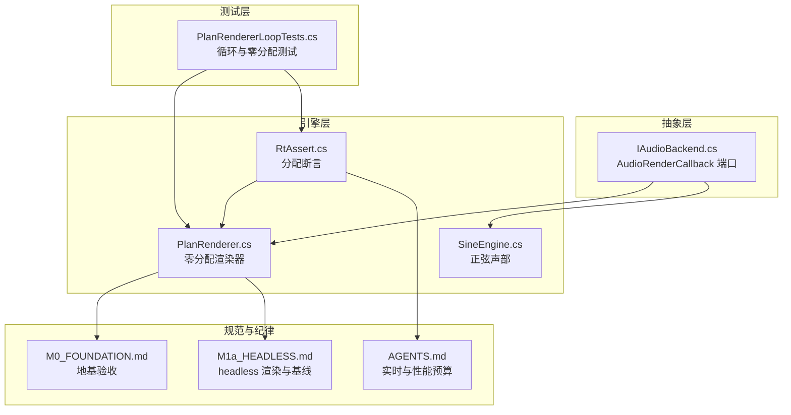
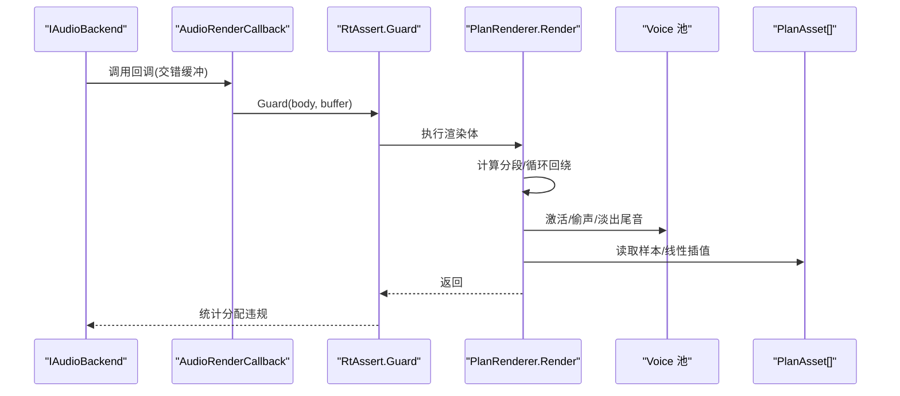
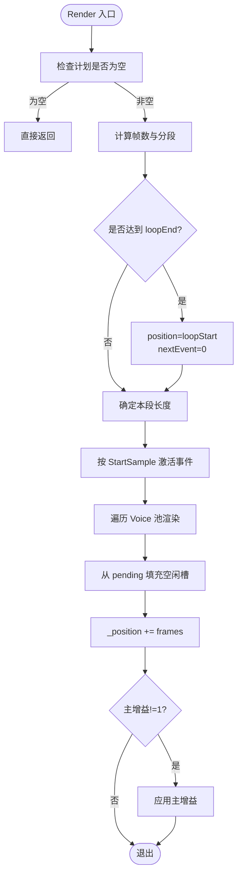
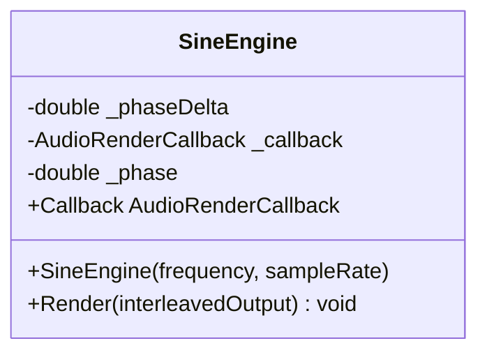
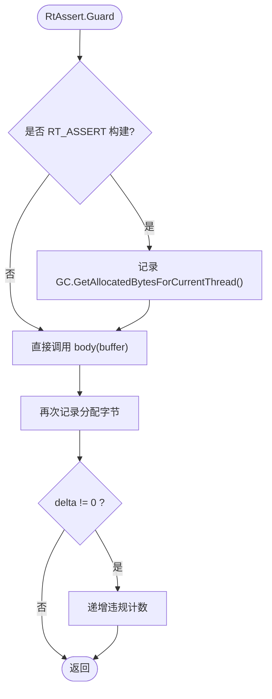
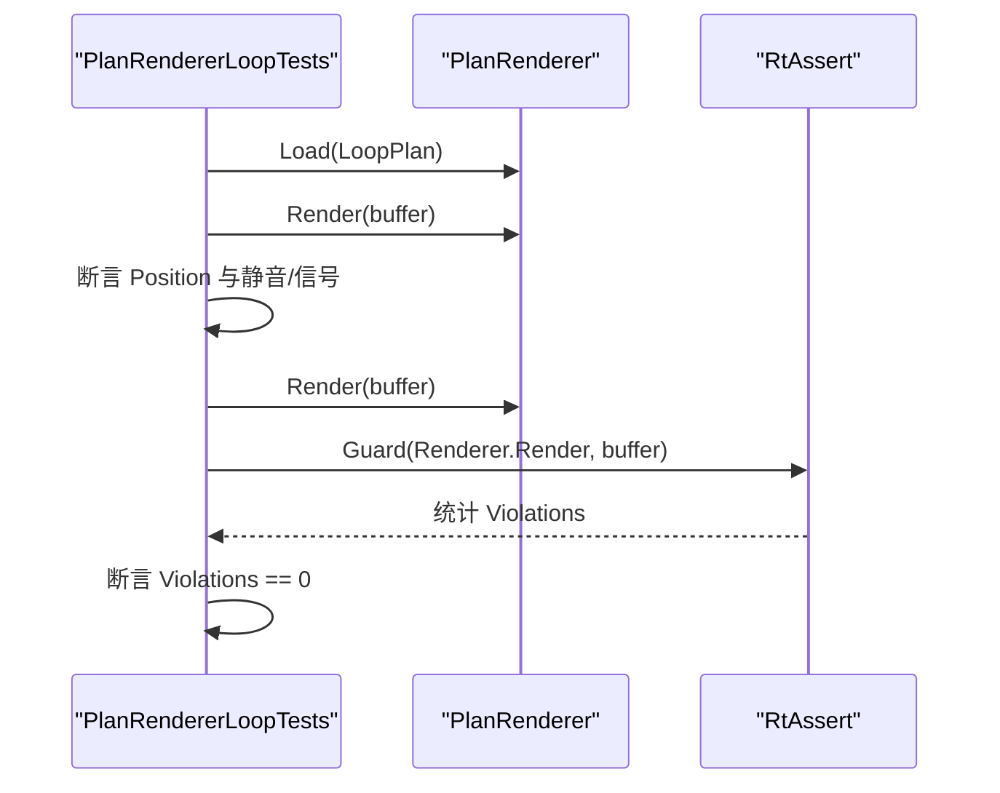

# 性能测试

<cite>
**本文引用的文件**   
- [PlanRenderer.cs](file://src/Weftone.Engine/PlanRenderer.cs)
- [RtAssert.cs](file://src/Weftone.Engine/RtAssert.cs)
- [SineEngine.cs](file://src/Weftone.Engine/SineEngine.cs)
- [IAudioBackend.cs](file://src/Weftone.Abstractions/IAudioBackend.cs)
- [PlanRendererLoopTests.cs](file://tests/Weftone.Engine.Tests/PlanRendererLoopTests.cs)
- [M0_FOUNDATION.md](file://specs/M0_FOUNDATION.md)
- [M1a_HEADLESS.md](file://specs/M1a_HEADLESS.md)
- [AGENTS.md](file://AGENTS.md)
</cite>

## 目录
1. [引言](#引言)
2. [项目结构](#项目结构)
3. [核心组件](#核心组件)
4. [架构总览](#架构总览)
5. [详细组件分析](#详细组件分析)
6. [依赖关系分析](#依赖关系分析)
7. [性能要求与预算](#性能要求与预算)
8. [基准测试编写指南](#基准测试编写指南)
9. [性能回归检测机制](#性能回归检测机制)
10. [故障排查指南](#故障排查指南)
11. [结论](#结论)

## 引言
本文面向 Weftone 实时音频系统的性能测试，聚焦以下目标：
- 明确实时音频路径的性能要求：零分配保证、RT 安全验证、延迟控制。
- 解释 PlanRenderer 循环测试的实现要点：帧率稳定性、内存分配监控、CPU 使用率测量。
- 说明 RtAssert 工具的使用方法：运行时断言与性能监控。
- 给出性能基准测试的编写指南：如何测试音频渲染性能与资源管理。
- 描述性能回归检测机制与优化建议。

## 项目结构
与性能测试直接相关的代码位于 Engine 层与 Abstractions 层，测试位于 Engine.Tests；规范文档在 specs 与 AGENTS.md 中定义实时纪律与验收标准。

**图表来源**
- [IAudioBackend.cs:1-14](file://src/Weftone.Abstractions/IAudioBackend.cs#L1-L14)
- [PlanRenderer.cs:1-356](file://src/Weftone.Engine/PlanRenderer.cs#L1-L356)
- [SineEngine.cs:1-40](file://src/Weftone.Engine/SineEngine.cs#L1-L40)
- [RtAssert.cs:1-32](file://src/Weftone.Engine/RtAssert.cs#L1-L32)
- [PlanRendererLoopTests.cs:1-91](file://tests/Weftone.Engine.Tests/PlanRendererLoopTests.cs#L1-L91)
- [M0_FOUNDATION.md:1-33](file://specs/M0_FOUNDATION.md#L1-L33)
- [M1a_HEADLESS.md:1-98](file://specs/M1a_HEADLESS.md#L1-L98)
- [AGENTS.md:193-224](file://AGENTS.md#L193-L224)

**章节来源**
- [IAudioBackend.cs:1-14](file://src/Weftone.Abstractions/IAudioBackend.cs#L1-L14)
- [PlanRenderer.cs:1-356](file://src/Weftone.Engine/PlanRenderer.cs#L1-L356)
- [SineEngine.cs:1-40](file://src/Weftone.Engine/SineEngine.cs#L1-L40)
- [RtAssert.cs:1-32](file://src/Weftone.Engine/RtAssert.cs#L1-L32)
- [PlanRendererLoopTests.cs:1-91](file://tests/Weftone.Engine.Tests/PlanRendererLoopTests.cs#L1-L91)
- [M0_FOUNDATION.md:1-33](file://specs/M0_FOUNDATION.md#L1-L33)
- [M1a_HEADLESS.md:1-98](file://specs/M1a_HEADLESS.md#L1-L98)
- [AGENTS.md:193-224](file://AGENTS.md#L193-L224)

## 核心组件
- PlanRenderer：离线/实时两用渲染器，固定 64 复音池、事件按 StartSample 顺序激活、池满时“偷”最早结束者并线性淡出防 click，pending 环等位；支持 LoopStartSample/LoopEndSample 回绕重触发；全程零分配（由 RtAssert 守护）。
- SineEngine：正弦声部实现，双精度相位累积，预捕获委托避免方法组转换分配。
- RtAssert：仅在 RT_ASSERT 构建生效的分配断言，统计违规次数，不抛异常，保障音频线程零异常。
- IAudioBackend/AudioRenderCallback：音频后端端口，回调运行于实时线程，禁止分配/锁/异常。

**章节来源**
- [PlanRenderer.cs:1-356](file://src/Weftone.Engine/PlanRenderer.cs#L1-L356)
- [SineEngine.cs:1-40](file://src/Weftone.Engine/SineEngine.cs#L1-L40)
- [RtAssert.cs:1-32](file://src/Weftone.Engine/RtAssert.cs#L1-L32)
- [IAudioBackend.cs:1-14](file://src/Weftone.Abstractions/IAudioBackend.cs#L1-L14)

## 架构总览
实时音频路径从后端回调进入引擎渲染，再由 RtAssert 包裹进行分配断言。PlanRenderer 负责将 RenderPlan 中的事件调度到 Voice 池，输出交错浮点缓冲。

**图表来源**
- [IAudioBackend.cs:1-14](file://src/Weftone.Abstractions/IAudioBackend.cs#L1-L14)
- [RtAssert.cs:1-32](file://src/Weftone.Engine/RtAssert.cs#L1-L32)
- [PlanRenderer.cs:61-137](file://src/Weftone.Engine/PlanRenderer.cs#L61-L137)

## 详细组件分析

### PlanRenderer 循环与零分配
- 循环回绕：当 position 到达 loopEnd 时回绕至 loopStart，事件游标归零以重新触发事件；活跃声部自然延续尾音；单块内可多次回绕。
- 零分配策略：固定数组池、Span<T>、struct、预分配缓冲；避免 new/装箱/LINQ/闭包/lock/async/日志/DI/反射/异常/native malloc。
- 关键流程：Load 初始化状态与池；Render 分块处理；Activate 分配槽或入 pending；StealOldest 选择最早结束的声部并设置 FadeTail；FillSlotsFromPending 释放后回填；RenderGate/RenderFadeTail 分别处理正常与偷声淡出；ReadAsset/SampleChannel 提供线性插值；SkipWait/AdvancePhase 推进等待与相位。

**图表来源**
- [PlanRenderer.cs:61-137](file://src/Weftone.Engine/PlanRenderer.cs#L61-L137)
- [PlanRenderer.cs:139-231](file://src/Weftone.Engine/PlanRenderer.cs#L139-L231)
- [PlanRenderer.cs:233-354](file://src/Weftone.Engine/PlanRenderer.cs#L233-L354)

**章节来源**
- [PlanRenderer.cs:1-356](file://src/Weftone.Engine/PlanRenderer.cs#L1-L356)

### SineEngine 零分配与相位管理
- 构造阶段校验频率范围并计算相位增量；预捕获委托避免方法组转换分配。
- Render 逐样本写入正弦值并更新相位，保持双精度相位累积以避免漂移。

**图表来源**
- [SineEngine.cs:1-40](file://src/Weftone.Engine/SineEngine.cs#L1-L40)

**章节来源**
- [SineEngine.cs:1-40](file://src/Weftone.Engine/SineEngine.cs#L1-L40)

### RtAssert 分配断言与监控
- 仅 RT_ASSERT 构建启用；Guard 在 body 前后比较当前线程分配字节差值，若不为 0 则递增违规计数。
- Violations 暴露全局违规计数，Reset 清零；不抛异常，确保音频线程稳定。

**图表来源**
- [RtAssert.cs:1-32](file://src/Weftone.Engine/RtAssert.cs#L1-L32)

**章节来源**
- [RtAssert.cs:1-32](file://src/Weftone.Engine/RtAssert.cs#L1-L32)

### PlanRendererLoopTests 循环测试与零分配断言
- 构造 RenderPlan 指定 LoopStartSample/LoopEndSample，创建正弦声部。
- 验证位置回绕与事件重触发；验证短于块大小的循环多次回绕；通过 RtAssert.Guard 连续调用渲染回调并断言 Violations == 0。

**图表来源**
- [PlanRendererLoopTests.cs:1-91](file://tests/Weftone.Engine.Tests/PlanRendererLoopTests.cs#L1-L91)
- [PlanRenderer.cs:61-137](file://src/Weftone.Engine/PlanRenderer.cs#L61-L137)
- [RtAssert.cs:1-32](file://src/Weftone.Engine/RtAssert.cs#L1-L32)

**章节来源**
- [PlanRendererLoopTests.cs:1-91](file://tests/Weftone.Engine.Tests/PlanRendererLoopTests.cs#L1-L91)

## 依赖关系分析
- Engine 仅依赖 Abstractions，遵循 ADR-0002/0003 的解耦原则。
- PlanRenderer 依赖 RenderPlan/RenderVoice/PlanAsset 等数据结构（来自 Abstractions.Rendering），但不引入第三方类型。
- RtAssert 依赖 AudioRenderCallback 作为包装入口。
- 测试依赖 NUnit 框架与 Engine 类型。

**图表来源**
- [IAudioBackend.cs:1-14](file://src/Weftone.Abstractions/IAudioBackend.cs#L1-L14)
- [PlanRenderer.cs:1-356](file://src/Weftone.Engine/PlanRenderer.cs#L1-L356)
- [PlanRendererLoopTests.cs:1-91](file://tests/Weftone.Engine.Tests/PlanRendererLoopTests.cs#L1-L91)

**章节来源**
- [IAudioBackend.cs:1-14](file://src/Weftone.Abstractions/IAudioBackend.cs#L1-L14)
- [PlanRenderer.cs:1-356](file://src/Weftone.Engine/PlanRenderer.cs#L1-L356)
- [PlanRendererLoopTests.cs:1-91](file://tests/Weftone.Engine.Tests/PlanRendererLoopTests.cs#L1-L91)

## 性能要求与预算
- 实时预算：128 samples @48k、64 轨、8 插件场景下引擎 CPU < 1.5ms/块。
- 分配断言：GC.GetAllocatedBytesForCurrentThread() 差值为 0；仅 DEBUG / RT_ASSERT 构建启用。
- RT 内禁止 native malloc；分配断言不覆盖 native，需人工/工具审计。
- 回调耗时直方图 p99 记录并上报。
- UI 60fps；Piano Roll 1 万音符视口裁剪后仍流畅。
- 离线导出快于实时。
- 门禁分级：正确性、架构规则、三平台构建、分配断言为硬门禁；性能预算为软门禁，CI 做相对回归冒烟。

**章节来源**
- [AGENTS.md:193-224](file://AGENTS.md#L193-L224)
- [M0_FOUNDATION.md:20-33](file://specs/M0_FOUNDATION.md#L20-L33)
- [M1a_HEADLESS.md:44-49](file://specs/M1a_HEADLESS.md#L44-L49)

## 基准测试编写指南
- 帧率稳定性：
  - 使用固定采样率（如 48kHz）与固定块大小（如 128 或 256 帧）进行循环渲染。
  - 统计每块渲染耗时，计算均值、方差与 p99；确保在预算范围内。
- 内存分配监控：
  - 使用 RtAssert.Guard 包裹渲染回调，断言 Violations == 0。
  - 在 Debug/RT_ASSERT 构建下运行，确保托管分配为零。
- CPU 使用率测量：
  - 在基准机上运行长时间渲染（例如 10 秒），采集 CPU 使用率与耗时直方图。
  - 对比不同复音数量、资产规模与主增益配置下的性能变化。
- 资源管理：
  - 验证 Voice 池容量与 Pending 环容量足够，避免 DroppedEvents 增长。
  - 验证 LoopStartSample/LoopEndSample 回绕路径无分配且事件重触发正确。
- 示例测试参考：
  - 参考 PlanRendererLoopTests 的循环回绕与零分配断言模式。

**章节来源**
- [PlanRendererLoopTests.cs:1-91](file://tests/Weftone.Engine.Tests/PlanRendererLoopTests.cs#L1-L91)
- [RtAssert.cs:1-32](file://src/Weftone.Engine/RtAssert.cs#L1-L32)
- [AGENTS.md:193-224](file://AGENTS.md#L193-L224)

## 性能回归检测机制
- CI 矩阵：三平台构建与测试，包含 native shim 编译与占位符检查。
- 分配断言门禁：Debug/RT_ASSERT 构建下必须全绿，Violations == 0。
- 黄金音频基线：同工程两次渲染逐位一致；WAV 尺寸与样本偏差有容差。
- 性能回归冒烟：CI 对性能预算做相对回归检测，结合 p99 耗时与 CPU 使用率趋势。

**章节来源**
- [M0_FOUNDATION.md:20-33](file://specs/M0_FOUNDATION.md#L20-L33)
- [M1a_HEADLESS.md:71-79](file://specs/M1a_HEADLESS.md#L71-L79)
- [AGENTS.md:204-206](file://AGENTS.md#L204-L206)

## 故障排查指南
- 分配断言失败：
  - 检查是否在音频路径使用了 new/装箱/LINQ/闭包/lock/async/日志/DI/反射/异常/native malloc。
  - 确认仅在 RT_ASSERT 构建下启用断言；Release 构建不统计分配。
- 循环回绕异常：
  - 检查 LoopStartSample/LoopEndSample 设置是否正确；确认 Position 回绕与 nextEvent 归零逻辑。
  - 验证活跃声部尾音淡出未导致 click。
- 事件丢失：
  - 检查 Pending 环容量与 Voice 池大小；关注 DroppedEvents 计数。
- 性能退化：
  - 采集 p99 耗时与 CPU 使用率；对比历史基线定位回归点。
  - 检查资产线性插值与主增益路径是否引入额外开销。

**章节来源**
- [PlanRenderer.cs:61-137](file://src/Weftone.Engine/PlanRenderer.cs#L61-L137)
- [PlanRenderer.cs:139-231](file://src/Weftone.Engine/PlanRenderer.cs#L139-L231)
- [RtAssert.cs:1-32](file://src/Weftone.Engine/RtAssert.cs#L1-L32)
- [AGENTS.md:193-224](file://AGENTS.md#L193-L224)

## 结论
Weftone 的实时音频系统以 PlanRenderer 为核心，结合 RtAssert 分配断言与严格的实时纪律，确保在复杂复音与循环回绕场景下实现零分配、低延迟与高稳定性。通过 PlanRendererLoopTests 等测试用例，可验证帧率稳定性、内存分配与 CPU 使用率；配合 CI 的门禁与基线守护，形成完整的性能回归检测机制。持续优化应围绕 Voice 池调度、资产读取路径与主增益处理展开，同时保持实时路径的零分配与零异常约束。