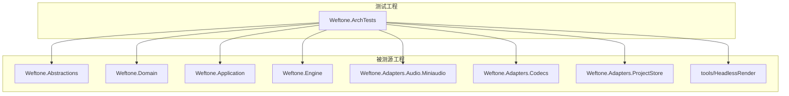
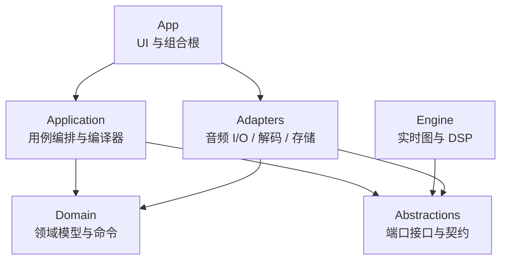
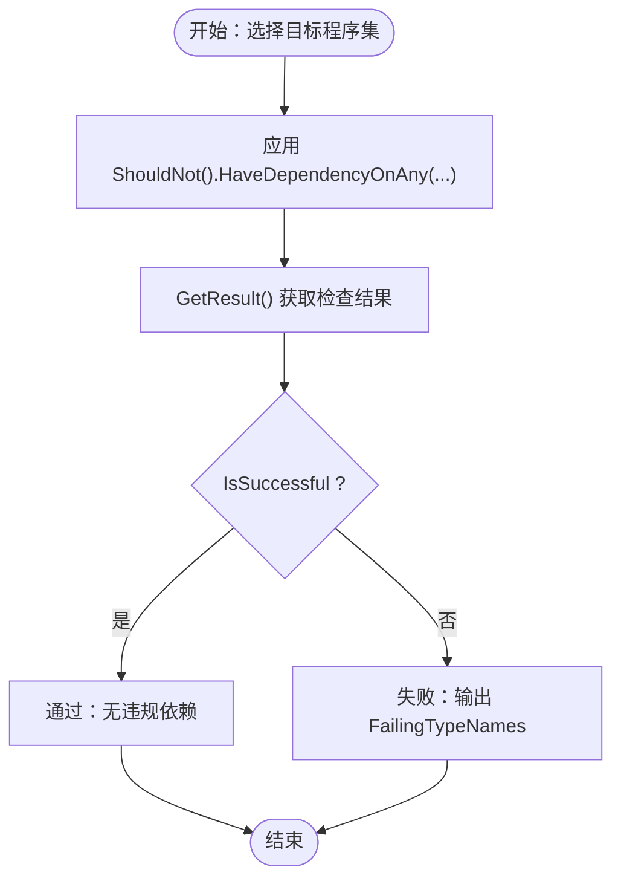
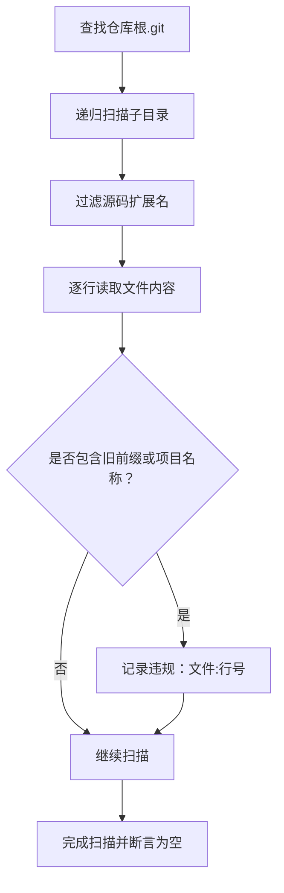
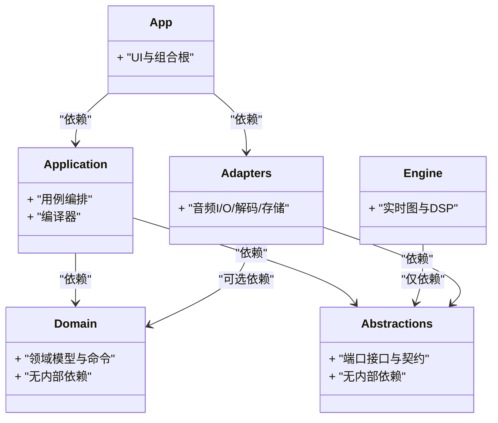
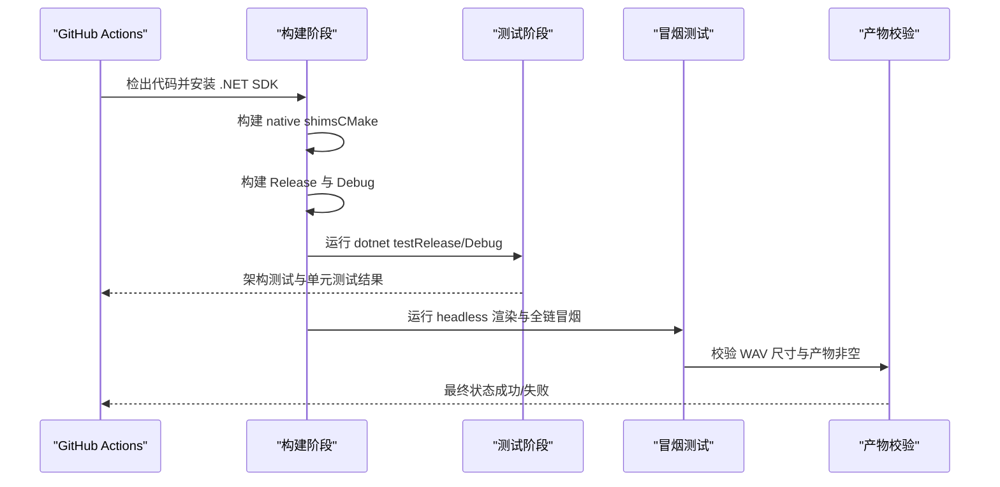

# 架构规则测试

<cite>
**本文引用的文件**   
- [DependencyRuleTests.cs](file://tests/Weftone.ArchTests/DependencyRuleTests.cs)
- [PlaceholderScanTests.cs](file://tests/Weftone.ArchTests/PlaceholderScanTests.cs)
- [Weftone.ArchTests.csproj](file://tests/Weftone.ArchTests/Weftone.ArchTests.csproj)
- [README.md（Weftone.ArchTests）](file://tests/Weftone.ArchTests/README.md)
- [ci.yml](file://.github/workflows/ci.yml)
- [AGENTS.md](file://AGENTS.md)
</cite>

## 目录
1. [引言](#引言)
2. [项目结构](#项目结构)
3. [核心组件](#核心组件)
4. [架构总览](#架构总览)
5. [详细组件分析](#详细组件分析)
6. [依赖关系分析](#依赖关系分析)
7. [性能与可维护性考虑](#性能与可维护性考虑)
8. [故障排查指南](#故障排查指南)
9. [结论](#结论)
10. [附录：在 CI/CD 中集成架构测试](#附录在-cicd-中集成架构测试)

## 引言
本文面向 Weftone 的架构规则测试，聚焦如何使用 NetArchTest.Rules 对六边形架构进行依赖约束检查，并覆盖命名约定与代码结构验证。文档说明 Engine、Abstractions、Application、Adapters、Domain 各层之间的依赖规则，给出具体测试用例的组织方式与执行路径，并解释如何在 CI/CD 中持续运行这些规则，确保代码质量与架构纪律。

## 项目结构
Weftone 的架构测试位于 `tests/Weftone.ArchTests`，包含两类测试：
- 依赖规则测试：基于 NetArchTest.Rules 校验各程序集之间的依赖方向。
- 占位符扫描测试：扫描源码，禁止遗留旧项目前缀或项目名称占位符。

**图表来源**
- [Weftone.ArchTests.csproj:7-22](file://tests/Weftone.ArchTests/Weftone.ArchTests.csproj#L7-L22)

**章节来源**
- [Weftone.ArchTests.csproj:1-25](file://tests/Weftone.ArchTests/Weftone.ArchTests.csproj#L1-L25)

## 核心组件
- 依赖规则测试类：集中定义各层的依赖约束，使用 NetArchTest 的 API 声明“不应依赖”的程序集名称。
- 占位符扫描测试类：递归扫描仓库源码，检测旧项目前缀和项目名称占位符，避免遗留命名污染。
- 测试工程清单：声明 NUnit、NetArchTest.Rules 等包引用，以及被检查的各源程序集的项目引用。

关键职责划分：
- DependencyRuleTests：将六边形架构的依赖契约转化为可执行的断言。
- PlaceholderScanTests：以静态文本扫描的方式补充架构规则，覆盖无法通过类型依赖检查的规则。
- Weftone.ArchTests.csproj：作为架构测试的入口，聚合所有被测程序集，便于统一构建与运行。

**章节来源**
- [DependencyRuleTests.cs:1-80](file://tests/Weftone.ArchTests/DependencyRuleTests.cs#L1-L80)
- [PlaceholderScanTests.cs:1-70](file://tests/Weftone.ArchTests/PlaceholderScanTests.cs#L1-L70)
- [Weftone.ArchTests.csproj:1-25](file://tests/Weftone.ArchTests/Weftone.ArchTests.csproj#L1-L25)

## 架构总览
Weftone 采用六边形架构（端口与适配器），配合编译器模式和数据导向实时层。核心数据流从可编辑的工程文档出发，经编译生成渲染计划，再交给实时引擎消费。依赖方向由内向外：Domain 与 Abstractions 处于核心，Application 编排用例，Engine 实现实时能力，Adapters 对接外部系统，App 组合 UI 与业务。

**图表来源**
- [AGENTS.md:61-80](file://AGENTS.md#L61-L80)

**章节来源**
- [AGENTS.md:61-80](file://AGENTS.md#L61-L80)

## 详细组件分析

### 依赖规则测试（NetArchTest）
该测试类定义了五组依赖规则，分别对应 Engine、Abstractions、Application、Adapters、Domain 五个程序集的依赖边界。每条规则都使用 `Types.InAssembly(...).ShouldNot().HaveDependencyOnAny(...)` 来声明禁止依赖的程序集名称，并通过 `GetResult()` 获取结果后断言成功。

- Engine 仅依赖 Abstractions：禁止依赖 Domain、Application、Adapters、App 及 UI 相关库。
- Abstractions 零内部依赖：禁止依赖其他 Weftone 内部程序集。
- Application 仅依赖 Domain 与 Abstractions：禁止依赖 Engine、Adapters、App 及 UI 相关库。
- Adapters 仅依赖 Abstractions 与 Domain：允许实现端口时引用领域类型，但禁止依赖 Application、Engine、App 及 UI 相关库。
- Domain 不依赖任何外部程序集：禁止依赖 Application、Engine、Adapters、App 等。

**图表来源**
- [DependencyRuleTests.cs:13-24](file://tests/Weftone.ArchTests/DependencyRuleTests.cs#L13-L24)
- [DependencyRuleTests.cs:26-36](file://tests/Weftone.ArchTests/DependencyRuleTests.cs#L26-L36)
- [DependencyRuleTests.cs:38-49](file://tests/Weftone.ArchTests/DependencyRuleTests.cs#L38-L49)
- [DependencyRuleTests.cs:51-65](file://tests/Weftone.ArchTests/DependencyRuleTests.cs#L51-L65)
- [DependencyRuleTests.cs:67-78](file://tests/Weftone.ArchTests/DependencyRuleTests.cs#L67-L78)

**章节来源**
- [DependencyRuleTests.cs:1-80](file://tests/Weftone.ArchTests/DependencyRuleTests.cs#L1-L80)

### 占位符扫描测试（命名约定与代码结构）
该测试用于防止仓库残留旧项目前缀或项目名称占位符。它递归遍历仓库根目录下的源码文件，忽略二进制与工具目录，并在运行时拼接 token 以避免本测试文件自匹配。

关键点：
- 扫描扩展名：涵盖 C#、C/C++、CMake、YAML 等常见源码扩展名。
- 忽略目录：如 `.git`、`bin`、`obj`、`vendor` 等。
- Token 拼接：使用字符串拼接构造敏感词，避免在源码中被正则或简单搜索命中。
- 报告格式：每个违规行输出文件路径与行号，便于定位修复。

**图表来源**
- [PlaceholderScanTests.cs:21-29](file://tests/Weftone.ArchTests/PlaceholderScanTests.cs#L21-L29)
- [PlaceholderScanTests.cs:31-39](file://tests/Weftone.ArchTests/PlaceholderScanTests.cs#L31-L39)
- [PlaceholderScanTests.cs:41-68](file://tests/Weftone.ArchTests/PlaceholderScanTests.cs#L41-L68)

**章节来源**
- [PlaceholderScanTests.cs:1-70](file://tests/Weftone.ArchTests/PlaceholderScanTests.cs#L1-L70)

### 测试工程配置（NuGet 与项目引用）
Weftone.ArchTests 工程引用了以下包与项目：
- NuGet 包：Microsoft.NET.Test.Sdk、NUnit、NUnit3TestAdapter、NetArchTest.Rules。
- 项目引用：Weftone.Abstractions、Weftone.Engine、Weftone.Adapters.*、Weftone.Application、tools/HeadlessRender。

这使得架构测试能够直接访问被测程序集的类型，从而基于程序集名称进行依赖约束检查。

**章节来源**
- [Weftone.ArchTests.csproj:1-25](file://tests/Weftone.ArchTests/Weftone.ArchTests.csproj#L1-L25)

## 依赖关系分析
根据 AGENTS.md 中的架构决策与 DependencyRuleTests 的实现，Weftone 的依赖方向如下：
- Domain：无内部依赖，保持纯领域模型与命令。
- Abstractions：仅暴露端口与契约，不依赖其他 Weftone 内部程序集。
- Application：依赖 Domain 与 Abstractions，负责用例编排与编译流程。
- Engine：仅依赖 Abstractions，保证实时层与 UI、用例解耦。
- Adapters：依赖 Abstractions，必要时依赖 Domain 以实现端口；禁止反向依赖 Application、Engine、App。
- App：组合根，依赖 Application 与 Adapters，承载 UI 与用户交互。

**图表来源**
- [AGENTS.md:61-80](file://AGENTS.md#L61-L80)
- [DependencyRuleTests.cs:13-78](file://tests/Weftone.ArchTests/DependencyRuleTests.cs#L13-L78)

**章节来源**
- [AGENTS.md:61-80](file://AGENTS.md#L61-L80)
- [DependencyRuleTests.cs:1-80](file://tests/Weftone.ArchTests/DependencyRuleTests.cs#L1-L80)

## 性能与可维护性考虑
- 架构测试轻量且快速：依赖规则基于程序集元数据扫描，开销低，适合频繁运行。
- 占位符扫描为静态文本检查：注意大仓库下递归扫描的性能，可通过忽略目录与扩展名过滤优化。
- 规则可扩展：新增程序集或依赖约束时，只需在 DependencyRuleTests 中添加相应断言，或在 PlaceholderScanTests 中调整扫描策略。
- 可读性与可维护性：每条规则都有明确注释与失败信息，便于定位违规类型。

[本节为通用指导，不涉及具体文件分析]

## 故障排查指南
当架构测试失败时，可按以下步骤排查：
- 查看失败类型列表：NetArchTest 的结果中包含 `FailingTypeNames`，可直接定位到违规类型。
- 确认依赖方向：对照 AGENTS.md 的依赖规则，判断是否为预期变更或误用。
- 修正依赖：将第三方类型或内部类型迁移至合适的 adapter 或 abstraction，避免跨层耦合。
- 更新规则：若架构演进导致规则变化，需同步更新 DependencyRuleTests 中的禁止依赖列表。
- 清理占位符：若 PlaceholderScanTests 失败，按输出的文件与行号删除或替换旧前缀/项目名称。

**章节来源**
- [DependencyRuleTests.cs:22-24](file://tests/Weftone.ArchTests/DependencyRuleTests.cs#L22-L24)
- [DependencyRuleTests.cs:34-36](file://tests/Weftone.ArchTests/DependencyRuleTests.cs#L34-L36)
- [DependencyRuleTests.cs:47-49](file://tests/Weftone.ArchTests/DependencyRuleTests.cs#L47-L49)
- [DependencyRuleTests.cs:63-65](file://tests/Weftone.ArchTests/DependencyRuleTests.cs#L63-L65)
- [DependencyRuleTests.cs:76-78](file://tests/Weftone.ArchTests/DependencyRuleTests.cs#L76-L78)
- [PlaceholderScanTests.cs:27-29](file://tests/Weftone.ArchTests/PlaceholderScanTests.cs#L27-L29)

## 结论
Weftone 的架构规则测试通过 NetArchTest.Rules 与自定义占位符扫描，将六边形架构的依赖契约固化为可执行的断言。Engine 仅依赖 Abstractions，Abstractions 零内部依赖，Application 仅依赖 Domain 与 Abstractions，Adapters 仅依赖 Abstractions 与 Domain，Domain 不依赖外部程序集。配合 CI 的全链路构建与测试，这些规则能有效保障代码质量与架构一致性。

[本节为总结性内容，不涉及具体文件分析]

## 附录：在 CI/CD 中集成架构测试
CI 工作流会：
- 检出代码。
- 安装 .NET SDK。
- 构建 native shims（CMake）。
- 构建 Release 与 Debug。
- 运行测试（Release 与 Debug）。
- 执行 CLI 冒烟与全链冒烟。
- 校验 WAV 尺寸与产物非空。

架构测试作为 `dotnet test` 的一部分，会在 Release 与 Debug 两种配置下自动执行，确保每次提交与 PR 都满足依赖规则与命名约定。

**图表来源**
- [ci.yml:1-60](file://.github/workflows/ci.yml#L1-L60)

**章节来源**
- [ci.yml:1-60](file://.github/workflows/ci.yml#L1-L60)
- [README.md（Weftone.ArchTests）:1-7](file://tests/Weftone.ArchTests/README.md#L1-L7)