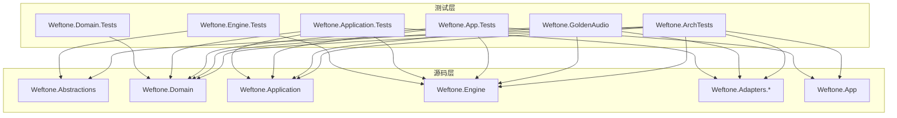
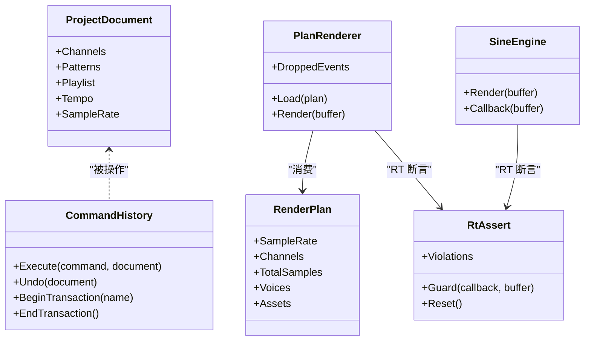
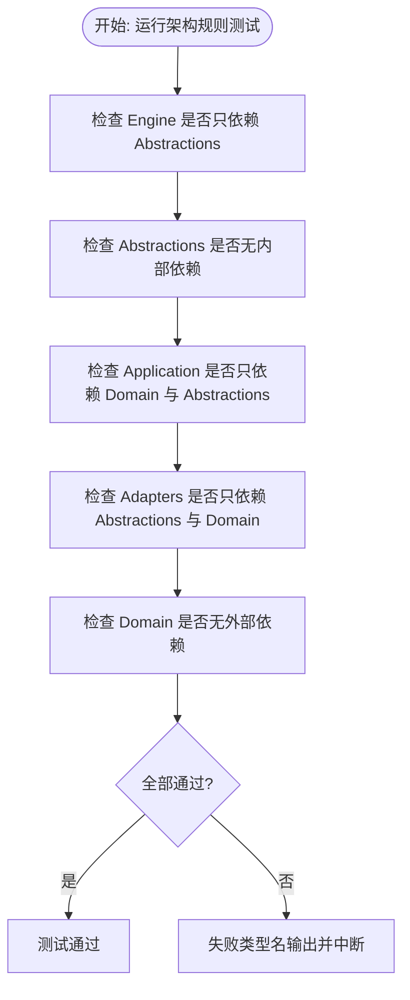
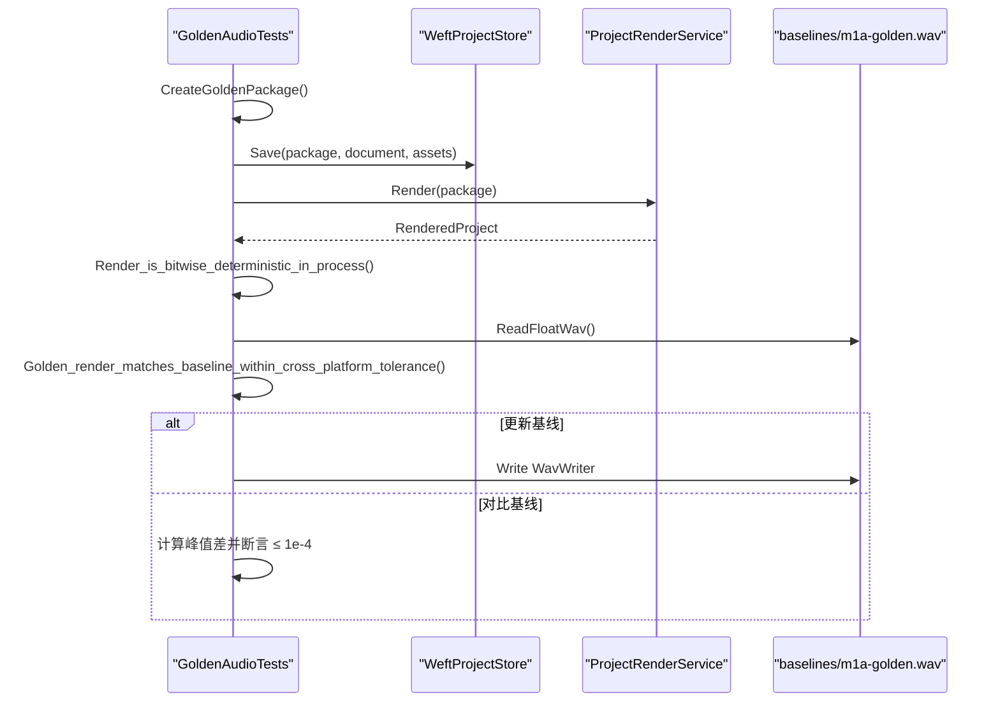
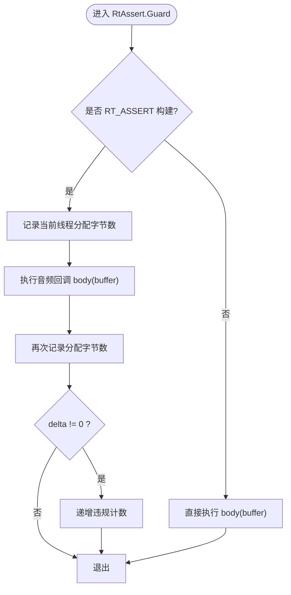
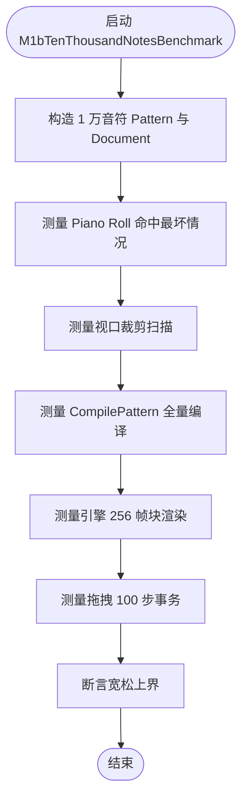
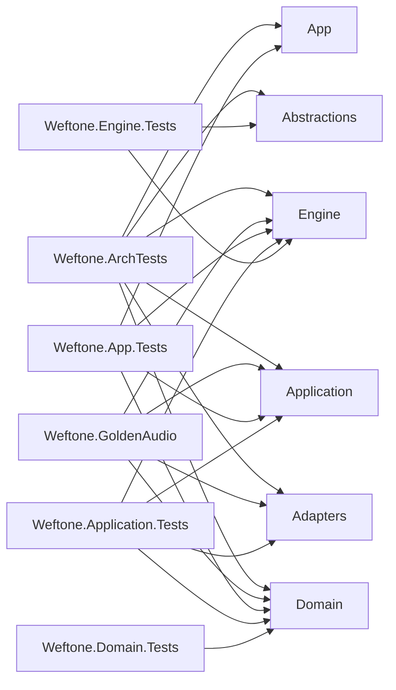
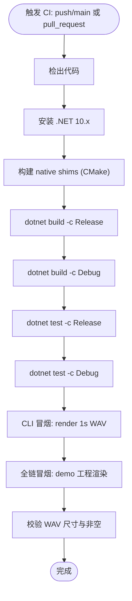

# 测试策略

<cite>
**本文引用的文件**   
- [README.md](file://README.md)
- [.github/workflows/ci.yml](file://.github/workflows/ci.yml)
- [tests/Weftone.ArchTests/DependencyRuleTests.cs](file://tests/Weftone.ArchTests/DependencyRuleTests.cs)
- [tests/Weftone.GoldenAudio/GoldenAudioTests.cs](file://tests/Weftone.GoldenAudio/GoldenAudioTests.cs)
- [tests/Weftone.Engine.Tests/PlanRendererTests.cs](file://tests/Weftone.Engine.Tests/PlanRendererTests.cs)
- [src/Weftone.Engine/RtAssert.cs](file://src/Weftone.Engine/RtAssert.cs)
- [tests/Weftone.Application.Tests/EditSessionTests.cs](file://tests/Weftone.Application.Tests/EditSessionTests.cs)
- [tests/Weftone.Domain.Tests/ClipCommandTests.cs](file://tests/Weftone.Domain.Tests/ClipCommandTests.cs)
- [tests/Weftone.App.Tests/MainWindowViewModelTests.cs](file://tests/Weftone.App.Tests/MainWindowViewModelTests.cs)
- [tests/Weftone.Engine.Tests/SineEngineTests.cs](file://tests/Weftone.Engine.Tests/SineEngineTests.cs)
- [tests/Weftone.Domain.Tests/ProjectLoadFuzzTests.cs](file://tests/Weftone.Domain.Tests/ProjectLoadFuzzTests.cs)
- [tests/Weftone.App.Tests/M1bTenThousandNotesBenchmark.cs](file://tests/Weftone.App.Tests/M1bTenThousandNotesBenchmark.cs)
</cite>

## 目录
1. [引言](#引言)
2. [项目结构](#项目结构)
3. [核心组件](#核心组件)
4. [架构总览](#架构总览)
5. [详细组件分析](#详细组件分析)
6. [依赖关系分析](#依赖关系分析)
7. [性能与实时性测试](#性能与实时性测试)
8. [CI/CD 自动化与质量门禁](#cicd-自动化与质量门禁)
9. [故障排查指南](#故障排查指南)
10. [结论](#结论)

## 引言
本测试策略文档面向 Weftone 的开发者与维护者，系统化说明单元测试、架构规则测试、黄金音频回归测试、性能基准与实时性验证的整体方案。Weftone 采用六边形架构（端口与适配器）、编译器模式与数据导向实时层，测试体系围绕以下目标构建：

- 保证编辑模型、命令撤销、文档编译、渲染计划与实时引擎的正确性与稳定性。
- 通过 NetArchTest 约束模块依赖边界，防止 UI、应用层或第三方类型泄漏到核心领域与引擎。
- 通过黄金音频回归确保跨平台确定性输出，并在本地可控更新基线。
- 在 Debug 构建下启用 RT_ASSERT，强制音频回调零分配；Release 构建保持高性能路径。
- 在 CI 中执行三平台构建、测试与 CLI 冒烟，形成可重复的质量门禁。

## 项目结构
测试代码位于 `tests` 目录下，按功能域划分测试项目：

| 测试项目 | 职责 | 关键用例 |
|---|---|---|
| `Weftone.Domain.Tests` | 领域对象、命令与撤销历史、工程加载鲁棒性 | Clip 命令、命令历史、模糊测试 |
| `Weftone.Application.Tests` | 编辑会话、工程保存打开往返、编译与播放服务 | EditSession、PlaybackService |
| `Weftone.Engine.Tests` | 正弦引擎、渲染计划、采样器、WAV 写入 | PlanRenderer、SineEngine、WavWriter |
| `Weftone.App.Tests` | Avalonia UI ViewModel 行为、几何计算、软基准 | MainWindowViewModel、PianoRollGeometry、M1b 基准 |
| `Weftone.ArchTests` | 架构依赖规则检查 | Engine/Abstractions/Application/Adapters/Domain 依赖约束 |
| `Weftone.GoldenAudio` | 黄金音频回归 | DemoProject 全链渲染、基线比较 |

**图表来源**
- [tests/Weftone.ArchTests/DependencyRuleTests.cs:1-80](file://tests/Weftone.ArchTests/DependencyRuleTests.cs#L1-L80)
- [tests/Weftone.GoldenAudio/GoldenAudioTests.cs:1-115](file://tests/Weftone.GoldenAudio/GoldenAudioTests.cs#L1-L115)
- [tests/Weftone.Engine.Tests/PlanRendererTests.cs:1-231](file://tests/Weftone.Engine.Tests/PlanRendererTests.cs#L1-L231)
- [tests/Weftone.Application.Tests/EditSessionTests.cs:1-102](file://tests/Weftone.Application.Tests/EditSessionTests.cs#L1-L102)
- [tests/Weftone.Domain.Tests/ClipCommandTests.cs:1-108](file://tests/Weftone.Domain.Tests/ClipCommandTests.cs#L1-L108)
- [tests/Weftone.App.Tests/MainWindowViewModelTests.cs:1-53](file://tests/Weftone.App.Tests/MainWindowViewModelTests.cs#L1-L53)

**章节来源**
- [README.md:70-79](file://README.md#L70-L79)

## 核心组件
Weftone 的测试体系由以下核心能力组成：

- **NUnit 单元测试框架**：所有测试项目使用 NUnit 组织用例，包含 `[Test]`、`[SetUp]`、`[TearDown]`、`Assert.Multiple` 等常用特性。
- **NetArchTest 架构规则测试**：通过 `Types.InAssembly` 与 `ShouldNot().HaveDependencyOnAny` 断言模块依赖边界。
- **黄金音频回归**：基于 `DemoProject` 生成 `.weft` 工程并渲染 WAV，与基线文件进行逐样本峰值差比较。
- **RT_ASSERT 实时性断言**：Debug 构建下通过 `RtAssert.Guard` 检测托管分配，Release 构建为空过。
- **性能基准**：以 NUnit `[Explicit]` 标记的本地基准测试评估 Piano Roll 交互、编译、引擎块渲染与拖拽命令成本。
- **模糊测试**：对工程包字节进行位翻转变异，校验异常分类正确性，避免未分类异常逃逸。

**章节来源**
- [tests/Weftone.ArchTests/DependencyRuleTests.cs:1-80](file://tests/Weftone.ArchTests/DependencyRuleTests.cs#L1-L80)
- [tests/Weftone.GoldenAudio/GoldenAudioTests.cs:1-115](file://tests/Weftone.GoldenAudio/GoldenAudioTests.cs#L1-L115)
- [src/Weftone.Engine/RtAssert.cs:1-32](file://src/Weftone.Engine/RtAssert.cs#L1-L32)
- [tests/Weftone.App.Tests/M1bTenThousandNotesBenchmark.cs:1-155](file://tests/Weftone.App.Tests/M1bTenThousandNotesBenchmark.cs#L1-L155)
- [tests/Weftone.Domain.Tests/ProjectLoadFuzzTests.cs:1-70](file://tests/Weftone.Domain.Tests/ProjectLoadFuzzTests.cs#L1-L70)

## 架构总览
Weftone 的测试架构遵循“分层隔离 + 规则驱动”的原则：

- **领域层**：纯业务对象与命令，不依赖外部实现。
- **应用层**：编排编辑器、编译器、播放器，依赖领域与抽象。
- **引擎层**：音频渲染与实时回调，仅依赖抽象，禁止 UI 与第三方类型。
- **适配器层**：对接 miniaudio、dr_wav、工程存储，依赖领域与抽象。
- **UI 层**：Avalonia ViewModel 与控件，依赖应用层与引擎。

**图表来源**
- [tests/Weftone.Domain.Tests/ClipCommandTests.cs:1-108](file://tests/Weftone.Domain.Tests/ClipCommandTests.cs#L1-L108)
- [tests/Weftone.Engine.Tests/PlanRendererTests.cs:1-231](file://tests/Weftone.Engine.Tests/PlanRendererTests.cs#L1-L231)
- [tests/Weftone.Engine.Tests/SineEngineTests.cs:1-50](file://tests/Weftone.Engine.Tests/SineEngineTests.cs#L1-L50)
- [src/Weftone.Engine/RtAssert.cs:1-32](file://src/Weftone.Engine/RtAssert.cs#L1-L32)

## 详细组件分析

### 架构规则测试（NetArchTest）
架构规则测试通过 `DependencyRuleTests` 定义以下约束：

- `Engine` 只能依赖 `Abstractions`，禁止依赖 `Domain`、`Application`、`Adapters`、`App`、插件宿主、IPC 以及 UI 库 Avalonia/SkiaSharp。
- `Abstractions` 不能依赖任何内部实现层。
- `Application` 只能依赖 `Domain` 与 `Abstractions`。
- `Adapters` 可依赖 `Abstractions` 与 `Domain`，但禁止依赖 `Application`、`Engine`、`App` 等上层。
- `Domain` 不依赖任何外部实现。

**图表来源**
- [tests/Weftone.ArchTests/DependencyRuleTests.cs:1-80](file://tests/Weftone.ArchTests/DependencyRuleTests.cs#L1-L80)

**章节来源**
- [tests/Weftone.ArchTests/DependencyRuleTests.cs:1-80](file://tests/Weftone.ArchTests/DependencyRuleTests.cs#L1-L80)

### 黄金音频回归测试
黄金音频回归测试通过以下步骤保障确定性输出：

1. 在工作目录生成 kick.wav 与 demo 工程文档。
2. 使用 `WeftProjectStore` 保存为 `.weft` 包。
3. 调用 `ProjectRenderService.Render` 得到 `RenderedProject`。
4. 同进程两次渲染比对帧数组，确保逐位一致。
5. 与基线 WAV 文件比较样本长度与峰值差，阈值 ≤ 1e-4。
6. 支持通过环境变量 `WEFTONE_GOLDEN_UPDATE=1` 更新基线文件。

**图表来源**
- [tests/Weftone.GoldenAudio/GoldenAudioTests.cs:1-115](file://tests/Weftone.GoldenAudio/GoldenAudioTests.cs#L1-L115)

**章节来源**
- [tests/Weftone.GoldenAudio/GoldenAudioTests.cs:1-115](file://tests/Weftone.GoldenAudio/GoldenAudioTests.cs#L1-L115)

### 实时性测试与分配断言
实时性测试通过 `RtAssert` 在 Debug 构建下检测音频回调中的托管分配：

- `RtAssert.Guard` 包裹音频回调，记录 `GC.GetAllocatedBytesForCurrentThread()` 前后差值。
- 若差值非零，则增加违规计数，但不抛出异常，保证音频线程安全。
- 测试通过多次调用 `RtAssert.Guard` 并断言 `Violations == 0`。

**图表来源**
- [src/Weftone.Engine/RtAssert.cs:1-32](file://src/Weftone.Engine/RtAssert.cs#L1-L32)
- [tests/Weftone.Engine.Tests/PlanRendererTests.cs:96-115](file://tests/Weftone.Engine.Tests/PlanRendererTests.cs#L96-L115)
- [tests/Weftone.Engine.Tests/SineEngineTests.cs:35-48](file://tests/Weftone.Engine.Tests/SineEngineTests.cs#L35-L48)

**章节来源**
- [src/Weftone.Engine/RtAssert.cs:1-32](file://src/Weftone.Engine/RtAssert.cs#L1-L32)
- [tests/Weftone.Engine.Tests/PlanRendererTests.cs:96-115](file://tests/Weftone.Engine.Tests/PlanRendererTests.cs#L96-L115)
- [tests/Weftone.Engine.Tests/SineEngineTests.cs:35-48](file://tests/Weftone.Engine.Tests/SineEngineTests.cs#L35-L48)

### 性能基准测试
M1b 基准测试以 `[Explicit]` 标记，仅在本地运行，用于软门禁防退化：

- 构造 1 万音符 Pattern 与 Document。
- 测量 Piano Roll 命中最坏情况、视口裁剪扫描、CompilePattern、引擎块渲染、拖拽命令事务。
- 断言宽松上界，例如引擎块均值低于 1.5 ms，拖拽手势低于 50 ms。

**图表来源**
- [tests/Weftone.App.Tests/M1bTenThousandNotesBenchmark.cs:1-155](file://tests/Weftone.App.Tests/M1bTenThousandNotesBenchmark.cs#L1-L155)

**章节来源**
- [tests/Weftone.App.Tests/M1bTenThousandNotesBenchmark.cs:1-155](file://tests/Weftone.App.Tests/M1bTenThousandNotesBenchmark.cs#L1-L155)

### 领域与命令测试
领域测试覆盖 Clip 命令的添加、移除、移动、未知模式拒绝、负 Tick 拒绝以及拖拽事务合并：

- `AddClipCommand` 与 `RemoveClipCommand` 验证 Playlist 数量变化与撤销栈状态。
- `MoveClipCommand` 验证 StartTick 与 PatternId 变更，以及撤销回退。
- 事务机制将多次 Move 合并为一次撤销记录。

**章节来源**
- [tests/Weftone.Domain.Tests/ClipCommandTests.cs:1-108](file://tests/Weftone.Domain.Tests/ClipCommandTests.cs#L1-L108)

### 应用层测试
应用层测试覆盖 EditSession 的新建演示工程、保存打开往返、命令撤销重做、打开清空历史等行为：

- `NewDemo` 编译后应产生声部与资产。
- `Save` 与 `Open` 往返应保持 Voice 数量与 IsDirty 状态。
- `Execute`、`Undo`、`Redo` 应维护 History 状态。

**章节来源**
- [tests/Weftone.Application.Tests/EditSessionTests.cs:1-102](file://tests/Weftone.Application.Tests/EditSessionTests.cs#L1-L102)

### UI 层测试
UI 层测试覆盖 MainWindowViewModel 的时间格式化、播放停止切换、未命名工程标题占位符：

- `FormatTime` 将样本数转换为分钟秒毫秒格式。
- `PlayCommand` 与 `StopCommand` 控制 `IsPlaying` 与循环模式。
- 未命名工程显示中文占位标题。

**章节来源**
- [tests/Weftone.App.Tests/MainWindowViewModelTests.cs:1-53](file://tests/Weftone.App.Tests/MainWindowViewModelTests.cs#L1-L53)

### 模糊测试
工程加载模糊测试对有效 `.weft` 包进行随机位翻转，验证异常分类：

- 仅允许 `InvalidProjectException` 或 `InvalidDataException`。
- 统计打开与拒绝次数，断言总和等于迭代次数，确保无未分类异常逃逸。

**章节来源**
- [tests/Weftone.Domain.Tests/ProjectLoadFuzzTests.cs:1-70](file://tests/Weftone.Domain.Tests/ProjectLoadFuzzTests.cs#L1-L70)

## 依赖关系分析
测试项目与源码层的依赖关系如下：

- `Weftone.ArchTests` 依赖所有主要模块，用于断言依赖规则。
- `Weftone.GoldenAudio` 依赖 Domain、Application、Engine、Adapters，用于端到端渲染。
- `Weftone.App.Tests` 依赖 App、Application、Engine、Domain，用于 UI 与业务集成。
- `Weftone.Application.Tests` 依赖 Application、Domain、Engine、Adapters，用于编辑会话与播放服务。
- `Weftone.Domain.Tests` 仅依赖 Domain，用于领域逻辑与鲁棒性。
- `Weftone.Engine.Tests` 依赖 Engine 与 Abstractions，用于音频渲染与实时性。

**图表来源**
- [tests/Weftone.ArchTests/DependencyRuleTests.cs:1-80](file://tests/Weftone.ArchTests/DependencyRuleTests.cs#L1-L80)
- [tests/Weftone.GoldenAudio/GoldenAudioTests.cs:1-115](file://tests/Weftone.GoldenAudio/GoldenAudioTests.cs#L1-L115)
- [tests/Weftone.Engine.Tests/PlanRendererTests.cs:1-231](file://tests/Weftone.Engine.Tests/PlanRendererTests.cs#L1-L231)
- [tests/Weftone.Application.Tests/EditSessionTests.cs:1-102](file://tests/Weftone.Application.Tests/EditSessionTests.cs#L1-L102)
- [tests/Weftone.Domain.Tests/ClipCommandTests.cs:1-108](file://tests/Weftone.Domain.Tests/ClipCommandTests.cs#L1-L108)
- [tests/Weftone.App.Tests/MainWindowViewModelTests.cs:1-53](file://tests/Weftone.App.Tests/MainWindowViewModelTests.cs#L1-L53)

## 性能与实时性测试
性能与实时性测试分为两类：

- **实时性测试**：通过 `RtAssert` 在 Debug 构建下检测音频回调分配，Release 构建空过。
- **性能基准**：以 `[Explicit]` 标记的本地基准测试评估 UI 交互、编译、渲染与命令事务成本。

最佳实践包括：

- 在音频回调中使用预分配缓冲区，避免临时对象。
- 使用 `RtAssert.Guard` 包裹回调，确保零分配。
- 基准测试使用 `Stopwatch` 测量平均与最大值，设置宽松上界防退化。
- 对复杂场景（如 1 万音符）进行压力测试，关注最坏情况。

**章节来源**
- [src/Weftone.Engine/RtAssert.cs:1-32](file://src/Weftone.Engine/RtAssert.cs#L1-L32)
- [tests/Weftone.Engine.Tests/PlanRendererTests.cs:96-115](file://tests/Weftone.Engine.Tests/PlanRendererTests.cs#L96-L115)
- [tests/Weftone.Engine.Tests/SineEngineTests.cs:35-48](file://tests/Weftone.Engine.Tests/SineEngineTests.cs#L35-L48)
- [tests/Weftone.App.Tests/M1bTenThousandNotesBenchmark.cs:1-155](file://tests/Weftone.App.Tests/M1bTenThousandNotesBenchmark.cs#L1-L155)

## CI/CD 自动化与质量门禁
CI 流水线在 GitHub Actions 中配置，执行以下任务：

- 在 Windows、Ubuntu、macOS 三平台并行构建。
- 构建 native shims（CMake），验证原生层可编译。
- 构建 Release 与 Debug 版本。
- 运行测试：Release 测试与 Debug 测试（启用 RT_ASSERT）。
- 执行 CLI 冒烟：headless 渲染 1 秒 WAV，校验文件大小。
- 全链冒烟：demo 工程渲染，校验输出 WAV 非空。

**图表来源**
- [.github/workflows/ci.yml:1-60](file://.github/workflows/ci.yml#L1-L60)

**章节来源**
- [.github/workflows/ci.yml:1-60](file://.github/workflows/ci.yml#L1-L60)

## 故障排查指南
常见问题与排查建议：

- **架构规则失败**：检查模块是否引入 UI 或第三方类型，确保 Engine 仅依赖 Abstractions。
- **黄金音频回归失败**：确认基线文件存在，检查样本长度与峰值差；如需更新基线，设置 `WEFTONE_GOLDEN_UPDATE=1`。
- **RT_ASSERT 分配断言失败**：检查音频回调中是否有临时对象、LINQ 查询或字符串拼接。
- **模糊测试出现未分类异常**：检查工程加载逻辑，确保仅抛出 `InvalidProjectException` 或 `InvalidDataException`。
- **性能基准退化**：检查 Piano Roll 命中、视口裁剪、编译排序与渲染循环是否存在 O(n²) 或额外分配。

**章节来源**
- [tests/Weftone.ArchTests/DependencyRuleTests.cs:1-80](file://tests/Weftone.ArchTests/DependencyRuleTests.cs#L1-L80)
- [tests/Weftone.GoldenAudio/GoldenAudioTests.cs:1-115](file://tests/Weftone.GoldenAudio/GoldenAudioTests.cs#L1-L115)
- [src/Weftone.Engine/RtAssert.cs:1-32](file://src/Weftone.Engine/RtAssert.cs#L1-L32)
- [tests/Weftone.Domain.Tests/ProjectLoadFuzzTests.cs:1-70](file://tests/Weftone.Domain.Tests/ProjectLoadFuzzTests.cs#L1-L70)
- [tests/Weftone.App.Tests/M1bTenThousandNotesBenchmark.cs:1-155](file://tests/Weftone.App.Tests/M1bTenThousandNotesBenchmark.cs#L1-L155)

## 结论
Weftone 的测试策略以分层隔离、规则驱动与确定性为核心，结合 NUnit、NetArchTest、黄金音频回归、RT_ASSERT 与性能基准，构建了从领域逻辑到实时引擎的全链路质量保障。CI 流水线在三平台执行构建、测试与冒烟，确保代码变更不会破坏架构边界、音频确定性与实时性能。开发者在新增功能时，应同步补充单元测试、架构规则与回归基线，并关注性能基准的软门禁，以维持系统稳定与可演进性。