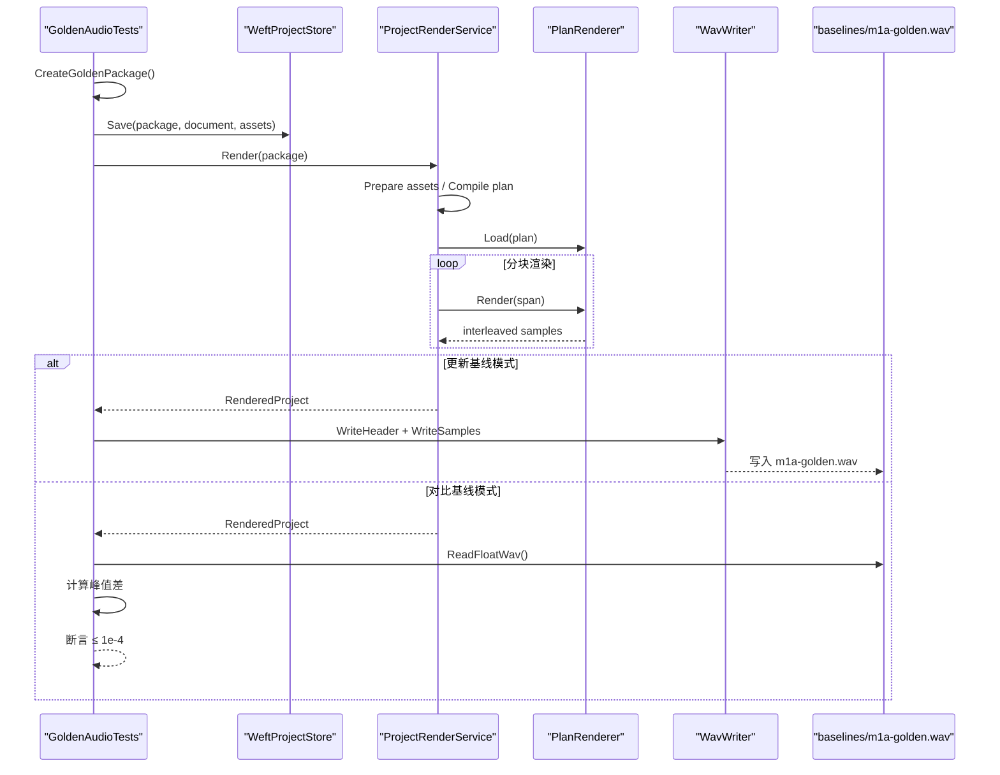
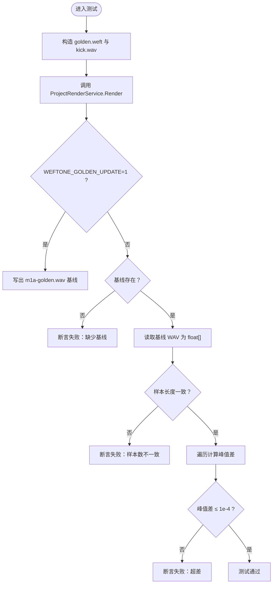
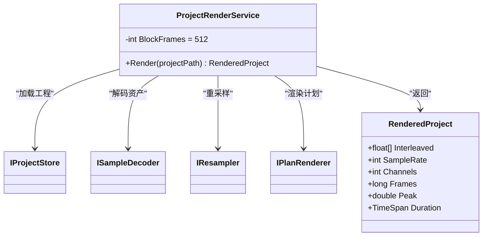
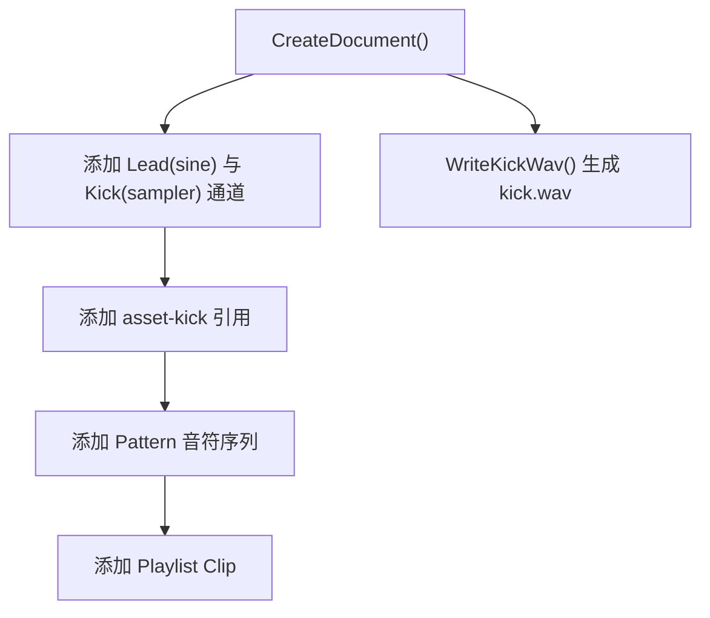
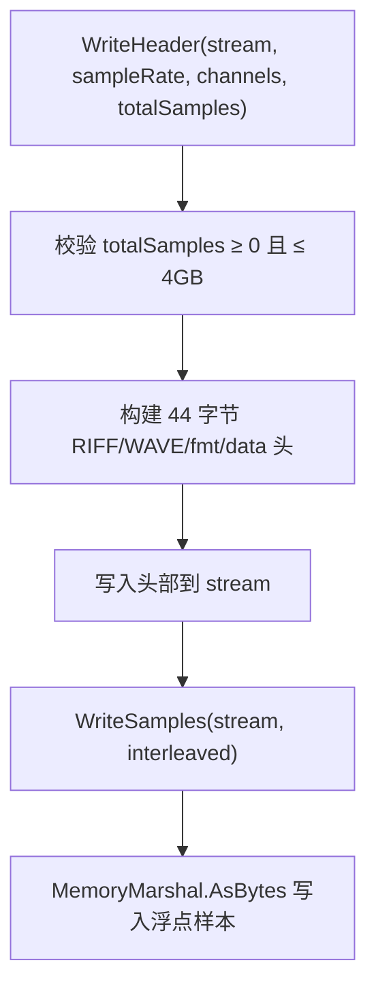
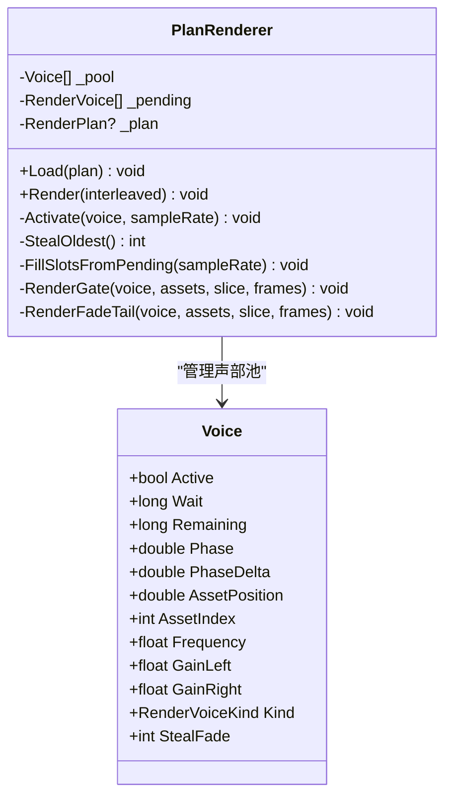
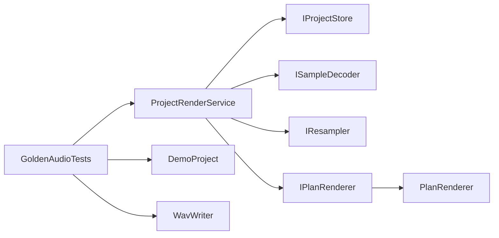

# 黄金音频回归测试

<cite>
**本文引用的文件**   
- [GoldenAudioTests.cs](file://tests/Weftone.GoldenAudio/GoldenAudioTests.cs)
- [README.md（黄金音频）](file://tests/Weftone.GoldenAudio/README.md)
- [WavWriter.cs](file://src/Weftone.Application/WavWriter.cs)
- [ProjectRenderService.cs](file://src/Weftone.Application/ProjectRenderService.cs)
- [DemoProject.cs](file://src/Weftone.Application/DemoProject.cs)
- [PlanRenderer.cs](file://src/Weftone.Engine/PlanRenderer.cs)
- [ci.yml](file://.github/workflows/ci.yml)
</cite>

## 目录
1. [引言](#引言)
2. [项目结构](#项目结构)
3. [核心组件](#核心组件)
4. [架构总览](#架构总览)
5. [详细组件分析](#详细组件分析)
6. [依赖关系分析](#依赖关系分析)
7. [性能与精度特性](#性能与精度特性)
8. [故障排查指南](#故障排查指南)
9. [结论](#结论)

## 引言
本文件面向 Weftone 的“黄金音频回归测试”，目标是确保音频渲染输出在跨平台、跨版本中保持稳定一致。黄金音频测试通过固定输入工程，将渲染结果与已提交的基准 WAV 文件进行数值比较，从而捕获潜在的音频回归。其核心价值在于：
- 保证音频输出一致性：同进程两次渲染逐位一致；跨平台峰值差控制在容差范围内。
- 提供可复现的基准：通过明确的基线生成流程和维护策略，使回归检测具备长期稳定性。
- 明确差异处理：当渲染形状或数值发生变化时，提供更新基线的受控路径和失败处理策略。

## 项目结构
黄金音频测试位于 tests/Weftone.GoldenAudio 下，围绕一个最小但完整的渲染链路构建：
- 测试入口：GoldenAudioTests.cs
- 基线说明：README.md（黄金音频）
- 基线文件位置：tests/Weftone.GoldenAudio/baselines/m1a-golden.wav（由测试动态定位）
- 渲染服务：ProjectRenderService.cs
- 演示工程：DemoProject.cs
- WAV 写出工具：WavWriter.cs
- 引擎渲染器：PlanRenderer.cs
- CI 流水线：.github/workflows/ci.yml

```mermaid
graph TB
subgraph "测试层"
GA["GoldenAudioTests.cs"]
GReadme["README.md黄金音频"]
end
subgraph "应用层"
PRS["ProjectRenderService.cs"]
DP["DemoProject.cs"]
WW["WavWriter.cs"]
end
subgraph "引擎层"
PR["PlanRenderer.cs"]
end
subgraph "CI"
CI[".github/workflows/ci.yml"]
end
GA --> PRS
GA --> DP
GA --> WW
PRS --> PR
CI --> GA
```

**图表来源**
- [GoldenAudioTests.cs:11-15](file://tests/Weftone.GoldenAudio/GoldenAudioTests.cs#L11-L15)
- [ProjectRenderService.cs:10-15](file://src/Weftone.Application/ProjectRenderService.cs#L10-L15)
- [DemoProject.cs:5-8](file://src/Weftone.Application/DemoProject.cs#L5-L8)
- [WavWriter.cs:6-8](file://src/Weftone.Application/WavWriter.cs#L6-L8)
- [PlanRenderer.cs:5-10](file://src/Weftone.Engine/PlanRenderer.cs#L5-L10)
- [ci.yml:8-15](file://.github/workflows/ci.yml#L8-L15)

**章节来源**
- [GoldenAudioTests.cs:11-15](file://tests/Weftone.GoldenAudio/GoldenAudioTests.cs#L11-L15)
- [README.md（黄金音频）:1-10](file://tests/Weftone.GoldenAudio/README.md#L1-L10)

## 核心组件
- 黄金音频测试类 GoldenAudioTests：负责构造测试包、执行渲染、读取基线、计算峰值差并断言。
- 渲染服务 ProjectRenderService：封装 store→prepare→compile→render 全链，输出 RenderedProject。
- 演示工程 DemoProject：定义确定性合成内容（sine 三和弦 + 合成 kick），并提供写入 kick WAV 的工具方法。
- WAV 写出 WavWriter：按 IEEE float32 小端格式写出 WAV 头与样本。
- 引擎 PlanRenderer：实现离线/实时渲染，包含声部管理、淡出偷取、线性插值采样等逻辑。
- CI 配置 ci.yml：在多操作系统上构建、测试与冒烟验证。

**章节来源**
- [GoldenAudioTests.cs:16-114](file://tests/Weftone.GoldenAudio/GoldenAudioTests.cs#L16-L114)
- [ProjectRenderService.cs:7-49](file://src/Weftone.Application/ProjectRenderService.cs#L7-L49)
- [DemoProject.cs:9-61](file://src/Weftone.Application/DemoProject.cs#L9-L61)
- [WavWriter.cs:7-38](file://src/Weftone.Application/WavWriter.cs#L7-L38)
- [PlanRenderer.cs:11-355](file://src/Weftone.Engine/PlanRenderer.cs#L11-L355)
- [ci.yml:8-60](file://.github/workflows/ci.yml#L8-L60)

## 架构总览
黄金音频测试的端到端流程如下：
- 构造 .weft 工程包：使用 DemoProject.CreateDocument() 创建文档，并通过 WeftProjectStore.Save 保存为 golden.weft，同时注入 assets/kick.wav。
- 渲染：ProjectRenderService.Render 加载工程、准备资产、编译计划、调用 PlanRenderer 分块渲染，累积 Interleaved 样本与峰值。
- 基线对比：若未设置更新环境变量，则读取 baselines/m1a-golden.wav，校验长度并计算峰值差，断言不超过容差。
- 基线更新：若设置 WEFTONE_GOLDEN_UPDATE=1，则直接写出当前渲染结果为基线文件。



**图表来源**
- [GoldenAudioTests.cs:33-41](file://tests/Weftone.GoldenAudio/GoldenAudioTests.cs#L33-L41)
- [GoldenAudioTests.cs:70-104](file://tests/Weftone.GoldenAudio/GoldenAudioTests.cs#L70-L104)
- [ProjectRenderService.cs:19-48](file://src/Weftone.Application/ProjectRenderService.cs#L19-L48)
- [WavWriter.cs:9-38](file://src/Weftone.Application/WavWriter.cs#L9-L38)

## 详细组件分析

### 黄金音频测试 GoldenAudioTests
职责与行为：
- 工作目录管理：每个测试用例创建临时目录并在 Teardown 清理。
- 工程包构造：生成 kick.wav 并保存为 golden.weft，注入 assets/kick.wav。
- 基线路径解析：向上查找 .git 根，定位 tests/Weftone.GoldenAudio/baselines/m1a-golden.wav。
- 确定性测试：同工程两次渲染，断言 Frames 与 Interleaved 完全一致。
- 基线对比测试：
  - 若 WEFTONE_GOLDEN_UPDATE=1，则写出当前渲染结果为基线文件并警告提交。
  - 否则检查基线存在性，读取 WAV 数据，校验样本数一致，计算峰值差并断言 ≤ 1e-4。
- WAV 读取：简单校验 RIFF/data 标记，并将字节缓冲按 float32 解释。



**图表来源**
- [GoldenAudioTests.cs:57-104](file://tests/Weftone.GoldenAudio/GoldenAudioTests.cs#L57-L104)

**章节来源**
- [GoldenAudioTests.cs:18-28](file://tests/Weftone.GoldenAudio/GoldenAudioTests.cs#L18-L28)
- [GoldenAudioTests.cs:33-55](file://tests/Weftone.GoldenAudio/GoldenAudioTests.cs#L33-L55)
- [GoldenAudioTests.cs:57-114](file://tests/Weftone.GoldenAudio/GoldenAudioTests.cs#L57-L114)

### 渲染服务 ProjectRenderService
职责与行为：
- 接收 IProjectStore、ISampleDecoder、IResampler、IPlanRenderer。
- Render(projectPath)：加载工程、准备资产、编译计划、分块渲染，累积 Interleaved 与峰值，返回 RenderedProject。
- 分块大小 BlockFrames=512，避免一次性分配过大缓冲。



**图表来源**
- [ProjectRenderService.cs:7-49](file://src/Weftone.Application/ProjectRenderService.cs#L7-L49)

**章节来源**
- [ProjectRenderService.cs:7-49](file://src/Weftone.Application/ProjectRenderService.cs#L7-L49)

### 演示工程 DemoProject
职责与行为：
- 定义确定性合成内容：sine 三和弦通道与 sampler kick 通道。
- 提供 WriteKickWav：以指数下滑频率与振幅衰减生成 mono float32 WAV。
- 作为黄金音频测试与 CLI demo 的共同输入源，确保一致性。



**图表来源**
- [DemoProject.cs:14-41](file://src/Weftone.Application/DemoProject.cs#L14-L41)
- [DemoProject.cs:44-61](file://src/Weftone.Application/DemoProject.cs#L44-L61)

**章节来源**
- [DemoProject.cs:9-61](file://src/Weftone.Application/DemoProject.cs#L9-L61)

### WAV 写出 WavWriter
职责与行为：
- 写出 WAVE_FORMAT_IEEE_FLOAT（32-bit 小端）WAV 头，随后流式追加样本。
- 限制单 WAV 上限 4GB，防止溢出。
- 支持 WriteHeader 与 WriteSamples 两个关键方法。



**图表来源**
- [WavWriter.cs:9-38](file://src/Weftone.Application/WavWriter.cs#L9-L38)

**章节来源**
- [WavWriter.cs:6-38](file://src/Weftone.Application/WavWriter.cs#L6-L38)

### 引擎渲染 PlanRenderer
职责与行为：
- 64 复音预分配池，事件按 StartSample 顺序激活。
- 池满时“偷”最早结束声部，带 FadeTail 线性淡出防 click。
- Sine 双精度相位；Sampler 线性插值采样；全程零分配（RtAssert 守护）。
- 主增益最后统一缩放。



**图表来源**
- [PlanRenderer.cs:11-355](file://src/Weftone.Engine/PlanRenderer.cs#L11-L355)

**章节来源**
- [PlanRenderer.cs:5-10](file://src/Weftone.Engine/PlanRenderer.cs#L5-L10)
- [PlanRenderer.cs:48-105](file://src/Weftone.Engine/PlanRenderer.cs#L48-L105)
- [PlanRenderer.cs:139-231](file://src/Weftone.Engine/PlanRenderer.cs#L139-L231)
- [PlanRenderer.cs:233-355](file://src/Weftone.Engine/PlanRenderer.cs#L233-L355)

## 依赖关系分析
- GoldenAudioTests 依赖：
  - WeftProjectStore（项目存储）
  - DrWavDecoder（WAV 解码）
  - LinearResampler（重采样）
  - PlanRenderer（引擎渲染）
  - ProjectRenderService（应用层渲染服务）
  - DemoProject（演示工程）
  - WavWriter（WAV 写出）
- ProjectRenderService 依赖：
  - IProjectStore、ISampleDecoder、IResampler、IPlanRenderer
  - DocumentCompiler、AssetPreparer（内部类型）
- PlanRenderer 依赖：
  - RenderPlan、PlanAsset、RenderVoiceKind（渲染计划与资产）



**图表来源**
- [GoldenAudioTests.cs:1-8](file://tests/Weftone.GoldenAudio/GoldenAudioTests.cs#L1-L8)
- [ProjectRenderService.cs:1-4](file://src/Weftone.Application/ProjectRenderService.cs#L1-L4)
- [PlanRenderer.cs:1-2](file://src/Weftone.Engine/PlanRenderer.cs#L1-L2)

**章节来源**
- [GoldenAudioTests.cs:1-8](file://tests/Weftone.GoldenAudio/GoldenAudioTests.cs#L1-L8)
- [ProjectRenderService.cs:1-15](file://src/Weftone.Application/ProjectRenderService.cs#L1-L15)
- [PlanRenderer.cs:1-10](file://src/Weftone.Engine/PlanRenderer.cs#L1-L10)

## 性能与精度特性
- 确定性：PlanRenderer 使用固定复音池、事件顺序激活、线性插值采样，避免随机性与非确定性分支，保证同进程两次渲染逐位一致。
- 精度控制：
  - 内部 DSP 同机位一致标准为 ≤1e-6（由确定性测试隐含覆盖）。
  - 跨平台黄金音频回归容差为峰值差 ≤1e-4。
- 内存与分配：
  - PlanRenderer 设计为全程零分配（RtAssert 守护）。
  - ProjectRenderService 分块渲染（BlockFrames=512），减少单次缓冲压力。
- WAV 上限：WavWriter 对单 WAV 限制 4GB，防止溢出。

**章节来源**
- [PlanRenderer.cs:5-10](file://src/Weftone.Engine/PlanRenderer.cs#L5-L10)
- [GoldenAudioTests.cs:57-104](file://tests/Weftone.GoldenAudio/GoldenAudioTests.cs#L57-L104)
- [ProjectRenderService.cs:17-48](file://src/Weftone.Application/ProjectRenderService.cs#L17-L48)
- [WavWriter.cs:11-17](file://src/Weftone.Application/WavWriter.cs#L11-L17)

## 故障排查指南
常见问题与处理策略：
- 缺少基线文件：
  - 现象：断言提示缺少 baselines/m1a-golden.wav。
  - 处理：本地设置 WEFTONE_GOLDEN_UPDATE=1 运行测试，生成基线后提交至仓库。
- 样本长度不一致：
  - 现象：断言提示样本数与基线不一致。
  - 处理：确认渲染输出形状变化是否预期；若是，更新基线并提交。
- 跨平台峰值差超差：
  - 现象：峰值差 > 1e-4。
  - 处理：检查近期变更是否影响数值精度或算法分支；必要时更新基线并提交。
- CI 失败：
  - 现象：多操作系统矩阵测试失败。
  - 处理：查看对应 OS 的日志，确认是否为基线缺失或超差；必要时在本地模拟该 OS 环境更新基线。

**章节来源**
- [GoldenAudioTests.cs:70-104](file://tests/Weftone.GoldenAudio/GoldenAudioTests.cs#L70-L104)
- [ci.yml:8-60](file://.github/workflows/ci.yml#L8-L60)

## 结论
Weftone 的黄金音频回归测试通过严格的确定性渲染与受控的基线对比机制，确保音频输出在跨平台环境中保持一致。测试覆盖了从工程构造、资产准备、计划编译到引擎渲染的全链路，并以峰值差容差 1e-4 作为回归阈值。配合 CI 的多操作系统矩阵，能够在持续集成中自动发现潜在音频回归。当渲染逻辑或数值精度发生变化时，可通过 WEFTONE_GOLDEN_UPDATE=1 更新基线，确保回归测试的长期有效性。