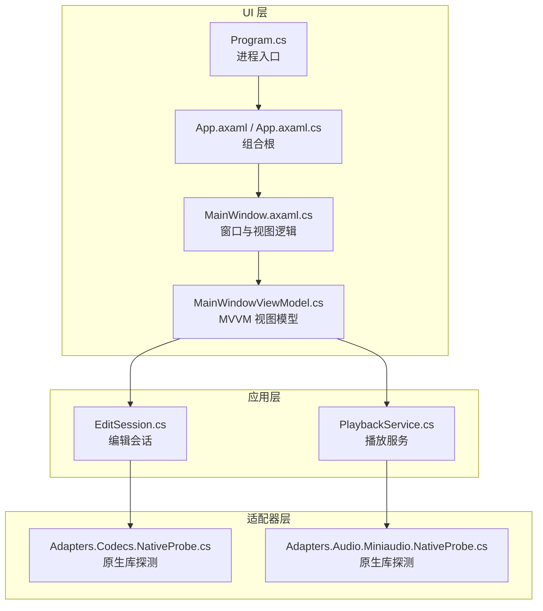
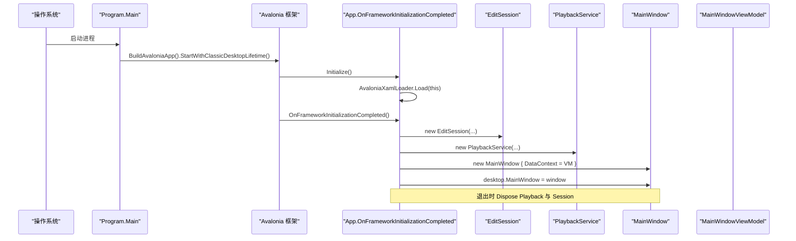
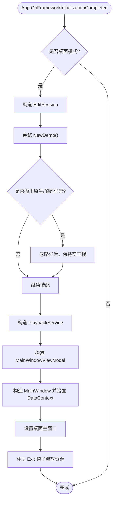
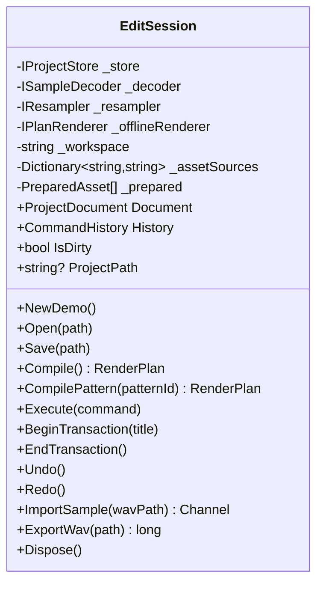
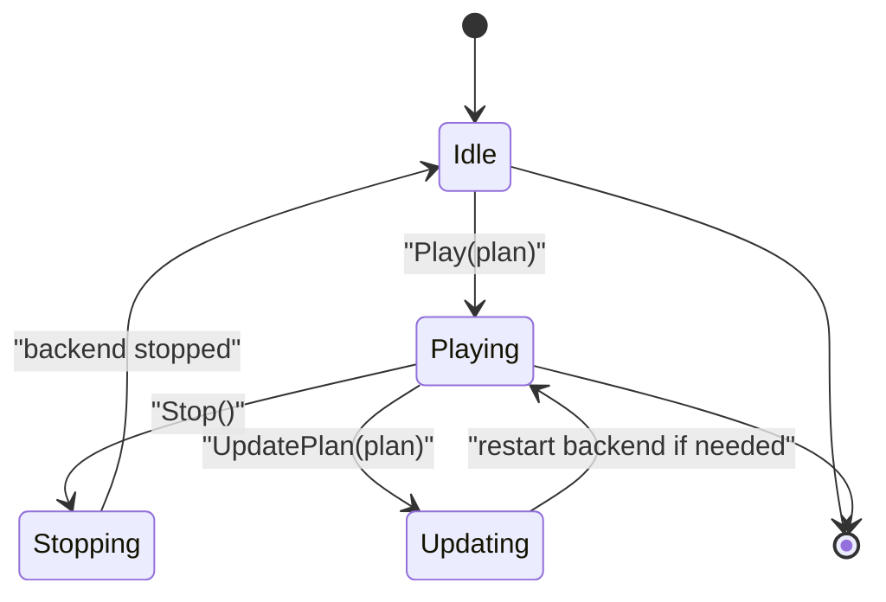
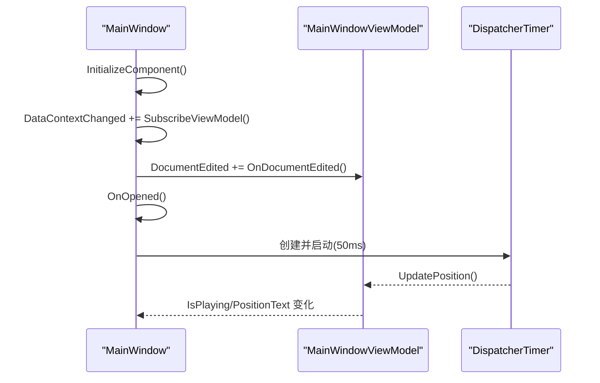
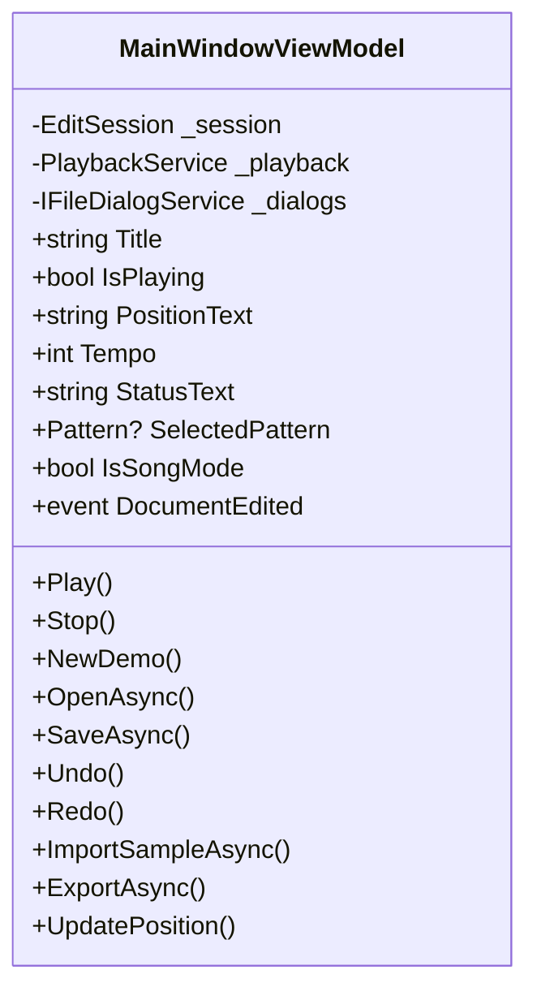
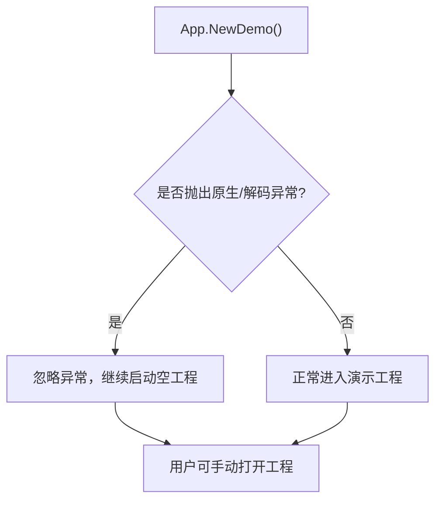
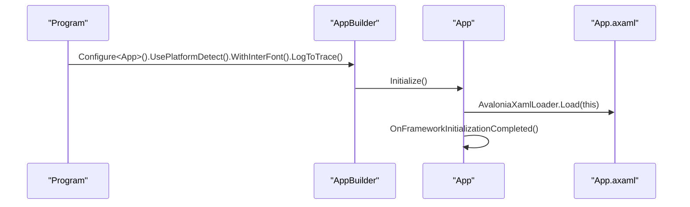
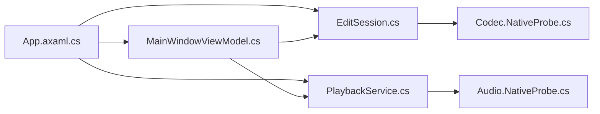

# Avalonia 应用架构

<cite>
**本文引用的文件**   
- [Program.cs](file://src/Weftone.App/Program.cs)
- [App.axaml](file://src/Weftone.App/App.axaml)
- [App.axaml.cs](file://src/Weftone.App/App.axaml.cs)
- [MainWindow.axaml.cs](file://src/Weftone.App/MainWindow.axaml.cs)
- [MainWindowViewModel.cs](file://src/Weftone.App/ViewModels/MainWindowViewModel.cs)
- [EditSession.cs](file://src/Weftone.Application/EditSession.cs)
- [PlaybackService.cs](file://src/Weftone.Application/PlaybackService.cs)
- [NativeProbe.cs（编解码适配器）](file://src/Weftone.Adapters.Codecs/NativeProbe.cs)
- [NativeProbe.cs（音频适配器）](file://src/Weftone.Adapters.Audio.Miniaudio/NativeProbe.cs)
- [AGENTS.md](file://AGENTS.md)
</cite>

## 目录
1. [引言](#引言)
2. [项目结构](#项目结构)
3. [核心组件](#核心组件)
4. [架构总览](#架构总览)
5. [详细组件分析](#详细组件分析)
6. [依赖关系分析](#依赖关系分析)
7. [性能与实时性考虑](#性能与实时性考虑)
8. [故障排查指南](#故障排查指南)
9. [结论](#结论)
10. [附录：扩展示例](#附录扩展示例)

## 引言
本文面向 Weftone 的 Avalonia 桌面应用，聚焦以下目标：
- 解释 App.axaml.cs 中的组合根模式、依赖装配与生命周期管理。
- 说明 EditSession 与 PlaybackService 的职责、数据流和释放策略。
- 梳理 Avalonia 框架初始化流程：XAML 加载、桌面生命周期、窗口绑定。
- 解析 MainWindow 的 DataContext 绑定机制与 MVVM 实践。
- 说明原生库异常处理与降级启动策略。
- 总结应用配置、资源管理与跨平台兼容性要点。
- 提供扩展组件与新服务依赖的实际接入方式。

## 项目结构
Weftone 采用六边形架构与“端口 + 适配器”分层：
- Domain：工程文档、命令与撤销。
- Abstractions：端口接口与 RenderPlan 契约。
- Application：用例编排、编译器、编辑会话、播放服务。
- Engine：实时渲染引擎。
- Adapters：miniaudio 音频后端、WAV 解码、重采样、项目存储等。
- App：Avalonia UI、MVVM、组合根。

图表来源
- [Program.cs:5-15](file://src/Weftone.App/Program.cs#L5-L15)
- [App.axaml.cs:14-48](file://src/Weftone.App/App.axaml.cs#L14-L48)
- [MainWindow.axaml.cs:7-70](file://src/Weftone.App/MainWindow.axaml.cs#L7-L70)
- [MainWindowViewModel.cs:12-106](file://src/Weftone.App/ViewModels/MainWindowViewModel.cs#L12-L106)
- [EditSession.cs:14-41](file://src/Weftone.Application/EditSession.cs#L14-L41)
- [PlaybackService.cs:12-31](file://src/Weftone.Application/PlaybackService.cs#L12-L31)
- [NativeProbe.cs（编解码适配器）:10-22](file://src/Weftone.Adapters.Codecs/NativeProbe.cs#L10-L22)
- [NativeProbe.cs（音频适配器）:10-22](file://src/Weftone.Adapters.Audio.Miniaudio/NativeProbe.cs#L10-L22)

章节来源
- [AGENTS.md:61-105](file://AGENTS.md#L61-L105)
- [Program.cs:5-15](file://src/Weftone.App/Program.cs#L5-L15)

## 核心组件
- Program：创建 Avalonia 应用构建器，启用平台检测、字体与日志。
- App：组合根，装配 EditSession、PlaybackService、对话框服务、ViewModel 与 MainWindow；处理桌面生命周期与退出清理。
- MainWindow：窗口宿主，负责滚动视口同步、自绘控件刷新、播放位置定时器。
- MainWindowViewModel：MVVM 视图模型，封装播放、导入导出、撤销重做、混音与轨道操作。
- EditSession：编辑会话，持有 ProjectDocument、命令历史、资产工作区，负责编译与离线导出。
- PlaybackService：实时播放服务，封装音频后端生命周期与计划交换。

章节来源
- [Program.cs:5-15](file://src/Weftone.App/Program.cs#L5-L15)
- [App.axaml.cs:14-48](file://src/Weftone.App/App.axaml.cs#L14-L48)
- [MainWindow.axaml.cs:7-70](file://src/Weftone.App/MainWindow.axaml.cs#L7-L70)
- [MainWindowViewModel.cs:12-106](file://src/Weftone.App/ViewModels/MainWindowViewModel.cs#L12-L106)
- [EditSession.cs:14-41](file://src/Weftone.Application/EditSession.cs#L14-L41)
- [PlaybackService.cs:12-31](file://src/Weftone.Application/PlaybackService.cs#L12-L31)

## 架构总览
下图展示从进程入口到 UI 渲染与音频输出的关键调用链，以及组合根如何装配各组件。

图表来源
- [Program.cs:7-15](file://src/Weftone.App/Program.cs#L7-L15)
- [App.axaml.cs:16-47](file://src/Weftone.App/App.axaml.cs#L16-L47)

章节来源
- [Program.cs:5-15](file://src/Weftone.App/Program.cs#L5-L15)
- [App.axaml.cs:14-48](file://src/Weftone.App/App.axaml.cs#L14-L48)

## 详细组件分析

### App.axaml.cs：组合根与生命周期
- 职责
  - 加载 XAML 主题样式。
  - 在桌面模式下装配 EditSession、PlaybackService、FileDialogService、MainWindowViewModel 与 MainWindow。
  - 捕获原生库缺失或解码失败异常，降级为空白工程启动。
  - 在桌面退出时释放 PlaybackService 与 EditSession。
- 关键点
  - 组合根集中装配依赖，避免在 UI 层散落 new。
  - 通过工厂委托注入 MiniaudioBackend，便于按需重建音频后端。
  - 使用 when 子句精准捕获 DllNotFoundException、InvalidOperationException、InvalidDataException，实现优雅降级。

图表来源
- [App.axaml.cs:18-47](file://src/Weftone.App/App.axaml.cs#L18-L47)

章节来源
- [App.axaml.cs:14-48](file://src/Weftone.App/App.axaml.cs#L14-L48)

### EditSession：编辑会话与工作区
- 职责
  - 持有 ProjectDocument、CommandHistory、临时工作区与已准备资产。
  - 打开/保存工程、导入采样、编译 RenderPlan、离线导出 WAV。
  - 通过 IProjectStore、ISampleDecoder、IResampler、IPlanRenderer 端口解耦外部实现。
- 生命周期
  - 构造时创建临时工作区目录并初始化 Document。
  - Open/Save 管理资产映射与 IsDirty 状态。
  - Dispose 尽力删除工作区，忽略 IO 权限错误。
- 复杂度与优化
  - PrepareAssets 对全量文档进行资产预处理，适合非实时线程。
  - ExportWav 分块渲染，降低内存峰值。

图表来源
- [EditSession.cs:14-41](file://src/Weftone.Application/EditSession.cs#L14-L41)
- [EditSession.cs:51-94](file://src/Weftone.Application/EditSession.cs#L51-L94)
- [EditSession.cs:100-130](file://src/Weftone.Application/EditSession.cs#L100-L130)
- [EditSession.cs:137-188](file://src/Weftone.Application/EditSession.cs#L137-L188)
- [EditSession.cs:190-221](file://src/Weftone.Application/EditSession.cs#L190-L221)

章节来源
- [EditSession.cs:14-221](file://src/Weftone.Application/EditSession.cs#L14-L221)

### PlaybackService：实时播放与热更新
- 职责
  - 封装音频后端生命周期：Open/Start/Stop/Dispose。
  - 支持 Play/Stop/UpdatePlan，保证停止-交换-恢复的零并发。
  - 根据采样率与声道数自动重建后端。
- 实时约束
  - 回调路径零分配，RenderPlan 由编辑器线程 Load。
  - UpdatePlan 在播放中安全替换计划，短暂静音避免切换爆音。

图表来源
- [PlaybackService.cs:12-31](file://src/Weftone.Application/PlaybackService.cs#L12-L31)
- [PlaybackService.cs:42-90](file://src/Weftone.Application/PlaybackService.cs#L42-L90)
- [PlaybackService.cs:92-97](file://src/Weftone.Application/PlaybackService.cs#L92-L97)

章节来源
- [PlaybackService.cs:12-98](file://src/Weftone.Application/PlaybackService.cs#L12-L98)

### MainWindow：视图与交互协调
- 职责
  - 同步 Piano Roll 与 Playlist 滚动视口。
  - 订阅 ViewModel 的 DocumentEdited 事件，触发自绘控件 InvalidateVisual。
  - 窗口打开后启动 DispatcherTimer 轮询播放位置。
- 设计要点
  - 将 UI 细节与业务逻辑分离，ViewModel 不感知 Avalonia 类型。
  - 通过事件通知视图刷新，避免在 ViewModel 中直接操作控件。

图表来源
- [MainWindow.axaml.cs:12-20](file://src/Weftone.App/MainWindow.axaml.cs#L12-L20)
- [MainWindow.axaml.cs:35-53](file://src/Weftone.App/MainWindow.axaml.cs#L35-L53)
- [MainWindow.axaml.cs:55-70](file://src/Weftone.App/MainWindow.axaml.cs#L55-L70)
- [MainWindowViewModel.cs:325-340](file://src/Weftone.App/ViewModels/MainWindowViewModel.cs#L325-L340)

章节来源
- [MainWindow.axaml.cs:7-70](file://src/Weftone.App/MainWindow.axaml.cs#L7-L70)
- [MainWindowViewModel.cs:325-340](file://src/Weftone.App/ViewModels/MainWindowViewModel.cs#L325-L340)

### MainWindowViewModel：MVVM 与命令编排
- 职责
  - 暴露 Title、IsPlaying、PositionText、Tempo、StatusText、Patterns、PlaylistClips、Channels 等可观察属性。
  - 封装播放、停止、新建演示工程、打开/保存工程、导入/导出、撤销/重做、混音与轨道手势。
  - 在播放中实时更新 RenderPlan，确保 UI 与音频输出一致。
- MVVM 实践
  - 使用 ObservableObject 与 RelayCommand 生成属性变更与命令。
  - 通过事件 DocumentEdited 通知视图刷新自绘控件。
  - 所有业务逻辑集中在 ViewModel，视图仅负责输入与展示。

图表来源
- [MainWindowViewModel.cs:12-106](file://src/Weftone.App/ViewModels/MainWindowViewModel.cs#L12-L106)
- [MainWindowViewModel.cs:112-138](file://src/Weftone.App/ViewModels/MainWindowViewModel.cs#L112-L138)
- [MainWindowViewModel.cs:140-213](file://src/Weftone.App/ViewModels/MainWindowViewModel.cs#L140-L213)
- [MainWindowViewModel.cs:398-435](file://src/Weftone.App/ViewModels/MainWindowViewModel.cs#L398-L435)
- [MainWindowViewModel.cs:496-521](file://src/Weftone.App/ViewModels/MainWindowViewModel.cs#L496-L521)

章节来源
- [MainWindowViewModel.cs:12-521](file://src/Weftone.App/ViewModels/MainWindowViewModel.cs#L12-L521)

### 原生库异常处理与降级启动
- 编解码与音频适配器均提供 NativeProbe，用于定位 weftone_codecs 与 weftone_miniaudio 动态库。
- App 在尝试 NewDemo 时捕获 DllNotFoundException、InvalidOperationException、InvalidDataException，若失败则跳过演示工程，以空工程启动，用户仍可手动打开工程。
- 该策略确保在未构建原生库或解码失败时，UI 仍可运行。

图表来源
- [App.axaml.cs:23-32](file://src/Weftone.App/App.axaml.cs#L23-L32)
- [NativeProbe.cs（编解码适配器）:10-22](file://src/Weftone.Adapters.Codecs/NativeProbe.cs#L10-L22)
- [NativeProbe.cs（音频适配器）:10-22](file://src/Weftone.Adapters.Audio.Miniaudio/NativeProbe.cs#L10-L22)

章节来源
- [App.axaml.cs:23-32](file://src/Weftone.App/App.axaml.cs#L23-L32)
- [NativeProbe.cs（编解码适配器）:10-70](file://src/Weftone.Adapters.Codecs/NativeProbe.cs#L10-L70)
- [NativeProbe.cs（音频适配器）:10-44](file://src/Weftone.Adapters.Audio.Miniaudio/NativeProbe.cs#L10-L44)

### Avalonia 框架初始化与 XAML 加载
- Program.BuildAvaloniaApp 配置 App、平台检测、Inter 字体与日志。
- App.Initialize 调用 AvaloniaXamlLoader.Load(this) 加载 App.axaml。
- App.axaml 声明 FluentTheme 样式与主题变体。
- OnFrameworkInitializationCompleted 中执行组合根装配与桌面生命周期处理。

图表来源
- [Program.cs:7-15](file://src/Weftone.App/Program.cs#L7-L15)
- [App.axaml.cs:16-18](file://src/Weftone.App/App.axaml.cs#L16-L18)
- [App.axaml:1-8](file://src/Weftone.App/App.axaml#L1-L8)

章节来源
- [Program.cs:5-15](file://src/Weftone.App/Program.cs#L5-L15)
- [App.axaml.cs:14-48](file://src/Weftone.App/App.axaml.cs#L14-L48)
- [App.axaml:1-8](file://src/Weftone.App/App.axaml#L1-L8)

## 依赖关系分析
- 组合根依赖
  - App 依赖 Application（EditSession、PlaybackService）、Adapters（MiniaudioBackend、DrWavDecoder、LinearResampler、WeftProjectStore）、Engine（PlanRenderer）。
- ViewModel 依赖
  - MainWindowViewModel 依赖 EditSession、PlaybackService、IFileDialogService。
- 适配器依赖
  - NativeProbe 通过环境变量与应用目录、仓库布局探测原生库。

图表来源
- [App.axaml.cs:22-37](file://src/Weftone.App/App.axaml.cs#L22-L37)
- [MainWindowViewModel.cs:96-106](file://src/Weftone.App/ViewModels/MainWindowViewModel.cs#L96-L106)
- [NativeProbe.cs（音频适配器）:10-22](file://src/Weftone.Adapters.Audio.Miniaudio/NativeProbe.cs#L10-L22)
- [NativeProbe.cs（编解码适配器）:10-22](file://src/Weftone.Adapters.Codecs/NativeProbe.cs#L10-L22)

章节来源
- [App.axaml.cs:22-37](file://src/Weftone.App/App.axaml.cs#L22-L37)
- [MainWindowViewModel.cs:96-106](file://src/Weftone.App/ViewModels/MainWindowViewModel.cs#L96-L106)

## 性能与实时性考虑
- 实时路径
  - PlaybackService 在音频回调中零分配，RenderPlan 由编辑器线程 Load。
  - UpdatePlan 采用停止-交换-恢复，避免并发访问。
- 编译与导出
  - EditSession.Compile 与 CompilePattern 在非实时线程执行。
  - ExportWav 分块渲染，减少内存占用。
- UI 刷新
  - MainWindow 使用 DispatcherTimer 轮询播放位置，避免频繁事件风暴。
- 资源清理
  - App 在桌面退出时释放 PlaybackService 与 EditSession，防止资源泄漏。

[本节为通用指导，不直接分析具体文件]

## 故障排查指南
- 原生库未构建或找不到
  - 现象：启动时出现 DllNotFoundException。
  - 处理：App 捕获异常并降级为空白工程；检查 WEFTONE_NATIVE_DIR 或 native/build 布局。
- 解码失败或无效 WAV
  - 现象：导入采样时报 InvalidDataException。
  - 处理：ViewModel 捕获并提示用户；确认 WAV 格式与编码。
- 音频后端异常
  - 现象：Open/Start/Stop 抛 InvalidOperationException。
  - 处理：检查设备权限与驱动；PlaybackService 会在 Stop 后重试。
- 工程保存失败
  - 现象：IO 异常导致保存失败。
  - 处理：检查路径权限与磁盘空间；ViewModel 捕获并提示。

章节来源
- [App.axaml.cs:29-32](file://src/Weftone.App/App.axaml.cs#L29-L32)
- [MainWindowViewModel.cs:412-415](file://src/Weftone.App/ViewModels/MainWindowViewModel.cs#L412-L415)
- [MainWindowViewModel.cs:431-434](file://src/Weftone.App/ViewModels/MainWindowViewModel.cs#L431-L434)

## 结论
Weftone 的 Avalonia 应用通过组合根集中装配依赖，清晰划分 UI、应用与适配器边界。EditSession 与 PlaybackService 分别承担编辑与实时播放职责，配合 MVVM 与事件驱动刷新，形成稳定可扩展的架构。原生库异常被优雅降级，确保在无原生库环境下仍可运行。未来扩展新服务时，应遵循端口抽象与组合根装配原则，保持实时路径零分配与 UI 层无业务耦合。

[本节为总结，不直接分析具体文件]

## 附录：扩展示例

### 添加新的服务依赖
步骤：
1. 定义服务接口（例如 INotificationService），放在 Abstractions 或 Application 层。
2. 实现具体服务（例如 ConsoleNotificationService），放在 Adapters 或 Application 层。
3. 在 App.axaml.cs 的组合根中装配该服务，并通过构造函数注入到需要的位置（如 MainWindowViewModel）。
4. 在 ViewModel 中使用该服务，保持 UI 与业务解耦。

参考路径
- [App.axaml.cs:22-37](file://src/Weftone.App/App.axaml.cs#L22-L37)
- [MainWindowViewModel.cs:96-106](file://src/Weftone.App/ViewModels/MainWindowViewModel.cs#L96-L106)

### 扩展播放功能
步骤：
1. 在 PlaybackService 中添加新方法（例如 Pause/Resume），保持停止-交换-恢复语义。
2. 在 MainWindowViewModel 中暴露对应命令（例如 PauseCommand）。
3. 在 MainWindow 或 XAML 中绑定按钮到命令。
4. 测试播放状态与音频输出一致性。

参考路径
- [PlaybackService.cs:42-90](file://src/Weftone.Application/PlaybackService.cs#L42-L90)
- [MainWindowViewModel.cs:112-138](file://src/Weftone.App/ViewModels/MainWindowViewModel.cs#L112-L138)

### 扩展工程导入能力
步骤：
1. 在 EditSession 中新增 ImportXXX 方法，复用 ImportSample 的工作区与资产准备流程。
2. 在 MainWindowViewModel 中增加对应命令与用户提示。
3. 在 App 的组合根中注入新的 IProjectStore 或 ISampleDecoder 实现。

参考路径
- [EditSession.cs:137-188](file://src/Weftone.Application/EditSession.cs#L137-L188)
- [MainWindowViewModel.cs:398-435](file://src/Weftone.App/ViewModels/MainWindowViewModel.cs#L398-L435)