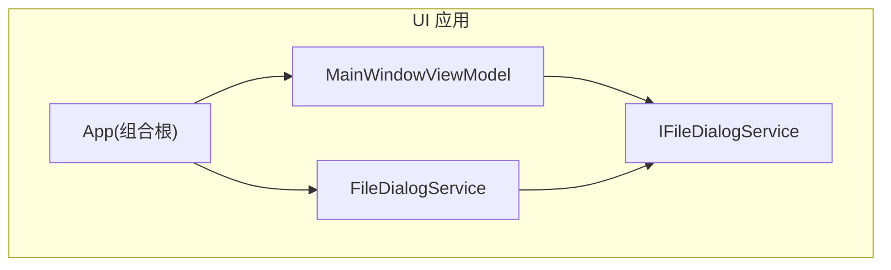
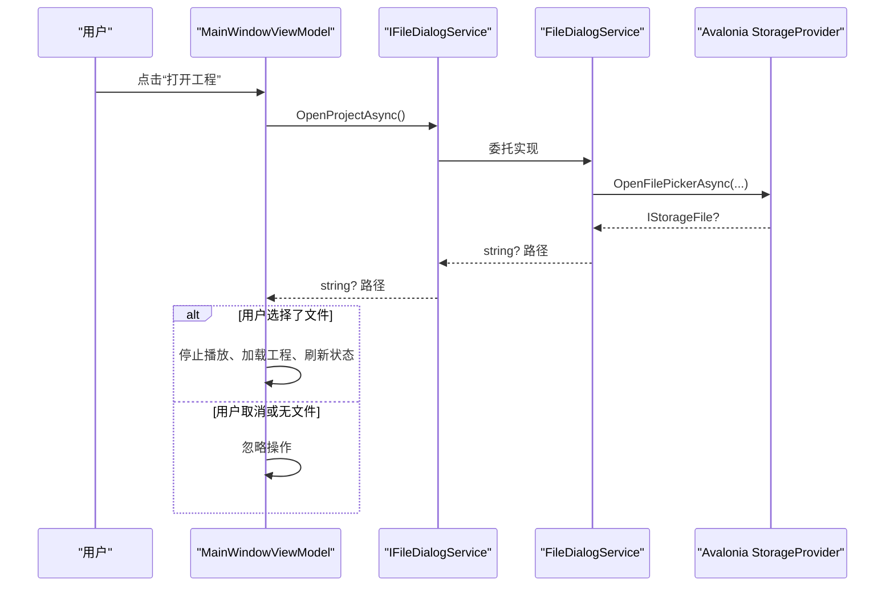
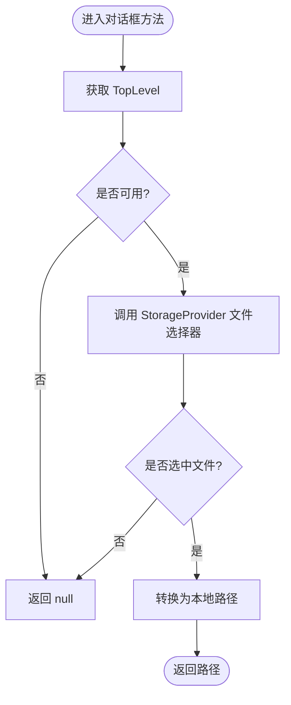
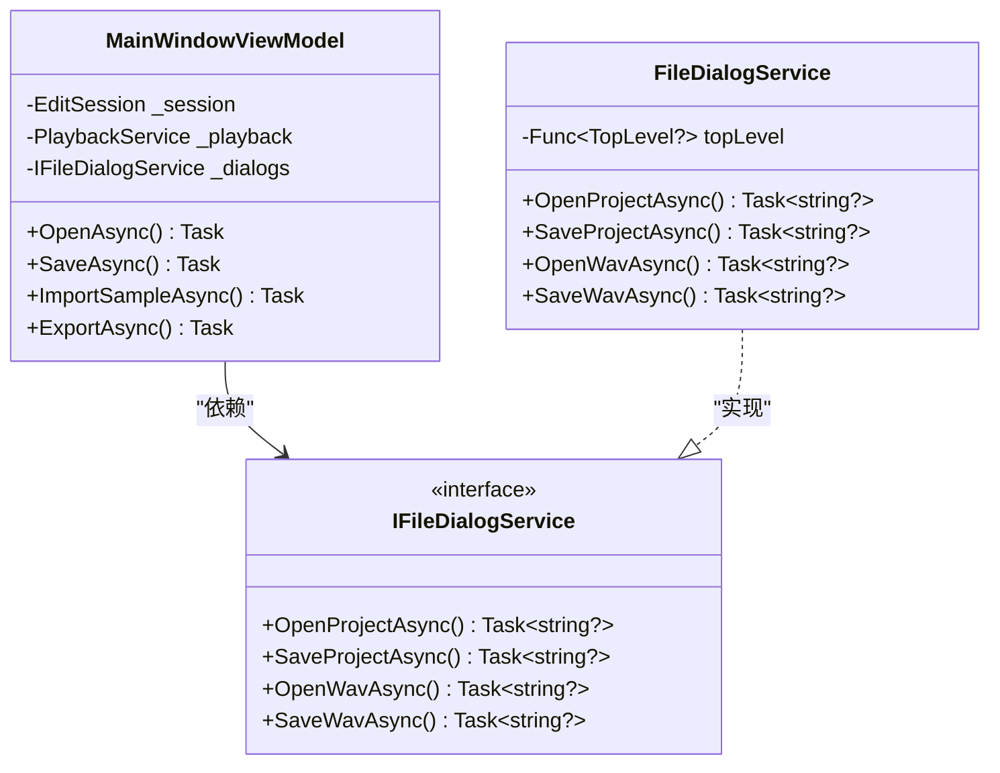
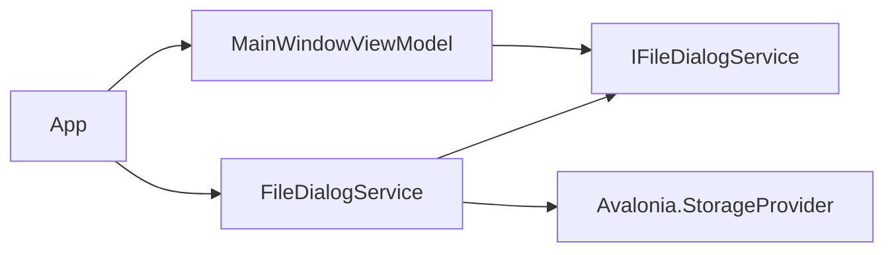

# UI 服务层

<cite>
**本文引用的文件**   
- [IFileDialogService.cs](file://src/Weftone.App/Services/IFileDialogService.cs)
- [FileDialogService.cs](file://src/Weftone.App/Services/FileDialogService.cs)
- [MainWindowViewModel.cs](file://src/Weftone.App/ViewModels/MainWindowViewModel.cs)
- [App.axaml.cs](file://src/Weftone.App/App.axaml.cs)
- [Program.cs](file://src/Weftone.App/Program.cs)
- [Fakes.cs](file://tests/Weftone.App.Tests/Fakes.cs)
- [TestAppBuilder.cs](file://tests/Weftone.App.Tests/TestAppBuilder.cs)
- [MainWindowViewModelTests.cs](file://tests/Weftone.App.Tests/MainWindowViewModelTests.cs)
</cite>

## 目录
1. [引言](#引言)
2. [项目结构](#项目结构)
3. [核心组件](#核心组件)
4. [架构总览](#架构总览)
5. [详细组件分析](#详细组件分析)
6. [依赖关系分析](#依赖关系分析)
7. [性能与异步特性](#性能与异步特性)
8. [故障排查指南](#故障排查指南)
9. [结论](#结论)
10. [附录：扩展指南与测试示例](#附录扩展指南与测试示例)

## 引言
本文聚焦 Weftone 的 UI 服务层，重点说明文件对话框服务的抽象设计、跨平台适配机制、与 ViewModel 的解耦模式、异步处理与错误回调、服务注册与生命周期管理，并给出扩展新 UI 服务和对话框类型的实践方法。该文档既适合初学者理解整体思路，也能为有经验的开发者提供可操作的实现细节。

## 项目结构
UI 服务位于 Weftone.App 项目中，采用“接口 + 具体实现”的分层方式：
- 抽象层：IFileDialogService 定义文件对话框能力契约。
- 实现层：FileDialogService 基于 Avalonia 的文件选择器完成打开/保存工程与 WAV 文件。
- 使用层：MainWindowViewModel 通过 IFileDialogService 调用对话框，不直接依赖 UI 框架。
- 组合根：App.axaml.cs 负责创建实例、注入依赖、管理生命周期。

图表来源
- [MainWindowViewModel.cs:96-106](file://src/Weftone.App/ViewModels/MainWindowViewModel.cs#L96-L106)
- [FileDialogService.cs:6-16](file://src/Weftone.App/Services/FileDialogService.cs#L6-L16)
- [App.axaml.cs:34-38](file://src/Weftone.App/App.axaml.cs#L34-L38)

章节来源
- [App.axaml.cs:18-48](file://src/Weftone.App/App.axaml.cs#L18-L48)
- [Program.cs:5-15](file://src/Weftone.App/Program.cs#L5-L15)

## 核心组件
- IFileDialogService：定义四个异步方法，分别用于打开/保存工程和导入/导出 WAV。返回值为可空字符串路径，表示用户取消或失败。
- FileDialogService：封装 Avalonia 的 StorageProvider 文件选择器，按类型过滤（.weft/.wav），将 IStorageFile 转换为本地路径。
- MainWindowViewModel：通过构造函数注入 IFileDialogService，在命令中调用对话框，并根据返回值执行后续业务逻辑。
- App：组合根，创建 EditSession、PlaybackService、FileDialogService、MainWindowViewModel，并将对话框服务注入 ViewModel。

章节来源
- [IFileDialogService.cs:3-13](file://src/Weftone.App/Services/IFileDialogService.cs#L3-L13)
- [FileDialogService.cs:6-81](file://src/Weftone.App/Services/FileDialogService.cs#L6-L81)
- [MainWindowViewModel.cs:96-106](file://src/Weftone.App/ViewModels/MainWindowViewModel.cs#L96-L106)
- [App.axaml.cs:34-38](file://src/Weftone.App/App.axaml.cs#L34-L38)

## 架构总览
UI 服务层遵循六边形架构思想：ViewModel 仅依赖 IFileDialogService 接口，不感知底层 UI 框架；具体实现由组合根装配。这样既保证 UI 逻辑的可测试性，又便于在不同平台或宿主环境中替换实现。

图表来源
- [MainWindowViewModel.cs:150-161](file://src/Weftone.App/ViewModels/MainWindowViewModel.cs#L150-L161)
- [FileDialogService.cs:18-32](file://src/Weftone.App/Services/FileDialogService.cs#L18-L32)

## 详细组件分析

### IFileDialogService 接口设计
- 职责边界：仅暴露文件对话框能力，不包含任何业务逻辑。
- 方法语义：
  - OpenProjectAsync：打开 .weft 工程文件。
  - SaveProjectAsync：保存为 .weft 工程文件。
  - OpenWavAsync：导入 .wav 采样。
  - SaveWavAsync：导出 .wav 音频。
- 返回值：Task<string?>，成功返回本地路径，取消或失败返回 null。
- 可测试性：接口屏蔽了 Avalonia 细节，便于单元测试和模拟对象注入。

章节来源
- [IFileDialogService.cs:3-13](file://src/Weftone.App/Services/IFileDialogService.cs#L3-L13)

### FileDialogService 实现与跨平台适配
- 跨平台机制：通过 Avalonia 的 TopLevel.StorageProvider 统一访问系统文件选择器，屏蔽 Windows/macOS/Linux 差异。
- 类型过滤：
  - 工程类型：.weft
  - 音频类型：.wav
- 路径转换：IStorageFile.TryGetLocalPath() 获取本地路径，避免平台相关路径问题。
- 健壮性：若无法获取 TopLevel（例如 headless 环境），直接返回 null，避免异常。

图表来源
- [FileDialogService.cs:18-32](file://src/Weftone.App/Services/FileDialogService.cs#L18-L32)
- [FileDialogService.cs:34-48](file://src/Weftone.App/Services/FileDialogService.cs#L34-L48)
- [FileDialogService.cs:50-64](file://src/Weftone.App/Services/FileDialogService.cs#L50-L64)
- [FileDialogService.cs:66-81](file://src/Weftone.App/Services/FileDialogService.cs#L66-L81)

章节来源
- [FileDialogService.cs:6-81](file://src/Weftone.App/Services/FileDialogService.cs#L6-L81)

### ViewModel 与服务解耦模式
- 依赖注入：MainWindowViewModel 通过构造函数接收 IFileDialogService，避免直接耦合 Avalonia。
- 命令驱动：Open/Save/Import/Export 等命令调用对话框，根据返回值更新状态。
- 状态同步：打开/保存成功后，停止播放、加载/保存工程、刷新标题、通知视图更新。

图表来源
- [MainWindowViewModel.cs:96-106](file://src/Weftone.App/ViewModels/MainWindowViewModel.cs#L96-L106)
- [IFileDialogService.cs:3-13](file://src/Weftone.App/Services/IFileDialogService.cs#L3-L13)
- [FileDialogService.cs:6-16](file://src/Weftone.App/Services/FileDialogService.cs#L6-L16)

章节来源
- [MainWindowViewModel.cs:150-161](file://src/Weftone.App/ViewModels/MainWindowViewModel.cs#L150-L161)
- [MainWindowViewModel.cs:202-213](file://src/Weftone.App/ViewModels/MainWindowViewModel.cs#L202-L213)
- [MainWindowViewModel.cs:398-435](file://src/Weftone.App/ViewModels/MainWindowViewModel.cs#L398-L435)

### 异步操作与错误回调机制
- 异步模型：所有对话框方法均为 async Task<string?>，ViewModel 使用 await 等待结果。
- 错误处理：
  - 对话框层面：若无 TopLevel 或用户取消，返回 null。
  - ViewModel 层面：对导入/导出过程中的 IO 或解码异常进行捕获，更新状态文本提示用户。
- 用户体验：在导入失败时明确提示“不是可解码的 WAV”，导出失败时显示具体错误信息。

章节来源
- [FileDialogService.cs:18-32](file://src/Weftone.App/Services/FileDialogService.cs#L18-L32)
- [MainWindowViewModel.cs:398-435](file://src/Weftone.App/ViewModels/MainWindowViewModel.cs#L398-L435)

### 服务注册与生命周期管理
- 组合根：App.OnFrameworkInitializationCompleted 中创建 EditSession、PlaybackService、FileDialogService、MainWindowViewModel。
- 生命周期：
  - FileDialogService：随窗口存在而存在，无需显式释放。
  - PlaybackService：在应用退出时释放资源。
  - EditSession：在应用退出时释放资源。
- 入口点：Program.Main 启动 Avalonia 桌面应用。

章节来源
- [App.axaml.cs:18-48](file://src/Weftone.App/App.axaml.cs#L18-L48)
- [Program.cs:5-15](file://src/Weftone.App/Program.cs#L5-L15)

## 依赖关系分析
- 低耦合：ViewModel 仅依赖 IFileDialogService，不感知 Avalonia。
- 高内聚：FileDialogService 集中处理文件选择器逻辑。
- 外部依赖：Avalonia 仅在实现层引入，保持业务层纯净。

图表来源
- [MainWindowViewModel.cs:96-106](file://src/Weftone.App/ViewModels/MainWindowViewModel.cs#L96-L106)
- [FileDialogService.cs:1-3](file://src/Weftone.App/Services/FileDialogService.cs#L1-L3)
- [App.axaml.cs:34-38](file://src/Weftone.App/App.axaml.cs#L34-L38)

章节来源
- [IFileDialogService.cs:3-13](file://src/Weftone.App/Services/IFileDialogService.cs#L3-L13)
- [FileDialogService.cs:1-81](file://src/Weftone.App/Services/FileDialogService.cs#L1-L81)
- [MainWindowViewModel.cs:96-106](file://src/Weftone.App/ViewModels/MainWindowViewModel.cs#L96-L106)
- [App.axaml.cs:34-38](file://src/Weftone.App/App.axaml.cs#L34-L38)

## 性能与异步特性
- 异步 I/O：文件选择器调用为异步，避免阻塞 UI 线程。
- 轻量实现：FileDialogService 仅做薄封装，无额外计算开销。
- 建议：
  - 在大文件导入/导出场景中，可在 ViewModel 层增加进度反馈与取消令牌支持。
  - 对频繁调用的对话框方法进行缓存策略（如最近路径）需谨慎评估一致性。

[本节为通用指导，不涉及具体文件分析]

## 故障排查指南
- 现象：对话框无响应或返回 null。
  - 可能原因：TopLevel 不可用（headless 环境）、用户取消、文件类型过滤不匹配。
  - 处理建议：检查 App 是否正确创建窗口；确认 FileTypeFilter 设置正确；在 ViewModel 中对 null 分支进行处理。
- 现象：导入 WAV 失败。
  - 可能原因：文件格式损坏、编码不支持、IO 异常。
  - 处理建议：查看状态文本提示；确保异常捕获覆盖 InvalidDataException、IOException、InvalidOperationException。
- 现象：导出 WAV 失败。
  - 可能原因：磁盘写入权限不足、路径无效。
  - 处理建议：捕获 IO 异常并提示用户；验证目标路径有效性。

章节来源
- [FileDialogService.cs:18-32](file://src/Weftone.App/Services/FileDialogService.cs#L18-L32)
- [MainWindowViewModel.cs:398-435](file://src/Weftone.App/ViewModels/MainWindowViewModel.cs#L398-L435)

## 结论
UI 服务层通过 IFileDialogService 抽象与 FileDialogService 实现，实现了 UI 逻辑与 Avalonia 的解耦，提升了可测试性与跨平台兼容性。结合组合根的生命周期管理，确保了资源的合理分配与释放。该模式易于扩展新的对话框类型和服务，同时保持了代码清晰与职责单一。

[本节为总结性内容，不涉及具体文件分析]

## 附录：扩展指南与测试示例

### 添加新的 UI 服务
- 步骤：
  1. 在 Services 目录下新增接口（如 INotificationService）。
  2. 提供具体实现（如 NotificationService），封装平台相关逻辑。
  3. 在 App 组合根中创建实例并注入到需要的位置（如 ViewModel）。
  4. 在 ViewModel 中通过构造函数注入并使用。
- 注意事项：
  - 接口应保持稳定，避免频繁变更。
  - 实现类尽量无副作用，便于测试。

[本节为概念性指导，不涉及具体文件分析]

### 添加新的对话框类型
- 步骤：
  1. 在 IFileDialogService 中新增方法（如 OpenImageAsync）。
  2. 在 FileDialogService 中实现该方法，配置 FileTypeFilter 与 Title。
  3. 在 MainWindowViewModel 中新增命令调用新方法。
  4. 在测试中更新 FakeDialogs 以支持新方法的模拟。
- 示例参考：
  - 现有方法：OpenWavAsync、SaveWavAsync。
  - 新增方法可参照其结构与错误处理模式。

章节来源
- [IFileDialogService.cs:3-13](file://src/Weftone.App/Services/IFileDialogService.cs#L3-L13)
- [FileDialogService.cs:50-81](file://src/Weftone.App/Services/FileDialogService.cs#L50-L81)
- [MainWindowViewModel.cs:398-435](file://src/Weftone.App/ViewModels/MainWindowViewModel.cs#L398-L435)

### 单元测试示例与模拟对象
- 模拟对话框：FakeDialogs 实现 IFileDialogService，返回预设路径或 null，用于控制测试输入。
- 测试场景：
  - 播放/停止：验证 IsPlaying 状态变化。
  - 未命名工程：验证标题包含占位符。
  - 导入/导出：可通过 FakeDialogs 返回路径，验证业务逻辑分支。
- 测试环境：TestAppBuilder 提供 Headless 测试应用，避免 native/音频依赖。

章节来源
- [Fakes.cs:14-27](file://tests/Weftone.App.Tests/Fakes.cs#L14-L27)
- [TestAppBuilder.cs:19-24](file://tests/Weftone.App.Tests/TestAppBuilder.cs#L19-L24)
- [MainWindowViewModelTests.cs:10-52](file://tests/Weftone.App.Tests/MainWindowViewModelTests.cs#L10-L52)