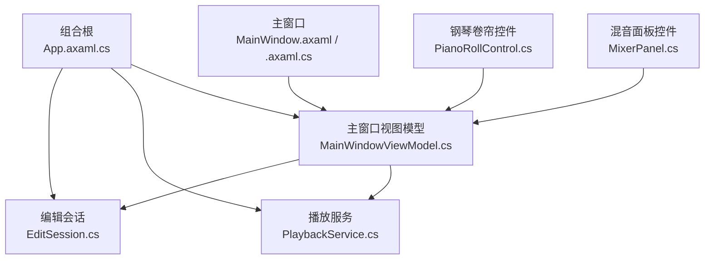
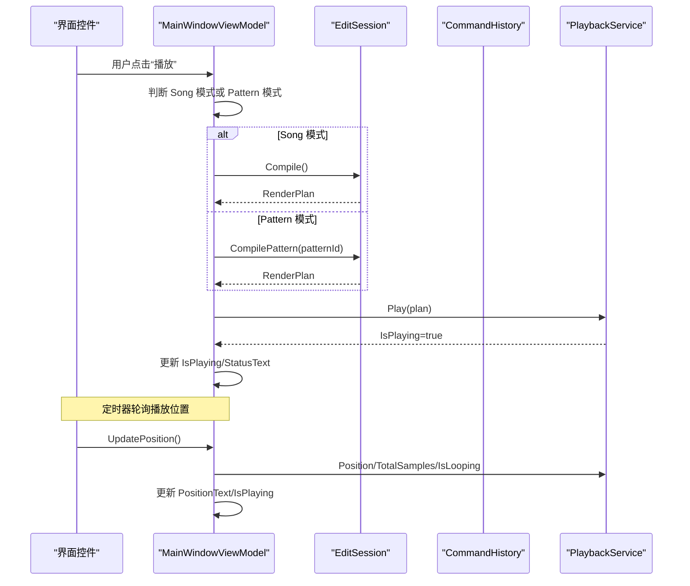
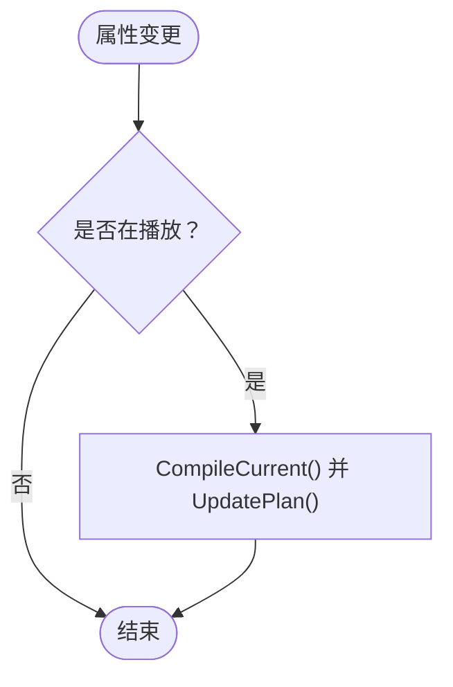
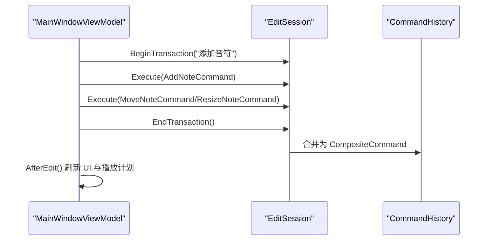
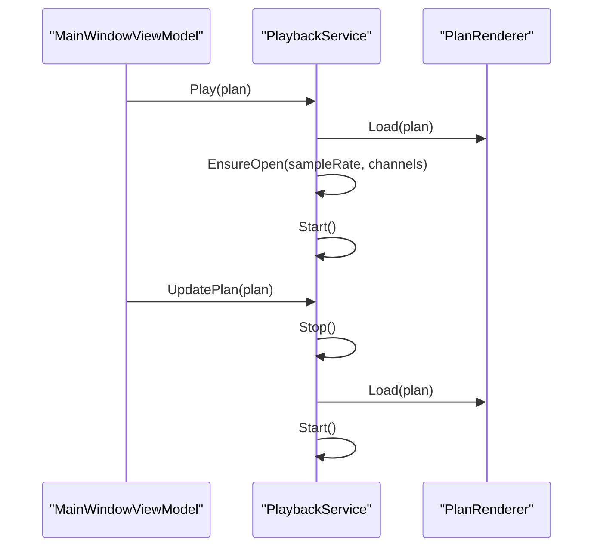
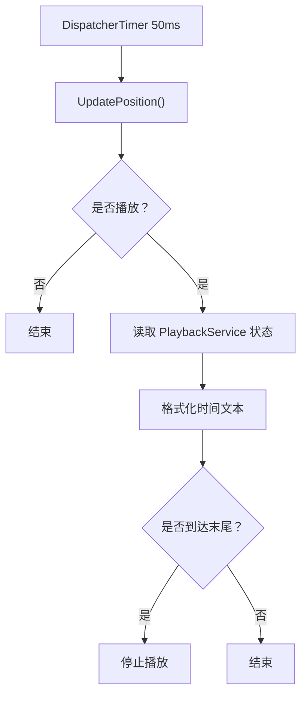
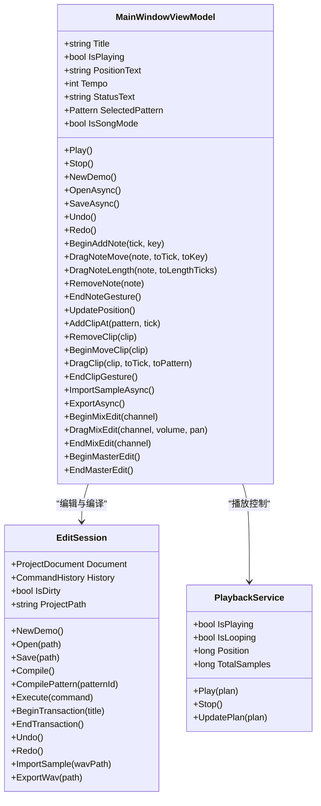

# 主窗口视图模型

<cite>
**本文引用的文件**   
- [MainWindowViewModel.cs](file://src/Weftone.App/ViewModels/MainWindowViewModel.cs)
- [EditSession.cs](file://src/Weftone.Application/EditSession.cs)
- [PlaybackService.cs](file://src/Weftone.Application/PlaybackService.cs)
- [CommandHistory.cs](file://src/Weftone.Domain/Commands/CommandHistory.cs)
- [App.axaml.cs](file://src/Weftone.App/App.axaml.cs)
- [MainWindow.axaml.cs](file://src/Weftone.App/MainWindow.axaml.cs)
- [MainWindow.axaml](file://src/Weftone.App/MainWindow.axaml)
- [MixerPanel.cs](file://src/Weftone.App/Controls/MixerPanel.cs)
- [PianoRollControl.cs](file://src/Weftone.App/Controls/PianoRollControl.cs)
</cite>

## 目录
1. [引言](#引言)
2. [项目结构定位](#项目结构定位)
3. [核心组件与职责边界](#核心组件与职责边界)
4. [架构总览](#架构总览)
5. [详细组件分析](#详细组件分析)
6. [依赖关系分析](#依赖关系分析)
7. [性能与实时性考虑](#性能与实时性考虑)
8. [故障排查指南](#故障排查指南)
9. [结论](#结论)
10. [附录：扩展视图模型属性与命令的示例路径](#附录扩展视图模型属性与命令的示例路径)

## 引言
本文件围绕 `MainWindowViewModel` 展开，说明其在 MVVM 中的职责、与 `EditSession` 和 `PlaybackService` 的协作方式、属性绑定与命令机制、用户操作到业务逻辑的映射、响应式更新策略，以及错误处理、用户反馈与进度指示的实现思路。文档同时给出如何添加新的视图模型属性和命令的可操作指引，帮助开发者在不破坏现有架构的前提下扩展主窗口行为。

## 项目结构定位
`MainWindowViewModel` 位于 UI 层（Avalonia 应用）中，是主窗口的数据上下文和业务编排中心。它不直接持有 UI 类型，而是通过服务抽象与领域对象交互；UI 控件仅负责展示和用户手势输入，所有编辑意图最终都汇聚到视图模型，再由其调用 `EditSession` 执行命令、调用 `PlaybackService` 控制播放。

**图表来源**
- [App.axaml.cs:23-38](file://src/Weftone.App/App.axaml.cs#L23-L38)
- [MainWindowViewModel.cs:12-106](file://src/Weftone.App/ViewModels/MainWindowViewModel.cs#L12-L106)
- [EditSession.cs:14-41](file://src/Weftone.Application/EditSession.cs#L14-L41)
- [PlaybackService.cs:12-31](file://src/Weftone.Application/PlaybackService.cs#L12-L31)
- [MainWindow.axaml.cs:55-63](file://src/Weftone.App/MainWindow.axaml.cs#L55-L63)
- [PianoRollControl.cs:15-21](file://src/Weftone.App/Controls/PianoRollControl.cs#L15-L21)
- [MixerPanel.cs:17-33](file://src/Weftone.App/Controls/MixerPanel.cs#L17-L33)

**章节来源**
- [App.axaml.cs:18-44](file://src/Weftone.App/App.axaml.cs#L18-L44)
- [MainWindowViewModel.cs:12-106](file://src/Weftone.App/ViewModels/MainWindowViewModel.cs#L12-L106)

## 核心组件与职责边界
- `MainWindowViewModel`
  - 暴露可绑定的 UI 状态属性：标题、是否播放、位置文本、BPM、状态栏文本、选中 Pattern、Song 模式等。
  - 提供命令：播放、停止、新建演示工程、打开工程、保存、撤销、重做、导入采样、导出 WAV。
  - 协调编辑手势：音符添加/移动/调整长度/删除、Clip 放置/移动/删除、混音推子拖动、主音量拖动。
  - 维护 UI 与业务状态的同步：编译渲染计划、热更新播放、刷新标题与历史按钮可用性、触发自绘控件重绘。
- `EditSession`
  - 持有当前工程文档、命令历史、资产工作区。
  - 提供工程生命周期方法：新建演示、打开、保存。
  - 提供命令执行与事务合并：撤销/重做、拖拽手势内多条命令合并为单条撤销记录。
  - 提供渲染计划编译：整曲或指定 Pattern。
- `PlaybackService`
  - 封装音频后端与渲染器，提供播放、停止、热更新渲染计划的能力。
  - 保证“停止-交换-恢复”的零并发安全更新。
- `CommandHistory`
  - 实现命令日志、撤销/重做栈、事务聚合。

**章节来源**
- [MainWindowViewModel.cs:12-106](file://src/Weftone.App/ViewModels/MainWindowViewModel.cs#L12-L106)
- [EditSession.cs:8-41](file://src/Weftone.Application/EditSession.cs#L8-L41)
- [PlaybackService.cs:6-31](file://src/Weftone.Application/PlaybackService.cs#L6-L31)
- [CommandHistory.cs:3-18](file://src/Weftone.Domain/Commands/CommandHistory.cs#L3-L18)

## 架构总览
下图展示了从 UI 到业务再到音频播放的关键流程。视图模型作为编排者，将用户操作转换为对 `EditSession` 的命令调用和对 `PlaybackService` 的播放控制。

**图表来源**
- [MainWindowViewModel.cs:112-130](file://src/Weftone.App/ViewModels/MainWindowViewModel.cs#L112-L130)
- [MainWindowViewModel.cs:325-340](file://src/Weftone.App/ViewModels/MainWindowViewModel.cs#L325-L340)
- [PlaybackService.cs:42-52](file://src/Weftone.Application/PlaybackService.cs#L42-L52)
- [EditSession.cs:94-98](file://src/Weftone.Application/EditSession.cs#L94-L98)

## 详细组件分析

### 视图模型属性与绑定机制
`MainWindowViewModel` 使用 CommunityToolkit.Mvvm 的源生成特性来声明可观察属性，例如标题、播放状态、位置文本、BPM、状态文本、选中 Pattern、Song 模式等。这些属性通过 XAML 绑定到界面元素，实现双向或单向的数据同步。

- 命令绑定
  - 播放、停止、撤销、重做等通过 `[RelayCommand]` 生成命令，XAML 中直接使用 `PlayCommand`、`StopCommand`、`UndoCommand`、`RedoCommand`。
  - 异步命令如打开工程、保存、导入采样、导出 WAV 返回 `Task`，支持异步 UI 绑定。
- 状态同步
  - 播放状态由 `UpdatePosition` 定时轮询 `PlaybackService` 的位置与循环状态，驱动 `IsPlaying` 与 `PositionText`。
  - 工程替换后统一刷新标题、选中项、集合、主音量、历史按钮可用性与自绘控件重绘。
- 数据验证
  - 视图模型在关键入口进行空引用与参数校验，例如构造函数中对依赖注入参数的非空检查。
  - 数值范围限制在预览阶段进行钳制，例如主音量与通道音量/声像的范围约束。

**图表来源**
- [MainWindowViewModel.cs:176-190](file://src/Weftone.App/ViewModels/MainWindowViewModel.cs#L176-L190)
- [MainWindowViewModel.cs:193-200](file://src/Weftone.App/ViewModels/MainWindowViewModel.cs#L193-L200)

**章节来源**
- [MainWindowViewModel.cs:36-55](file://src/Weftone.App/ViewModels/MainWindowViewModel.cs#L36-L55)
- [MainWindowViewModel.cs:112-130](file://src/Weftone.App/ViewModels/MainWindowViewModel.cs#L112-L130)
- [MainWindowViewModel.cs:325-352](file://src/Weftone.App/ViewModels/MainWindowViewModel.cs#L325-L352)
- [MainWindow.axaml:27-49](file://src/Weftone.App/MainWindow.axaml#L27-L49)

### 与 EditSession 的交互模式
`MainWindowViewModel` 通过 `EditSession` 访问工程文档、执行命令、管理撤销重做、编译渲染计划。典型交互包括：
- 工程生命周期：新建演示工程、打开工程、保存工程。
- 命令执行：添加/移动/调整长度/删除音符与 Clip，设置通道混音与主音量。
- 事务合并：拖拽类手势开启事务，结束时合并为单条撤销记录。
- 文档替换后的全局刷新：标题、选中项、集合、主音量、历史按钮、自绘控件重绘。

**图表来源**
- [MainWindowViewModel.cs:229-323](file://src/Weftone.App/ViewModels/MainWindowViewModel.cs#L229-L323)
- [EditSession.cs:100-118](file://src/Weftone.Application/EditSession.cs#L100-L118)
- [CommandHistory.cs:20-59](file://src/Weftone.Domain/Commands/CommandHistory.cs#L20-L59)

**章节来源**
- [MainWindowViewModel.cs:140-174](file://src/Weftone.App/ViewModels/MainWindowViewModel.cs#L140-L174)
- [MainWindowViewModel.cs:229-323](file://src/Weftone.App/ViewModels/MainWindowViewModel.cs#L229-L323)
- [EditSession.cs:51-92](file://src/Weftone.Application/EditSession.cs#L51-L92)
- [CommandHistory.cs:35-59](file://src/Weftone.Domain/Commands/CommandHistory.cs#L35-L59)

### 与 PlaybackService 的交互模式
视图模型根据当前模式（Song 或 Pattern）选择编译策略，并将渲染计划交给 `PlaybackService` 播放。播放过程中，视图模型通过定时器轮询播放位置，并在需要时热更新渲染计划以反映实时编辑。

**图表来源**
- [MainWindowViewModel.cs:112-130](file://src/Weftone.App/ViewModels/MainWindowViewModel.cs#L112-L130)
- [PlaybackService.cs:42-78](file://src/Weftone.Application/PlaybackService.cs#L42-L78)

**章节来源**
- [MainWindowViewModel.cs:112-130](file://src/Weftone.App/ViewModels/MainWindowViewModel.cs#L112-L130)
- [PlaybackService.cs:33-78](file://src/Weftone.Application/PlaybackService.cs#L33-L78)

### 用户操作到业务逻辑的映射
- 播放控制
  - “播放”：根据 Song/Pattern 模式编译渲染计划并启动播放，更新 UI 状态。
  - “停止”：停止播放，重置 UI 状态。
- 工程操作
  - “新建演示工程”：停止播放，加载演示工程，刷新 UI。
  - “打开工程”：异步打开工程，停止播放，刷新 UI。
  - “保存工程”：异步保存工程，刷新标题与状态。
- UI 状态管理
  - 选中 Pattern 变化：若正在播放则热更新渲染计划。
  - Song 模式切换：若正在播放则热更新渲染计划并更新状态文本。
  - 主音量拖动：拖动中实时预览，释放时提交命令入撤销栈。
  - 通道混音拖动：拖动中实时预览，释放时提交命令入撤销栈。
  - 音符与 Clip 手势：开始→拖动→结束，事务合并为单条撤销记录。

**章节来源**
- [MainWindowViewModel.cs:112-227](file://src/Weftone.App/ViewModels/MainWindowViewModel.cs#L112-L227)
- [MainWindowViewModel.cs:437-494](file://src/Weftone.App/ViewModels/MainWindowViewModel.cs#L437-L494)
- [MainWindowViewModel.cs:354-396](file://src/Weftone.App/ViewModels/MainWindowViewModel.cs#L354-L396)

### 响应式更新机制
- 属性通知
  - 使用 `[ObservableProperty]` 自动生成属性变更通知，XAML 自动更新。
  - 手动触发 `OnPropertyChanged` 用于集合与复杂属性的刷新。
- 事件驱动
  - `DocumentEdited` 事件通知自绘控件（钢琴卷帘、播放列表）重绘。
- 定时器轮询
  - 主窗口打开时创建定时器，每 50ms 调用 `UpdatePosition`，同步播放位置与状态。

**图表来源**
- [MainWindow.axaml.cs:55-63](file://src/Weftone.App/MainWindow.axaml.cs#L55-L63)
- [MainWindowViewModel.cs:325-340](file://src/Weftone.App/ViewModels/MainWindowViewModel.cs#L325-L340)
- [MainWindowViewModel.cs:342-352](file://src/Weftone.App/ViewModels/MainWindowViewModel.cs#L342-L352)

**章节来源**
- [MainWindow.axaml.cs:55-63](file://src/Weftone.App/MainWindow.axaml.cs#L55-L63)
- [MainWindowViewModel.cs:325-352](file://src/Weftone.App/ViewModels/MainWindowViewModel.cs#L325-L352)

### 错误处理、用户反馈与进度指示
- 错误处理
  - 构造函数对依赖注入参数进行非空校验。
  - 导入采样与导出 WAV 捕获特定异常（无效数据、IO 异常、非法操作），并通过状态文本反馈失败原因。
- 用户反馈
  - 状态栏文本实时更新：播放中、已停止、工程载入、打开/保存成功、导入/导出结果。
  - 标题显示工程名与脏标记（未保存）。
- 进度指示
  - 位置文本显示当前播放时间，格式化为分钟:秒.毫秒。
  - 导出 WAV 完成后显示时长信息。

**章节来源**
- [MainWindowViewModel.cs:96-106](file://src/Weftone.App/ViewModels/MainWindowViewModel.cs#L96-L106)
- [MainWindowViewModel.cs:418-435](file://src/Weftone.App/ViewModels/MainWindowViewModel.cs#L418-L435)
- [MainWindowViewModel.cs:515-521](file://src/Weftone.App/ViewModels/MainWindowViewModel.cs#L515-L521)

## 依赖关系分析
视图模型依赖以下组件：
- `EditSession`：工程编辑、命令执行、撤销重做、渲染计划编译。
- `PlaybackService`：音频播放与热更新。
- `IFileDialogService`：文件对话框抽象，避免 UI 框架耦合。
- 领域对象与命令：`Pattern`、`Channel`、`Note`、`Clip` 及各类命令。

**图表来源**
- [MainWindowViewModel.cs:12-106](file://src/Weftone.App/ViewModels/MainWindowViewModel.cs#L12-L106)
- [EditSession.cs:14-41](file://src/Weftone.Application/EditSession.cs#L14-L41)
- [PlaybackService.cs:12-31](file://src/Weftone.Application/PlaybackService.cs#L12-L31)

**章节来源**
- [MainWindowViewModel.cs:12-106](file://src/Weftone.App/ViewModels/MainWindowViewModel.cs#L12-L106)
- [EditSession.cs:14-41](file://src/Weftone.Application/EditSession.cs#L14-L41)
- [PlaybackService.cs:12-31](file://src/Weftone.Application/PlaybackService.cs#L12-L31)

## 性能与实时性考虑
- 实时播放
  - `PlaybackService` 采用“停止-交换-恢复”策略，确保音频线程零并发，避免渲染期间修改渲染计划。
  - 音频回调一次性捕获，音频路径零分配，保障实时性能。
- 渲染计划热更新
  - 编辑后通过 `UpdatePlan` 快速替换渲染计划，保持播放状态不变，短暂静音换零并发。
- 定时器轮询
  - 50ms 间隔轮询播放位置，平衡 UI 流畅度与 CPU 占用。
- 集合与属性刷新
  - 工程替换后批量刷新必要属性与集合，减少不必要的 UI 重建。

**章节来源**
- [PlaybackService.cs:6-11](file://src/Weftone.Application/PlaybackService.cs#L6-L11)
- [PlaybackService.cs:63-78](file://src/Weftone.Application/PlaybackService.cs#L63-L78)
- [MainWindow.axaml.cs:55-63](file://src/Weftone.App/MainWindow.axaml.cs#L55-L63)
- [MainWindowViewModel.cs:163-174](file://src/Weftone.App/ViewModels/MainWindowViewModel.cs#L163-L174)

## 故障排查指南
- 无法播放
  - 检查是否选择了 Pattern 或在 Song 模式下正确编译。
  - 确认 `PlaybackService.Play` 被调用且 `IsPlaying` 为真。
- 位置文本不更新
  - 确认主窗口定时器已启动并调用 `UpdatePosition`。
  - 检查 `PlaybackService.Position` 与 `TotalSamples` 是否正常。
- 撤销/重做无效
  - 确认事务是否正确开启与结束，命令是否通过 `EditSession.Execute` 执行。
  - 检查 `CommandHistory.CanUndo` 与 `CanRedo` 的状态。
- 导入/导出失败
  - 查看状态栏反馈的错误信息，确认文件格式与权限。
  - 检查异常捕获分支是否覆盖对应异常类型。

**章节来源**
- [MainWindowViewModel.cs:112-130](file://src/Weftone.App/ViewModels/MainWindowViewModel.cs#L112-L130)
- [MainWindowViewModel.cs:325-340](file://src/Weftone.App/ViewModels/MainWindowViewModel.cs#L325-L340)
- [CommandHistory.cs:14-18](file://src/Weftone.Domain/Commands/CommandHistory.cs#L14-L18)
- [MainWindowViewModel.cs:418-435](file://src/Weftone.App/ViewModels/MainWindowViewModel.cs#L418-L435)

## 结论
`MainWindowViewModel` 在 MVVM 中承担视图与业务之间的编排职责，通过属性绑定与命令机制将用户操作映射到 `EditSession` 的命令执行与 `PlaybackService` 的播放控制。其响应式更新机制确保 UI 与业务状态实时同步，事务合并提升用户体验，错误处理与状态反馈增强可诊断性。遵循本文档的扩展指引，可在不破坏现有架构的前提下新增视图模型属性与命令。

## 附录：扩展视图模型属性与命令的示例路径
- 新增可绑定属性
  - 参考现有属性声明位置与特性使用方式。
  - 示例路径：[MainWindowViewModel.cs:36-55](file://src/Weftone.App/ViewModels/MainWindowViewModel.cs#L36-L55)
- 新增命令
  - 使用 `[RelayCommand]` 定义命令方法，并在 XAML 中绑定。
  - 示例路径：[MainWindowViewModel.cs:112-130](file://src/Weftone.App/ViewModels/MainWindowViewModel.cs#L112-L130)
- 异步命令
  - 返回 `Task` 的异步命令，结合文件对话框服务。
  - 示例路径：[MainWindowViewModel.cs:149-161](file://src/Weftone.App/ViewModels/MainWindowViewModel.cs#L149-L161)
- 属性变更回调
  - 使用 partial 方法监听属性变更，触发业务逻辑。
  - 示例路径：[MainWindowViewModel.cs:176-190](file://src/Weftone.App/ViewModels/MainWindowViewModel.cs#L176-L190)
- 与 EditSession 交互
  - 命令执行与事务合并。
  - 示例路径：[MainWindowViewModel.cs:229-323](file://src/Weftone.App/ViewModels/MainWindowViewModel.cs#L229-L323)
- 与 PlaybackService 交互
  - 播放控制与热更新。
  - 示例路径：[MainWindowViewModel.cs:112-130](file://src/Weftone.App/ViewModels/MainWindowViewModel.cs#L112-L130)
- UI 绑定示例
  - XAML 中命令与属性绑定。
  - 示例路径：[MainWindow.axaml:27-49](file://src/Weftone.App/MainWindow.axaml#L27-L49)