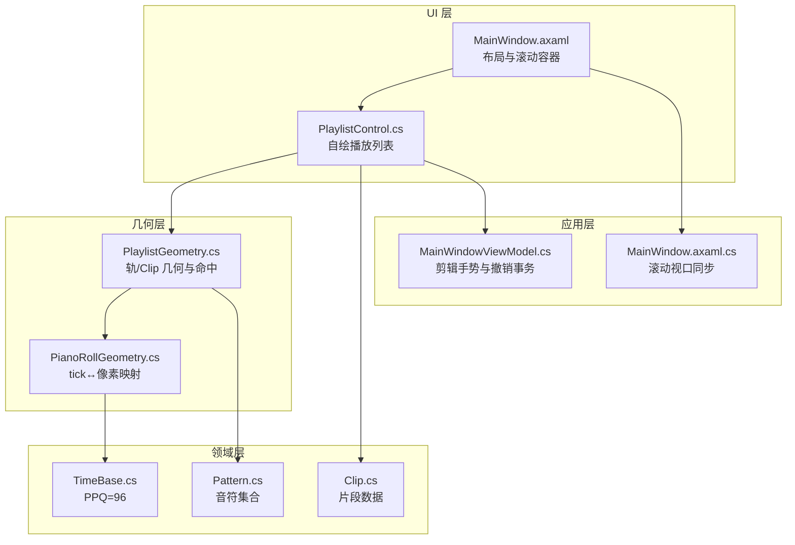
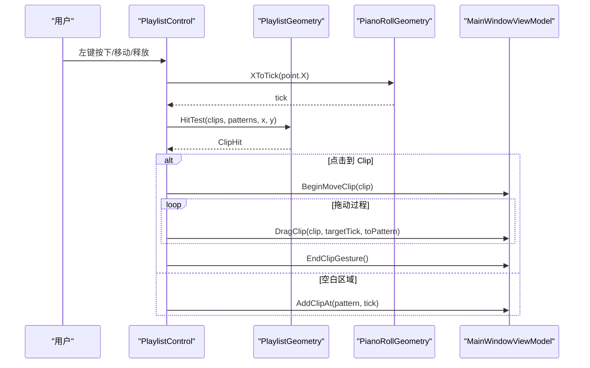
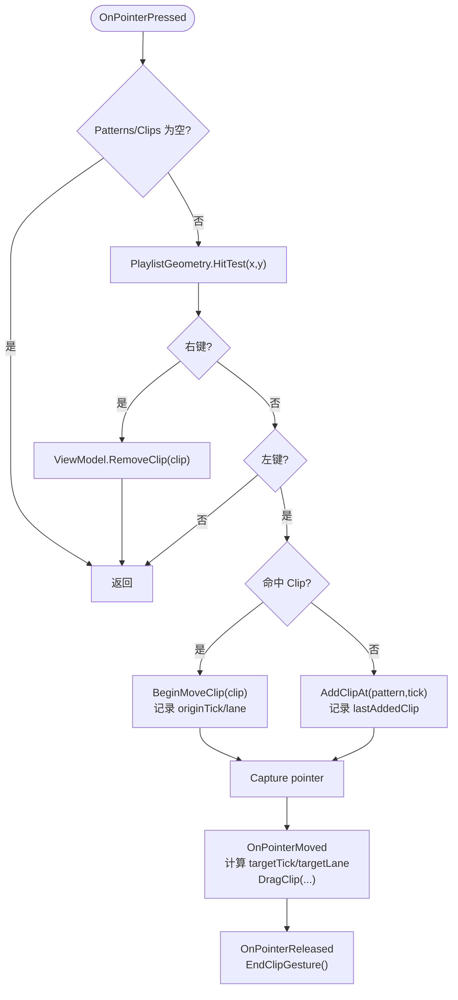
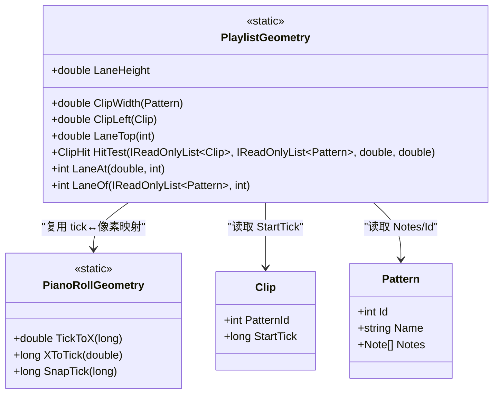
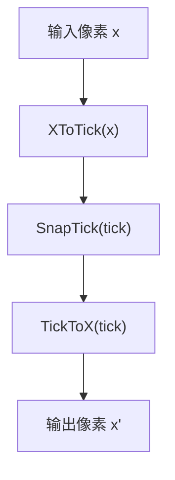
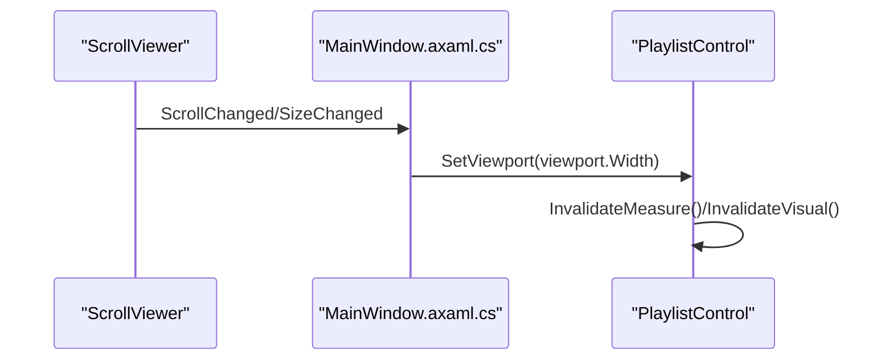
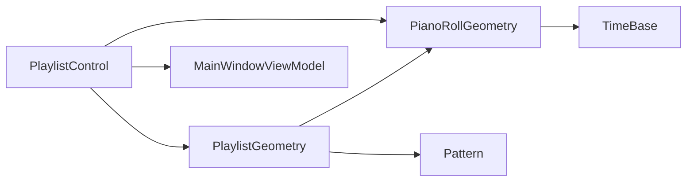

# 播放列表控件

<cite>
**本文引用的文件**   
- [PlaylistControl.cs](file://src/Weftone.App/Controls/PlaylistControl.cs)
- [PlaylistGeometry.cs](file://src/Weftone.App/Controls/PlaylistGeometry.cs)
- [PianoRollGeometry.cs](file://src/Weftone.App/Controls/PianoRollGeometry.cs)
- [Clip.cs](file://src/Weftone.Domain/Clip.cs)
- [Pattern.cs](file://src/Weftone.Domain/Pattern.cs)
- [TimeBase.cs](file://src/Weftone.Domain/TimeBase.cs)
- [MainWindowViewModel.cs](file://src/Weftone.App/ViewModels/MainWindowViewModel.cs)
- [MainWindow.axaml.cs](file://src/Weftone.App/MainWindow.axaml.cs)
- [MainWindow.axaml](file://src/Weftone.App/MainWindow.axaml)
</cite>

## 目录
1. [简介](#简介)
2. [项目结构](#项目结构)
3. [核心组件](#核心组件)
4. [架构总览](#架构总览)
5. [详细组件分析](#详细组件分析)
6. [依赖关系分析](#依赖关系分析)
7. [性能与大数据处理](#性能与大数据处理)
8. [样式与主题定制](#样式与主题定制)
9. [故障排查指南](#故障排查指南)
10. [结论](#结论)

## 简介
本文件为 PlaylistControl 播放列表控件的完整 UI 组件文档。该控件用于在“片段编排界面”中可视化并编辑 Clip（片段），实现拖拽排序、时间轴对齐、轨道切换、删除等交互；并通过 PlaylistGeometry 提供时间轴几何计算，复用 PianoRollGeometry 的 tick↔像素映射，确保与钢琴卷帘的时间基准一致。

## 项目结构
播放列表相关代码主要分布在以下位置：
- UI 自绘控件：`Weftone.App/Controls/PlaylistControl.cs`
- 几何与命中计算：`Weftone.App/Controls/PlaylistGeometry.cs`
- 时间轴基础映射：`Weftone.App/Controls/PianoRollGeometry.cs`
- 领域模型：`Weftone.Domain/Clip.cs`、`Weftone.Domain/Pattern.cs`、`Weftone.Domain/TimeBase.cs`
- 视图模型与命令：`Weftone.App/ViewModels/MainWindowViewModel.cs`
- 宿主窗口与滚动同步：`Weftone.App/MainWindow.axaml.cs`、`Weftone.App/MainWindow.axaml`

**图表来源**
- [PlaylistControl.cs:10-15](file://src/Weftone.App/Controls/PlaylistControl.cs#L10-L15)
- [PlaylistGeometry.cs:13-17](file://src/Weftone.App/Controls/PlaylistGeometry.cs#L13-L17)
- [PianoRollGeometry.cs:14-18](file://src/Weftone.App/Controls/PianoRollGeometry.cs#L14-L18)
- [Clip.cs:3-8](file://src/Weftone.Domain/Clip.cs#L3-L8)
- [Pattern.cs:3-8](file://src/Weftone.Domain/Pattern.cs#L3-L8)
- [TimeBase.cs:3-7](file://src/Weftone.Domain/TimeBase.cs#L3-L7)
- [MainWindowViewModel.cs:354-396](file://src/Weftone.App/ViewModels/MainWindowViewModel.cs#L354-L396)
- [MainWindow.axaml.cs:15-33](file://src/Weftone.App/MainWindow.axaml.cs#L15-L33)
- [MainWindow.axaml:74-81](file://src/Weftone.App/MainWindow.axaml#L74-L81)

**章节来源**
- [PlaylistControl.cs:10-15](file://src/Weftone.App/Controls/PlaylistControl.cs#L10-L15)
- [PlaylistGeometry.cs:13-17](file://src/Weftone.App/Controls/PlaylistGeometry.cs#L13-L17)
- [PianoRollGeometry.cs:14-18](file://src/Weftone.App/Controls/PianoRollGeometry.cs#L14-L18)
- [Clip.cs:3-8](file://src/Weftone.Domain/Clip.cs#L3-L8)
- [Pattern.cs:3-8](file://src/Weftone.Domain/Pattern.cs#L3-L8)
- [TimeBase.cs:3-7](file://src/Weftone.Domain/TimeBase.cs#L3-L7)
- [MainWindowViewModel.cs:354-396](file://src/Weftone.App/ViewModels/MainWindowViewModel.cs#L354-L396)
- [MainWindow.axaml.cs:15-33](file://src/Weftone.App/MainWindow.axaml.cs#L15-L33)
- [MainWindow.axaml:74-81](file://src/Weftone.App/MainWindow.axaml#L74-L81)

## 核心组件
- PlaylistControl：Avalonia 自绘 Control，负责渲染背景、轨线、小节网格、Clip 块，以及指针事件（左键放置/拖拽、右键删除）。
- PlaylistGeometry：纯函数式几何模块，提供 Clip 宽度、左边界、轨顶坐标、命中测试、轨索引映射等。
- PianoRollGeometry：提供 tick↔像素线性映射、可见范围计算、吸附步长等，被 PlaylistGeometry 复用。
- Clip/Pattern/TimeBase：领域模型与时间基准（PPQ=96）。
- MainWindowViewModel：封装 Add/Remove/Move Clip 的命令与撤销事务，控制手势生命周期。
- MainWindow.axaml(.cs)：承载 PlaylistControl 的 ScrollViewer，并在滚动变化时同步视口宽度。

**章节来源**
- [PlaylistControl.cs:10-15](file://src/Weftone.App/Controls/PlaylistControl.cs#L10-L15)
- [PlaylistGeometry.cs:13-17](file://src/Weftone.App/Controls/PlaylistGeometry.cs#L13-L17)
- [PianoRollGeometry.cs:14-18](file://src/Weftone.App/Controls/PianoRollGeometry.cs#L14-L18)
- [Clip.cs:3-8](file://src/Weftone.Domain/Clip.cs#L3-L8)
- [Pattern.cs:3-8](file://src/Weftone.Domain/Pattern.cs#L3-L8)
- [TimeBase.cs:3-7](file://src/Weftone.Domain/TimeBase.cs#L3-L7)
- [MainWindowViewModel.cs:354-396](file://src/Weftone.App/ViewModels/MainWindowViewModel.cs#L354-L396)
- [MainWindow.axaml.cs:15-33](file://src/Weftone.App/MainWindow.axaml.cs#L15-L33)
- [MainWindow.axaml:74-81](file://src/Weftone.App/MainWindow.axaml#L74-L81)

## 架构总览
播放列表控件采用“UI 自绘 + 几何纯函数 + 领域模型 + 视图模型命令”的分层设计：
- UI 层仅负责绘制与事件捕获，不直接修改业务状态。
- 几何层提供无副作用的计算方法，便于 headless 单测覆盖。
- 领域层定义不可变或最小可变的数据结构（Clip、Pattern）。
- 视图模型层通过命令与撤销事务管理状态变更。

**图表来源**
- [PlaylistControl.cs:193-284](file://src/Weftone.App/Controls/PlaylistControl.cs#L193-L284)
- [PlaylistGeometry.cs:29-50](file://src/Weftone.App/Controls/PlaylistGeometry.cs#L29-L50)
- [PianoRollGeometry.cs:29-40](file://src/Weftone.App/Controls/PianoRollGeometry.cs#L29-L40)
- [MainWindowViewModel.cs:354-396](file://src/Weftone.App/ViewModels/MainWindowViewModel.cs#L354-L396)

## 详细组件分析

### PlaylistControl：片段编排界面与交互
- 渲染职责：
  - 绘制背景、轨分隔线、节拍/小节网格。
  - 根据 Pattern 名称绘制 Clip 块文本标签。
  - 使用每轨色相生成 Clip 填充色，保证暗色背景下黑字可读。
  - 当处于拖拽手势时，用白色轮廓高亮当前 Clip。
- 测量与布局：
  - 高度 = 轨数 × LaneHeight，至少一轨。
  - 宽度 = max(视口宽度, 内容最右端 + 余量)，内容宽度由所有 Clip 的最右边界决定。
- 交互逻辑：
  - 左键：命中 Clip → 开始移动；空白区域 → 在当前轨插入新 Clip。
  - 右键：命中 Clip → 删除。
  - 拖动：实时计算目标 tick 与目标轨，调用 ViewModel 更新。
  - 释放：结束手势，提交撤销事务。

**图表来源**
- [PlaylistControl.cs:193-284](file://src/Weftone.App/Controls/PlaylistControl.cs#L193-L284)
- [MainWindowViewModel.cs:354-396](file://src/Weftone.App/ViewModels/MainWindowViewModel.cs#L354-L396)

**章节来源**
- [PlaylistControl.cs:26-38](file://src/Weftone.App/Controls/PlaylistControl.cs#L26-L38)
- [PlaylistControl.cs:77-106](file://src/Weftone.App/Controls/PlaylistControl.cs#L77-L106)
- [PlaylistControl.cs:108-171](file://src/Weftone.App/Controls/PlaylistControl.cs#L108-L171)
- [PlaylistControl.cs:173-191](file://src/Weftone.App/Controls/PlaylistControl.cs#L173-L191)
- [PlaylistControl.cs:193-284](file://src/Weftone.App/Controls/PlaylistControl.cs#L193-L284)

### PlaylistGeometry：时间轴与命中计算
- Clip 显示宽度：基于 Pattern 内容长度（最大音符结束 tick）+ 1 拍余量，再经 TickToX 转换为像素。
- Clip 左边界：StartTick 对应的像素位置。
- 轨顶坐标：laneIndex × LaneHeight。
- 命中测试：逆序遍历 Clips，取最上层命中矩形（Body 区域）。
- 轨映射：
  - LaneOf：PatternId → 轨索引，未知返回 -1。
  - LaneAt：y 坐标 → 轨索引，越界钳制到有效范围。
- Pattern 内容长度：遍历 Notes，取最大 (note.Tick + note.LengthTicks)，并与一个 PPQ 比较，保证最小宽度。

**图表来源**
- [PlaylistGeometry.cs:17-89](file://src/Weftone.App/Controls/PlaylistGeometry.cs#L17-L89)
- [PianoRollGeometry.cs:29-40](file://src/Weftone.App/Controls/PianoRollGeometry.cs#L29-L40)
- [Clip.cs:3-8](file://src/Weftone.Domain/Clip.cs#L3-L8)
- [Pattern.cs:3-8](file://src/Weftone.Domain/Pattern.cs#L3-L8)

**章节来源**
- [PlaylistGeometry.cs:19-27](file://src/Weftone.App/Controls/PlaylistGeometry.cs#L19-L27)
- [PlaylistGeometry.cs:29-50](file://src/Weftone.App/Controls/PlaylistGeometry.cs#L29-L50)
- [PlaylistGeometry.cs:52-67](file://src/Weftone.App/Controls/PlaylistGeometry.cs#L52-L67)
- [PlaylistGeometry.cs:81-89](file://src/Weftone.App/Controls/PlaylistGeometry.cs#L81-L89)

### PianoRollGeometry：时间轴映射与可见范围
- 时间单位：PPQ=96（TimeBase.Ppq）。
- 像素映射：
  - TickToX(tick) = tick × PixelsPerBeat / PPQ。
  - XToTick(x) = floor(x × PPQ / PixelsPerBeat)。
- 吸附步长：默认 1/4 拍（PPQ/4）。
- 可见范围：VisibleTickRange(x0,x1) 返回首尾 tick，两侧留 1 tick 余量。

**图表来源**
- [PianoRollGeometry.cs:29-40](file://src/Weftone.App/Controls/PianoRollGeometry.cs#L29-L40)
- [TimeBase.cs:3-7](file://src/Weftone.Domain/TimeBase.cs#L3-L7)

**章节来源**
- [PianoRollGeometry.cs:29-40](file://src/Weftone.App/Controls/PianoRollGeometry.cs#L29-L40)
- [PianoRollGeometry.cs:66-72](file://src/Weftone.App/Controls/PianoRollGeometry.cs#L66-L72)
- [TimeBase.cs:3-7](file://src/Weftone.Domain/TimeBase.cs#L3-L7)

### 用户交互功能
- 片段选择与拖拽：
  - 左键按下命中 Clip → 进入移动手势，记录起始 tick 与轨。
  - 拖动过程中实时更新目标 tick 与目标轨，调用 ViewModel.DragClip。
  - 释放后提交撤销事务。
- 片段放置：
  - 左键按下空白区域 → 在当前轨添加新 Clip，设置 StartTick。
- 片段删除：
  - 右键命中 Clip → 调用 ViewModel.RemoveClip。
- 复制粘贴与分割合并：
  - 当前实现未包含复制/粘贴、分割/合并操作；如需扩展，可在 ViewModel 层增加相应命令，并在 PlaylistControl 中添加对应快捷键或上下文菜单触发。

**章节来源**
- [PlaylistControl.cs:193-284](file://src/Weftone.App/Controls/PlaylistControl.cs#L193-L284)
- [MainWindowViewModel.cs:354-396](file://src/Weftone.App/ViewModels/MainWindowViewModel.cs#L354-L396)

### 滚动与缩放机制
- 滚动：
  - MainWindow.axaml 中的 ScrollViewer 包裹 PlaylistControl。
  - MainWindow.axaml.cs 监听 ScrollChanged/SizeChanged，调用 Playlist.SetViewport(viewport.Width) 同步视口宽度。
- 缩放：
  - 当前实现未提供缩放能力；可通过扩展 PianoRollGeometry 的 PixelsPerBeat 或引入缩放因子，并在 PlaylistControl 中重新计算 ContentWidth 与网格间距。

**图表来源**
- [MainWindow.axaml.cs:15-33](file://src/Weftone.App/MainWindow.axaml.cs#L15-L33)
- [PlaylistControl.cs:64-75](file://src/Weftone.App/Controls/PlaylistControl.cs#L64-L75)

**章节来源**
- [MainWindow.axaml.cs:15-33](file://src/Weftone.App/MainWindow.axaml.cs#L15-L33)
- [PlaylistControl.cs:64-75](file://src/Weftone.App/Controls/PlaylistControl.cs#L64-L75)

### 视觉反馈系统
- 选中/拖拽状态：
  - 拖拽中，使用 GesturePen 绘制 Clip 轮廓高亮。
- 悬停效果：
  - 当前未实现鼠标悬停高亮；可结合 HitTest 结果在 OnPointerMoved 中更新视觉状态。
- 动画过渡：
  - 当前为即时重绘；如需平滑过渡，可在 ViewModel 中引入插值属性并在 Render 中插值绘制。

**章节来源**
- [PlaylistControl.cs:166-169](file://src/Weftone.App/Controls/PlaylistControl.cs#L166-L169)

### 样式与主题支持
- 颜色与笔刷：
  - 背景、轨分隔线、节拍线、小节线、手势轮廓均为硬编码 SolidColorBrush/Pen。
- 主题扩展建议：
  - 将 Brush/Pen 暴露为 Avalonia 资源或 StyledProperty，允许外部主题替换。
  - 将 LaneHeight、PixelsPerBeat、SnapTicks 等常量参数化，支持不同密度主题。

**章节来源**
- [PlaylistControl.cs:26-32](file://src/Weftone.App/Controls/PlaylistControl.cs#L26-L32)
- [PlaylistGeometry.cs:19](file://src/Weftone.App/Controls/PlaylistGeometry.cs#L19)
- [PianoRollGeometry.cs:21-25](file://src/Weftone.App/Controls/PianoRollGeometry.cs#L21-L25)

## 依赖关系分析
- PlaylistControl 依赖：
  - PlaylistGeometry：Clip 几何与命中。
  - PianoRollGeometry：tick↔像素映射与可见范围。
  - TimeBase：PPQ 常量。
  - MainWindowViewModel：剪辑命令与撤销事务。
- PlaylistGeometry 依赖：
  - PianoRollGeometry：TickToX。
  - Pattern：Notes 与 Id。
- 视图模型依赖：
  - EditSession/CommandHistory：撤销与事务（通过 Execute/BeginTransaction/EndTransaction）。

**图表来源**
- [PlaylistControl.cs:108-171](file://src/Weftone.App/Controls/PlaylistControl.cs#L108-L171)
- [PlaylistGeometry.cs:21-25](file://src/Weftone.App/Controls/PlaylistGeometry.cs#L21-L25)
- [PianoRollGeometry.cs:29-40](file://src/Weftone.App/Controls/PianoRollGeometry.cs#L29-L40)
- [MainWindowViewModel.cs:354-396](file://src/Weftone.App/ViewModels/MainWindowViewModel.cs#L354-L396)

**章节来源**
- [PlaylistControl.cs:108-171](file://src/Weftone.App/Controls/PlaylistControl.cs#L108-L171)
- [PlaylistGeometry.cs:21-25](file://src/Weftone.App/Controls/PlaylistGeometry.cs#L21-L25)
- [PianoRollGeometry.cs:29-40](file://src/Weftone.App/Controls/PianoRollGeometry.cs#L29-L40)
- [MainWindowViewModel.cs:354-396](file://src/Weftone.App/ViewModels/MainWindowViewModel.cs#L354-L396)

## 性能与大数据处理
- 渲染优化：
  - 使用静态 Brush/Pen 避免重复分配。
  - 仅在内容变化或手势期间调用 InvalidateMeasure/InvalidateVisual。
- 几何计算：
  - PlaylistGeometry 为纯函数，易于缓存与并行化（如预计算 Clip 矩形）。
- 大数据集策略：
  - 仅绘制可见范围内的节拍/小节网格（VisibleTickRange）。
  - 对大量 Clip 的命中测试保持逆序遍历以支持上层优先，必要时可引入空间索引（如四叉树或区间树）加速。
- 未来扩展：
  - 引入视口裁剪：仅渲染可见轨与可见 Clip。
  - 虚拟化：对轨列表进行虚拟化渲染（若轨数量极大）。

[本节为通用性能建议，不直接分析具体文件]

## 样式与主题定制
- 当前样式：
  - 背景、轨线、节拍/小节线、手势轮廓均为硬编码颜色。
  - Clip 填充色按轨色相循环生成，保证可读性。
- 定制建议：
  - 将颜色与笔刷提取为 Avalonia 资源字典，支持动态主题切换。
  - 暴露 LaneHeight、PixelsPerBeat、SnapTicks 等参数，适配高密度/低密度主题。
  - 提供选中/悬停/禁用状态的视觉样式配置项。

**章节来源**
- [PlaylistControl.cs:26-32](file://src/Weftone.App/Controls/PlaylistControl.cs#L26-L32)
- [PlaylistControl.cs:173-191](file://src/Weftone.App/Controls/PlaylistControl.cs#L173-L191)
- [PlaylistGeometry.cs:19](file://src/Weftone.App/Controls/PlaylistGeometry.cs#L19)
- [PianoRollGeometry.cs:21-25](file://src/Weftone.App/Controls/PianoRollGeometry.cs#L21-L25)

## 故障排查指南
- 无法放置/移动 Clip：
  - 检查 Patterns/Playlist 是否为 null 或空。
  - 确认 ViewModel 已绑定且非 null。
  - 查看是否触发了 OnContentChanged 导致重绘异常。
- 命中不准确：
  - 检查 PlaylistGeometry.HitTest 的矩形计算是否与渲染一致。
  - 确认 LaneAt/LaneOf 的索引映射正确。
- 滚动不同步：
  - 确认 MainWindow.axaml.cs 中 ScrollChanged/SizeChanged 已订阅并调用 SetViewport。
- 撤销失效：
  - 检查 BeginMoveClip/DragClip/EndClipGesture 的事务边界是否正确。
  - 确认 AfterEdit 触发 DocumentEdited 通知。

**章节来源**
- [PlaylistControl.cs:71-75](file://src/Weftone.App/Controls/PlaylistControl.cs#L71-L75)
- [PlaylistGeometry.cs:29-50](file://src/Weftone.App/Controls/PlaylistGeometry.cs#L29-L50)
- [MainWindow.axaml.cs:15-33](file://src/Weftone.App/MainWindow.axaml.cs#L15-L33)
- [MainWindowViewModel.cs:354-396](file://src/Weftone.App/ViewModels/MainWindowViewModel.cs#L354-L396)

## 结论
PlaylistControl 提供了简洁高效的片段编排界面，结合 PlaylistGeometry 与 PianoRollGeometry 实现了稳定的时间轴对齐与命中检测。通过 MainWindowViewModel 的命令与撤销事务，保证了交互的一致性与可回滚性。当前实现聚焦于放置、拖拽、删除等核心交互；后续可扩展复制粘贴、分割合并、缩放与主题定制，以满足更复杂的音乐制作需求。