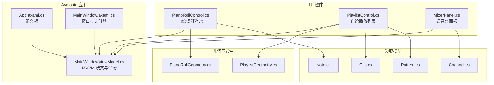
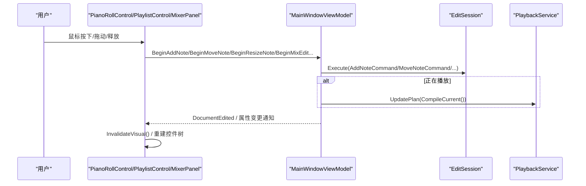
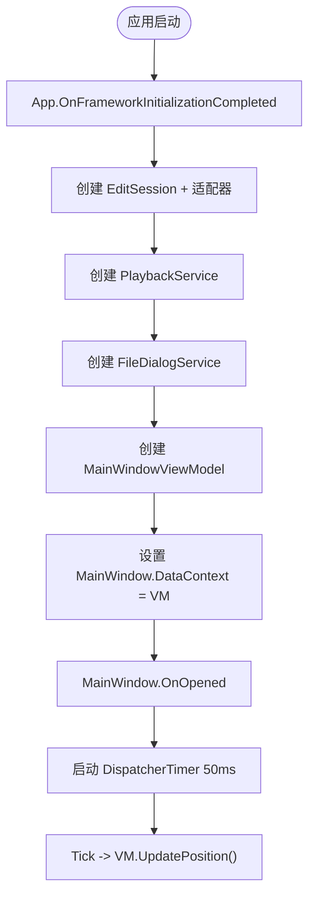
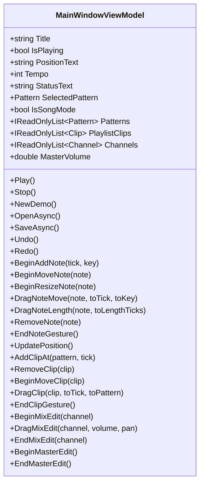
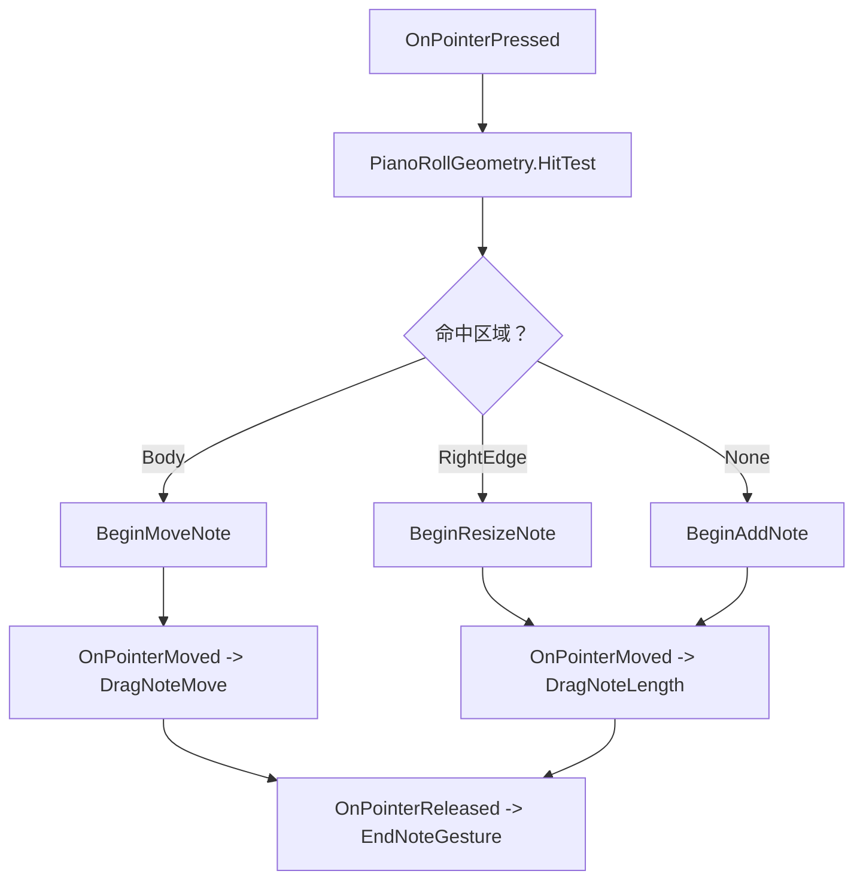
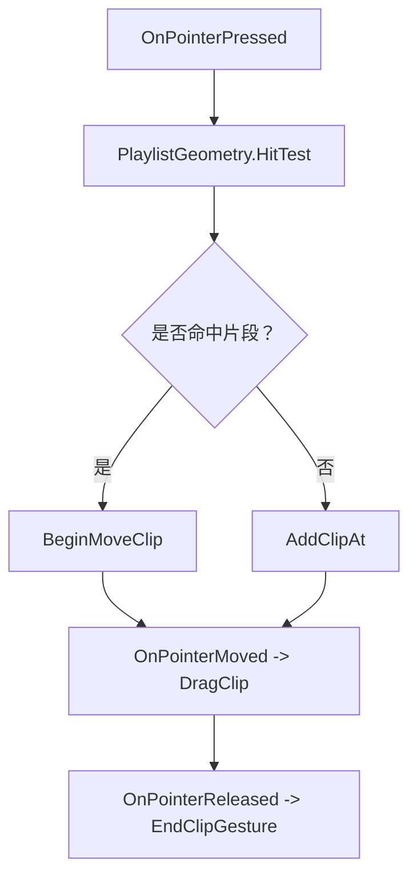
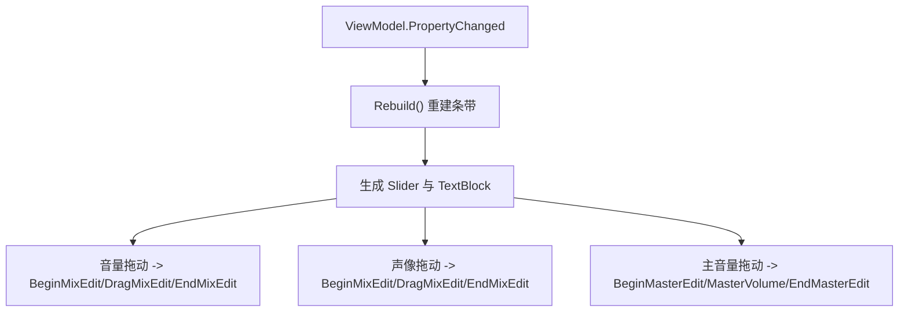
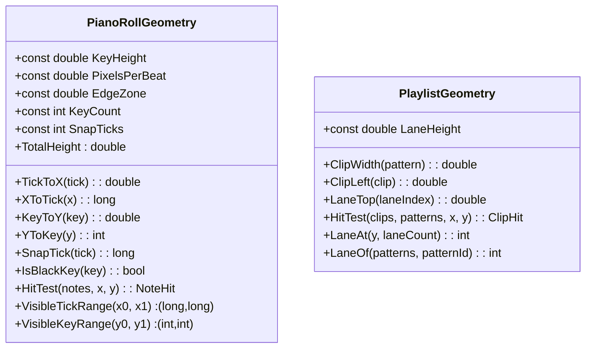
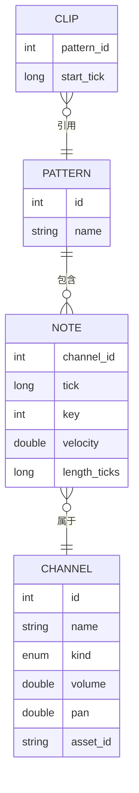
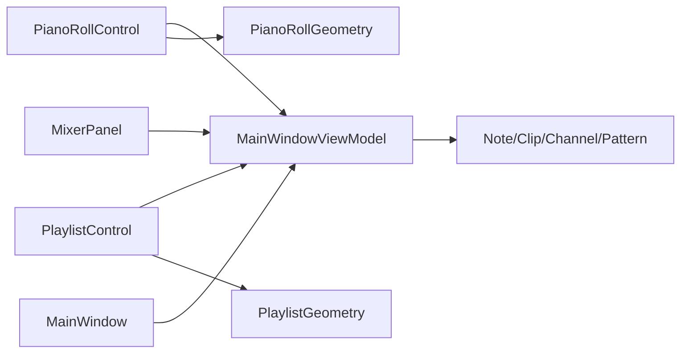

# 用户界面

<cite>
**本文引用的文件**   
- [App.axaml.cs](file://src/Weftone.App/App.axaml.cs)
- [MainWindowViewModel.cs](file://src/Weftone.App/ViewModels/MainWindowViewModel.cs)
- [MainWindow.axaml.cs](file://src/Weftone.App/MainWindow.axaml.cs)
- [PianoRollControl.cs](file://src/Weftone.App/Controls/PianoRollControl.cs)
- [PianoRollGeometry.cs](file://src/Weftone.App/Controls/PianoRollGeometry.cs)
- [PlaylistControl.cs](file://src/Weftone.App/Controls/PlaylistControl.cs)
- [PlaylistGeometry.cs](file://src/Weftone.App/Controls/PlaylistGeometry.cs)
- [MixerPanel.cs](file://src/Weftone.App/Controls/MixerPanel.cs)
- [Note.cs](file://src/Weftone.Domain/Note.cs)
- [Clip.cs](file://src/Weftone.Domain/Clip.cs)
- [Channel.cs](file://src/Weftone.Domain/Channel.cs)
- [Pattern.cs](file://src/Weftone.Domain/Pattern.cs)
</cite>

## 目录
1. [简介](#简介)
2. [项目结构](#项目结构)
3. [核心组件](#核心组件)
4. [架构总览](#架构总览)
5. [详细组件分析](#详细组件分析)
6. [依赖关系分析](#依赖关系分析)
7. [性能与可维护性](#性能与可维护性)
8. [故障排查指南](#故障排查指南)
9. [结论](#结论)

## 简介
本文件面向 Weftone 的用户界面层，系统性说明 Avalonia 应用组合装配、MVVM 视图模型、以及钢琴卷帘、播放列表、调音台三大 UI 控件的实现方式。重点包括：
- App.axaml.cs 作为组合根，装配编辑会话、回放服务、对话框服务和主窗口视图模型。
- MainWindowViewModel 的 MVVM 实现，统一处理播放、工程打开保存、撤销重做、音符与片段手势、混音控制等。
- PianoRollControl 自绘钢琴卷帘，支持网格绘制、音符选择与编辑（添加、移动、调整长度、删除）。
- PlaylistControl 自绘播放列表，支持片段放置、拖拽换轨和时间轴小节网格。
- MixerPanel 基于标准控件组合的调音台面板，支持通道音量、声像和主音量调节。
- UI 与业务逻辑解耦策略，以及通过事件和属性变更通知实现的响应式更新机制。

## 项目结构
UI 相关代码集中在 Weftone.App 项目中，按职责分为：
- Controls：自绘或组合控件（钢琴卷帘、播放列表、调音台、几何计算）。
- ViewModels：MVVM 视图模型，承载状态、命令和手势事务。
- Services：对话框服务抽象与实现。
- MainWindow：窗口生命周期、滚动视口同步、播放位置轮询。

图表来源
- [App.axaml.cs:18-44](file://src/Weftone.App/App.axaml.cs#L18-L44)
- [MainWindow.axaml.cs:12-20](file://src/Weftone.App/MainWindow.axaml.cs#L12-L20)
- [MainWindowViewModel.cs:12-106](file://src/Weftone.App/ViewModels/MainWindowViewModel.cs#L12-L106)
- [PianoRollControl.cs:15-58](file://src/Weftone.App/Controls/PianoRollControl.cs#L15-L58)
- [PlaylistControl.cs:15-56](file://src/Weftone.App/Controls/PlaylistControl.cs#L15-L56)
- [MixerPanel.cs:17-33](file://src/Weftone.App/Controls/MixerPanel.cs#L17-L33)
- [PianoRollGeometry.cs:18-25](file://src/Weftone.App/Controls/PianoRollGeometry.cs#L18-L25)
- [PlaylistGeometry.cs:17-20](file://src/Weftone.App/Controls/PlaylistGeometry.cs#L17-L20)
- [Note.cs:4-11](file://src/Weftone.Domain/Note.cs#L4-L11)
- [Clip.cs:4-8](file://src/Weftone.Domain/Clip.cs#L4-L8)
- [Channel.cs:10-18](file://src/Weftone.Domain/Channel.cs#L10-L18)
- [Pattern.cs:3-8](file://src/Weftone.Domain/Pattern.cs#L3-L8)

章节来源
- [App.axaml.cs:18-44](file://src/Weftone.App/App.axaml.cs#L18-L44)
- [MainWindow.axaml.cs:12-20](file://src/Weftone.App/MainWindow.axaml.cs#L12-L20)

## 核心组件
- 组合根 App：在框架初始化完成后创建 EditSession、PlaybackService、FileDialogService 和 MainWindowViewModel，并注入到 MainWindow 的 DataContext。
- 视图模型 MainWindowViewModel：暴露 Patterns、PlaylistClips、Channels、MasterVolume 等属性；提供 Play/Stop/NewDemo/Open/Save/Undo/Redo/ImportSample/Export 等命令；封装音符与片段的手势事务；驱动播放计划编译与更新。
- 钢琴卷帘 PianoRollControl：自绘网格与音符矩形，支持左键添加/移动/调整长度、右键删除；通过 ViewModel 调用命令，使用几何类进行命中测试与可见范围裁剪。
- 播放列表 PlaylistControl：自绘轨道与片段块，支持空轨放置 clip、拖拽移动换轨、右键删除；复用时间轴 tick 映射。
- 调音台 MixerPanel：为每个 Channel 构建竖推子（音量）与横推子（pan），右侧 Master 推子；拖动中实时预览，释放时写入撤销栈。

章节来源
- [App.axaml.cs:18-44](file://src/Weftone.App/App.axaml.cs#L18-L44)
- [MainWindowViewModel.cs:36-106](file://src/Weftone.App/ViewModels/MainWindowViewModel.cs#L36-L106)
- [PianoRollControl.cs:15-58](file://src/Weftone.App/Controls/PianoRollControl.cs#L15-L58)
- [PlaylistControl.cs:15-56](file://src/Weftone.App/Controls/PlaylistControl.cs#L15-L56)
- [MixerPanel.cs:17-33](file://src/Weftone.App/Controls/MixerPanel.cs#L17-L33)

## 架构总览
Weftone 的 UI 层遵循 MVVM 模式：
- View（Avalonia 控件）只负责渲染和用户输入捕获。
- ViewModel（MainWindowViewModel）持有状态、执行命令、协调业务层（EditSession、PlaybackService）。
- Model（Domain 实体：Note、Clip、Channel、Pattern）由业务层管理，UI 仅读取或通过命令修改。

图表来源
- [PianoRollControl.cs:185-291](file://src/Weftone.App/Controls/PianoRollControl.cs#L185-L291)
- [PlaylistControl.cs:193-283](file://src/Weftone.App/Controls/PlaylistControl.cs#L193-L283)
- [MixerPanel.cs:129-172](file://src/Weftone.App/Controls/MixerPanel.cs#L129-L172)
- [MainWindowViewModel.cs:229-323](file://src/Weftone.App/ViewModels/MainWindowViewModel.cs#L229-L323)
- [MainWindowViewModel.cs:437-494](file://src/Weftone.App/ViewModels/MainWindowViewModel.cs#L437-L494)

## 详细组件分析

### 组合根与窗口装配（App.axaml.cs 与 MainWindow.axaml.cs）
- App.OnFrameworkInitializationCompleted 中构造 EditSession、PlaybackService、FileDialogService 和 MainWindowViewModel，并将 ViewModel 赋给 MainWindow.DataContext。
- MainWindow 订阅滚动与尺寸变化以同步自绘控件的视口；打开窗口后启动 DispatcherTimer 每 50ms 调用 VM.UpdatePosition 以刷新播放位置显示。

图表来源
- [App.axaml.cs:18-44](file://src/Weftone.App/App.axaml.cs#L18-L44)
- [MainWindow.axaml.cs:55-64](file://src/Weftone.App/MainWindow.axaml.cs#L55-L64)

章节来源
- [App.axaml.cs:18-44](file://src/Weftone.App/App.axaml.cs#L18-L44)
- [MainWindow.axaml.cs:12-20](file://src/Weftone.App/MainWindow.axaml.cs#L12-L20)
- [MainWindow.axaml.cs:55-64](file://src/Weftone.App/MainWindow.axaml.cs#L55-L64)

### 视图模型与 MVVM（MainWindowViewModel.cs）
- 状态属性：Title、IsPlaying、PositionText、Tempo、StatusText、SelectedPattern、IsSongMode、Patterns、PlaylistClips、Channels、MasterVolume。
- 命令：Play、Stop、NewDemo、OpenAsync、SaveAsync、Undo、Redo、ImportSampleAsync、ExportAsync。
- 手势事务：
  - 音符：BeginAddNote/BeginMoveNote/BeginResizeNote/DragNoteMove/DragNoteLength/RemoveNote/EndNoteGesture。
  - 片段：AddClipAt/RemoveClip/BeginMoveClip/DragClip/EndClipGesture。
  - 混音：BeginMixEdit/DragMixEdit/EndMixEdit 与 BeginMasterEdit/EndMasterEdit。
- 响应式更新：AfterEdit 触发标题刷新、历史按钮状态、Channels/MasterVolume 属性变更、DocumentEdited 事件，并在播放中重新编译播放计划。

图表来源
- [MainWindowViewModel.cs:12-106](file://src/Weftone.App/ViewModels/MainWindowViewModel.cs#L12-L106)
- [MainWindowViewModel.cs:112-227](file://src/Weftone.App/ViewModels/MainWindowViewModel.cs#L112-L227)
- [MainWindowViewModel.cs:229-323](file://src/Weftone.App/ViewModels/MainWindowViewModel.cs#L229-L323)
- [MainWindowViewModel.cs:354-396](file://src/Weftone.App/ViewModels/MainWindowViewModel.cs#L354-L396)
- [MainWindowViewModel.cs:437-494](file://src/Weftone.App/ViewModels/MainWindowViewModel.cs#L437-L494)

章节来源
- [MainWindowViewModel.cs:36-106](file://src/Weftone.App/ViewModels/MainWindowViewModel.cs#L36-L106)
- [MainWindowViewModel.cs:112-227](file://src/Weftone.App/ViewModels/MainWindowViewModel.cs#L112-L227)
- [MainWindowViewModel.cs:229-323](file://src/Weftone.App/ViewModels/MainWindowViewModel.cs#L229-L323)
- [MainWindowViewModel.cs:354-396](file://src/Weftone.App/ViewModels/MainWindowViewModel.cs#L354-L396)
- [MainWindowViewModel.cs:437-494](file://src/Weftone.App/ViewModels/MainWindowViewModel.cs#L437-L494)

### 钢琴卷帘控件（PianoRollControl.cs）
- 自绘背景、黑键行、节拍/小节线，按可见 tick/key 范围裁剪绘制音符矩形，力度值映射为色相渐变。
- 手势流程：
  - 左键点击空白区域：开始添加音符。
  - 左键点击音符主体：开始移动音符。
  - 左键点击音符右边缘：开始调整长度。
  - 右键点击音符：删除音符。
- 通过 PianoRollGeometry 完成命中测试、tick↔像素映射、可见范围计算与吸附对齐。

图表来源
- [PianoRollControl.cs:185-291](file://src/Weftone.App/Controls/PianoRollControl.cs#L185-L291)
- [PianoRollGeometry.cs:44-64](file://src/Weftone.App/Controls/PianoRollGeometry.cs#L44-L64)

章节来源
- [PianoRollControl.cs:15-58](file://src/Weftone.App/Controls/PianoRollControl.cs#L15-L58)
- [PianoRollControl.cs:104-157](file://src/Weftone.App/Controls/PianoRollControl.cs#L104-L157)
- [PianoRollControl.cs:185-291](file://src/Weftone.App/Controls/PianoRollControl.cs#L185-L291)
- [PianoRollGeometry.cs:18-80](file://src/Weftone.App/Controls/PianoRollGeometry.cs#L18-L80)

### 播放列表控件（PlaylistControl.cs）
- 自绘轨道分隔线、时间轴小节线，按轨道绘制片段块，块宽度等于对应 Pattern 内容长度加余量。
- 手势流程：
  - 右键点击片段：删除片段。
  - 左键点击片段：开始移动片段（可跨轨）。
  - 左键点击空白轨道：在该轨道放置新片段。
- 通过 PlaylistGeometry 完成命中测试、轨道索引、片段左右边界与宽度计算。

图表来源
- [PlaylistControl.cs:193-283](file://src/Weftone.App/Controls/PlaylistControl.cs#L193-L283)
- [PlaylistGeometry.cs:29-50](file://src/Weftone.App/Controls/PlaylistGeometry.cs#L29-L50)

章节来源
- [PlaylistControl.cs:15-56](file://src/Weftone.App/Controls/PlaylistControl.cs#L15-L56)
- [PlaylistControl.cs:108-171](file://src/Weftone.App/Controls/PlaylistControl.cs#L108-L171)
- [PlaylistControl.cs:193-283](file://src/Weftone.App/Controls/PlaylistControl.cs#L193-L283)
- [PlaylistGeometry.cs:17-89](file://src/Weftone.App/Controls/PlaylistGeometry.cs#L17-L89)

### 调音台面板（MixerPanel.cs）
- 动态构建每个 Channel 的竖推子（音量 0..2）、数值标签、横推子（pan -1..1），右侧追加 Master 推子。
- 拖动中直接修改文档属性以实时反映播放；释放时将差异写入撤销栈。
- 监听 ViewModel.Channels 与 MasterVolume 属性变更，重建条带布局。

图表来源
- [MixerPanel.cs:49-74](file://src/Weftone.App/Controls/MixerPanel.cs#L49-L74)
- [MixerPanel.cs:95-173](file://src/Weftone.App/Controls/MixerPanel.cs#L95-L173)
- [MixerPanel.cs:175-223](file://src/Weftone.App/Controls/MixerPanel.cs#L175-L223)

章节来源
- [MixerPanel.cs:17-33](file://src/Weftone.App/Controls/MixerPanel.cs#L17-L33)
- [MixerPanel.cs:49-74](file://src/Weftone.App/Controls/MixerPanel.cs#L49-L74)
- [MixerPanel.cs:95-173](file://src/Weftone.App/Controls/MixerPanel.cs#L95-L173)
- [MixerPanel.cs:175-223](file://src/Weftone.App/Controls/MixerPanel.cs#L175-L223)

### 几何与命中（PianoRollGeometry.cs 与 PlaylistGeometry.cs）
- PianoRollGeometry：定义键高、像素/拍比例、边区大小、键数量、默认吸附步长；提供 tick↔像素、key↔像素、可见范围、黑键判断、命中测试等方法。
- PlaylistGeometry：定义轨道高度、片段宽度与左边界、轨道顶部坐标、命中测试、轨道索引、PatternId→轨道映射、Pattern 内容长度计算。

图表来源
- [PianoRollGeometry.cs:18-80](file://src/Weftone.App/Controls/PianoRollGeometry.cs#L18-L80)
- [PlaylistGeometry.cs:17-89](file://src/Weftone.App/Controls/PlaylistGeometry.cs#L17-L89)

章节来源
- [PianoRollGeometry.cs:18-80](file://src/Weftone.App/Controls/PianoRollGeometry.cs#L18-L80)
- [PlaylistGeometry.cs:17-89](file://src/Weftone.App/Controls/PlaylistGeometry.cs#L17-L89)

### 领域模型（Note、Clip、Channel、Pattern）
- Note：包含声道 ID、起始 tick、MIDI key、力度、长度 ticks。
- Clip：包含关联 PatternId 与起始 tick。
- Channel：包含 Id、Name、Kind、Volume、Pan、AssetId。
- Pattern：包含 Id、Name、Notes 列表。

图表来源
- [Note.cs:4-11](file://src/Weftone.Domain/Note.cs#L4-L11)
- [Clip.cs:4-8](file://src/Weftone.Domain/Clip.cs#L4-L8)
- [Channel.cs:10-18](file://src/Weftone.Domain/Channel.cs#L10-L18)
- [Pattern.cs:3-8](file://src/Weftone.Domain/Pattern.cs#L3-L8)

章节来源
- [Note.cs:4-11](file://src/Weftone.Domain/Note.cs#L4-L11)
- [Clip.cs:4-8](file://src/Weftone.Domain/Clip.cs#L4-L8)
- [Channel.cs:10-18](file://src/Weftone.Domain/Channel.cs#L10-L18)
- [Pattern.cs:3-8](file://src/Weftone.Domain/Pattern.cs#L3-L8)

## 依赖关系分析
- UI 控件依赖 ViewModel 提供的命令与数据集合；不直接访问业务层。
- 几何类与领域模型解耦 UI 渲染细节，便于 headless 单元测试。
- MainWindow 通过事件订阅 ViewModel.DocumentEdited 触发自绘控件重绘；通过定时器轮询播放位置。

图表来源
- [PianoRollControl.cs:15-58](file://src/Weftone.App/Controls/PianoRollControl.cs#L15-L58)
- [PlaylistControl.cs:15-56](file://src/Weftone.App/Controls/PlaylistControl.cs#L15-L56)
- [MixerPanel.cs:17-33](file://src/Weftone.App/Controls/MixerPanel.cs#L17-L33)
- [MainWindow.axaml.cs:35-53](file://src/Weftone.App/MainWindow.axaml.cs#L35-L53)

章节来源
- [PianoRollControl.cs:15-58](file://src/Weftone.App/Controls/PianoRollControl.cs#L15-L58)
- [PlaylistControl.cs:15-56](file://src/Weftone.App/Controls/PlaylistControl.cs#L15-L56)
- [MixerPanel.cs:17-33](file://src/Weftone.App/Controls/MixerPanel.cs#L17-L33)
- [MainWindow.axaml.cs:35-53](file://src/Weftone.App/MainWindow.axaml.cs#L35-L53)

## 性能与可维护性
- 钢琴卷帘与播放列表采用自绘与视口裁剪，避免对大量音符/片段进行逐项 UI 元素管理，提升大工程下的绘制性能。
- 几何计算与命中测试独立于 UI 框架，便于无头测试与算法优化。
- 手势操作通过事务合并为单条撤销命令，减少撤销栈膨胀并保持交互流畅。
- 播放中的实时更新通过 UpdatePlan 增量更新播放计划，避免重启播放带来的卡顿。
- 建议：
  - 对极长工程进一步引入虚拟滚动与按需加载。
  - 将颜色与样式参数外置为资源字典，便于主题切换。
  - 对命中测试与可见范围计算增加基准测试，确保缩放与滚动时的性能稳定。

[本节为通用指导，不直接分析具体文件]

## 故障排查指南
- 原生库缺失或解码失败：App 启动时捕获 DllNotFoundException/InvalidOperationException/InvalidDataException，回退到空工程，用户可手动打开工程。
- 导入 WAV 失败：捕获 InvalidDataException/IOException/InvalidOperationException，状态栏提示失败原因。
- 导出失败：捕获 IOException/InvalidOperationException，状态栏显示错误信息。
- 播放位置不更新：检查 MainWindow 的 DispatcherTimer 是否启动，以及 VM.UpdatePosition 是否被调用。
- 自绘控件未重绘：确认 ViewModel.DocumentEdited 事件是否触发，以及 MainWindow 是否正确订阅并调用 InvalidateVisual。

章节来源
- [App.axaml.cs:25-32](file://src/Weftone.App/App.axaml.cs#L25-L32)
- [MainWindowViewModel.cs:398-435](file://src/Weftone.App/ViewModels/MainWindowViewModel.cs#L398-L435)
- [MainWindow.axaml.cs:55-64](file://src/Weftone.App/MainWindow.axaml.cs#L55-L64)
- [MainWindow.axaml.cs:35-53](file://src/Weftone.App/MainWindow.axaml.cs#L35-L53)

## 结论
Weftone 的 UI 层通过清晰的 MVVM 分层与自绘控件实现了高性能、可测试且易扩展的用户界面。组合根集中装配依赖，视图模型统一编排业务交互，几何与命中逻辑独立于 UI 框架，使钢琴卷帘、播放列表与调音台控件具备良好的可维护性与可扩展性。响应式更新通过属性变更与事件驱动，保证 UI 与业务状态的一致性。

[本节为总结性内容，不直接分析具体文件]