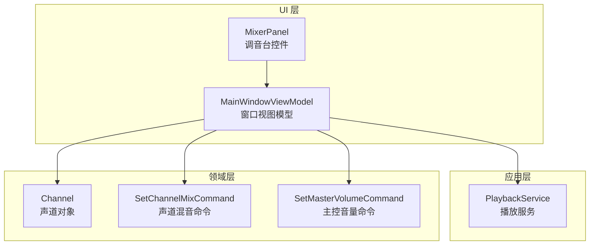
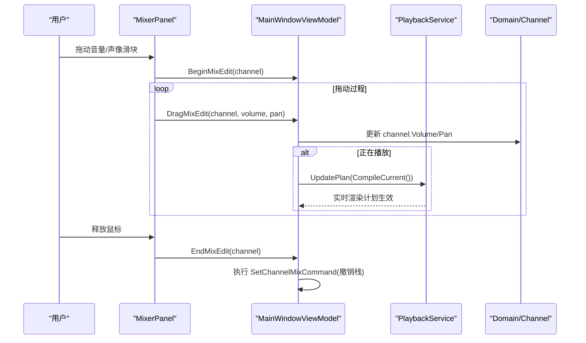
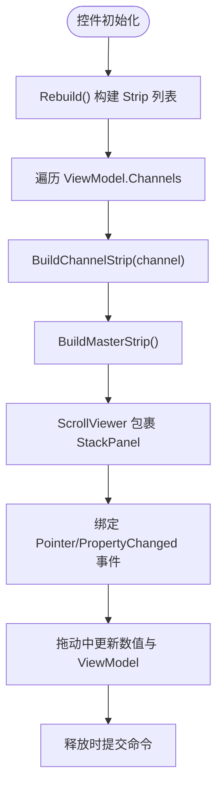
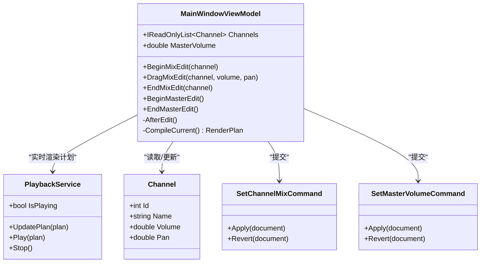
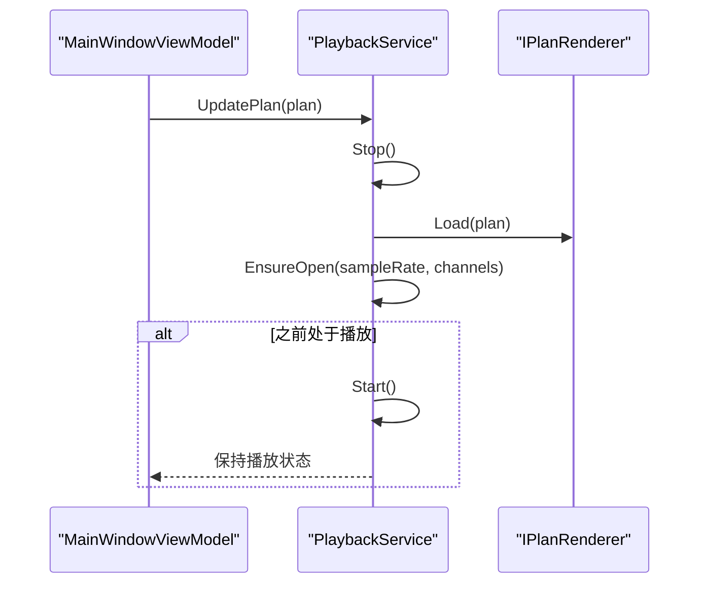
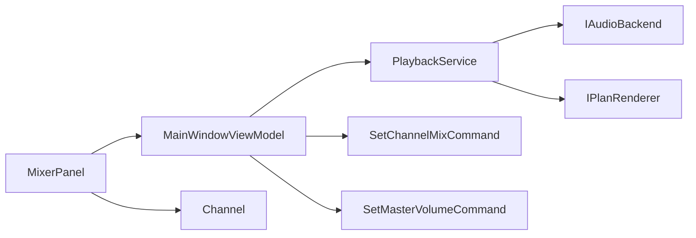

# 调音台面板

<cite>
**本文引用的文件**   
- [MixerPanel.cs](file://src/Weftone.App/Controls/MixerPanel.cs)
- [MainWindowViewModel.cs](file://src/Weftone.App/ViewModels/MainWindowViewModel.cs)
- [PlaybackService.cs](file://src/Weftone.Application/PlaybackService.cs)
- [Channel.cs](file://src/Weftone.Domain/Channel.cs)
- [SetChannelMixCommand.cs](file://src/Weftone.Domain/Commands/SetChannelMixCommand.cs)
- [SetMasterVolumeCommand.cs](file://src/Weftone.Domain/Commands/SetMasterVolumeCommand.cs)
- [MainWindowViewModelMixerTests.cs](file://tests/Weftone.App.Tests/MainWindowViewModelMixerTests.cs)
</cite>

## 目录
1. [简介](#简介)
2. [项目结构定位](#项目结构定位)
3. [核心组件总览](#核心组件总览)
4. [架构总览](#架构总览)
5. [详细组件分析](#详细组件分析)
6. [依赖关系分析](#依赖关系分析)
7. [性能与实时性](#性能与实时性)
8. [用户交互与批量操作](#用户交互与批量操作)
9. [可视化参数与状态说明](#可视化参数与状态说明)
10. [样式、主题与扩展指南](#样式主题与扩展指南)
11. [无障碍与键盘导航](#无障碍与键盘导航)
12. [故障排查](#故障排查)
13. [结论](#结论)

## 简介
本文件为 MixerPanel 调音台控件的 UI 组件文档，聚焦以下目标：
- 解释混音控制界面中音量滑块、声像控制和声道状态显示的实现。
- 说明音频参数的可视化表示方式，包括当前数值标签、主通道区分以及静音/独奏状态的扩展点。
- 描述用户交互逻辑：拖动预览、数值输入、撤销栈提交和批量操作模式。
- 解释与 PlaybackService 的实时数据同步机制，确保 UI 反映当前混音状态。
- 说明自定义控件的样式定义、主题适配方式和扩展方法。
- 提供无障碍访问支持与键盘导航建议。
- 给出扩展指南，展示如何添加新的混音参数或视觉效果。

## 项目结构定位
MixerPanel 位于应用层 UI 控件目录，负责将 Domain 层的 Channel 混音参数以竖推子（音量）+ 横推子（声像）的形式呈现，并通过 ViewModel 与播放服务协作，实现“拖动预览 + 释放提交”的混音编辑体验。

**图表来源**
- [MixerPanel.cs:17-74](file://src/Weftone.App/Controls/MixerPanel.cs#L17-L74)
- [MainWindowViewModel.cs:70-94](file://src/Weftone.App/ViewModels/MainWindowViewModel.cs#L70-L94)
- [PlaybackService.cs:24-78](file://src/Weftone.Application/PlaybackService.cs#L24-L78)
- [Channel.cs:9-17](file://src/Weftone.Domain/Channel.cs#L9-L17)
- [SetChannelMixCommand.cs:8-31](file://src/Weftone.Domain/Commands/SetChannelMixCommand.cs#L8-L31)
- [SetMasterVolumeCommand.cs:7-26](file://src/Weftone.Domain/Commands/SetMasterVolumeCommand.cs#L7-L26)

**章节来源**
- [MixerPanel.cs:12-16](file://src/Weftone.App/Controls/MixerPanel.cs#L12-L16)
- [MainWindowViewModel.cs:70-94](file://src/Weftone.App/ViewModels/MainWindowViewModel.cs#L70-L94)

## 核心组件总览
- MixerPanel：Avalonia ContentControl 子类，动态构建每个 Channel 的 Strip，并追加 Master Strip；通过 ViewModel 订阅属性变化重建 UI。
- MainWindowViewModel：封装混音手势 Begin/Drag/End，结合 EditSession 与 PlaybackService 实现实时预览与撤销提交。
- PlaybackService：管理音频后端打开/停止/热更新，支持“停止-交换-恢复”的实时计划替换。
- Channel：Domain 层声道模型，包含音量与声像等混音参数。
- SetChannelMixCommand / SetMasterVolumeCommand：可撤销的命令类型，用于持久化混音变更。

**章节来源**
- [MixerPanel.cs:17-74](file://src/Weftone.App/Controls/MixerPanel.cs#L17-L74)
- [MainWindowViewModel.cs:437-494](file://src/Weftone.App/ViewModels/MainWindowViewModel.cs#L437-L494)
- [PlaybackService.cs:24-78](file://src/Weftone.Application/PlaybackService.cs#L24-L78)
- [Channel.cs:9-17](file://src/Weftone.Domain/Channel.cs#L9-L17)
- [SetChannelMixCommand.cs:8-31](file://src/Weftone.Domain/Commands/SetChannelMixCommand.cs#L8-L31)
- [SetMasterVolumeCommand.cs:7-26](file://src/Weftone.Domain/Commands/SetMasterVolumeCommand.cs#L7-L26)

## 架构总览
MixerPanel 不直接操作音频设备，而是通过 ViewModel 协调 Domain 与 Application 层：
- 控件监听 ViewModel.Channels 与 MasterVolume 变化，重建 Strip 列表。
- 拖动过程中调用 ViewModel.BeginMixEdit / DragMixEdit / EndMixEdit，或在主通道调用 BeginMasterEdit / EndMasterEdit。
- ViewModel 在播放状态下调用 PlaybackService.UpdatePlan 进行实时渲染计划替换。
- 命令层保证一次拖拽只产生一条可撤销记录。

**图表来源**
- [MixerPanel.cs:129-171](file://src/Weftone.App/Controls/MixerPanel.cs#L129-L171)
- [MainWindowViewModel.cs:437-474](file://src/Weftone.App/ViewModels/MainWindowViewModel.cs#L437-L474)
- [PlaybackService.cs:63-78](file://src/Weftone.Application/PlaybackService.cs#L63-L78)

## 详细组件分析

### MixerPanel 控件
- 职责：
  - 根据 ViewModel.Channels 动态生成每个 Channel 的 Strip。
  - 在右侧追加 Master Strip。
  - 使用 ScrollViewer 包裹横向排列的 Strip，支持水平滚动。
- 关键行为：
  - 订阅 ViewModel.PropertyChanged，当 Channels 或 MasterVolume 变化时重建 UI。
  - 每个 Channel Strip 包含名称 TextBlock、垂直 Slider（音量）、数值 TextBlock、水平 Slider（声像）。
  - Master Strip 包含标题、垂直 Slider 和数值标签，背景色与 Channel Strip 不同以区分。
- 交互处理：
  - 使用 PointerPressed/PointerReleased 与 PropertyChanged 组合，维护 MixDragState 判断当前是音量还是声像拖动。
  - 拖动期间实时更新数值标签并调用 ViewModel.DragMixEdit。
  - 释放时调用 ViewModel.EndMixEdit 提交撤销命令。

**图表来源**
- [MixerPanel.cs:57-74](file://src/Weftone.App/Controls/MixerPanel.cs#L57-L74)
- [MixerPanel.cs:95-173](file://src/Weftone.App/Controls/MixerPanel.cs#L95-L173)
- [MixerPanel.cs:175-223](file://src/Weftone.App/Controls/MixerPanel.cs#L175-L223)

**章节来源**
- [MixerPanel.cs:17-74](file://src/Weftone.App/Controls/MixerPanel.cs#L17-L74)
- [MixerPanel.cs:95-173](file://src/Weftone.App/Controls/MixerPanel.cs#L95-L173)
- [MixerPanel.cs:175-223](file://src/Weftone.App/Controls/MixerPanel.cs#L175-L223)

### MainWindowViewModel 混音逻辑
- 混音手势：
  - BeginMixEdit：记录起始 Volume/Pan 与目标 Channel。
  - DragMixEdit：钳制范围后更新 Channel 参数；若播放中则 UpdatePlan 实时生效。
  - EndMixEdit：若无变化则不提交；否则执行 SetChannelMixCommand 入撤销栈。
- 主控音量手势：
  - BeginMasterEdit：记录起始 MasterVolume。
  - 设置 MasterVolume 属性会直接修改 Document.MasterVolume，并在播放中触发 UpdatePlan。
  - EndMasterEdit：若无变化则不提交；否则执行 SetMasterVolumeCommand。
- 通知机制：
  - AfterEdit 刷新 Title、History、Channels、MasterVolume，并触发 DocumentEdited 事件。
  - 若播放中，再次 UpdatePlan 确保 UI 与音频一致。

**图表来源**
- [MainWindowViewModel.cs:70-94](file://src/Weftone.App/ViewModels/MainWindowViewModel.cs#L70-L94)
- [MainWindowViewModel.cs:437-494](file://src/Weftone.App/ViewModels/MainWindowViewModel.cs#L437-L494)
- [PlaybackService.cs:24-78](file://src/Weftone.Application/PlaybackService.cs#L24-L78)
- [Channel.cs:9-17](file://src/Weftone.Domain/Channel.cs#L9-L17)
- [SetChannelMixCommand.cs:8-31](file://src/Weftone.Domain/Commands/SetChannelMixCommand.cs#L8-L31)
- [SetMasterVolumeCommand.cs:7-26](file://src/Weftone.Domain/Commands/SetMasterVolumeCommand.cs#L7-L26)

**章节来源**
- [MainWindowViewModel.cs:70-94](file://src/Weftone.App/ViewModels/MainWindowViewModel.cs#L70-L94)
- [MainWindowViewModel.cs:437-494](file://src/Weftone.App/ViewModels/MainWindowViewModel.cs#L437-L494)

### PlaybackService 实时同步
- 作用：
  - 管理音频后端生命周期（Open/Start/Stop）。
  - 提供 Play/Stop/UpdatePlan 接口，支持“停止-交换-恢复”的热更新。
- 与 MixerPanel 的关系：
  - MixerPanel 不直接调用 PlaybackService，而是通过 ViewModel 在拖动中触发 UpdatePlan。
  - ViewModel 在播放状态下编译当前 RenderPlan 并交给 PlaybackService 更新。

**图表来源**
- [PlaybackService.cs:63-78](file://src/Weftone.Application/PlaybackService.cs#L63-L78)
- [MainWindowViewModel.cs:446-458](file://src/Weftone.App/ViewModels/MainWindowViewModel.cs#L446-L458)

**章节来源**
- [PlaybackService.cs:24-78](file://src/Weftone.Application/PlaybackService.cs#L24-L78)

### Channel 数据模型
- 字段：
  - Id：声道标识。
  - Name：声道名称。
  - Kind：声源类型（Sine/Sampler）。
  - Volume：音量，范围 0..2。
  - Pan：声像，范围 -1..1，线性声像。
  - AssetId：资源标识（采样器用）。
- 与 UI 的关系：
  - MixerPanel 使用 Channel.Name 显示名称。
  - Volume 与 Pan 分别映射到垂直与水平 Slider。

**章节来源**
- [Channel.cs:9-17](file://src/Weftone.Domain/Channel.cs#L9-L17)

### 命令层：SetChannelMixCommand 与 SetMasterVolumeCommand
- SetChannelMixCommand：
  - Apply：校验 toVolume/toPan 范围并写入 Channel。
  - Revert：恢复到 fromVolume/fromPan。
- SetMasterVolumeCommand：
  - Apply：校验 toVolume 范围并写入 Document.MasterVolume。
  - Revert：恢复到 fromVolume。

**章节来源**
- [SetChannelMixCommand.cs:8-31](file://src/Weftone.Domain/Commands/SetChannelMixCommand.cs#L8-L31)
- [SetMasterVolumeCommand.cs:7-26](file://src/Weftone.Domain/Commands/SetMasterVolumeCommand.cs#L7-L26)

## 依赖关系分析
- MixerPanel 依赖：
  - Avalonia 控件体系（ContentControl、Slider、TextBlock、Border、StackPanel、ScrollViewer）。
  - MainWindowViewModel（ViewModel 属性与事件）。
  - Channel（Domain 层混音参数）。
- MainWindowViewModel 依赖：
  - EditSession（文档与撤销栈）。
  - PlaybackService（实时渲染计划）。
  - IFileDialogService（文件对话框）。
  - Domain Commands（SetChannelMixCommand、SetMasterVolumeCommand）。
- PlaybackService 依赖：
  - IAudioBackend（音频后端抽象）。
  - IPlanRenderer（渲染计划接口）。

**图表来源**
- [MixerPanel.cs:1-9](file://src/Weftone.App/Controls/MixerPanel.cs#L1-L9)
- [MainWindowViewModel.cs:1-9](file://src/Weftone.App/ViewModels/MainWindowViewModel.cs#L1-L9)
- [PlaybackService.cs:1-3](file://src/Weftone.Application/PlaybackService.cs#L1-L3)

**章节来源**
- [MixerPanel.cs:1-9](file://src/Weftone.App/Controls/MixerPanel.cs#L1-L9)
- [MainWindowViewModel.cs:1-9](file://src/Weftone.App/ViewModels/MainWindowViewModel.cs#L1-L9)
- [PlaybackService.cs:1-3](file://src/Weftone.Application/PlaybackService.cs#L1-L3)

## 性能与实时性
- 拖动预览：
  - MixerPanel 在拖动过程中仅更新 UI 数值标签与 ViewModel 中的 Channel 参数，避免频繁重建控件树。
  - 仅在播放状态下调用 PlaybackService.UpdatePlan，减少非播放时的渲染开销。
- 命令合并：
  - 一次拖拽只提交一条命令，降低撤销栈压力。
- 播放路径：
  - PlaybackService 使用“停止-交换-恢复”策略，保证音频线程零分配与低延迟。

[本节为通用性能讨论，不直接分析具体文件]

## 用户交互与批量操作
- 拖动预览：
  - 按住音量或声像滑块开始编辑，拖动中实时更新 Channel 参数与数值标签。
  - 若播放中，ViewModel 调用 PlaybackService.UpdatePlan 使更改立即生效。
- 数值输入：
  - Slider 的 Value 变化触发 PropertyChanged，控件内部判断是否处于拖动状态再更新 ViewModel。
- 批量操作：
  - 多个 Channel 的拖动各自独立，但每次拖拽结束后统一提交一条命令。
  - Master 音量拖动同样遵循 Begin/End 模式，最终提交 SetMasterVolumeCommand。
- 测试验证：
  - MainWindowViewModelMixerTests 验证了拖动中实时改文档、单条撤销、无变化不入栈等行为。

**章节来源**
- [MixerPanel.cs:129-171](file://src/Weftone.App/Controls/MixerPanel.cs#L129-L171)
- [MainWindowViewModel.cs:437-494](file://src/Weftone.App/ViewModels/MainWindowViewModel.cs#L437-L494)
- [MainWindowViewModelMixerTests.cs:94-150](file://tests/Weftone.App.Tests/MainWindowViewModelMixerTests.cs#L94-L150)

## 可视化参数与状态说明
- 音量滑块：
  - 范围 0..2，默认 1.0。
  - 数值标签以两位小数显示，颜色较浅以区别于标题。
- 声像滑块：
  - 范围 -1..1，中心为居中。
  - 拖动中实时影响声道平衡。
- 主通道区分：
  - Master Strip 背景色更深，标题为 “Master”，数值标签颜色更亮。
- 电平表与峰值指示：
  - 当前 MixerPanel 未实现电平表或峰值指示。
  - 可在每个 Strip 中添加自定义绘制区域或使用 Avalonia 绘图 API 叠加显示。
- 静音/独奏状态：
  - 当前 Channel 模型未包含 Mute/Solo 字段。
  - 可扩展 Channel 增加布尔字段，并在 MixerPanel 中增加按钮或指示灯显示状态。

[本节部分内容为概念性扩展建议，不直接分析具体文件]

## 样式、主题与扩展指南
- 样式定义：
  - StripShell 使用 Border 包裹 StackPanel，固定宽度 92，内边距与间距常量。
  - 背景色通过 SolidColorBrush 硬编码，Master 与 Channel 使用不同颜色。
- 主题适配：
  - 建议将颜色提取为主题资源（如 ThemeResource），以便切换明暗主题。
  - 可将 Slider 样式、TextBlock 字体与颜色也放入主题资源。
- 扩展新混音参数：
  - 在 Channel 中新增字段（例如 Reverb、Delay）。
  - 在 MixerPanel.BuildChannelStrip 中新增对应控件（Slider/Toggle）。
  - 在 ViewModel.DragMixEdit 中处理新参数，并在 EndMixEdit 中扩展命令。
  - 新增命令类型（如 SetChannelEffectCommand）以支持撤销。
- 扩展视觉效果：
  - 在 Strip 中增加自定义控件（如 Canvas 绘制电平表）。
  - 使用 Avalonia 动画或绑定表达式驱动视觉反馈。

**章节来源**
- [MixerPanel.cs:76-93](file://src/Weftone.App/Controls/MixerPanel.cs#L76-L93)
- [Channel.cs:9-17](file://src/Weftone.Domain/Channel.cs#L9-L17)
- [MainWindowViewModel.cs:437-494](file://src/Weftone.App/ViewModels/MainWindowViewModel.cs#L437-L494)

## 无障碍与键盘导航
- 当前实现：
  - MixerPanel 主要依赖 Pointer 事件与 Slider 控件，未显式处理键盘导航。
- 建议改进：
  - 为 Slider 设置 AutomationProperties.Name（如 “音量”、“声像”）。
  - 支持 Tab 键在 Strip 间移动，Enter/Space 激活 Slider。
  - 为 Master Strip 与 Channel Strip 提供可访问的名称与角色。
  - 考虑增加快捷键（如数字键快速设置音量）。

[本节为通用无障碍建议，不直接分析具体文件]

## 故障排查
- 拖动无效：
  - 检查 ViewModel 是否为 null，或 BeginMixEdit 是否被调用。
  - 确认 MixDragState 的 Volume/Pan 标志位是否正确设置。
- 撤销失败：
  - 确认 EndMixEdit 是否被执行，且 Channel 参数确实发生变化。
  - 检查 SetChannelMixCommand 的范围校验是否抛出异常。
- 实时播放不更新：
  - 确认 PlaybackService.IsPlaying 为 true，且 ViewModel.CompileCurrent 返回有效 RenderPlan。
  - 检查 PlaybackService.UpdatePlan 是否被调用且后端正常启动。

**章节来源**
- [MixerPanel.cs:129-171](file://src/Weftone.App/Controls/MixerPanel.cs#L129-L171)
- [MainWindowViewModel.cs:437-494](file://src/Weftone.App/ViewModels/MainWindowViewModel.cs#L437-L494)
- [SetChannelMixCommand.cs:19-31](file://src/Weftone.Domain/Commands/SetChannelMixCommand.cs#L19-L31)
- [PlaybackService.cs:63-78](file://src/Weftone.Application/PlaybackService.cs#L63-L78)

## 结论
MixerPanel 通过简洁的 Avalonia 控件组合实现了可调的混音界面，配合 MainWindowViewModel 与 PlaybackService 完成“拖动预览 + 实时渲染 + 撤销提交”的完整工作流。当前实现聚焦音量与声像，未包含电平表、峰值指示与静音/独奏状态。可通过扩展 Channel 模型、命令层与 UI 控件逐步增强功能，同时建议引入主题资源与无障碍支持以提升用户体验与可维护性。

[本节为总结性内容，不直接分析具体文件]