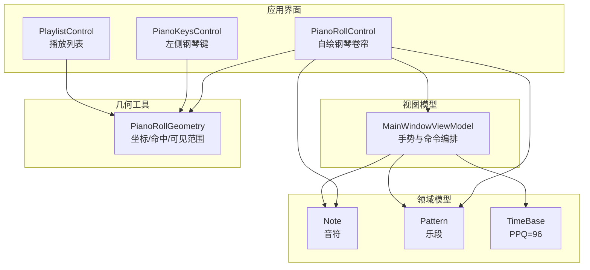
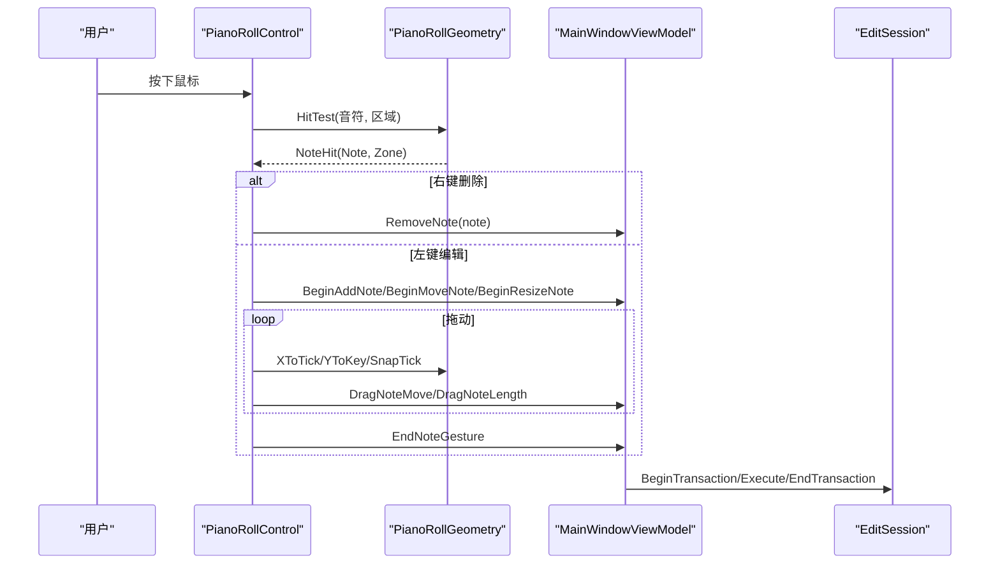
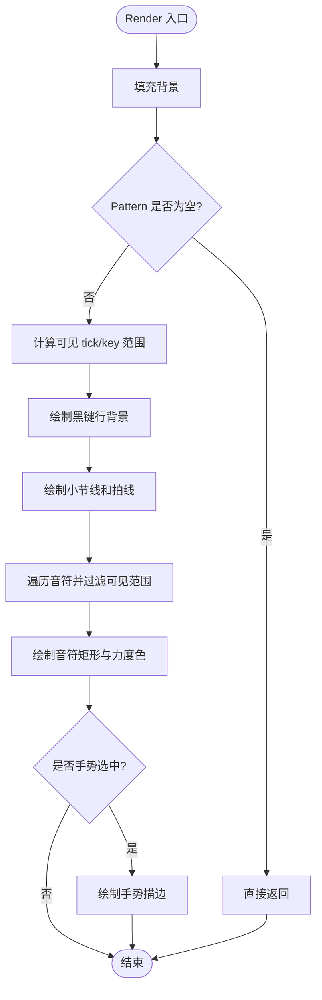
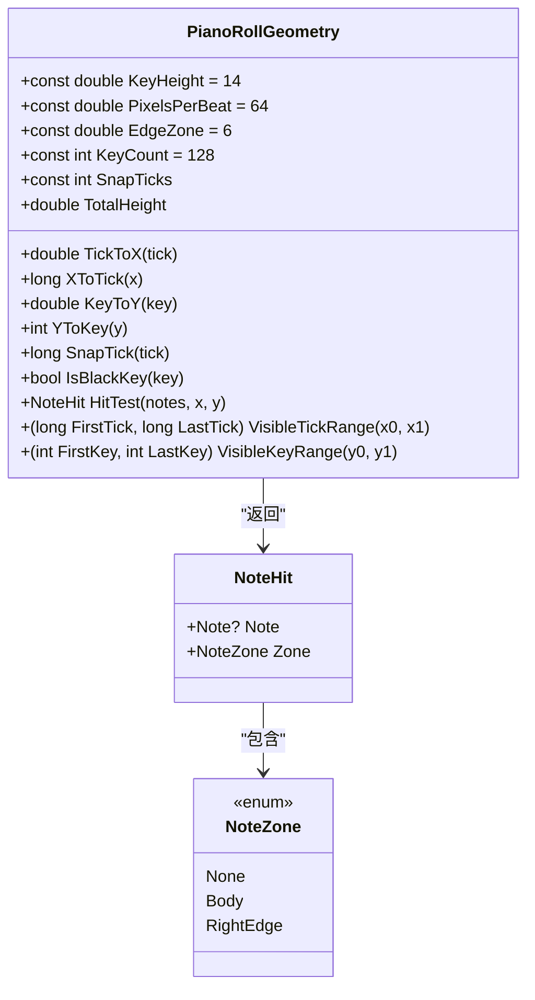
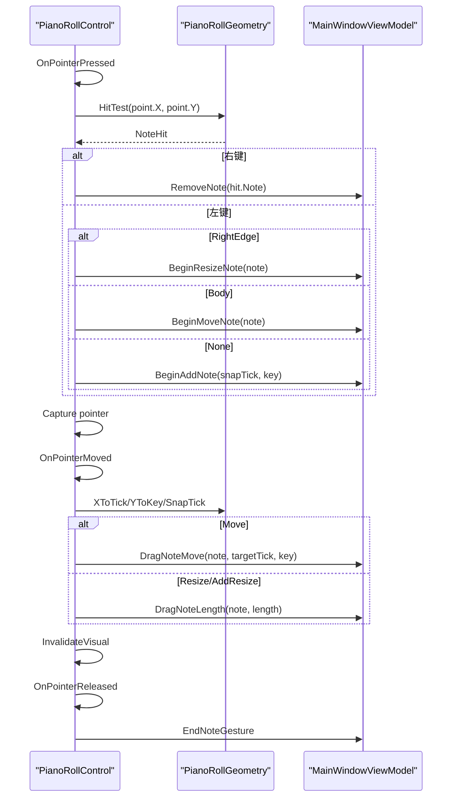
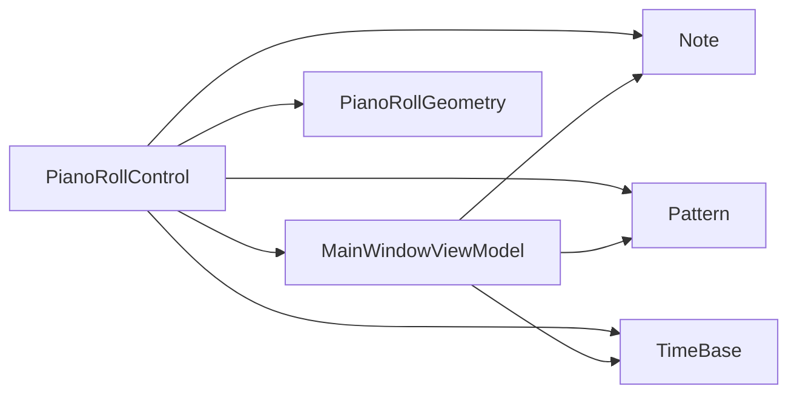

# 钢琴卷帘控件

<cite>
**本文引用的文件**   
- [PianoRollControl.cs](file://src/Weftone.App/Controls/PianoRollControl.cs)
- [PianoRollGeometry.cs](file://src/Weftone.App/Controls/PianoRollGeometry.cs)
- [MainWindowViewModel.cs](file://src/Weftone.App/ViewModels/MainWindowViewModel.cs)
- [Note.cs](file://src/Weftone.Domain/Note.cs)
- [Pattern.cs](file://src/Weftone.Domain/Pattern.cs)
- [TimeBase.cs](file://src/Weftone.Domain/TimeBase.cs)
- [PianoRollGeometryTests.cs](file://tests/Weftone.App.Tests/PianoRollGeometryTests.cs)
- [MainWindowViewModelGestureTests.cs](file://tests/Weftone.App.Tests/MainWindowViewModelGestureTests.cs)
- [NoteEditCommandTests.cs](file://tests/Weftone.Domain.Tests/NoteEditCommandTests.cs)
</cite>

## 目录
1. [简介](#简介)
2. [项目结构定位](#项目结构定位)
3. [核心组件总览](#核心组件总览)
4. [架构总览](#架构总览)
5. [渲染管线与自绘实现](#渲染管线与自绘实现)
6. [几何计算与坐标系统](#几何计算与坐标系统)
7. [用户交互处理](#用户交互处理)
8. [性能优化分析](#性能优化分析)
9. [样式、主题与可访问性](#样式主题与可访问性)
10. [依赖关系分析](#依赖关系分析)
11. [使用示例与扩展指南](#使用示例与扩展指南)
12. [故障排查](#故障排查)
13. [结论](#结论)

## 简介
本文件为 PianoRollControl 钢琴卷帘控件的完整 UI 组件文档。该控件基于 Avalonia 自绘，负责在钢琴键网格上绘制音符矩形，并提供音符选择、拖拽编辑、缩放和平移等交互能力。其设计将“几何计算”和“命中测试”从 UI 框架中剥离到纯函数类 PianoRollGeometry，从而支持 headless 单测；UI 层只负责渲染和用户意图转发，真正的数据变更通过 MainWindowViewModel 的命令与事务机制完成，保证可撤销、可重做且可单元测试。

## 项目结构定位
PianoRollControl 位于应用层的 Avalonia 控件目录，与钢琴键控件、播放列表控件并列；它依赖领域模型 Note、Pattern、TimeBase，并通过 ViewModel 调用命令层完成编辑操作。几何计算类 PianoRollGeometry 不依赖 UI 类型，是跨层共享的纯数学工具。

**图表来源**
- [PianoRollControl.cs:15-157](file://src/Weftone.App/Controls/PianoRollControl.cs#L15-L157)
- [PianoRollGeometry.cs:18-81](file://src/Weftone.App/Controls/PianoRollGeometry.cs#L18-L81)
- [MainWindowViewModel.cs:229-310](file://src/Weftone.App/ViewModels/MainWindowViewModel.cs#L229-L310)
- [Note.cs:4-11](file://src/Weftone.Domain/Note.cs#L4-L11)
- [Pattern.cs:3-8](file://src/Weftone.Domain/Pattern.cs#L3-L8)
- [TimeBase.cs:4-7](file://src/Weftone.Domain/TimeBase.cs#L4-L7)

**章节来源**
- [PianoRollControl.cs:15-157](file://src/Weftone.App/Controls/PianoRollControl.cs#L15-L157)
- [PianoRollGeometry.cs:18-81](file://src/Weftone.App/Controls/PianoRollGeometry.cs#L18-L81)
- [MainWindowViewModel.cs:229-310](file://src/Weftone.App/ViewModels/MainWindowViewModel.cs#L229-L310)
- [Note.cs:4-11](file://src/Weftone.Domain/Note.cs#L4-L11)
- [Pattern.cs:3-8](file://src/Weftone.Domain/Pattern.cs#L3-L8)
- [TimeBase.cs:4-7](file://src/Weftone.Domain/TimeBase.cs#L4-L7)

## 核心组件总览
- PianoRollControl：Avalonia Control，负责背景、黑键行、小节/拍网格、音符矩形绘制，以及鼠标按下、移动、释放事件处理。
- PianoRollGeometry：纯函数几何类，提供 tick/pixel 线性映射、key/pixel 映射、吸附步长、黑键判断、命中测试、可视区域计算。
- MainWindowViewModel：封装 Add/Move/Resize/Remove 音符的手势生命周期，使用 EditSession 和命令历史进行事务合并与撤销重做。
- Note/Pattern/TimeBase：领域模型，定义音符属性、乐段集合和 PPQ 时间基准。

**章节来源**
- [PianoRollControl.cs:15-157](file://src/Weftone.App/Controls/PianoRollControl.cs#L15-L157)
- [PianoRollGeometry.cs:18-81](file://src/Weftone.App/Controls/PianoRollGeometry.cs#L18-L81)
- [MainWindowViewModel.cs:229-310](file://src/Weftone.App/ViewModels/MainWindowViewModel.cs#L229-L310)
- [Note.cs:4-11](file://src/Weftone.Domain/Note.cs#L4-L11)
- [Pattern.cs:3-8](file://src/Weftone.Domain/Pattern.cs#L3-L8)
- [TimeBase.cs:4-7](file://src/Weftone.Domain/TimeBase.cs#L4-L7)

## 架构总览
PianoRollControl 作为 UI 层，仅持有 Pattern 和 ViewModel 引用。渲染时根据视口计算可见 tick/key 范围，再绘制网格和音符；交互时通过 PianoRollGeometry 进行命中测试，并将用户意图委托给 MainWindowViewModel。ViewModel 使用 EditSession 开启事务，执行命令并合并拖动过程中的多次修改为一次撤销单元。

**图表来源**
- [PianoRollControl.cs:185-293](file://src/Weftone.App/Controls/PianoRollControl.cs#L185-L293)
- [PianoRollGeometry.cs:44-64](file://src/Weftone.App/Controls/PianoRollGeometry.cs#L44-L64)
- [MainWindowViewModel.cs:229-310](file://src/Weftone.App/ViewModels/MainWindowViewModel.cs#L229-L310)

## 渲染管线与自绘实现
PianoRollControl.Render 的渲染顺序如下：
1. 填充背景色。
2. 若 Pattern 为空则直接返回，避免空引用。
3. 根据当前视口 _viewportX/_viewportY/_viewportWidth/_viewportHeight 计算可见 tick 范围和可见 key 范围。
4. 遍历可见 key，仅对黑键行绘制黑色背景条。
5. 遍历可见拍，绘制小节线（每 4 拍）和拍线。
6. 遍历 Pattern.Notes，按 tick/key 过滤出可见音符，计算 left/top/width，绘制圆角矩形音符；若音符处于手势选中状态，则额外绘制白色描边。

关键特性：
- 视口裁剪：通过 VisibleTickRange 和 VisibleKeyRange 限制绘制范围，避免绘制不可见音符。
- 黑键行高亮：使用 IsBlackKey 判断黑键，提升可读性。
- 力度着色：NoteBrush 将 velocity 映射为 HSV 色相，低力度偏蓝、高力度偏橙。
- 手势反馈：当音符被拖拽或调整长度时，使用 GesturePen 绘制轮廓以提示当前操作对象。

**图表来源**
- [PianoRollControl.cs:104-157](file://src/Weftone.App/Controls/PianoRollControl.cs#L104-L157)
- [PianoRollGeometry.cs:66-80](file://src/Weftone.App/Controls/PianoRollGeometry.cs#L66-L80)

**章节来源**
- [PianoRollControl.cs:104-183](file://src/Weftone.App/Controls/PianoRollControl.cs#L104-L183)

## 几何计算与坐标系统
PianoRollGeometry 定义了钢琴卷帘的核心数学规则：
- 常量：KeyHeight=14、PixelsPerBeat=64、EdgeZone=6、KeyCount=128、SnapTicks=PPQ/4。
- Tick↔Pixel：TickToX 和 XToTick 实现线性映射，PPQ=96，一拍对应 64 像素。
- Key↔Pixel：KeyToY 将 MIDI key 0..127 映射到 y 坐标，127 在顶部；YToKey 反向映射并钳制边界。
- 吸附：SnapTick 将 tick 四舍五入到最近的 1/4 拍（24 tick）。
- 黑键判断：IsBlackKey 基于音阶周期判断黑键。
- 命中测试：HitTest 逆序遍历音符，返回 Body 或 RightEdge 区域；右边缘 EdgeZone 像素内视为 Resize。
- 可见范围：VisibleTickRange 和 VisibleKeyRange 用于视口裁剪，两侧各留 1 tick 余量。

这些方法均为纯函数，无 UI 依赖，便于 headless 单测覆盖。

**图表来源**
- [PianoRollGeometry.cs:5-81](file://src/Weftone.App/Controls/PianoRollGeometry.cs#L5-L81)

**章节来源**
- [PianoRollGeometry.cs:18-81](file://src/Weftone.App/Controls/PianoRollGeometry.cs#L18-L81)
- [PianoRollGeometryTests.cs:9-81](file://tests/Weftone.App.Tests/PianoRollGeometryTests.cs#L9-L81)

## 用户交互处理
PianoRollControl 的用户交互流程分为三个阶段：按下、移动、释放。

- 按下（OnPointerPressed）：
  - 获取鼠标位置并进行 HitTest。
  - 右键：若命中音符则调用 ViewModel.RemoveNote。
  - 左键：根据 Zone 决定行为：
    - RightEdge：开始调整长度（BeginResizeNote）。
    - Body：开始移动（BeginMoveNote）。
    - None：开始添加音符（BeginAddNote），并设置 LastAddedNote。
  - 捕获指针并刷新视觉。

- 移动（OnPointerMoved）：
  - 根据当前手势更新目标 tick/key。
  - Move：计算 delta 和目标 tick，调用 DragNoteMove。
  - Resize/AddResize：确保最小长度为 1/4 拍，调用 DragNoteLength。
  - 每次移动后刷新视觉。

- 释放（OnPointerReleased）：
  - 结束手势，清空内部状态，调用 ViewModel.EndNoteGesture 提交事务。

**图表来源**
- [PianoRollControl.cs:185-293](file://src/Weftone.App/Controls/PianoRollControl.cs#L185-L293)
- [MainWindowViewModel.cs:229-310](file://src/Weftone.App/ViewModels/MainWindowViewModel.cs#L229-L310)

**章节来源**
- [PianoRollControl.cs:185-293](file://src/Weftone.App/Controls/PianoRollControl.cs#L185-L293)
- [MainWindowViewModelGestureTests.cs:28-104](file://tests/Weftone.App.Tests/MainWindowViewModelGestureTests.cs#L28-L104)

## 性能优化分析
当前实现采用以下优化策略：
- 视口裁剪：仅在 Render 中绘制可见范围内的黑键行、拍线和音符，避免全量绘制。
- 增量重绘：每次手势移动后调用 InvalidateVisual，触发局部重绘而非整窗刷新。
- 静态画笔复用：BackgroundBrush、BlackRowBrush、BeatPen、BarPen、GesturePen 等静态字段减少对象分配。
- 简单几何计算：TickToX/XToTick/KeyToY/YToKey 为 O(1) 线性映射，命中测试为 O(n) 但仅遍历可见音符。
- 未实现离屏渲染：代码中没有显式离屏缓冲或双缓冲逻辑，依赖 Avalonia 底层渲染优化。

潜在改进点：
- 引入离屏位图缓存：对网格和黑键行进行一次性缓存，滚动时复用。
- 音符批量绘制：将音符矩形收集到路径或顶点缓冲区以减少 DrawRectangle 调用次数。
- 更细粒度脏区：记录手势影响的矩形区域，仅重绘相关部分。
- 内存管理：避免在 NoteBrush 中频繁创建 SolidColorBrush，可预构建力度色表。

**章节来源**
- [PianoRollControl.cs:104-183](file://src/Weftone.App/Controls/PianoRollControl.cs#L104-L183)
- [PianoRollGeometry.cs:29-40](file://src/Weftone.App/Controls/PianoRollGeometry.cs#L29-L40)

## 样式、主题与可访问性
- 样式：控件使用硬编码颜色（如 BackgroundBrush、BlackRowBrush、BeatLineBrush、BarLineBrush），未暴露样式属性或主题绑定。
- 主题适配：当前不支持动态主题切换，如需支持应引入资源字典或主题服务，将 Brush/Pen 替换为可配置资源。
- 可访问性：控件未实现键盘导航、屏幕阅读器文本或焦点管理；建议增加：
  - 键盘快捷键：方向键移动音符、Delete 删除、空格播放。
  - 焦点指示器：为选中音符绘制焦点框。
  - 语义化标签：为音符和网格提供描述文本。

**章节来源**
- [PianoRollControl.cs:23-30](file://src/Weftone.App/Controls/PianoRollControl.cs#L23-L30)

## 依赖关系分析
PianoRollControl 依赖：
- Avalonia UI 框架：Control、DrawingContext、Input 事件。
- 领域模型：Pattern、Note、TimeBase。
- 视图模型：MainWindowViewModel，用于命令执行和事务管理。
- 几何工具：PianoRollGeometry，用于坐标转换和命中测试。

**图表来源**
- [PianoRollControl.cs:1-7](file://src/Weftone.App/Controls/PianoRollControl.cs#L1-L7)
- [MainWindowViewModel.cs:1-10](file://src/Weftone.App/ViewModels/MainWindowViewModel.cs#L1-L10)
- [Note.cs:1-11](file://src/Weftone.Domain/Note.cs#L1-L11)
- [Pattern.cs:1-8](file://src/Weftone.Domain/Pattern.cs#L1-L8)
- [TimeBase.cs:1-7](file://src/Weftone.Domain/TimeBase.cs#L1-L7)

**章节来源**
- [PianoRollControl.cs:1-7](file://src/Weftone.App/Controls/PianoRollControl.cs#L1-L7)
- [MainWindowViewModel.cs:1-10](file://src/Weftone.App/ViewModels/MainWindowViewModel.cs#L1-L10)

## 使用示例与扩展指南
### 基本使用
- 在宿主窗口中绑定 SelectedPattern 到 PianoRollControl.Pattern。
- 将 MainWindowViewModel 实例赋值给 PianoRollControl.ViewModel。
- 通过 ScrollViewer 联动 SetViewport，传入横向偏移、纵向偏移、宽度和高度。

### 添加新音符类型
- 扩展 Note 类：新增属性如 PitchBend、ControllerData。
- 修改 PianoRollGeometry.HitTest：根据新属性调整命中区域或优先级。
- 修改 PianoRollControl.Render：根据新属性绘制不同形状或纹理。
- 更新 ViewModel 命令：在 AddNoteCommand/MoveNoteCommand/ResizeNoteCommand 中支持新字段。

### 添加新编辑行为
- 在 PianoRollControl 中添加新的 Gesture 枚举值和处理分支。
- 在 MainWindowViewModel 中添加对应的手势方法和命令。
- 在 PianoRollGeometry 中扩展 HitTest 区域或可见范围计算。

### 自定义样式
- 将静态 Brush/Pen 替换为可配置属性或资源字典键。
- 引入主题服务，根据 Light/Dark 模式切换颜色。
- 暴露样式属性如 NoteBrush、GridPen、BackgroundColor 等。

**章节来源**
- [PianoRollControl.cs:17-21](file://src/Weftone.App/Controls/PianoRollControl.cs#L17-L21)
- [PianoRollControl.cs:66-74](file://src/Weftone.App/Controls/PianoRollControl.cs#L66-L74)
- [Note.cs:4-11](file://src/Weftone.Domain/Note.cs#L4-L11)
- [PianoRollGeometry.cs:44-64](file://src/Weftone.App/Controls/PianoRollGeometry.cs#L44-L64)

## 故障排查
常见问题及解决方案：
- 音符不显示：检查 Pattern 是否为空，确认 SetViewport 是否正确传入视口参数。
- 拖拽无效：确认 ViewModel 已赋值，且手势状态未被外部重置。
- 吸附异常：检查 SnapTick 是否被正确调用，确认 TimeBase.Ppq 值是否符合预期。
- 性能下降：检查是否有大量音符超出视口但仍被绘制，确认 VisibleTickRange/VisibleKeyRange 是否生效。
- 颜色不正确：检查 Velocity 是否在 0..1 范围内，HSV 转换是否溢出。

调试建议：
- 在 Render 中打印 firstTick/lastTick/firstKey/lastKey，验证可见范围。
- 在 HitTest 中打印命中结果，确认 Zone 是否正确。
- 在 ViewModel 中记录事务开始/结束，确认撤销重做是否正常。

**章节来源**
- [PianoRollControl.cs:104-157](file://src/Weftone.App/Controls/PianoRollControl.cs#L104-L157)
- [PianoRollGeometry.cs:66-80](file://src/Weftone.App/Controls/PianoRollGeometry.cs#L66-L80)
- [MainWindowViewModel.cs:229-310](file://src/Weftone.App/ViewModels/MainWindowViewModel.cs#L229-L310)

## 结论
PianoRollControl 是一个结构清晰、职责分离的钢琴卷帘控件。它将几何计算与 UI 渲染解耦，通过 ViewModel 统一管理编辑事务，保证了可测试性和可维护性。当前实现已具备基本的渲染、交互和性能优化能力，未来可在离屏缓存、批量绘制、主题支持和可访问性方面进一步扩展。