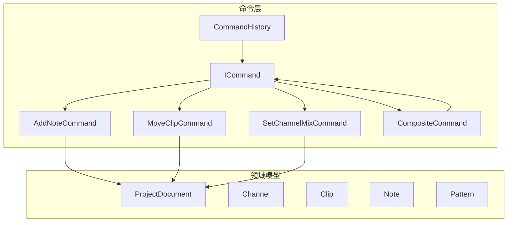
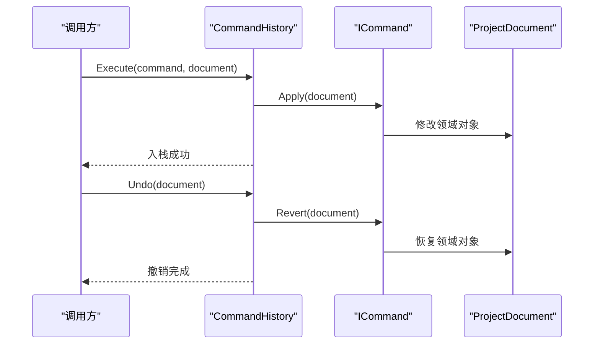
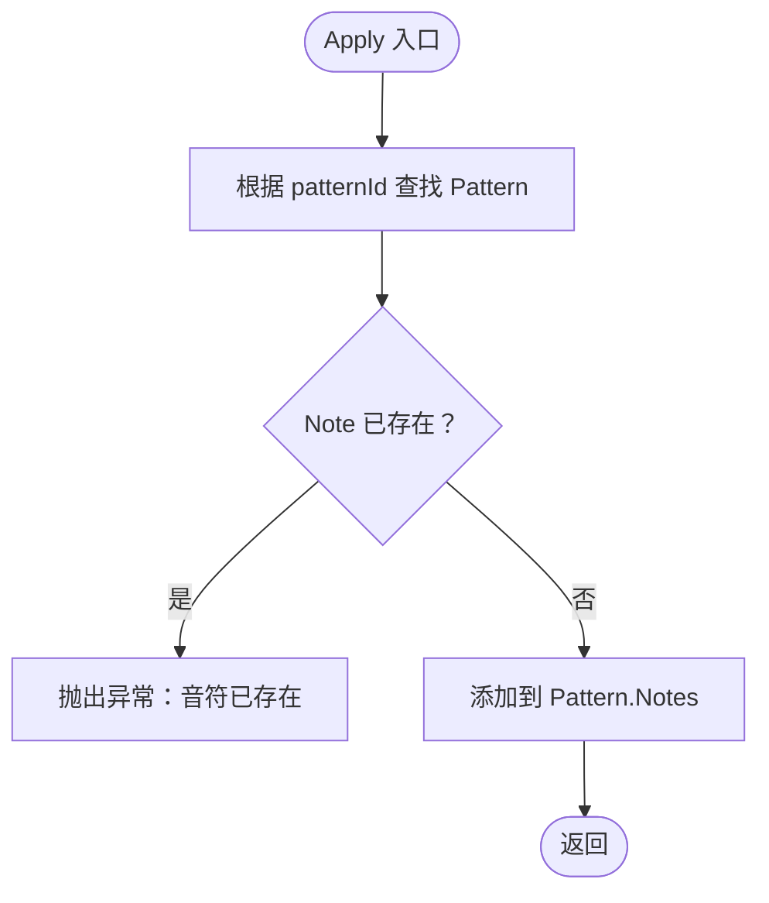
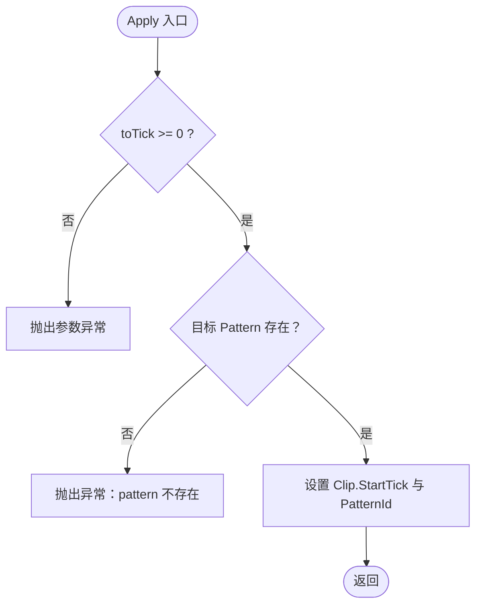
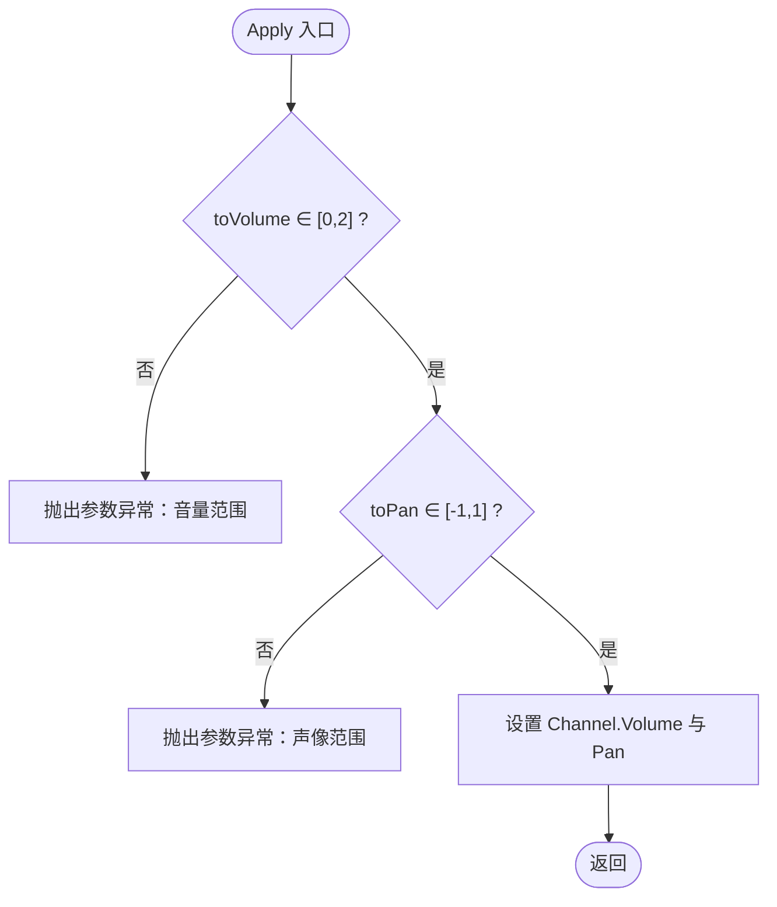
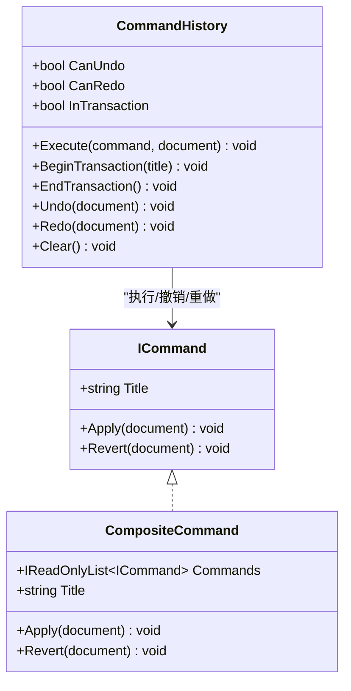
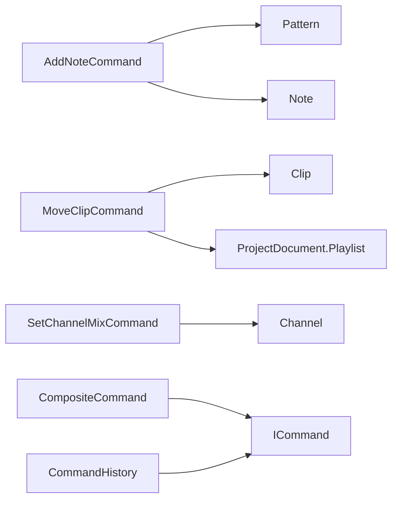

# 命令模式实现

<cite>
**本文引用的文件**   
- [ICommand.cs](file://src/Weftone.Domain/Commands/ICommand.cs)
- [ProjectDocument.cs](file://src/Weftone.Domain/ProjectDocument.cs)
- [Channel.cs](file://src/Weftone.Domain/Channel.cs)
- [Clip.cs](file://src/Weftone.Domain/Clip.cs)
- [Note.cs](file://src/Weftone.Domain/Note.cs)
- [Pattern.cs](file://src/Weftone.Domain/Pattern.cs)
- [AddNoteCommand.cs](file://src/Weftone.Domain/Commands/AddNoteCommand.cs)
- [MoveClipCommand.cs](file://src/Weftone.Domain/Commands/MoveClipCommand.cs)
- [SetChannelMixCommand.cs](file://src/Weftone.Domain/Commands/SetChannelMixCommand.cs)
- [CompositeCommand.cs](file://src/Weftone.Domain/Commands/CompositeCommand.cs)
- [CommandHistory.cs](file://src/Weftone.Domain/Commands/CommandHistory.cs)
</cite>

## 目录
1. [简介](#简介)
2. [项目结构](#项目结构)
3. [核心组件](#核心组件)
4. [架构总览](#架构总览)
5. [详细组件分析](#详细组件分析)
6. [依赖关系分析](#依赖关系分析)
7. [性能与一致性](#性能与一致性)
8. [故障排查指南](#故障排查指南)
9. [结论](#结论)
10. [附录：自定义命令示例](#附录自定义命令示例)

## 简介
本文件系统性梳理 Weftone 在领域层实现的“命令模式”，重点解释 ICommand 接口的设计约束、具体命令如何操作 ProjectDocument，以及 CommandHistory 提供的撤销/重做与事务合并机制。文档强调 Apply 与 Revert 的精确互逆要求，并给出错误处理策略、数据一致性保障和扩展自定义命令的实践建议。

## 项目结构
命令相关代码集中在 Weftone.Domain 的 Commands 子命名空间，领域模型（ProjectDocument、Channel、Clip、Note、Pattern）位于同一程序集。CommandHistory 作为命令执行与历史管理中枢，将 UI 手势或应用逻辑转换为对领域模型的原子变更。

图表来源
- [ICommand.cs:1-12](file://src/Weftone.Domain/Commands/ICommand.cs#L1-L12)
- [ProjectDocument.cs:1-21](file://src/Weftone.Domain/ProjectDocument.cs#L1-L21)
- [Channel.cs:1-19](file://src/Weftone.Domain/Channel.cs#L1-L19)
- [Clip.cs:1-9](file://src/Weftone.Domain/Clip.cs#L1-L9)
- [Note.cs:1-12](file://src/Weftone.Domain/Note.cs#L1-L12)
- [Pattern.cs:1-9](file://src/Weftone.Domain/Pattern.cs#L1-L9)
- [AddNoteCommand.cs:1-31](file://src/Weftone.Domain/Commands/AddNoteCommand.cs#L1-L31)
- [MoveClipCommand.cs:1-47](file://src/Weftone.Domain/Commands/MoveClipCommand.cs#L1-L47)
- [SetChannelMixCommand.cs:1-46](file://src/Weftone.Domain/Commands/SetChannelMixCommand.cs#L1-L46)
- [CompositeCommand.cs:1-29](file://src/Weftone.Domain/Commands/CompositeCommand.cs#L1-L29)
- [CommandHistory.cs:1-99](file://src/Weftone.Domain/Commands/CommandHistory.cs#L1-L99)

章节来源
- [ICommand.cs:1-12](file://src/Weftone.Domain/Commands/ICommand.cs#L1-L12)
- [ProjectDocument.cs:1-21](file://src/Weftone.Domain/ProjectDocument.cs#L1-L21)
- [CommandHistory.cs:1-99](file://src/Weftone.Domain/Commands/CommandHistory.cs#L1-L99)

## 核心组件
- ICommand：定义可撤销编辑命令的最小契约，包含标题、Apply 与 Revert。Apply/Revert 必须精确互逆，即先 Apply 后 Revert 应使 ProjectDocument 回到原状态。
- ProjectDocument：领域根对象，持有 Tempo、SampleRate、MasterVolume、Channels、Patterns、Playlist、Assets 等集合，是命令直接操作的唯一入口。
- CommandHistory：命令日志与事务管理器，负责 Execute、Undo、Redo、BeginTransaction、EndTransaction、Clear。
- CompositeCommand：组合命令，用于将一次手势的多条命令合并为单条撤销记录，Apply 顺序执行，Revert 逆序回滚。
- 具体命令：AddNoteCommand、MoveClipCommand、SetChannelMixCommand 等，分别对 Pattern.Notes、Playlist.Clip、Channel 进行原子修改。

章节来源
- [ICommand.cs:1-12](file://src/Weftone.Domain/Commands/ICommand.cs#L1-L12)
- [ProjectDocument.cs:1-21](file://src/Weftone.Domain/ProjectDocument.cs#L1-L21)
- [CommandHistory.cs:1-99](file://src/Weftone.Domain/Commands/CommandHistory.cs#L1-L99)
- [CompositeCommand.cs:1-29](file://src/Weftone.Domain/Commands/CompositeCommand.cs#L1-L29)
- [AddNoteCommand.cs:1-31](file://src/Weftone.Domain/Commands/AddNoteCommand.cs#L1-L31)
- [MoveClipCommand.cs:1-47](file://src/Weftone.Domain/Commands/MoveClipCommand.cs#L1-L47)
- [SetChannelMixCommand.cs:1-46](file://src/Weftone.Domain/Commands/SetChannelMixCommand.cs#L1-L46)

## 架构总览
命令模式在 Weftone 中承担“编辑语义”的职责：UI 手势与应用逻辑不直接修改领域模型，而是构造 ICommand 并通过 CommandHistory.Execute 提交。CommandHistory 负责入栈、撤销、重做与事务合并；具体命令通过 ProjectDocument 暴露的集合属性访问领域对象，保证所有变更都具备可撤销性。

图表来源
- [CommandHistory.cs:20-33](file://src/Weftone.Domain/Commands/CommandHistory.cs#L20-L33)
- [CommandHistory.cs:61-74](file://src/Weftone.Domain/Commands/CommandHistory.cs#L61-L74)
- [ICommand.cs:3-11](file://src/Weftone.Domain/Commands/ICommand.cs#L3-L11)

## 详细组件分析

### ICommand 接口设计
- Title：用于显示给用户或记录到日志，便于识别命令语义。
- Apply(ProjectDocument)：对领域模型施加正向变更。
- Revert(ProjectDocument)：对领域模型执行与 Apply 完全相反的逆向变更。
- 精确互逆要求：对于任意合法状态 S，若 Apply(S) → S'，则 Revert(S') → S。该不变式由每个具体命令自行保证。

章节来源
- [ICommand.cs:1-12](file://src/Weftone.Domain/Commands/ICommand.cs#L1-L12)

### ProjectDocument 领域根
- 提供 Tempo、SampleRate、MasterVolume、Channels、Patterns、Playlist、Assets 等公共集合与属性。
- 命令通过直接读写这些集合与属性来改变工程状态。
- M1a 阶段为单线程同步编辑，因此命令无需考虑并发保护。

章节来源
- [ProjectDocument.cs:1-21](file://src/Weftone.Domain/ProjectDocument.cs#L1-L21)

### AddNoteCommand
- 作用：向指定 Pattern 添加一个 Note。
- 参数：patternId、note。
- Apply：查找目标 Pattern，校验 Note 是否已存在，不存在则加入 Notes 列表。
- Revert：从对应 Pattern 的 Notes 移除该 Note。
- 错误处理：
  - 若 Note 已存在，抛出异常阻止重复添加。
  - 若 Pattern 不存在，抛出异常提示无效引用。

图表来源
- [AddNoteCommand.cs:10-18](file://src/Weftone.Domain/Commands/AddNoteCommand.cs#L10-L18)
- [AddNoteCommand.cs:25-29](file://src/Weftone.Domain/Commands/AddNoteCommand.cs#L25-L29)

章节来源
- [AddNoteCommand.cs:1-31](file://src/Weftone.Domain/Commands/AddNoteCommand.cs#L1-L31)
- [Pattern.cs:1-9](file://src/Weftone.Domain/Pattern.cs#L1-L9)
- [Note.cs:1-12](file://src/Weftone.Domain/Note.cs#L1-L12)

### MoveClipCommand
- 作用：移动 Playlist 中的 Clip，支持同时更改起始 tick 与所在 PatternId。
- 参数：clip、fromTick、fromPatternId、toTick、toPatternId。
- Apply：校验 toTick 非负且目标 Pattern 存在，然后设置 Clip.StartTick 与 Clip.PatternId。
- Revert：将 Clip 的 StartTick 与 PatternId 恢复为 fromTick 与 fromPatternId。
- 错误处理：
  - toTick < 0 抛出参数异常。
  - 目标 Pattern 不存在抛出异常。
  - Clip 不在 Playlist 中抛出异常。

图表来源
- [MoveClipCommand.cs:17-29](file://src/Weftone.Domain/Commands/MoveClipCommand.cs#L17-L29)
- [MoveClipCommand.cs:38-45](file://src/Weftone.Domain/Commands/MoveClipCommand.cs#L38-L45)

章节来源
- [MoveClipCommand.cs:1-47](file://src/Weftone.Domain/Commands/MoveClipCommand.cs#L1-L47)
- [Clip.cs:1-9](file://src/Weftone.Domain/Clip.cs#L1-L9)

### SetChannelMixCommand
- 作用：一次性设置 Channel 的 Volume 与 Pan，确保两条属性在同一撤销单元内更新。
- 参数：channelId、fromVolume、fromPan、toVolume、toPan。
- Apply：校验 toVolume ∈ [0, 2]、toPan ∈ [-1, 1]，然后写入 Channel.Volume 与 Channel.Pan。
- Revert：将 Channel 的 Volume 与 Pan 恢复为 fromVolume 与 fromPan。
- 错误处理：
  - 超出范围时抛出参数异常。
  - Channel 不存在时抛出异常。

图表来源
- [SetChannelMixCommand.cs:19-31](file://src/Weftone.Domain/Commands/SetChannelMixCommand.cs#L19-L31)
- [SetChannelMixCommand.cs:40-44](file://src/Weftone.Domain/Commands/SetChannelMixCommand.cs#L40-L44)

章节来源
- [SetChannelMixCommand.cs:1-46](file://src/Weftone.Domain/Commands/SetChannelMixCommand.cs#L1-L46)
- [Channel.cs:1-19](file://src/Weftone.Domain/Channel.cs#L1-L19)

### CompositeCommand 与事务
- CompositeCommand：将多个 ICommand 聚合为一个命令，Apply 顺序执行，Revert 逆序执行，从而保证整体可撤销。
- CommandHistory.BeginTransaction/EndTransaction：将一次手势（如拖拽）期间产生的多条命令打包为单个撤销项，避免中间状态污染撤销栈。
- 事务约束：不支持嵌套事务；事务进行中禁止 Undo/Redo；空事务不产生撤销项。

图表来源
- [CompositeCommand.cs:1-29](file://src/Weftone.Domain/Commands/CompositeCommand.cs#L1-L29)
- [CommandHistory.cs:1-99](file://src/Weftone.Domain/Commands/CommandHistory.cs#L1-L99)
- [ICommand.cs:1-12](file://src/Weftone.Domain/Commands/ICommand.cs#L1-L12)

章节来源
- [CompositeCommand.cs:1-29](file://src/Weftone.Domain/Commands/CompositeCommand.cs#L1-L29)
- [CommandHistory.cs:1-99](file://src/Weftone.Domain/Commands/CommandHistory.cs#L1-L99)

## 依赖关系分析
- 命令对领域模型的耦合：
  - AddNoteCommand 依赖 Pattern.Notes 与 Pattern.Id。
  - MoveClipCommand 依赖 Playlist 与 Clip 的属性。
  - SetChannelMixCommand 依赖 Channels 与 Channel 的属性。
- CommandHistory 仅依赖 ICommand 抽象，不感知具体命令类型，具备良好的可扩展性。
- 无循环依赖：命令与领域模型单向依赖，CommandHistory 与命令解耦。

图表来源
- [AddNoteCommand.cs:1-31](file://src/Weftone.Domain/Commands/AddNoteCommand.cs#L1-L31)
- [MoveClipCommand.cs:1-47](file://src/Weftone.Domain/Commands/MoveClipCommand.cs#L1-L47)
- [SetChannelMixCommand.cs:1-46](file://src/Weftone.Domain/Commands/SetChannelMixCommand.cs#L1-L46)
- [CompositeCommand.cs:1-29](file://src/Weftone.Domain/Commands/CompositeCommand.cs#L1-L29)
- [CommandHistory.cs:1-99](file://src/Weftone.Domain/Commands/CommandHistory.cs#L1-L99)

章节来源
- [AddNoteCommand.cs:1-31](file://src/Weftone.Domain/Commands/AddNoteCommand.cs#L1-L31)
- [MoveClipCommand.cs:1-47](file://src/Weftone.Domain/Commands/MoveClipCommand.cs#L1-L47)
- [SetChannelMixCommand.cs:1-46](file://src/Weftone.Domain/Commands/SetChannelMixCommand.cs#L1-L46)
- [CompositeCommand.cs:1-29](file://src/Weftone.Domain/Commands/CompositeCommand.cs#L1-L29)
- [CommandHistory.cs:1-99](file://src/Weftone.Domain/Commands/CommandHistory.cs#L1-L99)

## 性能与一致性
- 时间复杂度：
  - AddNoteCommand.Apply：O(1) 插入，但 Contains 检查可能 O(n)。
  - MoveClipCommand.Apply：O(1) 赋值，FindClip 使用引用相等判断为 O(1)。
  - SetChannelMixCommand.Apply：O(1) 赋值，FindChannel 按 Id 线性扫描 O(m)。
- 空间复杂度：命令对象本身为常量大小；CommandHistory 的撤销/重做栈随操作次数增长。
- 一致性保障：
  - 所有变更通过命令提交，确保可撤销。
  - 事务合并减少中间状态进入撤销栈的概率，提升用户体验与一致性。
  - 参数校验在 Apply 早期失败，避免部分更新导致的状态不一致。

[本节为通用指导，不直接分析具体文件]

## 故障排查指南
- 常见异常与定位：
  - “音符已存在于 pattern”：AddNoteCommand 检测到重复音符，需检查去重逻辑或业务输入。
  - “pattern X 不存在”：命令传入的 Id 无效，需确认 Pattern 创建与 Id 分配。
  - “起始 tick 不得为负”：MoveClipCommand 的 toTick 校验失败，检查拖拽计算逻辑。
  - “clip 不存在”：MoveClipCommand 的 Clip 引用不在 Playlist 中，检查生命周期与引用传递。
  - “音量须在 [0, 2] / 声像须在 [-1, 1]”：SetChannelMixCommand 的参数越界，检查 UI 滑块映射。
  - “未开启事务 / 事务进行中不可撤销 / 撤销栈为空 / 重做栈为空”：CommandHistory 的状态机约束被违反，检查 BeginTransaction/EndTransaction 配对与 UI 按钮可用性。
- 调试建议：
  - 在 CommandHistory.Execute 前后打印 Title，确认命令序列。
  - 在 Apply/Revert 边界增加断点，验证互逆不变式。
  - 使用最小复现用例，逐步缩小问题范围。

章节来源
- [AddNoteCommand.cs:10-29](file://src/Weftone.Domain/Commands/AddNoteCommand.cs#L10-L29)
- [MoveClipCommand.cs:17-45](file://src/Weftone.Domain/Commands/MoveClipCommand.cs#L17-L45)
- [SetChannelMixCommand.cs:19-44](file://src/Weftone.Domain/Commands/SetChannelMixCommand.cs#L19-L44)
- [CommandHistory.cs:20-99](file://src/Weftone.Domain/Commands/CommandHistory.cs#L20-L99)

## 结论
Weftone 的命令模式以 ICommand 为核心契约，结合 CommandHistory 的事务化撤销/重做机制，将 UI 手势与应用逻辑转化为对 ProjectDocument 的可逆变更。具体命令通过严格的参数校验与精确的 Revert 实现，确保领域状态的一致性。CompositeCommand 进一步提升了复杂交互场景下的用户体验与数据完整性。

[本节为总结性内容，不直接分析具体文件]

## 附录：自定义命令示例
以下示例展示如何创建一个自定义命令，遵循 Apply/Revert 精确互逆的要求，并通过 CommandHistory 提交。

- 步骤概览：
  1. 新建类实现 ICommand，并在构造函数中保存必要参数。
  2. 在 Apply 中校验参数并对 ProjectDocument 或其子对象进行原子修改。
  3. 在 Revert 中恢复 Apply 所做的全部变更。
  4. 通过 CommandHistory.Execute 提交命令；如需合并多次变更，使用 BeginTransaction/EndTransaction。

- 示例：设置工程 Tempo 的命令
  - 字段与构造：保存 fromTempo、toTempo。
  - Apply：校验 toTempo 是否在 MinTempo..MaxTempo 范围内，然后设置 ProjectDocument.Tempo。
  - Revert：将 ProjectDocument.Tempo 恢复为 fromTempo。
  - 提交：CommandHistory.Execute(new SetTempoCommand(...), document)。

- 示例：导入音频素材并关联 AssetRef
  - 字段与构造：保存 assetPath、assetId、targetCollectionIndex。
  - Apply：加载资源、生成 AssetRef，追加到 ProjectDocument.Assets，并记录索引。
  - Revert：从 ProjectDocument.Assets 移除对应条目。
  - 提交：CommandHistory.Execute(new ImportSampleCommand(...), document)。

- 最佳实践：
  - 保持 Apply/Revert 对称：任何在 Apply 中创建的临时状态必须在 Revert 中清理。
  - 尽早失败：在 Apply 开头进行参数校验，避免部分更新。
  - 使用事务：对涉及多对象或多集合的变更，使用 BeginTransaction/EndTransaction 包裹。
  - 标题可读：Title 应清晰表达用户意图，便于日志与调试。

[本节为概念性指导，不直接分析具体文件]