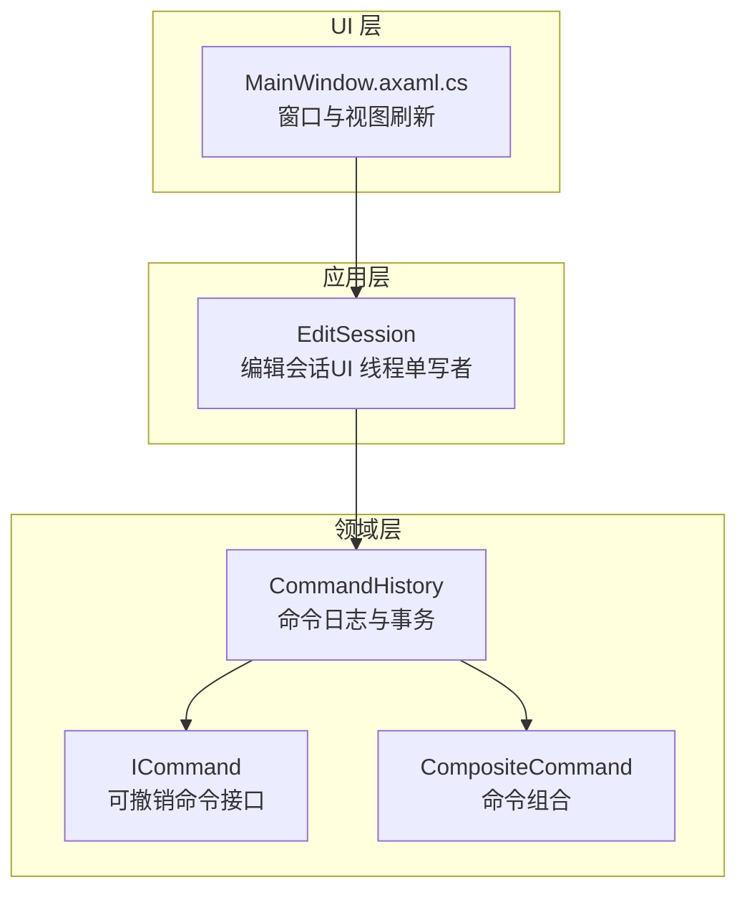
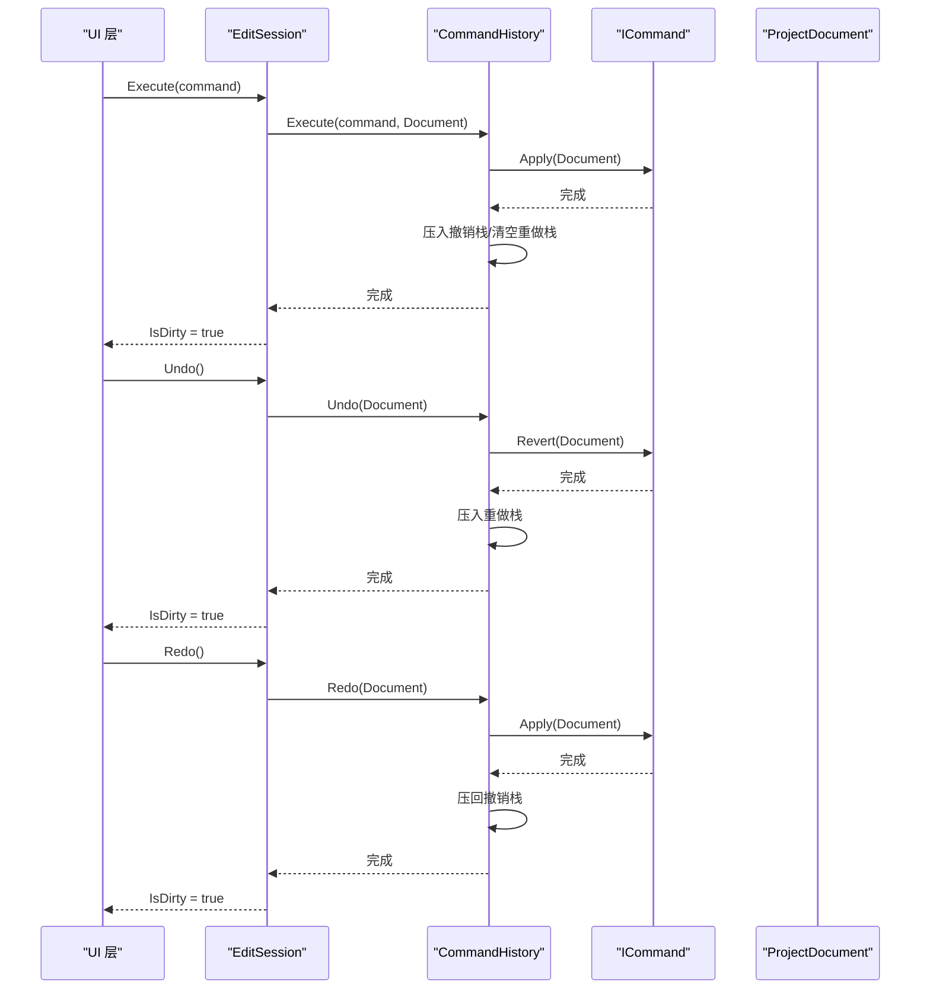
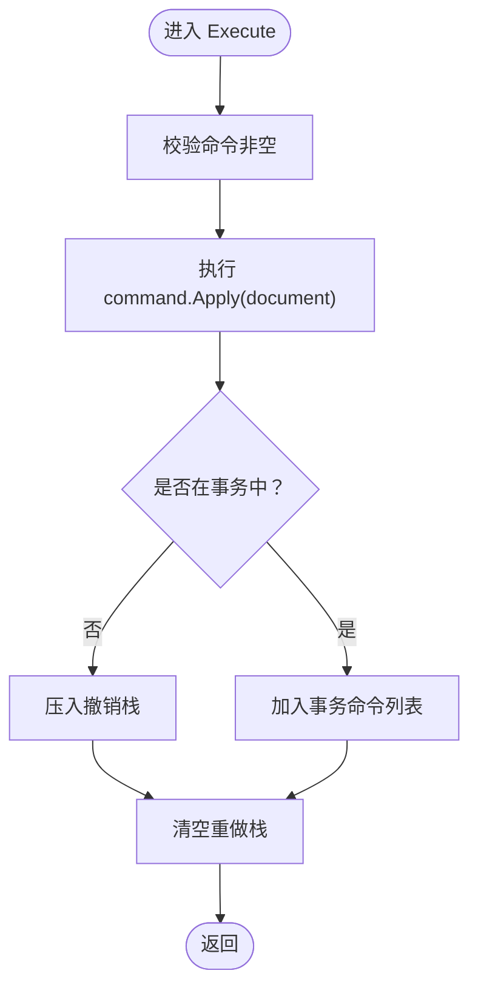
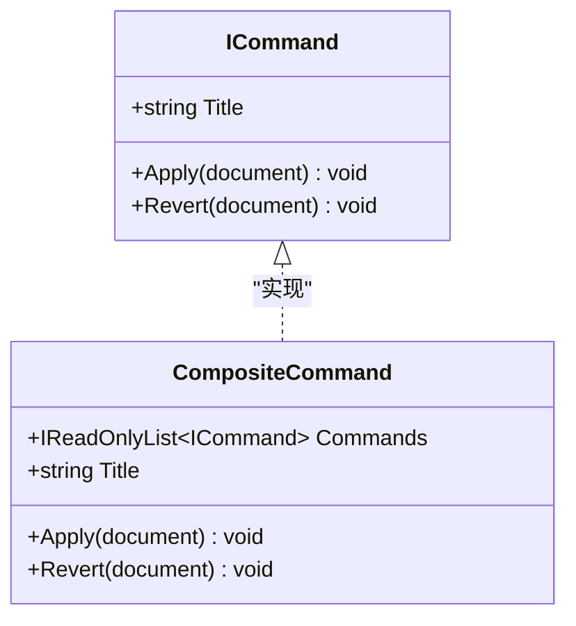
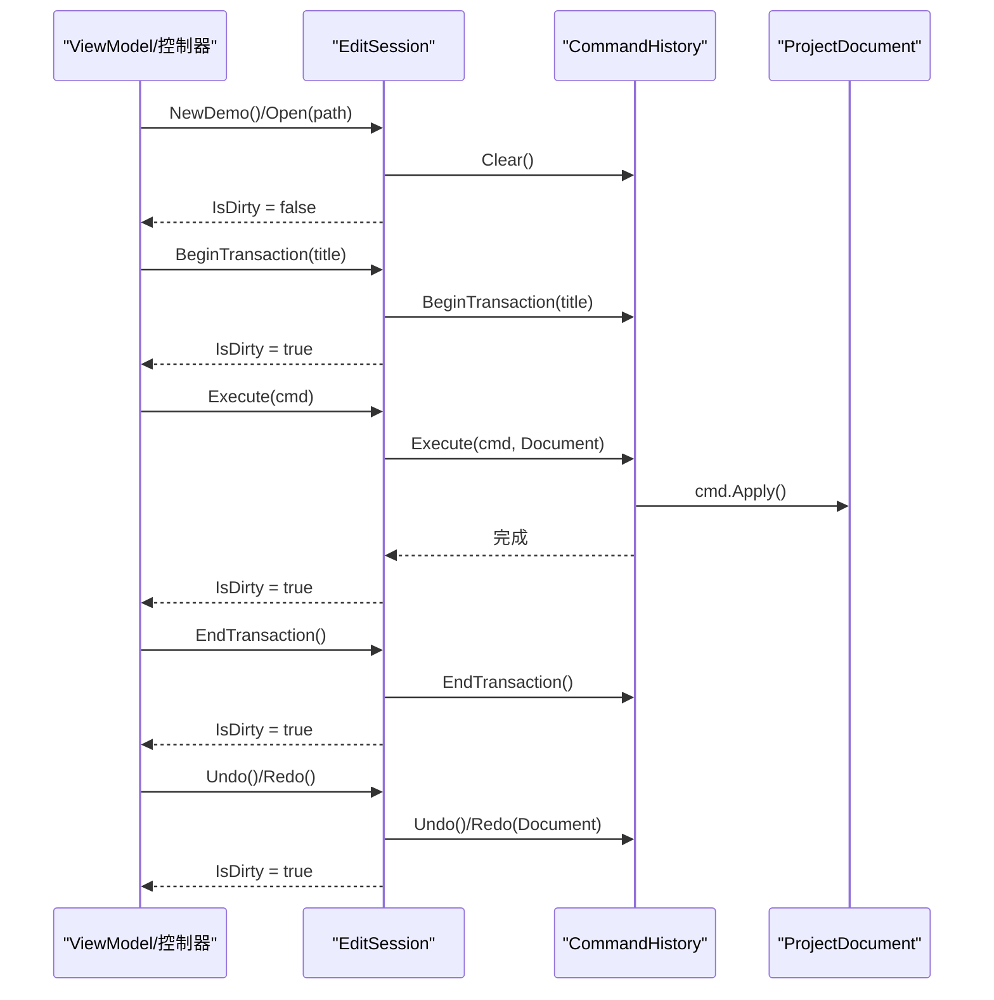
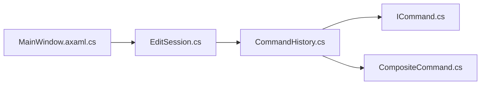
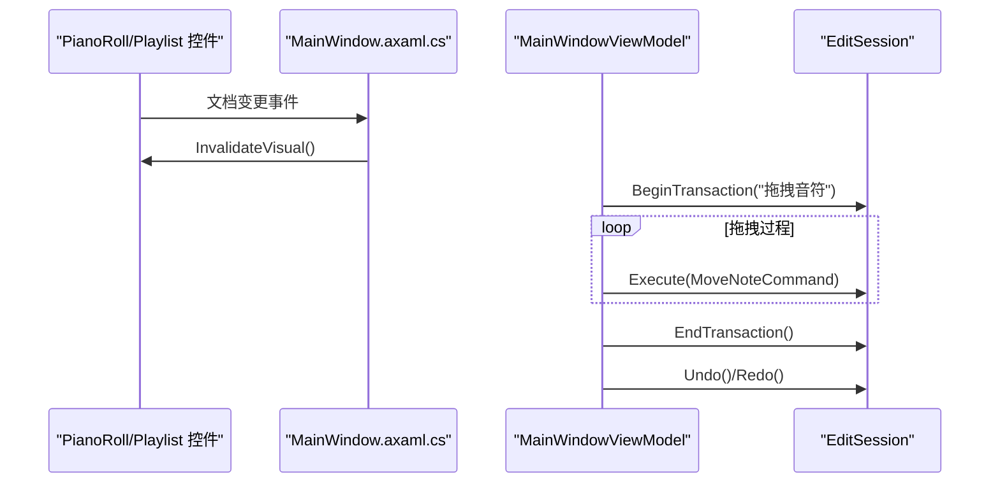

# 撤销重做系统

<cite>
**本文引用的文件**   
- [CommandHistory.cs](file://src/Weftone.Domain/Commands/CommandHistory.cs)
- [CompositeCommand.cs](file://src/Weftone.Domain/Commands/CompositeCommand.cs)
- [ICommand.cs](file://src/Weftone.Domain/Commands/ICommand.cs)
- [EditSession.cs](file://src/Weftone.Application/EditSession.cs)
- [MainWindow.axaml.cs](file://src/Weftone.App/MainWindow.axaml.cs)
- [CommandHistoryTests.cs](file://tests/Weftone.Domain.Tests/CommandHistoryTests.cs)
- [NoteEditCommandTests.cs](file://tests/Weftone.Domain.Tests/NoteEditCommandTests.cs)
- [EditSessionTests.cs](file://tests/Weftone.Application.Tests/EditSessionTests.cs)
</cite>

## 目录
1. [简介](#简介)
2. [项目结构](#项目结构)
3. [核心组件](#核心组件)
4. [架构总览](#架构总览)
5. [详细组件分析](#详细组件分析)
6. [依赖关系分析](#依赖关系分析)
7. [性能与内存优化](#性能与内存优化)
8. [UI 层集成示例](#ui-层集成示例)
9. [故障排查指南](#故障排查指南)
10. [结论](#结论)

## 简介
本文件面向 Weftone 的撤销重做子系统，重点解释以下目标：
- CommandHistory 的命令栈管理、执行历史跟踪与状态保存机制。
- CompositeCommand 如何将多个命令组合为原子操作。
- 撤销重做的核心算法：命令执行顺序控制、事务合并、重做栈清理策略。
- UI 层集成方式与最佳实践。
- 性能考虑与大对象处理、内存泄漏防护建议。

该子系统基于“命令模式 + 事务”的设计，将编辑动作封装为可逆的 ICommand，并通过 CommandHistory 维护撤销/重做栈；在拖拽等长手势中，通过 BeginTransaction/EndTransaction 将多次命令合并为一次撤销记录，提升用户体验。

## 项目结构
撤销重做相关代码主要分布在领域层与应用层：
- 领域层 Commands 子目录定义命令接口与核心实现。
- 应用层 EditSession 作为 UI 线程单写者，持有 ProjectDocument 与 CommandHistory，并对外暴露 Execute/Undo/Redo/BeginTransaction/EndTransaction。
- UI 层 MainWindow.axaml.cs 订阅文档变更事件以触发视图刷新。

**图表来源**
- [ICommand.cs:1-12](file://src/Weftone.Domain/Commands/ICommand.cs#L1-L12)
- [CommandHistory.cs:1-99](file://src/Weftone.Domain/Commands/CommandHistory.cs#L1-L99)
- [CompositeCommand.cs:1-29](file://src/Weftone.Domain/Commands/CompositeCommand.cs#L1-L29)
- [EditSession.cs:1-222](file://src/Weftone.Application/EditSession.cs#L1-L222)
- [MainWindow.axaml.cs:30-71](file://src/Weftone.App/MainWindow.axaml.cs#L30-L71)

**章节来源**
- [ICommand.cs:1-12](file://src/Weftone.Domain/Commands/ICommand.cs#L1-L12)
- [CommandHistory.cs:1-99](file://src/Weftone.Domain/Commands/CommandHistory.cs#L1-L99)
- [CompositeCommand.cs:1-29](file://src/Weftone.Domain/Commands/CompositeCommand.cs#L1-L29)
- [EditSession.cs:1-222](file://src/Weftone.Application/EditSession.cs#L1-L222)
- [MainWindow.axaml.cs:30-71](file://src/Weftone.App/MainWindow.axaml.cs#L30-L71)

## 核心组件
- ICommand：定义 Title、Apply、Revert，要求 Apply/Revert 精确互逆。
- CommandHistory：维护撤销栈与重做栈，支持事务合并、空栈保护、新命令清空重做栈。
- CompositeCommand：按序 Apply、逆序 Revert，作为单条撤销记录入栈。
- EditSession：封装 Document 与 History，提供 Undo/Redo/Execute/BeginTransaction/EndTransaction，并在打开工程时清空历史。

**章节来源**
- [ICommand.cs:1-12](file://src/Weftone.Domain/Commands/ICommand.cs#L1-L12)
- [CommandHistory.cs:1-99](file://src/Weftone.Domain/Commands/CommandHistory.cs#L1-L99)
- [CompositeCommand.cs:1-29](file://src/Weftone.Domain/Commands/CompositeCommand.cs#L1-L29)
- [EditSession.cs:100-130](file://src/Weftone.Application/EditSession.cs#L100-L130)

## 架构总览
撤销重做流程从 UI 或业务层调用 EditSession，再委托 CommandHistory 执行命令。CommandHistory 负责：
- 执行命令后将其压入撤销栈。
- 撤销时弹出命令并调用 Revert，同时压入重做栈。
- 重做时弹出命令并调用 Apply，同时压回撤销栈。
- 事务期间累积命令，结束时打包为 CompositeCommand 并入栈。

**图表来源**
- [EditSession.cs:100-130](file://src/Weftone.Application/EditSession.cs#L100-L130)
- [CommandHistory.cs:20-89](file://src/Weftone.Domain/Commands/CommandHistory.cs#L20-L89)

## 详细组件分析

### CommandHistory 类
职责与行为：
- 使用两个栈分别维护撤销与重做历史。
- Execute 先执行 Apply，然后：
  - 若不在事务中，直接压入撤销栈。
  - 若在事务中，追加到事务列表。
  - 每次新命令都清空重做栈。
- BeginTransaction 开启事务，禁止嵌套；EndTransaction 将事务内命令打包为 CompositeCommand 并入栈；空事务不入栈。
- Undo/Redo 在事务进行中拒绝执行，空栈抛出异常。
- Clear 用于载入新工程时清空历史。

**图表来源**
- [CommandHistory.cs:20-33](file://src/Weftone.Domain/Commands/CommandHistory.cs#L20-L33)

关键约束与边界条件：
- 空栈撤销/重做抛出异常。
- 事务进行中禁止撤销/重做。
- 不支持嵌套事务。
- 新命令会清空重做栈，保证分支编辑语义正确。

**章节来源**
- [CommandHistory.cs:1-99](file://src/Weftone.Domain/Commands/CommandHistory.cs#L1-L99)
- [CommandHistoryTests.cs:17-96](file://tests/Weftone.Domain.Tests/CommandHistoryTests.cs#L17-L96)
- [NoteEditCommandTests.cs:57-145](file://tests/Weftone.Domain.Tests/NoteEditCommandTests.cs#L57-L145)

### CompositeCommand 类
职责与行为：
- 包装一组 ICommand，Apply 按顺序执行所有子命令。
- Revert 逆序执行所有子命令的 Revert，确保撤销语义正确。
- 作为事务结束时的聚合单元，被 CommandHistory 作为单条撤销记录入栈。

**图表来源**
- [ICommand.cs:1-12](file://src/Weftone.Domain/Commands/ICommand.cs#L1-L12)
- [CompositeCommand.cs:1-29](file://src/Weftone.Domain/Commands/CompositeCommand.cs#L1-L29)

**章节来源**
- [CompositeCommand.cs:1-29](file://src/Weftone.Domain/Commands/CompositeCommand.cs#L1-L29)

### EditSession 与 UI 集成点
EditSession 作为 UI 线程单写者：
- 持有 Document 与 History。
- Execute/Undo/Redo 委托给 History，并标记 IsDirty。
- BeginTransaction/EndTransaction 用于拖拽等长手势。
- Open/NewDemo 时调用 History.Clear，避免跨工程的历史污染。

**图表来源**
- [EditSession.cs:51-84](file://src/Weftone.Application/EditSession.cs#L51-L84)
- [EditSession.cs:100-130](file://src/Weftone.Application/EditSession.cs#L100-L130)

**章节来源**
- [EditSession.cs:1-222](file://src/Weftone.Application/EditSession.cs#L1-L222)
- [EditSessionTests.cs:78-102](file://tests/Weftone.Application.Tests/EditSessionTests.cs#L78-L102)

## 依赖关系分析
- EditSession 依赖 CommandHistory 与 ProjectDocument。
- CommandHistory 依赖 ICommand 与 CompositeCommand。
- UI 层通过 EditSession 间接访问 CommandHistory，避免直接耦合领域细节。

**图表来源**
- [MainWindow.axaml.cs:30-71](file://src/Weftone.App/MainWindow.axaml.cs#L30-L71)
- [EditSession.cs:1-222](file://src/Weftone.Application/EditSession.cs#L1-L222)
- [CommandHistory.cs:1-99](file://src/Weftone.Domain/Commands/CommandHistory.cs#L1-L99)
- [CompositeCommand.cs:1-29](file://src/Weftone.Domain/Commands/CompositeCommand.cs#L1-L29)
- [ICommand.cs:1-12](file://src/Weftone.Domain/Commands/ICommand.cs#L1-L12)

**章节来源**
- [MainWindow.axaml.cs:30-71](file://src/Weftone.App/MainWindow.axaml.cs#L30-L71)
- [EditSession.cs:1-222](file://src/Weftone.Application/EditSession.cs#L1-L222)
- [CommandHistory.cs:1-99](file://src/Weftone.Domain/Commands/CommandHistory.cs#L1-L99)
- [CompositeCommand.cs:1-29](file://src/Weftone.Domain/Commands/CompositeCommand.cs#L1-L29)
- [ICommand.cs:1-12](file://src/Weftone.Domain/Commands/ICommand.cs#L1-L12)

## 性能与内存优化
当前实现的特点与建议：
- 时间复杂度：
  - Execute/Undo/Redo 均为 O(1) 栈操作；CompositeCommand.Apply/Revert 为 O(n)。
- 空间复杂度：
  - 撤销/重做栈存储命令对象引用；CompositeCommand 持有子命令列表引用。
- 大对象处理：
  - 命令应仅持有必要引用（如 Note 引用），避免复制大型数据结构。
  - 对于包含大量数据的命令（如批量移动音符），建议使用 CompositeCommand 分组，减少 UI 抖动。
- 内存泄漏防护：
  - 命令对象不应持有对 UI 控件或外部资源的强引用，避免阻止 GC。
  - EditSession.Dispose 清理临时工作区，防止文件句柄泄露。
- 历史清理：
  - Open/NewDemo 时调用 History.Clear，避免跨工程历史残留。
  - 新命令执行后清空重做栈，避免无效分支历史堆积。

[本节为通用指导，不直接分析具体文件]

## UI 层集成示例
典型集成步骤：
- 在 ViewModel 或控制器中持有 EditSession。
- 用户输入（键盘、鼠标拖拽）触发 BeginTransaction/Execute/EndTransaction。
- 撤销/重做按钮绑定到 EditSession.Undo/Redo。
- 监听 DocumentEdited 事件以刷新视图。

**图表来源**
- [MainWindow.axaml.cs:35-53](file://src/Weftone.App/MainWindow.axaml.cs#L35-L53)
- [EditSession.cs:100-130](file://src/Weftone.Application/EditSession.cs#L100-L130)

**章节来源**
- [MainWindow.axaml.cs:30-71](file://src/Weftone.App/MainWindow.axaml.cs#L30-L71)
- [EditSession.cs:100-130](file://src/Weftone.Application/EditSession.cs#L100-L130)

## 故障排查指南
常见问题与定位方法：
- 空栈撤销/重做异常：
  - 现象：调用 Undo/Redo 抛出异常。
  - 原因：撤销/重做栈为空。
  - 解决：在执行前检查 CanUndo/CanRedo，或在 UI 上禁用对应按钮。
- 事务中撤销/重做异常：
  - 现象：BeginTransaction 后调用 Undo/Redo 抛出异常。
  - 原因：事务进行中不允许撤销/重做。
  - 解决：确保在 EndTransaction 后再进行撤销/重做。
- 嵌套事务异常：
  - 现象：连续调用 BeginTransaction 抛出异常。
  - 原因：不支持嵌套事务。
  - 解决：确保每个 BeginTransaction 都有对应的 EndTransaction，且不嵌套。
- 新命令后重做栈未清空：
  - 现象：分支编辑后重做仍可用。
  - 原因：未遵循“新命令清空重做栈”的规则。
  - 解决：确保每次 Execute 后不再复用旧的重做路径。

**章节来源**
- [CommandHistory.cs:61-89](file://src/Weftone.Domain/Commands/CommandHistory.cs#L61-L89)
- [CommandHistoryTests.cs:31-49](file://tests/Weftone.Domain.Tests/CommandHistoryTests.cs#L31-L49)
- [NoteEditCommandTests.cs:108-145](file://tests/Weftone.Domain.Tests/NoteEditCommandTests.cs#L108-L145)

## 结论
Weftone 的撤销重做系统以 ICommand 为核心抽象，通过 CommandHistory 管理撤销/重做栈，并使用 CompositeCommand 将长手势中的多条命令合并为一次撤销记录。EditSession 作为 UI 线程单写者，统一协调文档状态与历史，确保撤销重做语义清晰、可测试且易于扩展。在实际使用中，应遵循事务边界、空栈保护与新命令清空重做栈的规则，并注意命令对象的引用范围以避免内存问题。