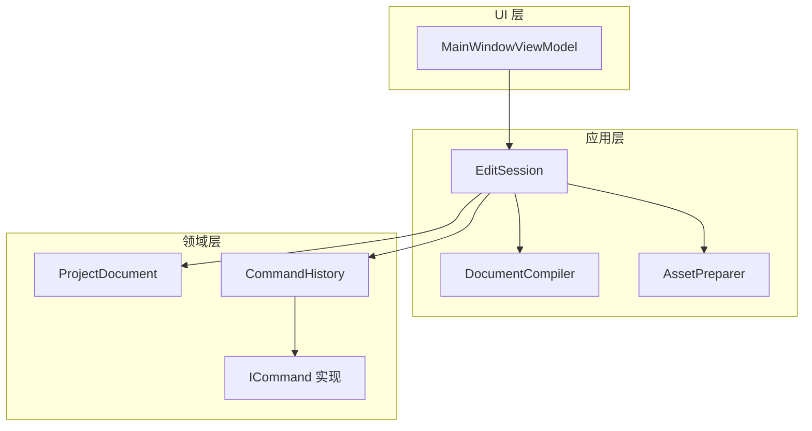
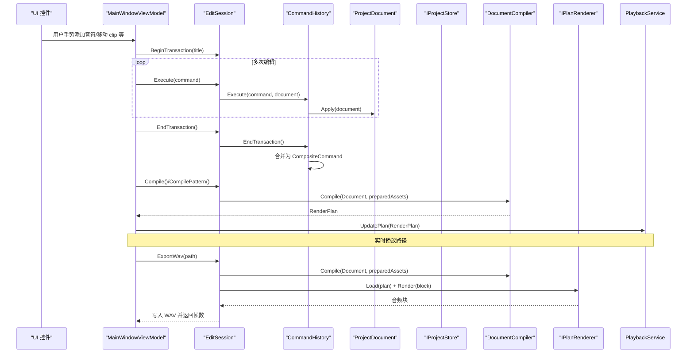
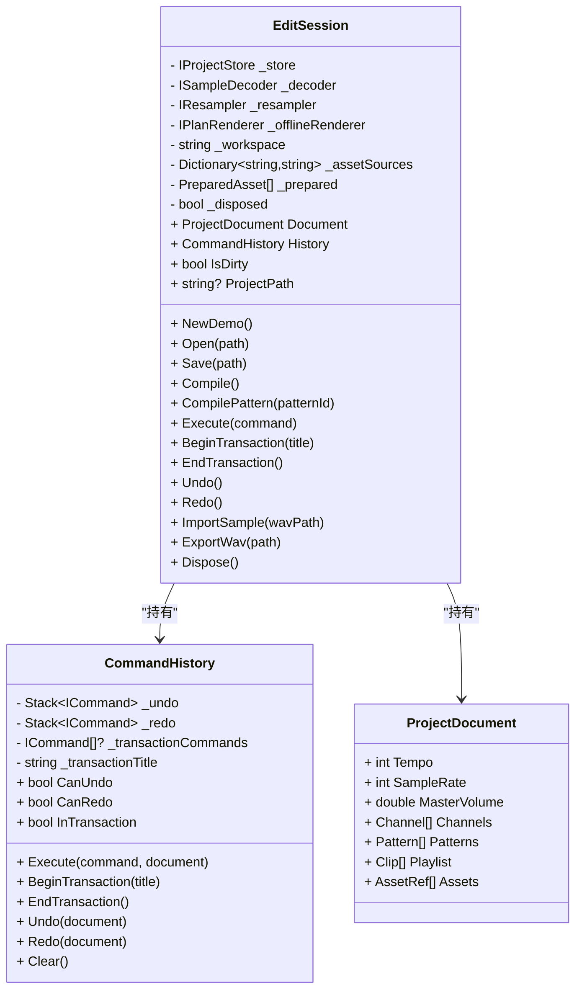
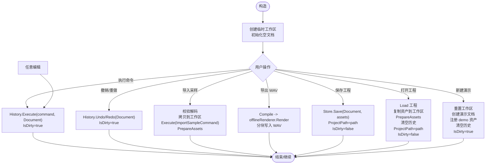
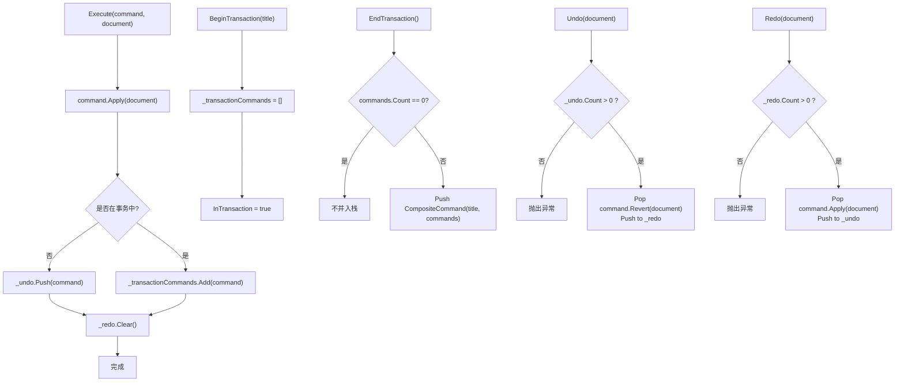
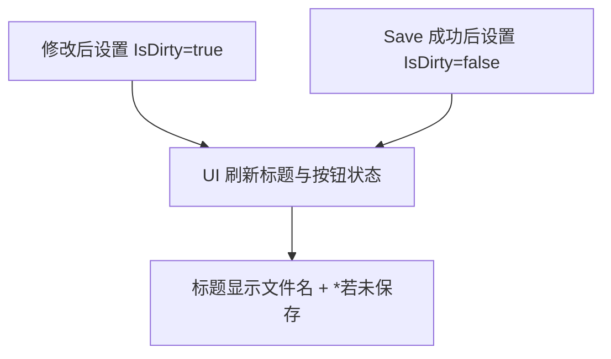
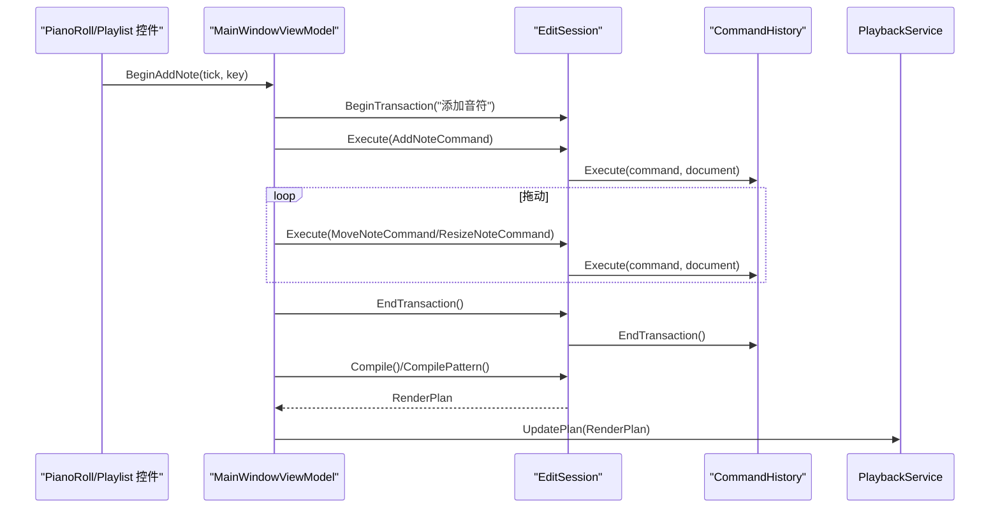
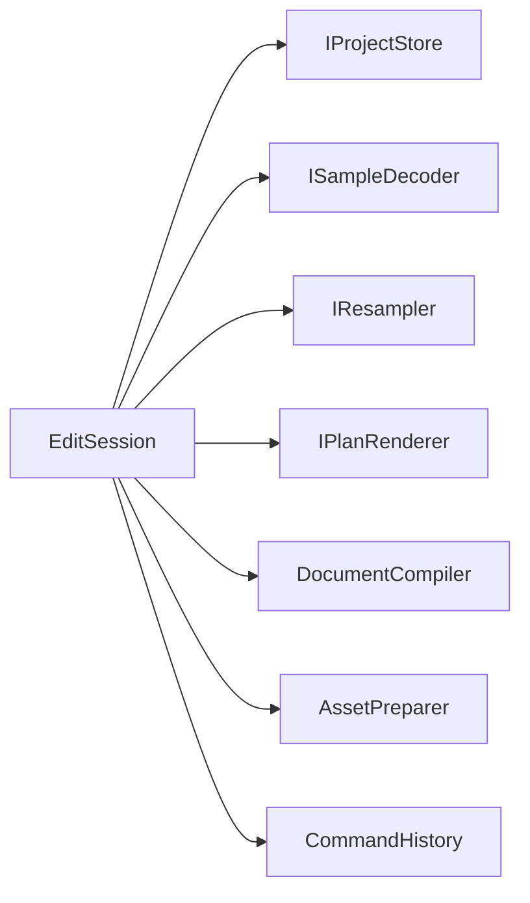

# 编辑会话工作流

<cite>
**本文引用的文件**   
- [EditSession.cs](file://src/Weftone.Application/EditSession.cs)
- [CommandHistory.cs](file://src/Weftone.Domain/Commands/CommandHistory.cs)
- [ProjectDocument.cs](file://src/Weftone.Domain/ProjectDocument.cs)
- [MainWindowViewModel.cs](file://src/Weftone.App/ViewModels/MainWindowViewModel.cs)
- [EditSessionTests.cs](file://tests/Weftone.Application.Tests/EditSessionTests.cs)
- [CommandHistoryTests.cs](file://tests/Weftone.Domain.Tests/CommandHistoryTests.cs)
</cite>

## 目录
1. [引言](#引言)
2. [项目结构](#项目结构)
3. [核心组件](#核心组件)
4. [架构总览](#架构总览)
5. [详细组件分析](#详细组件分析)
6. [依赖关系分析](#依赖关系分析)
7. [性能与并发考虑](#性能与并发考虑)
8. [故障排查指南](#故障排查指南)
9. [结论](#结论)
10. [附录：应用层使用示例](#附录应用层使用示例)

## 引言
本文面向 Weftone 的编辑会话工作流，重点解释 EditSession 如何协调用户输入、命令执行与状态管理，并说明其与 CommandHistory 的撤销重做集成、脏标记与持久化策略、事务合并机制，以及多线程安全边界。文档同时给出在应用层（UI ViewModel）中的典型用法和测试用例参考，帮助读者从高层到代码级全面理解该子系统。

## 项目结构
编辑会话相关代码分布在三层：
- 应用层：EditSession 负责工程文档、资产工作区、编译与导出、命令入口与事务封装。
- 领域层：ProjectDocument 是可编辑的富对象；CommandHistory 提供撤销重做与事务合并。
- UI 层：MainWindowViewModel 将用户手势转换为命令，并通过 EditSession 驱动状态更新与播放。

**图表来源**
- [EditSession.cs:14-222](file://src/Weftone.Application/EditSession.cs#L14-L222)
- [CommandHistory.cs:7-99](file://src/Weftone.Domain/Commands/CommandHistory.cs#L7-L99)
- [ProjectDocument.cs:7-20](file://src/Weftone.Domain/ProjectDocument.cs#L7-L20)
- [MainWindowViewModel.cs:96-106](file://src/Weftone.App/ViewModels/MainWindowViewModel.cs#L96-L106)

**章节来源**
- [EditSession.cs:14-222](file://src/Weftone.Application/EditSession.cs#L14-L222)
- [CommandHistory.cs:7-99](file://src/Weftone.Domain/Commands/CommandHistory.cs#L7-L99)
- [ProjectDocument.cs:7-20](file://src/Weftone.Domain/ProjectDocument.cs#L7-L20)
- [MainWindowViewModel.cs:96-106](file://src/Weftone.App/ViewModels/MainWindowViewModel.cs#L96-L106)

## 核心组件
- EditSession：编辑会话控制器，持有 ProjectDocument、CommandHistory、临时工作区与已准备资产，对外暴露打开、保存、导入、导出、编译、执行命令、撤销重做、事务等能力。
- CommandHistory：基于两个栈的撤销重做历史，支持事务合并，保证空栈拒绝与 redo 被新命令清空。
- ProjectDocument：可编辑的工程富对象，包含通道、模式、播放列表、资产引用等集合。
- MainWindowViewModel：UI 视图模型，将用户手势映射为命令，调用 EditSession 完成状态变更与播放更新。

**章节来源**
- [EditSession.cs:14-222](file://src/Weftone.Application/EditSession.cs#L14-L222)
- [CommandHistory.cs:7-99](file://src/Weftone.Domain/Commands/CommandHistory.cs#L7-L99)
- [ProjectDocument.cs:7-20](file://src/Weftone.Domain/ProjectDocument.cs#L7-L20)
- [MainWindowViewModel.cs:96-106](file://src/Weftone.App/ViewModels/MainWindowViewModel.cs#L96-L106)

## 架构总览
EditSession 作为 UI 线程单写者，集中管理 Document、命令日志与资产。命令通过 CommandHistory 入栈，Undo/Redo 直接作用于 Document。编译结果 RenderPlan 交给 PlaybackService 进行实时播放；离线渲染器用于 WAV 导出。

**图表来源**
- [MainWindowViewModel.cs:229-323](file://src/Weftone.App/ViewModels/MainWindowViewModel.cs#L229-L323)
- [EditSession.cs:100-130](file://src/Weftone.Application/EditSession.cs#L100-L130)
- [CommandHistory.cs:20-59](file://src/Weftone.Domain/Commands/CommandHistory.cs#L20-L59)
- [EditSession.cs:171-188](file://src/Weftone.Application/EditSession.cs#L171-L188)

## 详细组件分析

### EditSession 类分析
EditSession 是编辑会话的核心控制器，职责包括：
- 生命周期管理：构造时创建临时工作区与空文档；NewDemo/Open/Save 管理工程加载与持久化；Dispose 清理工作区。
- 资产与工作区：Open 时将工程内资源复制到临时目录，维护 assetPath→localPath 映射；PrepareAssets 预解码并重采样，供编译与导出使用。
- 命令与事务：Execute 委托给 CommandHistory；BeginTransaction/EndTransaction 将一次手势的多条命令合并为一条撤销记录。
- 编译与导出：Compile/CompilePattern 生成 RenderPlan；ExportWav 使用独立离线渲染器全时间轴导出。
- 状态标记：所有修改后设置 IsDirty=true；Save 成功后置 false；ProjectPath 反映当前工程路径。

**图表来源**
- [EditSession.cs:14-222](file://src/Weftone.Application/EditSession.cs#L14-L222)
- [CommandHistory.cs:7-99](file://src/Weftone.Domain/Commands/CommandHistory.cs#L7-L99)
- [ProjectDocument.cs:7-20](file://src/Weftone.Domain/ProjectDocument.cs#L7-L20)

#### 生命周期流程

**图表来源**
- [EditSession.cs:27-41](file://src/Weftone.Application/EditSession.cs#L27-L41)
- [EditSession.cs:51-92](file://src/Weftone.Application/EditSession.cs#L51-L92)
- [EditSession.cs:100-130](file://src/Weftone.Application/EditSession.cs#L100-L130)
- [EditSession.cs:137-188](file://src/Weftone.Application/EditSession.cs#L137-L188)

**章节来源**
- [EditSession.cs:27-41](file://src/Weftone.Application/EditSession.cs#L27-L41)
- [EditSession.cs:51-92](file://src/Weftone.Application/EditSession.cs#L51-L92)
- [EditSession.cs:100-130](file://src/Weftone.Application/EditSession.cs#L100-L130)
- [EditSession.cs:137-188](file://src/Weftone.Application/EditSession.cs#L137-L188)

### CommandHistory 集成与撤销重做
CommandHistory 通过两个栈维护 undo/redo，并在事务期间将多条命令聚合为 CompositeCommand。关键行为：
- Execute：Apply 后立即入栈；若在事务中则加入事务列表；任何新命令会清空 redo 栈。
- BeginTransaction/EndTransaction：禁止嵌套；空事务不入栈；结束时包装为 CompositeCommand。
- Undo/Redo：事务进行中拒绝；空栈抛异常；Undo 将命令移入 redo，Redo 将命令移回 undo。
- Clear：载入新工程时清空历史。

**图表来源**
- [CommandHistory.cs:20-99](file://src/Weftone.Domain/Commands/CommandHistory.cs#L20-L99)

**章节来源**
- [CommandHistory.cs:20-99](file://src/Weftone.Domain/Commands/CommandHistory.cs#L20-L99)

### 状态管理：脏标记、变更追踪与持久化
- 脏标记：所有修改（Execute、Undo、Redo、BeginTransaction、EndTransaction、NewDemo、Open、Save）都会调整 IsDirty。UI 标题根据 IsDirty 显示“*”提示未保存。
- 变更追踪：通过命令的 Apply/Revert 对 ProjectDocument 进行增量变更；CommandHistory 确保可逆。
- 持久化策略：Save 调用 IProjectStore.Save，传入 Document 与 _assetSources 映射；Open 时从 store.Load 获取 LoadedProject，复制资产到工作区并重建映射。

**图表来源**
- [EditSession.cs:47-92](file://src/Weftone.Application/EditSession.cs#L47-L92)
- [MainWindowViewModel.cs:496-521](file://src/Weftone.App/ViewModels/MainWindowViewModel.cs#L496-L521)

**章节来源**
- [EditSession.cs:47-92](file://src/Weftone.Application/EditSession.cs#L47-L92)
- [MainWindowViewModel.cs:496-521](file://src/Weftone.App/ViewModels/MainWindowViewModel.cs#L496-L521)

### 应用层使用示例
MainWindowViewModel 展示了如何在 UI 层使用 EditSession：
- 构造时注入 EditSession、PlaybackService、FileDialogService。
- 播放：根据 Song/Pattern 模式调用 Compile/CompilePattern，并将 RenderPlan 传给 PlaybackService。
- 手势：BeginAddNote/BeginMoveNote/BeginResizeNote 开启事务，中间多次 Execute，EndNoteGesture 结束事务；AfterEdit 统一刷新 UI 与播放计划。
- 导入/导出：ImportSampleAsync 调用 ImportSample，ExportAsync 调用 ExportWav。
- 混音与主音量：拖动中直接改文档以实时预览，释放时通过命令入栈。

**图表来源**
- [MainWindowViewModel.cs:229-323](file://src/Weftone.App/ViewModels/MainWindowViewModel.cs#L229-L323)
- [EditSession.cs:100-130](file://src/Weftone.Application/EditSession.cs#L100-L130)

**章节来源**
- [MainWindowViewModel.cs:96-106](file://src/Weftone.App/ViewModels/MainWindowViewModel.cs#L96-L106)
- [MainWindowViewModel.cs:229-323](file://src/Weftone.App/ViewModels/MainWindowViewModel.cs#L229-L323)
- [MainWindowViewModel.cs:398-435](file://src/Weftone.App/ViewModels/MainWindowViewModel.cs#L398-L435)
- [MainWindowViewModel.cs:437-494](file://src/Weftone.App/ViewModels/MainWindowViewModel.cs#L437-L494)

## 依赖关系分析
EditSession 依赖以下外部接口与组件：
- IProjectStore：工程持久化（Load/Save）。
- ISampleDecoder/IResampler：采样解码与重采样，用于 PrepareAssets。
- IPlanRenderer：离线渲染器，用于 ExportWav。
- DocumentCompiler/AssetPreparer：编译与资产预处理。
- CommandHistory：撤销重做与事务。

**图表来源**
- [EditSession.cs:18-24](file://src/Weftone.Application/EditSession.cs#L18-L24)
- [EditSession.cs:94-98](file://src/Weftone.Application/EditSession.cs#L94-L98)
- [EditSession.cs:190-194](file://src/Weftone.Application/EditSession.cs#L190-L194)

**章节来源**
- [EditSession.cs:18-24](file://src/Weftone.Application/EditSession.cs#L18-L24)
- [EditSession.cs:94-98](file://src/Weftone.Application/EditSession.cs#L94-L98)
- [EditSession.cs:190-194](file://src/Weftone.Application/EditSession.cs#L190-L194)

## 性能与并发考虑
- 单写者模型：EditSession 注释明确 UI 线程单写者持有 Document + 命令日志 + 资产；M1a/M1b 设计为单线程同步编辑，避免复杂锁。
- 实时播放隔离：RenderPlan 由 PlaybackService 消费；ExportWav 使用独立的 IPlanRenderer 实例，避免与实时播放共享渲染状态。
- 资产预取：PrepareAssets 在每次导入或工程打开后重建，减少重复解码开销。
- 导出分块：ExportWav 按固定帧块（512）渲染与写入，降低内存峰值。
- 并发访问控制：当前实现未加锁，假定仅 UI 线程调用；若未来引入后台线程，需增加互斥保护（例如 ReaderWriterLockSlim）并对 Document 与 _prepared 进行读写分离。

[本节为通用指导，不涉及具体文件分析]

## 故障排查指南
常见问题与定位建议：
- 撤销/重做异常：当撤销或重做栈为空时会抛出异常；检查是否先执行了足够多的命令或在事务中进行撤销。
- 事务错误：BeginTransaction 嵌套或未开启 EndTransaction 会抛出异常；确保每个 Begin 对应一个 End。
- 导入失败：InvalidDataException/IOException/InvalidOperationException 表示 WAV 不可解码或 IO 异常；UI 层捕获并提示。
- 导出失败：IO 或无效参数导致导出失败；检查输出路径与权限。
- 脏标记未清除：确认 Save 成功且 ProjectPath 已设置；UI 标题应不再显示“*”。

**章节来源**
- [CommandHistory.cs:61-89](file://src/Weftone.Domain/Commands/CommandHistory.cs#L61-L89)
- [MainWindowViewModel.cs:398-435](file://src/Weftone.App/ViewModels/MainWindowViewModel.cs#L398-L435)
- [EditSession.cs:137-188](file://src/Weftone.Application/EditSession.cs#L137-L188)

## 结论
EditSession 作为 Weftone 编辑会话的核心控制器，将用户输入转化为命令，借助 CommandHistory 提供稳健的撤销重做与事务合并，并通过 ProjectDocument 与 IProjectStore 实现状态管理与持久化。其单写者模型简化了并发问题，配合 AssetPreparer 与 DocumentCompiler 提升编译与导出效率。UI 层通过 MainWindowViewModel 将手势映射为命令，形成清晰的编辑工作流。

[本节为总结性内容，不涉及具体文件分析]

## 附录：应用层使用示例
以下为在应用层使用 EditSession 的典型步骤与参考位置（不包含具体代码内容）：
- 创建会话：构造 EditSession 并注入 IProjectStore、ISampleDecoder、IResampler、IPlanRenderer。
  - 参考：[EditSessionTests.cs:13-14](file://tests/Weftone.Application.Tests/EditSessionTests.cs#L13-L14)
- 新建演示工程：调用 NewDemo，验证编译结果与脏标记。
  - 参考：[EditSessionTests.cs:19-31](file://tests/Weftone.Application.Tests/EditSessionTests.cs#L19-L31)
- 保存与打开：调用 Save 与 Open，验证 roundtrip 与脏标记清除。
  - 参考：[EditSessionTests.cs:33-58](file://tests/Weftone.Application.Tests/EditSessionTests.cs#L33-L58)
- 执行命令与撤销重做：通过 Execute、Undo、Redo 验证历史与脏标记。
  - 参考：[EditSessionTests.cs:60-76](file://tests/Weftone.Application.Tests/EditSessionTests.cs#L60-L76)
- 打开工程清空历史：验证 Open 后 CanUndo/CanRedo 为假。
  - 参考：[EditSessionTests.cs:78-101](file://tests/Weftone.Application.Tests/EditSessionTests.cs#L78-L101)
- UI 中使用：MainWindowViewModel 将手势转换为命令，调用 BeginTransaction/Execute/EndTransaction，并在 AfterEdit 中刷新 UI 与播放计划。
  - 参考：[MainWindowViewModel.cs:229-323](file://src/Weftone.App/ViewModels/MainWindowViewModel.cs#L229-L323)
  - 参考：[MainWindowViewModel.cs:496-521](file://src/Weftone.App/ViewModels/MainWindowViewModel.cs#L496-L521)

**章节来源**
- [EditSessionTests.cs:13-14](file://tests/Weftone.Application.Tests/EditSessionTests.cs#L13-L14)
- [EditSessionTests.cs:19-31](file://tests/Weftone.Application.Tests/EditSessionTests.cs#L19-L31)
- [EditSessionTests.cs:33-58](file://tests/Weftone.Application.Tests/EditSessionTests.cs#L33-L58)
- [EditSessionTests.cs:60-76](file://tests/Weftone.Application.Tests/EditSessionTests.cs#L60-L76)
- [EditSessionTests.cs:78-101](file://tests/Weftone.Application.Tests/EditSessionTests.cs#L78-L101)
- [MainWindowViewModel.cs:229-323](file://src/Weftone.App/ViewModels/MainWindowViewModel.cs#L229-L323)
- [MainWindowViewModel.cs:496-521](file://src/Weftone.App/ViewModels/MainWindowViewModel.cs#L496-L521)