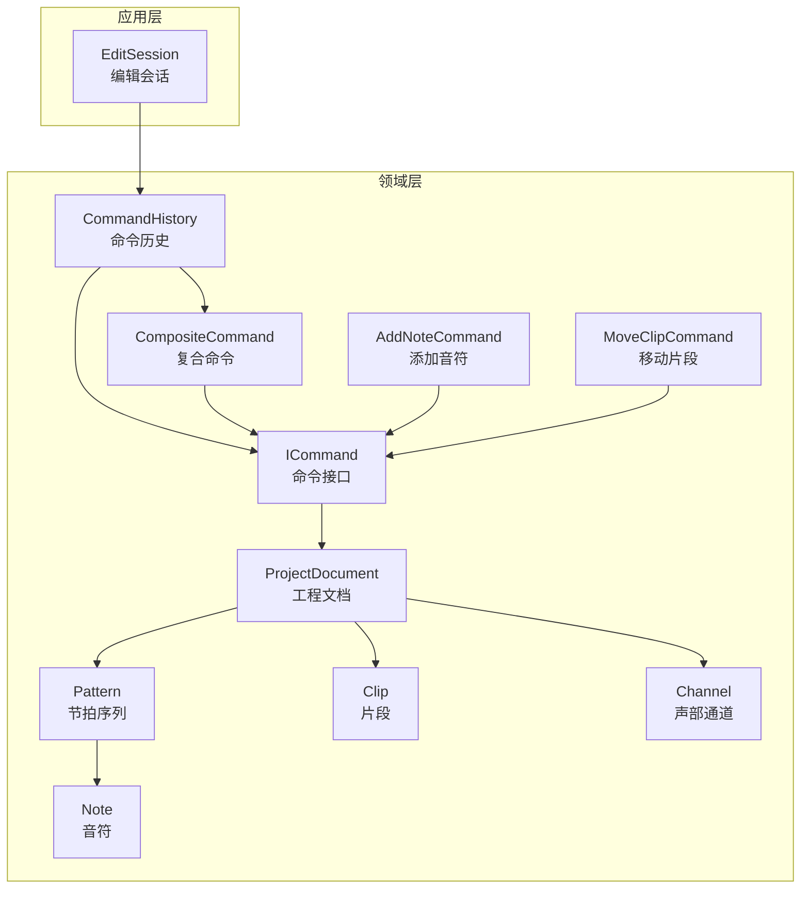
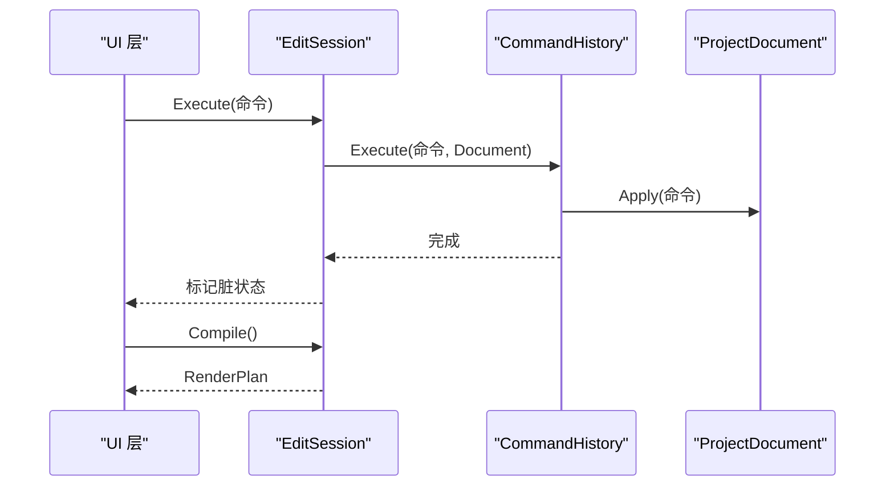
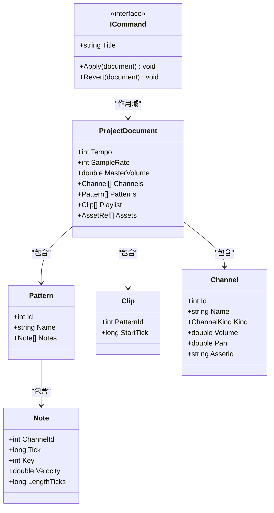
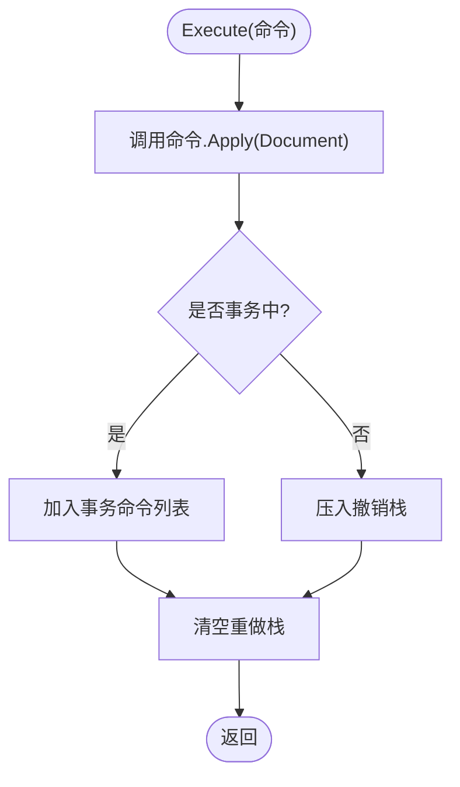
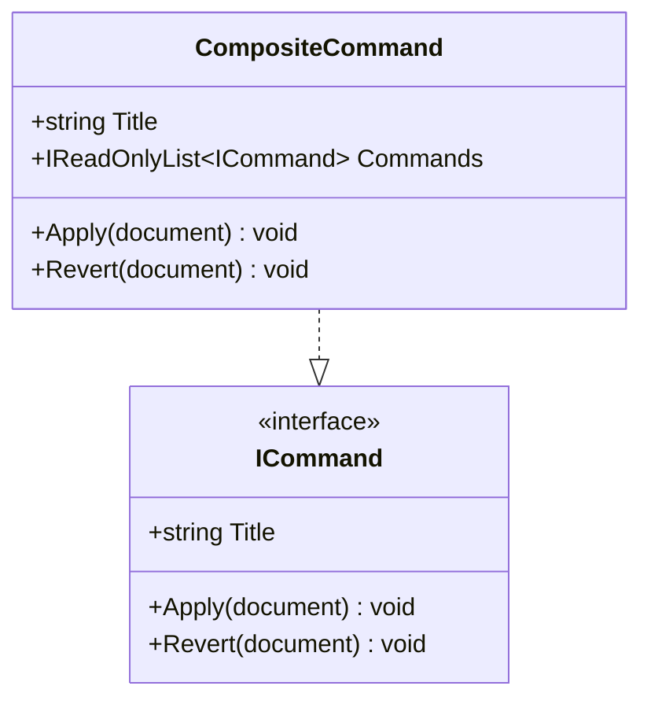
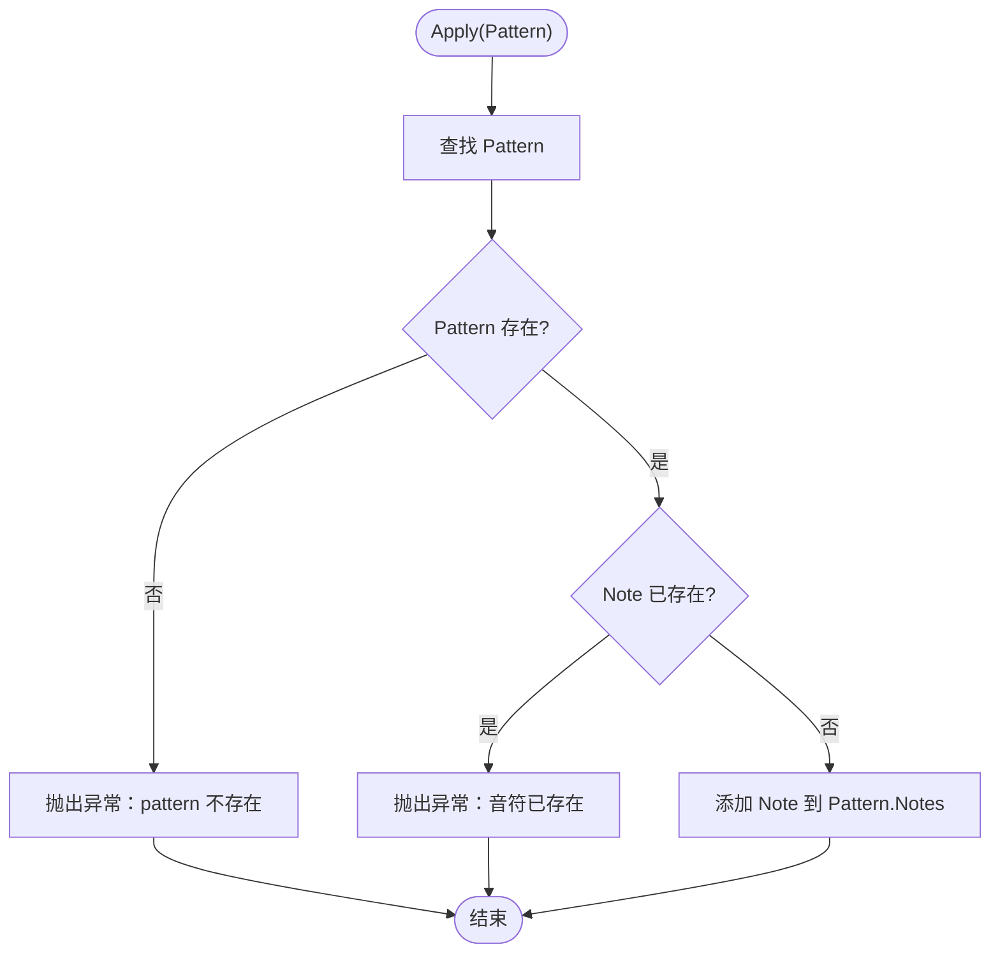
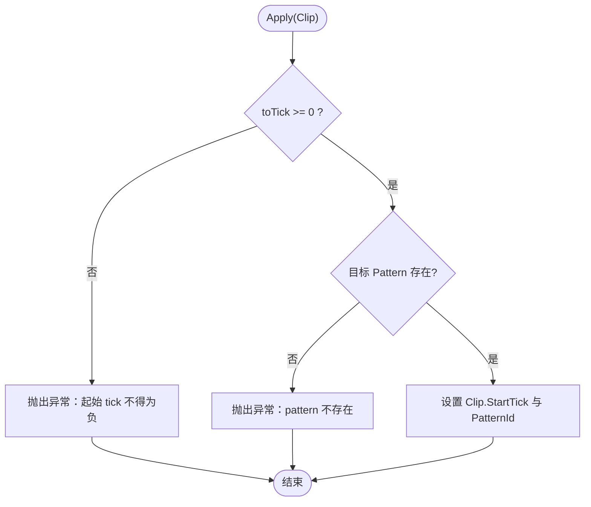
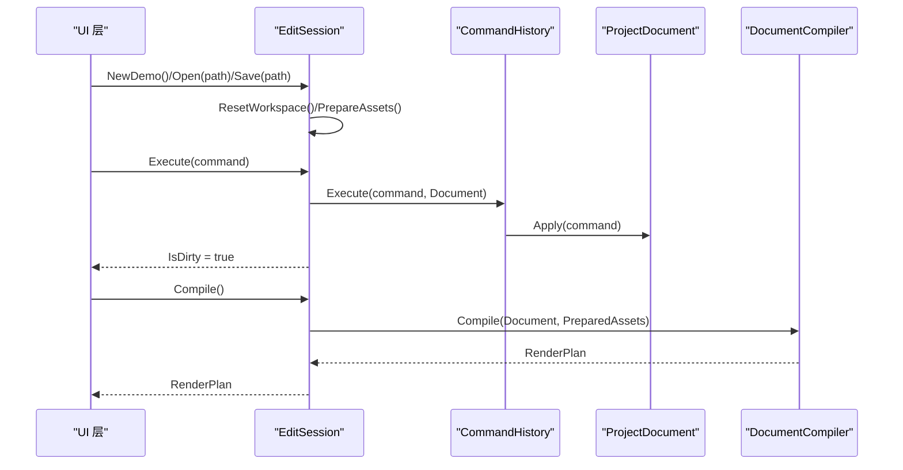
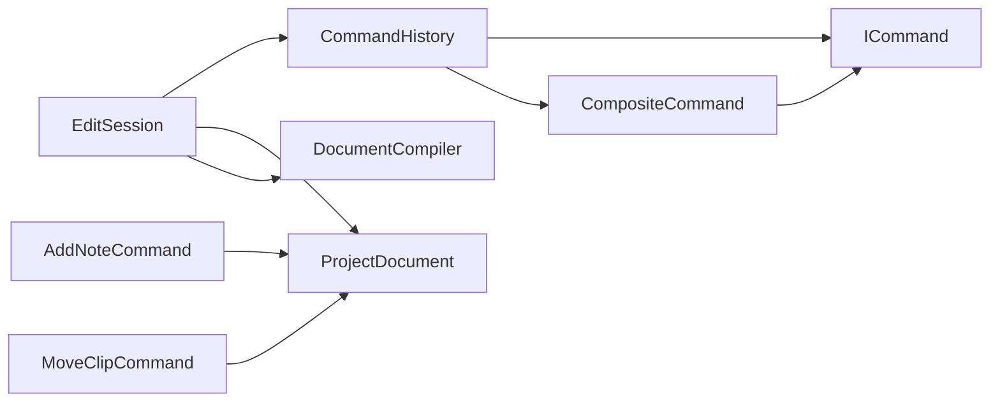

# 编辑系统

<cite>
**本文引用的文件**   
- [ICommand.cs](file://src/Weftone.Domain/Commands/ICommand.cs)
- [CommandHistory.cs](file://src/Weftone.Domain/Commands/CommandHistory.cs)
- [CompositeCommand.cs](file://src/Weftone.Domain/Commands/CompositeCommand.cs)
- [AddNoteCommand.cs](file://src/Weftone.Domain/Commands/AddNoteCommand.cs)
- [MoveClipCommand.cs](file://src/Weftone.Domain/Commands/MoveClipCommand.cs)
- [EditSession.cs](file://src/Weftone.Application/EditSession.cs)
- [ProjectDocument.cs](file://src/Weftone.Domain/ProjectDocument.cs)
- [Pattern.cs](file://src/Weftone.Domain/Pattern.cs)
- [Clip.cs](file://src/Weftone.Domain/Clip.cs)
- [Note.cs](file://src/Weftone.Domain/Note.cs)
- [Channel.cs](file://src/Weftone.Domain/Channel.cs)
</cite>

## 目录
1. [简介](#简介)
2. [项目结构](#项目结构)
3. [核心组件](#核心组件)
4. [架构总览](#架构总览)
5. [详细组件分析](#详细组件分析)
6. [依赖关系分析](#依赖关系分析)
7. [性能与可维护性](#性能与可维护性)
8. [故障排查指南](#故障排查指南)
9. [结论](#结论)
10. [附录：使用模式与示例路径](#附录使用模式与示例路径)

## 简介
本文件为 Weftone 编辑系统的功能文档，聚焦命令模式、撤销/重做机制、编辑会话流程、复合命令组合，以及编辑系统与领域模型的集成方式。该编辑系统以“富对象 + 可撤销命令”为核心设计，UI 层通过 EditSession 协调用户输入，将操作封装为 ICommand，并由 CommandHistory 管理执行历史；所有变更作用于 ProjectDocument 及其子对象（Pattern、Clip、Note、Channel），最终由 DocumentCompiler 生成 RenderPlan 供播放或导出。

## 项目结构
编辑系统横跨应用层与领域层：
- 领域层（Weftone.Domain）定义可编辑的文档模型与命令接口及具体命令实现。
- 应用层（Weftone.Application）提供 EditSession，负责生命周期、资产准备、编译、导入导出，并桥接命令历史与文档。

**图表来源**
- [EditSession.cs:14-45](file://src/Weftone.Application/EditSession.cs#L14-L45)
- [CommandHistory.cs:7-18](file://src/Weftone.Domain/Commands/CommandHistory.cs#L7-L18)
- [CompositeCommand.cs:7-11](file://src/Weftone.Domain/Commands/CompositeCommand.cs#L7-L11)
- [AddNoteCommand.cs:3-8](file://src/Weftone.Domain/Commands/AddNoteCommand.cs#L3-L8)
- [MoveClipCommand.cs:7-15](file://src/Weftone.Domain/Commands/MoveClipCommand.cs#L7-L15)
- [ProjectDocument.cs:7-19](file://src/Weftone.Domain/ProjectDocument.cs#L7-L19)
- [Pattern.cs:3-7](file://src/Weftone.Domain/Pattern.cs#L3-L7)
- [Clip.cs:4-7](file://src/Weftone.Domain/Clip.cs#L4-L7)
- [Note.cs:4-10](file://src/Weftone.Domain/Note.cs#L4-L10)
- [Channel.cs:10-17](file://src/Weftone.Domain/Channel.cs#L10-L17)

**章节来源**
- [EditSession.cs:14-45](file://src/Weftone.Application/EditSession.cs#L14-L45)
- [ProjectDocument.cs:7-19](file://src/Weftone.Domain/ProjectDocument.cs#L7-L19)

## 核心组件
- ICommand：定义可撤销编辑命令的统一契约，包含标题、Apply 与 Revert。
- CommandHistory：维护撤销栈与重做栈，支持事务合并多条命令为一次撤销记录。
- CompositeCommand：将多个命令按序 Apply、逆序 Revert，作为单条撤销项入栈。
- AddNoteCommand / MoveClipCommand：针对 Pattern 音符与 Playlist 片段的领域命令。
- EditSession：编辑会话入口，持有 Document、History、资产与工作区，协调命令执行、编译、导入导出。

**章节来源**
- [ICommand.cs:3-11](file://src/Weftone.Domain/Commands/ICommand.cs#L3-L11)
- [CommandHistory.cs:3-18](file://src/Weftone.Domain/Commands/CommandHistory.cs#L3-L18)
- [CompositeCommand.cs:3-11](file://src/Weftone.Domain/Commands/CompositeCommand.cs#L3-L11)
- [AddNoteCommand.cs:3-8](file://src/Weftone.Domain/Commands/AddNoteCommand.cs#L3-L8)
- [MoveClipCommand.cs:3-15](file://src/Weftone.Domain/Commands/MoveClipCommand.cs#L3-L15)
- [EditSession.cs:8-45](file://src/Weftone.Application/EditSession.cs#L8-L45)

## 架构总览
编辑系统采用“命令模式 + 富对象文档”的架构：
- UI 调用 EditSession.Execute 提交命令。
- EditSession 委托 CommandHistory 执行命令，更新 IsDirty。
- 命令直接修改 ProjectDocument 及其子对象。
- 编辑完成后，调用 Compile 生成 RenderPlan 用于播放或导出。

**图表来源**
- [EditSession.cs:100-104](file://src/Weftone.Application/EditSession.cs#L100-L104)
- [CommandHistory.cs:20-33](file://src/Weftone.Domain/Commands/CommandHistory.cs#L20-L33)
- [ProjectDocument.cs:7-19](file://src/Weftone.Domain/ProjectDocument.cs#L7-L19)

## 详细组件分析

### 命令接口与领域模型
ICommand 定义了统一的命令契约，要求 Apply 与 Revert 精确互逆，确保撤销语义正确。领域模型包括：
- ProjectDocument：工程根，包含 Tempo、SampleRate、MasterVolume、Channels、Patterns、Playlist、Assets。
- Pattern：节拍序列，包含 Notes。
- Clip：Playlist 中的片段，包含 PatternId 与 StartTick。
- Note：音符，包含 ChannelId、Tick、Key、Velocity、LengthTicks。
- Channel：声部通道，包含 Kind、Volume、Pan、AssetId。

**图表来源**
- [ICommand.cs:3-11](file://src/Weftone.Domain/Commands/ICommand.cs#L3-L11)
- [ProjectDocument.cs:7-19](file://src/Weftone.Domain/ProjectDocument.cs#L7-L19)
- [Pattern.cs:3-7](file://src/Weftone.Domain/Pattern.cs#L3-L7)
- [Clip.cs:4-7](file://src/Weftone.Domain/Clip.cs#L4-L7)
- [Note.cs:4-10](file://src/Weftone.Domain/Note.cs#L4-L10)
- [Channel.cs:10-17](file://src/Weftone.Domain/Channel.cs#L10-L17)

**章节来源**
- [ICommand.cs:3-11](file://src/Weftone.Domain/Commands/ICommand.cs#L3-L11)
- [ProjectDocument.cs:7-19](file://src/Weftone.Domain/ProjectDocument.cs#L7-L19)
- [Pattern.cs:3-7](file://src/Weftone.Domain/Pattern.cs#L3-L7)
- [Clip.cs:4-7](file://src/Weftone.Domain/Clip.cs#L4-L7)
- [Note.cs:4-10](file://src/Weftone.Domain/Note.cs#L4-L10)
- [Channel.cs:10-17](file://src/Weftone.Domain/Channel.cs#L10-L17)

### 命令历史与撤销/重做机制
CommandHistory 维护两个栈：
- _undo：已执行命令栈，支持 Undo。
- _redo：已撤销命令栈，支持 Redo。

关键行为：
- Execute：调用命令 Apply，并将命令压入撤销栈；若处于事务中则加入临时列表；清空重做栈。
- BeginTransaction/EndTransaction：将手势期间多条命令合并为 CompositeCommand，作为单条撤销记录。
- Undo/Redo：在事务进行中拒绝操作；空栈时抛出异常；Undo 将命令从撤销栈弹出并 Revert，压入重做栈；Redo 相反。
- Clear：载入新工程时清空历史。

**图表来源**
- [CommandHistory.cs:20-33](file://src/Weftone.Domain/Commands/CommandHistory.cs#L20-L33)

**章节来源**
- [CommandHistory.cs:3-18](file://src/Weftone.Domain/Commands/CommandHistory.cs#L3-L18)
- [CommandHistory.cs:20-33](file://src/Weftone.Domain/Commands/CommandHistory.cs#L20-L33)
- [CommandHistory.cs:35-59](file://src/Weftone.Domain/Commands/CommandHistory.cs#L35-L59)
- [CommandHistory.cs:61-97](file://src/Weftone.Domain/Commands/CommandHistory.cs#L61-L97)

### 复合命令（CompositeCommand）
CompositeCommand 用于将一组命令组合为一次撤销单元：
- Apply：按顺序执行每个子命令的 Apply。
- Revert：逆序执行每个子命令的 Revert，保证回滚正确性。
- 通常由 CommandHistory.EndTransaction 创建，作为单条撤销记录入栈。

**图表来源**
- [CompositeCommand.cs:7-27](file://src/Weftone.Domain/Commands/CompositeCommand.cs#L7-L27)
- [ICommand.cs:3-11](file://src/Weftone.Domain/Commands/ICommand.cs#L3-L11)

**章节来源**
- [CompositeCommand.cs:3-27](file://src/Weftone.Domain/Commands/CompositeCommand.cs#L3-L27)
- [CommandHistory.cs:46-59](file://src/Weftone.Domain/Commands/CommandHistory.cs#L46-L59)

### 具体命令：AddNoteCommand
AddNoteCommand 向指定 Pattern 添加一个 Note：
- Apply：查找 Pattern，校验 Note 不重复后添加。
- Revert：从 Pattern 移除对应 Note。
- 错误处理：Pattern 不存在或 Note 已存在时抛出异常。

**图表来源**
- [AddNoteCommand.cs:10-23](file://src/Weftone.Domain/Commands/AddNoteCommand.cs#L10-L23)
- [AddNoteCommand.cs:25-29](file://src/Weftone.Domain/Commands/AddNoteCommand.cs#L25-L29)

**章节来源**
- [AddNoteCommand.cs:3-29](file://src/Weftone.Domain/Commands/AddNoteCommand.cs#L3-L29)
- [Pattern.cs:3-7](file://src/Weftone.Domain/Pattern.cs#L3-L7)
- [Note.cs:4-10](file://src/Weftone.Domain/Note.cs#L4-L10)

### 具体命令：MoveClipCommand
MoveClipCommand 移动 Playlist 中的 Clip，可同时改变起始 tick 与所在 Pattern：
- Apply：校验 toTick 非负且目标 Pattern 存在，然后设置 Clip.StartTick 与 PatternId。
- Revert：恢复至 fromTick 与 fromPatternId。
- 错误处理：toTick 为负、目标 Pattern 不存在、Clip 不存在时抛出异常。

**图表来源**
- [MoveClipCommand.cs:17-29](file://src/Weftone.Domain/Commands/MoveClipCommand.cs#L17-L29)
- [MoveClipCommand.cs:31-45](file://src/Weftone.Domain/Commands/MoveClipCommand.cs#L31-L45)

**章节来源**
- [MoveClipCommand.cs:3-45](file://src/Weftone.Domain/Commands/MoveClipCommand.cs#L3-L45)
- [Clip.cs:4-7](file://src/Weftone.Domain/Clip.cs#L4-L7)
- [Pattern.cs:3-7](file://src/Weftone.Domain/Pattern.cs#L3-L7)

### 编辑会话（EditSession）工作流程
EditSession 是 UI 与领域之间的协调者：
- 生命周期：NewDemo/Open/Save 管理工程加载与保存，清理工作区并准备资产。
- 命令执行：Execute 委托 History.Execute，标记 IsDirty。
- 事务：BeginTransaction/EndTransaction 包装拖拽等手势，合并多条命令。
- 撤销/重做：Undo/Redo 委托 History，标记 IsDirty。
- 编译：Compile/CompilePattern 生成 RenderPlan。
- 导入采样：ImportSample 解码校验、拷贝到工作区、注册 AssetRef、创建 Sampler 通道，并以 ImportSampleCommand 一步撤销。
- 导出 WAV：ExportWav 全时间轴离线渲染，写入立体声 float32 WAV。

**图表来源**
- [EditSession.cs:51-94](file://src/Weftone.Application/EditSession.cs#L51-L94)
- [EditSession.cs:100-130](file://src/Weftone.Application/EditSession.cs#L100-L130)
- [EditSession.cs:190-194](file://src/Weftone.Application/EditSession.cs#L190-L194)

**章节来源**
- [EditSession.cs:8-45](file://src/Weftone.Application/EditSession.cs#L8-L45)
- [EditSession.cs:51-94](file://src/Weftone.Application/EditSession.cs#L51-L94)
- [EditSession.cs:100-130](file://src/Weftone.Application/EditSession.cs#L100-L130)
- [EditSession.cs:132-194](file://src/Weftone.Application/EditSession.cs#L132-L194)

## 依赖关系分析
- EditSession 依赖 CommandHistory、ProjectDocument、DocumentCompiler、IProjectStore、ISampleDecoder、IResampler、IPlanRenderer。
- CommandHistory 依赖 ICommand 与 CompositeCommand。
- 具体命令依赖 ProjectDocument 及其子对象（Pattern、Clip、Note、Channel）。

**图表来源**
- [EditSession.cs:14-45](file://src/Weftone.Application/EditSession.cs#L14-L45)
- [CommandHistory.cs:7-18](file://src/Weftone.Domain/Commands/CommandHistory.cs#L7-L18)
- [CompositeCommand.cs:7-11](file://src/Weftone.Domain/Commands/CompositeCommand.cs#L7-L11)
- [AddNoteCommand.cs:3-8](file://src/Weftone.Domain/Commands/AddNoteCommand.cs#L3-L8)
- [MoveClipCommand.cs:7-15](file://src/Weftone.Domain/Commands/MoveClipCommand.cs#L7-L15)

**章节来源**
- [EditSession.cs:14-45](file://src/Weftone.Application/EditSession.cs#L14-L45)
- [CommandHistory.cs:7-18](file://src/Weftone.Domain/Commands/CommandHistory.cs#L7-L18)
- [CompositeCommand.cs:7-11](file://src/Weftone.Domain/Commands/CompositeCommand.cs#L7-L11)

## 性能与可维护性
- 小文档同步编译：M1b 场景下，EditSession.Compile 同步生成 RenderPlan，适合小规模工程，避免异步复杂度。
- 资产预准备：PrepareAssets 一次性准备所有资源，减少运行时 IO 与解码开销。
- 事务合并：拖拽手势通过事务合并为单次撤销，提升用户体验与撤销粒度。
- 可维护性：命令职责单一，Apply/Revert 互逆，便于测试与扩展。

[本节为通用指导，不直接分析具体文件]

## 故障排查指南
常见异常与处理：
- 事务相关：
  - BeginTransaction 嵌套：抛出“事务已开启，不支持嵌套”。
  - EndTransaction 未开启事务：抛出“未开启事务”。
  - 事务中进行 Undo/Redo：抛出“事务进行中不可撤销/重做”。
- 栈为空：
  - Undo/Redo 空栈：抛出“撤销栈为空/重做栈为空”。
- 命令参数校验：
  - AddNoteCommand：Pattern 不存在或 Note 已存在。
  - MoveClipCommand：toTick 为负、目标 Pattern 不存在、Clip 不存在。
- 工程加载：
  - Open/Save 路径为空：抛出参数异常。

建议：
- 在 UI 层捕获这些异常并提示用户。
- 对非法输入进行前置校验，减少运行时异常。
- 使用事务包裹连续操作，确保撤销一致性。

**章节来源**
- [CommandHistory.cs:35-59](file://src/Weftone.Domain/Commands/CommandHistory.cs#L35-L59)
- [CommandHistory.cs:61-89](file://src/Weftone.Domain/Commands/CommandHistory.cs#L61-L89)
- [AddNoteCommand.cs:10-29](file://src/Weftone.Domain/Commands/AddNoteCommand.cs#L10-L29)
- [MoveClipCommand.cs:17-45](file://src/Weftone.Domain/Commands/MoveClipCommand.cs#L17-L45)
- [EditSession.cs:64-92](file://src/Weftone.Application/EditSession.cs#L64-L92)

## 结论
Weftone 编辑系统通过命令模式与富对象文档实现了清晰、可撤销的编辑体验。EditSession 作为协调者，将 UI 输入转化为命令，CommandHistory 管理撤销/重做，CompositeCommand 支持事务合并。领域模型（ProjectDocument、Pattern、Clip、Note、Channel）承载业务数据，命令直接操作这些对象，确保语义明确、易于测试与维护。

[本节为总结，不直接分析具体文件]

## 附录：使用模式与示例路径
- 基本命令执行：
  - 路径参考：[EditSession.Execute:100-104](file://src/Weftone.Application/EditSession.cs#L100-L104)
- 事务化拖拽：
  - 开始事务：[EditSession.BeginTransaction:107-111](file://src/Weftone.Application/EditSession.cs#L107-L111)
  - 结束事务：[EditSession.EndTransaction:114-118](file://src/Weftone.Application/EditSession.cs#L114-L118)
  - 事务合并逻辑：[CommandHistory.BeginTransaction/EndTransaction:35-59](file://src/Weftone.Domain/Commands/CommandHistory.cs#L35-L59)
- 撤销/重做：
  - 撤销：[EditSession.Undo:120-124](file://src/Weftone.Application/EditSession.cs#L120-L124)
  - 重做：[EditSession.Redo:126-130](file://src/Weftone.Application/EditSession.cs#L126-L130)
- 添加音符：
  - 命令实现：[AddNoteCommand:3-29](file://src/Weftone.Domain/Commands/AddNoteCommand.cs#L3-L29)
- 移动片段：
  - 命令实现：[MoveClipCommand:3-45](file://src/Weftone.Domain/Commands/MoveClipCommand.cs#L3-L45)
- 导入采样：
  - 流程参考：[EditSession.ImportSample:132-165](file://src/Weftone.Application/EditSession.cs#L132-L165)
- 导出 WAV：
  - 流程参考：[EditSession.ExportWav:171-188](file://src/Weftone.Application/EditSession.cs#L171-L188)

[本节为使用指引，不直接分析具体文件]