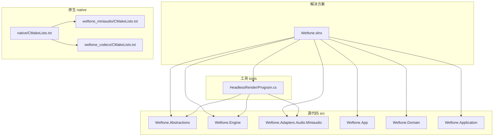
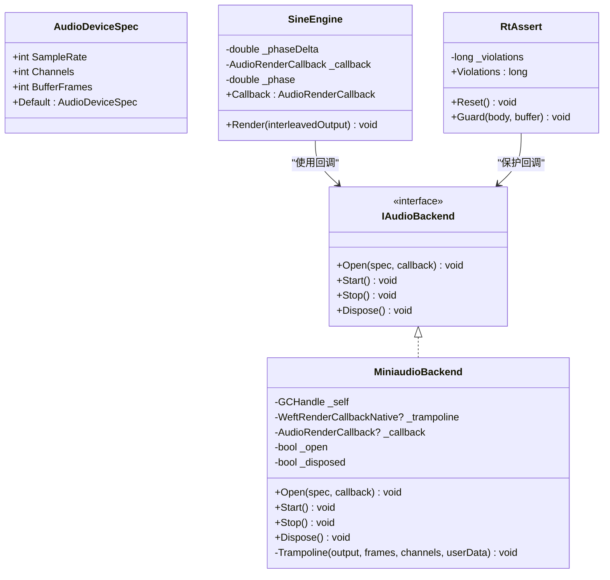
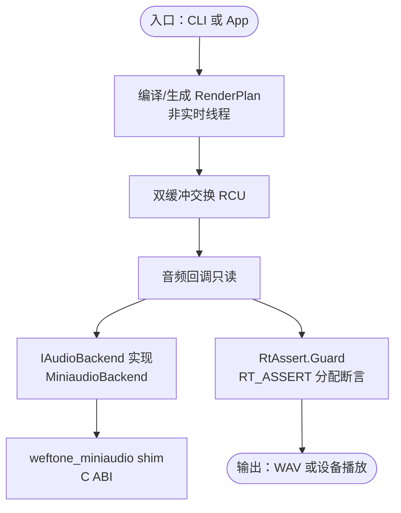
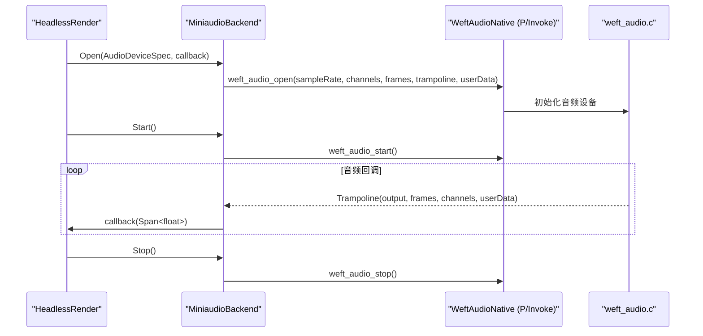
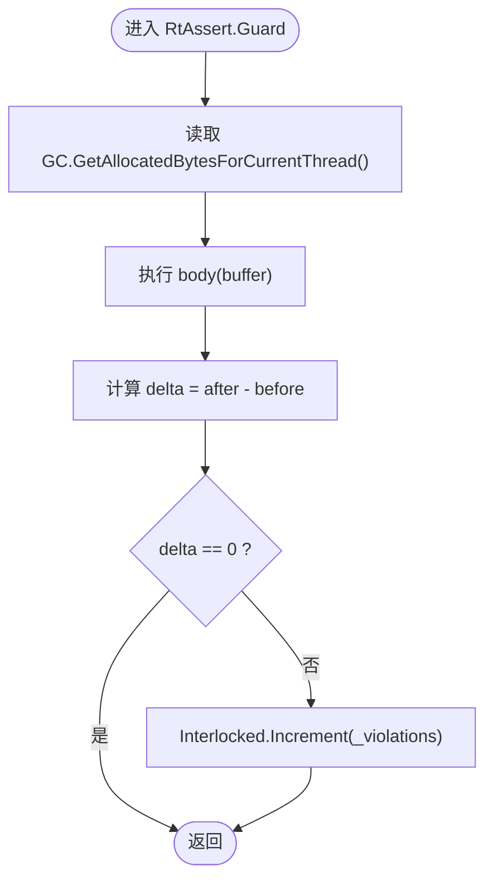
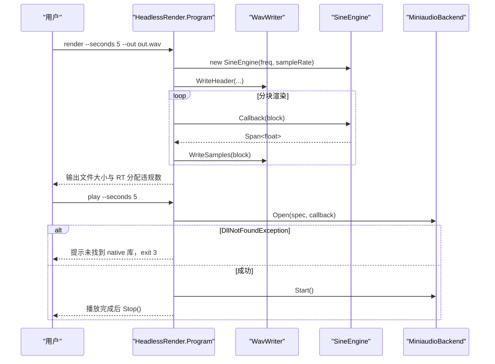
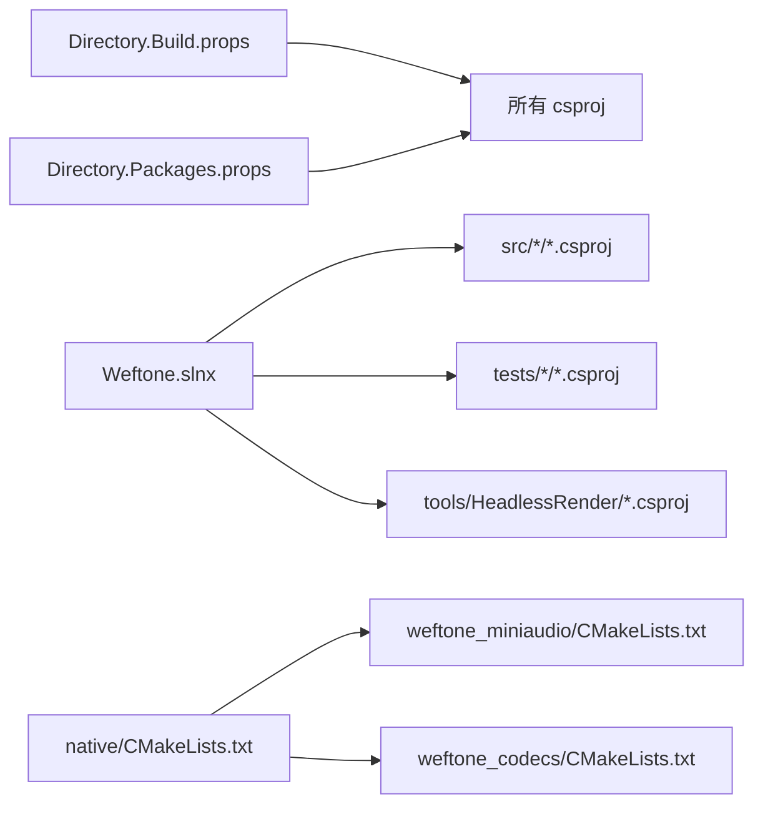
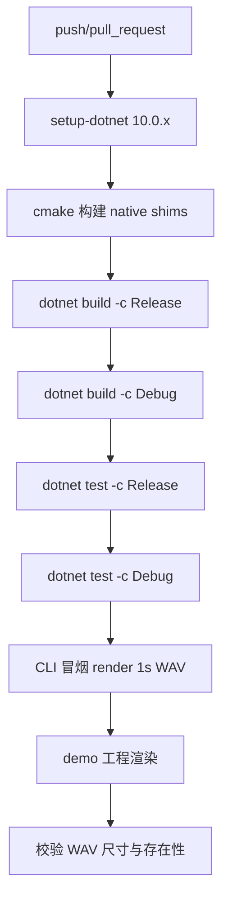

# M0 地基规格

<cite>
**本文引用的文件**   
- [specs/M0_FOUNDATION.md](file://specs/M0_FOUNDATION.md)
- [AGENTS.md](file://AGENTS.md)
- [README.md](file://README.md)
- [CONTRIBUTING.md](file://CONTRIBUTING.md)
- [THIRD_PARTY_NOTICES.md](file://THIRD_PARTY_NOTICES.md)
- [Directory.Build.props](file://Directory.Build.props)
- [Directory.Packages.props](file://Directory.Packages.props)
- [Weftone.slnx](file://Weftone.slnx)
- [.github/workflows/ci.yml](file://.github/workflows/ci.yml)
- [native/CMakeLists.txt](file://native/CMakeLists.txt)
- [native/weftone_miniaudio/CMakeLists.txt](file://native/weftone_miniaudio/CMakeLists.txt)
- [native/weftone_codecs/CMakeLists.txt](file://native/weftone_codecs/CMakeLists.txt)
- [src/Weftone.Abstractions/AudioDeviceSpec.cs](file://src/Weftone.Abstractions/AudioDeviceSpec.cs)
- [src/Weftone.Abstractions/IAudioBackend.cs](file://src/Weftone.Abstractions/IAudioBackend.cs)
- [src/Weftone.Engine/SineEngine.cs](file://src/Weftone.Engine/SineEngine.cs)
- [src/Weftone.Engine/RtAssert.cs](file://src/Weftone.Engine/RtAssert.cs)
- [src/Weftone.Adapters.Audio.Miniaudio/MiniaudioBackend.cs](file://src/Weftone.Adapters.Audio.Miniaudio/MiniaudioBackend.cs)
- [tools/HeadlessRender/Program.cs](file://tools/HeadlessRender/Program.cs)
</cite>

## 目录
1. [引言](#引言)
2. [项目结构](#项目结构)
3. [核心组件](#核心组件)
4. [架构总览](#架构总览)
5. [详细组件分析](#详细组件分析)
6. [依赖关系分析](#依赖关系分析)
7. [性能与实时纪律](#性能与实时纪律)
8. [CI/CD 与验收标准](#cicd-与验收标准)
9. [开发环境与构建指南](#开发环境与构建指南)
10. [故障排查](#故障排查)
11. [结论](#结论)

## 引言
M0 地基的目标是搭出“可出声、可离线渲染、可被三平台 CI 守护”的最小可行基础，为后续 headless 与 UI 里程碑提供稳定基座。其范围覆盖仓库治理、原生 shim、C# 端口与适配器、最小 CLI、测试策略与 CI 矩阵；非目标包括插件宿主、transport、文档模型、工程格式、UI 与进程隔离等后续能力。

- 核心目标：在 .NET 10 LTS 上实现正弦声输出、WAV 离线渲染、RT 分配断言、miniaudio 反向 P/Invoke 播放、三平台 CI 全绿。
- 关键约束：音频回调零分配、零锁、零异常、零 native malloc；渲染确定性；headless 优先；wheel-first。

**章节来源**
- [specs/M0_FOUNDATION.md:5-18](file://specs/M0_FOUNDATION.md#L5-L18)
- [AGENTS.md:25-35](file://AGENTS.md#L25-L35)

## 项目结构
仓库采用分层与领域划分相结合的布局：
- src：C# 源码（Abstractions / Domain / Application / Engine / Adapters / App）
- native：原生代码（weftone_miniaudio shim、weftone_codecs shim、vendored 库）
- specs：功能规格（SPEC-first）
- docs/adr：架构决策记录
- tests：引擎测试、架构测试、黄金音频回归
- tools：HeadlessRender CLI（weftone）
- 根级配置：Directory.Build.props、Directory.Packages.props、Weftone.slnx、CI 工作流

**图表来源**
- [Weftone.slnx:1-24](file://Weftone.slnx#L1-L24)
- [native/CMakeLists.txt:1-6](file://native/CMakeLists.txt#L1-L6)
- [tools/HeadlessRender/Program.cs:1-10](file://tools/HeadlessRender/Program.cs#L1-L10)

**章节来源**
- [README.md:70-79](file://README.md#L70-L79)
- [AGENTS.md:124-152](file://AGENTS.md#L124-L152)
- [Weftone.slnx:1-24](file://Weftone.slnx#L1-L24)

## 核心组件
- Abstractions：定义 IAudioBackend 端口与 AudioDeviceSpec 设备参数，作为 Engine 与 Adapters 的契约边界。
- Engine：SineEngine 提供零分配的音频回调；RtAssert 在 RT_ASSERT 下统计托管分配违规次数。
- Adapters.Audio.Miniaudio：MiniaudioBackend 通过反向 P/Invoke 调用 weftone_miniaudio shim，完成设备打开/启动/停止。
- HeadlessRender CLI：提供 render/play/project/demo 命令，串联 SineEngine、WavWriter、ProjectStore 与 MiniaudioBackend。

**图表来源**
- [src/Weftone.Abstractions/AudioDeviceSpec.cs:1-7](file://src/Weftone.Abstractions/AudioDeviceSpec.cs#L1-L7)
- [src/Weftone.Abstractions/IAudioBackend.cs:1-15](file://src/Weftone.Abstractions/IAudioBackend.cs#L1-L15)
- [src/Weftone.Adapters.Audio.Miniaudio/MiniaudioBackend.cs:1-85](file://src/Weftone.Adapters.Audio.Miniaudio/MiniaudioBackend.cs#L1-L85)
- [src/Weftone.Engine/SineEngine.cs:1-40](file://src/Weftone.Engine/SineEngine.cs#L1-L40)
- [src/Weftone.Engine/RtAssert.cs:1-32](file://src/Weftone.Engine/RtAssert.cs#L1-L32)

**章节来源**
- [src/Weftone.Abstractions/AudioDeviceSpec.cs:1-7](file://src/Weftone.Abstractions/AudioDeviceSpec.cs#L1-L7)
- [src/Weftone.Abstractions/IAudioBackend.cs:1-15](file://src/Weftone.Abstractions/IAudioBackend.cs#L1-L15)
- [src/Weftone.Engine/SineEngine.cs:1-40](file://src/Weftone.Engine/SineEngine.cs#L1-L40)
- [src/Weftone.Engine/RtAssert.cs:1-32](file://src/Weftone.Engine/RtAssert.cs#L1-L32)
- [src/Weftone.Adapters.Audio.Miniaudio/MiniaudioBackend.cs:1-85](file://src/Weftone.Adapters.Audio.Miniaudio/MiniaudioBackend.cs#L1-L85)

## 架构总览
M0 遵循六边形架构（端口与适配器）+ 编译器模式 + 数据导向实时层：
- 编辑模型与实时模型分离：Document → Compile → RenderPlan → AtomicSwap → RealtimeEngine。
- 实时纪律：音频回调零分配、零锁、零 GC、零异常、零 native malloc。
- Headless 优先：先 .weft → WAV 离线渲染，再贴 UI。
- Wheel-first：外围用轮子（音频 I/O、解码），核心自研（音频图、transport、文档模型、撤销）。

**图表来源**
- [AGENTS.md:61-70](file://AGENTS.md#L61-L70)
- [src/Weftone.Engine/RtAssert.cs:17-30](file://src/Weftone.Engine/RtAssert.cs#L17-L30)
- [src/Weftone.Adapters.Audio.Miniaudio/MiniaudioBackend.cs:21-56](file://src/Weftone.Adapters.Audio.Miniaudio/MiniaudioBackend.cs#L21-L56)

**章节来源**
- [README.md:38-57](file://README.md#L38-L57)
- [AGENTS.md:61-106](file://AGENTS.md#L61-L106)

## 详细组件分析

### 音频后端与原生绑定
- IAudioBackend 定义 Open/Start/Stop 生命周期与交错 float 输出回调契约。
- MiniaudioBackend 在 Open 时一次性建立委托与 GCHandle，回调路径零分配；通过 WeftAudioNative 反向 P/Invoke 调用 C shim。
- CMake 将 weftone_miniaudio 输出到 build 根目录，便于 C# 动态库探测。

**图表来源**
- [src/Weftone.Adapters.Audio.Miniaudio/MiniaudioBackend.cs:21-83](file://src/Weftone.Adapters.Audio.Miniaudio/MiniaudioBackend.cs#L21-L83)
- [native/weftone_miniaudio/CMakeLists.txt:7-28](file://native/weftone_miniaudio/CMakeLists.txt#L7-L28)

**章节来源**
- [src/Weftone.Abstractions/IAudioBackend.cs:1-15](file://src/Weftone.Abstractions/IAudioBackend.cs#L1-L15)
- [src/Weftone.Adapters.Audio.Miniaudio/MiniaudioBackend.cs:1-85](file://src/Weftone.Adapters.Audio.Miniaudio/MiniaudioBackend.cs#L1-L85)
- [native/weftone_miniaudio/CMakeLists.txt:1-29](file://native/weftone_miniaudio/CMakeLists.txt#L1-L29)

### 正弦引擎与分配断言
- SineEngine 以相位增量方式生成正弦样本，预捕获回调委托避免方法组转换分配。
- RtAssert.Guard 在 RT_ASSERT 下测量当前线程托管分配字节差值，违规仅计数不抛异常，保证音频线程零异常。

**图表来源**
- [src/Weftone.Engine/RtAssert.cs:17-30](file://src/Weftone.Engine/RtAssert.cs#L17-L30)
- [src/Weftone.Engine/SineEngine.cs:24-38](file://src/Weftone.Engine/SineEngine.cs#L24-L38)

**章节来源**
- [src/Weftone.Engine/SineEngine.cs:1-40](file://src/Weftone.Engine/SineEngine.cs#L1-L40)
- [src/Weftone.Engine/RtAssert.cs:1-32](file://src/Weftone.Engine/RtAssert.cs#L1-L32)

### CLI 工作流（render/play/project/demo）
- render：基于 SineEngine 生成 WAV，写入头与样本，校验 RtAssert.Violations。
- play：尝试加载 weftone_miniaudio，失败则 exit 3；成功则打开设备并播放指定时长。
- project：渲染 .weft 工程为 WAV，或打印工程概览。
- demo：生成演示工程（包含 kick.wav 资产）。

**图表来源**
- [tools/HeadlessRender/Program.cs:193-248](file://tools/HeadlessRender/Program.cs#L193-L248)

**章节来源**
- [tools/HeadlessRender/Program.cs:1-266](file://tools/HeadlessRender/Program.cs#L1-L266)

## 依赖关系分析
- 解决方案由 Weftone.slnx 统一组织 src/tests/tools 下的项目。
- Directory.Build.props 集中设置 net10.0、Nullable、Deterministic、TreatWarningsAsErrors，并在 Debug 自动定义 RT_ASSERT。
- Directory.Packages.props 集中管理 NuGet 包版本（Avalonia、CommunityToolkit.Mvvm、NUnit、NetArchTest 等）。
- native/CMakeLists.txt 聚合 weftone_miniaudio 与 weftone_codecs 两个子模块。

**图表来源**
- [Directory.Build.props:1-20](file://Directory.Build.props#L1-L20)
- [Directory.Packages.props:1-27](file://Directory.Packages.props#L1-L27)
- [Weftone.slnx:1-24](file://Weftone.slnx#L1-L24)
- [native/CMakeLists.txt:1-6](file://native/CMakeLists.txt#L1-L6)

**章节来源**
- [Directory.Build.props:1-20](file://Directory.Build.props#L1-L20)
- [Directory.Packages.props:1-27](file://Directory.Packages.props#L1-L27)
- [Weftone.slnx:1-24](file://Weftone.slnx#L1-L24)
- [native/CMakeLists.txt:1-6](file://native/CMakeLists.txt#L1-L6)

## 性能与实时纪律
- 实时纪律：音频回调零分配、零锁、零 LINQ、零装箱、零 string、零 async/await、零 DI/反射、零日志、零异常抛出、零 native malloc。
- 分配断言：仅在 DEBUG / RT_ASSERT 构建启用，通过 RtAssert.Guard 统计 Violations。
- 性能预算：引擎 CPU < 1.5ms/块（128 samples @48k，64 轨、8 插件），离线导出快于实时。
- 可观测性：p99 直方图、xrun/GC 暂停监控（M1a 引入 SPSC ring 后接入）。

**章节来源**
- [AGENTS.md:193-224](file://AGENTS.md#L193-L224)
- [src/Weftone.Engine/RtAssert.cs:1-32](file://src/Weftone.Engine/RtAssert.cs#L1-L32)

## CI/CD 与验收标准
- CI 矩阵：windows-latest、ubuntu-latest、macos-latest；步骤包括 native 构建、Release/Debug 构建与测试、CLI 冒烟、WAV 尺寸校验。
- 验收标准（M0）：
  1) dotnet build/test 在 Release 与 Debug（RT_ASSERT）均全绿。
  2) 渲染路径托管分配 == 0（RtAssert.Violations == 0）。
  3) weftone render --seconds 5 产出 48000Hz/2ch float32 WAV，尺寸=44+48000×5×2×4=1,920,044 字节，样本偏差 ≤ 1e-4。
  4) 同参数两次渲染逐位一致（确定性）。
  5) weftone play：有 native 库时打开设备播放；无库时明确降级提示并 exit 3。
  6) 三平台 CI 绿，含 native shim 编译与占位符检查。

**图表来源**
- [.github/workflows/ci.yml:1-60](file://.github/workflows/ci.yml#L1-L60)

**章节来源**
- [specs/M0_FOUNDATION.md:20-28](file://specs/M0_FOUNDATION.md#L20-L28)
- [.github/workflows/ci.yml:1-60](file://.github/workflows/ci.yml#L1-L60)

## 开发环境与构建指南
- 环境要求：.NET 10 LTS、CMake 3.16+、支持 Windows/macOS/Linux。
- 构建步骤：
  - dotnet build -c Release
  - dotnet test -c Release
  - dotnet test -c Debug（RT_ASSERT 分配断言生效）
  - cmake -S native -B native/build && cmake --build native/build --config Release
- 运行示例：
  - 离线渲染：dotnet run --project tools/HeadlessRender -c Release -- render --seconds 5 --out out.wav
  - 实时播放：dotnet run --project tools/HeadlessRender -c Release -- play --seconds 5
  - 图形界面（M1b）：dotnet run --project src/Weftone.App -c Release

**章节来源**
- [README.md:90-112](file://README.md#L90-L112)
- [CONTRIBUTING.md:15-26](file://CONTRIBUTING.md#L15-L26)

## 故障排查
- 未找到 native 库 weftone_miniaudio：
  - 现象：play 命令抛出 DllNotFoundException，退出码 3。
  - 处理：先构建 native shim，或设置 WEFTONE_NATIVE_DIR。
- 音频设备打开/启动失败：
  - 现象：InvalidOperationException，退出码 4。
  - 处理：检查系统音频设备权限与采样率/声道/缓冲区配置。
- WAV 尺寸异常：
  - 现象：CI 中 WAV 尺寸不等于预期（例如 1s 应为 384044 字节）。
  - 处理：确认采样率、声道数、帧长与浮点格式一致。
- 分配断言失败：
  - 现象：RtAssert.Violations > 0。
  - 处理：定位音频回调中的分配点，移除 new/LINQ/闭包/事件订阅等。

**章节来源**
- [tools/HeadlessRender/Program.cs:217-248](file://tools/HeadlessRender/Program.cs#L217-L248)
- [.github/workflows/ci.yml:50-60](file://.github/workflows/ci.yml#L50-L60)

## 结论
M0 地基通过清晰的端口/适配器边界、严格的实时纪律与三平台 CI 守护，奠定了 Weftone 的可出声、可渲染、可扩展的基础。后续里程碑可在该地基上逐步叠加 headless 竖切、UI 与插件宿主能力，同时保持 headless 优先与 wheel-first 的策略一致性。