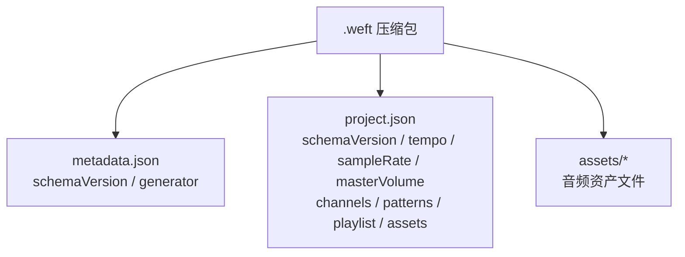
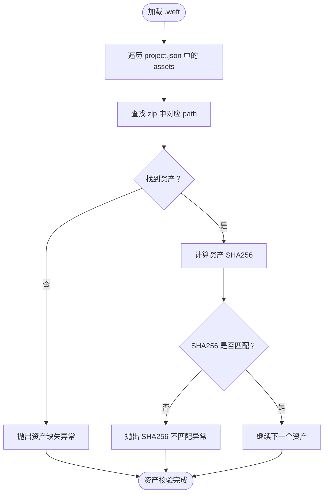
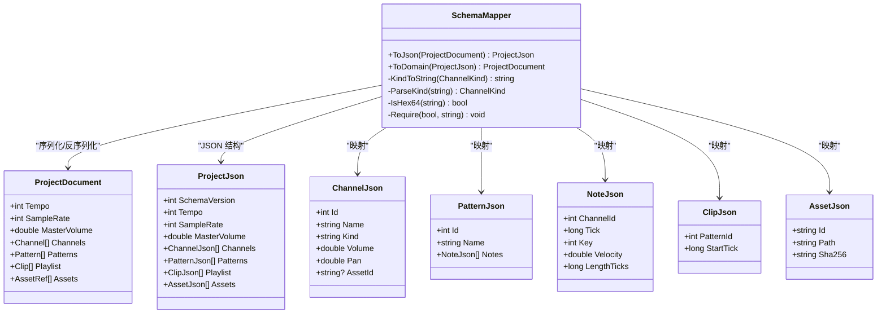
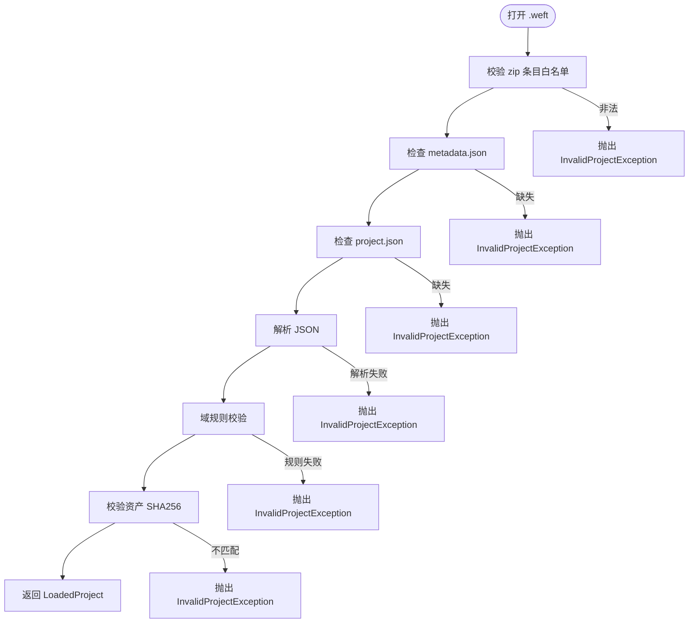
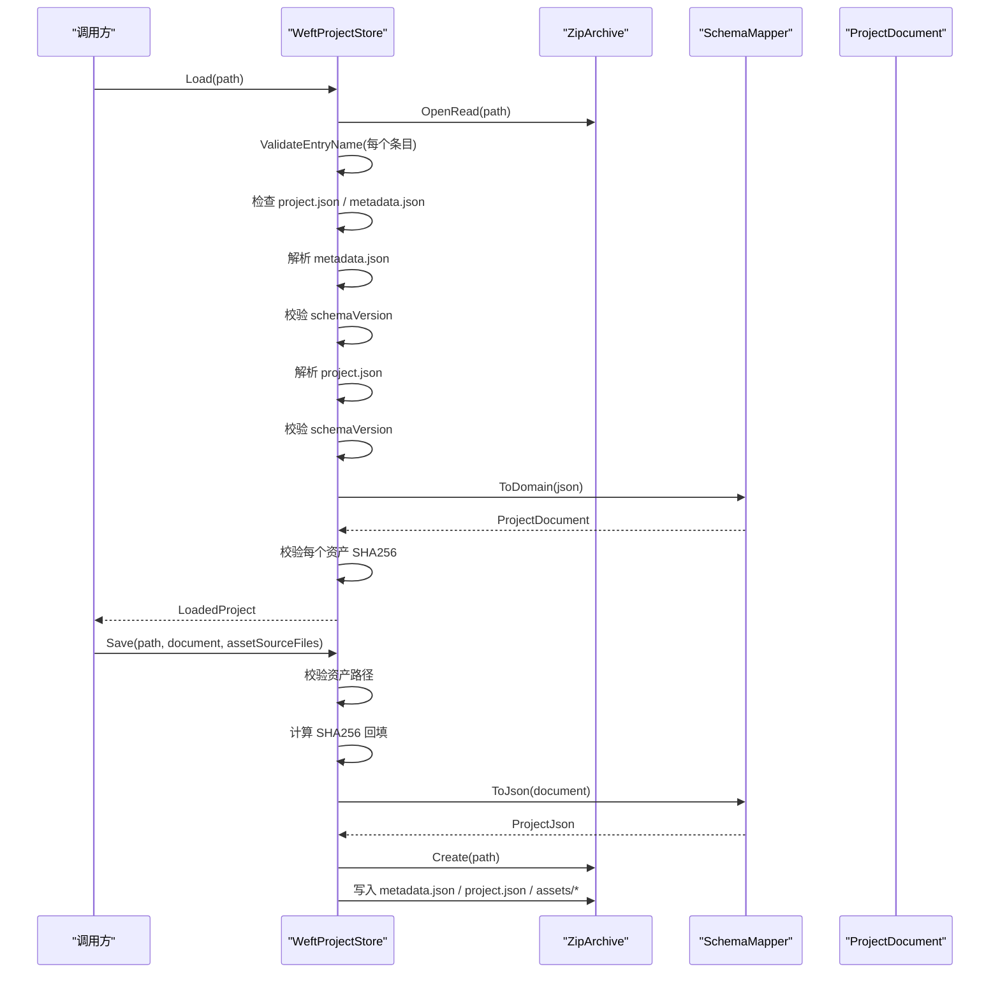

# .weft 文件格式规范

<cite>
**本文引用的文件**   
- [ADR-0006-project-format.md](file://docs/adr/ADR-0006-project-format.md)
- [IProjectStore.cs](file://src/Weftone.Domain/IProjectStore.cs)
- [ProjectDocument.cs](file://src/Weftone.Domain/ProjectDocument.cs)
- [AssetRef.cs](file://src/Weftone.Domain/AssetRef.cs)
- [SchemaMapper.cs](file://src/Weftone.Adapters.ProjectStore/SchemaMapper.cs)
- [WeftProjectStore.cs](file://src/Weftone.Adapters.ProjectStore/WeftProjectStore.cs)
- [InvalidProjectException.cs](file://src/Weftone.Adapters.ProjectStore/InvalidProjectException.cs)
- [README.md（项目存储适配器）](file://src/Weftone.Adapters.ProjectStore/README.md)
- [WeftProjectStoreTests.cs](file://tests/Weftone.Domain.Tests/WeftProjectStoreTests.cs)
</cite>

## 目录
1. [引言](#引言)
2. [.weft 包结构总览](#weft-包结构总览)
3. [metadata.json 规范](#metadatajson-规范)
4. [project.json 规范](#projectjson-规范)
5. [资产文件与 SHA256 命名机制](#资产文件与-sha256-命名机制)
6. [SchemaMapper 序列化与反序列化逻辑](#schemamapper-序列化与反序列化逻辑)
7. [安全保护与错误处理](#安全保护与错误处理)
8. [加载与保存流程](#加载与保存流程)
9. [兼容性、版本演进与迁移策略](#兼容性版本演进与迁移策略)
10. [故障排查指南](#故障排查指南)
11. [结论](#结论)

## 引言
`.weft` 是 Weftone 的开放工程文件格式，采用 zip 容器组织 `metadata.json`、`project.json` 和 `assets/*`。该格式面向 git 友好、可迁移、可恢复崩溃的工程持久化需求，并在 v1 阶段使用 JSON 作为主要描述语言，后续可在 M2 引入二进制缓存以提升大工程性能。

当前实现以 `WeftProjectStore` 为 `.weft` 存取入口，通过 `IProjectStore` 暴露加载与保存接口；`SchemaMapper` 负责领域模型与 JSON 结构之间的转换与校验；所有非法包统一抛出 `InvalidProjectException`。

**章节来源**
- [ADR-0006-project-format.md:4-11](file://docs/adr/ADR-0006-project-format.md#L4-L11)
- [IProjectStore.cs:3-14](file://src/Weftone.Domain/IProjectStore.cs#L3-L14)
- [README.md（项目存储适配器）:1-15](file://src/Weftone.Adapters.ProjectStore/README.md#L1-L15)

## .weft 包结构总览
一个合法的 `.weft` 文件是一个标准 zip 压缩包，根目录必须包含：
- `metadata.json`：声明 schema 版本与生成器信息。
- `project.json`：工程核心数据，包括 tempo、sampleRate、masterVolume、channels、patterns、playlist、assets。
- `assets/`：音频资产目录，每个资产由 `project.json` 中的 assets 条目引用，并通过 SHA256 校验完整性。

**图示来源**
- [WeftProjectStore.cs:9-15](file://src/Weftone.Adapters.ProjectStore/WeftProjectStore.cs#L9-L15)
- [SchemaMapper.cs:8-63](file://src/Weftone.Adapters.ProjectStore/SchemaMapper.cs#L8-L63)

**章节来源**
- [WeftProjectStore.cs:9-15](file://src/Weftone.Adapters.ProjectStore/WeftProjectStore.cs#L9-L15)
- [ADR-0006-project-format.md:7-11](file://docs/adr/ADR-0006-project-format.md#L7-L11)

## metadata.json 规范
| 字段 | 类型 | 必需 | 默认值 | 说明 |
|---|---|---:|---:|---|
| `schemaVersion` | integer | 是 | 无 | 元数据 schema 版本，当前固定为 `1` |
| `generator` | string | 是 | 无 | 生成器标识，当前写入 `"weftone"` |

验证规则：
- `schemaVersion` 必须等于当前实现的 `SchemaVersion`（当前为 `1`）。
- `generator` 用于记录生成工具，不强制语义校验，但应保持一致性。

若缺少 `metadata.json` 或 `schemaVersion` 不匹配，加载将拒绝并抛出 `InvalidProjectException`。

**章节来源**
- [WeftProjectStore.cs:36-46](file://src/Weftone.Adapters.ProjectStore/WeftProjectStore.cs#L36-L46)
- [SchemaMapper.cs:8-12](file://src/Weftone.Adapters.ProjectStore/SchemaMapper.cs#L8-L12)

## project.json 规范
`project.json` 是工程的核心描述文件，其顶层结构与字段如下：

| 字段 | 类型 | 必需 | 默认值 | 验证规则 |
|---|---|---:|---:|---|
| `schemaVersion` | integer | 是 | 无 | 必须等于当前 `SchemaVersion`（当前为 `1`） |
| `tempo` | integer | 是 | 无 | 必须在 `[MinTempo, MaxTempo]` 范围内 |
| `sampleRate` | integer | 是 | 无 | 必须在 `[8000, 192000]` 范围内 |
| `masterVolume` | number | 否 | `1.0` | 必须在 `[0, 2]` 范围内；旧包缺失时按默认值处理 |
| `channels` | array | 是 | 空数组 | 声部列表，见下方 Channel 定义 |
| `patterns` | array | 是 | 空数组 | 乐段列表，见下方 Pattern 定义 |
| `playlist` | array | 是 | 空数组 | 播放列表片段，见下方 Clip 定义 |
| `assets` | array | 是 | 空数组 | 资产引用列表，见下方 Asset 引用定义 |

### Channel 定义
| 字段 | 类型 | 必需 | 默认值 | 验证规则 |
|---|---|---:|---:|---|
| `id` | integer | 是 | 无 | channel id 必须唯一 |
| `name` | string | 是 | 空字符串 | 名称允许为空，但需保持可读性 |
| `kind` | string | 是 | 无 | 仅允许 `"sine"` 或 `"sampler"` |
| `volume` | number | 是 | 无 | 必须在 `[0, 2]` 范围内 |
| `pan` | number | 是 | 无 | 必须在 `[-1, 1]` 范围内 |
| `assetId` | string? | 条件必需 | 空 | 当 `kind == "sampler"` 时必须非空且指向已注册 asset |

### Pattern 定义
| 字段 | 类型 | 必需 | 默认值 | 验证规则 |
|---|---|---:|---:|---|
| `id` | integer | 是 | 无 | pattern id 必须唯一 |
| `name` | string | 是 | 空字符串 | 名称允许为空 |
| `notes` | array | 是 | 空数组 | 音符列表，见下方 Note 定义 |

### Note 定义
| 字段 | 类型 | 必需 | 默认值 | 验证规则 |
|---|---|---:|---:|---|
| `channelId` | integer | 是 | 无 | 必须引用已存在的 channel id |
| `tick` | integer | 是 | 无 | 必须 `>= 0` |
| `key` | integer | 是 | 无 | 必须在 `[0, 127]` 范围内 |
| `velocity` | number | 是 | 无 | 必须在 `[0, 1]` 范围内 |
| `lengthTicks` | integer | 是 | 无 | 必须 `>= 1` |

### Clip 定义
| 字段 | 类型 | 必需 | 默认值 | 验证规则 |
|---|---|---:|---:|---|
| `patternId` | integer | 是 | 无 | 必须引用已存在的 pattern id |
| `startTick` | integer | 是 | 无 | 必须 `>= 0` |

### Asset 引用定义
| 字段 | 类型 | 必需 | 默认值 | 验证规则 |
|---|---|---:|---:|---|
| `id` | string | 是 | 空字符串 | 不能为空 |
| `path` | string | 是 | 空字符串 | 必须以 `assets/` 开头，且路径合法 |
| `sha256` | string | 是 | 空字符串 | 必须是长度为 64 的小写十六进制字符串 |

领域层约束补充：
- `ProjectDocument.MinTempo` 与 `ProjectDocument.MaxTempo` 限制 tempo 范围。
- `MasterVolume` 默认值为 `1.0`，加载时校验 `[0, 2]`。
- `AssetRef` 表示资产引用，包含 `Id`、`Path`、`Sha256`。

**章节来源**
- [SchemaMapper.cs:14-63](file://src/Weftone.Adapters.ProjectStore/SchemaMapper.cs#L14-L63)
- [SchemaMapper.cs:102-180](file://src/Weftone.Adapters.ProjectStore/SchemaMapper.cs#L102-L180)
- [ProjectDocument.cs:7-20](file://src/Weftone.Domain/ProjectDocument.cs#L7-L20)
- [AssetRef.cs:3-9](file://src/Weftone.Domain/AssetRef.cs#L3-L9)

## 资产文件与 SHA256 命名机制
### 资产路径约定
- 所有音频资产位于 `assets/` 目录下。
- `project.json` 中每个 asset 的 `path` 必须以 `assets/` 开头。
- Save 时要求资产相对路径合法，拒绝根路径、反斜杠、`..` 以及不在 `assets/` 下的路径。

### SHA256 完整性校验
- 每个 asset 在 `project.json` 中提供 `sha256` 字段。
- Load 时会对每个 asset 计算实际 SHA256，并与期望值进行大小写不敏感比较。
- 若 SHA256 不匹配，视为资产被篡改，加载失败。

### SHA256 命名机制现状
当前实现并未强制资产文件名等于 SHA256；资产文件名仍由文档中的 `path` 决定。SHA256 命名去重策略在适配器 README 中被标记为后续版本再定。因此，当前规范更强调“内容哈希校验”，而非“文件名即哈希”。

**图示来源**
- [WeftProjectStore.cs:55-68](file://src/Weftone.Adapters.ProjectStore/WeftProjectStore.cs#L55-L68)
- [SchemaMapper.cs:125-131](file://src/Weftone.Adapters.ProjectStore/SchemaMapper.cs#L125-L131)

**章节来源**
- [WeftProjectStore.cs:55-68](file://src/Weftone.Adapters.ProjectStore/WeftProjectStore.cs#L55-L68)
- [SchemaMapper.cs:125-131](file://src/Weftone.Adapters.ProjectStore/SchemaMapper.cs#L125-L131)
- [README.md（项目存储适配器）:11-12](file://src/Weftone.Adapters.ProjectStore/README.md#L11-L12)

## SchemaMapper 序列化与反序列化逻辑
`SchemaMapper` 承担以下职责：
- 将领域对象 `ProjectDocument` 序列化为 `ProjectJson`。
- 将 `ProjectJson` 反序列化为 `ProjectDocument`，并进行严格校验。
- 管理 `ChannelKind` 到字符串的双向映射。
- 提供统一的 `Require` 校验失败抛错机制。

### 序列化方向
- `ToJson` 从 `ProjectDocument` 提取 tempo、sampleRate、masterVolume、channels、patterns、playlist、assets。
- `ChannelKind` 通过 `KindToString` 转换为 `"sine"` 或 `"sampler"`。
- `AssetRef` 直接映射为 `AssetJson`，保留 `id`、`path`、`sha256`。

### 反序列化方向
- `ToDomain` 构建 `ProjectDocument`，并逐项校验：
  - channel id 唯一。
  - asset id 非空、path 以 `assets/` 开头、sha256 为 64 位小写十六进制。
  - sampler channel 必须引用已注册 asset。
  - channel volume 在 `[0, 2]`，pan 在 `[-1, 1]`。
  - pattern id 唯一。
  - note tick >= 0、lengthTicks >= 1、key 在 `[0, 127]`、velocity 在 `[0, 1]`、channelId 存在。
  - clip patternId 存在、startTick >= 0。
  - tempo 在 `[MinTempo, MaxTempo]`、sampleRate 在 `[8000, 192000]`、masterVolume 在 `[0, 2]`。

### 迁移接口设计
当前实现未提供显式的 schema 版本迁移函数；`SchemaVersion` 固定为 `1`，不支持向后兼容更高版本。未来若引入多版本支持，应在 `SchemaMapper` 或 `WeftProjectStore` 中增加迁移入口，例如根据 `schemaVersion` 调用不同迁移策略。

**图示来源**
- [SchemaMapper.cs:8-63](file://src/Weftone.Adapters.ProjectStore/SchemaMapper.cs#L8-L63)
- [SchemaMapper.cs:67-206](file://src/Weftone.Adapters.ProjectStore/SchemaMapper.cs#L67-L206)
- [ProjectDocument.cs:7-20](file://src/Weftone.Domain/ProjectDocument.cs#L7-L20)

**章节来源**
- [SchemaMapper.cs:67-206](file://src/Weftone.Adapters.ProjectStore/SchemaMapper.cs#L67-L206)

## 安全保护与错误处理
### zip slip 防护
- 加载时对 zip 中每个条目的 `FullName` 执行白名单校验。
- 拒绝以下情况：
  - 空路径。
  - 包含反斜杠。
  - 绝对路径。
  - 包含 `..` 路径段。
  - 不在白名单内的条目：仅允许 `project.json`、`metadata.json` 和 `assets/*`。

### 畸形 zip 文件拒绝
- 若缺少 `project.json` 或 `metadata.json`，直接拒绝。
- JSON 解析失败会包装为 `InvalidProjectException`，并保留原始 `JsonException` 信息。

### 非法 schemaVersion 处理
- `metadata.json` 与 `project.json` 的 `schemaVersion` 都必须等于当前 `SchemaVersion`（当前为 `1`）。
- 不匹配时抛出 `InvalidProjectException`，提示不支持的版本。

### 资产完整性校验
- 对每个 asset 计算 SHA256，并与 `project.json` 中记录的 `sha256` 比较。
- 不匹配时抛出 `InvalidProjectException`，提示资产路径、期望值与实际值。

### 统一异常类型
所有非法包场景统一抛出 `InvalidProjectException`，便于上层捕获并给出明确错误提示。

**图示来源**
- [WeftProjectStore.cs:23-70](file://src/Weftone.Adapters.ProjectStore/WeftProjectStore.cs#L23-L70)
- [WeftProjectStore.cs:131-166](file://src/Weftone.Adapters.ProjectStore/WeftProjectStore.cs#L131-L166)
- [InvalidProjectException.cs:3-9](file://src/Weftone.Adapters.ProjectStore/InvalidProjectException.cs#L3-L9)

**章节来源**
- [WeftProjectStore.cs:23-70](file://src/Weftone.Adapters.ProjectStore/WeftProjectStore.cs#L23-L70)
- [WeftProjectStore.cs:131-166](file://src/Weftone.Adapters.ProjectStore/WeftProjectStore.cs#L131-L166)
- [InvalidProjectException.cs:3-9](file://src/Weftone.Adapters.ProjectStore/InvalidProjectException.cs#L3-L9)

## 加载与保存流程
### 加载流程
1. 打开 zip 文件。
2. 逐条校验 zip 条目名称，防止 zip slip。
3. 检查 `project.json` 与 `metadata.json` 是否存在。
4. 解析 `metadata.json`，校验 `schemaVersion`。
5. 解析 `project.json`，校验 `schemaVersion`。
6. 通过 `SchemaMapper.ToDomain` 将 JSON 转为领域模型，并执行域规则校验。
7. 对每个 asset 读取流并计算 SHA256，与期望值比较。
8. 返回 `LoadedProject`，其中包含文档与按需读取资产的委托。

### 保存流程
1. 确保目标路径目录存在。
2. 遍历 `assetSourceFiles`，校验资产相对路径合法。
3. 从源文件计算 SHA256 回填到 `AssetRef.Sha256`。
4. 通过 `SchemaMapper.ToJson` 将领域模型转为 JSON。
5. 创建 zip，写入 `metadata.json`、`project.json` 与所有资产。

**图示来源**
- [WeftProjectStore.cs:23-110](file://src/Weftone.Adapters.ProjectStore/WeftProjectStore.cs#L23-L110)
- [SchemaMapper.cs:67-180](file://src/Weftone.Adapters.ProjectStore/SchemaMapper.cs#L67-L180)

**章节来源**
- [WeftProjectStore.cs:23-110](file://src/Weftone.Adapters.ProjectStore/WeftProjectStore.cs#L23-L110)
- [SchemaMapper.cs:67-180](file://src/Weftone.Adapters.ProjectStore/SchemaMapper.cs#L67-L180)

## 兼容性、版本演进与迁移策略
### 当前版本
- 当前 `.weft` 为 v1，`SchemaVersion = 1`。
- `metadata.json` 与 `project.json` 的 `schemaVersion` 必须为 `1`。
- `masterVolume` 为可选字段，旧包缺失时默认 `1.0`，读入时校验 `[0, 2]`。

### 向后兼容性
- 当前实现不支持高于当前版本的 schema；遇到未知版本直接拒绝。
- 对于新增可选字段（如 `masterVolume`），采用默认值策略保证旧包可加载。
- 若未来引入新必填字段，应通过 schema 版本升级与迁移逻辑处理，而不是破坏现有 v1 包。

### 迁移接口建议
虽然当前未实现迁移函数，但建议在 `SchemaMapper` 或 `WeftProjectStore` 中预留迁移入口：
- 根据 `schemaVersion` 选择迁移策略。
- 提供 `Migrate(ProjectJson, targetVersion)` 或类似方法。
- 迁移过程中保持字段双向兼容，避免破坏旧包。

### 版本演进规划
- L1：JSON 为主，git 友好，支持基本工程持久化。
- M2：加入自动保存与崩溃恢复，可能引入二进制缓存提升性能。
- 后续：考虑 SHA256 命名去重策略、更多通道类型、扩展元数据等。

**章节来源**
- [WeftProjectStore.cs:15-21](file://src/Weftone.Adapters.ProjectStore/WeftProjectStore.cs#L15-L21)
- [SchemaMapper.cs:173-179](file://src/Weftone.Adapters.ProjectStore/SchemaMapper.cs#L173-L179)
- [README.md（项目存储适配器）:14-15](file://src/Weftone.Adapters.ProjectStore/README.md#L14-L15)
- [ADR-0006-project-format.md:7-11](file://docs/adr/ADR-0006-project-format.md#L7-L11)

## 故障排查指南
### 常见错误与原因
| 错误现象 | 可能原因 | 处理建议 |
|---|---|---|
| 加载时报“非法 zip 条目” | zip 中包含 `..`、反斜杠、绝对路径或非白名单条目 | 检查 zip 结构，仅保留 `project.json`、`metadata.json`、`assets/*` |
| 加载时报“缺少 project.json” | zip 中未包含 `project.json` | 重新保存工程，确保 `project.json` 存在 |
| 加载时报“缺少 metadata.json” | zip 中未包含 `metadata.json` | 重新保存工程，确保 `metadata.json` 存在 |
| 加载时报“schema 版本不支持” | `metadata.json` 或 `project.json` 的 `schemaVersion` 不等于当前版本 | 确认当前实现支持的 schema 版本，或升级实现 |
| 加载时报“资产缺失” | `project.json` 中 asset path 对应的 zip 条目不存在 | 检查 assets 目录是否完整 |
| 加载时报“SHA256 不匹配” | 资产内容被篡改或损坏 | 重新生成或替换资产文件 |
| JSON 解析失败 | `project.json` 或 `metadata.json` 格式错误 | 检查 JSON 语法与字段类型 |

### 测试覆盖的关键场景
- 拒绝 zip slip。
- 拒绝错误 schema 版本。
- 拒绝缺失 `project.json`。
- 拒绝被篡改的资产。

这些场景在单元测试中均有断言，可作为实现正确性的参考。

**章节来源**
- [WeftProjectStoreTests.cs:78-147](file://tests/Weftone.Domain.Tests/WeftProjectStoreTests.cs#L78-L147)
- [InvalidProjectException.cs:3-9](file://src/Weftone.Adapters.ProjectStore/InvalidProjectException.cs#L3-L9)

## 结论
`.weft` v1 格式以 zip 容器承载 `metadata.json`、`project.json` 与 `assets/*`，通过严格的 zip 条目白名单、schema 版本校验、域规则校验与资产 SHA256 校验，确保工程包的完整性与安全性。`SchemaMapper` 提供清晰的序列化与反序列化边界，`WeftProjectStore` 作为存取入口统一处理安全与错误。当前实现聚焦于稳定、可审计、git 友好的工程持久化，并为后续二进制缓存、迁移机制与功能扩展预留空间。