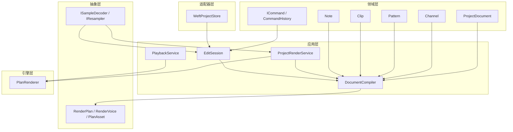
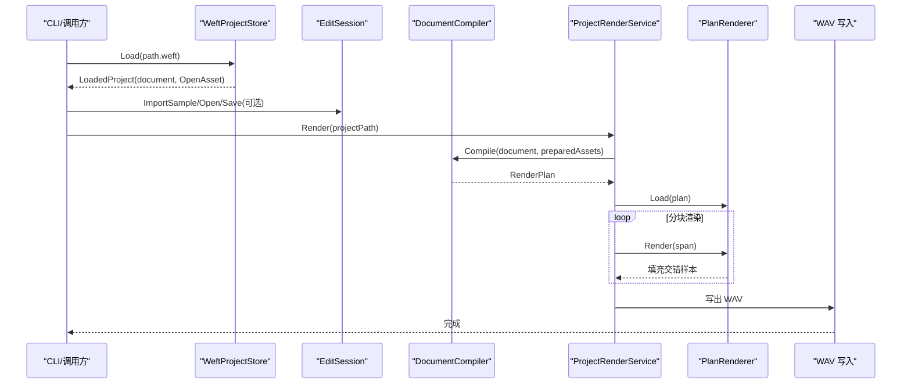
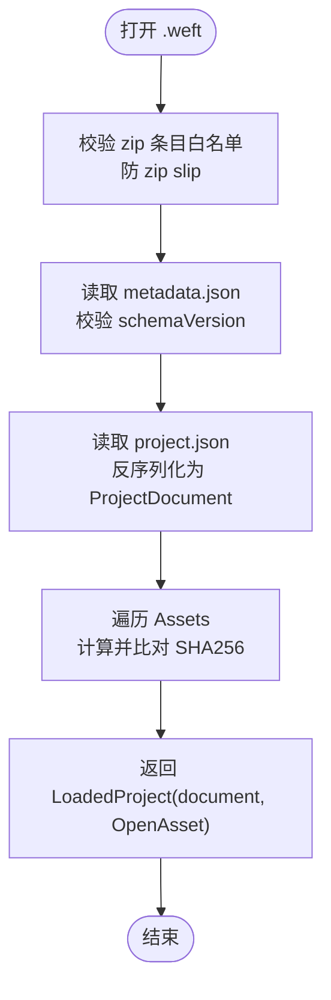
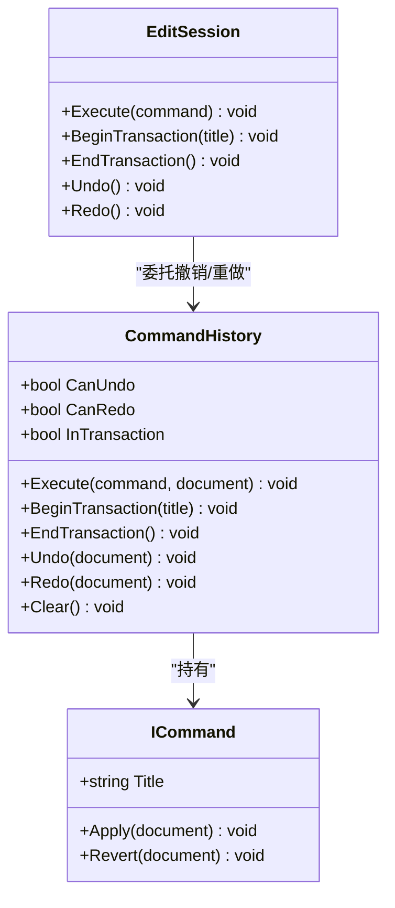
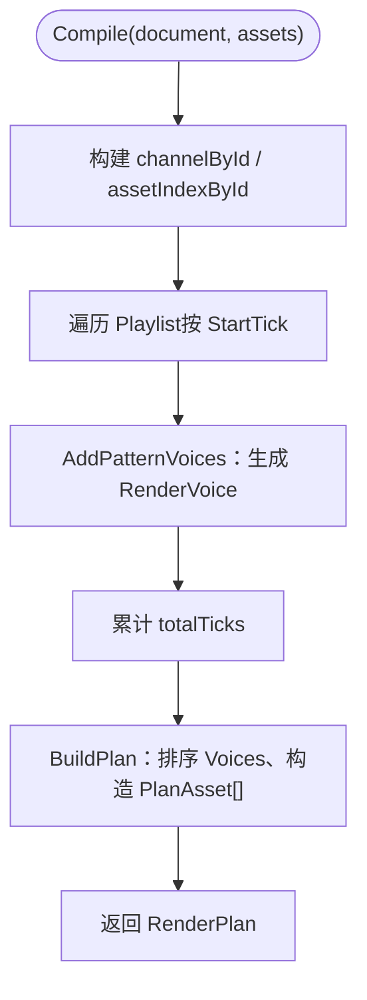
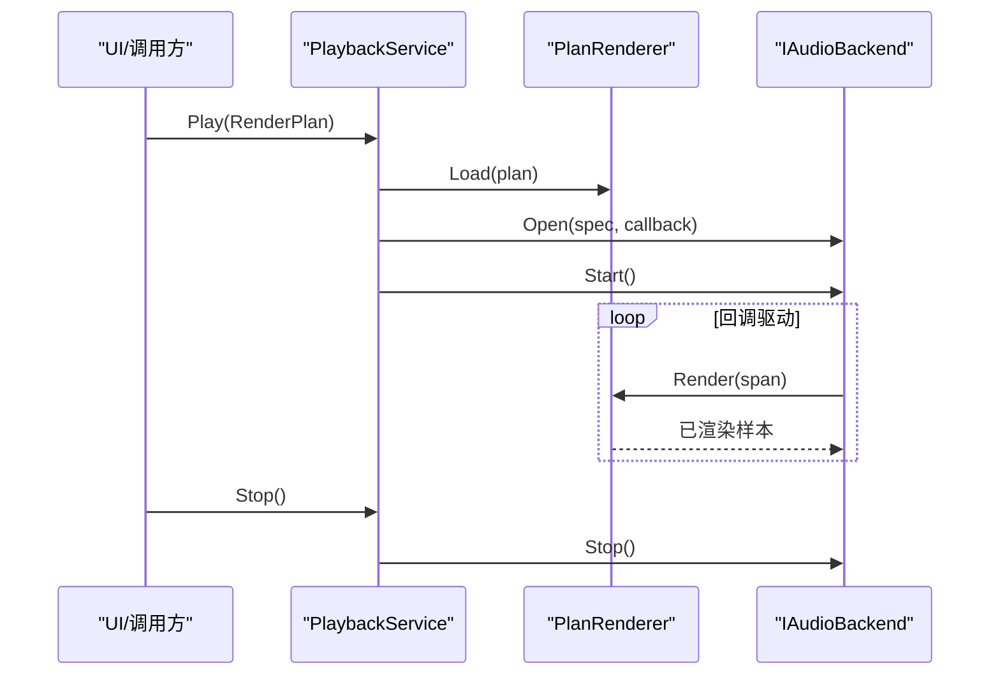
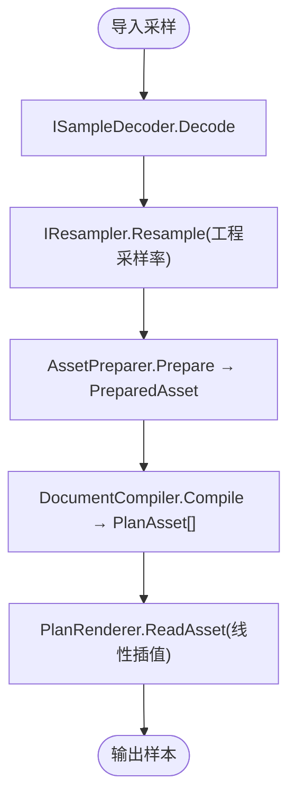
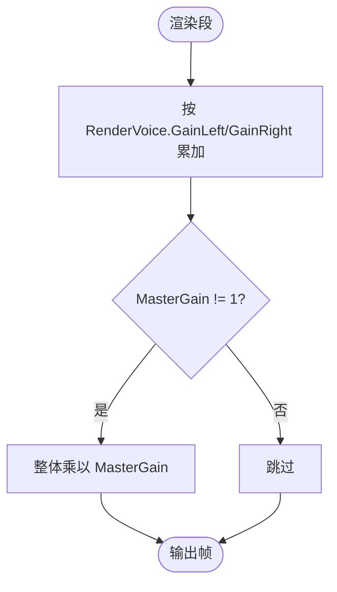
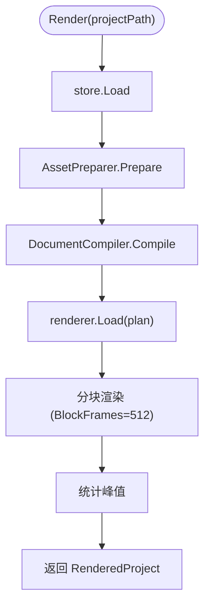
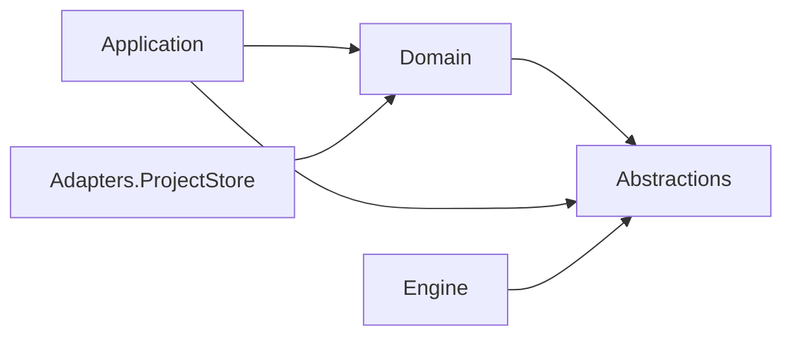

# M1a Headless 规格

<cite>
**本文引用的文件**   
- [M1a_HEADLESS.md](file://specs/M1a_HEADLESS.md)
- [DocumentCompiler.cs](file://src/Weftone.Application/DocumentCompiler.cs)
- [ProjectRenderService.cs](file://src/Weftone.Application/ProjectRenderService.cs)
- [EditSession.cs](file://src/Weftone.Application/EditSession.cs)
- [PlaybackService.cs](file://src/Weftone.Application/PlaybackService.cs)
- [PlanRenderer.cs](file://src/Weftone.Engine/PlanRenderer.cs)
- [RenderPlan.cs](file://src/Weftone.Abstractions/Rendering/RenderPlan.cs)
- [ISampleDecoder.cs](file://src/Weftone.Abstractions/ISampleDecoder.cs)
- [ProjectDocument.cs](file://src/Weftone.Domain/ProjectDocument.cs)
- [Channel.cs](file://src/Weftone.Domain/Channel.cs)
- [Pattern.cs](file://src/Weftone.Domain/Pattern.cs)
- [Clip.cs](file://src/Weftone.Domain/Clip.cs)
- [Note.cs](file://src/Weftone.Domain/Note.cs)
- [ICommand.cs](file://src/Weftone.Domain/Commands/ICommand.cs)
- [CommandHistory.cs](file://src/Weftone.Domain/Commands/CommandHistory.cs)
- [WeftProjectStore.cs](file://src/Weftone.Adapters.ProjectStore/WeftProjectStore.cs)
</cite>

## 目录
1. [引言](#引言)
2. [项目结构](#项目结构)
3. [核心组件](#核心组件)
4. [架构总览](#架构总览)
5. [详细组件分析](#详细组件分析)
6. [依赖关系分析](#依赖关系分析)
7. [性能考量](#性能考量)
8. [故障排查指南](#故障排查指南)
9. [结论](#结论)
10. [附录：API 使用示例与基准](#附录api-使用示例与基准)

## 引言
本规格文档面向 M1a Headless 能力，目标是让一个 .weft 工程（含采样资产）通过无头 CLI 确定性渲染出 WAV；编辑操作具备命令撤销重做；输出有黄金音频基线守护。该版本采用整数 tick（PPQ=96）、vendored dr_wav、离线线性插值重采样、线性声像律等拍板决策，并在 Application 层实现全量编译器，Engine 层提供零分配实时/离线渲染器，Domain 层提供富对象模型与可撤销命令。

## 项目结构
仓库按领域分层组织：
- Domain：ProjectDocument、Channel、Pattern、Clip、Note 等富对象与 ICommand/CommandHistory 命令系统。
- Abstractions：RenderPlan、RenderVoice、PlanAsset、ISampleDecoder、IResampler 等跨层接口与扁平计划类型。
- Application：DocumentCompiler、ProjectRenderService、EditSession、PlaybackService 等用例编排。
- Engine：PlanRenderer 等音频引擎实现。
- Adapters.ProjectStore：WeftProjectStore 负责 .weft v1 zip 存取与校验。
- specs：M1a_HEADLESS.md 为验收与拍板依据。

图表来源
- [DocumentCompiler.cs:1-159](file://src/Weftone.Application/DocumentCompiler.cs#L1-L159)
- [ProjectRenderService.cs:1-51](file://src/Weftone.Application/ProjectRenderService.cs#L1-L51)
- [EditSession.cs:1-222](file://src/Weftone.Application/EditSession.cs#L1-L222)
- [PlaybackService.cs:1-98](file://src/Weftone.Application/PlaybackService.cs#L1-L98)
- [PlanRenderer.cs:1-356](file://src/Weftone.Engine/PlanRenderer.cs#L1-L356)
- [RenderPlan.cs:1-42](file://src/Weftone.Abstractions/Rendering/RenderPlan.cs#L1-L42)
- [ISampleDecoder.cs:1-17](file://src/Weftone.Abstractions/ISampleDecoder.cs#L1-L17)
- [WeftProjectStore.cs:1-208](file://src/Weftone.Adapters.ProjectStore/WeftProjectStore.cs#L1-L208)

章节来源
- [M1a_HEADLESS.md:1-98](file://specs/M1a_HEADLESS.md#L1-L98)

## 核心组件
- 数据模型（Domain）
  - ProjectDocument：工程元信息（BPM、采样率、主控音量）与 Channels、Patterns、Playlist、Assets。
  - Channel：音源类型（正弦或采样）、音量、线性声像、可选 AssetId。
  - Pattern：音符集合。
  - Clip：播放列表片段，指定 PatternId 与起始 tick。
  - Note：音符参数（channelId、tick、key、velocity、lengthTicks）。
  - 时间单位：整数 tick，PPQ=96，避免浮点累积不确定。
- 命令系统（Domain.Commands）
  - ICommand：Apply/Revert 精确互逆。
  - CommandHistory：撤销栈/重做栈、事务合并、空栈拒绝。
- 文件格式（Adapters.ProjectStore）
  - WeftProjectStore：zip 容器（project.json + metadata.json + assets/*.wav），白名单校验、schemaVersion 校验、SHA256 校验、防 zip slip。
- 编译器（Application）
  - DocumentCompiler：ProjectDocument → RenderPlan，幂等、稳定排序、支持 Playlist 展开与 Pattern 循环区间。
- 渲染服务（Application）
  - ProjectRenderService：.weft → 资产准备 → 编译 → 离线渲染 → WAV 导出。
  - EditSession：编辑会话、导入采样、WAV 导出、撤销重做、工作区管理。
  - PlaybackService：实时播放控制，停止-交换-恢复，后端采样率变化时重建。
- 引擎（Engine）
  - PlanRenderer：64 复音池、事件激活、偷声淡出、线性插值读取资产、零分配路径。

章节来源
- [ProjectDocument.cs:1-21](file://src/Weftone.Domain/ProjectDocument.cs#L1-L21)
- [Channel.cs:1-19](file://src/Weftone.Domain/Channel.cs#L1-L19)
- [Pattern.cs:1-9](file://src/Weftone.Domain/Pattern.cs#L1-L9)
- [Clip.cs:1-9](file://src/Weftone.Domain/Clip.cs#L1-L9)
- [Note.cs:1-12](file://src/Weftone.Domain/Note.cs#L1-L12)
- [ICommand.cs:1-12](file://src/Weftone.Domain/Commands/ICommand.cs#L1-L12)
- [CommandHistory.cs:1-99](file://src/Weftone.Domain/Commands/CommandHistory.cs#L1-L99)
- [WeftProjectStore.cs:1-208](file://src/Weftone.Adapters.ProjectStore/WeftProjectStore.cs#L1-L208)
- [DocumentCompiler.cs:1-159](file://src/Weftone.Application/DocumentCompiler.cs#L1-L159)
- [ProjectRenderService.cs:1-51](file://src/Weftone.Application/ProjectRenderService.cs#L1-L51)
- [EditSession.cs:1-222](file://src/Weftone.Application/EditSession.cs#L1-L222)
- [PlaybackService.cs:1-98](file://src/Weftone.Application/PlaybackService.cs#L1-L98)
- [PlanRenderer.cs:1-356](file://src/Weftone.Engine/PlanRenderer.cs#L1-L356)
- [RenderPlan.cs:1-42](file://src/Weftone.Abstractions/Rendering/RenderPlan.cs#L1-L42)
- [ISampleDecoder.cs:1-17](file://src/Weftone.Abstractions/ISampleDecoder.cs#L1-L17)

## 架构总览
下图展示从 .weft 到 WAV 的完整链路，以及实时播放控制流。

图表来源
- [WeftProjectStore.cs:23-71](file://src/Weftone.Adapters.ProjectStore/WeftProjectStore.cs#L23-L71)
- [EditSession.cs:137-188](file://src/Weftone.Application/EditSession.cs#L137-L188)
- [ProjectRenderService.cs:19-49](file://src/Weftone.Application/ProjectRenderService.cs#L19-L49)
- [DocumentCompiler.cs:19-49](file://src/Weftone.Application/DocumentCompiler.cs#L19-L49)
- [PlanRenderer.cs:48-105](file://src/Weftone.Engine/PlanRenderer.cs#L48-L105)

## 详细组件分析

### 数据模型与文件格式
- 数据模型
  - ProjectDocument：包含 Tempo、SampleRate、MasterVolume、Channels、Patterns、Playlist、Assets。
  - Channel：Kind（Sine/Sampler）、Volume、Pan（线性）、AssetId（Sampler 用）。
  - Pattern：Notes 列表。
  - Clip：PatternId、StartTick。
  - Note：ChannelId、Tick、Key、Velocity、LengthTicks。
- .weft v1 格式
  - zip 容器：metadata.json（schemaVersion=1）、project.json（上述模型）、assets/*.wav（SHA256 命名）。
  - 加载流程：条目白名单校验 → schemaVersion 校验 → 反序列化为 Domain → 逐资产 SHA256 校验 → 返回 LoadedProject。
  - 保存流程：计算资产 SHA256 → 序列化 project.json → 写入 metadata.json → 写入 assets。

图表来源
- [WeftProjectStore.cs:23-71](file://src/Weftone.Adapters.ProjectStore/WeftProjectStore.cs#L23-L71)
- [WeftProjectStore.cs:131-152](file://src/Weftone.Adapters.ProjectStore/WeftProjectStore.cs#L131-L152)

章节来源
- [ProjectDocument.cs:1-21](file://src/Weftone.Domain/ProjectDocument.cs#L1-L21)
- [Channel.cs:1-19](file://src/Weftone.Domain/Channel.cs#L1-L19)
- [Pattern.cs:1-9](file://src/Weftone.Domain/Pattern.cs#L1-L9)
- [Clip.cs:1-9](file://src/Weftone.Domain/Clip.cs#L1-L9)
- [Note.cs:1-12](file://src/Weftone.Domain/Note.cs#L1-L12)
- [WeftProjectStore.cs:1-208](file://src/Weftone.Adapters.ProjectStore/WeftProjectStore.cs#L1-L208)

### 命令模式与撤销重做
- ICommand：定义 Apply/Revert，保证精确互逆。
- CommandHistory：
  - Execute：Apply 后入撤销栈，清空重做栈；事务中聚合命令。
  - BeginTransaction/EndTransaction：将一次手势的多条命令合并为 CompositeCommand。
  - Undo/Redo：空栈抛异常；Undo 将命令移入重做栈，Redo 反之。
  - Clear：载入新工程时清空状态。

图表来源
- [ICommand.cs:1-12](file://src/Weftone.Domain/Commands/ICommand.cs#L1-L12)
- [CommandHistory.cs:1-99](file://src/Weftone.Domain/Commands/CommandHistory.cs#L1-L99)
- [EditSession.cs:100-130](file://src/Weftone.Application/EditSession.cs#L100-L130)

章节来源
- [ICommand.cs:1-12](file://src/Weftone.Domain/Commands/ICommand.cs#L1-L12)
- [CommandHistory.cs:1-99](file://src/Weftone.Domain/Commands/CommandHistory.cs#L1-L99)
- [EditSession.cs:100-130](file://src/Weftone.Application/EditSession.cs#L100-L130)

### DocumentCompiler 编译器
- 目标：将富对象模型转换为扁平 RenderPlan，确保同输入产生同输出（幂等、稳定排序）。
- 关键流程：
  - 构建 channelById 与 assetIndexById 索引。
  - 遍历 Playlist（按 StartTick 排序），累计 totalTicks。
  - AddPatternVoices：将 Note 转为 RenderVoice，预乘 gain/pan，区分 Sine/Sampler。
  - BuildPlan：按 StartSample 排序 Voices，构造 PlanAsset[]，设置 LoopStart/LoopEnd。
- Pattern 模式：CompilePattern 仅编译单个 Pattern，并按小节向上取整确定循环长度。

图表来源
- [DocumentCompiler.cs:19-49](file://src/Weftone.Application/DocumentCompiler.cs#L19-L49)
- [DocumentCompiler.cs:98-157](file://src/Weftone.Application/DocumentCompiler.cs#L98-L157)

章节来源
- [DocumentCompiler.cs:1-159](file://src/Weftone.Application/DocumentCompiler.cs#L1-L159)
- [RenderPlan.cs:1-42](file://src/Weftone.Abstractions/Rendering/RenderPlan.cs#L1-L42)

### Transport 播放控制系统
- PlaybackService：
  - Play/Stop：封装后端生命周期，记录 IsLooping、TotalSamples。
  - UpdatePlan：编辑后热更新，停止-交换-恢复，保持播放状态。
  - EnsureOpen：采样率变化时重建后端设备。
- PlanRenderer：
  - Load：初始化位置、事件游标、循环区间。
  - Render：按帧渲染，处理循环回绕、主增益、事件激活、声部调度。
  - 事件激活：FindFreeSlot → 池满 StealOldest → pending 环等待。
  - 声部渲染：Gate/FadeTail 两种路径，Sine 相位推进，Sampler 线性插值读取。

图表来源
- [PlaybackService.cs:42-90](file://src/Weftone.Application/PlaybackService.cs#L42-L90)
- [PlanRenderer.cs:48-105](file://src/Weftone.Engine/PlanRenderer.cs#L48-L105)

章节来源
- [PlaybackService.cs:1-98](file://src/Weftone.Application/PlaybackService.cs#L1-L98)
- [PlanRenderer.cs:1-356](file://src/Weftone.Engine/PlanRenderer.cs#L1-L356)

### Sampler 采样器引擎
- 解码与重采样：
  - ISampleDecoder：Decode(stream) → DecodedAudio（f32 交错 PCM）。
  - IResampler：Resample(source, targetSampleRate)，M1a 为离线线性插值。
- 触发与播放：
  - PlanRenderer.ReadAsset：按频率步进位置，线性插值读取单/双声道样本。
  - MIDI60=原速，key 偏移即播放速率。
- 资源管理：
  - PreparedAsset：由 AssetPreparer 准备，包含 Interleaved、Channels、Frames。
  - PlanAsset：RenderPlan.Assets 中的只读引用。

图表来源
- [ISampleDecoder.cs:1-17](file://src/Weftone.Abstractions/ISampleDecoder.cs#L1-L17)
- [EditSession.cs:137-165](file://src/Weftone.Application/EditSession.cs#L137-L165)
- [DocumentCompiler.cs:108-127](file://src/Weftone.Application/DocumentCompiler.cs#L108-L127)
- [PlanRenderer.cs:300-334](file://src/Weftone.Engine/PlanRenderer.cs#L300-L334)

章节来源
- [ISampleDecoder.cs:1-17](file://src/Weftone.Abstractions/ISampleDecoder.cs#L1-L17)
- [EditSession.cs:137-165](file://src/Weftone.Application/EditSession.cs#L137-L165)
- [DocumentCompiler.cs:108-127](file://src/Weftone.Application/DocumentCompiler.cs#L108-L127)
- [PlanRenderer.cs:300-334](file://src/Weftone.Engine/PlanRenderer.cs#L300-L334)

### Mixer 混音器逻辑
- 通道增益与声像：
  - Channel.Volume、Channel.Pan（线性声像）。
  - PanLaw.Linear 计算左右增益。
- 主控增益：
  - ProjectDocument.MasterVolume 在 BuildPlan 中 Clamp 到 [0,2]。
- 渲染阶段：
  - PlanRenderer.Render 最后统一乘以 MasterGain。

图表来源
- [DocumentCompiler.cs:105-127](file://src/Weftone.Application/DocumentCompiler.cs#L105-L127)
- [DocumentCompiler.cs:145-156](file://src/Weftone.Application/DocumentCompiler.cs#L145-L156)
- [PlanRenderer.cs:97-105](file://src/Weftone.Engine/PlanRenderer.cs#L97-L105)

章节来源
- [DocumentCompiler.cs:105-127](file://src/Weftone.Application/DocumentCompiler.cs#L105-L127)
- [DocumentCompiler.cs:145-156](file://src/Weftone.Application/DocumentCompiler.cs#L145-L156)
- [PlanRenderer.cs:97-105](file://src/Weftone.Engine/PlanRenderer.cs#L97-L105)

### ProjectRenderService 离线渲染服务
- 流程：Load(.weft) → AssetPreparer.Prepare → DocumentCompiler.Compile → IPlanRenderer.Load → 分块 Render → 统计峰值与时长 → 返回 RenderedProject。
- 批大小：BlockFrames=512，减少内存分配与提升缓存局部性。
- 输出：Interleaved float32 立体声，Peak、Duration 用于质量检查。

图表来源
- [ProjectRenderService.cs:19-49](file://src/Weftone.Application/ProjectRenderService.cs#L19-L49)

章节来源
- [ProjectRenderService.cs:1-51](file://src/Weftone.Application/ProjectRenderService.cs#L1-L51)

## 依赖关系分析
- 模块耦合
  - Application 依赖 Domain 与 Abstractions.Rendering；Engine 仅依赖 Abstractions.Rendering。
  - Adapters.ProjectStore 依赖 Domain 与 System.IO.Compression/System.Text.Json。
- 外部依赖
  - dr_wav（vendored）通过 ISampleDecoder 暴露解码能力。
  - Miniaudio 后端通过 IAudioBackend 暴露音频设备。
- 潜在循环
  - 未见循环依赖；Abstractions 作为最底层被上层依赖。

图表来源
- [DocumentCompiler.cs:1-3](file://src/Weftone.Application/DocumentCompiler.cs#L1-L3)
- [ProjectRenderService.cs:1-4](file://src/Weftone.Application/ProjectRenderService.cs#L1-L4)
- [PlanRenderer.cs:1-2](file://src/Weftone.Engine/PlanRenderer.cs#L1-L2)
- [WeftProjectStore.cs:1-5](file://src/Weftone.Adapters.ProjectStore/WeftProjectStore.cs#L1-L5)

章节来源
- [DocumentCompiler.cs:1-3](file://src/Weftone.Application/DocumentCompiler.cs#L1-L3)
- [ProjectRenderService.cs:1-4](file://src/Weftone.Application/ProjectRenderService.cs#L1-L4)
- [PlanRenderer.cs:1-2](file://src/Weftone.Engine/PlanRenderer.cs#L1-L2)
- [WeftProjectStore.cs:1-5](file://src/Weftone.Adapters.ProjectStore/WeftProjectStore.cs#L1-L5)

## 性能考量
- 零分配渲染路径
  - PlanRenderer 使用固定数组池（_pool、_pending），全程不创建对象；RtAssert 守护。
- 事件调度优化
  - 事件按 StartSample 排序，增量激活；池满时选择最早结束者进行偷声并淡出 FadeTail=128。
- 分块渲染
  - ProjectRenderService 与 EditSession.ExportWav 使用 BlockFrames=512，降低峰值内存占用。
- 主增益批量乘法
  - 每帧结束后一次性乘以 MasterGain，避免逐样本分支。
- 重采样策略
  - M1a 使用离线线性插值，质量标注在黄金基线内自洽；高质量 r8brain 留待后续里程碑。

[本节为通用性能指导，不直接分析具体文件]

## 故障排查指南
- .weft 加载失败
  - 缺少 project.json/metadata.json：InvalidProjectException。
  - schemaVersion 不支持：抛出 InvalidProjectException。
  - 资产缺失或 SHA256 不匹配：InvalidProjectException。
  - 非法 zip 条目（包含“..”、绝对路径、非白名单）：InvalidProjectException。
- 编辑器命令错误
  - 撤销/重做空栈：InvalidOperationException。
  - 事务嵌套或未开启事务：InvalidOperationException。
- 渲染问题
  - sampler 通道缺少已准备资产：InvalidOperationException。
  - 事件过多导致 DroppedEvents 增加：检查复音上限（MaxVoices=64）与偷声策略。
- 回放问题
  - 后端采样率变化：EnsureOpen 会重建后端；若重复打开则拒绝。

章节来源
- [WeftProjectStore.cs:23-71](file://src/Weftone.Adapters.ProjectStore/WeftProjectStore.cs#L23-L71)
- [WeftProjectStore.cs:131-152](file://src/Weftone.Adapters.ProjectStore/WeftProjectStore.cs#L131-L152)
- [CommandHistory.cs:61-89](file://src/Weftone.Domain/Commands/CommandHistory.cs#L61-L89)
- [DocumentCompiler.cs:108-127](file://src/Weftone.Application/DocumentCompiler.cs#L108-L127)
- [PlanRenderer.cs:147-156](file://src/Weftone.Engine/PlanRenderer.cs#L147-L156)
- [PlaybackService.cs:80-90](file://src/Weftone.Application/PlaybackService.cs#L80-L90)

## 结论
M1a Headless 通过清晰的领域建模、稳健的命令系统与 .weft v1 格式规范，结合 Application 层的全量编译器与 Engine 层的零分配渲染器，实现了从 .weft 到 WAV 的确定性离线渲染与实时播放控制。该版本以整数 tick、线性插值重采样、线性声像律等拍板决策为基础，兼顾可维护性与可扩展性，并为后续里程碑（自动化、插件、UI）预留了扩展点。

[本节为总结性内容，不直接分析具体文件]

## 附录：API 使用示例与基准
- 典型 API 调用序列
  - 打开工程：EditSession.Open(path) → 自动解压资产到工作区 → PrepareAssets。
  - 导入采样：EditSession.ImportSample(wavPath) → 解码校验 → 注册 AssetRef + Sampler 通道 → 重备资产。
  - 编译计划：EditSession.Compile() 或 CompilePattern(patternId)。
  - 离线导出：EditSession.ExportWav(outPath) 或 ProjectRenderService.Render(projectPath)。
  - 实时播放：PlaybackService.Play(plan) → 回调驱动渲染 → PlaybackService.Stop()。
- 错误处理要点
  - 所有 I/O 与解析失败均抛出 InvalidProjectException 或 InvalidOperationException，便于上层捕获与提示。
- 性能基准建议
  - 同工程两次渲染应逐位一致（CI 三平台容差 ≤ 1e-4）。
  - 渲染路径断言 0 分配（RtAssert）。
  - 峰值差与时长用于黄金音频基线对比。

[本节为概念性说明，不直接分析具体文件]