# 命令系统与撤销重做

<cite>
**本文引用的文件**   
- [ICommand.cs](file://src/Weftone.Domain/Commands/ICommand.cs)
- [CommandHistory.cs](file://src/Weftone.Domain/Commands/CommandHistory.cs)
- [CompositeCommand.cs](file://src/Weftone.Domain/Commands/CompositeCommand.cs)
- [AddNoteCommand.cs](file://src/Weftone.Domain/Commands/AddNoteCommand.cs)
- [RemoveNoteCommand.cs](file://src/Weftone.Domain/Commands/RemoveNoteCommand.cs)
- [MoveNoteCommand.cs](file://src/Weftone.Domain/Commands/MoveNoteCommand.cs)
- [ResizeNoteCommand.cs](file://src/Weftone.Domain/Commands/ResizeNoteCommand.cs)
- [SetTempoCommand.cs](file://src/Weftone.Domain/Commands/SetTempoCommand.cs)
- [ProjectDocument.cs](file://src/Weftone.Domain/ProjectDocument.cs)
- [Pattern.cs](file://src/Weftone.Domain/Pattern.cs)
- [Note.cs](file://src/Weftone.Domain/Note.cs)
- [M1a_HEADLESS.md](file://specs/M1a_HEADLESS.md)
- [CommandHistoryTests.cs](file://tests/Weftone.Domain.Tests/CommandHistoryTests.cs)
- [NoteEditCommandTests.cs](file://tests/Weftone.Domain.Tests/NoteEditCommandTests.cs)
</cite>

## 目录
1. [引言](#引言)
2. [项目结构](#项目结构)
3. [核心组件](#核心组件)
4. [架构总览](#架构总览)
5. [详细组件分析](#详细组件分析)
6. [依赖关系分析](#依赖关系分析)
7. [性能考虑](#性能考虑)
8. [故障排查指南](#故障排查指南)
9. [结论](#结论)
10. [附录：命令使用示例与最佳实践](#附录命令使用示例与最佳实践)

## 引言
本文件面向 M1a Headless 的命令系统与撤销重做机制，聚焦以下目标：
- 解释 ICommand 接口的设计与职责分离（Apply/Revert）。
- 说明 CommandHistory 如何管理命令日志、事务合并与撤销重做。
- 阐述 CompositeCommand 如何将多个命令组合为原子操作。
- 解析具体命令（如 AddNoteCommand、RemoveNoteCommand、SetTempoCommand 等）如何修改 ProjectDocument 状态并实现可逆操作。
- 明确 M1a 的单线程同步执行模型，以及与未来多线程版本的接口预留。
- 提供命令模式的使用示例、错误处理机制和性能注意事项。

## 项目结构
命令系统位于 Domain 层 Commands 子目录中，围绕 ProjectDocument 这一富对象进行编辑；撤销重做由 CommandHistory 统一管理；拖拽类手势通过 CompositeCommand 合并为一次撤销记录。

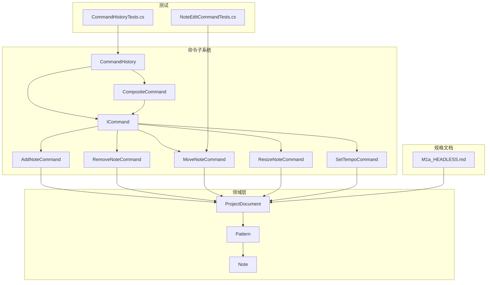

图表来源
- [ICommand.cs:3-11](file://src/Weftone.Domain/Commands/ICommand.cs#L3-L11)
- [CommandHistory.cs:7-98](file://src/Weftone.Domain/Commands/CommandHistory.cs#L7-L98)
- [CompositeCommand.cs:7-28](file://src/Weftone.Domain/Commands/CompositeCommand.cs#L7-L28)
- [AddNoteCommand.cs:3-30](file://src/Weftone.Domain/Commands/AddNoteCommand.cs#L3-L30)
- [RemoveNoteCommand.cs:3-28](file://src/Weftone.Domain/Commands/RemoveNoteCommand.cs#L3-L28)
- [MoveNoteCommand.cs:7-40](file://src/Weftone.Domain/Commands/MoveNoteCommand.cs#L7-L40)
- [ResizeNoteCommand.cs:7-40](file://src/Weftone.Domain/Commands/ResizeNoteCommand.cs#L7-L40)
- [SetTempoCommand.cs:3-22](file://src/Weftone.Domain/Commands/SetTempoCommand.cs#L3-L22)
- [ProjectDocument.cs:7-20](file://src/Weftone.Domain/ProjectDocument.cs#L7-L20)
- [Pattern.cs:3-8](file://src/Weftone.Domain/Pattern.cs#L3-L8)
- [Note.cs:4-11](file://src/Weftone.Domain/Note.cs#L4-L11)
- [M1a_HEADLESS.md:13-29](file://specs/M1a_HEADLESS.md#L13-L29)
- [CommandHistoryTests.cs:7-97](file://tests/Weftone.Domain.Tests/CommandHistoryTests.cs#L7-L97)
- [NoteEditCommandTests.cs:7-146](file://tests/Weftone.Domain.Tests/NoteEditCommandTests.cs#L7-L146)

章节来源
- [M1a_HEADLESS.md:13-29](file://specs/M1a_HEADLESS.md#L13-L29)

## 核心组件
- ICommand：定义可撤销编辑命令的契约，包含标题、应用变更 Apply 与回滚 Revert。
- CommandHistory：维护撤销栈与重做栈，支持 Execute、Undo、Redo、BeginTransaction、EndTransaction、Clear。
- CompositeCommand：将多条命令按序 Apply、逆序 Revert，作为单条撤销记录入栈。
- 具体命令：AddNoteCommand、RemoveNoteCommand、MoveNoteCommand、ResizeNoteCommand、SetTempoCommand 等，直接修改 ProjectDocument 状态。
- ProjectDocument：可编辑工程文档，承载 Tempo、SampleRate、MasterVolume、Channels、Patterns、Playlist、Assets 等。

章节来源
- [ICommand.cs:3-11](file://src/Weftone.Domain/Commands/ICommand.cs#L3-L11)
- [CommandHistory.cs:7-98](file://src/Weftone.Domain/Commands/CommandHistory.cs#L7-L98)
- [CompositeCommand.cs:7-28](file://src/Weftone.Domain/Commands/CompositeCommand.cs#L7-L28)
- [ProjectDocument.cs:7-20](file://src/Weftone.Domain/ProjectDocument.cs#L7-L20)

## 架构总览
命令系统采用“命令模式 + 历史栈”的经典设计：
- 调用方创建具体 ICommand 实例，交由 CommandHistory.Execute 执行。
- CommandHistory 在成功执行后压入撤销栈，并清空重做栈。
- Undo 从撤销栈弹出命令并调用 Revert，同时压入重做栈。
- Redo 从重做栈弹出命令并调用 Apply，同时压回撤销栈。
- BeginTransaction/EndTransaction 将多次 Execute 合并为一条 CompositeCommand 撤销记录。

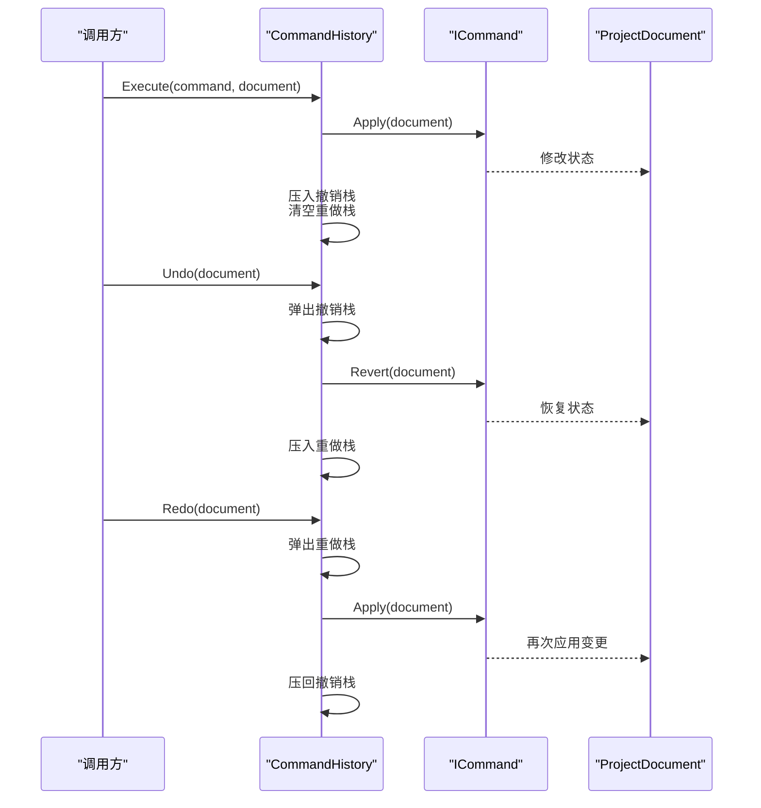

图表来源
- [CommandHistory.cs:20-89](file://src/Weftone.Domain/Commands/CommandHistory.cs#L20-L89)
- [ICommand.cs:3-11](file://src/Weftone.Domain/Commands/ICommand.cs#L3-L11)

## 详细组件分析

### ICommand 接口设计
- Title：用于显示给用户或记录日志的可读描述。
- Apply(ProjectDocument)：对工程文档施加变更；必须保证幂等性与可逆性。
- Revert(ProjectDocument)：精确撤销 Apply 的效果；两者必须互逆。

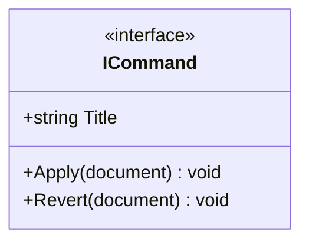

图表来源
- [ICommand.cs:3-11](file://src/Weftone.Domain/Commands/ICommand.cs#L3-L11)

章节来源
- [ICommand.cs:3-11](file://src/Weftone.Domain/Commands/ICommand.cs#L3-L11)

### CommandHistory：命令日志与事务
- 撤销栈与重做栈：分别保存已执行的命令与可重做的命令。
- Execute：先 Apply，再根据是否处于事务决定压入撤销栈或暂存到事务列表；新命令会清空重做栈。
- BeginTransaction/EndTransaction：开启事务时不允许嵌套；结束时若收集到命令则封装为 CompositeCommand 并入撤销栈；空事务不产生撤销记录。
- Undo/Redo：事务进行中禁止撤销/重做；空栈拒绝并抛出异常。
- Clear：载入新工程时清空所有栈与事务状态。

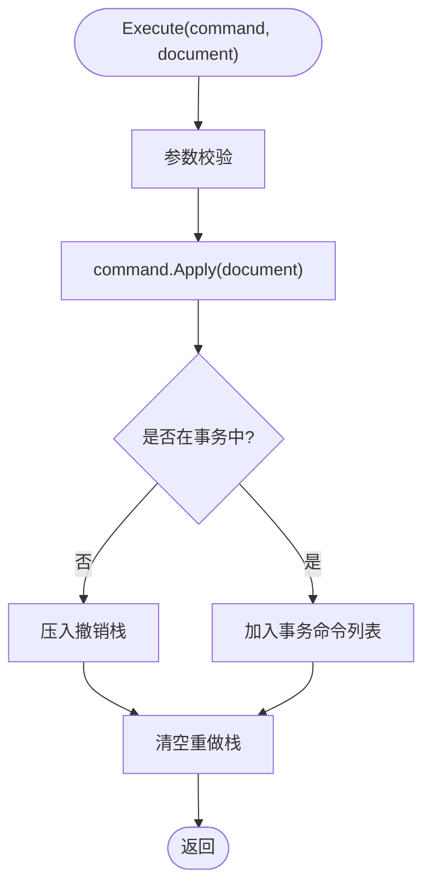

图表来源
- [CommandHistory.cs:20-33](file://src/Weftone.Domain/Commands/CommandHistory.cs#L20-L33)
- [CommandHistory.cs:35-59](file://src/Weftone.Domain/Commands/CommandHistory.cs#L35-L59)

章节来源
- [CommandHistory.cs:7-98](file://src/Weftone.Domain/Commands/CommandHistory.cs#L7-L98)

### CompositeCommand：原子化组合
- Apply：按顺序执行内部命令。
- Revert：逆序执行内部命令的 Revert，确保状态回滚正确。
- 用途：将拖拽过程中的多步移动/调整长度等操作合并为一次撤销。

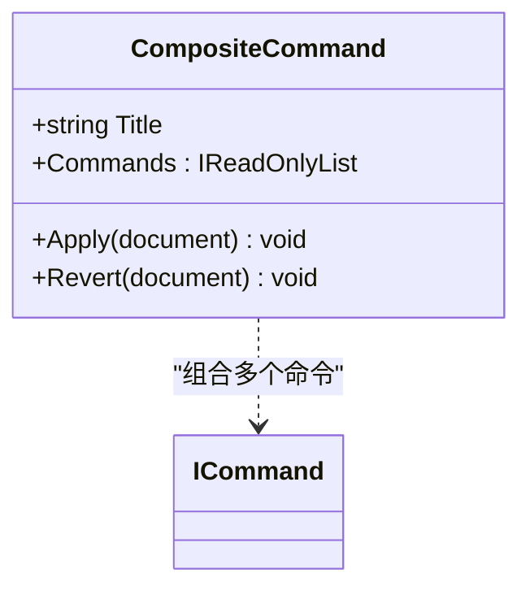

图表来源
- [CompositeCommand.cs:7-28](file://src/Weftone.Domain/Commands/CompositeCommand.cs#L7-L28)

章节来源
- [CompositeCommand.cs:7-28](file://src/Weftone.Domain/Commands/CompositeCommand.cs#L7-L28)

### 具体命令实现

#### AddNoteCommand
- 职责：向指定 Pattern 添加 Note。
- Apply：查找 Pattern，检查重复后添加 Note。
- Revert：从 Pattern 移除该 Note。
- 错误处理：Pattern 不存在或 Note 已存在时抛出异常。

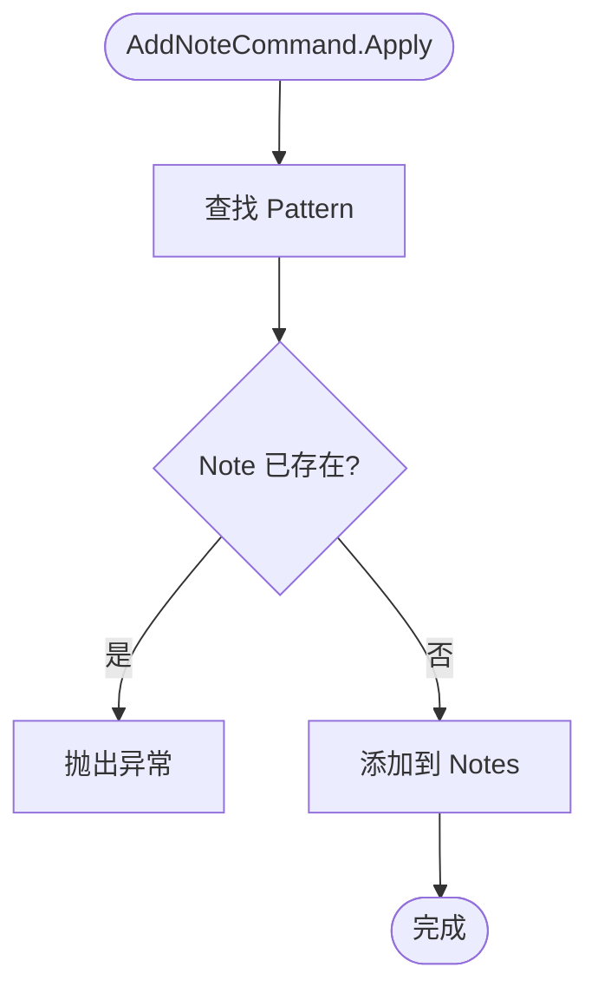

图表来源
- [AddNoteCommand.cs:10-29](file://src/Weftone.Domain/Commands/AddNoteCommand.cs#L10-L29)

章节来源
- [AddNoteCommand.cs:3-30](file://src/Weftone.Domain/Commands/AddNoteCommand.cs#L3-L30)

#### RemoveNoteCommand
- 职责：从指定 Pattern 删除 Note。
- Apply：尝试移除 Note，不存在则抛异常。
- Revert：将该 Note 重新加入 Pattern。
- 错误处理：Pattern 不存在或 Note 不存在时抛出异常。

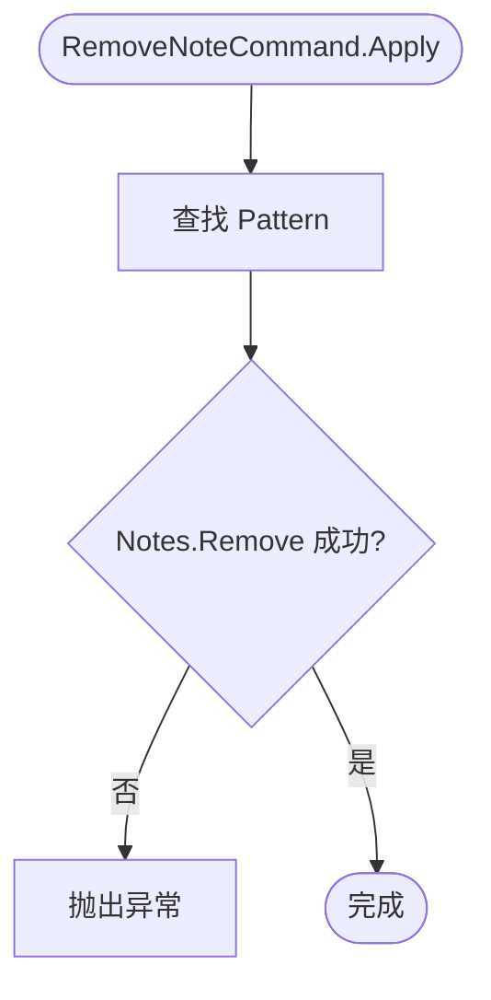

图表来源
- [RemoveNoteCommand.cs:10-27](file://src/Weftone.Domain/Commands/RemoveNoteCommand.cs#L10-L27)

章节来源
- [RemoveNoteCommand.cs:3-28](file://src/Weftone.Domain/Commands/RemoveNoteCommand.cs#L3-L28)

#### MoveNoteCommand
- 职责：移动音符（Piano Roll 拖拽），每步以 From=手势起点执行，经事务合并为单条撤销。
- Apply：设置 Tick 与 Key 为目标值。
- Revert：恢复为 FromTick 与 FromKey。
- 错误处理：Pattern 不存在或 Note 不存在时抛出异常。

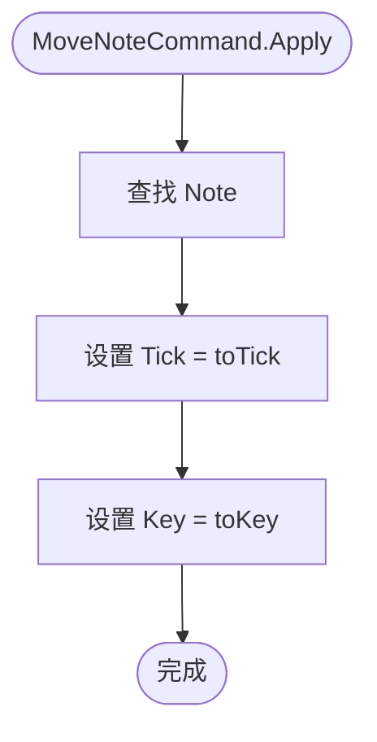

图表来源
- [MoveNoteCommand.cs:18-39](file://src/Weftone.Domain/Commands/MoveNoteCommand.cs#L18-L39)

章节来源
- [MoveNoteCommand.cs:7-40](file://src/Weftone.Domain/Commands/MoveNoteCommand.cs#L7-L40)

#### ResizeNoteCommand
- 职责：调整音符长度（Piano Roll 右缘拖拽），每步以 From=手势起点长度执行，经事务合并为单条撤销。
- Apply：校验最小长度为 1 tick，然后设置 LengthTicks。
- Revert：恢复为 fromLengthTicks。
- 错误处理：长度小于 1 或 Pattern/Note 不存在时抛出异常。

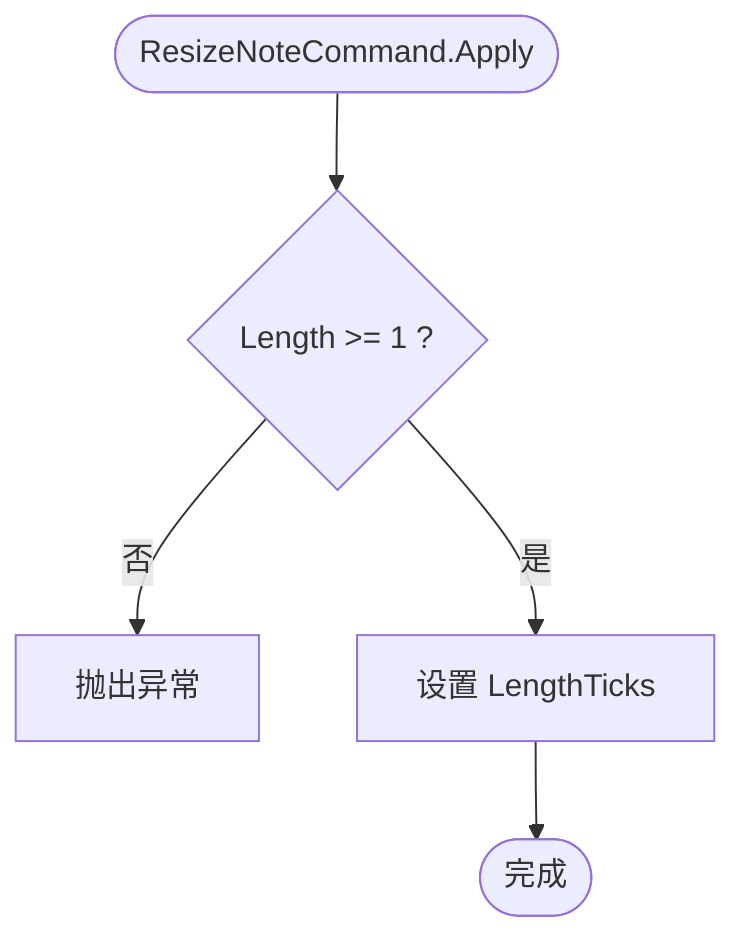

图表来源
- [ResizeNoteCommand.cs:16-39](file://src/Weftone.Domain/Commands/ResizeNoteCommand.cs#L16-L39)

章节来源
- [ResizeNoteCommand.cs:7-40](file://src/Weftone.Domain/Commands/ResizeNoteCommand.cs#L7-L40)

#### SetTempoCommand
- 职责：设置工程 BPM。
- Apply：校验范围 [MinTempo, MaxTempo]，保存旧值并更新 Tempo。
- Revert：恢复为旧 Tempo。
- 错误处理：超出范围时抛出异常。

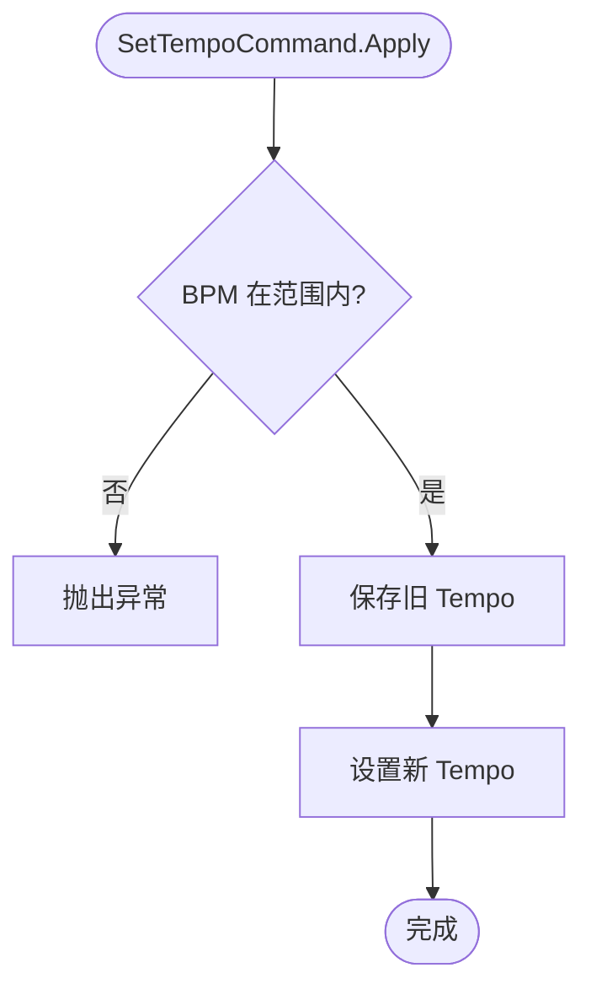

图表来源
- [SetTempoCommand.cs:10-21](file://src/Weftone.Domain/Commands/SetTempoCommand.cs#L10-L21)

章节来源
- [SetTempoCommand.cs:3-22](file://src/Weftone.Domain/Commands/SetTempoCommand.cs#L3-L22)

### 数据模型与状态修改
- ProjectDocument：承载 Tempo、SampleRate、MasterVolume、Channels、Patterns、Playlist、Assets。
- Pattern：包含 Id、Name、Notes。
- Note：包含 ChannelId、Tick、Key、Velocity、LengthTicks。

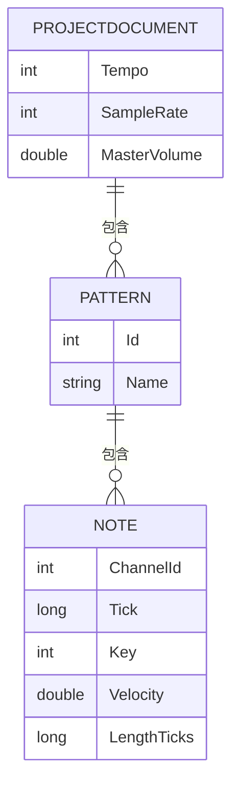

图表来源
- [ProjectDocument.cs:7-20](file://src/Weftone.Domain/ProjectDocument.cs#L7-L20)
- [Pattern.cs:3-8](file://src/Weftone.Domain/Pattern.cs#L3-L8)
- [Note.cs:4-11](file://src/Weftone.Domain/Note.cs#L4-L11)

章节来源
- [ProjectDocument.cs:7-20](file://src/Weftone.Domain/ProjectDocument.cs#L7-L20)
- [Pattern.cs:3-8](file://src/Weftone.Domain/Pattern.cs#L3-L8)
- [Note.cs:4-11](file://src/Weftone.Domain/Note.cs#L4-L11)

## 依赖关系分析
- CommandHistory 依赖 ICommand 抽象，并通过 CompositeCommand 聚合多个命令。
- 具体命令依赖 ProjectDocument 及其子对象 Pattern、Note。
- 规格文档 M1a_HEADLESS.md 定义了单线程同步执行与命令撤销的总体约束。

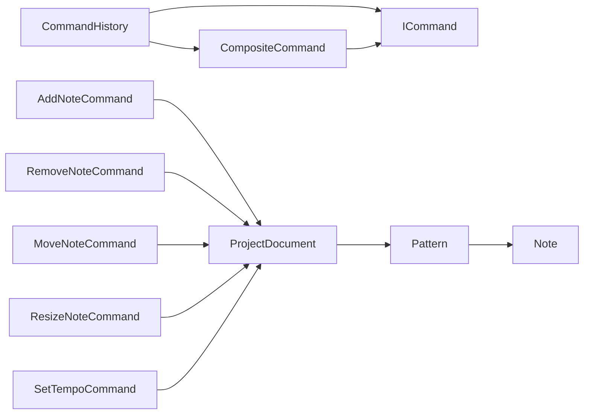

图表来源
- [CommandHistory.cs:7-98](file://src/Weftone.Domain/Commands/CommandHistory.cs#L7-L98)
- [CompositeCommand.cs:7-28](file://src/Weftone.Domain/Commands/CompositeCommand.cs#L7-L28)
- [AddNoteCommand.cs:3-30](file://src/Weftone.Domain/Commands/AddNoteCommand.cs#L3-L30)
- [RemoveNoteCommand.cs:3-28](file://src/Weftone.Domain/Commands/RemoveNoteCommand.cs#L3-L28)
- [MoveNoteCommand.cs:7-40](file://src/Weftone.Domain/Commands/MoveNoteCommand.cs#L7-L40)
- [ResizeNoteCommand.cs:7-40](file://src/Weftone.Domain/Commands/ResizeNoteCommand.cs#L7-L40)
- [SetTempoCommand.cs:3-22](file://src/Weftone.Domain/Commands/SetTempoCommand.cs#L3-L22)
- [ProjectDocument.cs:7-20](file://src/Weftone.Domain/ProjectDocument.cs#L7-L20)
- [Pattern.cs:3-8](file://src/Weftone.Domain/Pattern.cs#L3-L8)
- [Note.cs:4-11](file://src/Weftone.Domain/Note.cs#L4-L11)

章节来源
- [M1a_HEADLESS.md:13-29](file://specs/M1a_HEADLESS.md#L13-L29)

## 性能考虑
- 撤销/重做栈操作为 O(1)，整体撤销重做复杂度取决于命令本身的状态修改成本。
- 拖拽类操作通过事务合并为单次撤销，减少 UI 交互中的撤销粒度开销。
- 命令应尽量避免在 Apply/Revert 中进行昂贵计算；必要时预计算并缓存必要信息于命令对象内。
- 注意避免在命令中引入额外分配（例如频繁创建临时集合），尤其在高频拖拽路径上。

[本节为通用指导，不直接分析具体文件]

## 故障排查指南
常见异常与定位要点：
- 空栈撤销/重做：当撤销或重做栈为空时，CommandHistory 会抛出异常。可通过 CanUndo/CanRedo 判断可用性。
- 事务状态错误：未开启事务却调用 EndTransaction，或在事务中调用 Undo/Redo，均会抛出异常。
- 参数越界：SetTempoCommand 的 BPM 不在允许范围，或 ResizeNoteCommand 的长度小于 1，会抛出异常。
- 对象不存在：FindPattern/FindNote 找不到对应 Pattern 或 Note 时抛出异常。

建议排查步骤：
- 确认调用前是否开启了事务且未嵌套。
- 在执行命令前校验输入参数（如 BPM、长度）。
- 在命令 Apply 中增加前置条件检查，失败即抛异常且不入栈。
- 使用单元测试覆盖边界情况（空栈、空事务、非法参数、对象缺失）。

章节来源
- [CommandHistory.cs:35-89](file://src/Weftone.Domain/Commands/CommandHistory.cs#L35-L89)
- [SetTempoCommand.cs:10-21](file://src/Weftone.Domain/Commands/SetTempoCommand.cs#L10-L21)
- [ResizeNoteCommand.cs:16-39](file://src/Weftone.Domain/Commands/ResizeNoteCommand.cs#L16-L39)
- [AddNoteCommand.cs:10-29](file://src/Weftone.Domain/Commands/AddNoteCommand.cs#L10-L29)
- [RemoveNoteCommand.cs:10-27](file://src/Weftone.Domain/Commands/RemoveNoteCommand.cs#L10-L27)
- [MoveNoteCommand.cs:18-39](file://src/Weftone.Domain/Commands/MoveNoteCommand.cs#L18-L39)

## 结论
M1a Headless 的命令系统通过 ICommand 抽象与 CommandHistory 历史栈实现了清晰、可测试、可扩展的撤销重做能力。CompositeCommand 将复杂手势拆分为多步操作并以原子方式提交，保证了用户体验的一致性。具体命令围绕 ProjectDocument 的富对象状态进行修改，遵循 Apply/Revert 互逆原则。M1a 采用单线程同步执行，简化了并发问题，并为未来多线程版本预留了接口扩展空间。

[本节为总结性内容，不直接分析具体文件]

## 附录：命令使用示例与最佳实践

### 使用示例（基于测试用例的行为）
- 基本撤销重做：执行 SetTempoCommand，随后 Undo/Redo 验证状态往返一致。
- 音符增删：执行 AddNoteCommand 与 RemoveNoteCommand，验证撤销后状态恢复。
- 拖拽合并：在 BeginTransaction/EndTransaction 之间多次 Execute MoveNoteCommand，最终仅产生一条撤销记录。
- 参数校验：对非法 BPM 或无效长度执行命令，应抛出异常且不影响已有撤销栈。

章节来源
- [CommandHistoryTests.cs:17-96](file://tests/Weftone.Domain.Tests/CommandHistoryTests.cs#L17-L96)
- [NoteEditCommandTests.cs:17-146](file://tests/Weftone.Domain.Tests/NoteEditCommandTests.cs#L17-L146)

### 最佳实践
- 保持 Apply/Revert 严格互逆：任何状态变更都应在 Revert 中精确还原。
- 在 Apply 中进行前置校验，失败即抛异常，避免污染状态。
- 使用事务合并用户手势的多步操作，提升撤销体验。
- 命令对象尽量无副作用，避免访问外部可变状态。
- 对高频操作（如拖拽）优化命令内部逻辑，减少分配与查找成本。

[本节为通用指导，不直接分析具体文件]