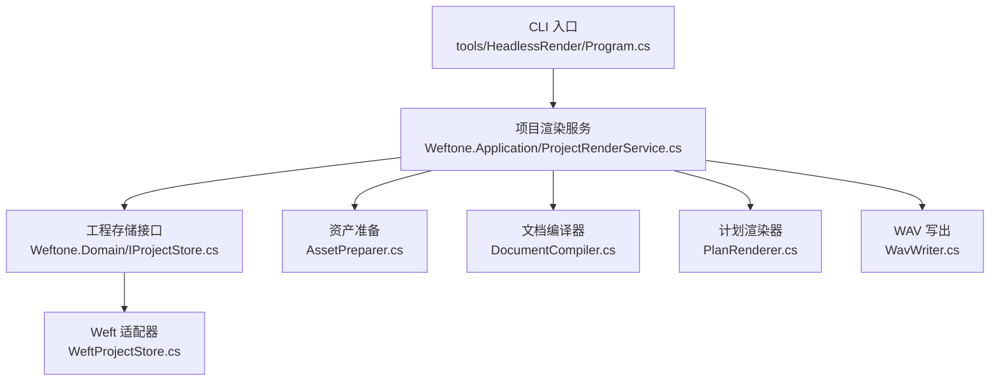
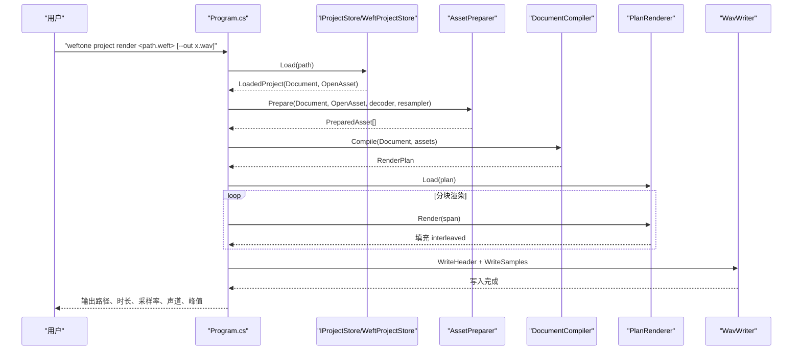
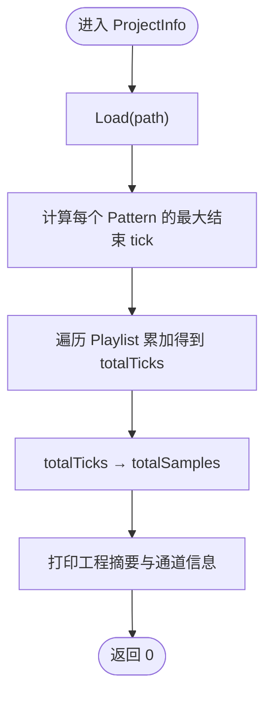
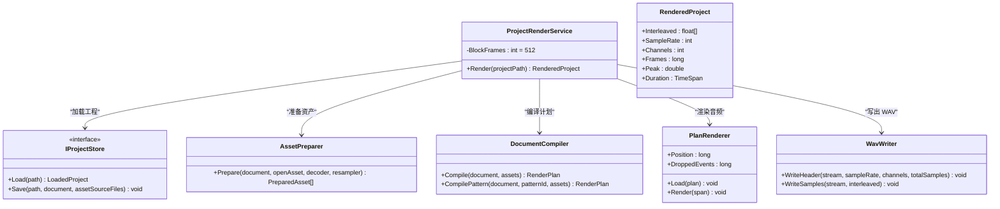
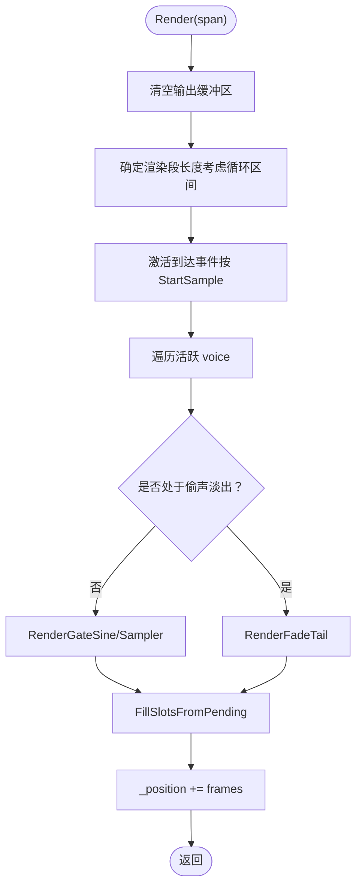
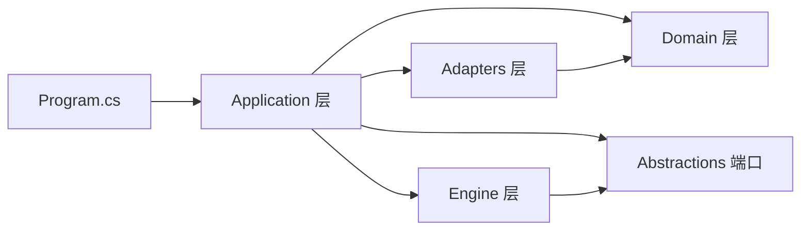

# 命令行工具与使用指南

<cite>
**本文引用的文件**   
- [Program.cs](file://tools/HeadlessRender/Program.cs)
- [README.md（HeadlessRender）](file://tools/HeadlessRender/README.md)
- [ProjectRenderService.cs](file://src/Weftone.Application/ProjectRenderService.cs)
- [WavWriter.cs](file://src/Weftone.Application/WavWriter.cs)
- [IProjectStore.cs](file://src/Weftone.Domain/IProjectStore.cs)
- [WeftProjectStore.cs](file://src/Weftone.Adapters.ProjectStore/WeftProjectStore.cs)
- [AssetPreparer.cs](file://src/Weftone.Application/AssetPreparer.cs)
- [DocumentCompiler.cs](file://src/Weftone.Application/DocumentCompiler.cs)
- [PlanRenderer.cs](file://src/Weftone.Engine/PlanRenderer.cs)
- [M1a_HEADLESS.md](file://specs/M1a_HEADLESS.md)
</cite>

## 目录
1. [简介](#简介)
2. [项目结构](#项目结构)
3. [核心组件](#核心组件)
4. [架构总览](#架构总览)
5. [详细组件分析](#详细组件分析)
6. [依赖关系分析](#依赖关系分析)
7. [性能与内存优化](#性能与内存优化)
8. [故障排查](#故障排查)
9. [结论](#结论)
10. [附录：命令速查与示例](#附录命令速查与示例)

## 简介
本指南面向 HeadlessRender 命令行工具 weftone，重点说明 weftone project render 与 weftone project info 的用法、参数、处理链路、错误处理策略、部署要求与 CI/CD 集成建议。当前实现支持：
- 渲染 .weft 工程为 WAV；
- 查看工程概览信息；
- 生成演示工程；
- 离线正弦渲染与实时播放（需 native shim）。

需要特别说明的是：当前 CLI 尚未实现 --from-tick 与 --to-tick 范围控制参数，该能力在规格中已规划但尚未落地。

**章节来源**
- [README.md（HeadlessRender）:1-16](file://tools/HeadlessRender/README.md#L1-L16)
- [M1a_HEADLESS.md:59-63](file://specs/M1a_HEADLESS.md#L59-L63)

## 项目结构
HeadlessRender 是 M1a 组合根 CLI，位于 tools/HeadlessRender，入口为 Program.cs。它通过 Weftone.Application 层编排加载、资产准备、编译、渲染与写出流程，底层依赖 Domain 模型与 Engine 渲染器。



**图表来源**
- [Program.cs:119-136](file://tools/HeadlessRender/Program.cs#L119-L136)
- [ProjectRenderService.cs:19-49](file://src/Weftone.Application/ProjectRenderService.cs#L19-L49)
- [IProjectStore.cs:3-14](file://src/Weftone.Domain/IProjectStore.cs#L3-L14)
- [WeftProjectStore.cs:23-71](file://src/Weftone.Adapters.ProjectStore/WeftProjectStore.cs#L23-L71)
- [AssetPreparer.cs:11-40](file://src/Weftone.Application/AssetPreparer.cs#L11-L40)
- [DocumentCompiler.cs:19-49](file://src/Weftone.Application/DocumentCompiler.cs#L19-L49)
- [PlanRenderer.cs:48-59](file://src/Weftone.Engine/PlanRenderer.cs#L48-L59)
- [WavWriter.cs:9-38](file://src/Weftone.Application/WavWriter.cs#L9-L38)

**章节来源**
- [Program.cs:1-16](file://tools/HeadlessRender/Program.cs#L1-L16)
- [README.md（HeadlessRender）:1-16](file://tools/HeadlessRender/README.md#L1-L16)

## 核心组件
- CLI 参数解析与命令分发：Program.cs 负责解析子命令 project/info/render/demo/play，以及 --out、--freq、--seconds 等参数。
- 工程渲染服务：ProjectRenderService 串联 IProjectStore.Load → AssetPreparer.Prepare → DocumentCompiler.Compile → PlanRenderer.Render → 峰值统计与时长计算。
- 工程存储：IProjectStore 抽象 .weft 存取，WeftProjectStore 实现 zip 容器校验、schema 版本检查、资产 SHA256 校验与防 zip slip。
- 资产准备：AssetPreparer 解码并离线重采样到工程采样率，限制声道数仅支持 1/2。
- 文档编译：DocumentCompiler 将 ProjectDocument 转换为 RenderPlan，按 tick→sample 映射展开 Playlist，构建声部事件。
- 计划渲染：PlanRenderer 基于预分配 voice 池进行零分配渲染，支持 sine 与 sampler，具备淡出偷声与循环逻辑。
- WAV 写出：WavWriter 输出 IEEE float32 小端 WAV，流式追加样本。

**章节来源**
- [Program.cs:21-96](file://tools/HeadlessRender/Program.cs#L21-L96)
- [ProjectRenderService.cs:7-49](file://src/Weftone.Application/ProjectRenderService.cs#L7-L49)
- [IProjectStore.cs:3-14](file://src/Weftone.Domain/IProjectStore.cs#L3-L14)
- [WeftProjectStore.cs:23-71](file://src/Weftone.Adapters.ProjectStore/WeftProjectStore.cs#L23-L71)
- [AssetPreparer.cs:8-40](file://src/Weftone.Application/AssetPreparer.cs#L8-L40)
- [DocumentCompiler.cs:6-49](file://src/Weftone.Application/DocumentCompiler.cs#L6-L49)
- [PlanRenderer.cs:5-59](file://src/Weftone.Engine/PlanRenderer.cs#L5-L59)
- [WavWriter.cs:6-38](file://src/Weftone.Application/WavWriter.cs#L6-L38)

## 架构总览
weftone project render 的完整处理链路如下：



**图表来源**
- [Program.cs:122-136](file://tools/HeadlessRender/Program.cs#L122-L136)
- [ProjectRenderService.cs:19-49](file://src/Weftone.Application/ProjectRenderService.cs#L19-L49)
- [WeftProjectStore.cs:23-71](file://src/Weftone.Adapters.ProjectStore/WeftProjectStore.cs#L23-L71)
- [AssetPreparer.cs:11-40](file://src/Weftone.Application/AssetPreparer.cs#L11-L40)
- [DocumentCompiler.cs:19-49](file://src/Weftone.Application/DocumentCompiler.cs#L19-L49)
- [PlanRenderer.cs:48-59](file://src/Weftone.Engine/PlanRenderer.cs#L48-L59)
- [WavWriter.cs:9-38](file://src/Weftone.Application/WavWriter.cs#L9-L38)

## 详细组件分析

### CLI 参数与命令行为
- 支持的顶层命令：render、play、project、demo。
- project 子命令：info、render。
- 通用参数：
  - --freq / -f：频率（默认 440Hz）；
  - --seconds / -s：时长（默认 5s，范围 (0, 3600]）；
  - --out / -o：输出路径（默认 out.wav）。
- 返回值约定：
  - 0：成功；
  - 1：RT 分配违规（非零退出码）；
  - 2：参数错误；
  - 3：native 缺失；
  - 4：工程或数据非法。

注意：当前未实现 --from-tick 与 --to-tick 参数，若未来扩展需在 Program.cs 的参数解析分支中添加对应选项并在 ProjectRenderService 或 DocumentCompiler 中应用裁剪逻辑。

**章节来源**
- [Program.cs:21-96](file://tools/HeadlessRender/Program.cs#L21-L96)
- [README.md（HeadlessRender）:1-16](file://tools/HeadlessRender/README.md#L1-L16)
- [M1a_HEADLESS.md:59-63](file://specs/M1a_HEADLESS.md#L59-L63)

### 工程信息查看：weftone project info
- 功能：读取 .weft 工程，打印 BPM、采样率、声部数量、pattern 数量、playlist clip 数量、资产数量、估算时长与各通道配置。
- 内部流程：
  - WeftProjectStore.Load 返回 LoadedProject；
  - 遍历 Patterns 计算每个 pattern 的最大结束 tick；
  - 遍历 Playlist 计算总 tick；
  - 根据 SampleRate、Tempo、PPQ 换算总样本与时长；
  - 输出各 Channel 的音量与声像。



**图表来源**
- [Program.cs:138-169](file://tools/HeadlessRender/Program.cs#L138-L169)

**章节来源**
- [Program.cs:138-169](file://tools/HeadlessRender/Program.cs#L138-L169)

### 工程渲染：weftone project render
- 输入：<path.weft>，可选 --out x.wav。
- 处理链路：
  - NewRenderService 组装 IProjectStore、ISampleDecoder、IResampler、IPlanRenderer；
  - Render(path) 执行：Load → Prepare → Compile → Load(plan) → 分块 Render → 峰值统计；
  - 写出 WAV：先写头，再流式追加样本。
- 输出：控制台打印输出路径、时长、采样率、声道、峰值。



**图表来源**
- [ProjectRenderService.cs:7-49](file://src/Weftone.Application/ProjectRenderService.cs#L7-L49)
- [IProjectStore.cs:3-14](file://src/Weftone.Domain/IProjectStore.cs#L3-L14)
- [AssetPreparer.cs:11-40](file://src/Weftone.Application/AssetPreparer.cs#L11-L40)
- [DocumentCompiler.cs:19-49](file://src/Weftone.Application/DocumentCompiler.cs#L19-L49)
- [PlanRenderer.cs:48-59](file://src/Weftone.Engine/PlanRenderer.cs#L48-L59)
- [WavWriter.cs:9-38](file://src/Weftone.Application/WavWriter.cs#L9-L38)

**章节来源**
- [Program.cs:119-136](file://tools/HeadlessRender/Program.cs#L119-L136)
- [ProjectRenderService.cs:19-49](file://src/Weftone.Application/ProjectRenderService.cs#L19-L49)
- [WavWriter.cs:9-38](file://src/Weftone.Application/WavWriter.cs#L9-L38)

### 资产准备与解码
- 对每个 AssetRef：
  - 通过 OpenAsset 打开 zip 内流；
  - ISampleDecoder.Decode 解码为 DecodedAudio；
  - IResampler.Resample 重采样到工程采样率；
  - 校验声道数仅支持 1/2；
  - 产出 PreparedAsset（ID、交错样本、声道数、帧数）。

异常处理：
- 解码失败抛出 InvalidDataException，附带资产路径与原始异常消息。

**章节来源**
- [AssetPreparer.cs:11-40](file://src/Weftone.Application/AssetPreparer.cs#L11-L40)

### 文档编译与时间映射
- TickMath.SamplesPerTick 将 BPM 与采样率转换为 tick→sample 比例；
- BuildChannelMap 建立 channel id→Channel 映射；
- AddPatternVoices 遍历 Notes，计算 pan/gain/frequency，区分 Sine/Sampler；
- BuildPlan 排序 voices，构建 RenderPlan（含 MasterGain、LoopStart/End、Assets 引用）。

关键点：
- 同 ProjectDocument → 同 RenderPlan（幂等）；
- Sampler 以 MIDI 60 为原速，key 偏移即速率；
- Loop 模式用于 Pattern 循环，非 Loop 用于整工程线性渲染。

**章节来源**
- [DocumentCompiler.cs:19-49](file://src/Weftone.Application/DocumentCompiler.cs#L19-L49)
- [DocumentCompiler.cs:98-157](file://src/Weftone.Application/DocumentCompiler.cs#L98-L157)

### 计划渲染与零分配保障
- PlanRenderer 维护固定大小 voice 池（MaxVoices=64），pending 环缓冲新事件；
- 池满时选择最早结束的 voice 进行淡出偷声（FadeTail=128），避免 click；
- 支持 sine 相位推进与 sampler 线性插值读取；
- 全程零分配（由 RtAssert.Guard 守护，非 RT 路径不强制）。



**图表来源**
- [PlanRenderer.cs:61-137](file://src/Weftone.Engine/PlanRenderer.cs#L61-L137)
- [PlanRenderer.cs:139-231](file://src/Weftone.Engine/PlanRenderer.cs#L139-L231)
- [PlanRenderer.cs:233-354](file://src/Weftone.Engine/PlanRenderer.cs#L233-L354)

**章节来源**
- [PlanRenderer.cs:5-59](file://src/Weftone.Engine/PlanRenderer.cs#L5-L59)
- [PlanRenderer.cs:61-137](file://src/Weftone.Engine/PlanRenderer.cs#L61-L137)
- [PlanRenderer.cs:139-231](file://src/Weftone.Engine/PlanRenderer.cs#L139-L231)
- [PlanRenderer.cs:233-354](file://src/Weftone.Engine/PlanRenderer.cs#L233-L354)

### WAV 写出
- 格式：IEEE float32，小端字节序；
- 头：RIFF/WAVE/fmt/data 四块，data 长度为 totalSamples * sizeof(float)；
- 单 WAV 上限：4GB（uint.MaxValue 字节）；
- 流式追加：WriteSamples 直接写入交错样本字节。

**章节来源**
- [WavWriter.cs:6-38](file://src/Weftone.Application/WavWriter.cs#L6-L38)

## 依赖关系分析
- CLI 依赖 Application 层的服务与工具类；
- Application 层依赖 Domain 模型与 Abstractions 端口；
- Engine 层仅依赖 Abstractions，保证渲染核心可复用；
- Adapters 层实现具体 I/O（zip/json、dr_wav、miniaudio）。



**图表来源**
- [Program.cs:1-9](file://tools/HeadlessRender/Program.cs#L1-L9)
- [ProjectRenderService.cs:1-4](file://src/Weftone.Application/ProjectRenderService.cs#L1-L4)
- [PlanRenderer.cs:1-2](file://src/Weftone.Engine/PlanRenderer.cs#L1-L2)
- [WeftProjectStore.cs:1-5](file://src/Weftone.Adapters.ProjectStore/WeftProjectStore.cs#L1-L5)

**章节来源**
- [Program.cs:1-9](file://tools/HeadlessRender/Program.cs#L1-L9)
- [ProjectRenderService.cs:1-4](file://src/Weftone.Application/ProjectRenderService.cs#L1-L4)
- [PlanRenderer.cs:1-2](file://src/Weftone.Engine/PlanRenderer.cs#L1-L2)
- [WeftProjectStore.cs:1-5](file://src/Weftone.Adapters.ProjectStore/WeftProjectStore.cs#L1-L5)

## 性能与内存优化
- 渲染分块：ProjectRenderService 使用 BlockFrames=512 分块渲染，降低单次内存占用；
- 零分配渲染：PlanRenderer 使用固定数组池与 Span，避免 GC 压力；
- 主增益后处理：PlanRenderer 在主输出阶段统一乘以 MasterGain，减少每 voice 乘法开销；
- 峰值统计：在渲染过程中逐样本比较绝对值，O(n) 复杂度；
- 大文件限制：WavWriter 对 totalSamples 做 uint.MaxValue 上限检查，防止溢出；
- 建议：
  - 对于超长工程，考虑分段导出或批处理脚本拆分；
  - 监控进程内存峰值与 CPU 占用，必要时调整 BlockFrames；
  - 使用黄金音频基线测试确保数值稳定性。

**章节来源**
- [ProjectRenderService.cs:17-49](file://src/Weftone.Application/ProjectRenderService.cs#L17-L49)
- [PlanRenderer.cs:5-59](file://src/Weftone.Engine/PlanRenderer.cs#L5-L59)
- [WavWriter.cs:9-17](file://src/Weftone.Application/WavWriter.cs#L9-L17)

## 故障排查
常见错误与处理策略：
- 参数错误：
  - 未知参数或缺少值：返回 2；
  - --seconds 超出范围：返回 2。
- 工程包非法：
  - 缺少 project.json/metadata.json；
  - schema 版本不支持；
  - JSON 解析失败；
  - 资产缺失或 SHA256 不匹配；
  - 非法 zip 条目（防 zip slip）；
  - 返回 4。
- 数据非法：
  - 资产解码失败；
  - 声道数不支持（仅 1/2）；
  - 返回 4。
- Native 缺失：
  - play 命令找不到 weftone_miniaudio 动态库；
  - 返回 3。
- 音频设备问题：
  - 打开/启动失败；
  - 返回 4。
- RT 分配违规：
  - 正弦直渲路径检测到分配；
  - 返回 1。

调试技巧：
- 使用 weftone demo 生成最小可复现工程；
- 逐步验证：demo.weft → project info → project render；
- 关注控制台输出的路径、时长、采样率、声道、峰值；
- 检查 .weft 包内 assets 路径与 SHA256 是否与 project.json 一致；
- 在 CI 中启用黄金音频对比，捕获跨平台浮点差异。

**章节来源**
- [Program.cs:81-107](file://tools/HeadlessRender/Program.cs#L81-L107)
- [Program.cs:227-236](file://tools/HeadlessRender/Program.cs#L227-L236)
- [WeftProjectStore.cs:23-71](file://src/Weftone.Adapters.ProjectStore/WeftProjectStore.cs#L23-L71)
- [AssetPreparer.cs:23-37](file://src/Weftone.Application/AssetPreparer.cs#L23-L37)

## 结论
weftone CLI 提供了从 .weft 工程到 WAV 的完整 headless 渲染链路，具备严格的工程校验、资产解码与重采样、确定性编译与零分配渲染能力。当前实现已覆盖 project render 与 project info，--from-tick/--to-tick 范围控制在规格中已定义但尚未实现。建议在后续迭代中补齐范围裁剪，并完善 CI/CD 中的黄金音频对比与资源监控。

[本节不直接分析具体文件，无需“章节来源”]

## 附录：命令速查与示例

### 基本用法
- 渲染工程为 WAV：
  - weftone project render <path.weft> --out x.wav
- 查看工程信息：
  - weftone project info <path.weft>
- 生成演示工程：
  - weftone demo --out demo.weft
- 离线正弦渲染：
  - weftone render --freq 440 --seconds 5 --out out.wav
- 实时播放（需 native shim）：
  - weftone play --freq 440 --seconds 5

### 参数说明
- --freq / -f：频率（默认 440Hz）；
- --seconds / -s：时长（默认 5s，范围 (0, 3600]）；
- --out / -o：输出路径（默认 out.wav）；
- --help / -h：显示帮助。

### 批处理脚本示例（Windows CMD）
```bat
@echo off
set WEFT_PATH=my_project.weft
set OUT_WAV=output.wav

echo 正在生成演示工程...
weftone demo --out demo.weft

echo 正在查看工程信息...
weftone project info %WEFT_PATH%

echo 正在渲染工程为 WAV...
weftone project render %WEFT_PATH% --out %OUT_WAV%

if %errorlevel% equ 0 (
    echo 渲染成功
) else (
    echo 渲染失败，错误码: %errorlevel%
)
```

### CI/CD 集成建议（GitHub Actions）
- 步骤：
  - 安装 .NET SDK；
  - 还原依赖并构建 HeadlessRender；
  - 运行 weftone project info 与 project render；
  - 对比黄金音频基线（峰值差容差 ≤ 1e-4）；
  - 收集日志与输出 WAV 作为工件。

```yaml
name: Weftone CI
on: [push, pull_request]
jobs:
  build-and-test:
    runs-on: windows-latest
    steps:
      - uses: actions/checkout@v4
      - name: Setup .NET
        uses: actions/setup-dotnet@v4
        with:
          dotnet-version: '8.x'
      - name: Restore
        run: dotnet restore
      - name: Build
        run: dotnet build --configuration Release
      - name: Generate Demo
        run: dotnet run --project tools/HeadlessRender/HeadlessRender.csproj -- demo --out demo.weft
      - name: Info
        run: dotnet run --project tools/HeadlessRender/HeadlessRender.csproj -- project info demo.weft
      - name: Render
        run: dotnet run --project tools/HeadlessRender/HeadlessRender.csproj -- project render demo.weft --out output.wav
      - name: Golden Audio Check
        run: echo "Compare output.wav with baseline"
```

### 部署方式与依赖要求
- 运行时：.NET 运行时（HeadlessRender 为 .NET 应用）；
- Native 依赖：
  - play 命令需要 weftone_miniaudio 动态库；
  - 可通过构建 native 或设置环境变量 WEFTONE_NATIVE_DIR 指定路径；
- 文件格式：
  - .weft 为 zip 容器，包含 metadata.json、project.json、assets/*.wav；
  - 加载时校验 schemaVersion、SHA256，拒绝非法包。

**章节来源**
- [Program.cs:227-236](file://tools/HeadlessRender/Program.cs#L227-L236)
- [WeftProjectStore.cs:23-71](file://src/Weftone.Adapters.ProjectStore/WeftProjectStore.cs#L23-L71)