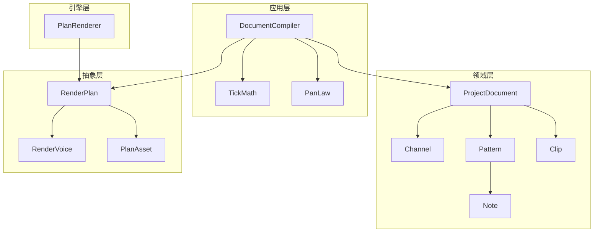
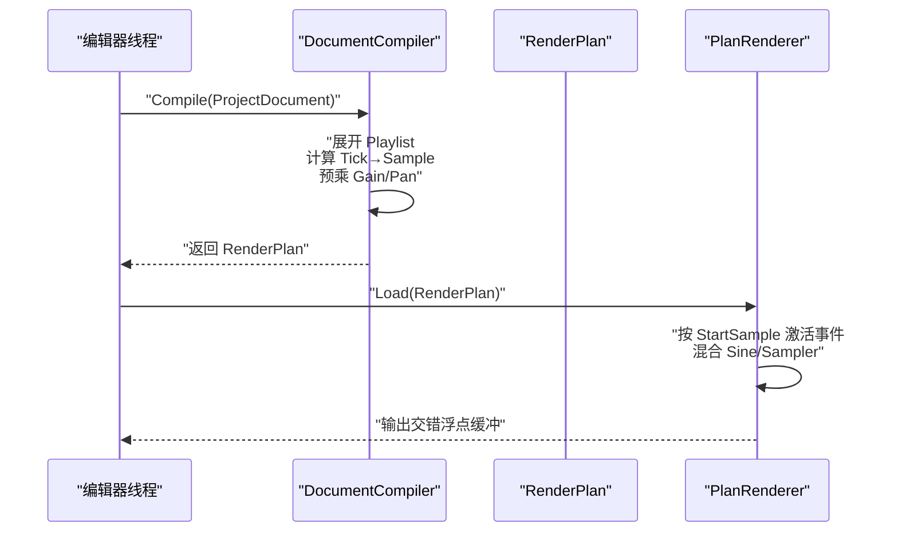
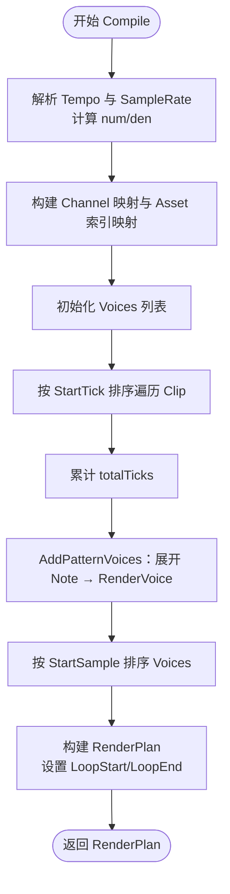
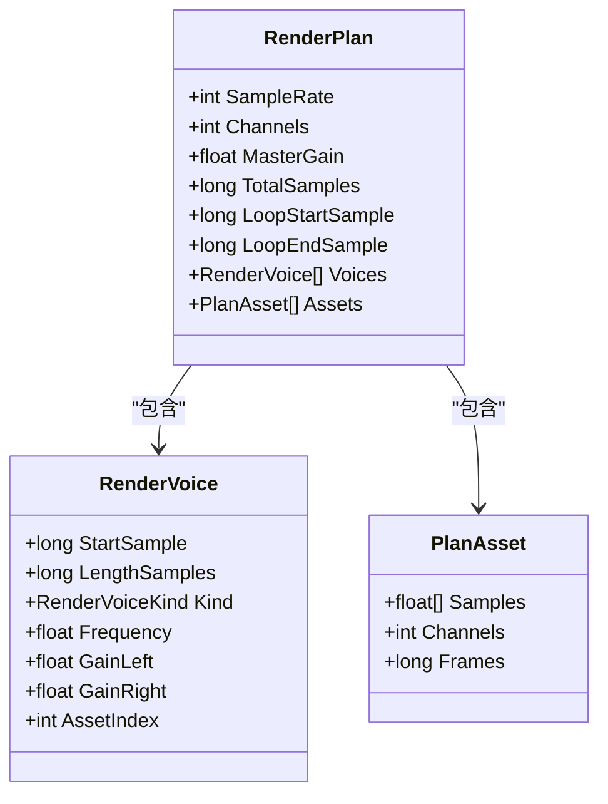
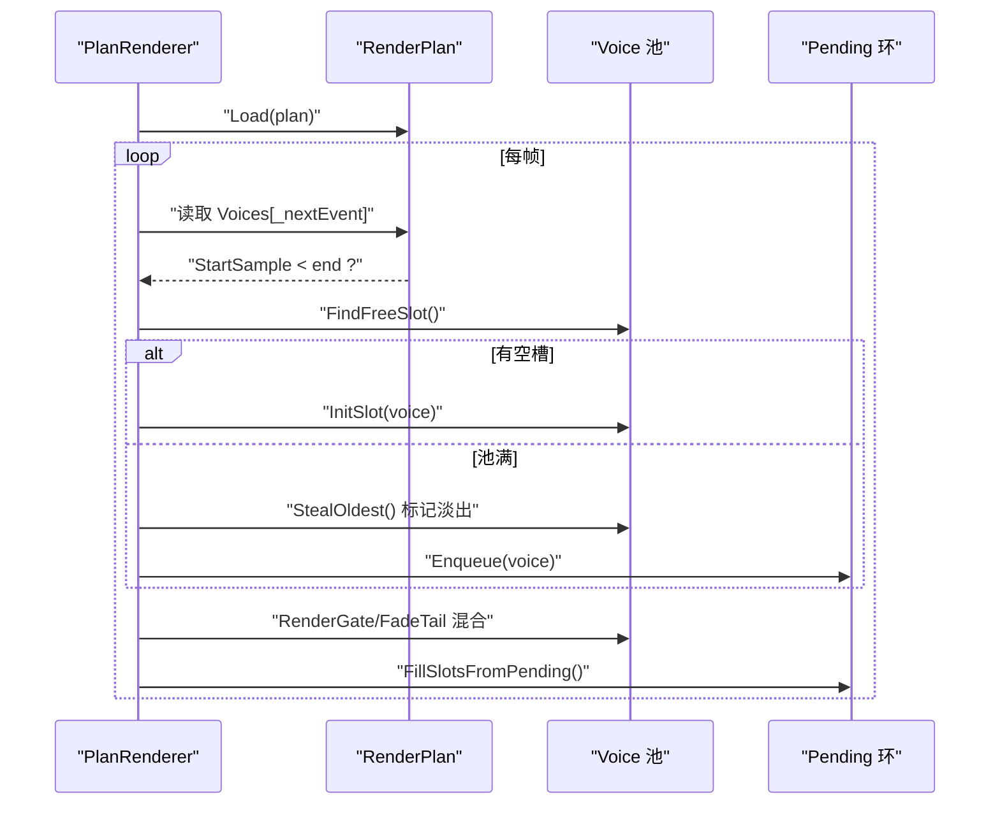
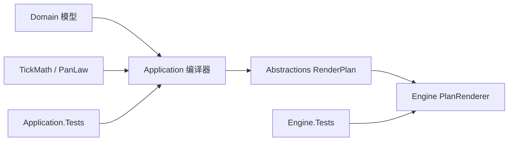

# 文档编译器与渲染计划

<cite>
**本文引用的文件**   
- [DocumentCompiler.cs](file://src/Weftone.Application/DocumentCompiler.cs)
- [RenderPlan.cs](file://src/Weftone.Abstractions/Rendering/RenderPlan.cs)
- [PlanRenderer.cs](file://src/Weftone.Engine/PlanRenderer.cs)
- [TickMath.cs](file://src/Weftone.Application/TickMath.cs)
- [PanLaw.cs](file://src/Weftone.Application/PanLaw.cs)
- [ProjectDocument.cs](file://src/Weftone.Domain/ProjectDocument.cs)
- [Channel.cs](file://src/Weftone.Domain/Channel.cs)
- [Note.cs](file://src/Weftone.Domain/Note.cs)
- [Clip.cs](file://src/Weftone.Domain/Clip.cs)
- [Pattern.cs](file://src/Weftone.Domain/Pattern.cs)
- [ADR-0003-document-engine-compiler.md](file://docs/adr/ADR-0003-document-engine-compiler.md)
- [ADR-0002-threading-realtime.md](file://docs/adr/ADR-0002-threading-realtime.md)
- [DocumentCompilerTests.cs](file://tests/Weftone.Application.Tests/DocumentCompilerTests.cs)
- [PlanRendererTests.cs](file://tests/Weftone.Engine.Tests/PlanRendererTests.cs)
</cite>

## 目录
1. [引言](#引言)
2. [项目结构](#项目结构)
3. [核心组件](#核心组件)
4. [架构总览](#架构总览)
5. [详细组件分析](#详细组件分析)
6. [依赖关系分析](#依赖关系分析)
7. [性能与内存特性](#性能与内存特性)
8. [编译示例与调试方法](#编译示例与调试方法)
9. [故障排查指南](#故障排查指南)
10. [结论](#结论)

## 引言
本文围绕 Weftone 的“文档编译器”和“渲染计划”展开，目标是解释编译器如何将富对象工程 `ProjectDocument` 转换为扁平、实时友好的 `RenderPlan`。重点包括：时间轴展开、事件排序、预计算增益与声像值、采样级位置映射、循环区间设置、幂等性保证，以及非实时线程全量编译策略与实时渲染引擎的解耦设计。同时给出 RenderPlan 的数据结构说明、优化策略、内存分配控制、基准测试要点，并提供可操作的编译示例与调试方法。

## 项目结构
本主题涉及三个层次：
- 领域层：`ProjectDocument`、`Channel`、`Pattern`、`Note`、`Clip` 描述可编辑工程。
- 应用层：`DocumentCompiler`、`TickMath`、`PanLaw` 负责离线编译。
- 抽象与引擎层：`RenderPlan`、`RenderVoice`、`PlanAsset`、`PlanRenderer` 提供实时渲染接口与实现。

**图表来源**
- [ProjectDocument.cs:7-20](file://src/Weftone.Domain/ProjectDocument.cs#L7-L20)
- [Channel.cs:3-18](file://src/Weftone.Domain/Channel.cs#L3-L18)
- [Pattern.cs:3-8](file://src/Weftone.Domain/Pattern.cs#L3-L8)
- [Note.cs:4-11](file://src/Weftone.Domain/Note.cs#L4-L11)
- [Clip.cs:4-8](file://src/Weftone.Domain/Clip.cs#L4-L8)
- [DocumentCompiler.cs:11-157](file://src/Weftone.Application/DocumentCompiler.cs#L11-L157)
- [TickMath.cs:6-13](file://src/Weftone.Application/TickMath.cs#L6-L13)
- [PanLaw.cs:7-14](file://src/Weftone.Application/PanLaw.cs#L7-L14)
- [RenderPlan.cs:3-41](file://src/Weftone.Abstractions/Rendering/RenderPlan.cs#L3-L41)
- [PlanRenderer.cs:11-44](file://src/Weftone.Engine/PlanRenderer.cs#L11-L44)

**章节来源**
- [ProjectDocument.cs:7-20](file://src/Weftone.Domain/ProjectDocument.cs#L7-L20)
- [DocumentCompiler.cs:11-157](file://src/Weftone.Application/DocumentCompiler.cs#L11-L157)
- [RenderPlan.cs:3-41](file://src/Weftone.Abstractions/Rendering/RenderPlan.cs#L3-L41)
- [PlanRenderer.cs:11-44](file://src/Weftone.Engine/PlanRenderer.cs#L11-L44)

## 核心组件
- `DocumentCompiler`：将 `ProjectDocument` 全量编译为 `RenderPlan`；支持整工程编译与单 Pattern 循环模式；保证相同输入产生相同输出。
- `RenderPlan`：扁平实时计划，包含采样率、声道数、主控音量、总样本数、循环区间、按采样位置排序的事件数组、资产数组。
- `RenderVoice`：单次触发事件，已预乘 gain/pan，携带采样级 start/length、频率、类型与资产索引。
- `PlanRenderer`：读取 `RenderPlan` 进行实时或离线渲染，固定复音池、等待门限、偷声部淡出、待入队环缓冲，全程零分配。

**章节来源**
- [DocumentCompiler.cs:6-10](file://src/Weftone.Application/DocumentCompiler.cs#L6-L10)
- [RenderPlan.cs:9-41](file://src/Weftone.Abstractions/Rendering/RenderPlan.cs#L9-L41)
- [PlanRenderer.cs:5-10](file://src/Weftone.Engine/PlanRenderer.cs#L5-L10)

## 架构总览
编译器在 UI/编辑线程运行，引擎在音频 RT 线程运行；两者通过不可变 `RenderPlan` 原子交换数据，音频线程永远不接触 `ProjectDocument`。

**图表来源**
- [DocumentCompiler.cs:19-48](file://src/Weftone.Application/DocumentCompiler.cs#L19-L48)
- [PlanRenderer.cs:48-105](file://src/Weftone.Engine/PlanRenderer.cs#L48-L105)
- [ADR-0003-document-engine-compiler.md:8-12](file://docs/adr/ADR-0003-document-engine-compiler.md#L8-L12)

**章节来源**
- [ADR-0003-document-engine-compiler.md:8-12](file://docs/adr/ADR-0003-document-engine-compiler.md#L8-L12)
- [ADR-0002-threading-realtime.md:7-15](file://docs/adr/ADR-0002-threading-realtime.md#L7-L15)

## 详细组件分析

### DocumentCompiler：从富对象到扁平计划
职责与流程：
- 解析工程 tempo 与采样率，计算 tick 到 sample 的比例。
- 构建通道映射与资产索引映射。
- 遍历按起始 tick 排序的 playlist clip，累计最大结束 tick，并逐个 pattern 展开音符为 voice。
- 对每个 note 计算采样级 start/length、频率、预乘 gain/pan、sampler 资产索引。
- 最终按 `StartSample` 排序生成 `RenderPlan`，设置循环区间（整工程关闭，pattern 模式开启）。

关键算法步骤：
- 时间轴展开：playlist 线性扫描，clip 偏移 pattern 内音符 tick。
- 采样映射：使用整数除法截断，保证确定性。
- 预计算增益与声像：velocity × channel volume × pan law，直接写入左右声道增益。
- 频率计算：正弦声部按 MIDI key 半音阶换算；sampler 声部以 MIDI 60 为原速，key 偏移作为播放速率。
- 循环长度：pattern 模式下按小节向上取整，至少 1 小节。

**图表来源**
- [DocumentCompiler.cs:19-48](file://src/Weftone.Application/DocumentCompiler.cs#L19-L48)
- [DocumentCompiler.cs:98-129](file://src/Weftone.Application/DocumentCompiler.cs#L98-L129)
- [DocumentCompiler.cs:131-157](file://src/Weftone.Application/DocumentCompiler.cs#L131-L157)

**章节来源**
- [DocumentCompiler.cs:19-48](file://src/Weftone.Application/DocumentCompiler.cs#L19-L48)
- [DocumentCompiler.cs:98-129](file://src/Weftone.Application/DocumentCompiler.cs#L98-L129)
- [DocumentCompiler.cs:131-157](file://src/Weftone.Application/DocumentCompiler.cs#L131-L157)

#### 时间轴与采样映射
- `TickMath.SamplesPerTick` 根据采样率与 tempo 计算分子分母。
- `TickMath.TicksToSamples` 使用整数除法截断，确保确定性。
- 示例验证：120 BPM 下 96 tick = 24000 sample；140 BPM 下按公式截断。

**章节来源**
- [TickMath.cs:6-13](file://src/Weftone.Application/TickMath.cs#L6-L13)
- [DocumentCompilerTests.cs:25-45](file://tests/Weftone.Application.Tests/DocumentCompilerTests.cs#L25-L45)

#### 预计算增益与声像
- 线性声像：pan=0 双侧全量，pan=-1 仅左，pan=+1 仅右。
- 每 voice 预乘：gainLeft = velocity × channel.volume × panLeft；gainRight = velocity × channel.volume × panRight。
- 测试覆盖中心声像与右侧声像场景。

**章节来源**
- [PanLaw.cs:7-14](file://src/Weftone.Application/PanLaw.cs#L7-L14)
- [DocumentCompiler.cs:102-128](file://src/Weftone.Application/DocumentCompiler.cs#L102-L128)
- [DocumentCompilerTests.cs:74-96](file://tests/Weftone.Application.Tests/DocumentCompilerTests.cs#L74-L96)

#### 频率与采样器速率
- 正弦声部：MIDI key 到频率按十二平均律换算，A4=440Hz。
- 采样器声部：MIDI 60 为原速，key 偏移决定播放速率；assetIndex 指向 plan.Assets。
- 缺失 prepared asset 时抛出异常。

**章节来源**
- [DocumentCompiler.cs:107-117](file://src/Weftone.Application/DocumentCompiler.cs#L107-L117)
- [DocumentCompilerTests.cs:98-127](file://tests/Weftone.Application.Tests/DocumentCompilerTests.cs#L98-L127)

#### 循环模式与幂等性
- 整工程编译：loop=false，LoopEndSample=0。
- Pattern 模式：loop=true，LoopEndSample=TotalSamples，LoopStartSample=0。
- 幂等性：相同 ProjectDocument 多次编译得到相同 Voices 顺序与数值，测试覆盖 50 次重复编译。

**章节来源**
- [DocumentCompiler.cs:51-76](file://src/Weftone.Application/DocumentCompiler.cs#L51-L76)
- [DocumentCompiler.cs:145-156](file://src/Weftone.Application/DocumentCompiler.cs#L145-L156)
- [DocumentCompilerTests.cs:143-165](file://tests/Weftone.Application.Tests/DocumentCompilerTests.cs#L143-L165)

### RenderPlan：扁平实时数据结构
字段说明：
- SampleRate：工程采样率。
- Channels：固定双声道。
- MasterGain：主控音量，范围 [0,2]，默认 1.0。
- TotalSamples：总样本数，由 totalTicks 转换而来。
- LoopStartSample / LoopEndSample：循环区间，仅在 pattern 模式启用。
- Voices：按 StartSample 升序排列的 `RenderVoice[]`。
- Assets：`PlanAsset[]`，包含交错样本、声道数与帧数。

**图表来源**
- [RenderPlan.cs:29-41](file://src/Weftone.Abstractions/Rendering/RenderPlan.cs#L29-L41)
- [RenderPlan.cs:9-27](file://src/Weftone.Abstractions/Rendering/RenderPlan.cs#L9-L27)

**章节来源**
- [RenderPlan.cs:9-41](file://src/Weftone.Abstractions/Rendering/RenderPlan.cs#L9-L41)

### PlanRenderer：实时渲染路径
职责与行为：
- 加载 `RenderPlan`，重置位置、事件游标、待入队环缓冲。
- 渲染分段：按 loop 区间处理回绕，按 `StartSample` 激活事件，混合活跃声部。
- 复音池：固定 64 槽位，空闲查找最早结束者进行偷声部，带 128 样本线性淡出防 click。
- 待入队缓冲：容量 32，溢出则丢弃并计数。
- 正弦声部：双精度相位累加，按频率步进。
- 采样器声部：线性插值读取资产，耗尽后静音。
- 全程零分配，RtAssert 守护。

**图表来源**
- [PlanRenderer.cs:48-105](file://src/Weftone.Engine/PlanRenderer.cs#L48-L105)
- [PlanRenderer.cs:139-231](file://src/Weftone.Engine/PlanRenderer.cs#L139-L231)

**章节来源**
- [PlanRenderer.cs:5-10](file://src/Weftone.Engine/PlanRenderer.cs#L5-L10)
- [PlanRenderer.cs:48-105](file://src/Weftone.Engine/PlanRenderer.cs#L48-L105)
- [PlanRenderer.cs:139-231](file://src/Weftone.Engine/PlanRenderer.cs#L139-L231)

## 依赖关系分析
- 编译器依赖领域模型与工具类，产出抽象层数据结构。
- 引擎仅依赖抽象层，不感知领域模型。
- 测试分别覆盖编译器与渲染器的正确性与稳定性。

**图表来源**
- [DocumentCompiler.cs:1-3](file://src/Weftone.Application/DocumentCompiler.cs#L1-L3)
- [PlanRenderer.cs:1-3](file://src/Weftone.Engine/PlanRenderer.cs#L1-L3)
- [DocumentCompilerTests.cs:1-5](file://tests/Weftone.Application.Tests/DocumentCompilerTests.cs#L1-L5)
- [PlanRendererTests.cs:1-5](file://tests/Weftone.Engine.Tests/PlanRendererTests.cs#L1-L5)

**章节来源**
- [DocumentCompiler.cs:1-3](file://src/Weftone.Application/DocumentCompiler.cs#L1-L3)
- [PlanRenderer.cs:1-3](file://src/Weftone.Engine/PlanRenderer.cs#L1-L3)

## 性能与内存特性
- 编译器：
  - 全量编译，非实时线程执行，复杂度主要由 playlist 排序与 voices 排序决定。
  - 中间结构使用 List 与 Dictionary，最终输出扁平数组。
  - 幂等性保证避免重复计算差异。
- 渲染器：
  - 固定大小 Voice 池（64）、Pending 环（32），无托管分配。
  - 事件按 StartSample 顺序激活，避免随机访问。
  - 偷声部带 FadeTail（128 样本）线性包络，防止 click。
  - 正弦相位双精度，采样器线性插值，避免高频伪影。
- 基准测试要点：
  - 渲染路径零分配断言（RtAssert.Guard）。
  - 复音溢出不崩溃，pending 消化溢出事件。
  - 采样器线性插值与立体声映射正确性。

**章节来源**
- [PlanRenderer.cs:13-16](file://src/Weftone.Engine/PlanRenderer.cs#L13-L16)
- [PlanRenderer.cs:97-105](file://src/Weftone.Engine/PlanRenderer.cs#L97-L105)
- [PlanRendererTests.cs:97-115](file://tests/Weftone.Engine.Tests/PlanRendererTests.cs#L97-L115)
- [PlanRendererTests.cs:77-94](file://tests/Weftone.Engine.Tests/PlanRendererTests.cs#L77-L94)

## 编译示例与调试方法
- 基本编译示例：
  - 创建 ProjectDocument，添加一个 sine 通道、一个 pattern、一个 playlist clip。
  - 调用 Compile，检查 Voices.Length、StartSample、LengthSamples、TotalSamples。
- 节拍映射验证：
  - 120 BPM 下 96 tick 对应 24000 sample；140 BPM 下按公式截断。
- 声像与增益验证：
  - 设置 channel.pan=1.0、velocity=0.8，预期 left=0、right=0.4。
- 采样器编译：
  - 添加 sampler 通道与 PreparedAsset，检查 Kind、AssetIndex、Frequency、Assets.Frames。
- 空 playlist：
  - 清空 playlist，期望 Voices 为空且 TotalSamples=0。
- 幂等性验证：
  - 多次编译同一 document，比较所有 voice 字段一致。

调试建议：
- 使用单元测试断言具体样本位置与数值。
- 在 PlanRenderer 中观察 Position、DroppedEvents 指标。
- 使用 RtAssert.Guard 捕获渲染路径分配违规。

**章节来源**
- [DocumentCompilerTests.cs:10-18](file://tests/Weftone.Application.Tests/DocumentCompilerTests.cs#L10-L18)
- [DocumentCompilerTests.cs:25-45](file://tests/Weftone.Application.Tests/DocumentCompilerTests.cs#L25-L45)
- [DocumentCompilerTests.cs:74-96](file://tests/Weftone.Application.Tests/DocumentCompilerTests.cs#L74-L96)
- [DocumentCompilerTests.cs:98-127](file://tests/Weftone.Application.Tests/DocumentCompilerTests.cs#L98-L127)
- [DocumentCompilerTests.cs:129-141](file://tests/Weftone.Application.Tests/DocumentCompilerTests.cs#L129-L141)
- [DocumentCompilerTests.cs:143-165](file://tests/Weftone.Application.Tests/DocumentCompilerTests.cs#L143-L165)
- [PlanRendererTests.cs:32-44](file://tests/Weftone.Engine.Tests/PlanRendererTests.cs#L32-L44)
- [PlanRendererTests.cs:97-115](file://tests/Weftone.Engine.Tests/PlanRendererTests.cs#L97-L115)

## 故障排查指南
常见问题与定位：
- 采样器通道缺少 prepared asset：
  - 现象：编译抛出异常提示缺少已准备的资产。
  - 原因：channel.AssetId 存在但未传入 PreparedAsset。
  - 解决：确保 PreparedAsset 列表包含对应 AssetId。
- 复音不足导致事件丢失：
  - 现象：DroppedEvents 增加。
  - 原因：同时触发的 voice 超过 pending 容量。
  - 解决：减少瞬时复音密度或增大 pending 容量（需权衡内存）。
- 结尾 click：
  - 现象：短门限声音结尾出现 click。
  - 原因：未使用 FadeTail 包络。
  - 解决：保持默认 FadeTail=128，确保门限末尾平滑衰减。
- 采样器提前静音：
  - 现象：gate 未结束但输出静音。
  - 原因：资产帧数耗尽。
  - 解决：延长 gate 或增加资产长度。

**章节来源**
- [DocumentCompiler.cs:109-117](file://src/Weftone.Application/DocumentCompiler.cs#L109-L117)
- [PlanRenderer.cs:147-156](file://src/Weftone.Engine/PlanRenderer.cs#L147-L156)
- [PlanRenderer.cs:233-268](file://src/Weftone.Engine/PlanRenderer.cs#L233-L268)
- [PlanRendererTests.cs:209-229](file://tests/Weftone.Engine.Tests/PlanRendererTests.cs#L209-L229)

## 结论
DocumentCompiler 将富对象工程安全地转换为扁平 RenderPlan，完成时间轴展开、采样级事件排序、预乘增益与声像、循环区间设置，并在非实时线程保证幂等性。RenderPlan 提供零计算负担的只读数据视图，PlanRenderer 在其上实现稳定、零分配的实时渲染。该设计实现了编辑模型与音频引擎的清晰解耦，兼顾可测性、确定性与性能。