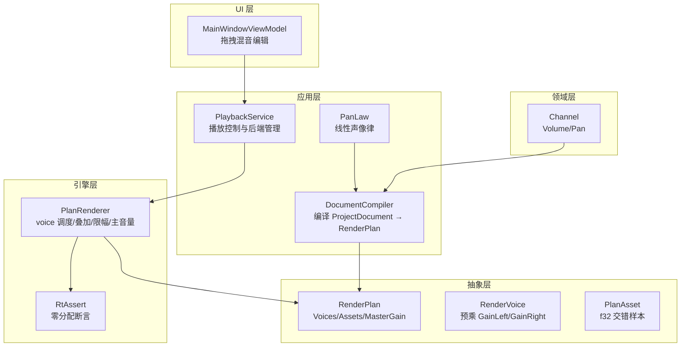
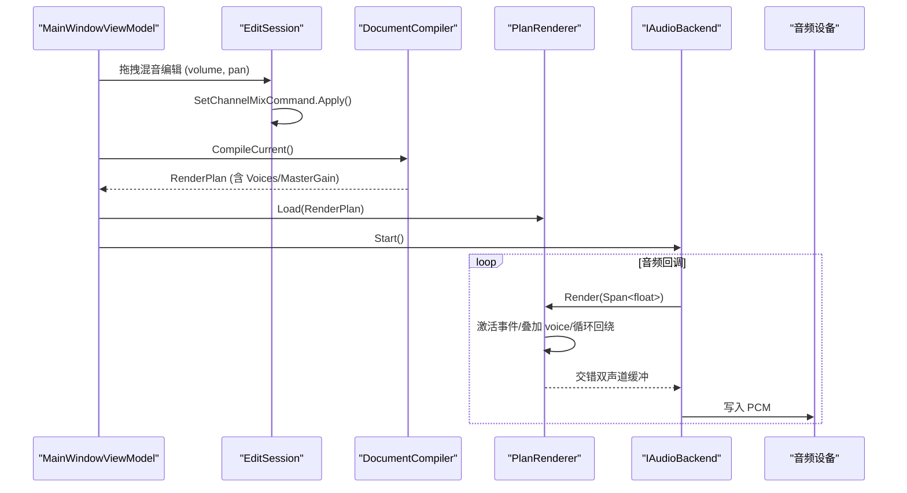
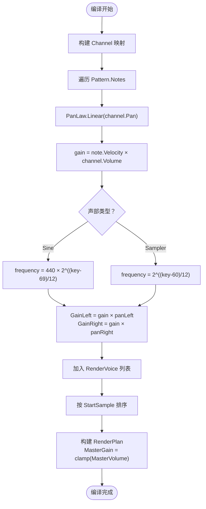
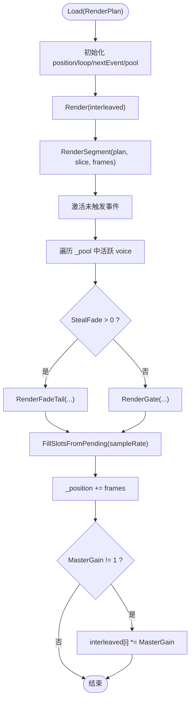
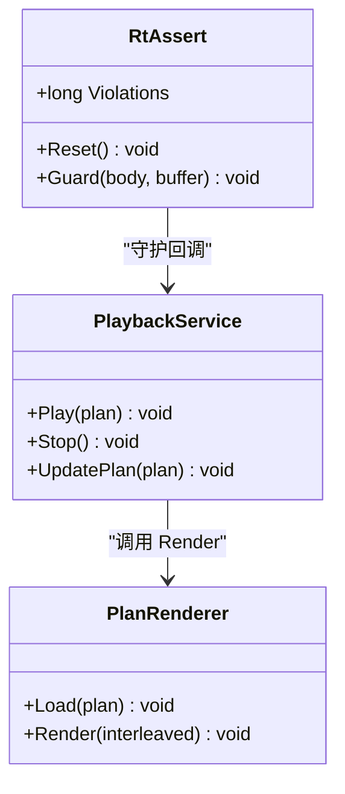
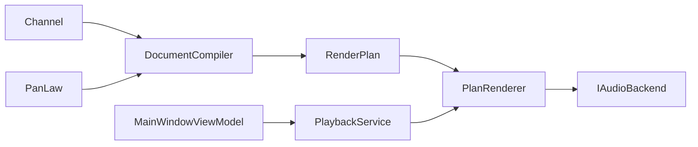

# 混音器与音频处理

<cite>
**本文引用的文件**   
- [PlanRenderer.cs](file://src/Weftone.Engine/PlanRenderer.cs)
- [PanLaw.cs](file://src/Weftone.Application/PanLaw.cs)
- [RtAssert.cs](file://src/Weftone.Engine/RtAssert.cs)
- [M1a_HEADLESS.md](file://specs/M1a_HEADLESS.md)
- [PlaybackService.cs](file://src/Weftone.Application/PlaybackService.cs)
- [Channel.cs](file://src/Weftone.Domain/Channel.cs)
- [RenderPlan.cs](file://src/Weftone.Abstractions/Rendering/RenderPlan.cs)
- [DocumentCompiler.cs](file://src/Weftone.Application/DocumentCompiler.cs)
- [MainWindowViewModel.cs](file://src/Weftone.App/ViewModels/MainWindowViewModel.cs)
- [SetChannelMixCommand.cs](file://src/Weftone.Domain/Commands/SetChannelMixCommand.cs)
- [PlanRendererTests.cs](file://tests/Weftone.Engine.Tests/PlanRendererTests.cs)
- [GoldenAudioTests.cs](file://tests/Weftone.GoldenAudio/GoldenAudioTests.cs)
</cite>

## 目录
1. [引言](#引言)
2. [项目结构](#项目结构)
3. [核心组件](#核心组件)
4. [架构总览](#架构总览)
5. [详细组件分析](#详细组件分析)
6. [依赖关系分析](#依赖关系分析)
7. [性能与实时性](#性能与实时性)
8. [音频质量评估指标](#音频质量评估指标)
9. [混音器配置示例](#混音器配置示例)
10. [故障排除指南](#故障排除指南)
11. [结论](#结论)

## 引言
本文面向混音器系统与音频处理链，重点解释以下目标：
- Mixer 如何通过 RenderPlan 的预乘增益与 PanLaw 线性声像律处理 channel gain/pan，以及 master gain 的混合方式。
- M1a 中常数增益（无自动化）的实现路径：编译期将 channel volume、velocity、pan 合并为 RenderVoice.GainLeft/GainRight，渲染期仅做叠加与 master gain 缩放。
- PanLaw 线性声像律的具体实现，以及与 constant-power（-3dB）声像律的对比分析。
- PlanRenderer 的音频渲染管线：多路 voice 叠加、fade tail 防 click、loop 回绕、master gain 输出格式化。
- 零分配保证与 RtAssert 实时监控断言机制。
- xrun 检测、耗时直方图统计与 p99 延迟监控的现状与建议。
- 音频质量评估指标、性能基准测试方法与优化建议。
- 混音器配置示例与故障排除指南。

## 项目结构
本项目采用分层与适配器模式组织代码：
- Domain 层定义工程数据模型（ProjectDocument、Channel、Pattern、Note 等）。
- Application 层负责编译器（DocumentCompiler）、播放用例（PlaybackService）、声像律（PanLaw）等。
- Engine 层提供实时/离线渲染器（PlanRenderer）与实时断言（RtAssert）。
- Abstractions 层定义渲染计划（RenderPlan、RenderVoice、PlanAsset）与后端接口。
- App 层提供 UI 交互（如 MainWindowViewModel 中的混音编辑）。
- Tests 层包含引擎行为测试、黄金音频回归测试等。

**图表来源**
- [DocumentCompiler.cs:1-159](file://src/Weftone.Application/DocumentCompiler.cs#L1-L159)
- [PlaybackService.cs:1-98](file://src/Weftone.Application/PlaybackService.cs#L1-L98)
- [PanLaw.cs:1-15](file://src/Weftone.Application/PanLaw.cs#L1-L15)
- [PlanRenderer.cs:1-356](file://src/Weftone.Engine/PlanRenderer.cs#L1-L356)
- [RtAssert.cs:1-32](file://src/Weftone.Engine/RtAssert.cs#L1-L32)
- [RenderPlan.cs:1-42](file://src/Weftone.Abstractions/Rendering/RenderPlan.cs#L1-L42)
- [Channel.cs:1-19](file://src/Weftone.Domain/Channel.cs#L1-L19)
- [MainWindowViewModel.cs:446-494](file://src/Weftone.App/ViewModels/MainWindowViewModel.cs#L446-L494)

**章节来源**
- [M1a_HEADLESS.md:1-98](file://specs/M1a_HEADLESS.md#L1-L98)
- [RenderPlan.cs:1-42](file://src/Weftone.Abstractions/Rendering/RenderPlan.cs#L1-L42)

## 核心组件
- DocumentCompiler：将 ProjectDocument 编译为 RenderPlan，计算 tick→sample 映射，生成按 StartSample 排序的事件数组，并将 channel volume、velocity、pan 预乘到 RenderVoice.GainLeft/GainRight；同时设置 MasterGain。
- PanLaw：提供线性声像律，pan=0 双侧全量，pan=-1 只剩左，pan=+1 只剩右，每侧从中心向对侧线性衰减。
- PlanRenderer：实现多路 voice 叠加、fade tail 防 click、loop 回绕、master gain 输出缩放；全程零分配（在 RT_ASSERT 构建下由 RtAssert 守护）。
- PlaybackService：封装 IPlanRenderer 与 IAudioBackend，提供 Play/Stop/UpdatePlan，确保音频线程零并发与零分配。
- RtAssert：在 RT_ASSERT 构建下通过 GC.GetAllocatedBytesForCurrentThread 检测音频回调期间是否发生分配，违规只计数不抛异常。
- Channel：定义 channel 的 Volume（0..2）与 Pan（-1..1），作为混音参数输入。

**章节来源**
- [DocumentCompiler.cs:1-159](file://src/Weftone.Application/DocumentCompiler.cs#L1-L159)
- [PanLaw.cs:1-15](file://src/Weftone.Application/PanLaw.cs#L1-L15)
- [PlanRenderer.cs:1-356](file://src/Weftone.Engine/PlanRenderer.cs#L1-L356)
- [PlaybackService.cs:1-98](file://src/Weftone.Application/PlaybackService.cs#L1-L98)
- [RtAssert.cs:1-32](file://src/Weftone.Engine/RtAssert.cs#L1-L32)
- [Channel.cs:1-19](file://src/Weftone.Domain/Channel.cs#L1-L19)

## 架构总览
下图展示从 UI 编辑到音频输出的完整流程，包括混音参数如何进入 RenderPlan，以及 PlanRenderer 如何将多路信号叠加并输出。

**图表来源**
- [MainWindowViewModel.cs:446-494](file://src/Weftone.App/ViewModels/MainWindowViewModel.cs#L446-L494)
- [SetChannelMixCommand.cs:1-45](file://src/Weftone.Domain/Commands/SetChannelMixCommand.cs#L1-L45)
- [DocumentCompiler.cs:1-159](file://src/Weftone.Application/DocumentCompiler.cs#L1-L159)
- [PlanRenderer.cs:61-105](file://src/Weftone.Engine/PlanRenderer.cs#L61-L105)
- [PlaybackService.cs:42-52](file://src/Weftone.Application/PlaybackService.cs#L42-L52)

## 详细组件分析

### 混音器与通道增益/声像
- Channel 的 Volume 与 Pan 在编译期被用于计算每个 note 的 RenderVoice.GainLeft/GainRight。
- 对于 Sine 声部，频率基于 MIDI key（440Hz × 2^((key-69)/12)）；对于 Sampler 声部，频率基于 MIDI key（440Hz × 2^((key-60)/12)），以 MIDI 60 为原速。
- PanLaw.Linear(pan) 返回左右增益系数，随后乘以 note.Velocity × channel.Volume，得到最终 GainLeft/GainRight。
- MasterGain 来自 document.MasterVolume，经 Math.Clamp(0, 2) 后写入 RenderPlan.MasterGain，并在渲染末尾统一缩放输出缓冲。

**图表来源**
- [DocumentCompiler.cs:98-159](file://src/Weftone.Application/DocumentCompiler.cs#L98-L159)
- [PanLaw.cs:9-13](file://src/Weftone.Application/PanLaw.cs#L9-L13)
- [RenderPlan.cs:30-41](file://src/Weftone.Abstractions/Rendering/RenderPlan.cs#L30-L41)

**章节来源**
- [DocumentCompiler.cs:98-159](file://src/Weftone.Application/DocumentCompiler.cs#L98-L159)
- [PanLaw.cs:1-15](file://src/Weftone.Application/PanLaw.cs#L1-L15)
- [Channel.cs:1-19](file://src/Weftone.Domain/Channel.cs#L1-L19)
- [RenderPlan.cs:30-41](file://src/Weftone.Abstractions/Rendering/RenderPlan.cs#L30-L41)

### PlanRenderer 渲染管线
PlanRenderer 的核心职责：
- 加载 RenderPlan，初始化位置、循环区间、事件游标与 voice 池。
- 按帧块渲染：激活事件、遍历活跃 voice、叠加 left/right 样本、填充 pending 槽位。
- 支持 fade tail 防 click：当 voice 池满时选择最早结束的 voice 进行淡出释放，新事件进入 pending 环等待。
- 输出阶段：若 MasterGain ≠ 1，则对整个交错缓冲进行缩放。

**图表来源**
- [PlanRenderer.cs:48-105](file://src/Weftone.Engine/PlanRenderer.cs#L48-L105)
- [PlanRenderer.cs:107-137](file://src/Weftone.Engine/PlanRenderer.cs#L107-L137)
- [PlanRenderer.cs:139-231](file://src/Weftone.Engine/PlanRenderer.cs#L139-L231)
- [PlanRenderer.cs:233-354](file://src/Weftone.Engine/PlanRenderer.cs#L233-L354)

**章节来源**
- [PlanRenderer.cs:1-356](file://src/Weftone.Engine/PlanRenderer.cs#L1-L356)

### 线性声像律与 constant-power 对比
- 线性声像律（当前实现）：
  - pan ∈ [-1, 1]，左侧增益 = (p ≤ 0 ? 1 : 1 - p)，右侧增益 = (p ≥ 0 ? 1 : 1 + p)。
  - 特点：简单可逆推，中心点两侧全量，边缘单侧静音；能量随 pan 变化非线性。
- constant-power（-3dB）声像律（建议升级方向）：
  - 典型公式：left = cos(θ), right = sin(θ)，其中 θ = π/4 × (1 + pan)。
  - 特点：保持总功率恒定，中心点两侧各 -3dB，边缘单侧 -3dB；听感更自然但实现稍复杂。
- 对比要点：
  - 线性声像律在 M1a 拍板 D4 中被选中，因其可解释性与可逆推性；constant-power 留待 ADR 决策升级。
  - 线性声像律在中心点两侧均为全量，可能导致中心声像能量偏高；constant-power 能维持恒定功率。

**章节来源**
- [PanLaw.cs:1-15](file://src/Weftone.Application/PanLaw.cs#L1-L15)
- [M1a_HEADLESS.md:84-92](file://specs/M1a_HEADLESS.md#L84-L92)

### 零分配保证与 RtAssert 实时监控
- RtAssert.Guard 在 RT_ASSERT 构建下，调用前记录当前线程已分配字节数，调用后比较差值，非零则递增违规计数。
- 设计原则：音频路径零异常抛出，违规只计数，便于实时监控而不影响实时性。
- 使用场景：PlaybackService 将 renderer.Render 作为回调传入后端，RtAssert 守护该回调执行期间的分配行为。

**图表来源**
- [RtAssert.cs:1-32](file://src/Weftone.Engine/RtAssert.cs#L1-L32)
- [PlaybackService.cs:1-98](file://src/Weftone.Application/PlaybackService.cs#L1-L98)
- [PlanRenderer.cs:61-105](file://src/Weftone.Engine/PlanRenderer.cs#L61-L105)

**章节来源**
- [RtAssert.cs:1-32](file://src/Weftone.Engine/RtAssert.cs#L1-L32)
- [PlaybackService.cs:1-98](file://src/Weftone.Application/PlaybackService.cs#L1-L98)

### xrun 检测与耗时直方图统计（现状与建议）
- 现状：
  - 文档与代码中未直接实现 xrun 检测或耗时直方图统计；M1a 规格提到“xrun/耗时直方图 p99 从本轮接入”，但具体实现未在现有文件中出现。
  - 建议在 PlaybackService 或后端适配层引入：
    - xrun 检测：监听底层音频驱动的回读错误标志（例如 miniaudio 的 xrun 回调）。
    - 耗时统计：记录每次 Render 回调的开始/结束时间，维护滑动窗口直方图，计算 p99 延迟。
- 建议实现要点：
  - 使用原子计数器与环形缓冲区存储耗时样本，避免在音频路径内分配。
  - 在非实时线程定期采样 p99，并暴露为遥测指标（如日志或 UI 面板）。
  - 结合 RtAssert 的 Violations 计数，形成“分配违规 + 延迟超标”的双重监控。

[本节为概念性建议，不直接分析具体文件]

## 依赖关系分析
- DocumentCompiler 依赖 PanLaw 与 TickMath，产出 RenderPlan。
- PlanRenderer 依赖 RenderPlan 与 PlanAsset，内部维护 Voice 池与 pending 环。
- PlaybackService 依赖 IPlanRenderer 与 IAudioBackend，封装播放生命周期。
- UI 层通过 MainWindowViewModel 修改 Channel 参数，触发重新编译与热更新。

**图表来源**
- [Channel.cs:1-19](file://src/Weftone.Domain/Channel.cs#L1-L19)
- [DocumentCompiler.cs:1-159](file://src/Weftone.Application/DocumentCompiler.cs#L1-L159)
- [PanLaw.cs:1-15](file://src/Weftone.Application/PanLaw.cs#L1-L15)
- [RenderPlan.cs:1-42](file://src/Weftone.Abstractions/Rendering/RenderPlan.cs#L1-L42)
- [PlanRenderer.cs:1-356](file://src/Weftone.Engine/PlanRenderer.cs#L1-L356)
- [PlaybackService.cs:1-98](file://src/Weftone.Application/PlaybackService.cs#L1-L98)
- [MainWindowViewModel.cs:446-494](file://src/Weftone.App/ViewModels/MainWindowViewModel.cs#L446-L494)

**章节来源**
- [DocumentCompiler.cs:1-159](file://src/Weftone.Application/DocumentCompiler.cs#L1-L159)
- [PlanRenderer.cs:1-356](file://src/Weftone.Engine/PlanRenderer.cs#L1-L356)
- [PlaybackService.cs:1-98](file://src/Weftone.Application/PlaybackService.cs#L1-L98)

## 性能与实时性
- 零分配保证：
  - PlanRenderer 使用固定大小 Voice 池（MaxVoices=64）与 pending 环（PendingCapacity=32），避免运行时分配。
  - RtAssert 在 RT_ASSERT 构建下监控音频回调期间的分配，违规只计数。
- 复音调度与偷声：
  - 池满时选择最早结束的 voice 进行 fade tail 释放，新事件进入 pending 环等待槽位释放。
  - 确定性策略：按 Wait+Remaining 最小优先，平局取低索引。
- 循环与回绕：
  - LoopStartSample/LoopEndSample 控制循环区间，position 到达 LoopEnd 时回绕至 LoopStart，事件游标归零重触发。
- 主音量缩放：
  - MasterGain 在渲染末尾对交错缓冲进行逐样本缩放，避免中间过程溢出风险。

**章节来源**
- [PlanRenderer.cs:13-16](file://src/Weftone.Engine/PlanRenderer.cs#L13-L16)
- [PlanRenderer.cs:191-215](file://src/Weftone.Engine/PlanRenderer.cs#L191-L215)
- [PlanRenderer.cs:78-93](file://src/Weftone.Engine/PlanRenderer.cs#L78-L93)
- [PlanRenderer.cs:97-104](file://src/Weftone.Engine/PlanRenderer.cs#L97-L104)
- [RtAssert.cs:17-30](file://src/Weftone.Engine/RtAssert.cs#L17-L30)

## 音频质量评估指标
- 黄金音频基线：
  - GoldenAudioTests 比较渲染结果与基线 WAV 的峰值差，跨平台容差 ≤ 1e-4，同机位一致标准 ≤ 1e-6。
- 数值正确性：
  - PlanRendererTests 验证 sampler 单声道/立体声样本读取、线性插值、增益映射等行为。
- 建议扩展指标：
  - THD+N（总谐波失真加噪声）：用于评估正弦波与采样器输出的谐波失真。
  - SNR（信噪比）：评估底噪水平。
  - 动态范围：评估最大不失真电平与噪声底噪之差。
  - 延迟分布：引入 p50/p95/p99 延迟统计，结合 xrun 检测评估实时稳定性。

**章节来源**
- [GoldenAudioTests.cs:92-114](file://tests/Weftone.GoldenAudio/GoldenAudioTests.cs#L92-L114)
- [PlanRendererTests.cs:117-207](file://tests/Weftone.Engine.Tests/PlanRendererTests.cs#L117-L207)

## 混音器配置示例
以下为常见混音器配置场景（基于 Channel 与 RenderPlan 字段）：
- 单声道采样器居中：
  - Channel.Volume = 1.0，Channel.Pan = 0.0
  - RenderVoice.GainLeft = velocity × 1.0，GainRight = velocity × 1.0
- 左偏声像：
  - Channel.Pan = -0.5，PanLaw.Linear(-0.5) → Left=1.0，Right=0.5
  - RenderVoice.GainLeft = velocity × 1.0，GainRight = velocity × 0.5
- 右偏声像且降低音量：
  - Channel.Pan = 0.8，Channel.Volume = 0.6
  - PanLaw.Linear(0.8) → Left=0.2，Right=1.0
  - RenderVoice.GainLeft = velocity × 0.6 × 0.2，GainRight = velocity × 0.6 × 1.0
- 主音量限制：
  - document.MasterVolume ∈ [0, 2]，RenderPlan.MasterGain = clamp(MasterVolume)
  - PlanRenderer 在输出阶段对交错缓冲进行缩放。

**章节来源**
- [Channel.cs:9-17](file://src/Weftone.Domain/Channel.cs#L9-L17)
- [PanLaw.cs:9-13](file://src/Weftone.Application/PanLaw.cs#L9-L13)
- [DocumentCompiler.cs:104-127](file://src/Weftone.Application/DocumentCompiler.cs#L104-L127)
- [RenderPlan.cs:34-34](file://src/Weftone.Abstractions/Rendering/RenderPlan.cs#L34-L34)
- [PlanRenderer.cs:97-104](file://src/Weftone.Engine/PlanRenderer.cs#L97-L104)

## 故障排除指南
- 声音无声或过小：
  - 检查 Channel.Volume 是否为 0 或接近 0；确认 RenderPlan.MasterGain 是否被设置为 0。
  - 验证 RenderVoice.GainLeft/GainRight 是否在编译期被正确预乘。
- 声像偏移异常：
  - 确认 Channel.Pan 是否在 [-1, 1] 范围内；PanLaw.Linear 会 clamp 输入。
  - 若需要恒定功率声像，考虑升级到 constant-power 实现（需 ADR 决策）。
- 爆音或 click：
  - 检查 voice stealing 的 fade tail 长度（FadeTail=128）是否足够平滑过渡。
  - 确认 RenderGate/RenderFadeTail 中的 envelope 计算是否正确。
- 实时分配违规：
  - 启用 RT_ASSERT 构建，观察 RtAssert.Violations 计数；定位音频回调中的分配点。
  - 避免在 PlaybackService 或 PlanRenderer 中使用临时对象、LINQ、字符串格式化等。
- 循环播放异常：
  - 检查 RenderPlan.LoopStartSample/LoopEndSample 设置是否正确；确认 position 回绕逻辑。
  - 验证事件游标 _nextEvent 是否在回绕时归零。

**章节来源**
- [PanLaw.cs:9-13](file://src/Weftone.Application/PanLaw.cs#L9-L13)
- [PlanRenderer.cs:125-133](file://src/Weftone.Engine/PlanRenderer.cs#L125-L133)
- [PlanRenderer.cs:233-298](file://src/Weftone.Engine/PlanRenderer.cs#L233-L298)
- [RtAssert.cs:17-30](file://src/Weftone.Engine/RtAssert.cs#L17-L30)
- [PlanRenderer.cs:78-93](file://src/Weftone.Engine/PlanRenderer.cs#L78-L93)

## 结论
本系统通过编译期预乘增益与线性声像律，实现了简洁高效的混音器；PlanRenderer 以固定池与 pending 环保障实时零分配，配合 RtAssert 实时监控分配违规。M1a 采用线性声像律，未来可考虑升级到 constant-power 以提升听感一致性。建议在后续迭代中引入 xrun 检测与延迟直方图统计，完善性能监控与质量评估体系。