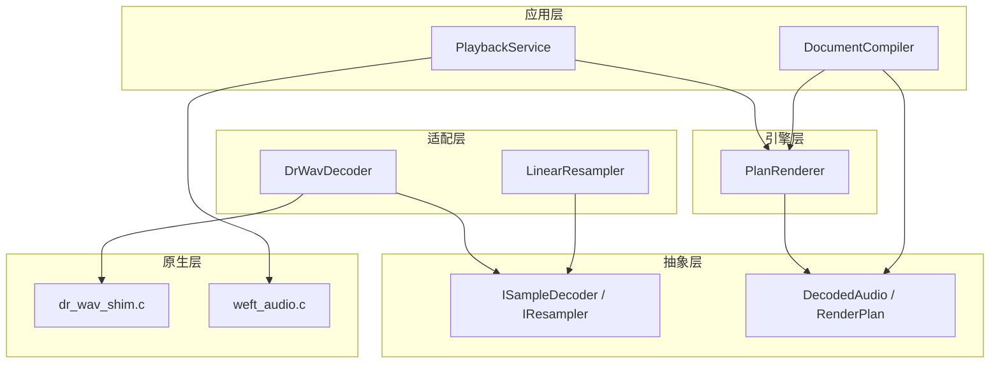
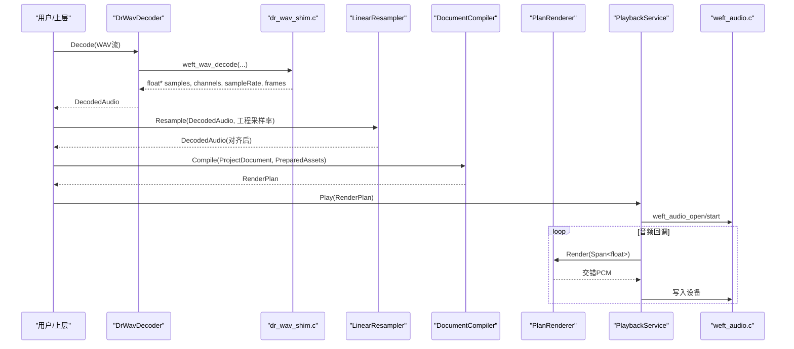
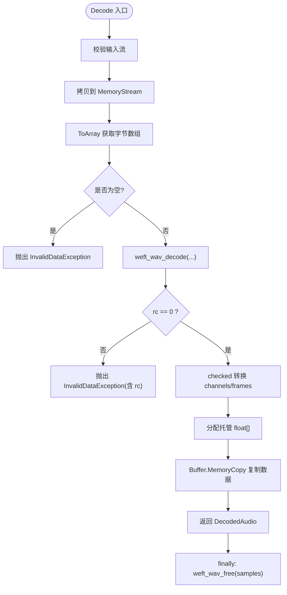
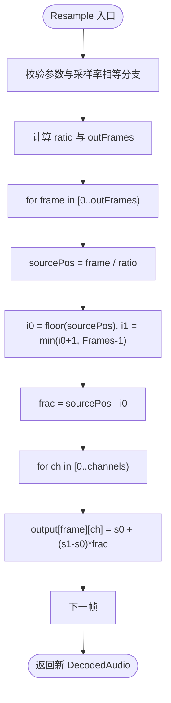
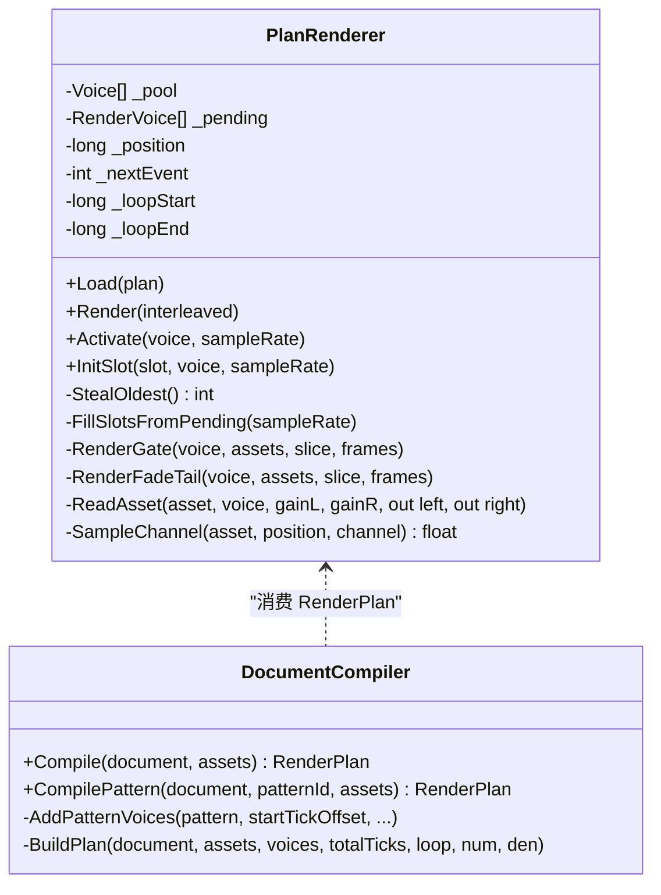
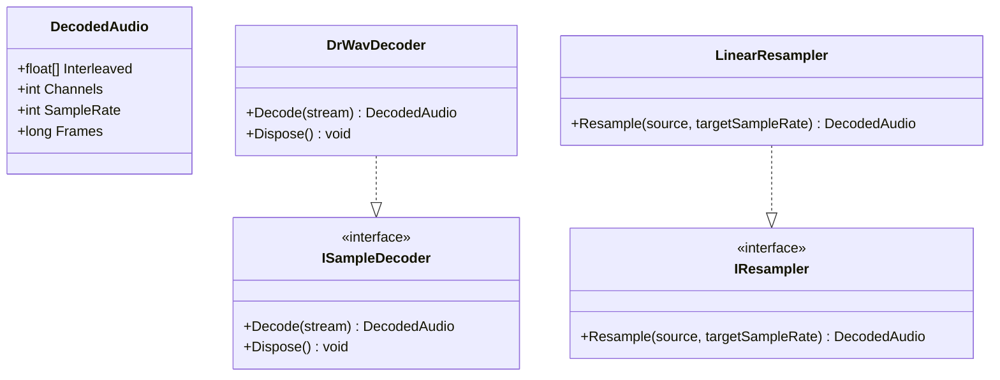
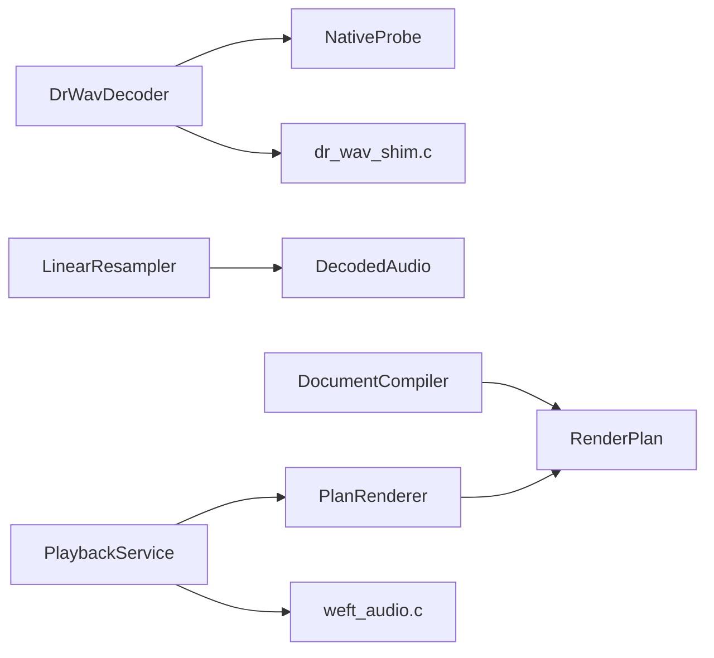

# 采样器引擎与音频解码

<cite>
**本文引用的文件**   
- [DrWavDecoder.cs](file://src/Weftone.Adapters.Codecs/DrWavDecoder.cs)
- [LinearResampler.cs](file://src/Weftone.Adapters.Codecs/LinearResampler.cs)
- [ISampleDecoder.cs](file://src/Weftone.Abstractions/ISampleDecoder.cs)
- [dr_wav_shim.c](file://native/weftone_codecs/dr_wav_shim.c)
- [NativeProbe.cs](file://src/Weftone.Adapters.Codecs/NativeProbe.cs)
- [PlanRenderer.cs](file://src/Weftone.Engine/PlanRenderer.cs)
- [DocumentCompiler.cs](file://src/Weftone.Application/DocumentCompiler.cs)
- [PlaybackService.cs](file://src/Weftone.Application/PlaybackService.cs)
- [AudioDeviceSpec.cs](file://src/Weftone.Abstractions/AudioDeviceSpec.cs)
- [weft_audio.c](file://native/weftone_miniaudio/weft_audio.c)
</cite>

## 目录
1. [引言](#引言)
2. [项目结构](#项目结构)
3. [核心组件](#核心组件)
4. [架构总览](#架构总览)
5. [详细组件分析](#详细组件分析)
6. [依赖关系分析](#依赖关系分析)
7. [性能与内存管理](#性能与内存管理)
8. [错误处理与质量评估](#错误处理与质量评估)
9. [配置与调优指南](#配置与调优指南)
10. [故障排查](#故障排查)
11. [结论](#结论)

## 引言
本文面向采样器引擎与音频解码子系统，系统性说明以下目标：
- DrWavDecoder 如何集成 vendored dr_wav 库，实现 16/24/32f PCM WAV 到 f32 交错 PCM 的整文件离线解码。
- LinearResampler 的离线线性插值重采样算法，用于对齐工程采样率与资产采样率。
- Sampler voice 的工作机制，包括整采样触发、key→播放速率映射（C4=C5 基准约定）。
- ISampleDecoder 接口的抽象设计及其扩展性。
- 音频数据内存模型、零分配保证与实时路径优化策略。
- 完整音频处理流程、错误处理机制与质量评估标准。
- 采样器配置选项与调优建议。

## 项目结构
本项目采用分层与适配器模式组织代码：
- Abstractions：定义解码、重采样、渲染计划等接口与数据结构。
- Adapters.Codecs：提供基于 dr_wav 的 WAV 解码与线性重采样实现。
- Engine：实时/离线渲染引擎 PlanRenderer，负责声部调度、相位推进、线性插值读取与淡出偷音。
- Application：文档编译为 RenderPlan，以及 PlaybackService 驱动后端设备。
- Native：C 层 shim，封装 dr_wav 解码与 miniaudio 播放。

**图表来源**
- [PlaybackService.cs:1-98](file://src/Weftone.Application/PlaybackService.cs#L1-L98)
- [DocumentCompiler.cs:1-159](file://src/Weftone.Application/DocumentCompiler.cs#L1-L159)
- [PlanRenderer.cs:1-356](file://src/Weftone.Engine/PlanRenderer.cs#L1-L356)
- [DrWavDecoder.cs:1-51](file://src/Weftone.Adapters.Codecs/DrWavDecoder.cs#L1-L51)
- [LinearResampler.cs:1-45](file://src/Weftone.Adapters.Codecs/LinearResampler.cs#L1-L45)
- [ISampleDecoder.cs:1-17](file://src/Weftone.Abstractions/ISampleDecoder.cs#L1-L17)
- [dr_wav_shim.c:1-68](file://native/weftone_codecs/dr_wav_shim.c#L1-L68)
- [weft_audio.c:1-163](file://native/weftone_miniaudio/weft_audio.c#L1-L163)

**章节来源**
- [PlaybackService.cs:1-98](file://src/Weftone.Application/PlaybackService.cs#L1-L98)
- [DocumentCompiler.cs:1-159](file://src/Weftone.Application/DocumentCompiler.cs#L1-L159)
- [PlanRenderer.cs:1-356](file://src/Weftone.Engine/PlanRenderer.cs#L1-L356)
- [DrWavDecoder.cs:1-51](file://src/Weftone.Adapters.Codecs/DrWavDecoder.cs#L1-L51)
- [LinearResampler.cs:1-45](file://src/Weftone.Adapters.Codecs/LinearResampler.cs#L1-L45)
- [ISampleDecoder.cs:1-17](file://src/Weftone.Abstractions/ISampleDecoder.cs#L1-L17)
- [dr_wav_shim.c:1-68](file://native/weftone_codecs/dr_wav_shim.c#L1-L68)
- [weft_audio.c:1-163](file://native/weftone_miniaudio/weft_audio.c#L1-L163)

## 核心组件
- DecodedAudio：f32 交错 PCM 的不可变结果记录，包含声道数、采样率与帧数。
- ISampleDecoder：统一解码入口，支持不同后端实现。
- IResampler：统一重采样入口，M1a 使用线性插值，后续可替换高质量实现。
- DrWavDecoder：通过 P/Invoke 调用 weft_wav_decode，将 WAV 解码为 f32 交错 PCM。
- LinearResampler：按声道进行确定性线性插值，输出目标采样率的 DecodedAudio。
- PlanRenderer：预分配池驱动的实时/离线渲染器，支持 Sine 与 Sampler 两种声部。
- DocumentCompiler：将 ProjectDocument 编译为 RenderPlan，计算 key→频率或 key→播放速率。
- PlaybackService：管理后端设备生命周期，回调捕获避免音频路径分配。

**章节来源**
- [ISampleDecoder.cs:1-17](file://src/Weftone.Abstractions/ISampleDecoder.cs#L1-L17)
- [DrWavDecoder.cs:1-51](file://src/Weftone.Adapters.Codecs/DrWavDecoder.cs#L1-L51)
- [LinearResampler.cs:1-45](file://src/Weftone.Adapters.Codecs/LinearResampler.cs#L1-L45)
- [PlanRenderer.cs:1-356](file://src/Weftone.Engine/PlanRenderer.cs#L1-L356)
- [DocumentCompiler.cs:1-159](file://src/Weftone.Application/DocumentCompiler.cs#L1-L159)
- [PlaybackService.cs:1-98](file://src/Weftone.Application/PlaybackService.cs#L1-L98)

## 架构总览
从工程文档到声音输出的关键链路如下：
1. 加载 WAV 资产：DrWavDecoder → dr_wav_shim.c → f32 交错 PCM。
2. 重采样：LinearResampler 将资产采样率对齐到工程采样率。
3. 编译：DocumentCompiler 生成 RenderPlan，包含声部事件与已准备资产。
4. 渲染：PlanRenderer 在实时回调中按 StartSample 激活声部，Sine 用相位推进，Sampler 用线性插值读取资产。
5. 输出：PlaybackService 通过 weft_audio.c 驱动 miniaudio 设备。

**图表来源**
- [DrWavDecoder.cs:8-45](file://src/Weftone.Adapters.Codecs/DrWavDecoder.cs#L8-L45)
- [dr_wav_shim.c:16-61](file://native/weftone_codecs/dr_wav_shim.c#L16-L61)
- [LinearResampler.cs:11-42](file://src/Weftone.Adapters.Codecs/LinearResampler.cs#L11-L42)
- [DocumentCompiler.cs:19-156](file://src/Weftone.Application/DocumentCompiler.cs#L19-L156)
- [PlanRenderer.cs:48-136](file://src/Weftone.Engine/PlanRenderer.cs#L48-L136)
- [PlaybackService.cs:42-90](file://src/Weftone.Application/PlaybackService.cs#L42-L90)
- [weft_audio.c:72-126](file://native/weftone_miniaudio/weft_audio.c#L72-L126)

## 详细组件分析

### DrWavDecoder 与 dr_wav 集成
- 职责：接收任意 Stream，拷贝到内存，调用 weft_wav_decode 解码为 f32 交错 PCM，并返回 DecodedAudio。
- 关键点：
  - 空流检查与异常抛出。
  - 固定字节数组指针后调用原生函数，避免 GC 移动。
  - 对 channels、frames 做 checked 转换，防止溢出。
  - Buffer.MemoryCopy 将原生缓冲区复制到托管数组。
  - finally 中释放原生分配的 samples 内存。
- 支持的 WAV 格式：由 dr_wav 内部处理；shim 使用 drwav_read_pcm_frames_f32 输出 f32，因此 16/24/32i/32f PCM 均可被转换为 f32。

**图表来源**
- [DrWavDecoder.cs:8-45](file://src/Weftone.Adapters.Codecs/DrWavDecoder.cs#L8-L45)
- [dr_wav_shim.c:16-61](file://native/weftone_codecs/dr_wav_shim.c#L16-L61)

**章节来源**
- [DrWavDecoder.cs:1-51](file://src/Weftone.Adapters.Codecs/DrWavDecoder.cs#L1-L51)
- [dr_wav_shim.c:1-68](file://native/weftone_codecs/dr_wav_shim.c#L1-L68)

### LinearResampler 离线线性插值
- 职责：将源 DecodedAudio 重采样到目标采样率，保持通道布局与顺序一致。
- 算法要点：
  - ratio = targetSampleRate / sourceSampleRate。
  - outFrames = floor(source.Frames * ratio)，最小为 1。
  - 逐帧计算 sourcePos = frame / ratio，取 i0、i1 与 frac。
  - 逐声道线性插值：s0 + (s1 - s0) * frac。
  - 若 source.SampleRate == targetSampleRate，直接返回原对象，避免多余分配。
- 复杂度：时间 O(outFrames × channels)，空间 O(outFrames × channels)。

**图表来源**
- [LinearResampler.cs:11-42](file://src/Weftone.Adapters.Codecs/LinearResampler.cs#L11-L42)

**章节来源**
- [LinearResampler.cs:1-45](file://src/Weftone.Adapters.Codecs/LinearResampler.cs#L1-L45)

### Sampler Voice 工作机制与 C4=C5 基准
- 编译阶段（DocumentCompiler）：
  - 对于 Sampler 通道，note.Key=60（C4）对应原速播放，即 frequency=1（单位：倍速）。
  - 其他键位按半音偏移计算倍频：frequency = 2^((note.Key - 60)/12)。
  - 该频率作为 AssetPosition 的步进增量，控制样本回放速度。
- 渲染阶段（PlanRenderer）：
  - 每个 Sampler voice 维护 AssetPosition、Remaining、GainLeft/GainRight。
  - ReadAsset 根据 channel 数选择单声道或立体声读取，并按 Frequency 步进位置。
  - SampleChannel 使用线性插值读取样本，边界保护到首尾样本。
  - 当 AssetPosition >= asset.Frames 时，标记 Remaining=1，自然结束。

**图表来源**
- [PlanRenderer.cs:11-356](file://src/Weftone.Engine/PlanRenderer.cs#L11-L356)
- [DocumentCompiler.cs:19-156](file://src/Weftone.Application/DocumentCompiler.cs#L19-L156)

**章节来源**
- [DocumentCompiler.cs:98-128](file://src/Weftone.Application/DocumentCompiler.cs#L98-L128)
- [PlanRenderer.cs:139-177](file://src/Weftone.Engine/PlanRenderer.cs#L139-L177)
- [PlanRenderer.cs:300-334](file://src/Weftone.Engine/PlanRenderer.cs#L300-L334)

### ISampleDecoder 接口抽象
- DecodedAudio：不可变记录，承载 Interleaved、Channels、SampleRate、Frames。
- ISampleDecoder：统一解码接口，支持未来扩展如 FLAC、OGG 等。
- IResampler：统一重采样接口，当前实现为线性插值，后续可替换高质量实现。

**图表来源**
- [ISampleDecoder.cs:1-17](file://src/Weftone.Abstractions/ISampleDecoder.cs#L1-L17)
- [DrWavDecoder.cs:1-51](file://src/Weftone.Adapters.Codecs/DrWavDecoder.cs#L1-L51)
- [LinearResampler.cs:1-45](file://src/Weftone.Adapters.Codecs/LinearResampler.cs#L1-L45)

**章节来源**
- [ISampleDecoder.cs:1-17](file://src/Weftone.Abstractions/ISampleDecoder.cs#L1-L17)

## 依赖关系分析
- DrWavDecoder 依赖 NativeProbe 确保 weftone_codecs 动态库可用，并通过 P/Invoke 调用 weft_wav_decode/weft_wav_free。
- LinearResampler 仅依赖 DecodedAudio 与 IResampler 接口。
- PlanRenderer 依赖 RenderPlan、PlanAsset、RenderVoice 等渲染数据结构。
- DocumentCompiler 依赖 ProjectDocument、Channel、Note、Clip 等领域模型，并产出 RenderPlan。
- PlaybackService 依赖 IPlanRenderer 与 IAudioBackend（miniaudio shim）。

**图表来源**
- [DrWavDecoder.cs:1-51](file://src/Weftone.Adapters.Codecs/DrWavDecoder.cs#L1-L51)
- [NativeProbe.cs:1-71](file://src/Weftone.Adapters.Codecs/NativeProbe.cs#L1-L71)
- [dr_wav_shim.c:1-68](file://native/weftone_codecs/dr_wav_shim.c#L1-L68)
- [LinearResampler.cs:1-45](file://src/Weftone.Adapters.Codecs/LinearResampler.cs#L1-L45)
- [DocumentCompiler.cs:1-159](file://src/Weftone.Application/DocumentCompiler.cs#L1-L159)
- [PlanRenderer.cs:1-356](file://src/Weftone.Engine/PlanRenderer.cs#L1-L356)
- [PlaybackService.cs:1-98](file://src/Weftone.Application/PlaybackService.cs#L1-L98)
- [weft_audio.c:1-163](file://native/weftone_miniaudio/weft_audio.c#L1-L163)

**章节来源**
- [NativeProbe.cs:1-71](file://src/Weftone.Adapters.Codecs/NativeProbe.cs#L1-L71)
- [PlaybackService.cs:1-98](file://src/Weftone.Application/PlaybackService.cs#L1-L98)

## 性能与内存管理
- 零分配保证：
  - PlanRenderer 使用固定大小 Voice 池与 pending 环，避免实时路径分配。
  - PlaybackService 缓存回调委托，避免方法组转换分配。
  - SineEngine 暴露预捕获回调，进一步降低开销。
- 内存模型：
  - DrWavDecoder 一次性分配托管 float[]，并在 finally 中释放原生 buffer。
  - LinearResampler 分配新的 output 数组，但仅在离线路径。
  - PlanRenderer 的 ReadAsset/SampleChannel 直接访问 PlanAsset.Samples，无额外缓冲。
- 实时优化：
  - PlaybackService 使用 256 帧缓冲，按需重开设备以匹配工程采样率。
  - PlanRenderer 的 StealFade 线性淡出避免 click，同时限制偷音次数。
  - Phase 推进使用双精度，避免累积误差。

**章节来源**
- [PlanRenderer.cs:11-10](file://src/Weftone.Engine/PlanRenderer.cs#L11-L10)
- [PlanRenderer.cs:118-136](file://src/Weftone.Engine/PlanRenderer.cs#L118-L136)
- [PlanRenderer.cs:233-334](file://src/Weftone.Engine/PlanRenderer.cs#L233-L334)
- [PlaybackService.cs:14-31](file://src/Weftone.Application/PlaybackService.cs#L14-L31)
- [PlaybackService.cs:80-90](file://src/Weftone.Application/PlaybackService.cs#L80-L90)
- [DrWavDecoder.cs:29-43](file://src/Weftone.Adapters.Codecs/DrWavDecoder.cs#L29-L43)

## 错误处理与质量评估
- 解码错误：
  - 空流：抛出 InvalidDataException。
  - 原生解码失败：根据 rc 值抛出 InvalidDataException，提示非法 WAV、空/超限、截断等。
  - 资源释放：finally 中调用 weft_wav_free，避免泄漏。
- 重采样错误：
  - 参数校验：source 为空或 targetSampleRate < 1 抛出异常。
  - 边界保护：outFrames 至少为 1。
- 渲染错误：
  - PlanRenderer 不主动抛错，而是通过 DroppedEvents 统计丢事件。
  - StealFade 防 click，避免突然截断。
- 质量评估：
  - 线性插值在低频段可接受，高频细节有限；高质量实现可在 M4 替换 IResampler。
  - 采样率对齐应优先在离线阶段完成，减少实时路径压力。

**章节来源**
- [DrWavDecoder.cs:10-43](file://src/Weftone.Adapters.Codecs/DrWavDecoder.cs#L10-L43)
- [dr_wav_shim.c:20-61](file://native/weftone_codecs/dr_wav_shim.c#L20-L61)
- [LinearResampler.cs:11-25](file://src/Weftone.Adapters.Codecs/LinearResampler.cs#L11-L25)
- [PlanRenderer.cs:147-155](file://src/Weftone.Engine/PlanRenderer.cs#L147-L155)
- [PlanRenderer.cs:210-215](file://src/Weftone.Engine/PlanRenderer.cs#L210-L215)

## 配置与调优指南
- 采样器配置：
  - 工程采样率：决定 RenderPlan.SampleRate，影响播放速度与重采样目标。
  - 主音量：MasterVolume 经 Clamp 限制在 [0,2]，避免削波。
  - 通道音量与声像：Channel.Volume 与 Pan 影响 GainLeft/GainRight。
  - 键位映射：Sampler 通道使用 note.Key=60 为原速，半音偏移按 2^(Δ/12) 调整播放速率。
- 重采样策略：
  - 建议在离线阶段将资产采样率对齐到工程采样率，避免实时重采样。
  - 若需高质量重采样，可替换 LinearResampler 为更高级实现（保留 IResampler 接口）。
- 渲染参数：
  - MaxVoices=64：复音上限，超出则按最早结束者偷音并淡出。
  - FadeTail=128：淡出长度，平衡平滑度与延迟。
  - PendingCapacity=32：待激活事件容量，溢出将丢弃事件并计数。
- 设备缓冲：
  - BufferFrames=256：默认缓冲帧数，可根据系统延迟与稳定性调整。

**章节来源**
- [DocumentCompiler.cs:102-128](file://src/Weftone.Application/DocumentCompiler.cs#L102-L128)
- [DocumentCompiler.cs:131-156](file://src/Weftone.Application/DocumentCompiler.cs#L131-L156)
- [PlanRenderer.cs:13-16](file://src/Weftone.Engine/PlanRenderer.cs#L13-L16)
- [PlaybackService.cs:14](file://src/Weftone.Application/PlaybackService.cs#L14)
- [AudioDeviceSpec.cs:1-7](file://src/Weftone.Abstractions/AudioDeviceSpec.cs#L1-L7)

## 故障排查
- 无法加载 weftone_codecs：
  - 检查环境变量 WEFTONE_NATIVE_DIR 是否指向包含 weftone_codecs.dll/.so/.dylib 的目录。
  - 确认应用目录 native/build 或 native/weftone_codecs/build 存在对应库文件。
- WAV 解码失败：
  - 查看 rc 值：-2 非法 WAV，-3 空或超限，-5 截断。
  - 确保输入流非空且可读。
- 播放无声或卡顿：
  - 检查 PlaybackService 是否正确调用 Open/Start。
  - 确认 PlanRenderer 未丢失过多事件（DroppedEvents 增长）。
  - 调整 BufferFrames 或降低复音数量。
- 音质问题：
  - 确认资产已在离线阶段重采样至工程采样率。
  - 如需更高保真，替换 IResampler 实现。

**章节来源**
- [NativeProbe.cs:15-38](file://src/Weftone.Adapters.Codecs/NativeProbe.cs#L15-L38)
- [NativeProbe.cs:40-69](file://src/Weftone.Adapters.Codecs/NativeProbe.cs#L40-L69)
- [DrWavDecoder.cs:21-43](file://src/Weftone.Adapters.Codecs/DrWavDecoder.cs#L21-L43)
- [PlaybackService.cs:42-90](file://src/Weftone.Application/PlaybackService.cs#L42-L90)
- [PlanRenderer.cs:147-155](file://src/Weftone.Engine/PlanRenderer.cs#L147-L155)

## 结论
本方案通过清晰的抽象与适配器模式，将 WAV 解码、重采样、编译与渲染解耦。DrWavDecoder 借助 vendored dr_wav 提供稳定可靠的 PCM 解码能力；LinearResampler 提供确定性离线重采样；PlanRenderer 以预分配池与线性插值实现实时零分配渲染；DocumentCompiler 将音乐语义转化为确定性的 RenderPlan；PlaybackService 统一管理设备生命周期。整体架构在保证实时性能的同时，提供了可扩展的解码与重采样接口，便于后续引入高质量算法与更多音频格式。