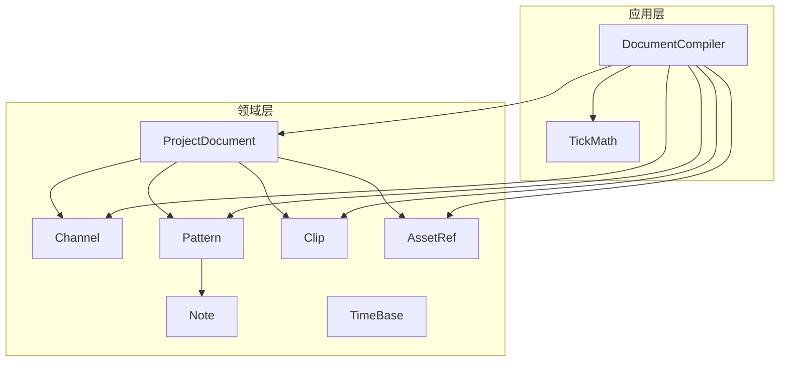
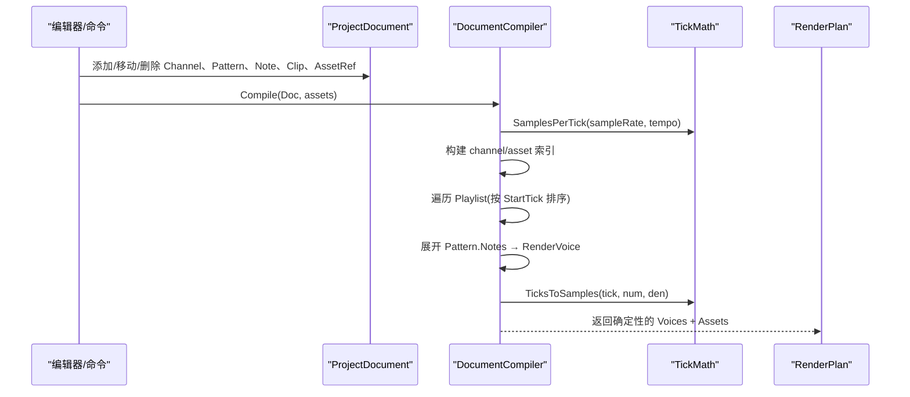
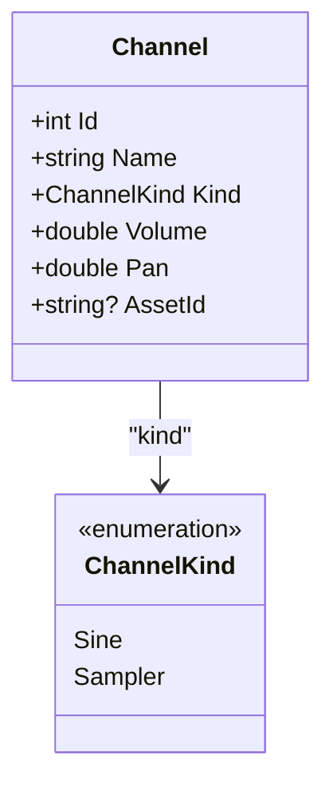
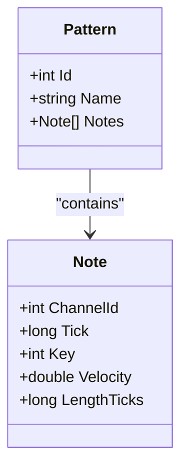
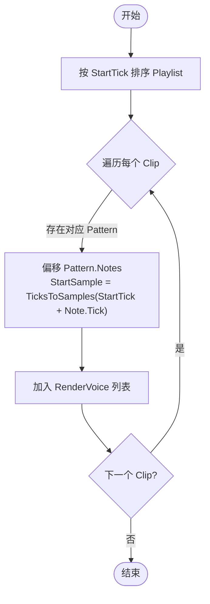
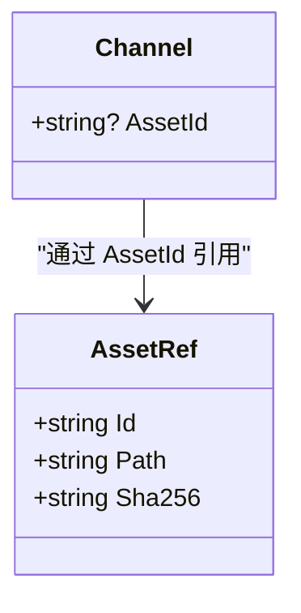
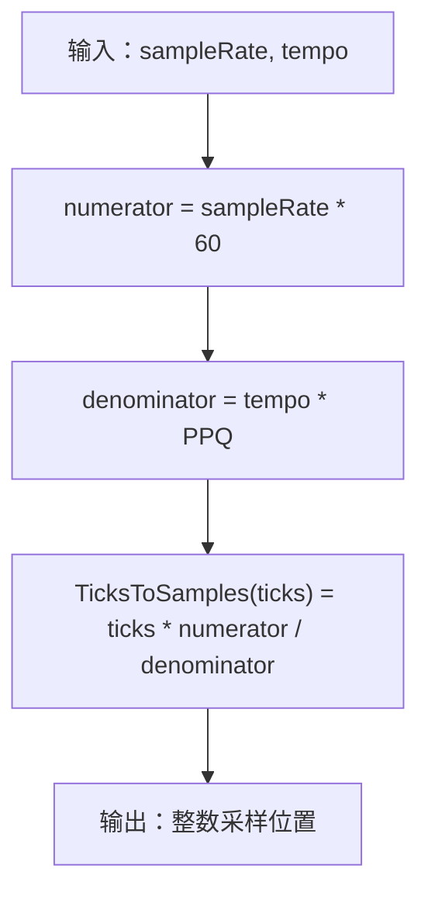

# 领域模型设计

<cite>
**本文引用的文件**   
- [M1a_HEADLESS.md](file://specs/M1a_HEADLESS.md)
- [ADR-0006-project-format.md](file://docs/adr/ADR-0006-project-format.md)
- [ProjectDocument.cs](file://src/Weftone.Domain/ProjectDocument.cs)
- [Channel.cs](file://src/Weftone.Domain/Channel.cs)
- [Pattern.cs](file://src/Weftone.Domain/Pattern.cs)
- [Note.cs](file://src/Weftone.Domain/Note.cs)
- [Clip.cs](file://src/Weftone.Domain/Clip.cs)
- [AssetRef.cs](file://src/Weftone.Domain/AssetRef.cs)
- [TimeBase.cs](file://src/Weftone.Domain/TimeBase.cs)
- [DocumentCompiler.cs](file://src/Weftone.Application/DocumentCompiler.cs)
- [TickMath.cs](file://src/Weftone.Application/TickMath.cs)
- [DemoProject.cs](file://src/Weftone.Application/DemoProject.cs)
</cite>

## 目录
1. [引言](#引言)
2. [项目结构](#项目结构)
3. [核心领域对象](#核心领域对象)
4. [架构总览](#架构总览)
5. [关键组件详解](#关键组件详解)
6. [依赖关系分析](#依赖关系分析)
7. [性能与确定性](#性能与确定性)
8. [故障排查](#故障排查)
9. [结论](#结论)
10. [附录：数据模型示例](#附录数据模型示例)

## 引言
本文面向 M1a Headless 富对象模型，围绕 `ProjectDocument` 顶层工程容器展开，解释 tempo、sampleRate、channels、patterns、playlist、assets 等属性的职责与协作方式。重点说明 Channel 的 sine/sampler 双类型、Pattern 中 Note 集合的组织、Clip 在 playlist 中的编排逻辑、AssetRef 的资产引用机制，以及整数 tick 时间系统（PPQ=96）的设计决策与浮点不确定性规避策略。文档同时给出编译器如何将领域模型转换为可渲染计划，并附带具体数据模型示例和使用场景。

## 项目结构
M1a Headless 将“领域模型”与“应用层编译器”分离：
- 领域层（Domain）定义可编辑、可撤销、可序列化的富对象图，包括 ProjectDocument、Channel、Pattern、Note、Clip、AssetRef、TimeBase。
- 应用层（Application）提供 DocumentCompiler，负责把 ProjectDocument 编译为 RenderPlan；TickMath 提供 tick 到采样点的整数映射。
- 规格与架构决策位于 specs 与 docs/adr，明确 PPQ=96、线性声像、离线重采样等拍板决策。

**图表来源**
- [ProjectDocument.cs:7-20](file://src/Weftone.Domain/ProjectDocument.cs#L7-L20)
- [Channel.cs:3-18](file://src/Weftone.Domain/Channel.cs#L3-L18)
- [Pattern.cs:3-8](file://src/Weftone.Domain/Pattern.cs#L3-L8)
- [Note.cs:4-11](file://src/Weftone.Domain/Note.cs#L4-L11)
- [Clip.cs:4-8](file://src/Weftone.Domain/Clip.cs#L4-L8)
- [AssetRef.cs:4-9](file://src/Weftone.Domain/AssetRef.cs#L4-L9)
- [TimeBase.cs:4-7](file://src/Weftone.Domain/TimeBase.cs#L4-L7)
- [DocumentCompiler.cs:11-158](file://src/Weftone.Application/DocumentCompiler.cs#L11-L158)
- [TickMath.cs:6-13](file://src/Weftone.Application/TickMath.cs#L6-L13)

**章节来源**
- [M1a_HEADLESS.md:13-29](file://specs/M1a_HEADLESS.md#L13-L29)
- [ProjectDocument.cs:7-20](file://src/Weftone.Domain/ProjectDocument.cs#L7-L20)
- [DocumentCompiler.cs:11-158](file://src/Weftone.Application/DocumentCompiler.cs#L11-L158)

## 核心领域对象
- ProjectDocument：顶层工程容器，持有 tempo、sampleRate、masterVolume、channels、patterns、playlist、assets。
- Channel：声部通道，包含 kind（sine/sampler）、volume、pan、可选 assetId。
- Pattern：乐段，包含 notes 列表。
- Note：音符，包含 channelId、tick、key、velocity、lengthTicks。
- Clip：播放列表片段，包含 patternId、startTick。
- AssetRef：资产引用，包含 id、path、sha256。
- TimeBase：全局时间基准，PPQ=96。

这些对象共同构成一个“富对象”工程图：ProjectDocument 聚合所有子对象，命令操作直接修改对象图，编译器再将其扁平化为渲染事件。

**章节来源**
- [ProjectDocument.cs:7-20](file://src/Weftone.Domain/ProjectDocument.cs#L7-L20)
- [Channel.cs:3-18](file://src/Weftone.Domain/Channel.cs#L3-L18)
- [Pattern.cs:3-8](file://src/Weftone.Domain/Pattern.cs#L3-L8)
- [Note.cs:4-11](file://src/Weftone.Domain/Note.cs#L4-L11)
- [Clip.cs:4-8](file://src/Weftone.Domain/Clip.cs#L4-L8)
- [AssetRef.cs:4-9](file://src/Weftone.Domain/AssetRef.cs#L4-L9)
- [TimeBase.cs:4-7](file://src/Weftone.Domain/TimeBase.cs#L4-L7)

## 架构总览
从工程到音频输出的关键路径如下：
- 编辑器通过命令修改 ProjectDocument 对象图。
- DocumentCompiler.Compile 读取 ProjectDocument，构建 channel 与 asset 索引，遍历 Playlist 按 startTick 排序展开 Pattern，生成 RenderVoice 列表。
- TickMath 使用整数运算将 tick 映射为 sample 位置，避免浮点累积误差。
- 最终输出 RenderPlan，供引擎或 WAV 写入器消费。

**图表来源**
- [DocumentCompiler.cs:19-49](file://src/Weftone.Application/DocumentCompiler.cs#L19-L49)
- [DocumentCompiler.cs:98-129](file://src/Weftone.Application/DocumentCompiler.cs#L98-L129)
- [DocumentCompiler.cs:131-157](file://src/Weftone.Application/DocumentCompiler.cs#L131-L157)
- [TickMath.cs:8-12](file://src/Weftone.Application/TickMath.cs#L8-L12)

**章节来源**
- [M1a_HEADLESS.md:36-49](file://specs/M1a_HEADLESS.md#L36-L49)
- [DocumentCompiler.cs:11-158](file://src/Weftone.Application/DocumentCompiler.cs#L11-L158)

## 关键组件详解

### ProjectDocument：顶层工程容器
- Tempo：BPM，影响 tick→sample 换算。
- SampleRate：工程采样率，决定输出音频采样率。
- MasterVolume：主控音量，范围 [0,2]，1.0 表示不衰减。
- Channels：声部集合，每个 Channel 指定音源类型和混音参数。
- Patterns：乐段集合，M1a 通常只使用一个 Pattern，但容器先建立扩展性。
- Playlist：Clip 集合，描述 Pattern 在时间轴上的摆放。
- Assets：AssetRef 集合，描述工程包内资产及其完整性校验信息。

ProjectDocument 是富对象图的根节点，所有编辑命令都直接修改其属性集合。

**章节来源**
- [ProjectDocument.cs:7-20](file://src/Weftone.Domain/ProjectDocument.cs#L7-L20)
- [M1a_HEADLESS.md:13-24](file://specs/M1a_HEADLESS.md#L13-L24)

### Channel：声部模型（sine / sampler）
- Kind：Sine 或 Sampler。
- Volume：[0,2]，与 Note.Velocity 相乘得到增益。
- Pan：[-1,1]，线性声像律，左/右增益由 PanLaw.Linear 计算。
- AssetId：当 Kind=Sampler 时，指向已准备的 PreparedAsset（由 AssetRef.Id 关联）。

Channel 作为“音源+混音参数”的载体，被 DocumentCompiler 用于决定频率计算方式和是否携带样本数据。

**图表来源**
- [Channel.cs:3-18](file://src/Weftone.Domain/Channel.cs#L3-L18)

**章节来源**
- [Channel.cs:3-18](file://src/Weftone.Domain/Channel.cs#L3-L18)
- [DocumentCompiler.cs:102-127](file://src/Weftone.Application/DocumentCompiler.cs#L102-L127)

### Pattern 与 Note：音符组织
- Pattern：包含 Notes 列表，Notes 是扁平集合，没有行/列网格。
- Note：
  - ChannelId：关联 Channel。
  - Tick：以 PPQ=96 为单位的整数拍位。
  - Key：MIDI note number，0..127。
  - Velocity：[0,1]，与 Channel.Volume 相乘得到增益。
  - LengthTicks：音符时长（tick），默认一个拍（TimeBase.Ppq）。

Pattern 的 Notes 集合按“谁在哪个 Channel、何时触发、持续多久”来组织，便于编译器直接展开为 RenderVoice。

**图表来源**
- [Pattern.cs:3-8](file://src/Weftone.Domain/Pattern.cs#L3-L8)
- [Note.cs:4-11](file://src/Weftone.Domain/Note.cs#L4-L11)

**章节来源**
- [Pattern.cs:3-8](file://src/Weftone.Domain/Pattern.cs#L3-L8)
- [Note.cs:4-11](file://src/Weftone.Domain/Note.cs#L4-L11)
- [DocumentCompiler.cs:98-129](file://src/Weftone.Application/DocumentCompiler.cs#L98-L129)

### Clip：Playlist 编排逻辑
- Clip：
  - PatternId：引用某个 Pattern。
  - StartTick：该 Pattern 在时间轴上的起始位置（整数 tick）。

DocumentCompiler 对 Playlist 按 StartTick 排序后顺序展开，将每个 Clip 对应的 Pattern.Notes 偏移 startTick 后加入 RenderVoice 列表。这样，playlist 成为 Pattern 的线性时间编排。

**图表来源**
- [DocumentCompiler.cs:38-47](file://src/Weftone.Application/DocumentCompiler.cs#L38-L47)
- [DocumentCompiler.cs:98-129](file://src/Weftone.Application/DocumentCompiler.cs#L98-L129)

**章节来源**
- [Clip.cs:4-8](file://src/Weftone.Domain/Clip.cs#L4-L8)
- [DocumentCompiler.cs:38-47](file://src/Weftone.Application/DocumentCompiler.cs#L38-L47)

### AssetRef：资产引用机制
- AssetRef：
  - Id：资产唯一标识。
  - Path：相对路径（如 assets/kick.wav）。
  - Sha256：内容哈希（小写十六进制），用于加载校验。

在编译阶段，AssetRef 并不直接携带样本数据；PreparedAsset 由外部准备（解码+重采样），DocumentCompiler 通过 AssetId 将 Channel 与 PreparedAsset 索引关联，并在 RenderPlan.Assets 中输出。

**图表来源**
- [AssetRef.cs:4-9](file://src/Weftone.Domain/AssetRef.cs#L4-L9)
- [Channel.cs:17-17](file://src/Weftone.Domain/Channel.cs#L17-L17)

**章节来源**
- [AssetRef.cs:4-9](file://src/Weftone.Domain/AssetRef.cs#L4-L9)
- [DocumentCompiler.cs:88-95](file://src/Weftone.Application/DocumentCompiler.cs#L88-L95)
- [DocumentCompiler.cs:108-127](file://src/Weftone.Application/DocumentCompiler.cs#L108-L127)

### 整数 tick 时间系统与 PPQ=96
- TimeBase.Ppq = 96：每拍 96 tick，与 FL 同型，保证与常见 DAW 的时间单位一致。
- TickMath.SamplesPerTick：基于 sampleRate 与 tempo 计算 numerator/denominator，避免浮点除法。
- TicksToSamples：使用整数乘法与截断除法，确保确定性。

选择整数 tick 的原因：
- 避免浮点累积不确定性，保证同工程同配置逐位一致的渲染结果。
- 与 FL 时间模型对齐，降低迁移成本。
- 简化量化、循环长度计算（小节向上取整）。

**图表来源**
- [TimeBase.cs:4-7](file://src/Weftone.Domain/TimeBase.cs#L4-L7)
- [TickMath.cs:8-12](file://src/Weftone.Application/TickMath.cs#L8-L12)

**章节来源**
- [TimeBase.cs:4-7](file://src/Weftone.Domain/TimeBase.cs#L4-L7)
- [TickMath.cs:8-12](file://src/Weftone.Application/TickMath.cs#L8-L12)
- [M1a_HEADLESS.md:26-29](file://specs/M1a_HEADLESS.md#L26-L29)

## 依赖关系分析
- Domain 层仅定义数据模型与枚举，不包含渲染细节。
- Application 层的 DocumentCompiler 依赖 Domain 对象与 Abstractions.Rendering 的 RenderPlan。
- TickMath 是纯函数工具，无状态，仅依赖 TimeBase。
- DemoProject 提供示例工程，展示 Channel、Pattern、Note、Clip、AssetRef 的组合用法。

**图表来源**
- [DocumentCompiler.cs:1-3](file://src/Weftone.Application/DocumentCompiler.cs#L1-L3)
- [DemoProject.cs:1-42](file://src/Weftone.Application/DemoProject.cs#L1-L42)

**章节来源**
- [DocumentCompiler.cs:1-158](file://src/Weftone.Application/DocumentCompiler.cs#L1-L158)
- [DemoProject.cs:1-42](file://src/Weftone.Application/DemoProject.cs#L1-L42)

## 性能与确定性
- 编译器非实时线程执行，全量编译，幂等：同 Document ⇒ 同 RenderPlan。
- RenderPlan 是扁平事件数组，预分配、无对象图、无第三方类型，利于零分配渲染。
- 整数 tick→sample 映射避免浮点累积误差，保证跨平台黄金基线一致性。
- 线性声像律可解释、可逆推，便于调试与回归测试。

**章节来源**
- [M1a_HEADLESS.md:36-49](file://specs/M1a_HEADLESS.md#L36-L49)
- [DocumentCompiler.cs:6-10](file://src/Weftone.Application/DocumentCompiler.cs#L6-L10)
- [TickMath.cs:5-12](file://src/Weftone.Application/TickMath.cs#L5-L12)

## 故障排查
- sampler 声部缺少已准备资产：DocumentCompiler 会抛出异常，提示缺少 PreparedAsset。
- 空 playlist：编译结果为静音计划（Voices 为空，TotalSamples 为 0）。
- 非法 patternId：CompilePattern 会抛出异常，提示 pattern 不存在。
- .weft 格式问题：加载时需校验 schemaVersion、SHA256，防止 zip slip 与畸形包。

建议排查步骤：
1. 确认 Channel.Kind=Sampler 时，Channel.AssetId 与 AssetRef.Id 一致。
2. 确认 Compiled 前已通过 AssetPreparer 准备 PreparedAsset。
3. 检查 Playlist 中 Clip.PatternId 是否存在于 Patterns。
4. 验证 .weft 包结构与 metadata.json 是否符合 v1 schema。

**章节来源**
- [DocumentCompiler.cs:108-127](file://src/Weftone.Application/DocumentCompiler.cs#L108-L127)
- [DocumentCompiler.cs:59-64](file://src/Weftone.Application/DocumentCompiler.cs#L59-L64)
- [M1a_HEADLESS.md:31-34](file://specs/M1a_HEADLESS.md#L31-L34)

## 结论
M1a Headless 的富对象模型以 ProjectDocument 为中心，通过 Channel、Pattern、Note、Clip、AssetRef 等对象表达音乐工程的结构与意图。整数 tick 时间系统（PPQ=96）确保时间计算的确定性与可重复性；DocumentCompiler 将领域模型编译为 RenderPlan，为后续引擎渲染或 WAV 导出提供稳定基础。该设计兼顾可扩展性（多 Pattern、多 Clip）与实现简洁性（扁平事件、整数运算），适合 headless CLI 与黄金基线守护。

## 附录：数据模型示例
以下示例来自 DemoProject，展示如何构造一个包含 sine lead 与 kick sampler 的工程：
- 两个 Channel：Lead（Sine，Pan=-0.5）、Kick（Sampler，AssetId="asset-kick"）。
- 一个 Pattern：包含三和弦 Lead 音符与 Kick 鼓点音符。
- 两个 Clip：分别在 StartTick=0 与 StartTick=480 放置同一 Pattern。
- 一个 AssetRef：id="asset-kick"，path="assets/kick.wav"。

该示例可用于：
- CLI demo 冒烟测试。
- CI 全链渲染与黄金音频基线对比。
- 学习如何组合 Channel、Pattern、Note、Clip、AssetRef。

**章节来源**
- [DemoProject.cs:14-41](file://src/Weftone.Application/DemoProject.cs#L14-L41)
- [M1a_HEADLESS.md:59-62](file://specs/M1a_HEADLESS.md#L59-L62)