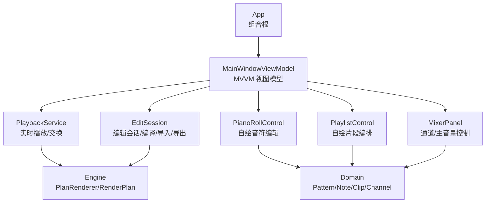
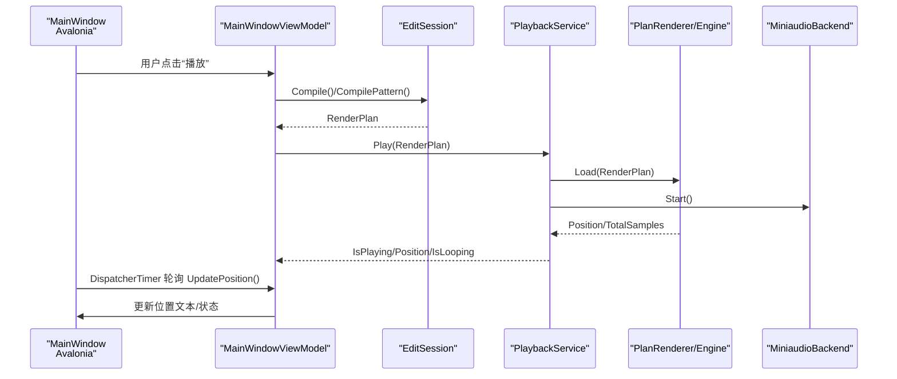
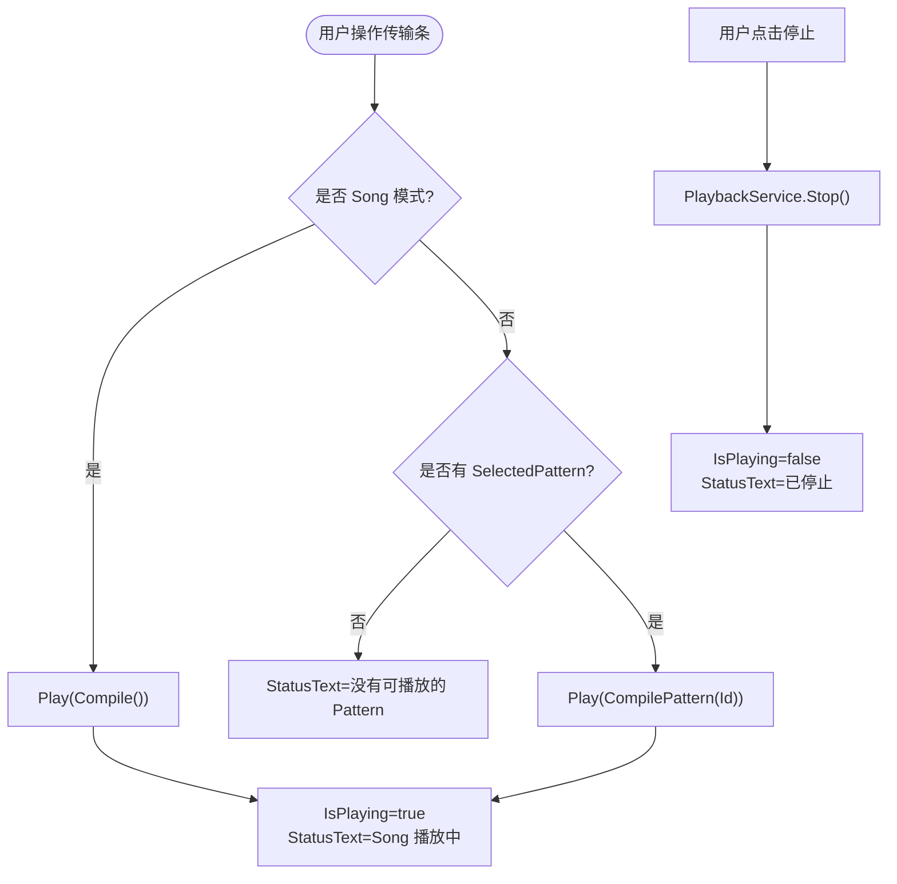
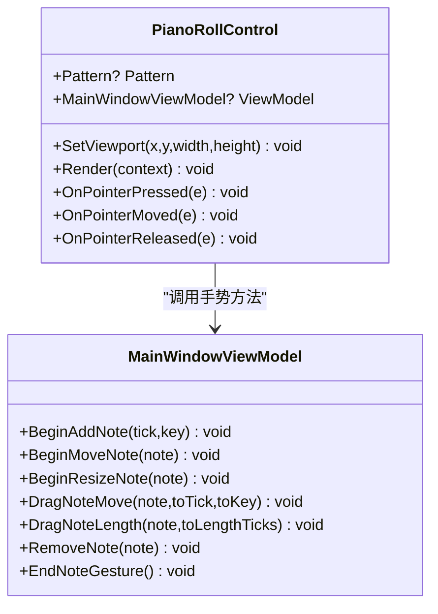
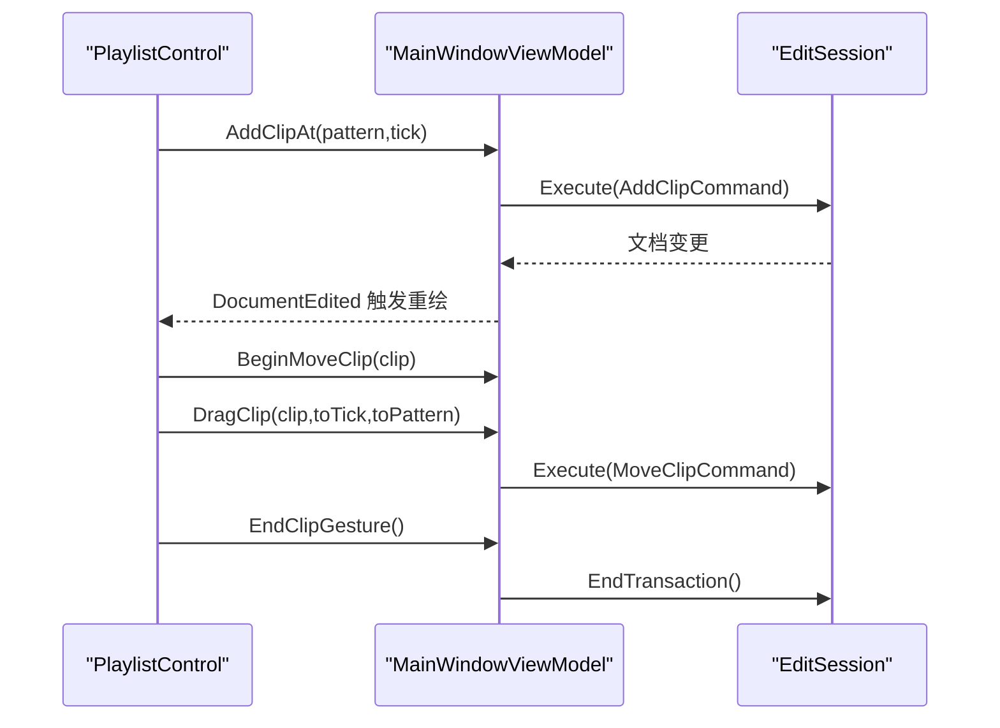
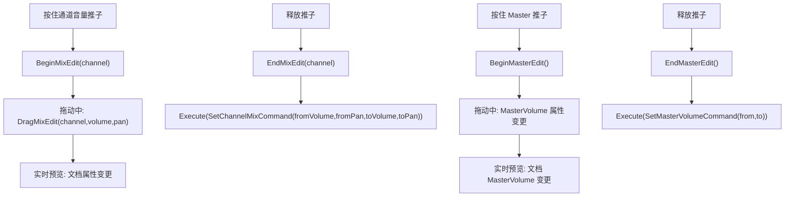
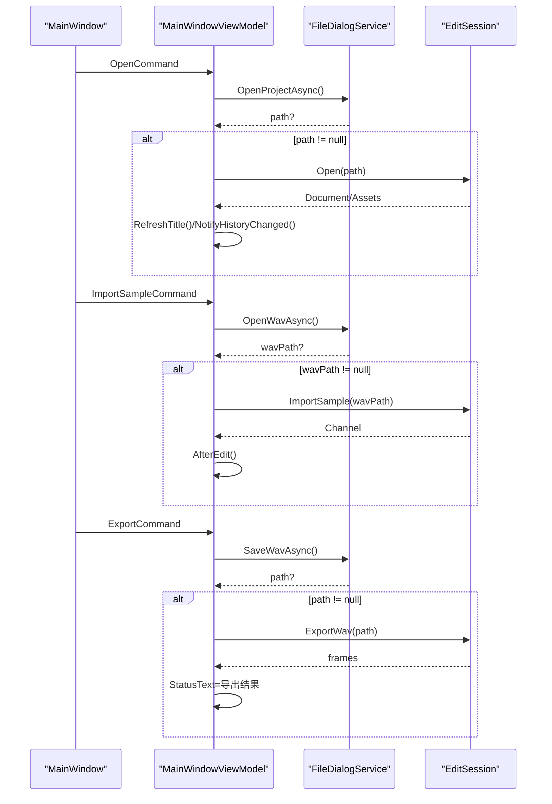
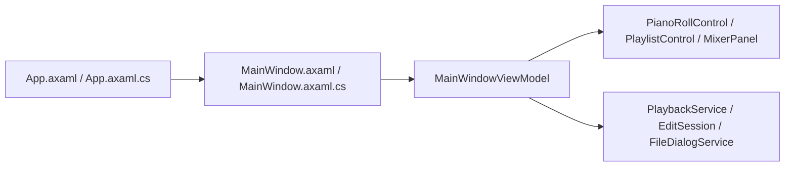
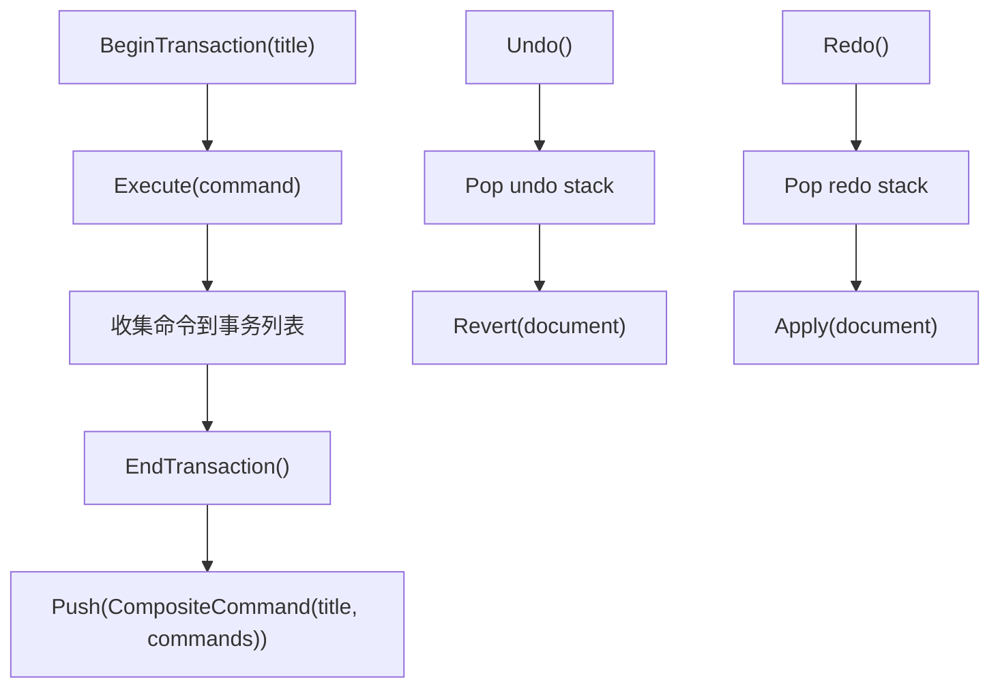
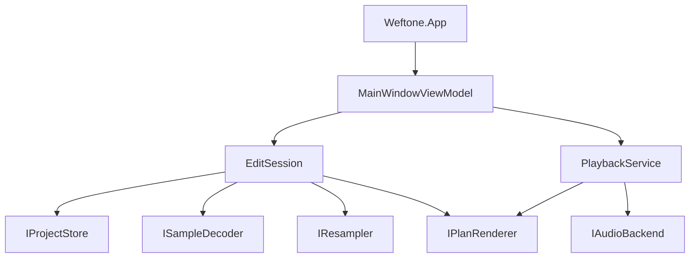

# M1b UI 规格

<cite>
**本文引用的文件**   
- [M1b_UI.md](file://specs/M1b_UI.md)
- [App.axaml.cs](file://src/Weftone.App/App.axaml.cs)
- [App.axaml](file://src/Weftone.App/App.axaml)
- [MainWindow.axaml.cs](file://src/Weftone.App/MainWindow.axaml.cs)
- [MainWindow.axaml](file://src/Weftone.App/MainWindow.axaml)
- [MainWindowViewModel.cs](file://src/Weftone.App/ViewModels/MainWindowViewModel.cs)
- [PianoRollControl.cs](file://src/Weftone.App/Controls/PianoRollControl.cs)
- [PlaylistControl.cs](file://src/Weftone.App/Controls/PlaylistControl.cs)
- [MixerPanel.cs](file://src/Weftone.App/Controls/MixerPanel.cs)
- [PlaybackService.cs](file://src/Weftone.Application/PlaybackService.cs)
- [EditSession.cs](file://src/Weftone.Application/EditSession.cs)
- [ProjectDocument.cs](file://src/Weftone.Domain/ProjectDocument.cs)
- [CommandHistory.cs](file://src/Weftone.Domain/Commands/CommandHistory.cs)
</cite>

## 目录
1. [引言](#引言)
2. [项目结构](#项目结构)
3. [核心组件](#核心组件)
4. [架构总览](#架构总览)
5. [详细组件分析](#详细组件分析)
6. [依赖关系分析](#依赖关系分析)
7. [性能与实时性](#性能与实时性)
8. [故障排查指南](#故障排查指南)
9. [结论](#结论)

## 引言
本规格面向 M1b 最小可行界面，目标是给出一个基于 Avalonia 的单窗口 DAW：加载采样、在 Piano Roll 绘制音符、Pattern 循环播放、Playlist 编排片段、Mixer 调节音量与声像、导出 WAV，并保证撤销/重做与工程存取可用。UI 层遵循 MVVM，所有编辑与渲染逻辑可在无 UI 环境测试；Avalonia 仅作为薄壳视图层。

该文档重点解释以下方面：
- Piano Roll 钢琴卷帘的音符编辑功能与视口裁剪。
- Playlist 播放列表的片段编排与拖拽。
- Mixer 调音台的通道推子、pan 旋钮与 master 控制。
- 传输条（Transport Bar）的播放、暂停、停止、循环与模式切换。
- 工程存取对话框与操作反馈。
- Avalonia + MVVM 的使用方式与响应式数据绑定。
- 界面与后端服务（PlaybackService、EditSession、Engine）的集成与数据流。

**章节来源**
- [M1b_UI.md:7-10](file://specs/M1b_UI.md#L7-L10)
- [M1b_UI.md:18-47](file://specs/M1b_UI.md#L18-L47)

## 项目结构
M1b UI 位于 Weftone.App 项目中，采用 Avalonia XAML 布局 + C# 代码后台 + ViewModel 的模式。三个核心自绘控件分别负责 Piano Roll、Playlist 与 Mixer 面板；MainWindow 组合这些控件并提供传输条与菜单；App 作为组合根装配 EditSession、PlaybackService 与 MainWindowViewModel。

**图表来源**
- [App.axaml.cs:18-44](file://src/Weftone.App/App.axaml.cs#L18-L44)
- [MainWindow.axaml:15-96](file://src/Weftone.App/MainWindow.axaml#L15-L96)
- [MainWindowViewModel.cs:12-106](file://src/Weftone.App/ViewModels/MainWindowViewModel.cs#L12-L106)
- [PlaybackService.cs:12-31](file://src/Weftone.Application/PlaybackService.cs#L12-L31)
- [EditSession.cs:14-41](file://src/Weftone.Application/EditSession.cs#L14-L41)

**章节来源**
- [App.axaml.cs:18-44](file://src/Weftone.App/App.axaml.cs#L18-L44)
- [MainWindow.axaml:15-96](file://src/Weftone.App/MainWindow.axaml#L15-L96)

## 核心组件
- MainWindowViewModel：承载 UI 状态、命令、手势与播放意图；通过 EditSession 执行命令、编译 RenderPlan，并通过 PlaybackService 驱动音频。
- PlaybackService：封装 miniaudio 后端，提供 Play/Stop/UpdatePlan，实现“停止-交换-恢复”的热更新。
- EditSession：管理 ProjectDocument、命令历史、资产工作区、导入与导出；暴露 Compile/CompilePattern/ExportWav。
- PianoRollControl：自绘音符网格、视口裁剪、音符添加/移动/调整长度/删除。
- PlaylistControl：自绘轨道与 clip 块，支持放置、拖拽移动与删除。
- MixerPanel：组合 Slider 实现通道音量/pan 与 master 音量控制，拖动中预览、释放后入撤销栈。

**章节来源**
- [MainWindowViewModel.cs:12-106](file://src/Weftone.App/ViewModels/MainWindowViewModel.cs#L12-L106)
- [PlaybackService.cs:12-31](file://src/Weftone.Application/PlaybackService.cs#L12-L31)
- [EditSession.cs:14-41](file://src/Weftone.Application/EditSession.cs#L14-L41)
- [PianoRollControl.cs:10-14](file://src/Weftone.App/Controls/PianoRollControl.cs#L10-L14)
- [PlaylistControl.cs:10-14](file://src/Weftone.App/Controls/PlaylistControl.cs#L10-L14)
- [MixerPanel.cs:12-15](file://src/Weftone.App/Controls/MixerPanel.cs#L12-L15)

## 架构总览
M1b 保持“App 唯一引用 Avalonia”的边界：Engine/Application/Domain 不依赖 UI。UI 线程是 Document 的唯一写者；音频线程只读 RenderPlan，零分配零锁。播放位置由 DispatcherTimer 轮询，避免回调直接订阅 UI。

**图表来源**
- [MainWindow.axaml:27-49](file://src/Weftone.App/MainWindow.axaml#L27-L49)
- [MainWindowViewModel.cs:112-130](file://src/Weftone.App/ViewModels/MainWindowViewModel.cs#L112-L130)
- [PlaybackService.cs:42-52](file://src/Weftone.Application/PlaybackService.cs#L42-L52)
- [MainWindow.axaml.cs:55-64](file://src/Weftone.App/MainWindow.axaml.cs#L55-L64)

**章节来源**
- [M1b_UI.md:39-47](file://specs/M1b_UI.md#L39-L47)
- [PlaybackService.cs:42-78](file://src/Weftone.Application/PlaybackService.cs#L42-L78)
- [MainWindow.axaml.cs:55-64](file://src/Weftone.App/MainWindow.axaml.cs#L55-L64)

## 详细组件分析

### 传输条（Transport Bar）与播放控制
传输条包含播放、停止、Song 模式切换、Pattern 选择、位置显示、BPM 显示、撤销/重做按钮。ViewModel 根据当前模式调用 PlaybackService 播放 Pattern 或 Song；位置通过定时器轮询更新。

**图表来源**
- [MainWindow.axaml:27-49](file://src/Weftone.App/MainWindow.axaml#L27-L49)
- [MainWindowViewModel.cs:112-138](file://src/Weftone.App/ViewModels/MainWindowViewModel.cs#L112-L138)

**章节来源**
- [MainWindow.axaml:27-49](file://src/Weftone.App/MainWindow.axaml#L27-L49)
- [MainWindowViewModel.cs:112-138](file://src/Weftone.App/ViewModels/MainWindowViewModel.cs#L112-L138)

### Piano Roll 钢琴卷帘
Piano Roll 使用 DrawingContext 自绘，横轴为 tick（小节/拍网格），纵轴为 MIDI key（左侧钢琴键侧栏）。支持：
- 空处左键按下：开始添加音符，拖动调整长度。
- 音符体左键按下：移动音符。
- 音符右边缘：调整长度。
- 右键：删除音符。
- 视口裁剪：只绘制可见 tick/key 范围，目标 1 万音符流畅。

**图表来源**
- [PianoRollControl.cs:15-74](file://src/Weftone.App/Controls/PianoRollControl.cs#L15-L74)
- [PianoRollControl.cs:185-291](file://src/Weftone.App/Controls/PianoRollControl.cs#L185-L291)
- [MainWindowViewModel.cs:229-323](file://src/Weftone.App/ViewModels/MainWindowViewModel.cs#L229-L323)

**章节来源**
- [PianoRollControl.cs:10-14](file://src/Weftone.App/Controls/PianoRollControl.cs#L10-L14)
- [PianoRollControl.cs:104-157](file://src/Weftone.App/Controls/PianoRollControl.cs#L104-L157)
- [PianoRollControl.cs:185-291](file://src/Weftone.App/Controls/PianoRollControl.cs#L185-L291)
- [MainWindowViewModel.cs:229-323](file://src/Weftone.App/ViewModels/MainWindowViewModel.cs#L229-L323)

### Playlist 播放列表
Playlist 控件按轨展示 Pattern clip 块，复用 PianoRollGeometry 的 tick 映射。支持：
- 空轨左键：放置 clip。
- 拖拽 clip：移动（可换轨）。
- 右键：删除 clip。
- 视口宽度同步：ScrollViewer 变化时通知控件设置视口。

**图表来源**
- [PlaylistControl.cs:193-283](file://src/Weftone.App/Controls/PlaylistControl.cs#L193-L283)
- [MainWindowViewModel.cs:354-396](file://src/Weftone.App/ViewModels/MainWindowViewModel.cs#L354-L396)

**章节来源**
- [PlaylistControl.cs:10-14](file://src/Weftone.App/Controls/PlaylistControl.cs#L10-L14)
- [PlaylistControl.cs:108-171](file://src/Weftone.App/Controls/PlaylistControl.cs#L108-L171)
- [PlaylistControl.cs:193-283](file://src/Weftone.App/Controls/PlaylistControl.cs#L193-L283)
- [MainWindowViewModel.cs:354-396](file://src/Weftone.App/ViewModels/MainWindowViewModel.cs#L354-L396)

### Mixer 调音台
MixerPanel 使用标准控件组合：每通道竖推子（音量 0..2）、横推子（pan -1..1）、名称标签；右侧 master 推子。拖动中直接修改文档以实时反映播放，释放时以 from/to 参数生成撤销命令。

**图表来源**
- [MixerPanel.cs:95-173](file://src/Weftone.App/Controls/MixerPanel.cs#L95-L173)
- [MixerPanel.cs:175-223](file://src/Weftone.App/Controls/MixerPanel.cs#L175-L223)
- [MainWindowViewModel.cs:437-494](file://src/Weftone.App/ViewModels/MainWindowViewModel.cs#L437-L494)

**章节来源**
- [MixerPanel.cs:12-15](file://src/Weftone.App/Controls/MixerPanel.cs#L12-L15)
- [MixerPanel.cs:95-173](file://src/Weftone.App/Controls/MixerPanel.cs#L95-L173)
- [MixerPanel.cs:175-223](file://src/Weftone.App/Controls/MixerPanel.cs#L175-L223)
- [MainWindowViewModel.cs:437-494](file://src/Weftone.App/ViewModels/MainWindowViewModel.cs#L437-L494)

### 工程存取与采样导入
- 打开/保存 .weft：通过 IFileDialogService 调用 OpenFileDialog/SaveFileDialog，ViewModel 调用 EditSession.Open/Save。
- 标题栏显示工程名与脏标记（*），关闭/新建提示未保存。
- 导入采样：选 WAV → EditSession.ImportSample 解码校验、拷贝到工作区、注册 AssetRef 与 sampler 通道，一步撤销。
- 导出 WAV：调用 EditSession.ExportWav，离线路径与实时播放互不干扰。

**图表来源**
- [MainWindow.axaml:16-24](file://src/Weftone.App/MainWindow.axaml#L16-L24)
- [MainWindowViewModel.cs:149-161](file://src/Weftone.App/ViewModels/MainWindowViewModel.cs#L149-L161)
- [MainWindowViewModel.cs:202-213](file://src/Weftone.App/ViewModels/MainWindowViewModel.cs#L202-L213)
- [MainWindowViewModel.cs:398-435](file://src/Weftone.App/ViewModels/MainWindowViewModel.cs#L398-L435)
- [EditSession.cs:64-92](file://src/Weftone.Application/EditSession.cs#L64-L92)
- [EditSession.cs:137-165](file://src/Weftone.Application/EditSession.cs#L137-L165)
- [EditSession.cs:171-188](file://src/Weftone.Application/EditSession.cs#L171-L188)

**章节来源**
- [M1b_UI.md:94-105](file://specs/M1b_UI.md#L94-L105)
- [MainWindowViewModel.cs:149-161](file://src/Weftone.App/ViewModels/MainWindowViewModel.cs#L149-L161)
- [MainWindowViewModel.cs:202-213](file://src/Weftone.App/ViewModels/MainWindowViewModel.cs#L202-L213)
- [MainWindowViewModel.cs:398-435](file://src/Weftone.App/ViewModels/MainWindowViewModel.cs#L398-L435)
- [EditSession.cs:64-92](file://src/Weftone.Application/EditSession.cs#L64-L92)
- [EditSession.cs:137-165](file://src/Weftone.Application/EditSession.cs#L137-L165)
- [EditSession.cs:171-188](file://src/Weftone.Application/EditSession.cs#L171-L188)

### Avalonia UI 与 MVVM 应用
- App.axaml 启用 FluentTheme；App.axaml.cs 作为组合根装配 EditSession、PlaybackService、FileDialogService 与 MainWindowViewModel。
- MainWindow.axaml 使用 DockPanel 固定分区：顶部菜单与传输条、中部左右分栏（Pattern 列表 + Playlist）、底部 Piano Roll 与 Mixer。
- ViewModel 使用 CommunityToolkit.Mvvm 的 ObservableObject 与 RelayCommand，XAML 通过 Binding 绑定 Title、Patterns、SelectedPattern、PlaylistClips、Channels、MasterVolume、PositionText、Tempo、StatusText 等。
- 响应式更新：DocumentEdited 事件通知自绘控件 InvalidateVisual；PropertyChanged 用于 Channels/MasterVolume 重建 Mixer 面板。

**图表来源**
- [App.axaml:1-8](file://src/Weftone.App/App.axaml#L1-L8)
- [App.axaml.cs:18-44](file://src/Weftone.App/App.axaml.cs#L18-L44)
- [MainWindow.axaml:1-98](file://src/Weftone.App/MainWindow.axaml#L1-L98)
- [MainWindowViewModel.cs:12-106](file://src/Weftone.App/ViewModels/MainWindowViewModel.cs#L12-L106)

**章节来源**
- [App.axaml:1-8](file://src/Weftone.App/App.axaml#L1-L8)
- [App.axaml.cs:18-44](file://src/Weftone.App/App.axaml.cs#L18-L44)
- [MainWindow.axaml:1-98](file://src/Weftone.App/MainWindow.axaml#L1-L98)
- [MainWindowViewModel.cs:12-106](file://src/Weftone.App/ViewModels/MainWindowViewModel.cs#L12-L106)

### 撤销/重做与事务合并
CommandHistory 支持事务：BeginTransaction/EndTransaction 将一次手势的多条命令合并为 CompositeCommand，确保拖拽操作撤销为单步。Undo/Redo 空栈拒绝，新命令会清空 redo 栈。

**图表来源**
- [CommandHistory.cs:7-59](file://src/Weftone.Domain/Commands/CommandHistory.cs#L7-L59)
- [CommandHistory.cs:61-97](file://src/Weftone.Domain/Commands/CommandHistory.cs#L61-L97)

**章节来源**
- [CommandHistory.cs:7-59](file://src/Weftone.Domain/Commands/CommandHistory.cs#L7-L59)
- [CommandHistory.cs:61-97](file://src/Weftone.Domain/Commands/CommandHistory.cs#L61-L97)
- [MainWindowViewModel.cs:496-521](file://src/Weftone.App/ViewModels/MainWindowViewModel.cs#L496-L521)

## 依赖关系分析
- App 是唯一允许引用 Avalonia 的项目；Engine/Application/Domain 不依赖 UI。
- ViewModel 依赖 Application（EditSession、PlaybackService）与 Domain（Pattern/Clip/Channel/Note）。
- PlaybackService 依赖 Abstractions.Rendering（IPlanRenderer）与 Abstractions.Audio（IAudioBackend）。
- EditSession 依赖 Adapters（IProjectStore、ISampleDecoder、IResampler）与 Engine（IPlanRenderer）。

**图表来源**
- [App.axaml.cs:18-44](file://src/Weftone.App/App.axaml.cs#L18-L44)
- [PlaybackService.cs:12-31](file://src/Weftone.Application/PlaybackService.cs#L12-L31)
- [EditSession.cs:14-41](file://src/Weftone.Application/EditSession.cs#L14-L41)

**章节来源**
- [M1b_UI.md:18-37](file://specs/M1b_UI.md#L18-L37)
- [PlaybackService.cs:12-31](file://src/Weftone.Application/PlaybackService.cs#L12-L31)
- [EditSession.cs:14-41](file://src/Weftone.Application/EditSession.cs#L14-L41)

## 性能与实时性
- 自绘控件使用视口裁剪，只绘制可见区域，目标 1 万音符流畅。
- 音频线程只读 RenderPlan，零分配零锁；PlaybackService 在回调内一次性捕获渲染器，避免分配。
- 编辑后热更新采用“停止-交换-恢复”，短暂静音换取零并发风险。
- 位置反馈通过 DispatcherTimer 轮询，非 RT 侧，避免音频线程→UI 的事件订阅/分配。

**章节来源**
- [M1b_UI.md:66-73](file://specs/M1b_UI.md#L66-L73)
- [M1b_UI.md:59-64](file://specs/M1b_UI.md#L59-L64)
- [PlaybackService.cs:42-78](file://src/Weftone.Application/PlaybackService.cs#L42-L78)
- [MainWindow.axaml.cs:55-64](file://src/Weftone.App/MainWindow.axaml.cs#L55-L64)

## 故障排查指南
- 无法出声或 native 缺失：App 启动时若缺少 native 或解码失败，会以空工程启动，用户可手动打开工程。检查 miniaudio native 构建与运行时复制。
- 播放位置不更新：确认 MainWindow 的 DispatcherTimer 已启动且 DataContext 正确绑定到 MainWindowViewModel。
- 撤销/重做无效：检查 CommandHistory 是否在事务中进行；空栈拒绝撤销/重做；新命令会清空 redo 栈。
- 导入采样失败：EditSession.ImportSample 对 WAV 进行解码校验，失败抛出 InvalidDataException；检查文件格式与工作区权限。
- 导出 WAV 异常：ExportWav 使用离线路径，检查路径写入权限与磁盘空间。

**章节来源**
- [App.axaml.cs:25-32](file://src/Weftone.App/App.axaml.cs#L25-L32)
- [MainWindow.axaml.cs:55-64](file://src/Weftone.App/MainWindow.axaml.cs#L55-L64)
- [CommandHistory.cs:61-97](file://src/Weftone.Domain/Commands/CommandHistory.cs#L61-L97)
- [EditSession.cs:137-165](file://src/Weftone.Application/EditSession.cs#L137-L165)
- [EditSession.cs:171-188](file://src/Weftone.Application/EditSession.cs#L171-L188)

## 结论
M1b UI 通过 Avalonia + MVVM 实现了最小可行的 DAW 界面：Piano Roll 音符编辑、Playlist 片段编排、Mixer 音量控制与传输条播放控制均具备完整交互流程。工程存取与采样导入通过对话框与服务层协作，导出 WAV 走离线路径。架构上严格分离 UI 与引擎，实时播放零分配，撤销/重做覆盖所有编辑，满足 DoD 全链验收与三平台 CI 要求。后续里程碑可扩展双缓冲原子交换、增量编译、插件宿主与更多交互打磨。