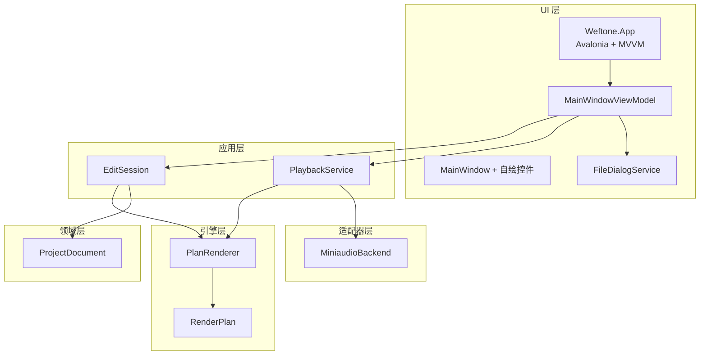
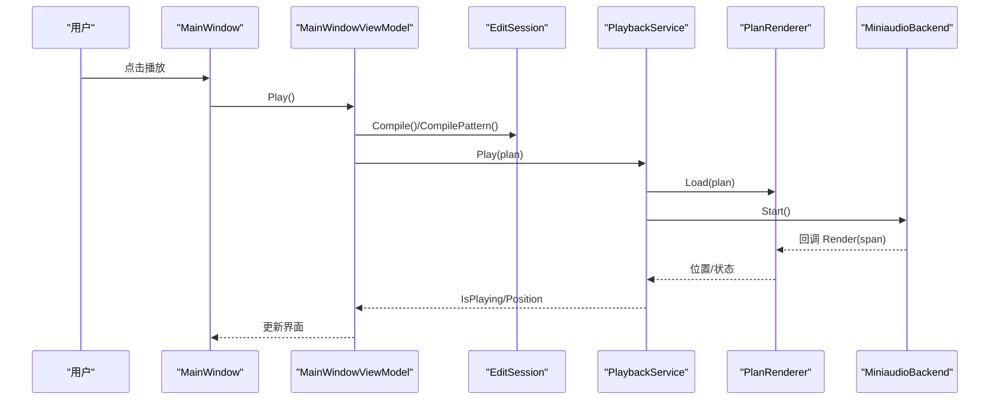
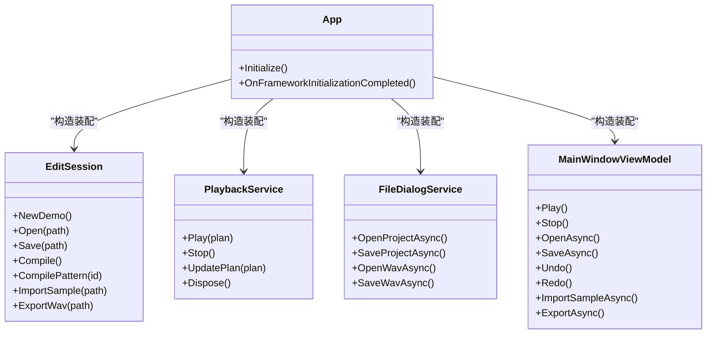
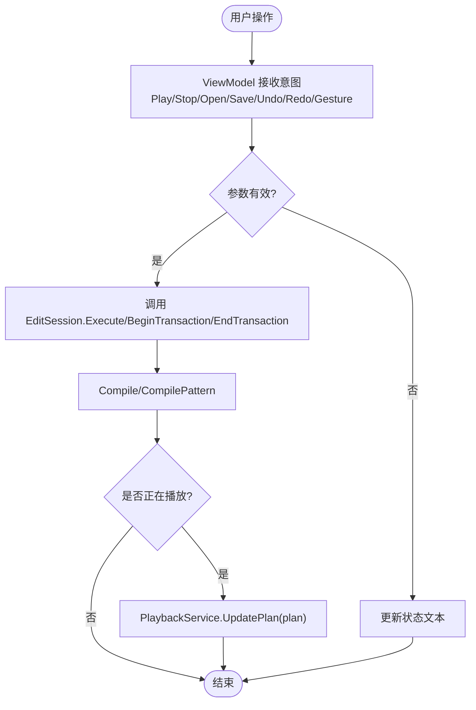
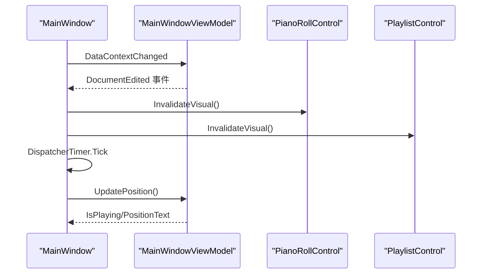
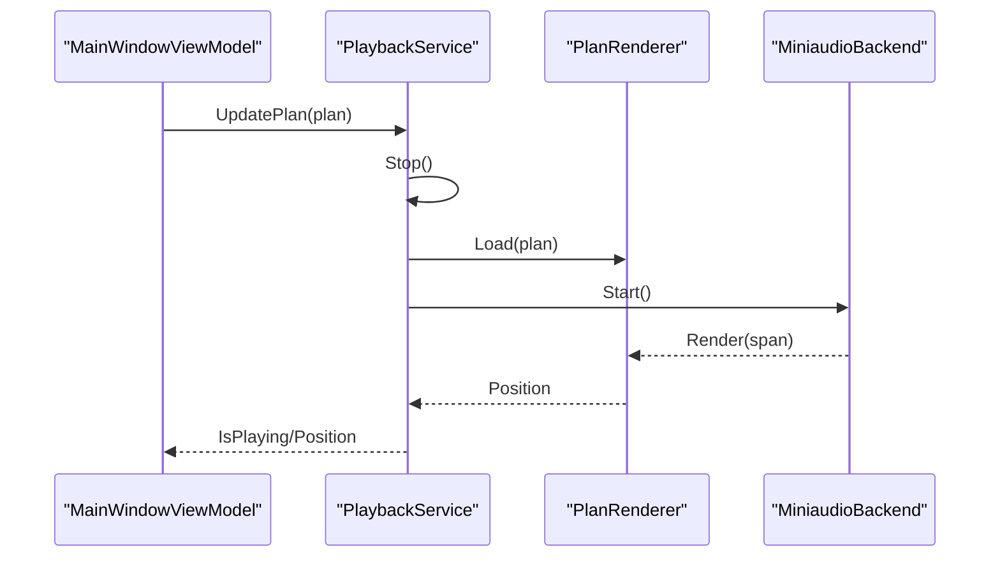
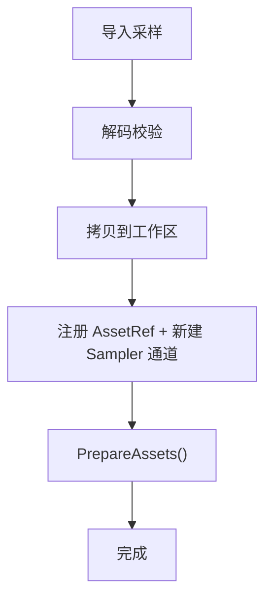
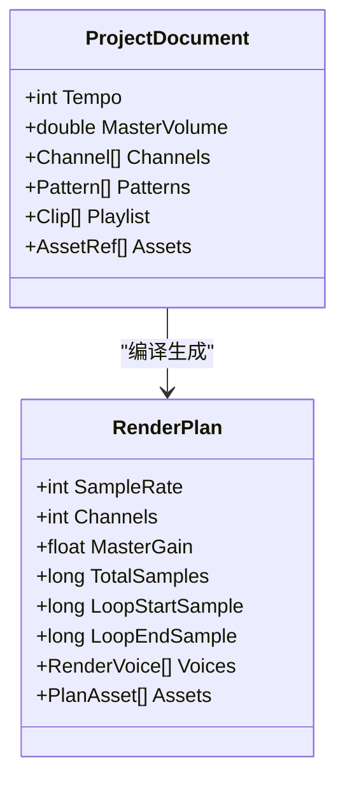
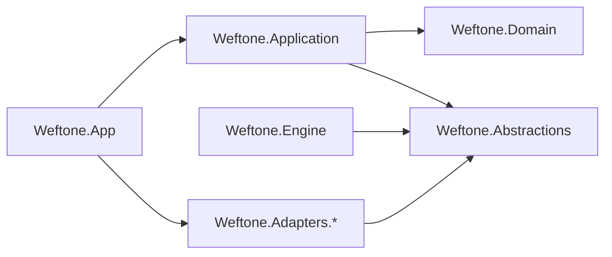

# UI 架构设计

<cite>
**本文引用的文件**   
- [README.md](file://README.md)
- [AGENTS.md](file://AGENTS.md)
- [ADR-0002-threading-realtime.md](file://docs/adr/ADR-0002-threading-realtime.md)
- [ADR-0004-ports-adapters-wheel-first.md](file://docs/adr/ADR-0004-ports-adapters-wheel-first.md)
- [M1b_UI.md](file://specs/M1b_UI.md)
- [Program.cs](file://src/Weftone.App/Program.cs)
- [App.axaml.cs](file://src/Weftone.App/App.axaml.cs)
- [MainWindow.axaml.cs](file://src/Weftone.App/MainWindow.axaml.cs)
- [MainWindowViewModel.cs](file://src/Weftone.App/ViewModels/MainWindowViewModel.cs)
- [FileDialogService.cs](file://src/Weftone.App/Services/FileDialogService.cs)
- [PlaybackService.cs](file://src/Weftone.Application/PlaybackService.cs)
- [EditSession.cs](file://src/Weftone.Application/EditSession.cs)
- [PlanRenderer.cs](file://src/Weftone.Engine/PlanRenderer.cs)
- [RenderPlan.cs](file://src/Weftone.Abstractions/Rendering/RenderPlan.cs)
- [ProjectDocument.cs](file://src/Weftone.Domain/ProjectDocument.cs)
- [MiniaudioBackend.cs](file://src/Weftone.Adapters.Audio.Miniaudio/MiniaudioBackend.cs)
</cite>

## 目录
1. [引言](#引言)
2. [项目结构](#项目结构)
3. [核心组件](#核心组件)
4. [架构总览](#架构总览)
5. [详细组件分析](#详细组件分析)
6. [依赖关系分析](#依赖关系分析)
7. [性能与实时性](#性能与实时性)
8. [故障排查指南](#故障排查指南)
9. [结论](#结论)
10. [附录：Avalonia 选型与跨平台说明](#avalonia-选型与跨平台说明)

## 引言
本文件面向 Weftone（纬音）的 UI 架构设计，聚焦 Avalonia 单窗口 DAW 的整体架构、MVVM 模式应用、组合根装配与依赖注入边界、线程模型、头优先原则在 UI 层的落地，以及 Avalonia 框架的选择理由与跨平台考虑。文档以仓库现有实现为依据，结合 M1b 最小 UI 规格与相关架构决策记录进行系统化说明，并辅以架构图、类图、时序图和流程图帮助读者理解。

## 项目结构
Weftone 采用六边形架构 + 编译器模式 + 数据导向实时层。UI 仅存在于 Weftone.App 中，其他层（Domain / Abstractions / Application / Engine / Adapters）不感知 UI。UI 通过 MVVM 将用户操作转化为命令，由 Application 层编排编辑会话、编译和渲染；Engine 提供零分配的实时渲染能力；Adapters 封装音频 I/O、解码等第三方轮子。

图表来源
- [Program.cs:1-16](file://src/Weftone.App/Program.cs#L1-L16)
- [App.axaml.cs:18-48](file://src/Weftone.App/App.axaml.cs#L18-L48)
- [MainWindowViewModel.cs:12-106](file://src/Weftone.App/ViewModels/MainWindowViewModel.cs#L12-L106)
- [PlaybackService.cs:12-31](file://src/Weftone.Application/PlaybackService.cs#L12-L31)
- [PlanRenderer.cs:11-44](file://src/Weftone.Engine/PlanRenderer.cs#L11-L44)
- [RenderPlan.cs:29-41](file://src/Weftone.Abstractions/Rendering/RenderPlan.cs#L29-L41)
- [ProjectDocument.cs:7-20](file://src/Weftone.Domain/ProjectDocument.cs#L7-L20)
- [MiniaudioBackend.cs:11-36](file://src/Weftone.Adapters.Audio.Miniaudio/MiniaudioBackend.cs#L11-L36)

章节来源
- [README.md:38-79](file://README.md#L38-L79)
- [AGENTS.md:61-105](file://AGENTS.md#L61-L105)
- [M1b_UI.md:18-48](file://specs/M1b_UI.md#L18-L48)

## 核心组件
- App 组合根：负责创建 EditSession、PlaybackService、FileDialogService、MainWindowViewModel，并将 ViewModel 注入 MainWindow。
- MainWindowViewModel：MVVM 视图模型，承载播放控制、工程打开/保存、撤销重做、Piano Roll/Playlist/Mixer 手势、导出 WAV 等用例。
- PlaybackService：实时播放用例，封装后端启停、计划加载与热更新（停止-交换-恢复）。
- EditSession：UI 线程单写者，持有 ProjectDocument、命令历史、资产工作区，提供编译与离线导出。
- PlanRenderer：实时渲染器，基于 RenderPlan 执行零分配渲染，支持循环回绕。
- MiniaudioBackend：miniaudio 适配，提供 IAudioBackend 实现，回调路径零分配。
- FileDialogService：Avalonia 文件对话框抽象，供 ViewModel 调用。

章节来源
- [App.axaml.cs:18-48](file://src/Weftone.App/App.axaml.cs#L18-L48)
- [MainWindowViewModel.cs:12-106](file://src/Weftone.App/ViewModels/MainWindowViewModel.cs#L12-L106)
- [PlaybackService.cs:12-31](file://src/Weftone.Application/PlaybackService.cs#L12-L31)
- [EditSession.cs:14-41](file://src/Weftone.Application/EditSession.cs#L14-L41)
- [PlanRenderer.cs:11-44](file://src/Weftone.Engine/PlanRenderer.cs#L11-L44)
- [MiniaudioBackend.cs:11-36](file://src/Weftone.Adapters.Audio.Miniaudio/MiniaudioBackend.cs#L11-L36)
- [FileDialogService.cs:6-18](file://src/Weftone.App/Services/FileDialogService.cs#L6-L18)

## 架构总览
Weftone 的 UI 架构遵循“头优先”原则：所有编辑与渲染逻辑可在无 UI 环境测试，UI 只是薄壳。UI 层通过 MVVM 将用户意图转换为命令，Application 层编排编辑会话与编译，Engine 层提供确定性、零分配的实时渲染。

图表来源
- [MainWindow.axaml.cs:55-64](file://src/Weftone.App/MainWindow.axaml.cs#L55-L64)
- [MainWindowViewModel.cs:112-130](file://src/Weftone.App/ViewModels/MainWindowViewModel.cs#L112-L130)
- [PlaybackService.cs:42-52](file://src/Weftone.Application/PlaybackService.cs#L42-L52)
- [PlanRenderer.cs:48-59](file://src/Weftone.Engine/PlanRenderer.cs#L48-L59)
- [MiniaudioBackend.cs:78-83](file://src/Weftone.Adapters.Audio.Miniaudio/MiniaudioBackend.cs#L78-L83)

## 详细组件分析

### 组合根与依赖注入边界
App 是唯一的 Avalonia 引用点，也是 DI 组合根。它在 OnFrameworkInitializationCompleted 中装配 EditSession、PlaybackService、FileDialogService、MainWindowViewModel，并设置 MainWindow 的 DataContext。若原生库缺失或解码失败，则以空工程启动，保证 UI 可运行。

图表来源
- [App.axaml.cs:18-48](file://src/Weftone.App/App.axaml.cs#L18-L48)
- [EditSession.cs:27-41](file://src/Weftone.Application/EditSession.cs#L27-L41)
- [PlaybackService.cs:24-31](file://src/Weftone.Application/PlaybackService.cs#L24-L31)
- [FileDialogService.cs:6-18](file://src/Weftone.App/Services/FileDialogService.cs#L6-L18)
- [MainWindowViewModel.cs:96-106](file://src/Weftone.App/ViewModels/MainWindowViewModel.cs#L96-L106)

章节来源
- [App.axaml.cs:18-48](file://src/Weftone.App/App.axaml.cs#L18-L48)
- [AGENTS.md:61-80](file://AGENTS.md#L61-L80)

### MVVM 视图模型与交互流程
MainWindowViewModel 使用 CommunityToolkit.Mvvm 的属性通知与命令绑定，封装播放、工程存取、撤销重做、Piano Roll/Playlist/Mixer 手势、导入导出等用例。它通过 EditSession 访问 Document 与命令历史，通过 PlaybackService 驱动实时播放，通过 FileDialogService 调用系统文件对话框。

图表来源
- [MainWindowViewModel.cs:112-130](file://src/Weftone.App/ViewModels/MainWindowViewModel.cs#L112-L130)
- [MainWindowViewModel.cs:229-323](file://src/Weftone.App/ViewModels/MainWindowViewModel.cs#L229-L323)
- [MainWindowViewModel.cs:398-435](file://src/Weftone.App/ViewModels/MainWindowViewModel.cs#L398-L435)
- [PlaybackService.cs:63-78](file://src/Weftone.Application/PlaybackService.cs#L63-L78)

章节来源
- [MainWindowViewModel.cs:12-106](file://src/Weftone.App/ViewModels/MainWindowViewModel.cs#L12-L106)
- [MainWindowViewModel.cs:229-323](file://src/Weftone.App/ViewModels/MainWindowViewModel.cs#L229-L323)
- [MainWindowViewModel.cs:398-435](file://src/Weftone.App/ViewModels/MainWindowViewModel.cs#L398-L435)

### 视图与自绘控件
MainWindow 负责滚动视口同步、订阅 ViewModel 的 DocumentEdited 事件触发自绘控件重画，并使用 DispatcherTimer 定时轮询播放位置。Piano Roll、Playlist、Mixer 等核心视图采用自绘，避免为每个音符创建控件，满足大规模音符场景的性能要求。

图表来源
- [MainWindow.axaml.cs:35-53](file://src/Weftone.App/MainWindow.axaml.cs#L35-L53)
- [MainWindow.axaml.cs:55-64](file://src/Weftone.App/MainWindow.axaml.cs#L55-L64)
- [MainWindowViewModel.cs:325-340](file://src/Weftone.App/ViewModels/MainWindowViewModel.cs#L325-L340)

章节来源
- [MainWindow.axaml.cs:12-20](file://src/Weftone.App/MainWindow.axaml.cs#L12-L20)
- [MainWindow.axaml.cs:35-53](file://src/Weftone.App/MainWindow.axaml.cs#L35-L53)
- [MainWindow.axaml.cs:55-64](file://src/Weftone.App/MainWindow.axaml.cs#L55-L64)

### 实时播放与计划交换
PlaybackService 管理音频后端生命周期，Load 仅在 Stop 后调用，确保音频线程不会并发访问计划。编辑后通过 UpdatePlan 实现“停止-交换-恢复”，短暂静音换取零并发风险。PlanRenderer 在音频回调中只读 RenderPlan，零分配、零锁。

图表来源
- [PlaybackService.cs:63-78](file://src/Weftone.Application/PlaybackService.cs#L63-L78)
- [PlanRenderer.cs:48-59](file://src/Weftone.Engine/PlanRenderer.cs#L48-L59)
- [MiniaudioBackend.cs:78-83](file://src/Weftone.Adapters.Audio.Miniaudio/MiniaudioBackend.cs#L78-L83)

章节来源
- [PlaybackService.cs:42-78](file://src/Weftone.Application/PlaybackService.cs#L42-L78)
- [PlanRenderer.cs:48-105](file://src/Weftone.Engine/PlanRenderer.cs#L48-L105)

### 编辑会话与资产工作区
EditSession 维护 ProjectDocument、命令历史与临时工作区。导入采样时先解码校验，再拷贝到工作区，注册 AssetRef 并重建 PreparedAsset 列表。导出 WAV 走离线路径，独立于实时播放。

图表来源
- [EditSession.cs:137-165](file://src/Weftone.Application/EditSession.cs#L137-L165)
- [EditSession.cs:190-194](file://src/Weftone.Application/EditSession.cs#L190-L194)

章节来源
- [EditSession.cs:14-41](file://src/Weftone.Application/EditSession.cs#L14-L41)
- [EditSession.cs:137-165](file://src/Weftone.Application/EditSession.cs#L137-L165)
- [EditSession.cs:190-194](file://src/Weftone.Application/EditSession.cs#L190-L194)

### 领域模型与实时模型分离
ProjectDocument 是可编辑的富对象，包含 Tempo、MasterVolume、Channels、Patterns、Playlist、Assets 等。RenderPlan 是扁平数组、预分配、无第三方类型的实时计划，音频线程只读。两者通过编译器解耦，确保音频线程永不可见 Document。

图表来源
- [ProjectDocument.cs:7-20](file://src/Weftone.Domain/ProjectDocument.cs#L7-L20)
- [RenderPlan.cs:29-41](file://src/Weftone.Abstractions/Rendering/RenderPlan.cs#L29-L41)

章节来源
- [ProjectDocument.cs:7-20](file://src/Weftone.Domain/ProjectDocument.cs#L7-L20)
- [RenderPlan.cs:29-41](file://src/Weftone.Abstractions/Rendering/RenderPlan.cs#L29-L41)

## 依赖关系分析
UI 层仅允许引用 Avalonia，Engine/Application/Domain 层不得出现 UI 类型。依赖方向严格：App → Application + Adapters；Application → Domain + Abstractions；Engine → Abstractions；Adapters → Abstractions。

图表来源
- [AGENTS.md:61-80](file://AGENTS.md#L61-L80)
- [ADR-0004-ports-adapters-wheel-first.md:7-14](file://docs/adr/ADR-0004-ports-adapters-wheel-first.md#L7-L14)

章节来源
- [AGENTS.md:61-80](file://AGENTS.md#L61-L80)
- [ADR-0004-ports-adapters-wheel-first.md:7-14](file://docs/adr/ADR-0004-ports-adapters-wheel-first.md#L7-L14)

## 性能与实时性
- 音频线程纪律：零分配、零锁、零异常、零 native malloc。PlanRenderer 全程零分配，RtAssert 守护。
- 计划交换：M1b 采用“停止-交换-恢复”，避免并发风险；RCU 双缓冲留待后续里程碑。
- UI 性能：Piano Roll/Playlist/Mixer 自绘，视口裁剪，目标 1 万音符流畅。
- 导出性能：离线渲染快于实时，独立于播放路径。

章节来源
- [PlanRenderer.cs:11-10](file://src/Weftone.Engine/PlanRenderer.cs#L11-L10)
- [PlanRenderer.cs:48-105](file://src/Weftone.Engine/PlanRenderer.cs#L48-L105)
- [M1b_UI.md:59-64](file://specs/M1b_UI.md#L59-L64)
- [M1b_UI.md:66-74](file://specs/M1b_UI.md#L66-L74)
- [M1b_UI.md:102-105](file://specs/M1b_UI.md#L102-L105)

## 故障排查指南
- 原生库未构建或解码失败：App 捕获 DllNotFoundException/InvalidOperationException/InvalidDataException，以空工程启动，用户可手动打开工程。
- 文件对话框返回 null：FileDialogService 在 TopLevel 为空时返回 null，ViewModel 需处理取消操作。
- 播放位置不同步：MainWindow 使用 DispatcherTimer 轮询 PlaybackService.Position，确保 UI 线程读取。
- 实时分配断言失败：检查 PlanRenderer 与 MiniaudioBackend 回调路径是否引入 new/LINQ/字符串/异常/native malloc。

章节来源
- [App.axaml.cs:25-32](file://src/Weftone.App/App.axaml.cs#L25-L32)
- [FileDialogService.cs:18-32](file://src/Weftone.App/Services/FileDialogService.cs#L18-L32)
- [MainWindow.axaml.cs:55-64](file://src/Weftone.App/MainWindow.axaml.cs#L55-L64)
- [PlanRenderer.cs:48-105](file://src/Weftone.Engine/PlanRenderer.cs#L48-L105)
- [MiniaudioBackend.cs:78-83](file://src/Weftone.Adapters.Audio.Miniaudio/MiniaudioBackend.cs#L78-L83)

## 结论
Weftone 的 UI 架构以 Avalonia 为唯一 UI 入口，MVVM 将用户操作转化为命令，Application 层编排编辑与编译，Engine 层提供零分配实时渲染。头优先原则确保所有编辑/渲染逻辑可在无 UI 环境测试，UI 仅作为薄壳。线程模型明确 UI 线程独占 Document 编辑，音频线程只读 RenderPlan，通过“停止-交换-恢复”保障实时安全。该设计兼顾跨平台、可测性与可扩展性，为后续插件宿主、自动化曲线与性能优化奠定基础。

## 附录：Avalonia 选型与跨平台说明
- Avalonia 11+ 提供跨平台 UI 能力，配合 SkiaSharp 自绘与 CommunityToolkit.Mvvm 简化 MVVM。
- 三平台 CI 绿，无需显示设备即可运行 headless 冒烟测试。
- 选择 Avalonia 的理由：统一 API、Skia 底层自绘、社区生态成熟、MIT 许可。

章节来源
- [README.md:59-68](file://README.md#L59-L68)
- [M1b_UI.md:5](file://specs/M1b_UI.md#L5)
- [M1b_UI.md:107-113](file://specs/M1b_UI.md#L107-L113)