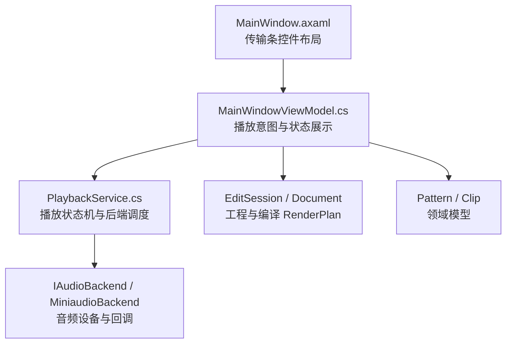
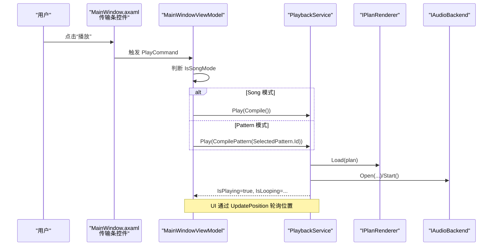
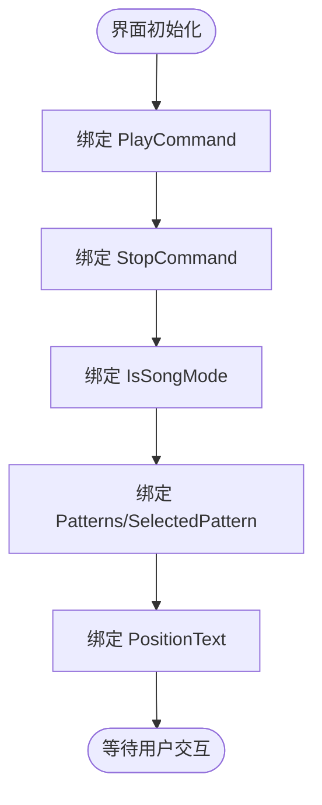
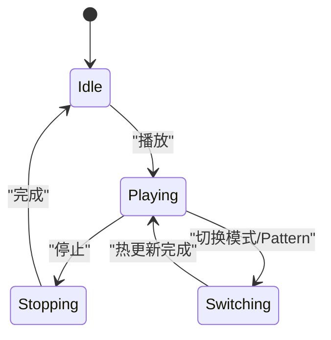
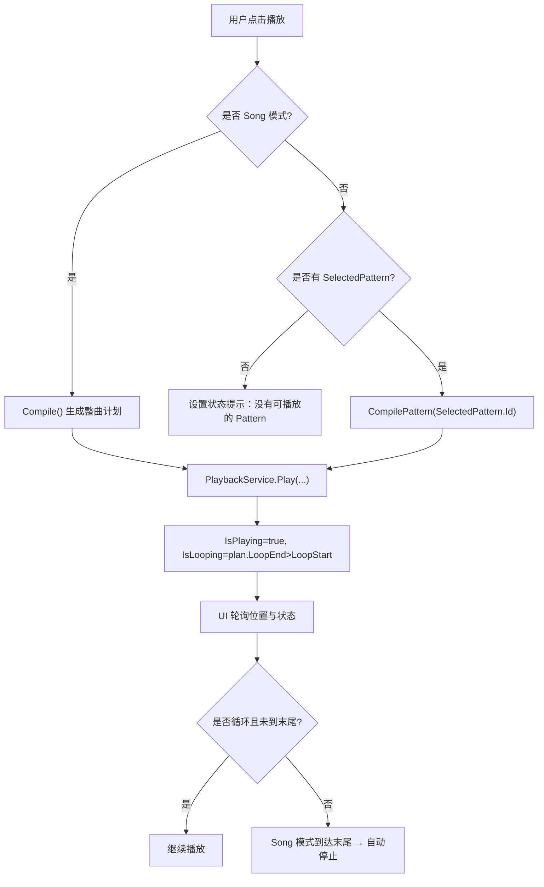
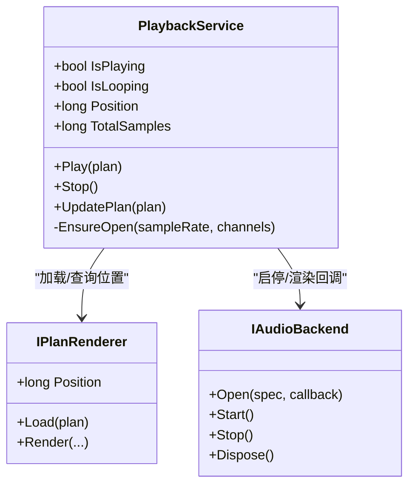
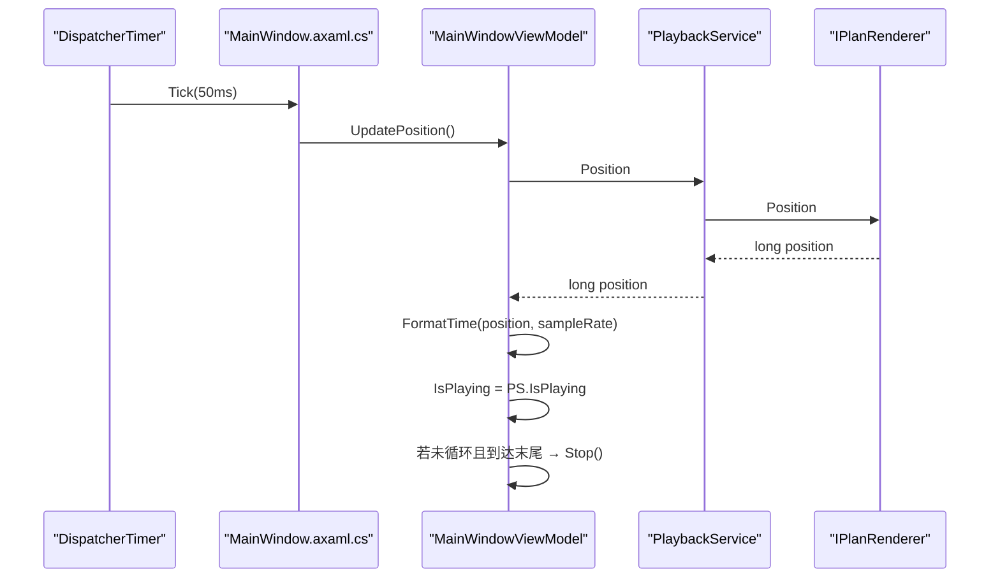
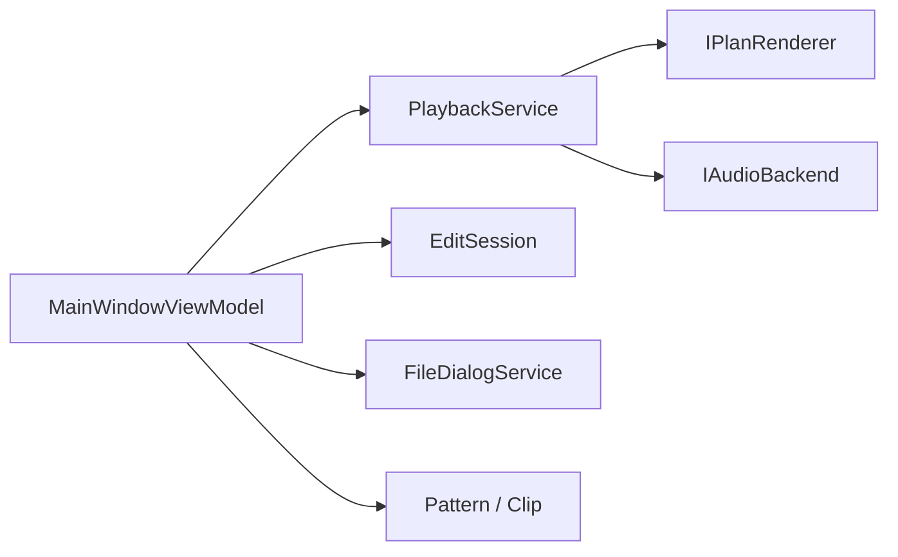

# 传输条控件

<cite>
**本文引用的文件**   
- [App.axaml.cs](file://src/Weftone.App/App.axaml.cs)
- [MainWindow.axaml](file://src/Weftone.App/MainWindow.axaml)
- [MainWindow.axaml.cs](file://src/Weftone.App/MainWindow.axaml.cs)
- [MainWindowViewModel.cs](file://src/Weftone.App/ViewModels/MainWindowViewModel.cs)
- [PlaybackService.cs](file://src/Weftone.Application/PlaybackService.cs)
- [Pattern.cs](file://src/Weftone.Domain/Pattern.cs)
- [Clip.cs](file://src/Weftone.Domain/Clip.cs)
</cite>

## 目录
1. [简介](#简介)
2. [项目结构](#项目结构)
3. [核心组件](#核心组件)
4. [架构总览](#架构总览)
5. [详细组件分析](#详细组件分析)
6. [依赖关系分析](#依赖关系分析)
7. [性能与实时性](#性能与实时性)
8. [故障排查指南](#故障排查指南)
9. [结论](#结论)

## 简介
本文围绕“传输条控件”展开，聚焦播放控制界面的实现：包括 Pattern 模式与 Song 模式的切换机制、播放/暂停/停止/循环等用户交互流程、Application 层 PlaybackService 的播放状态机、ViewModel 发送意图而不直接管理音频状态的职责边界，以及位置反馈机制（音频线程写位置、UI 用 DispatcherTimer 轮询读取）。同时给出控件布局示例、用户操作流程和状态转换图，并说明与后端服务的集成方式和数据绑定机制。

## 项目结构
本功能涉及三层代码：
- UI 层：MainWindow.axaml 定义传输条控件布局；MainWindow.axaml.cs 负责窗口生命周期、滚动视口同步与定时器轮询。
- ViewModel 层：MainWindowViewModel.cs 暴露命令与可观察属性，处理播放意图、模式切换、位置更新与状态文本。
- Application 层：PlaybackService.cs 封装播放状态机、渲染计划加载与后端设备启停。

图表来源
- [MainWindow.axaml:27-50](file://src/Weftone.App/MainWindow.axaml#L27-L50)
- [MainWindow.axaml.cs:55-63](file://src/Weftone.App/MainWindow.axaml.cs#L55-L63)
- [MainWindowViewModel.cs:112-138](file://src/Weftone.App/ViewModels/MainWindowViewModel.cs#L112-L138)
- [PlaybackService.cs:42-78](file://src/Weftone.Application/PlaybackService.cs#L42-L78)

章节来源
- [MainWindow.axaml:27-50](file://src/Weftone.App/MainWindow.axaml#L27-L50)
- [MainWindow.axaml.cs:55-63](file://src/Weftone.App/MainWindow.axaml.cs#L55-L63)
- [MainWindowViewModel.cs:112-138](file://src/Weftone.App/ViewModels/MainWindowViewModel.cs#L112-L138)
- [PlaybackService.cs:42-78](file://src/Weftone.Application/PlaybackService.cs#L42-L78)

## 核心组件
- 传输条控件（播放/停止/Song 模式切换/Pattern 选择/位置显示/BPM/撤销重做）
- ViewModel 播放命令与状态属性
- PlaybackService 播放状态机
- 位置反馈定时器与轮询机制

章节来源
- [MainWindow.axaml:27-50](file://src/Weftone.App/MainWindow.axaml#L27-L50)
- [MainWindowViewModel.cs:36-55](file://src/Weftone.App/ViewModels/MainWindowViewModel.cs#L36-L55)
- [PlaybackService.cs:33-40](file://src/Weftone.Application/PlaybackService.cs#L33-L40)

## 架构总览
传输条控件通过 Avalonia 的数据绑定驱动界面，ViewModel 将用户操作转换为对 PlaybackService 的命令调用；PlaybackService 负责加载渲染计划、打开/关闭音频后端并在播放中维护状态。UI 不直接持有音频线程状态，而是通过定时器轮询 Position、IsPlaying、IsLooping 等只读属性进行刷新。

图表来源
- [MainWindow.axaml:27-50](file://src/Weftone.App/MainWindow.axaml#L27-L50)
- [MainWindowViewModel.cs:112-130](file://src/Weftone.App/ViewModels/MainWindowViewModel.cs#L112-L130)
- [PlaybackService.cs:42-52](file://src/Weftone.Application/PlaybackService.cs#L42-L52)

## 详细组件分析

### 传输条控件布局与数据绑定
- 播放/停止按钮分别绑定到 PlayCommand 与 StopCommand。
- Song 模式切换使用 ToggleButton，双向绑定 IsSongMode。
- Pattern 列表使用 ComboBox 绑定 Patterns 集合，选中项绑定 SelectedPattern。
- 当前位置显示绑定 PositionText，BPM 绑定 Tempo。
- 撤销/重做按钮绑定 CanUndo/CanRedo 以启用状态。

图表来源
- [MainWindow.axaml:27-50](file://src/Weftone.App/MainWindow.axaml#L27-L50)

章节来源
- [MainWindow.axaml:27-50](file://src/Weftone.App/MainWindow.axaml#L27-L50)

### Pattern 模式与 Song 模式切换机制
- ViewModel 暴露 IsSongMode 属性，UI 通过 ToggleButton 双向绑定。
- 当 IsSongMode 变化时，若当前正在播放，则立即重新编译并热更新渲染计划，保持播放状态不变但切换播放内容。
- Pattern 模式下，SelectedPattern 变化也会触发热更新，确保播放的是所选 Pattern。

图表来源
- [MainWindowViewModel.cs:184-190](file://src/Weftone.App/ViewModels/MainWindowViewModel.cs#L184-L190)
- [MainWindowViewModel.cs:176-181](file://src/Weftone.App/ViewModels/MainWindowViewModel.cs#L176-L181)
- [PlaybackService.cs:64-78](file://src/Weftone.Application/PlaybackService.cs#L64-L78)

章节来源
- [MainWindowViewModel.cs:184-190](file://src/Weftone.App/ViewModels/MainWindowViewModel.cs#L184-L190)
- [MainWindowViewModel.cs:176-181](file://src/Weftone.App/ViewModels/MainWindowViewModel.cs#L176-L181)

### 播放、暂停、停止、循环的用户交互流程
- 播放：
  - Song 模式：调用 Compile() 生成整曲计划，进入播放。
  - Pattern 模式：若无选中 Pattern，仅设置状态提示；否则调用 CompilePattern(SelectedPattern.Id)，进入循环播放。
- 停止：调用 Stop()，并将 IsPlaying 置为 false，状态文本更新为“已停止”。
- 循环：
  - Pattern 模式：RenderPlan 包含循环区间，PlaybackService.IsLooping 为 true，UI 不会在末尾自动停止。
  - Song 模式：无循环区间，到达 TotalSamples 后自动停止。

图表来源
- [MainWindowViewModel.cs:112-130](file://src/Weftone.App/ViewModels/MainWindowViewModel.cs#L112-L130)
- [PlaybackService.cs:42-52](file://src/Weftone.Application/PlaybackService.cs#L42-L52)

章节来源
- [MainWindowViewModel.cs:112-130](file://src/Weftone.App/ViewModels/MainWindowViewModel.cs#L112-L130)
- [PlaybackService.cs:42-52](file://src/Weftone.Application/PlaybackService.cs#L42-L52)

### 播放状态机（PlaybackService）
- 关键状态：
  - _playing：是否正在播放。
  - IsLooping：当前计划是否带循环区间（Pattern 模式常用）。
  - Position：由 IPlanRenderer 提供，表示当前采样位置。
  - TotalSamples：当前计划的总采样数。
- 主要方法：
  - Play(plan)：停止旧播放、加载新计划、根据 SampleRate/Channels 打开或复用后端、启动播放。
  - Stop()：安全停止并重置 _playing。
  - UpdatePlan(plan)：编辑后热更新，采用“停止-交换-恢复”策略，保持播放状态不变。
- 后端管理：
  - EnsureOpen：按采样率与声道数决定是否重建 IAudioBackend，避免重复打开。

图表来源
- [PlaybackService.cs:12-98](file://src/Weftone.Application/PlaybackService.cs#L12-L98)

章节来源
- [PlaybackService.cs:12-98](file://src/Weftone.Application/PlaybackService.cs#L12-L98)

### ViewModel 的职责边界：发送意图而非管理状态
- ViewModel 不直接持有音频线程状态，也不直接操作 IAudioBackend。
- 所有播放相关动作通过调用 PlaybackService 的方法表达意图：
  - Play()：根据 IsSongMode 决定编译整曲或 Pattern。
  - Stop()：请求停止并更新 UI 状态。
  - UpdatePlan(...)：编辑后热更新，保持播放状态。
- 状态展示：
  - IsPlaying、PositionText、StatusText 等属性用于 UI 绑定。
  - UpdatePosition() 由 UI 定时器周期性调用，从 PlaybackService 读取最新状态。

章节来源
- [MainWindowViewModel.cs:112-138](file://src/Weftone.App/ViewModels/MainWindowViewModel.cs#L112-L138)
- [MainWindowViewModel.cs:325-340](file://src/Weftone.App/ViewModels/MainWindowViewModel.cs#L325-L340)

### 位置反馈机制：音频线程写位置，UI 轮询读取
- 音频线程：
  - PlaybackService 通过 IPlanRenderer.Render 回调持续渲染，内部维护 Position。
- UI 线程：
  - MainWindow.axaml.cs 在窗口打开时创建 DispatcherTimer，每 50ms 触发一次 Tick。
  - Tick 回调调用 ViewModel.UpdatePosition()，读取 PlaybackService.Position 并格式化显示。
  - 非循环模式到达末尾时自动停止。

图表来源
- [MainWindow.axaml.cs:55-63](file://src/Weftone.App/MainWindow.axaml.cs#L55-L63)
- [MainWindowViewModel.cs:325-340](file://src/Weftone.App/ViewModels/MainWindowViewModel.cs#L325-L340)
- [PlaybackService.cs:38-40](file://src/Weftone.Application/PlaybackService.cs#L38-L40)

章节来源
- [MainWindow.axaml.cs:55-63](file://src/Weftone.App/MainWindow.axaml.cs#L55-L63)
- [MainWindowViewModel.cs:325-340](file://src/Weftone.App/ViewModels/MainWindowViewModel.cs#L325-L340)
- [PlaybackService.cs:38-40](file://src/Weftone.Application/PlaybackService.cs#L38-L40)

### 与后端服务的集成方式
- 组合根（App.axaml.cs）：
  - 创建 EditSession、PlaybackService、FileDialogService，注入到 MainWindowViewModel。
  - 窗口退出时释放 PlaybackService 与 EditSession。
- PlaybackService 通过 Func<IAudioBackend> 工厂创建后端实例，避免耦合具体实现。
- MiniaudioBackend 实现 IAudioBackend，封装 weft_audio_open/stop/start 等原生调用。

章节来源
- [App.axaml.cs:22-44](file://src/Weftone.App/App.axaml.cs#L22-L44)
- [PlaybackService.cs:24-31](file://src/Weftone.Application/PlaybackService.cs#L24-L31)

### 数据绑定机制
- 控件属性与 ViewModel 属性双向绑定：
  - IsChecked="{Binding IsSongMode}"
  - ItemsSource="{Binding Patterns}"
  - SelectedItem="{Binding SelectedPattern}"
  - Text="{Binding PositionText}"
  - Command="{Binding PlayCommand}" / "{Binding StopCommand}"
- 列表模板：
  - ComboBox.ItemTemplate 绑定 Pattern.Name。
- 自绘控件：
  - PlaylistControl 与 PianoRollControl 通过 DataContext 访问 ViewModel，文档变更时通过事件触发 InvalidateVisual。

章节来源
- [MainWindow.axaml:27-50](file://src/Weftone.App/MainWindow.axaml#L27-L50)
- [MainWindow.axaml.cs:35-53](file://src/Weftone.App/MainWindow.axaml.cs#L35-L53)

## 依赖关系分析
- UI 层依赖 ViewModel 暴露的属性与命令。
- ViewModel 依赖 EditSession（工程与编译）、PlaybackService（播放）、FileDialogService（文件对话框）。
- PlaybackService 依赖 IPlanRenderer（渲染计划与位置）与 IAudioBackend（音频设备）。
- 领域模型 Pattern 与 Clip 作为数据源被 UI 与 ViewModel 使用。

图表来源
- [MainWindowViewModel.cs:24-26](file://src/Weftone.App/ViewModels/MainWindowViewModel.cs#L24-L26)
- [PlaybackService.cs:16-18](file://src/Weftone.Application/PlaybackService.cs#L16-L18)
- [Pattern.cs:1-8](file://src/Weftone.Domain/Pattern.cs#L1-L8)
- [Clip.cs:1-8](file://src/Weftone.Domain/Clip.cs#L1-L8)

章节来源
- [MainWindowViewModel.cs:24-26](file://src/Weftone.App/ViewModels/MainWindowViewModel.cs#L24-L26)
- [PlaybackService.cs:16-18](file://src/Weftone.Application/PlaybackService.cs#L16-L18)
- [Pattern.cs:1-8](file://src/Weftone.Domain/Pattern.cs#L1-L8)
- [Clip.cs:1-8](file://src/Weftone.Domain/Clip.cs#L1-L8)

## 性能与实时性
- 音频路径零分配：PlaybackService 在回调中捕获渲染函数，避免实时路径分配。
- 缓冲区大小：BufferFrames=256，平衡延迟与稳定性。
- 热更新策略：编辑后“停止-交换-恢复”，短暂静音但保持播放状态，避免 UI 卡顿。
- UI 轮询间隔：DispatcherTimer 每 50ms 轮询一次位置，兼顾流畅性与资源占用。

章节来源
- [PlaybackService.cs:14-18](file://src/Weftone.Application/PlaybackService.cs#L14-L18)
- [PlaybackService.cs:64-78](file://src/Weftone.Application/PlaybackService.cs#L64-L78)
- [MainWindow.axaml.cs:55-63](file://src/Weftone.App/MainWindow.axaml.cs#L55-L63)

## 故障排查指南
- 无法播放：
  - 检查 SelectedPattern 是否为空（Pattern 模式）。
  - 检查 PlaybackService 是否正确初始化与释放（App.axaml.cs 组合根）。
- 位置不更新：
  - 确认 MainWindow.axaml.cs 中的 DispatcherTimer 已启动并在窗口关闭时停止。
  - 检查 ViewModel.UpdatePosition 是否被调用。
- 模式切换无声：
  - 确认 IsSongMode 或 SelectedPattern 变化时触发了 UpdatePlan。
- 导出/导入失败：
  - 查看 StatusText 的错误信息，通常为文件格式或 IO 异常。

章节来源
- [MainWindowViewModel.cs:112-130](file://src/Weftone.App/ViewModels/MainWindowViewModel.cs#L112-L130)
- [MainWindow.axaml.cs:55-63](file://src/Weftone.App/MainWindow.axaml.cs#L55-L63)
- [App.axaml.cs:22-44](file://src/Weftone.App/App.axaml.cs#L22-L44)

## 结论
传输条控件通过清晰的 MVVM 分层与 PlaybackService 的状态机实现了稳健的播放控制。UI 仅负责呈现与用户交互，ViewModel 负责意图转发与状态展示，PlaybackService 负责音频路径与后端管理。Pattern 与 Song 模式的切换通过热更新渲染计划实现无缝体验，位置反馈通过定时器轮询保证 UI 与音频线程解耦。该设计在保证实时性的同时，提供了良好的可测试性与扩展性。