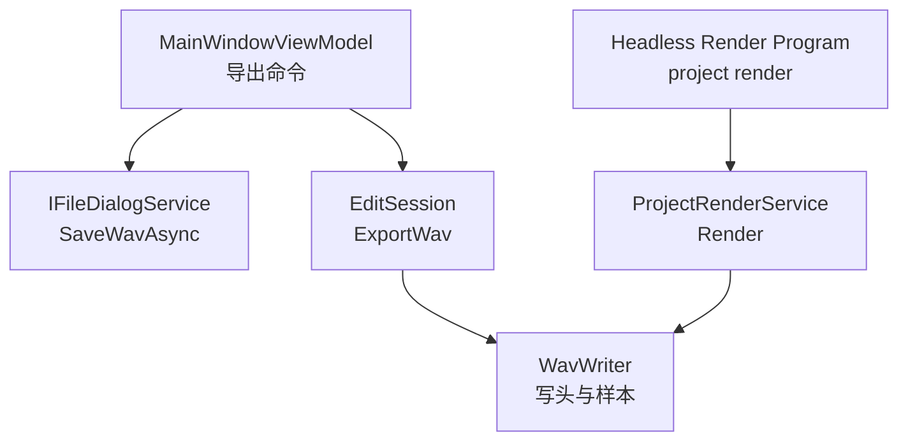
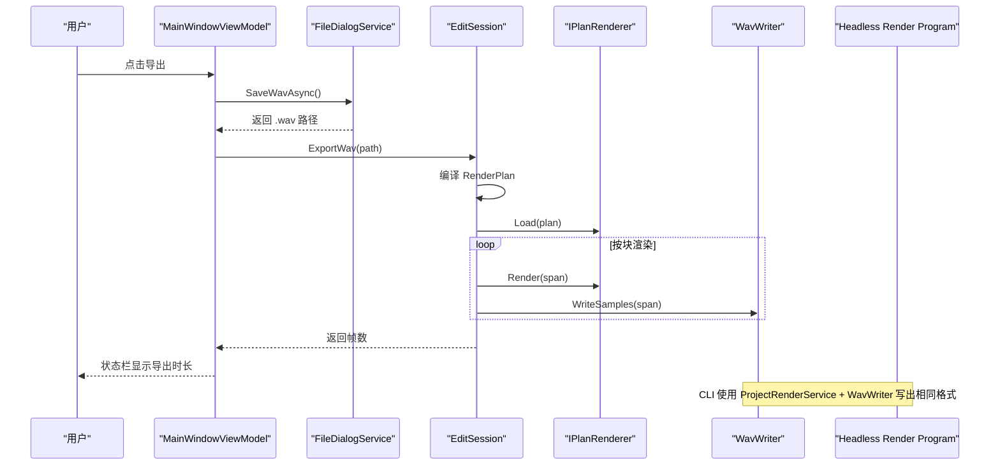
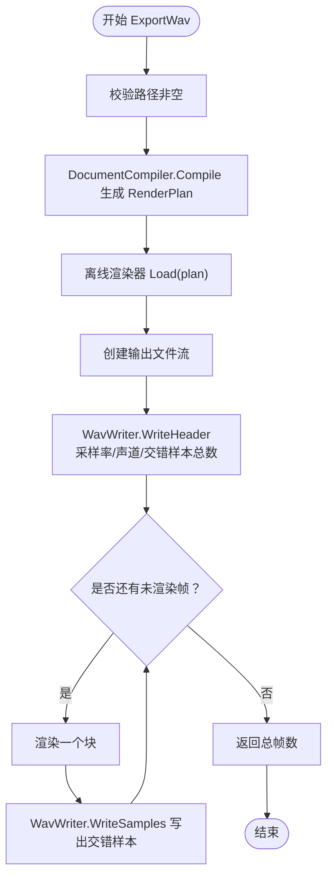
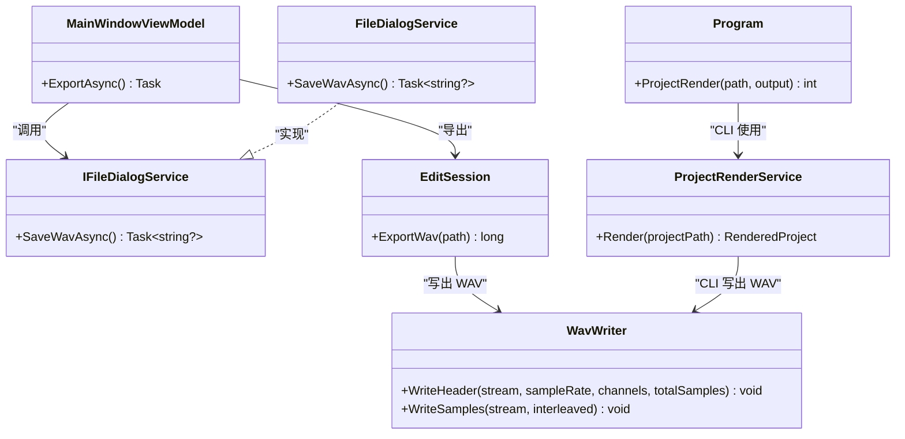
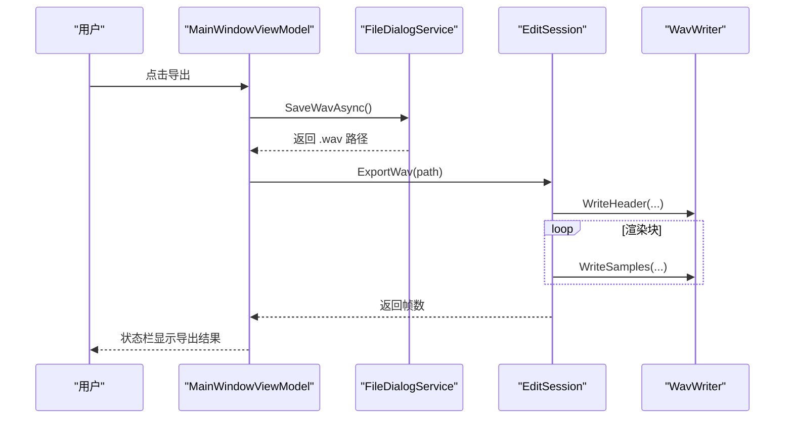
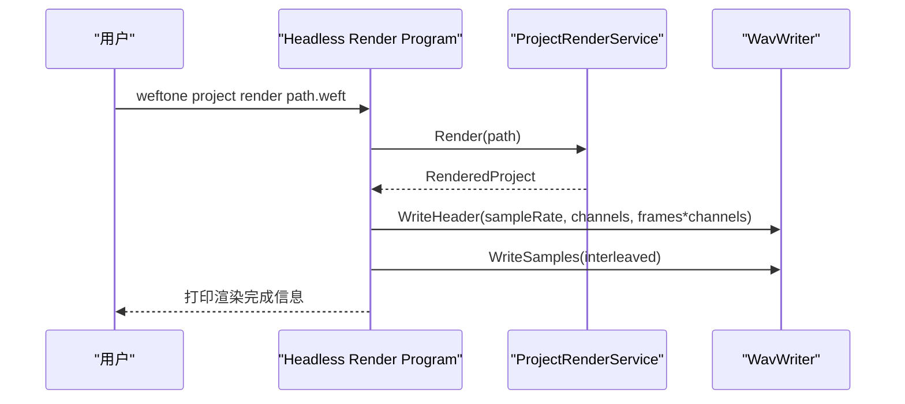

# 导出功能

<cite>
**本文引用的文件**   
- [ProjectRenderService.cs](file://src/Weftone.Application/ProjectRenderService.cs)
- [EditSession.cs](file://src/Weftone.Application/EditSession.cs)
- [WavWriter.cs](file://src/Weftone.Application/WavWriter.cs)
- [FileDialogService.cs](file://src/Weftone.App/Services/FileDialogService.cs)
- [IFileDialogService.cs](file://src/Weftone.App/Services/IFileDialogService.cs)
- [MainWindowViewModel.cs](file://src/Weftone.App/ViewModels/MainWindowViewModel.cs)
- [Program.cs](file://tools/HeadlessRender/Program.cs)
- [EditSessionImportExportTests.cs](file://tests/Weftone.Application.Tests/EditSessionImportExportTests.cs)
</cite>

## 目录
1. [引言](#引言)
2. [项目结构中的导出相关位置](#项目结构中的导出相关位置)
3. [核心组件总览](#核心组件总览)
4. [架构总览：用户界面、离线渲染与 CLI 的一致性](#架构总览用户界面离线渲染与-cli-的一致性)
5. [详细组件分析](#详细组件分析)
6. [依赖关系分析](#依赖关系分析)
7. [性能与内存特性](#性能与内存特性)
8. [错误处理与故障排查](#错误处理与故障排查)
9. [导出流程示例](#导出流程示例)
10. [结论与建议](#结论与建议)

## 引言
本文围绕 Weftone 的 WAV 导出能力展开，重点说明以下目标：
- 用户界面中导出按钮如何触发 SaveFileDialog 路径选择，以及导出完成后如何反馈给用户。
- EditSession.ExportWav 与 ProjectRenderService.Render 两条离线渲染路径的实现差异与一致性保证。
- 导出范围为何是完整工程时间轴，而不是当前播放片段；实时播放与离线导出如何互不干扰。
- WavWriter 的音频数据序列化方式，以及与 headless CLI 渲染结果保持一致的设计机制。
- 常见错误、可观测的用户反馈、以及针对长时导出的性能优化建议。

## 项目结构中的导出相关位置
导出功能横跨应用层、UI 适配层和底层渲染/写入模块：
- UI 入口位于 `MainWindowViewModel.ExportAsync`，负责调用对话框并展示状态。
- 文件对话框由 `FileDialogService.SaveWavAsync` 实现，封装 Avalonia 保存对话框。
- 实际导出逻辑在 `EditSession.ExportWav`，使用注入的离线渲染器按块渲染并写出 WAV。
- 独立离线渲染用例由 `ProjectRenderService.Render` 提供，被 headless CLI 复用。
- 二进制 WAV 写出由 `WavWriter` 完成，CLI 也直接复用该类型。

**图表来源**
- [MainWindowViewModel.cs:418-435](file://src/Weftone.App/ViewModels/MainWindowViewModel.cs#L418-L435)
- [FileDialogService.cs:66-81](file://src/Weftone.App/Services/FileDialogService.cs#L66-L81)
- [EditSession.cs:171-188](file://src/Weftone.Application/EditSession.cs#L171-L188)
- [WavWriter.cs:6-39](file://src/Weftone.Application/WavWriter.cs#L6-L39)
- [Program.cs:122-135](file://tools/HeadlessRender/Program.cs#L122-L135)

**章节来源**
- [MainWindowViewModel.cs:418-435](file://src/Weftone.App/ViewModels/MainWindowViewModel.cs#L418-L435)
- [FileDialogService.cs:66-81](file://src/Weftone.App/Services/FileDialogService.cs#L66-L81)
- [EditSession.cs:171-188](file://src/Weftone.Application/EditSession.cs#L171-L188)
- [WavWriter.cs:6-39](file://src/Weftone.Application/WavWriter.cs#L6-L39)
- [Program.cs:122-135](file://tools/HeadlessRender/Program.cs#L122-L135)

## 核心组件总览
| 组件 | 职责 | 与导出的关系 |
|---|---|---|
| MainWindowViewModel | 绑定 UI 命令、调用服务、更新状态文本 | 触发导出、显示成功或失败信息 |
| IFileDialogService / FileDialogService | 抽象并实现系统文件对话框 | 提供“导出 WAV”保存路径选择 |
| EditSession | 管理文档、资产、撤销栈、离线渲染实例 | 执行完整工程时间轴的 WAV 导出 |
| ProjectRenderService | 面向用例的离线渲染入口 | 被 CLI 复用，保证与 UI 导出一致 |
| WavWriter | 写出 IEEE float32 交错样本的 WAV 文件 | UI 导出与 CLI 共用同一写出器 |
| Headless Render Program | CLI 入口，解析参数并调用渲染服务 | 验证 UI 导出与 CLI 输出一致 |

**章节来源**
- [MainWindowViewModel.cs:418-435](file://src/Weftone.App/ViewModels/MainWindowViewModel.cs#L418-L435)
- [IFileDialogService.cs:1-14](file://src/Weftone.App/Services/IFileDialogService.cs#L1-L14)
- [FileDialogService.cs:1-82](file://src/Weftone.App/Services/FileDialogService.cs#L1-L82)
- [EditSession.cs:8-13](file://src/Weftone.Application/EditSession.cs#L8-L13)
- [EditSession.cs:171-188](file://src/Weftone.Application/EditSession.cs#L171-L188)
- [ProjectRenderService.cs:10-49](file://src/Weftone.Application/ProjectRenderService.cs#L10-L49)
- [WavWriter.cs:6-39](file://src/Weftone.Application/WavWriter.cs#L6-L39)
- [Program.cs:119-135](file://tools/HeadlessRender/Program.cs#L119-L135)

## 架构总览：用户界面、离线渲染与 CLI 的一致性
导出不是实时播放的一部分。UI 通过 ViewModel 发起导出，EditSession 使用独立的离线渲染器按块渲染整个工程时间轴，并将浮点样本流式写出为 WAV。CLI 的 `weftone project render` 同样走 ProjectRenderService，从而保证 UI 导出与 CLI 渲染在相同输入下产生相同输出。

**图表来源**
- [MainWindowViewModel.cs:418-435](file://src/Weftone.App/ViewModels/MainWindowViewModel.cs#L418-L435)
- [FileDialogService.cs:66-81](file://src/Weftone.App/Services/FileDialogService.cs#L66-L81)
- [EditSession.cs:171-188](file://src/Weftone.Application/EditSession.cs#L171-L188)
- [WavWriter.cs:37-39](file://src/Weftone.Application/WavWriter.cs#L37-L39)
- [Program.cs:122-135](file://tools/HeadlessRender/Program.cs#L122-L135)

## 详细组件分析

### 用户界面导出入口：MainWindowViewModel.ExportAsync
- 调用 `IFileDialogService.SaveWavAsync` 打开系统保存对话框。
- 如果用户取消，则直接返回，不改变状态。
- 成功后调用 `EditSession.ExportWav`，并根据返回帧数和采样率计算导出时长。
- 成功时状态文本包含文件名和近似时长；失败时捕获 IO 或操作异常并提示失败原因。

关键点：
- 导出是异步命令，但当前实现中导出本身同步执行，UI 线程会阻塞直到导出完成。
- 状态反馈简单直观，适合短工程；长工程需要更细粒度的进度反馈。

**章节来源**
- [MainWindowViewModel.cs:418-435](file://src/Weftone.App/ViewModels/MainWindowViewModel.cs#L418-L435)

### 文件对话框：FileDialogService.SaveWavAsync
- 基于 Avalonia 的 `StorageProvider.SaveFilePickerAsync`。
- 默认扩展名为 `.wav`，建议文件名为 `export`。
- 返回本地路径；若顶层窗口为空，返回 null。

设计意义：
- 将平台对话框细节隔离在 Service 中，ViewModel 只依赖接口，便于测试和 headless 场景。

**章节来源**
- [FileDialogService.cs:66-81](file://src/Weftone.App/Services/FileDialogService.cs#L66-L81)
- [IFileDialogService.cs:1-14](file://src/Weftone.App/Services/IFileDialogService.cs#L1-L14)

### 编辑会话导出：EditSession.ExportWav
- 使用当前文档 `_prepared` 资产准备结果重新编译 `RenderPlan`。
- 通过注入的 `_offlineRenderer` 加载计划，避免与实时播放共享渲染器。
- 以固定块大小 `ExportBlockFrames = 512` 循环渲染，每块直接写出到 WAV。
- 返回值是总帧数，供 ViewModel 计算导出时长。

重要设计原则：
- 导出范围是完整工程时间轴，对应 Song 模式下的全部 Clip 与 Pattern。
- 导出与实时播放互不干扰：实时播放使用 PlaybackService 和另一个渲染上下文，而导出使用独立离线渲染器。
- 空时间轴仍可写出合法 WAV，只是帧数为零。

**图表来源**
- [EditSession.cs:171-188](file://src/Weftone.Application/EditSession.cs#L171-L188)
- [WavWriter.cs:9-35](file://src/Weftone.Application/WavWriter.cs#L9-L35)

**章节来源**
- [EditSession.cs:167-188](file://src/Weftone.Application/EditSession.cs#L167-L188)

### 独立离线渲染用例：ProjectRenderService.Render
- 从项目路径加载 LoadedProject。
- 使用 AssetPreparer 准备资产，DocumentCompiler 编译 RenderPlan。
- 通过 IPlanRenderer 按块渲染，同时计算峰值电平与持续时间。
- 返回 `RenderedProject`，包含交错样本数组、采样率、声道数、帧数、峰值和时长。

与 EditSession 的区别：
- EditSession 直接写出 WAV，ProjectRenderService 返回内存中的渲染结果。
- CLI 使用 ProjectRenderService 获取结果后，再调用 WavWriter 写出文件。
- 两者都遵循相同的渲染管线，因此输出一致。

**章节来源**
- [ProjectRenderService.cs:10-49](file://src/Weftone.Application/ProjectRenderService.cs#L10-L49)

### WAV 写出器：WavWriter
- 支持 `WAVE_FORMAT_IEEE_FLOAT`，即 32-bit 小端浮点。
- `WriteHeader` 根据采样率、声道数和总样本数计算 RIFF 大小并写出 44 字节头部。
- `WriteSamples` 直接将交错浮点 Span 转为字节写出。
- 对超大文件进行上限检查，防止超出单 WAV 文件大小限制。

与 CLI 的关系：
- CLI 的 `ProjectRender` 方法直接使用 WavWriter 写出与 UI 导出完全相同的格式。
- 测试通过解码导出 WAV 并与 CLI 渲染结果比较，确保位级一致。

**章节来源**
- [WavWriter.cs:6-39](file://src/Weftone.Application/WavWriter.cs#L6-L39)
- [Program.cs:122-135](file://tools/HeadlessRender/Program.cs#L122-L135)
- [EditSessionImportExportTests.cs:175-194](file://tests/Weftone.Application.Tests/EditSessionImportExportTests.cs#L175-L194)

### 导出范围与格式参数
- 导出范围：完整工程时间轴，由 DocumentCompiler 根据 Playlist、Pattern、Note 计算总样本数。
- 格式参数：采样率和声道数来自 RenderPlan；WAV 固定为 IEEE float32 交错格式。
- 用户操作反馈：状态栏显示成功时的文件名和时长，失败时显示异常消息。
- 当前没有导出范围选择控件，也没有采样率或声道选择；这些参数由工程文档和渲染计划决定。

如果需要未来扩展：
- 可在 UI 增加导出区间选择（起始 tick 到结束 tick）。
- 可增加采样率、声道数、压缩格式等配置项。
- 应将这些配置传入新的导出入口，并保持与 CLI 一致的默认值。

**章节来源**
- [EditSession.cs:171-188](file://src/Weftone.Application/EditSession.cs#L171-L188)
- [ProjectRenderService.cs:19-49](file://src/Weftone.Application/ProjectRenderService.cs#L19-L49)
- [MainWindowViewModel.cs:418-435](file://src/Weftone.App/ViewModels/MainWindowViewModel.cs#L418-L435)

## 依赖关系分析
导出相关依赖如下：
- MainWindowViewModel 依赖 IFileDialogService 和 EditSession。
- FileDialogService 依赖 Avalonia 平台存储 API。
- EditSession 依赖 IProjectStore、ISampleDecoder、IResampler、IPlanRenderer。
- ProjectRenderService 依赖同样的抽象端口，便于替换实现。
- WavWriter 无外部依赖，仅使用 System.Buffers.Binary 和 Stream。

**图表来源**
- [MainWindowViewModel.cs:418-435](file://src/Weftone.App/ViewModels/MainWindowViewModel.cs#L418-L435)
- [IFileDialogService.cs:1-14](file://src/Weftone.App/Services/IFileDialogService.cs#L1-L14)
- [FileDialogService.cs:66-81](file://src/Weftone.App/Services/FileDialogService.cs#L66-L81)
- [EditSession.cs:171-188](file://src/Weftone.Application/EditSession.cs#L171-L188)
- [ProjectRenderService.cs:10-49](file://src/Weftone.Application/ProjectRenderService.cs#L10-L49)
- [WavWriter.cs:6-39](file://src/Weftone.Application/WavWriter.cs#L6-L39)
- [Program.cs:122-135](file://tools/HeadlessRender/Program.cs#L122-L135)

**章节来源**
- [MainWindowViewModel.cs:418-435](file://src/Weftone.App/ViewModels/MainWindowViewModel.cs#L418-L435)
- [EditSession.cs:171-188](file://src/Weftone.Application/EditSession.cs#L171-L188)
- [ProjectRenderService.cs:10-49](file://src/Weftone.Application/ProjectRenderService.cs#L10-L49)
- [WavWriter.cs:6-39](file://src/Weftone.Application/WavWriter.cs#L6-L39)
- [Program.cs:122-135](file://tools/HeadlessRender/Program.cs#L122-L135)

## 性能与内存特性
- 块大小：EditSession 使用 512 帧块，ProjectRenderService 使用 512 帧块，CLI 正弦渲染使用 256 帧块。块越小，内存占用越低，但渲染调用次数更多。
- 内存模型：EditSession 直接写出流，不缓存整段音频；ProjectRenderService 将整个交错样本数组保留在内存中，适合中等长度工程。
- 峰值计算：ProjectRenderService 在渲染过程中计算峰值电平，可用于后续响度或限幅分析。
- 实时与离线分离：导出不会修改实时播放状态，也不会影响 PlaybackService 的计划。
- 长工程优化建议：
  - 将 ViewModel.ExportAsync 改为后台任务，避免阻塞 UI。
  - 在导出循环中定期报告进度，例如每渲染若干块更新一次状态。
  - 对于超长工程，考虑分块写出临时文件并在最后合并，降低峰值内存。
  - 可引入取消令牌，允许用户在导出中途取消。

[本节为通用性能讨论，不直接分析具体代码行]

## 错误处理与故障排查
常见错误及处理方式：
- 用户取消导出：SaveWavAsync 返回 null，ViewModel 直接返回，不报错。
- 文件写入失败：EditSession 抛出 IOException 或 InvalidOperationException，ViewModel 捕获并显示失败消息。
- 工程包非法：CLI 捕获 InvalidProjectException，返回错误码 4。
- 数据非法：CLI 捕获 InvalidDataException，返回错误码 4。
- 原生库缺失：CLI 播放路径捕获 DllNotFoundException，提示先构建 native shim。

排查建议：
- 确认导出路径有写入权限。
- 确认工程文件未被其他进程锁定。
- 如果使用 CLI，确认 weftone_miniaudio 原生库已构建并可加载。
- 使用 Golden Audio 测试或 EditSessionImportExportTests 中的位级对比测试验证导出一致性。

**章节来源**
- [MainWindowViewModel.cs:418-435](file://src/Weftone.App/ViewModels/MainWindowViewModel.cs#L418-L435)
- [Program.cs:98-107](file://tools/HeadlessRender/Program.cs#L98-L107)
- [Program.cs:227-236](file://tools/HeadlessRender/Program.cs#L227-L236)
- [EditSessionImportExportTests.cs:175-194](file://tests/Weftone.Application.Tests/EditSessionImportExportTests.cs#L175-L194)

## 导出流程示例

### 用户界面导出示例
1. 用户在主窗口点击导出。
2. ViewModel 调用 FileDialogService.SaveWavAsync。
3. 用户选择 `.wav` 文件路径。
4. ViewModel 调用 EditSession.ExportWav。
5. EditSession 编译 RenderPlan，加载离线渲染器。
6. 按块渲染并写出 WAV。
7. ViewModel 更新状态栏，显示导出时长。

**图表来源**
- [MainWindowViewModel.cs:418-435](file://src/Weftone.App/ViewModels/MainWindowViewModel.cs#L418-L435)
- [FileDialogService.cs:66-81](file://src/Weftone.App/Services/FileDialogService.cs#L66-L81)
- [EditSession.cs:171-188](file://src/Weftone.Application/EditSession.cs#L171-L188)
- [WavWriter.cs:9-39](file://src/Weftone.Application/WavWriter.cs#L9-L39)

### CLI 导出示例
1. 运行 `weftone project render <path.weft>`。
2. CLI 构造 ProjectRenderService。
3. ProjectRenderService 渲染工程并返回 RenderedProject。
4. CLI 创建输出目录和文件流。
5. CLI 调用 WavWriter.WriteHeader 和 WriteSamples。
6. CLI 打印渲染完成信息，包括时长、采样率、声道数和峰值。

**图表来源**
- [Program.cs:119-135](file://tools/HeadlessRender/Program.cs#L119-L135)
- [ProjectRenderService.cs:19-49](file://src/Weftone.Application/ProjectRenderService.cs#L19-L49)
- [WavWriter.cs:9-39](file://src/Weftone.Application/WavWriter.cs#L9-L39)

### 一致性保证机制
- EditSession 与 ProjectRenderService 都使用 DocumentCompiler 生成 RenderPlan。
- 两者都使用 WavWriter 写出 IEEE float32 交错样本。
- 测试通过导出 WAV 与 CLI 渲染结果解码比较，确保位级一致。
- 这保证了 UI 导出与 headless CLI 渲染在相同工程输入下输出相同。

**章节来源**
- [EditSessionImportExportTests.cs:175-194](file://tests/Weftone.Application.Tests/EditSessionImportExportTests.cs#L175-L194)
- [EditSession.cs:171-188](file://src/Weftone.Application/EditSession.cs#L171-L188)
- [ProjectRenderService.cs:19-49](file://src/Weftone.Application/ProjectRenderService.cs#L19-L49)
- [Program.cs:122-135](file://tools/HeadlessRender/Program.cs#L122-L135)

## 结论与建议
- 当前导出功能清晰分离了 UI、离线渲染和 WAV 写出，符合模块化设计。
- EditSession.ExportWav 与 ProjectRenderService.Render 共享渲染管线，并通过 WavWriter 保证输出格式一致。
- 用户反馈简洁有效，但缺少进度条和取消能力，不适合超长工程。
- 建议在未来版本中增加导出区间选择、采样率/声道配置、后台导出任务和进度回调。
- 保持与 CLI 的一致性是关键质量保障，现有测试覆盖了这一目标。

[本节为总结性内容，不直接分析具体代码行]