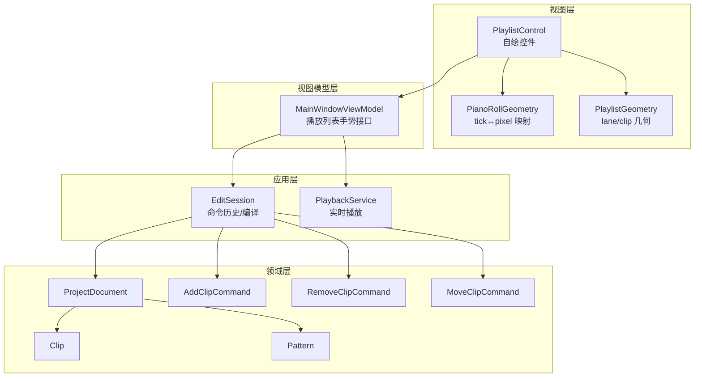
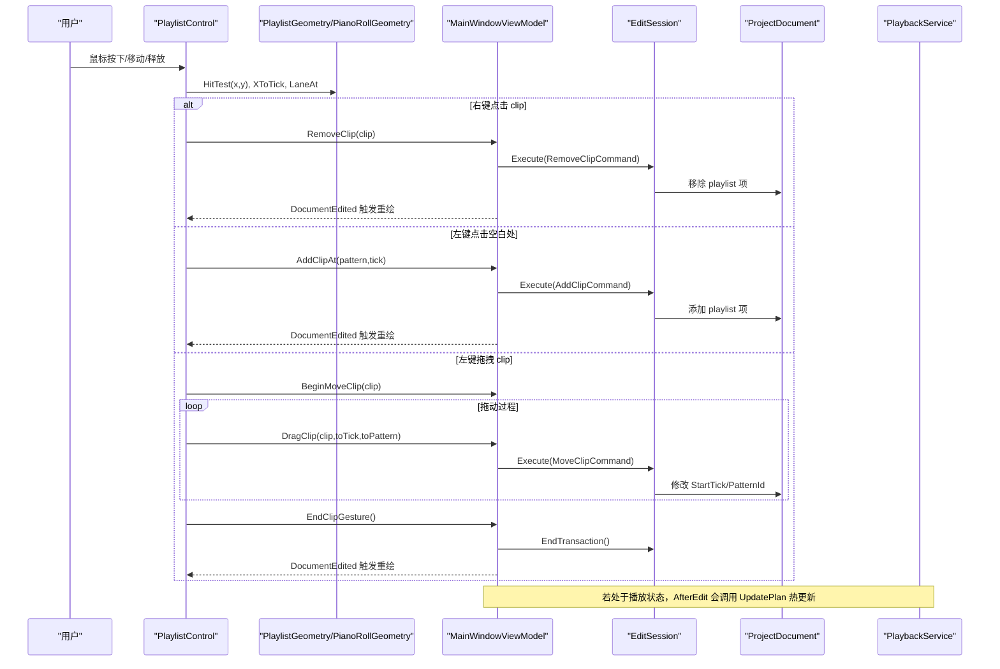
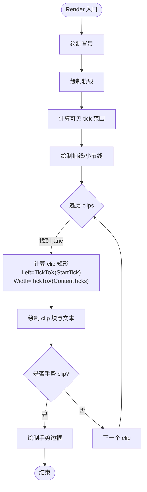
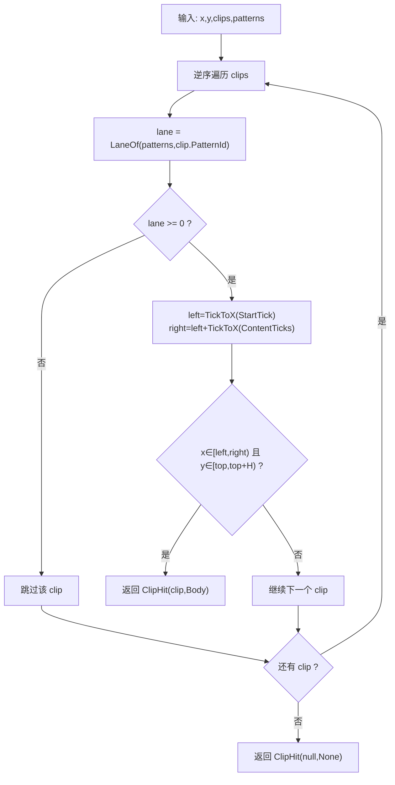
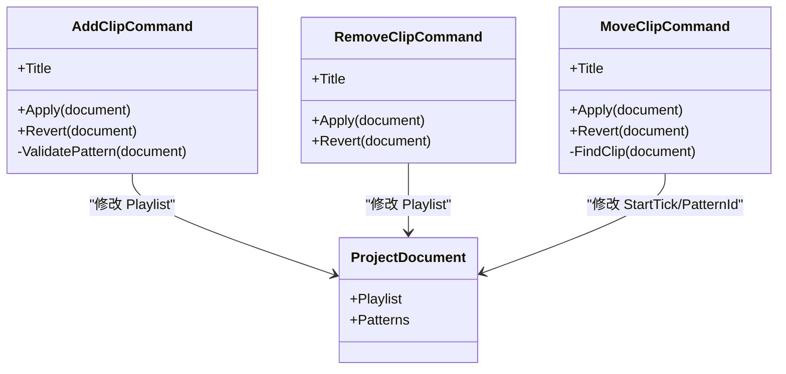
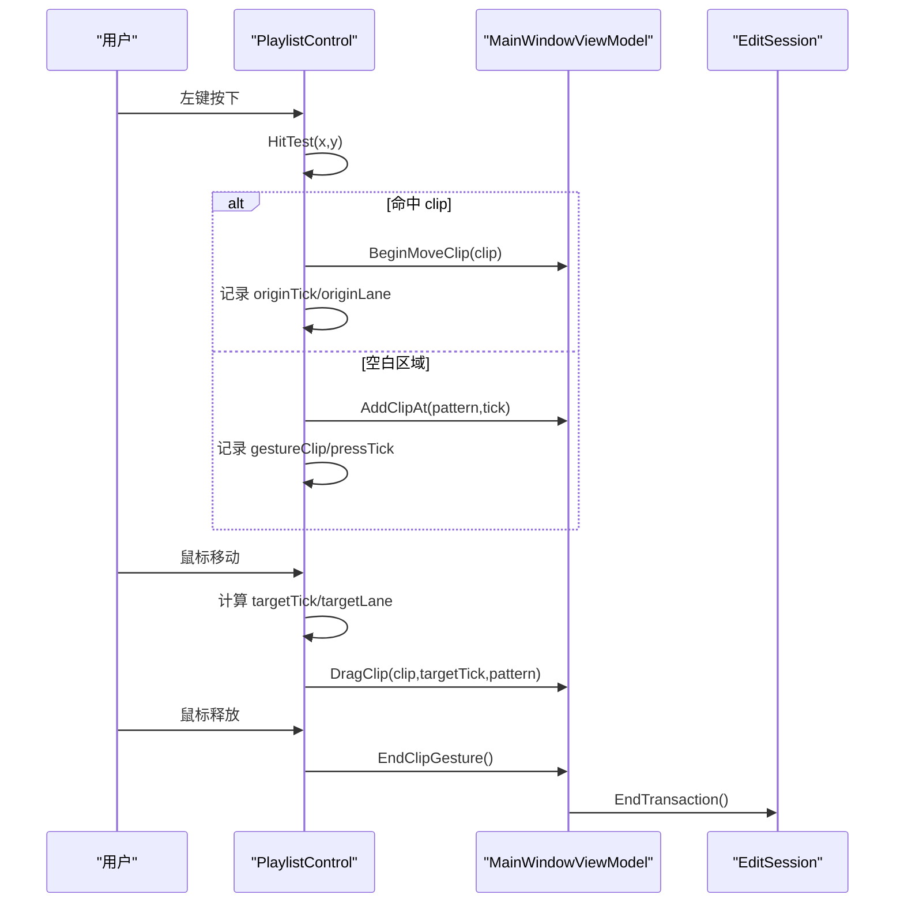
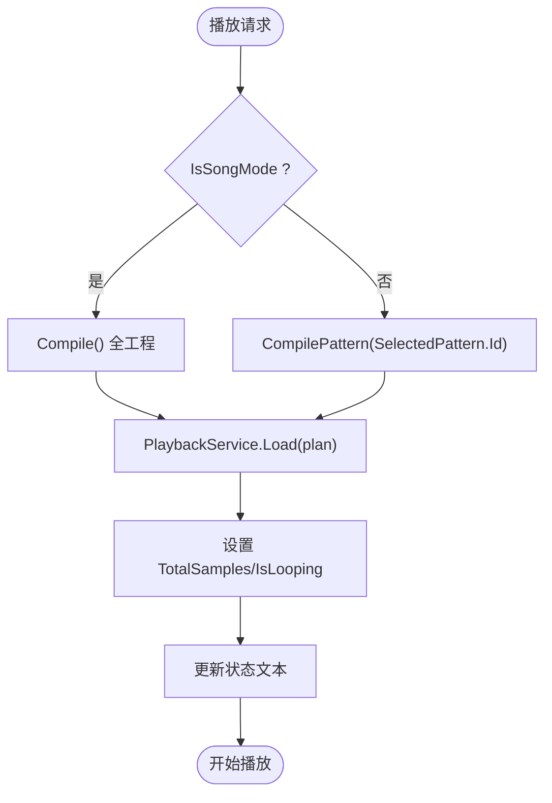
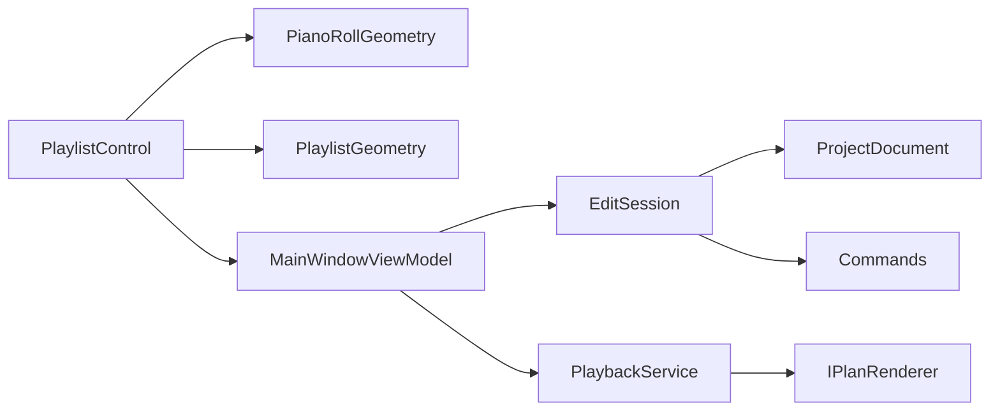

# 播放列表编辑器

<cite>
**本文引用的文件**   
- [PlaylistControl.cs](file://src/Weftone.App/Controls/PlaylistControl.cs)
- [PlaylistGeometry.cs](file://src/Weftone.App/Controls/PlaylistGeometry.cs)
- [PianoRollGeometry.cs](file://src/Weftone.App/Controls/PianoRollGeometry.cs)
- [AddClipCommand.cs](file://src/Weftone.Domain/Commands/AddClipCommand.cs)
- [RemoveClipCommand.cs](file://src/Weftone.Domain/Commands/RemoveClipCommand.cs)
- [MoveClipCommand.cs](file://src/Weftone.Domain/Commands/MoveClipCommand.cs)
- [Clip.cs](file://src/Weftone.Domain/Clip.cs)
- [Pattern.cs](file://src/Weftone.Domain/Pattern.cs)
- [ProjectDocument.cs](file://src/Weftone.Domain/ProjectDocument.cs)
- [MainWindowViewModel.cs](file://src/Weftone.App/ViewModels/MainWindowViewModel.cs)
- [EditSession.cs](file://src/Weftone.Application/EditSession.cs)
- [PlaybackService.cs](file://src/Weftone.Application/PlaybackService.cs)
- [PlaylistGeometryTests.cs](file://tests/Weftone.App.Tests/PlaylistGeometryTests.cs)
- [MainWindowViewModelPlaylistTests.cs](file://tests/Weftone.App.Tests/MainWindowViewModelPlaylistTests.cs)
</cite>

## 目录
1. [引言](#引言)
2. [项目结构定位](#项目结构定位)
3. [核心组件总览](#核心组件总览)
4. [架构总览](#架构总览)
5. [详细组件分析](#详细组件分析)
6. [依赖关系分析](#依赖关系分析)
7. [性能与优化](#性能与优化)
8. [故障排查](#故障排查)
9. [结论](#结论)

## 引言
本文围绕 Weftone 的播放列表编辑器展开，重点解释以下能力：
- clip 编排界面的自绘实现：横轴 tick、纵轨 Pattern clip 块布局。
- AddClip / RemoveClip / MoveClip 命令及其撤销语义。
- clip 拖放排布的用户交互流程。
- Song 模式下 Playlist 展开为线性时间轴的播放逻辑。
- 几何计算函数：tick↔pixel 映射、clip 命中测试、可见范围计算。
- 界面布局示例、拖拽流程图和性能优化建议。
- 与 Pattern/Song 模式切换的集成方式。

该文档面向 UI 开发者、音频编辑使用者以及需要理解播放列表行为的技术读者。

## 项目结构定位
播放列表编辑器位于 Avalonia 桌面应用层，采用“控件 + 几何纯函数 + ViewModel + 领域命令 + 编辑会话”的分层组织：
- 视图层：`PlaylistControl` 负责自绘轨道、网格、clip 块和用户手势。
- 几何层：`PlaylistGeometry` 提供 lane、clip 宽度、命中测试等纯函数；横轴复用 `PianoRollGeometry` 的 tick↔pixel 映射。
- 视图模型层：`MainWindowViewModel` 暴露 AddClipAt / RemoveClip / BeginMoveClip / DragClip / EndClipGesture 等方法，并协调撤销事务。
- 领域层：`Clip`、`Pattern`、`ProjectDocument` 描述数据结构；`AddClipCommand`、`RemoveClipCommand`、`MoveClipCommand` 封装可撤销编辑。
- 应用层：`EditSession` 持有 Document 与命令历史，`PlaybackService` 负责实时播放与计划热更新。

**图表来源**
- [PlaylistControl.cs:10-14](file://src/Weftone.App/Controls/PlaylistControl.cs#L10-L14)
- [PlaylistGeometry.cs:13-16](file://src/Weftone.App/Controls/PlaylistGeometry.cs#L13-L16)
- [PianoRollGeometry.cs:14-18](file://src/Weftone.App/Controls/PianoRollGeometry.cs#L14-L18)
- [MainWindowViewModel.cs:354-396](file://src/Weftone.App/ViewModels/MainWindowViewModel.cs#L354-L396)
- [EditSession.cs:100-118](file://src/Weftone.Application/EditSession.cs#L100-L118)
- [PlaybackService.cs:42-78](file://src/Weftone.Application/PlaybackService.cs#L42-L78)

**章节来源**
- [PlaylistControl.cs:10-14](file://src/Weftone.App/Controls/PlaylistControl.cs#L10-L14)
- [PlaylistGeometry.cs:13-16](file://src/Weftone.App/Controls/PlaylistGeometry.cs#L13-L16)
- [PianoRollGeometry.cs:14-18](file://src/Weftone.App/Controls/PianoRollGeometry.cs#L14-L18)
- [MainWindowViewModel.cs:354-396](file://src/Weftone.App/ViewModels/MainWindowViewModel.cs#L354-L396)
- [EditSession.cs:100-118](file://src/Weftone.Application/EditSession.cs#L100-L118)
- [PlaybackService.cs:42-78](file://src/Weftone.Application/PlaybackService.cs#L42-L78)

## 核心组件总览
- `PlaylistControl`：Avalonia 自绘控件，绘制背景、轨线、拍线、小节线、clip 块及手势高亮；处理按下、移动、释放事件，委托 ViewModel 执行命令。
- `PlaylistGeometry`：纯函数集合，定义 lane 高度、clip 宽度（pattern 内容长度 + 一拍余量）、clip 左边界、命中测试、y→lane 映射、patternId→lane 查找。
- `PianoRollGeometry`：共享横轴几何，提供 TickToX、XToTick、SnapTick、VisibleTickRange 等。
- `Clip`：playlist 片段，包含 PatternId 与 StartTick。
- `Pattern`：音符序列容器，用于计算 clip 显示宽度。
- `ProjectDocument`：工程文档，包含 Patterns、Playlist、Channels 等。
- `AddClipCommand` / `RemoveClipCommand` / `MoveClipCommand`：可撤销命令，分别添加、删除、移动 clip。
- `MainWindowViewModel`：暴露播放列表手势方法，管理 BeginTransaction/EndTransaction，触发 DocumentEdited 通知重绘，并在播放中热更新 RenderPlan。
- `EditSession`：命令历史、编译、资产准备、导出 WAV。
- `PlaybackService`：实时播放、停止-交换-恢复、循环标志 IsLooping。

**章节来源**
- [PlaylistControl.cs:10-14](file://src/Weftone.App/Controls/PlaylistControl.cs#L10-L14)
- [PlaylistGeometry.cs:13-16](file://src/Weftone.App/Controls/PlaylistGeometry.cs#L13-L16)
- [PianoRollGeometry.cs:14-18](file://src/Weftone.App/Controls/PianoRollGeometry.cs#L14-L18)
- [Clip.cs:3-8](file://src/Weftone.Domain/Clip.cs#L3-L8)
- [Pattern.cs:3-8](file://src/Weftone.Domain/Pattern.cs#L3-L8)
- [ProjectDocument.cs:3-20](file://src/Weftone.Domain/ProjectDocument.cs#L3-L20)
- [AddClipCommand.cs:3-31](file://src/Weftone.Domain/Commands/AddClipCommand.cs#L3-L31)
- [RemoveClipCommand.cs:3-21](file://src/Weftone.Domain/Commands/RemoveClipCommand.cs#L3-L21)
- [MoveClipCommand.cs:3-46](file://src/Weftone.Domain/Commands/MoveClipCommand.cs#L3-L46)
- [MainWindowViewModel.cs:354-396](file://src/Weftone.App/ViewModels/MainWindowViewModel.cs#L354-L396)
- [EditSession.cs:100-118](file://src/Weftone.Application/EditSession.cs#L100-L118)
- [PlaybackService.cs:42-78](file://src/Weftone.Application/PlaybackService.cs#L42-L78)

## 架构总览
播放列表编辑器的数据流遵循“视图 → 视图模型 → 编辑会话 → 领域对象”，渲染由控件自绘完成，播放由 PlaybackService 驱动。

**图表来源**
- [PlaylistControl.cs:193-284](file://src/Weftone.App/Controls/PlaylistControl.cs#L193-L284)
- [PlaylistGeometry.cs:29-54](file://src/Weftone.App/Controls/PlaylistGeometry.cs#L29-L54)
- [PianoRollGeometry.cs:29-40](file://src/Weftone.App/Controls/PianoRollGeometry.cs#L29-L40)
- [MainWindowViewModel.cs:354-396](file://src/Weftone.App/ViewModels/MainWindowViewModel.cs#L354-L396)
- [EditSession.cs:100-118](file://src/Weftone.Application/EditSession.cs#L100-L118)
- [PlaybackService.cs:63-78](file://src/Weftone.Application/PlaybackService.cs#L63-L78)

## 详细组件分析

### 自绘界面与布局系统
- 背景与轨线：控件在 Render 中填充背景色，按 lanes+1 绘制水平轨线。
- 横轴网格：使用 PianoRollGeometry.VisibleTickRange 计算可见拍范围，按每拍绘制 beat 线，每小节首拍绘制 bar 线。
- Clip 块布局：
  - 每个 clip 对应一个 pattern 轨，轨序 = patterns 列表索引。
  - clip 左边界 = TickToX(StartTick)。
  - clip 宽度 = TickToX(PatternContentTicks(pattern))，其中 PatternContentTicks 取 pattern 内所有 note 的最右端 + 一拍余量，空 pattern 至少一拍。
  - clip 矩形在 laneTop(lane)+2 到 laneHeight-4 范围内绘制，圆角矩形填充，并在内部绘制 pattern 名称文本。
  - 当前手势中的 clip 用白色描边高亮。

**图表来源**
- [PlaylistControl.cs:108-170](file://src/Weftone.App/Controls/PlaylistControl.cs#L108-L170)
- [PlaylistGeometry.cs:21-27](file://src/Weftone.App/Controls/PlaylistGeometry.cs#L21-L27)
- [PianoRollGeometry.cs:66-72](file://src/Weftone.App/Controls/PianoRollGeometry.cs#L66-L72)

**章节来源**
- [PlaylistControl.cs:108-170](file://src/Weftone.App/Controls/PlaylistControl.cs#L108-L170)
- [PlaylistGeometry.cs:21-27](file://src/Weftone.App/Controls/PlaylistGeometry.cs#L21-L27)
- [PianoRollGeometry.cs:66-72](file://src/Weftone.App/Controls/PianoRollGeometry.cs#L66-L72)

### 几何计算与命中测试
- tick↔pixel 映射：
  - TickToX(tick) = tick × PixelsPerBeat / TimeBase.Ppq。
  - XToTick(x) = floor(x × TimeBase.Ppq / PixelsPerBeat)。
  - SnapTick(tick) 以 1/4 拍为步长对齐。
- 可见范围：
  - VisibleTickRange(x0,x1) 返回 firstTick,lastTick，两侧各留 1 tick 余量。
- Playlist 几何：
  - LaneHeight = 28。
  - ClipWidth(pattern) = TickToX(PatternContentTicks(pattern))。
  - ClipLeft(clip) = TickToX(clip.StartTick)。
  - LaneTop(laneIndex) = laneIndex × LaneHeight。
  - LaneAt(y,laneCount) = clamp(floor(y/LaneHeight), 0, laneCount-1)。
  - LaneOf(patterns,patternId) 返回列表索引，未找到返回 -1。
- 命中测试：
  - HitTest(clips,patterns,x,y) 逆序遍历 clips，判断 x∈[left,right)、y∈[top,top+LaneHeight)，返回最上层 clip。

**图表来源**
- [PlaylistGeometry.cs:29-54](file://src/Weftone.App/Controls/PlaylistGeometry.cs#L29-L54)
- [PianoRollGeometry.cs:29-40](file://src/Weftone.App/Controls/PianoRollGeometry.cs#L29-L40)

**章节来源**
- [PlaylistGeometry.cs:21-54](file://src/Weftone.App/Controls/PlaylistGeometry.cs#L21-L54)
- [PianoRollGeometry.cs:29-40](file://src/Weftone.App/Controls/PianoRollGeometry.cs#L29-L40)

### AddClip / RemoveClip / MoveClip 命令实现
- AddClipCommand：
  - Apply：校验 clip 不存在、pattern 存在，添加到 document.Playlist。
  - Revert：从 playlist 移除 clip。
- RemoveClipCommand：
  - Apply：从 playlist 移除 clip，不存在则抛异常。
  - Revert：重新添加 clip。
- MoveClipCommand：
  - Apply：校验 toTick≥0、toPatternId 存在，修改 clip.StartTick 与 PatternId。
  - Revert：恢复 fromTick 与 fromPatternId。

这些命令通过 EditSession.History.Execute 入栈，支持撤销/重做。

**图表来源**
- [AddClipCommand.cs:9-30](file://src/Weftone.Domain/Commands/AddClipCommand.cs#L9-L30)
- [RemoveClipCommand.cs:9-20](file://src/Weftone.Domain/Commands/RemoveClipCommand.cs#L9-L20)
- [MoveClipCommand.cs:17-45](file://src/Weftone.Domain/Commands/MoveClipCommand.cs#L17-L45)
- [ProjectDocument.cs:17-18](file://src/Weftone.Domain/ProjectDocument.cs#L17-L18)

**章节来源**
- [AddClipCommand.cs:9-30](file://src/Weftone.Domain/Commands/AddClipCommand.cs#L9-L30)
- [RemoveClipCommand.cs:9-20](file://src/Weftone.Domain/Commands/RemoveClipCommand.cs#L9-L20)
- [MoveClipCommand.cs:17-45](file://src/Weftone.Domain/Commands/MoveClipCommand.cs#L17-L45)

### 用户交互流程：拖放排布
- 按下：
  - 右键：若命中 clip，调用 VM.RemoveClip。
  - 左键：若命中 clip，调用 VM.BeginMoveClip；否则在目标 lane 调用 VM.AddClipAt。
  - 记录 _gestureClip、_pressTick、_originTick、_originLane。
- 移动：
  - 计算目标 tick = SnapTick(XToTick(x))，delta = targetTick - pressTick，targetTick = max(0, SnapTick(originTick)+delta)。
  - 目标 lane = LaneAt(y,patterns.Count)。
  - 调用 VM.DragClip(_gestureClip,targetTick,patterns[targetLane])。
- 释放：
  - 调用 VM.EndClipGesture()，结束事务。

**图表来源**
- [PlaylistControl.cs:193-284](file://src/Weftone.App/Controls/PlaylistControl.cs#L193-L284)
- [MainWindowViewModel.cs:354-396](file://src/Weftone.App/ViewModels/MainWindowViewModel.cs#L354-L396)
- [EditSession.cs:106-118](file://src/Weftone.Application/EditSession.cs#L106-L118)

**章节来源**
- [PlaylistControl.cs:193-284](file://src/Weftone.App/Controls/PlaylistControl.cs#L193-L284)
- [MainWindowViewModel.cs:354-396](file://src/Weftone.App/ViewModels/MainWindowViewModel.cs#L354-L396)
- [EditSession.cs:106-118](file://src/Weftone.Application/EditSession.cs#L106-L118)

### Song 模式下 Playlist 的线性时间轴播放
- MainWindowViewModel.Play：
  - 若 IsSongMode=true，调用 _session.Compile() 生成完整 RenderPlan，状态设为“Song 播放中”。
  - 若 IsSongMode=false，选择 SelectedPattern，调用 CompilePattern(SelectedPattern.Id)，状态设为“Pattern 循环播放中”。
- PlaybackService.Play：
  - Load(plan)，设置 TotalSamples，IsLooping = plan.LoopEndSample > plan.LoopStartSample。
- 测试验证：
  - Pattern 计划 IsLooping=true，Song 计划 IsLooping=false。
  - Song 总样本数大于单 pattern 样本数，体现线性展开。

**图表来源**
- [MainWindowViewModel.cs:112-130](file://src/Weftone.App/ViewModels/MainWindowViewModel.cs#L112-L130)
- [PlaybackService.cs:42-52](file://src/Weftone.Application/PlaybackService.cs#L42-L52)
- [MainWindowViewModelPlaylistTests.cs:97-115](file://tests/Weftone.App.Tests/MainWindowViewModelPlaylistTests.cs#L97-L115)

**章节来源**
- [MainWindowViewModel.cs:112-130](file://src/Weftone.App/ViewModels/MainWindowViewModel.cs#L112-L130)
- [PlaybackService.cs:42-52](file://src/Weftone.Application/PlaybackService.cs#L42-L52)
- [MainWindowViewModelPlaylistTests.cs:97-115](file://tests/Weftone.App.Tests/MainWindowViewModelPlaylistTests.cs#L97-L115)

### 与 Pattern/Song 模式切换的集成
- OnIsSongModeChanged：
  - 若正在播放，立即调用 UpdatePlan(CompileCurrent())，并根据模式更新状态文本。
- CompileCurrent：
  - 若 IsSongMode 或 SelectedPattern 为空，返回 _session.Compile()。
  - 否则返回 _session.CompilePattern(SelectedPattern.Id)。
- 这保证模式切换时，播放引擎加载正确的 RenderPlan，避免状态不一致。

**章节来源**
- [MainWindowViewModel.cs:184-200](file://src/Weftone.App/ViewModels/MainWindowViewModel.cs#L184-L200)

## 依赖关系分析
- PlaylistControl 依赖：
  - PianoRollGeometry：tick↔pixel、可见范围、吸附。
  - PlaylistGeometry：lane/clip 几何、命中测试。
  - MainWindowViewModel：AddClipAt/RemoveClip/BeginMoveClip/DragClip/EndClipGesture。
- MainWindowViewModel 依赖：
  - EditSession：Execute/BegainTransaction/EndTransaction/Undo/Redo/Compile/CompilePattern。
  - PlaybackService：Play/Stop/UpdatePlan。
- EditSession 依赖：
  - ProjectDocument：Patterns/Playlist/Channels。
  - CommandHistory：撤销/重做。
- PlaybackService 依赖：
  - IPlanRenderer：Load/Render/Position。

**图表来源**
- [PlaylistControl.cs:10-14](file://src/Weftone.App/Controls/PlaylistControl.cs#L10-L14)
- [MainWindowViewModel.cs:354-396](file://src/Weftone.App/ViewModels/MainWindowViewModel.cs#L354-L396)
- [EditSession.cs:100-118](file://src/Weftone.Application/EditSession.cs#L100-L118)
- [PlaybackService.cs:42-78](file://src/Weftone.Application/PlaybackService.cs#L42-L78)

**章节来源**
- [PlaylistControl.cs:10-14](file://src/Weftone.App/Controls/PlaylistControl.cs#L10-L14)
- [MainWindowViewModel.cs:354-396](file://src/Weftone.App/ViewModels/MainWindowViewModel.cs#L354-L396)
- [EditSession.cs:100-118](file://src/Weftone.Application/EditSession.cs#L100-L118)
- [PlaybackService.cs:42-78](file://src/Weftone.Application/PlaybackService.cs#L42-L78)

## 性能与优化
- 渲染优化：
  - 仅绘制可见拍范围：VisibleTickRange 限制 grid 绘制区间。
  - 轨线/clip 绘制使用简单几何操作，避免复杂路径。
  - 颜色与笔刷静态化，减少分配。
- 命中测试优化：
  - 逆序遍历 clips，命中即返回，适合少量 clip 场景。
  - 对大量 clip 可考虑空间分区或四叉树加速。
- 几何计算优化：
  - TickToX/XToTick 为线性变换，O(1)。
  - PatternContentTicks 遍历 notes，复杂度 O(N_notes)；若 pattern 很大，可缓存 endTick。
- 交互优化：
  - 拖动过程中只更新 VM 状态与重绘，不频繁编译；仅在 AfterEdit 或播放中热更新。
  - 使用 BeginTransaction/EndTransaction 合并多次 MoveClipCommand 为一次撤销。
- 播放优化：
  - PlaybackService.UpdatePlan 采用停止-交换-恢复策略，避免音频线程并发。
  - BufferFrames=256，平衡延迟与稳定性。

**章节来源**
- [PlaylistControl.cs:108-170](file://src/Weftone.App/Controls/PlaylistControl.cs#L108-L170)
- [PlaylistGeometry.cs:81-89](file://src/Weftone.App/Controls/PlaylistGeometry.cs#L81-L89)
- [PianoRollGeometry.cs:29-40](file://src/Weftone.App/Controls/PianoRollGeometry.cs#L29-L40)
- [PlaybackService.cs:63-78](file://src/Weftone.Application/PlaybackService.cs#L63-L78)

## 故障排查
- 添加 clip 失败：
  - 检查 pattern 是否存在于 document.Patterns；AddClipCommand.ValidatePattern 会抛出异常。
- 删除 clip 失败：
  - 检查 clip 是否在 document.Playlist；RemoveClipCommand.Apply 会抛出异常。
- 移动 clip 失败：
  - 检查 toTick≥0；toPatternId 是否存在；MoveClipCommand.Apply 会抛出异常。
- 命中测试无响应：
  - 确认 y 坐标落在有效 lane 范围；LaneAt 会钳制越界值。
  - 确认 x 坐标在 clip 宽度范围内；HitTest 使用 left/right 比较。
- 播放模式不一致：
  - 检查 IsSongMode 与 SelectedPattern；CompileCurrent 决定使用 Compile 还是 CompilePattern。
  - 播放中切换模式会调用 UpdatePlan，确保 RenderPlan 同步。

**章节来源**
- [AddClipCommand.cs:24-30](file://src/Weftone.Domain/Commands/AddClipCommand.cs#L24-L30)
- [RemoveClipCommand.cs:9-15](file://src/Weftone.Domain/Commands/RemoveClipCommand.cs#L9-L15)
- [MoveClipCommand.cs:17-29](file://src/Weftone.Domain/Commands/MoveClipCommand.cs#L17-L29)
- [PlaylistGeometry.cs:52-54](file://src/Weftone.App/Controls/PlaylistGeometry.cs#L52-L54)
- [MainWindowViewModel.cs:184-200](file://src/Weftone.App/ViewModels/MainWindowViewModel.cs#L184-L200)

## 结论
播放列表编辑器通过自绘控件与纯几何函数实现了清晰的 clip 编排界面，结合命令系统与编辑会话提供了可靠的撤销/重做能力。Song 模式下 Playlist 展开为线性时间轴，Pattern 模式下保持循环播放。几何计算高效直观，命中测试简洁可靠。未来可在大量 clip 场景下引入空间分区以提升性能，并可扩展更多交互手势与可视化反馈。