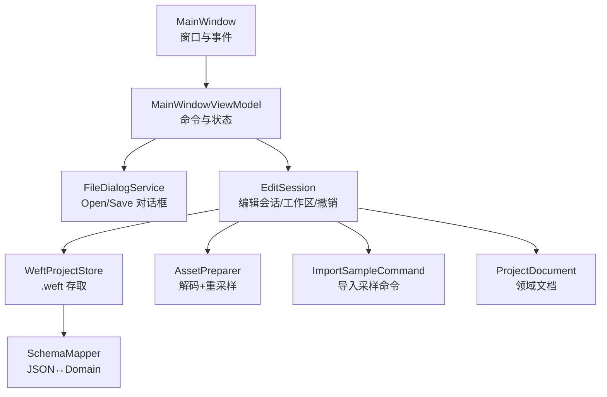
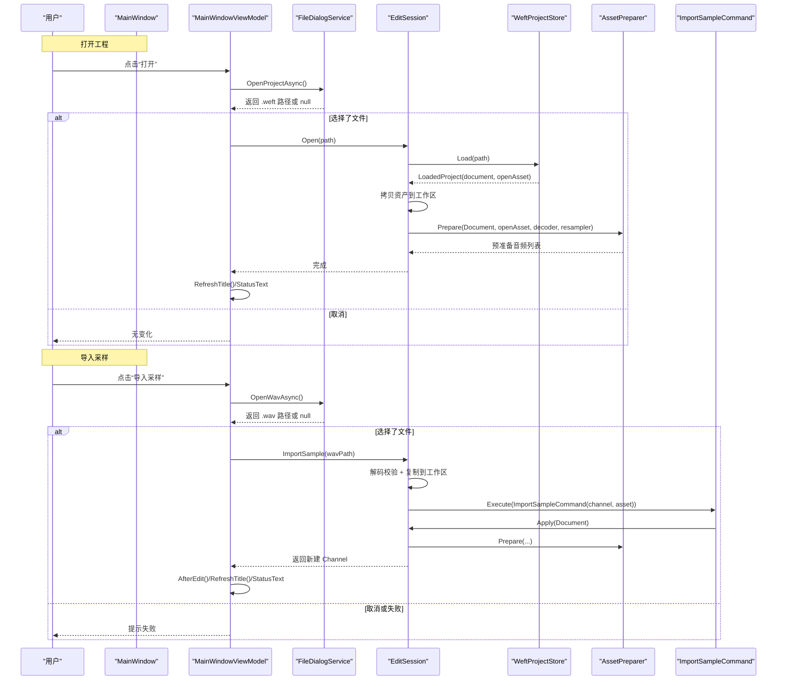
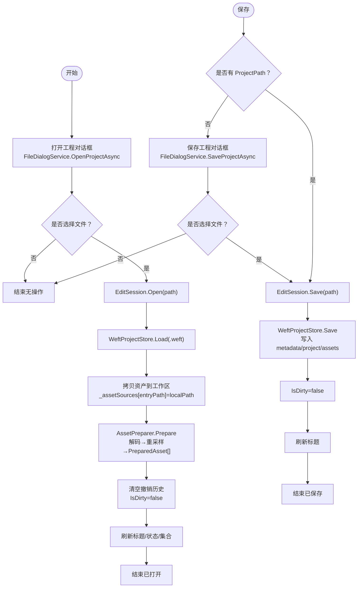
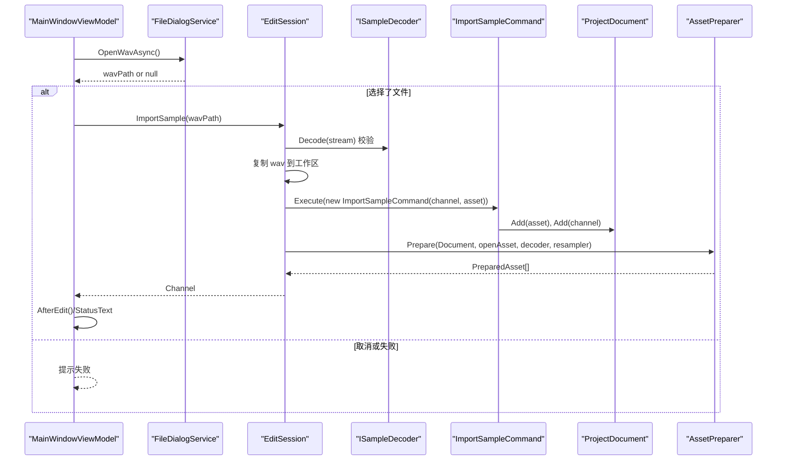
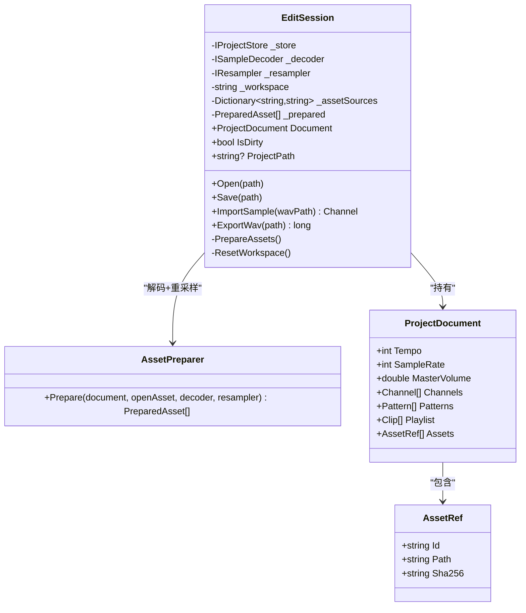
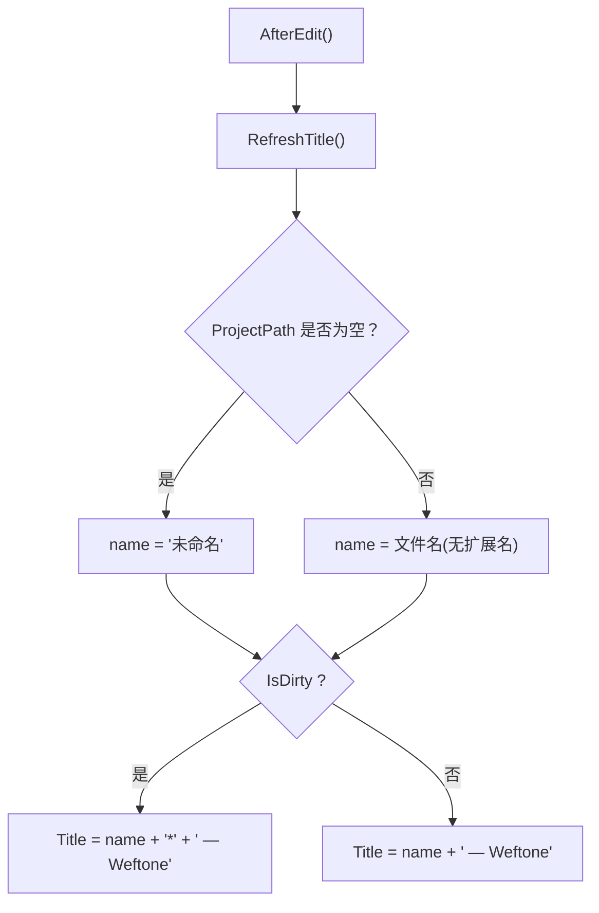
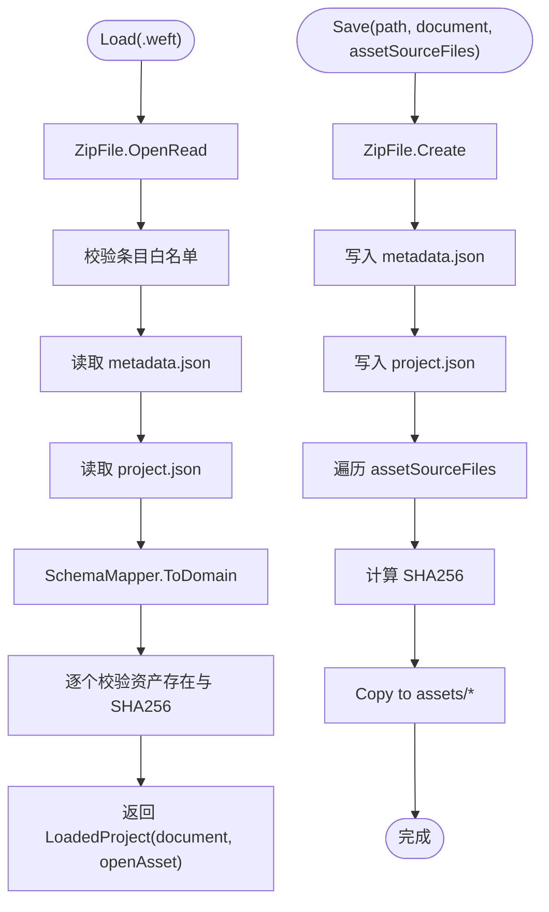
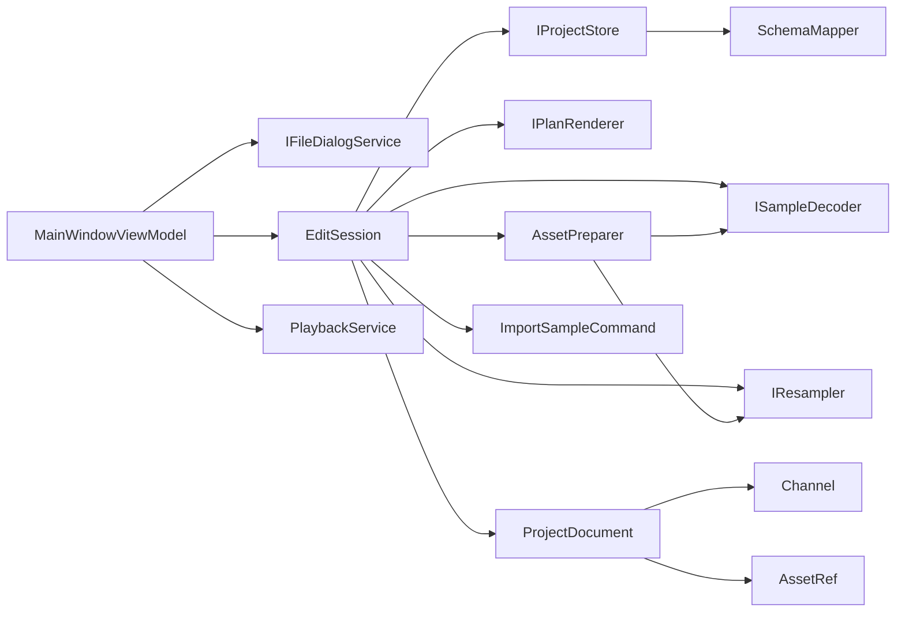

# 文件操作界面

<cite>
**本文引用的文件**   
- [MainWindow.axaml.cs](file://src/Weftone.App/MainWindow.axaml.cs)
- [MainWindowViewModel.cs](file://src/Weftone.App/ViewModels/MainWindowViewModel.cs)
- [FileDialogService.cs](file://src/Weftone.App/Services/FileDialogService.cs)
- [EditSession.cs](file://src/Weftone.Application/EditSession.cs)
- [AssetPreparer.cs](file://src/Weftone.Application/AssetPreparer.cs)
- [ImportSampleCommand.cs](file://src/Weftone.Domain/Commands/ImportSampleCommand.cs)
- [ProjectDocument.cs](file://src/Weftone.Domain/ProjectDocument.cs)
- [Channel.cs](file://src/Weftone.Domain/Channel.cs)
- [AssetRef.cs](file://src/Weftone.Domain/AssetRef.cs)
- [WeftProjectStore.cs](file://src/Weftone.Adapters.ProjectStore/WeftProjectStore.cs)
- [SchemaMapper.cs](file://src/Weftone.Adapters.ProjectStore/SchemaMapper.cs)
</cite>

## 目录
1. [引言](#引言)
2. [项目结构](#项目结构)
3. [核心组件](#核心组件)
4. [架构总览](#架构总览)
5. [详细组件分析](#详细组件分析)
6. [依赖关系分析](#依赖关系分析)
7. [性能与资源管理](#性能与资源管理)
8. [故障排查指南](#故障排查指南)
9. [结论](#结论)

## 引言
本文面向“文件操作界面”，聚焦工程存取、采样导入、未存盘资产内存注册表、标题栏脏标记状态，以及与 WeftProjectStore 的集成和持久化流程。目标是帮助开发者快速理解从用户点击菜单到 .weft 文件落盘、WAV 采样导入并创建 sampler 通道的完整链路，同时明确各层职责、错误处理与用户体验设计。

## 项目结构
本功能横跨应用层（UI）、应用服务层（会话与编译）与领域/适配器层（持久化）。关键文件组织如下：
- UI 窗口与视图模型：负责对话框交互、命令绑定、标题与状态更新。
- 文件对话框服务：封装 Avalonia 的文件选择器，统一打开/保存 .weft 与 WAV。
- 编辑会话：持有 ProjectDocument、撤销栈、工作区临时文件、解码/重采样后的预准备音频数据。
- 资产准备：对工程中所有 AssetRef 进行解码与离线重采样，输出可渲染的交错浮点缓冲。
- 导入采样命令：将 AssetRef 与 sampler 通道作为原子命令加入文档。
- 项目存储：.weft zip 容器读写、schema 校验、资产 SHA256 校验。
- Schema 映射：JSON DTO 与领域对象的双向转换与规则校验。

图表来源
- [MainWindowViewModel.cs:149-213](file://src/Weftone.App/ViewModels/MainWindowViewModel.cs#L149-L213)
- [FileDialogService.cs:18-80](file://src/Weftone.App/Services/FileDialogService.cs#L18-L80)
- [EditSession.cs:64-94](file://src/Weftone.Application/EditSession.cs#L64-L94)
- [AssetPreparer.cs:8-40](file://src/Weftone.Application/AssetPreparer.cs#L8-L40)
- [ImportSampleCommand.cs:8-37](file://src/Weftone.Domain/Commands/ImportSampleCommand.cs#L8-L37)
- [ProjectDocument.cs:7-20](file://src/Weftone.Domain/ProjectDocument.cs#L7-L20)
- [WeftProjectStore.cs:23-110](file://src/Weftone.Adapters.ProjectStore/WeftProjectStore.cs#L23-L110)
- [SchemaMapper.cs:67-100](file://src/Weftone.Adapters.ProjectStore/SchemaMapper.cs#L67-L100)

章节来源
- [MainWindow.axaml.cs:12-20](file://src/Weftone.App/MainWindow.axaml.cs#L12-L20)
- [MainWindowViewModel.cs:96-106](file://src/Weftone.App/ViewModels/MainWindowViewModel.cs#L96-L106)

## 核心组件
- MainWindow：窗口生命周期、滚动视口同步、订阅 ViewModel 的 DocumentEdited 事件触发重绘。
- MainWindowViewModel：封装 Open/Save/Export/ImportSample 等命令；维护 IsDirty、ProjectPath、Title 显示；协调 EditSession 与 PlaybackService。
- FileDialogService：基于 Avalonia StorageProvider 的 Open/Save 对话框，限定 .weft 与 .wav 类型。
- EditSession：工程打开/保存、工作区管理、导入采样、导出 WAV、撤销/重做、编译 RenderPlan。
- AssetPreparer：遍历 ProjectDocument.Assets，解码并重采样至工程采样率，产出 PreparedAsset。
- ImportSampleCommand：原子性地将 AssetRef 与 sampler Channel 加入文档，支持撤销。
- WeftProjectStore：.weft zip 容器的加载与保存，含 schema 版本校验、资产白名单、SHA256 校验。
- SchemaMapper：JSON DTO 与 Domain 对象的映射与约束校验。

章节来源
- [MainWindow.axaml.cs:35-53](file://src/Weftone.App/MainWindow.axaml.cs#L35-L53)
- [MainWindowViewModel.cs:36-50](file://src/Weftone.App/ViewModels/MainWindowViewModel.cs#L36-L50)
- [FileDialogService.cs:6-16](file://src/Weftone.App/Services/FileDialogService.cs#L6-L16)
- [EditSession.cs:14-41](file://src/Weftone.Application/EditSession.cs#L14-L41)
- [AssetPreparer.cs:1-40](file://src/Weftone.Application/AssetPreparer.cs#L1-L40)
- [ImportSampleCommand.cs:1-37](file://src/Weftone.Domain/Commands/ImportSampleCommand.cs#L1-L37)
- [WeftProjectStore.cs:9-21](file://src/Weftone.Adapters.ProjectStore/WeftProjectStore.cs#L9-L21)
- [SchemaMapper.cs:8-24](file://src/Weftone.Adapters.ProjectStore/SchemaMapper.cs#L8-L24)

## 架构总览
下图展示从用户操作到持久化的端到端调用链，包括工程打开/保存与采样导入两条主路径。

图表来源
- [MainWindowViewModel.cs:149-161](file://src/Weftone.App/ViewModels/MainWindowViewModel.cs#L149-L161)
- [FileDialogService.cs:18-32](file://src/Weftone.App/Services/FileDialogService.cs#L18-L32)
- [EditSession.cs:64-84](file://src/Weftone.Application/EditSession.cs#L64-L84)
- [AssetPreparer.cs:11-40](file://src/Weftone.Application/AssetPreparer.cs#L11-L40)
- [ImportSampleCommand.cs:15-31](file://src/Weftone.Domain/Commands/ImportSampleCommand.cs#L15-L31)
- [WeftProjectStore.cs:23-71](file://src/Weftone.Adapters.ProjectStore/WeftProjectStore.cs#L23-L71)

## 详细组件分析

### 工程打开/保存流程（.weft）
- 打开工程
  - 视图模型通过 FileDialogService.OpenProjectAsync 弹出“打开工程”对话框，仅允许 *.weft。
  - 若用户选择文件，则调用 EditSession.Open(path)。
  - EditSession 委托 WeftProjectStore.Load 解析 .weft，得到 LoadedProject，包含 ProjectDocument 与按资产路径打开流的回调。
  - EditSession 将每个资产流拷贝到本地工作区，建立资产路径到本地文件的映射 _assetSources。
  - 随后调用 PrepareAssets，使用 AssetPreparer 对所有资产解码并重采样到工程采样率，结果缓存于 _prepared。
  - 完成后清空撤销历史、设置 ProjectPath 与 IsDirty=false，并刷新标题与状态。
- 保存工程
  - 若已有 ProjectPath，直接保存；否则通过 FileDialogService.SaveProjectAsync 弹出“保存工程”对话框，默认扩展名 weft。
  - EditSession.Save 调用 WeftProjectStore.Save，传入 Document 与 _assetSources。
  - WeftProjectStore 计算每个资产的 SHA256，写入 metadata.json、project.json 与 assets/*，形成 .weft zip。
  - 成功后重置 IsDirty=false，并刷新标题。

图表来源
- [MainWindowViewModel.cs:149-161](file://src/Weftone.App/ViewModels/MainWindowViewModel.cs#L149-L161)
- [MainWindowViewModel.cs:202-213](file://src/Weftone.App/ViewModels/MainWindowViewModel.cs#L202-L213)
- [FileDialogService.cs:18-48](file://src/Weftone.App/Services/FileDialogService.cs#L18-L48)
- [EditSession.cs:64-94](file://src/Weftone.Application/EditSession.cs#L64-L94)
- [WeftProjectStore.cs:23-110](file://src/Weftone.Adapters.ProjectStore/WeftProjectStore.cs#L23-L110)

章节来源
- [MainWindowViewModel.cs:149-161](file://src/Weftone.App/ViewModels/MainWindowViewModel.cs#L149-L161)
- [MainWindowViewModel.cs:202-213](file://src/Weftone.App/ViewModels/MainWindowViewModel.cs#L202-L213)
- [EditSession.cs:64-94](file://src/Weftone.Application/EditSession.cs#L64-L94)
- [WeftProjectStore.cs:23-110](file://src/Weftone.Adapters.ProjectStore/WeftProjectStore.cs#L23-L110)

### 采样导入流程（WAV → AssetRef + Sampler 通道）
- 用户点击“导入采样”，视图模型调用 FileDialogService.OpenWavAsync 弹出“导入采样”对话框，仅允许 *.wav。
- 若用户选择文件，视图模型调用 EditSession.ImportSample(wavPath)。
- EditSession 内部步骤：
  1) 使用 ISampleDecoder 对 WAV 进行一次解码校验，确保格式有效。
  2) 生成唯一 assetId，构造 entryPath="assets/{assetId}.wav"，并将源文件复制到工作区。
  3) 分配新 ChannelId，创建 Channel（Kind=Sampler，Name=文件名，AssetId=assetId）。
  4) 执行 ImportSampleCommand(channel, new AssetRef{Id=assetId, Path=entryPath})。
     - ImportSampleCommand.Apply 校验 channel id、asset id 不重复，且 channel 为 Sampler 且 AssetId 匹配。
     - 将 AssetRef 与 Channel 追加到 ProjectDocument。
  5) 记录 _assetSources[entryPath] = localPath。
  6) 调用 PrepareAssets，重新解码并重采样所有资产，更新 _prepared。
  7) 返回新建 Channel，供视图模型更新状态。
- 视图模型在成功时更新 StatusText 为“已导入采样 → 通道「xxx」”，失败时捕获 InvalidDataException/IOException/InvalidOperationException，提示“不是可解码的 WAV”。

图表来源
- [MainWindowViewModel.cs:398-416](file://src/Weftone.App/ViewModels/MainWindowViewModel.cs#L398-L416)
- [FileDialogService.cs:50-64](file://src/Weftone.App/Services/FileDialogService.cs#L50-L64)
- [EditSession.cs:137-165](file://src/Weftone.Application/EditSession.cs#L137-L165)
- [ImportSampleCommand.cs:15-31](file://src/Weftone.Domain/Commands/ImportSampleCommand.cs#L15-L31)
- [AssetPreparer.cs:11-40](file://src/Weftone.Application/AssetPreparer.cs#L11-L40)

章节来源
- [MainWindowViewModel.cs:398-416](file://src/Weftone.App/ViewModels/MainWindowViewModel.cs#L398-L416)
- [EditSession.cs:137-165](file://src/Weftone.Application/EditSession.cs#L137-L165)
- [ImportSampleCommand.cs:8-37](file://src/Weftone.Domain/Commands/ImportSampleCommand.cs#L8-L37)
- [AssetPreparer.cs:8-40](file://src/Weftone.Application/AssetPreparer.cs#L8-L40)

### 未存盘资产内存注册表与工作区设计
- 工作区：EditSession 在构造函数中创建临时目录（系统 Temp 下的 weftone-session-*），用于存放导入或从 .weft 解压出的资产副本。
- 资产注册表：_assetSources 字典键为工程内相对路径（如 assets/xxx.wav），值为本地工作区绝对路径。
- 生命周期：
  - NewDemo/Open：先 ResetWorkspace 清理旧工作区，再重建资产映射。
  - ImportSample：复制新 WAV 到工作区，并登记到 _assetSources。
  - Save：将 _assetSources 中的文件打包进 .weft，并计算 SHA256。
  - Dispose：尝试删除整个工作区目录，忽略 IO/权限异常，避免退出阻塞。
- 解码数据缓存：_prepared 列表保存每个资产的交错浮点缓冲、声道数与帧数，由 AssetPreparer 生成，供 DocumentCompiler 编译播放计划。

图表来源
- [EditSession.cs:14-41](file://src/Weftone.Application/EditSession.cs#L14-L41)
- [EditSession.cs:190-204](file://src/Weftone.Application/EditSession.cs#L190-L204)
- [AssetPreparer.cs:1-40](file://src/Weftone.Application/AssetPreparer.cs#L1-L40)
- [ProjectDocument.cs:7-20](file://src/Weftone.Domain/ProjectDocument.cs#L7-L20)
- [AssetRef.cs:1-9](file://src/Weftone.Domain/AssetRef.cs#L1-L9)

章节来源
- [EditSession.cs:27-41](file://src/Weftone.Application/EditSession.cs#L27-L41)
- [EditSession.cs:190-222](file://src/Weftone.Application/EditSession.cs#L190-L222)
- [AssetPreparer.cs:8-40](file://src/Weftone.Application/AssetPreparer.cs#L8-L40)
- [ProjectDocument.cs:7-20](file://src/Weftone.Domain/ProjectDocument.cs#L7-L20)
- [AssetRef.cs:1-9](file://src/Weftone.Domain/AssetRef.cs#L1-L9)

### 标题栏工程名与脏标记（*）状态管理
- 标题构建：MainWindowViewModel.RefreshTitle 根据 EditSession.ProjectPath 决定显示名称；若为空显示“未命名”，否则取文件名（不含扩展名）。
- 脏标记：若 EditSession.IsDirty 为真，则在标题末尾追加“*”，表示有未保存更改。
- 脏标记变更点：
  - EditSession.Execute/BeginTransaction/EndTransaction/Undo/Redo 均设置 IsDirty=true。
  - EditSession.Open 后 IsDirty=false；Save 后 IsDirty=false。
  - MainWindowViewModel.AfterEdit 会调用 RefreshTitle 以反映最新状态。
- 窗口标题绑定：Avalonia 将 Window.Title 绑定到 ViewModel.Title 属性，因此每次 RefreshTitle 都会即时更新标题栏。

图表来源
- [MainWindowViewModel.cs:515-521](file://src/Weftone.App/ViewModels/MainWindowViewModel.cs#L515-L521)
- [MainWindowViewModel.cs:496-507](file://src/Weftone.App/ViewModels/MainWindowViewModel.cs#L496-L507)
- [EditSession.cs:47-49](file://src/Weftone.Application/EditSession.cs#L47-L49)
- [EditSession.cs:100-130](file://src/Weftone.Application/EditSession.cs#L100-L130)
- [EditSession.cs:64-94](file://src/Weftone.Application/EditSession.cs#L64-L94)

章节来源
- [MainWindowViewModel.cs:496-521](file://src/Weftone.App/ViewModels/MainWindowViewModel.cs#L496-L521)
- [EditSession.cs:47-49](file://src/Weftone.Application/EditSession.cs#L47-L49)
- [EditSession.cs:100-130](file://src/Weftone.Application/EditSession.cs#L100-L130)

### 与 WeftProjectStore 的集成与数据持久化
- 加载流程：
  - WeftProjectStore.Load 打开 .weft zip，校验条目白名单（防 zip slip），读取 metadata.json 与 project.json，校验 schemaVersion。
  - 将 ProjectJson 映射为 ProjectDocument（SchemaMapper.ToDomain），并对每个 AssetRef 校验其存在与 SHA256。
  - 返回 LoadedProject，其中包含 document 与一个按 asset.Path 打开流的回调（EntryStream 包装 ZipArchiveEntry）。
- 保存流程：
  - WeftProjectStore.Save 接收 Document 与 _assetSources，要求每个资产路径以 assets/ 开头且合法。
  - 对每个资产计算 SHA256，写入 metadata.json、project.json 与 assets/*。
  - 若资产未在文档注册，抛出 InvalidProjectException。
- Schema 映射：
  - SchemaMapper.ToJson/ToDomain 负责字段映射与约束校验，包括 channel/pattern/clip/asset 的 ID 唯一性、范围检查、引用完整性等。

图表来源
- [WeftProjectStore.cs:23-71](file://src/Weftone.Adapters.ProjectStore/WeftProjectStore.cs#L23-L71)
- [WeftProjectStore.cs:73-110](file://src/Weftone.Adapters.ProjectStore/WeftProjectStore.cs#L73-L110)
- [SchemaMapper.cs:67-100](file://src/Weftone.Adapters.ProjectStore/SchemaMapper.cs#L67-L100)
- [SchemaMapper.cs:102-180](file://src/Weftone.Adapters.ProjectStore/SchemaMapper.cs#L102-L180)

章节来源
- [WeftProjectStore.cs:23-110](file://src/Weftone.Adapters.ProjectStore/WeftProjectStore.cs#L23-L110)
- [SchemaMapper.cs:67-180](file://src/Weftone.Adapters.ProjectStore/SchemaMapper.cs#L67-L180)

## 依赖关系分析
- UI 层依赖：
  - MainWindowViewModel 依赖 IFileDialogService、EditSession、PlaybackService。
  - MainWindow 订阅 ViewModel.DocumentEdited 事件，触发自绘控件重绘。
- 应用层依赖：
  - EditSession 依赖 IProjectStore、ISampleDecoder、IResampler、IPlanRenderer。
  - AssetPreparer 依赖 ISampleDecoder、IResampler，输出 PreparedAsset。
- 领域层依赖：
  - ProjectDocument 聚合 Channel、Pattern、Clip、AssetRef。
  - ImportSampleCommand 依赖 Channel、AssetRef，对 ProjectDocument 施加变更。
- 适配器层依赖：
  - WeftProjectStore 依赖 System.IO.Compression、System.Security.Cryptography、System.Text.Json。
  - SchemaMapper 定义 JSON DTO 与映射逻辑。

图表来源
- [MainWindowViewModel.cs:24-26](file://src/Weftone.App/ViewModels/MainWindowViewModel.cs#L24-L26)
- [EditSession.cs:18-21](file://src/Weftone.Application/EditSession.cs#L18-L21)
- [AssetPreparer.cs:1-12](file://src/Weftone.Application/AssetPreparer.cs#L1-L12)
- [ProjectDocument.cs:7-20](file://src/Weftone.Domain/ProjectDocument.cs#L7-L20)
- [ImportSampleCommand.cs:8-11](file://src/Weftone.Domain/Commands/ImportSampleCommand.cs#L8-L11)
- [WeftProjectStore.cs:1-5](file://src/Weftone.Adapters.ProjectStore/WeftProjectStore.cs#L1-L5)
- [SchemaMapper.cs:1-4](file://src/Weftone.Adapters.ProjectStore/SchemaMapper.cs#L1-L4)

章节来源
- [MainWindowViewModel.cs:24-26](file://src/Weftone.App/ViewModels/MainWindowViewModel.cs#L24-L26)
- [EditSession.cs:18-21](file://src/Weftone.Application/EditSession.cs#L18-L21)
- [AssetPreparer.cs:1-12](file://src/Weftone.Application/AssetPreparer.cs#L1-L12)
- [ProjectDocument.cs:7-20](file://src/Weftone.Domain/ProjectDocument.cs#L7-L20)
- [ImportSampleCommand.cs:8-11](file://src/Weftone.Domain/Commands/ImportSampleCommand.cs#L8-L11)
- [WeftProjectStore.cs:1-5](file://src/Weftone.Adapters.ProjectStore/WeftProjectStore.cs#L1-L5)
- [SchemaMapper.cs:1-4](file://src/Weftone.Adapters.ProjectStore/SchemaMapper.cs#L1-L4)

## 性能与资源管理
- 解码与重采样：
  - AssetPreparer 对每个资产解码一次，然后重采样到工程采样率，避免实时播放路径重复解码。
  - 重采样结果以交错浮点数组缓存，空间复杂度与总帧数×声道数成正比。
- 工作区与临时文件：
  - EditSession 使用系统临时目录，避免污染用户目录；Dispose 尽力删除，忽略占用导致的异常。
  - 打开工程时，将 zip 内资产拷贝到工作区，便于后续解码与保存。
- 导出 WAV：
  - 使用独立 IPlanRenderer 实例离线渲染，分块写入 WavWriter，降低峰值内存。
- 对话框与异步：
  - 所有文件对话框均为异步，避免阻塞 UI 线程。
- 建议优化：
  - 大工程下可考虑增量 PrepareAssets，仅对新增/变更资产重采样。
  - 对超大 WAV 可引入流式解码与分块重采样，减少一次性内存占用。

[本节为通用性能讨论，不直接分析具体文件]

## 故障排查指南
- 打开工程失败
  - 现象：抛出 InvalidProjectException，提示缺少 project.json/metadata.json、schema 版本不支持、资产缺失或 SHA256 不匹配。
  - 排查：确认 .weft 包结构正确；检查 assets 子目录是否存在对应文件；核对 SHA256 是否与工程元数据一致。
  - 相关位置：WeftProjectStore.Load 的校验与异常抛出。
- 保存工程失败
  - 现象：InvalidProjectException 提示非法资产路径或未注册资产。
  - 排查：确保 _assetSources 中的键均以 assets/ 开头且在 ProjectDocument.Assets 中存在；检查磁盘权限。
  - 相关位置：WeftProjectStore.Save 的路径校验与资产查找。
- 导入采样失败
  - 现象：视图模型捕获 InvalidDataException/IOException/InvalidOperationException，提示“不是可解码的 WAV”。
  - 排查：确认 WAV 文件可读且能被 ISampleDecoder 解码；检查文件路径与权限。
  - 相关位置：MainWindowViewModel.ImportSampleAsync 的 try/catch 与 EditSession.ImportSample 的解码校验。
- 标题未更新或脏标记异常
  - 现象：标题未显示“*”或工程名不正确。
  - 排查：确认 AfterEdit 被调用；检查 EditSession.IsDirty 与 ProjectPath 是否正确设置。
  - 相关位置：MainWindowViewModel.AfterEdit/RefreshTitle 与 EditSession 的状态变更点。

章节来源
- [WeftProjectStore.cs:23-71](file://src/Weftone.Adapters.ProjectStore/WeftProjectStore.cs#L23-L71)
- [WeftProjectStore.cs:73-110](file://src/Weftone.Adapters.ProjectStore/WeftProjectStore.cs#L73-L110)
- [MainWindowViewModel.cs:398-416](file://src/Weftone.App/ViewModels/MainWindowViewModel.cs#L398-L416)
- [MainWindowViewModel.cs:496-521](file://src/Weftone.App/ViewModels/MainWindowViewModel.cs#L496-L521)

## 结论
文件操作界面通过清晰的层次划分实现了稳健的工程存取与采样导入流程：
- UI 层专注用户交互与状态反馈；
- 应用层 EditSession 统一管理文档、工作区、撤销与编译；
- 领域层保证数据结构与命令的可撤销性与一致性；
- 适配器层提供安全的 .weft 持久化与 schema 校验。

该设计确保了：
- 打开/保存 .weft 的安全性与可恢复性；
- 采样导入的原子性与可撤销性；
- 解码数据的集中管理与生命周期可控；
- 标题栏工程名与脏标记的准确反映。