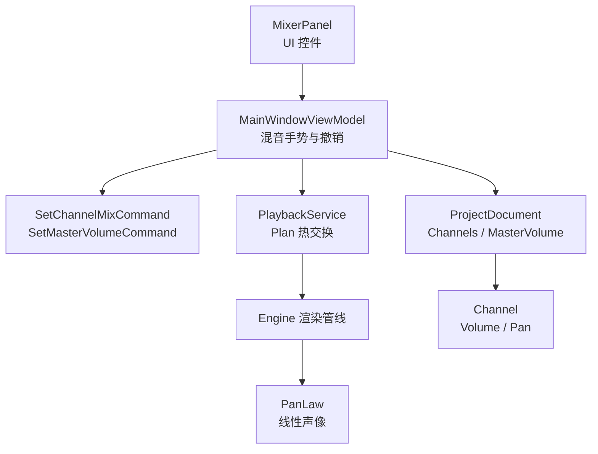
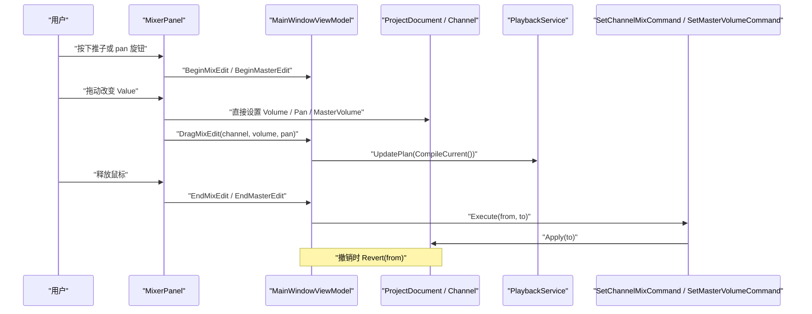
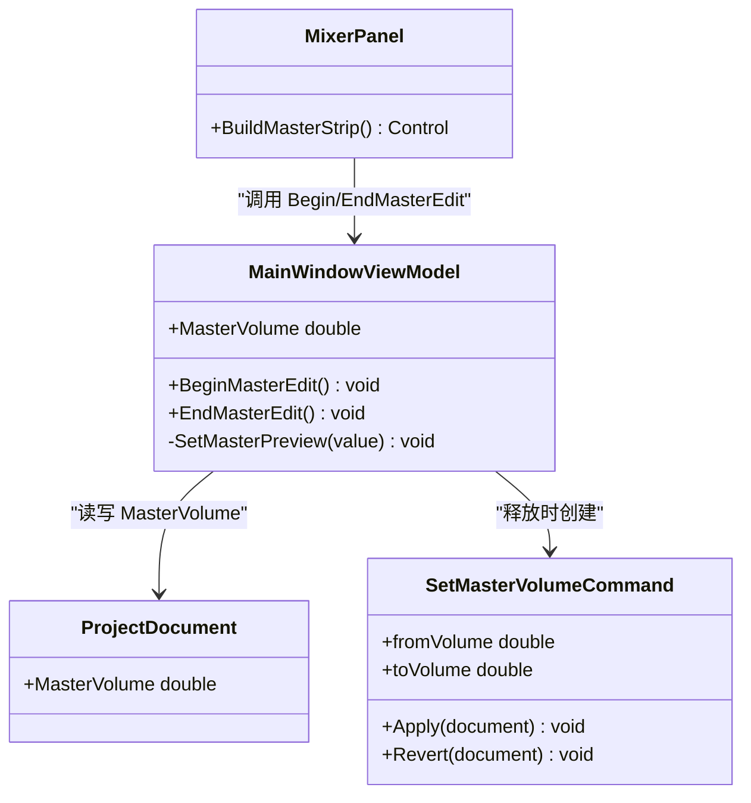
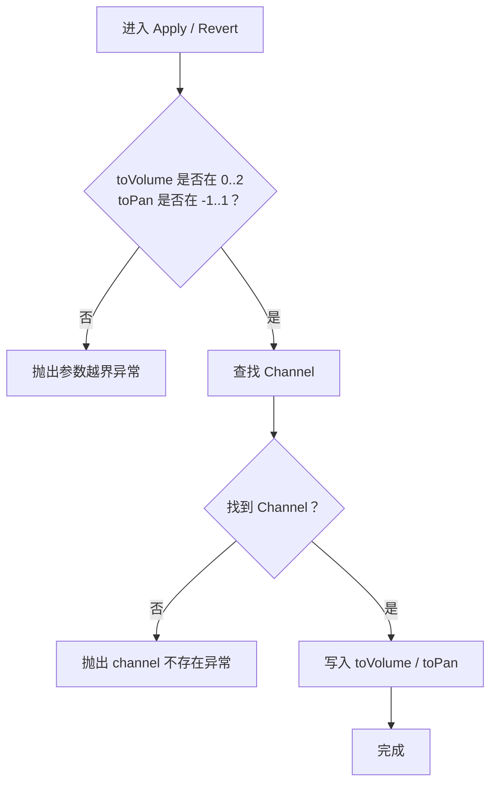
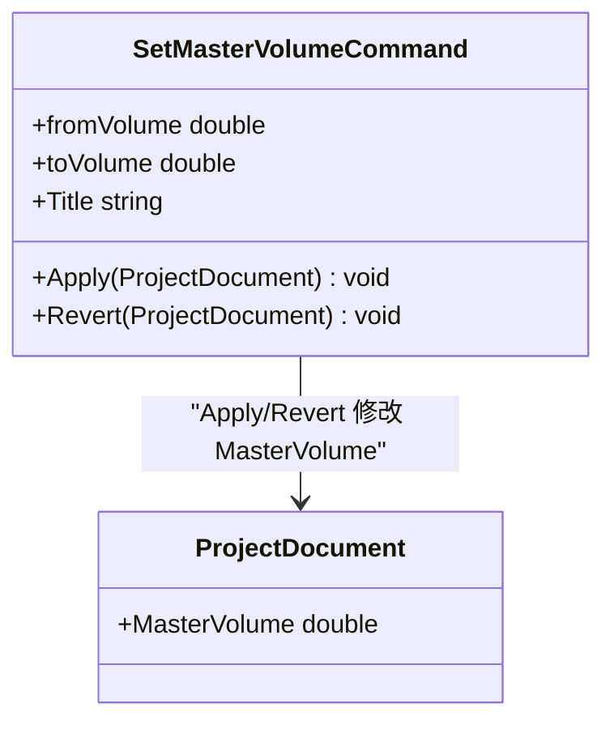
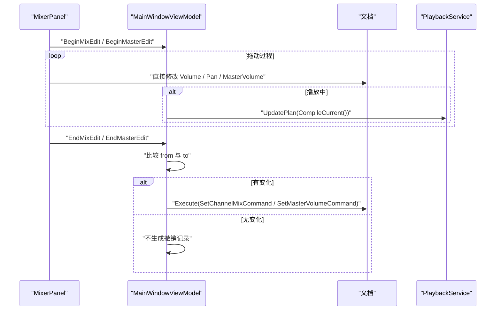
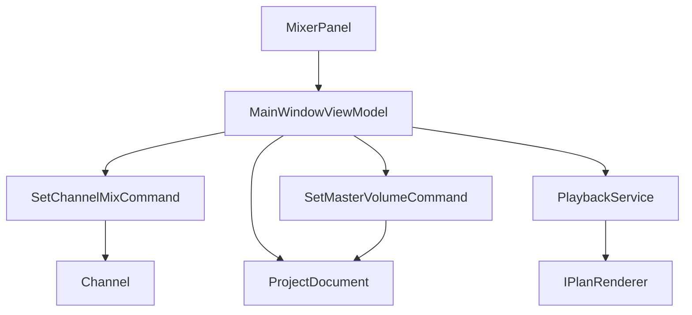

# 调音台面板

<cite>
**本文引用的文件**   
- [MixerPanel.cs](file://src/Weftone.App/Controls/MixerPanel.cs)
- [MainWindowViewModel.cs](file://src/Weftone.App/ViewModels/MainWindowViewModel.cs)
- [SetChannelMixCommand.cs](file://src/Weftone.Domain/Commands/SetChannelMixCommand.cs)
- [SetMasterVolumeCommand.cs](file://src/Weftone.Domain/Commands/SetMasterVolumeCommand.cs)
- [PlaybackService.cs](file://src/Weftone.Application/PlaybackService.cs)
- [PanLaw.cs](file://src/Weftone.Application/PanLaw.cs)
- [Channel.cs](file://src/Weftone.Domain/Channel.cs)
- [ProjectDocument.cs](file://src/Weftone.Domain/ProjectDocument.cs)
- [M1b_UI.md](file://specs/M1b_UI.md)
- [MainWindowViewModelMixerTests.cs](file://tests/Weftone.App.Tests/MainWindowViewModelMixerTests.cs)
</cite>

## 目录
1. [简介](#简介)
2. [项目结构中的调音台位置](#项目结构中的调音台位置)
3. [核心组件总览](#核心组件总览)
4. [架构与数据流](#架构与数据流)
5. [每通道推子、pan 旋钮与名称的界面实现](#每通道推子pan-旋钮与名称的界面实现)
6. [主通道 master 的特殊处理](#主通道-master-的特殊处理)
7. [SetChannelMix 命令与连续值参数设计](#setchannelmix-命令与连续值参数设计)
8. [新增 SetMasterVolume 命令](#新增-setmastervolume-命令)
9. [用户交互流程：实时预览与精确调整](#用户交互流程实时预览与精确调整)
10. [数值精度与可视化反馈](#数值精度与可视化反馈)
11. [与音频引擎的参数传递机制](#与音频引擎的参数传递机制)
12. [依赖关系分析](#依赖关系分析)
13. [性能与实时性考虑](#性能与实时性考虑)
14. [故障排查指南](#故障排查指南)
15. [结论](#结论)

## 简介
本文件聚焦 Weftone 调音台面板的实现，目标是让读者理解以下问题：
- 每通道音量推子、pan 旋钮和名称控件如何组合并绑定到视图模型。
- `SetChannelMix` 命令如何承载“从 to”两个参数的撤销语义。
- 新增的 `SetMasterVolume` 命令如何服务 master 推子。
- 拖拽过程中的“实时预览”与释放后的“精确调整”如何协作。
- master 通道的特殊行为以及音量、pan 的可视化反馈。
- 调音台参数如何最终进入播放管线，影响实时声音输出。

该能力属于 M1b UI 的最小可运行 DAW 的一部分，验收标准包括加载采样、Piano Roll、Pattern 循环、Playlist、调音台、导出 WAV 与撤销重做。

**章节来源**
- [M1b_UI.md:7-16](file://specs/M1b_UI.md#L7-L16)
- [M1b_UI.md:72-90](file://specs/M1b_UI.md#L72-L90)

## 项目结构中的调音台位置
调音台相关代码分布在三层：
- UI 层：Avalonia 自定义控件 `MixerPanel`，负责绘制通道条、master 条、滑块事件。
- 视图模型层：`MainWindowViewModel`，封装混音手势、撤销事务、编译与播放热更新。
- 领域层与应用层：`SetChannelMixCommand`、`SetMasterVolumeCommand`、`Channel`、`ProjectDocument`、`PlaybackService`、`PanLaw`。



**图表来源**
- [MixerPanel.cs:12-17](file://src/Weftone.App/Controls/MixerPanel.cs#L12-L17)
- [MainWindowViewModel.cs:437-494](file://src/Weftone.App/ViewModels/MainWindowViewModel.cs#L437-L494)
- [SetChannelMixCommand.cs:3-10](file://src/Weftone.Domain/Commands/SetChannelMixCommand.cs#L3-L10)
- [SetMasterVolumeCommand.cs:3-7](file://src/Weftone.Domain/Commands/SetMasterVolumeCommand.cs#L3-L7)
- [ProjectDocument.cs:12-16](file://src/Weftone.Domain/ProjectDocument.cs#L12-L16)
- [PlaybackService.cs:6-11](file://src/Weftone.Application/PlaybackService.cs#L6-L11)
- [PanLaw.cs:3-13](file://src/Weftone.Application/PanLaw.cs#L3-L13)

**章节来源**
- [M1b_UI.md:18-37](file://specs/M1b_UI.md#L18-L37)
- [M1b_UI.md:66-73](file://specs/M1b_UI.md#L66-L73)

## 核心组件总览
| 组件 | 职责 | 关键行为 |
|---|---|---|
| `MixerPanel` | 构建每通道 strip 与 master strip，处理指针按下、拖动、释放 | 实时更新文档值；拖动中调用 VM 预览；释放时提交撤销命令 |
| `MainWindowViewModel` | 管理混音手势、撤销事务、编译当前计划、触发播放热更新 | `BeginMixEdit` / `DragMixEdit` / `EndMixEdit`；`BeginMasterEdit` / `EndMasterEdit` |
| `SetChannelMixCommand` | 将 channel 的 volume 与 pan 合并为一条撤销命令 | Apply 写入 to 值，Revert 恢复 from 值 |
| `SetMasterVolumeCommand` | 将 master 音量变化记录为一条撤销命令 | Apply 写入 to 值，Revert 恢复 from 值 |
| `PlaybackService` | 控制播放、停止、plan 热交换 | `UpdatePlan` 在编辑后重新加载 plan |
| `PanLaw` | 线性声像算法 | 将 pan -1..1 映射为左右声道增益 |
| `Channel` | 通道数据模型 | 保存 Id、Name、Kind、Volume、Pan |
| `ProjectDocument` | 工程文档根对象 | 保存 MasterVolume、Channels 等 |

**章节来源**
- [MixerPanel.cs:12-17](file://src/Weftone.App/Controls/MixerPanel.cs#L12-L17)
- [MainWindowViewModel.cs:437-507](file://src/Weftone.App/ViewModels/MainWindowViewModel.cs#L437-L507)
- [SetChannelMixCommand.cs:3-45](file://src/Weftone.Domain/Commands/SetChannelMixCommand.cs#L3-L45)
- [SetMasterVolumeCommand.cs:3-27](file://src/Weftone.Domain/Commands/SetMasterVolumeCommand.cs#L3-L27)
- [PlaybackService.cs:6-11](file://src/Weftone.Application/PlaybackService.cs#L6-L11)
- [PanLaw.cs:3-13](file://src/Weftone.Application/PanLaw.cs#L3-L13)
- [Channel.cs:9-18](file://src/Weftone.Domain/Channel.cs#L9-L18)
- [ProjectDocument.cs:3-16](file://src/Weftone.Domain/ProjectDocument.cs#L3-L16)

## 架构与数据流
调音台的数据流遵循 MVVM + 命令模式：
1. 用户在 `MixerPanel` 上拖动推子或 pan 旋钮。
2. 控件立即修改对应 `Channel` 或 `ProjectDocument.MasterVolume`，实现实时预览。
3. 如果正在播放，`MainWindowViewModel` 调用 `PlaybackService.UpdatePlan` 重新编译并热交换 plan。
4. 用户释放鼠标时，VM 创建 `SetChannelMixCommand` 或 `SetMasterVolumeCommand`，并通过 `EditSession` 执行，形成单条撤销记录。
5. 撤销时，命令的 `Revert` 方法把 from 值写回文档，恢复拖拽前状态。



**图表来源**
- [MixerPanel.cs:130-171](file://src/Weftone.App/Controls/MixerPanel.cs#L130-L171)
- [MixerPanel.cs:201-221](file://src/Weftone.App/Controls/MixerPanel.cs#L201-L221)
- [MainWindowViewModel.cs:86-94](file://src/Weftone.App/ViewModels/MainWindowViewModel.cs#L86-L94)
- [MainWindowViewModel.cs:437-494](file://src/Weftone.App/ViewModels/MainWindowViewModel.cs#L437-L494)
- [PlaybackService.cs:63-78](file://src/Weftone.Application/PlaybackService.cs#L63-L78)
- [SetChannelMixCommand.cs:19-38](file://src/Weftone.Domain/Commands/SetChannelMixCommand.cs#L19-L38)
- [SetMasterVolumeCommand.cs:14-26](file://src/Weftone.Domain/Commands/SetMasterVolumeCommand.cs#L14-L26)

## 每通道推子、pan 旋钮与名称的界面实现
`MixerPanel` 使用 Avalonia 控件组合出每个通道条：
- 名称：居中文本块，支持省略号截断。
- 音量推子：垂直 Slider，范围 0..2，默认高度 110。
- 数值标签：显示两位小数格式，例如 `1.00`。
- pan 旋钮：水平 Slider，范围 -1..1。
- 容器：带背景色的 Border，普通通道与 master 通道背景色不同。

交互方面，控件通过内部 `MixDragState` 区分当前是 volume 拖动还是 pan 拖动，避免同时误判。拖动过程中：
- 数值标签即时刷新。
- 调用 `vm.DragMixEdit(channel, volume, pan)` 直接修改文档。
- 如果播放中，VM 会重新编译并热交换 plan，让用户听到实时效果。

释放时：
- 调用 `vm.EndMixEdit(channel)`。
- VM 比较 from 与 to，若发生变化则执行 `SetChannelMixCommand`。
- 未变化时不生成撤销记录。

```mermaid
flowchart TD
Start["开始构建通道条"] --> Name["创建名称 TextBlock"]
Name --> VolSlider["创建垂直 Volume Slider<br/>0..2"]
VolSlider --> VolLabel["创建数值标签<br/>ToString(\"0.00\")"]
VolLabel --> PanSlider["创建水平 Pan Slider<br/>-1..1"]
PanSlider --> Events["注册 PointerPressed / Released / PropertyChanged"]
Events --> DragCheck{"是否拖动中？"}
DragCheck --> |是| UpdateDoc["更新 Channel.Volume / Channel.Pan"]
UpdateDoc --> LivePreview["播放中则 UpdatePlan"]
DragCheck --> |否| Render["返回 StripShell 容器"]
LivePreview --> Render
```

**图表来源**
- [MixerPanel.cs:95-172](file://src/Weftone.App/Controls/MixerPanel.cs#L95-L172)
- [MainWindowViewModel.cs:446-458](file://src/Weftone.App/ViewModels/MainWindowViewModel.cs#L446-L458)

**章节来源**
- [MixerPanel.cs:57-93](file://src/Weftone.App/Controls/MixerPanel.cs#L57-L93)
- [MixerPanel.cs:95-172](file://src/Weftone.App/Controls/MixerPanel.cs#L95-L172)
- [Channel.cs:9-18](file://src/Weftone.Domain/Channel.cs#L9-L18)

## 主通道 master 的特殊处理
master 通道与普通通道有两个重要区别：
1. master 没有 pan，只有音量推子和数值标签。
2. master 的值来自 `ProjectDocument.MasterVolume`，而不是某个 `Channel`。
3. 拖动 master 时，VM 直接修改文档并触发播放热更新。
4. 释放时生成 `SetMasterVolumeCommand`，撤销时恢复 from 值。

此外，master strip 的背景色与普通通道不同，用于视觉区分。



**图表来源**
- [MixerPanel.cs:175-223](file://src/Weftone.App/Controls/MixerPanel.cs#L175-L223)
- [MainWindowViewModel.cs:73-94](file://src/Weftone.App/ViewModels/MainWindowViewModel.cs#L73-L94)
- [MainWindowViewModel.cs:476-494](file://src/Weftone.App/ViewModels/MainWindowViewModel.cs#L476-L494)
- [SetMasterVolumeCommand.cs:7-27](file://src/Weftone.Domain/Commands/SetMasterVolumeCommand.cs#L7-L27)
- [ProjectDocument.cs:14-16](file://src/Weftone.Domain/ProjectDocument.cs#L14-L16)

**章节来源**
- [MixerPanel.cs:175-223](file://src/Weftone.App/Controls/MixerPanel.cs#L175-L223)
- [MainWindowViewModel.cs:73-94](file://src/Weftone.App/ViewModels/MainWindowViewModel.cs#L73-L94)
- [ProjectDocument.cs:14-16](file://src/Weftone.Domain/ProjectDocument.cs#L14-L16)

## SetChannelMix 命令与连续值参数设计
`SetChannelMixCommand` 是一个“连续值命令”，它同时携带 from 和 to 两组参数：
- `fromVolume`：拖动前的通道音量。
- `fromPan`：拖动前的通道 pan。
- `toVolume`：释放时的通道音量。
- `toPan`：释放时的通道 pan。

这种设计的核心原因是：
- 拖动过程中，UI 直接修改文档，提供实时预览。
- 释放时才把一次完整拖拽压缩成一条命令入撤销栈。
- `Apply` 写入 to 值，`Revert` 恢复 from 值，保证撤销精确还原。

参数校验规则：
- volume 必须在 0..2。
- pan 必须在 -1..1。
- 找不到 channel 时抛出异常。



**图表来源**
- [SetChannelMixCommand.cs:8-15](file://src/Weftone.Domain/Commands/SetChannelMixCommand.cs#L8-L15)
- [SetChannelMixCommand.cs:19-44](file://src/Weftone.Domain/Commands/SetChannelMixCommand.cs#L19-L44)

**章节来源**
- [SetChannelMixCommand.cs:3-45](file://src/Weftone.Domain/Commands/SetChannelMixCommand.cs#L3-L45)
- [M1b_UI.md:85-90](file://specs/M1b_UI.md#L85-L90)

## 新增 SetMasterVolume 命令
`SetMasterVolumeCommand` 是 M1b 为 mixer master 推子补充的命令类型。它同样采用 from/to 设计：
- `fromVolume`：拖动前的 master 音量。
- `toVolume`：释放时的 master 音量。
- `Apply` 写入 `ProjectDocument.MasterVolume`。
- `Revert` 恢复 `fromVolume`。

它与 `SetChannelMixCommand` 的区别在于：
- 只操作一个标量值，不涉及 channel 查找。
- 标题文本体现 from→to 的变化。
- 由 `MainWindowViewModel.EndMasterEdit` 在释放时创建。



**图表来源**
- [SetMasterVolumeCommand.cs:7-27](file://src/Weftone.Domain/Commands/SetMasterVolumeCommand.cs#L7-L27)
- [ProjectDocument.cs:14-16](file://src/Weftone.Domain/ProjectDocument.cs#L14-L16)

**章节来源**
- [SetMasterVolumeCommand.cs:3-27](file://src/Weftone.Domain/Commands/SetMasterVolumeCommand.cs#L3-L27)
- [M1b_UI.md:85-90](file://specs/M1b_UI.md#L85-L90)

## 用户交互流程：实时预览与精确调整
调音台的交互分为两个阶段：

### 实时预览阶段
- 用户按下推子或 pan 旋钮。
- `MixerPanel` 调用 `BeginMixEdit` 或 `BeginMasterEdit`。
- 拖动过程中，控件直接修改 `Channel.Volume`、`Channel.Pan` 或 `ProjectDocument.MasterVolume`。
- 如果 `PlaybackService.IsPlaying` 为真，VM 调用 `UpdatePlan(CompileCurrent())`，让新参数立即生效。

### 精确调整阶段
- 用户释放鼠标。
- `MixerPanel` 调用 `EndMixEdit` 或 `EndMasterEdit`。
- VM 比较 from 与 to：
  - 有变化：执行对应命令，入撤销栈。
  - 无变化：不生成撤销记录。
- `AfterEdit` 刷新标题、历史按钮状态、Channels、MasterVolume，并通知自绘控件重绘。



**图表来源**
- [MixerPanel.cs:130-171](file://src/Weftone.App/Controls/MixerPanel.cs#L130-L171)
- [MixerPanel.cs:201-221](file://src/Weftone.App/Controls/MixerPanel.cs#L201-L221)
- [MainWindowViewModel.cs:437-507](file://src/Weftone.App/ViewModels/MainWindowViewModel.cs#L437-L507)
- [PlaybackService.cs:63-78](file://src/Weftone.Application/PlaybackService.cs#L63-L78)

**章节来源**
- [MainWindowViewModelMixerTests.cs:94-150](file://tests/Weftone.App.Tests/MainWindowViewModelMixerTests.cs#L94-L150)
- [M1b_UI.md:85-90](file://specs/M1b_UI.md#L85-L90)

## 数值精度与可视化反馈
数值展示与精度处理体现在多个位置：

| 场景 | 精度策略 | 说明 |
|---|---|---|
| 通道音量标签 | `ToString("0.00")` | 显示两位小数，便于用户判断微调幅度 |
| master 音量标签 | `ToString("0.00")` | 与通道保持一致的显示风格 |
| 命令标题 | `0.###` | 去除末尾零，使撤销标题更简洁 |
| 推子范围 | volume 0..2，pan -1..1 | 允许超过 1 的增益，但 pan 限制在立体声左到右 |
| 输入钳制 | `Math.Clamp` | VM 和命令层对越界值进行保护 |

需要注意：
- UI 显示用两位小数，但底层存储是 `double`，因此撤销恢复的是精确浮点值，不是字符串格式化后的值。
- 命令标题使用 `0.###`，是为了可读性，不影响实际数值。

**章节来源**
- [MixerPanel.cs:114-117](file://src/Weftone.App/Controls/MixerPanel.cs#L114-L117)
- [MixerPanel.cs:194-199](file://src/Weftone.App/Controls/MixerPanel.cs#L194-L199)
- [SetChannelMixCommand.cs:17](file://src/Weftone.Domain/Commands/SetChannelMixCommand.cs#L17)
- [SetMasterVolumeCommand.cs:12](file://src/Weftone.Domain/Commands/SetMasterVolumeCommand.cs#L12)
- [MainWindowViewModel.cs:452-453](file://src/Weftone.App/ViewModels/MainWindowViewModel.cs#L452-L453)

## 与音频引擎的参数传递机制
调音台本身不直接产生音频，而是通过以下链路影响音频输出：

1. `Channel.Volume` 与 `Channel.Pan` 是工程文档的一部分。
2. `ProjectDocument.MasterVolume` 是全局输出增益。
3. `MainWindowViewModel.CompileCurrent()` 根据当前模式编译为 `RenderPlan`。
4. `PlaybackService.UpdatePlan` 在播放中停止后端、加载新 plan、再启动后端。
5. 音频引擎读取 plan 中的渲染图，结合 `PanLaw.Linear` 计算左右声道增益。


**图表来源**
- [MainWindowViewModel.cs:193-200](file://src/Weftone.App/ViewModels/MainWindowViewModel.cs#L193-L200)
- [PlaybackService.cs:42-78](file://src/Weftone.Application/PlaybackService.cs#L42-L78)
- [PanLaw.cs:9-13](file://src/Weftone.Application/PanLaw.cs#L9-L13)

**章节来源**
- [PlaybackService.cs:6-11](file://src/Weftone.Application/PlaybackService.cs#L6-L11)
- [PlaybackService.cs:63-78](file://src/Weftone.Application/PlaybackService.cs#L63-L78)
- [PanLaw.cs:3-13](file://src/Weftone.Application/PanLaw.cs#L3-L13)

## 依赖关系分析
调音台相关组件的依赖方向清晰：
- `MixerPanel` 依赖 `MainWindowViewModel` 和 `Channel`。
- `MainWindowViewModel` 依赖 `EditSession`、`PlaybackService`、`ProjectDocument`、命令类。
- 命令类依赖 `ProjectDocument` 和 `Channel`。
- `PlaybackService` 依赖抽象渲染接口和音频后端工厂。
- `PanLaw` 是纯函数工具，被音频路径使用。



**图表来源**
- [MixerPanel.cs:7-8](file://src/Weftone.App/Controls/MixerPanel.cs#L7-L8)
- [MainWindowViewModel.cs:4-8](file://src/Weftone.App/ViewModels/MainWindowViewModel.cs#L4-L8)
- [SetChannelMixCommand.cs:1](file://src/Weftone.Domain/Commands/SetChannelMixCommand.cs#L1)
- [SetMasterVolumeCommand.cs:1](file://src/Weftone.Domain/Commands/SetMasterVolumeCommand.cs#L1)
- [PlaybackService.cs:1-3](file://src/Weftone.Application/PlaybackService.cs#L1-L3)

**章节来源**
- [MixerPanel.cs:1-9](file://src/Weftone.App/Controls/MixerPanel.cs#L1-L9)
- [MainWindowViewModel.cs:1-12](file://src/Weftone.App/ViewModels/MainWindowViewModel.cs#L1-L12)
- [SetChannelMixCommand.cs:1-10](file://src/Weftone.Domain/Commands/SetChannelMixCommand.cs#L1-L10)
- [SetMasterVolumeCommand.cs:1-7](file://src/Weftone.Domain/Commands/SetMasterVolumeCommand.cs#L1-L7)
- [PlaybackService.cs:1-31](file://src/Weftone.Application/PlaybackService.cs#L1-L31)

## 性能与实时性考虑
调音台的关键性能约束来自实时播放：
- 拖动中可能频繁触发 `UpdatePlan`，因此编译必须足够快。
- M1b 采用 UI 线程同步全量编译，适合小规模工程。
- `PlaybackService.UpdatePlan` 使用“停止-交换-恢复”策略，避免音频线程并发访问可变状态。
- 音频回调内零分配、零锁，由 `RtAssert` 守护。
- 调音台 UI 控件数量固定（通道数 + master），不会随音符数量增长而爆炸。

优化建议：
- 如果通道很多，可考虑减少每次拖动触发的重建频率，例如节流 `DragMixEdit`。
- 当前实现已经避免在音频线程修改文档，保持边界清晰。
- 数值格式化仅在 UI 层，不应在音频路径重复执行。

**章节来源**
- [M1b_UI.md:39-47](file://specs/M1b_UI.md#L39-L47)
- [M1b_UI.md:59-64](file://specs/M1b_UI.md#L59-L64)
- [PlaybackService.cs:6-11](file://src/Weftone.Application/PlaybackService.cs#L6-L11)
- [PlaybackService.cs:63-78](file://src/Weftone.Application/PlaybackService.cs#L63-L78)

## 故障排查指南
常见问题与定位方式：

| 现象 | 可能原因 | 排查建议 |
|---|---|---|
| 拖动推子没有实时声音变化 | 播放未开启或 `PlaybackService` 未收到 `UpdatePlan` | 检查 `IsPlaying` 与 VM 中 `DragMixEdit` 分支 |
| 撤销无效 | 拖动前后值相同，未生成命令 | 查看 `EndMixEdit` 中 from/to 比较逻辑 |
| master 推子撤销后恢复到错误值 | `fromVolume` 未正确记录 | 检查 `BeginMasterEdit` 与 `EndMasterEdit` |
| pan 超出预期 | UI 范围或命令校验不一致 | 确认 Slider 范围 -1..1 与命令校验 |
| 音量超出范围 | 外部代码直接赋值 | 检查 `Math.Clamp` 与命令参数校验 |
| 撤销后 UI 未刷新 | `AfterEdit` 未触发属性变更通知 | 检查 `OnPropertyChanged(nameof(Channels))` 与 `DocumentEdited` |

测试用例覆盖的关键断言包括：
- 拖动中实时改文档。
- 拖动中命令尚未入栈。
- 释放后生成单条撤销记录。
- 撤销回到拖前值。
- 无变化时不入栈。
- master 拖动撤销恢复默认值。

**章节来源**
- [MainWindowViewModelMixerTests.cs:94-150](file://tests/Weftone.App.Tests/MainWindowViewModelMixerTests.cs#L94-L150)
- [MainWindowViewModel.cs:437-507](file://src/Weftone.App/ViewModels/MainWindowViewModel.cs#L437-L507)
- [SetChannelMixCommand.cs:19-44](file://src/Weftone.Domain/Commands/SetChannelMixCommand.cs#L19-L44)
- [SetMasterVolumeCommand.cs:14-26](file://src/Weftone.Domain/Commands/SetMasterVolumeCommand.cs#L14-L26)

## 结论
调音台面板在 Weftone 中承担“用户编辑混音参数 → 实时预览 → 精确撤销”的核心职责。其设计优点包括：
- UI 与业务分离：`MixerPanel` 只负责交互，`MainWindowViewModel` 负责状态与命令。
- 连续值命令统一 from/to 语义：拖动预览与撤销恢复一致。
- 实时预览与精确调整解耦：拖动中直接改文档，释放时落盘为命令。
- master 通道独立建模：通过 `ProjectDocument.MasterVolume` 与专用命令表达全局音量。
- 与音频引擎边界清晰：UI 不接触音频线程，通过 `PlaybackService` 安全交换 plan。

后续扩展时可重点考虑：
- 多通道拖动批量编辑。
- 更丰富的 pan law 切换。
- 更细粒度的拖动节流与数值步进。
- 自动化曲线与包络（当前为非目标）。